# INDRA — complete project handbook

**Start here for the presentation.** This is the single project documentation
file; the root README is the short installation entry point. Detailed historical
material is retained below in expandable sections, with its original date/scope.
Historical plans describe their own version and do not override this overview.

## What to demonstrate

1. **Six-hour forecasts:** temperature, relative humidity, station pressure,
   PM2.5, PM10 and wind. The gateway uses LightGBM, a residual MLP, the retained
   hybrid and persistence, with validation-selected weights per target.
2. **Parameter maps:** interpolate synchronized readings from multiple locations.
   Two locations support a connecting line; an area needs non-collinear locations.
3. **Current weather patterns:** ten overlapping sensor-pattern scores, trained
   against synthetic rules. They are distinct from future numerical forecasts.
4. **Hazard scenarios:** cloudburst, flood and landslide simulations under stated
   rainfall/soil assumptions. These are not calibrated probabilities of events.
5. **Online learning:** delayed +6h observations score previously recorded forecasts
   and train a shadow correction. They do not silently replace the active model.
6. **Audit trail:** transaction-bound event hashes, signed exports, local Solidity
   anchoring and tamper checks. Independent blockchain witnessing is outstanding.

## Five-minute presentation flow

- Open the dashboard's observations view: explain the source and six inputs,
  then show the +6h values and model identity.
- Open Parameters with the separate simulated multi-node dataset to show maps.
  Explain which locations are simulated and the supported interpolation area.
- Show current weather-pattern scores and describe their rule-derived labels.
- Open System: show ensemble performance, shadow learning and the audit panel.
- Finish with measured results and the remaining physical validation work.

## Launch locally

```sh
# Install only on the first setup.
python3 -m venv .venv
.venv/bin/python -m pip install -r requirements-dashboard.txt
npm ci --prefix apps/indra-himachal-ui
npm run build --prefix apps/indra-himachal-ui

# Multi-location maps and category demonstration: http://127.0.0.1:8082
.venv/bin/python scripts/run_himachal_demo.py --offline --weather-demo --db data/himachal/weather_demo.sqlite --port 8082
```

For the downloaded Mandi view, source acquisition and automatic delayed evaluation,
use the **Current Mandi feed** section in the guide index below. Raw datasets are
local and ignored; a fresh clone must retrieve them. Keep the Mandi model-grid
view distinct from the simulated multi-location demonstration.

## Results and limits to explain

The current saved Mandi test contains 1,170 future-time pairs; per-channel MAE:
temperature 1.4264 °C, humidity 6.8214 percentage points, pressure 0.9412 hPa,
PM2.5 6.5932 µg/m³, PM10 8.6987 µg/m³, wind 0.3019 m/s. These are retrospective
API/model-grid errors, not physical Mandi sensor accuracy. The previously examined
test period is not a new untouched holdout. See the detailed evaluation below.

The blockchain integration passed functional local EVM tests, not a deployed
multi-party security evaluation. Physical ESP32/sensor/radio execution and
independent disaster-event validation remain separate work.

The Word report is `docs/reports/INDRA_MODEL_BRIEF_REPORT.docx`. Open it in Word,
Pages or LibreOffice; VS Code's ordinary text editor cannot render it.

## Documentation migration

All previously tracked project Markdown except `README.md` is consolidated here.
`docs/documentation_consolidation.json` maps original paths to handbook sections.
`docs/archive/original_markdown.zip` preserves the remaining original source bytes
for evidence/checksum verification. It is a preservation archive, not another
set of active guides. Model weights and numerical export artifacts are unchanged.

---

# INDRA operating handbook

This is the consolidated project documentation. Start with [README.md](README.md)
for installation and local operation. Sections retain their original dates and
status; older plans are historical and do not override the current status below.

## Current status — 23 October 2026

The active Python forecast uses the Mandi v2 ensemble. It predicts six numerical
measurements at +6 hours. Parameter maps, synthetic-trained categories and
assumption-based hazard scenarios remain distinct outputs. Physical field
accuracy and calibrated disaster probabilities have not been established.

The new provenance integration captures transaction-bound audit events, exports
Ed25519-signed batches and tests an append-only Solidity anchor on a local EVM.
The live backend reports LOCAL_ONLY until an external anchor worker, finality
verification and independent witness are configured. This is not a public chain
deployment or a claim of production security readiness.

## Provenance commands

```sh
.venv/bin/python -m pip install -r requirements-blockchain.txt
.venv/bin/python scripts/compile_anchor.py
.venv/bin/python scripts/provenance.py export --db data/himachal/mandi_dashboard.sqlite --output data/himachal/audit-proof.json --key data/himachal/audit-signing.key
# Pin the returned public key independently; never publish the signing key.
.venv/bin/python scripts/provenance.py verify --proof data/himachal/audit-proof.json --trusted-key YOUR_PINNED_PUBLIC_KEY
.venv/bin/python scripts/provenance.py evm-test --proof data/himachal/audit-proof.json --trusted-key YOUR_PINNED_PUBLIC_KEY
```

The local EVM command creates an ephemeral chain per invocation. Its transaction
reference cannot be checked later on a persistent public network. Retain exported
proofs independently. Existing rows before this integration are not retroactively
audited. Audit events become durable in the same SQLite transaction as the write.
A compromised local administrator can rewrite a whole unanchored history.

## Optional persistent local anchor worker

With an existing local EVM RPC and its unlocked development account, use
`--deploy --once` instead of `--contract CONTRACT_ADDRESS` on the first run to
deploy the contract. Keep the returned contract address for subsequent runs:

```sh
.venv/bin/python scripts/anchor_worker.py --rpc http://127.0.0.1:8545 --contract CONTRACT_ADDRESS --account LOCAL_UNLOCKED_ACCOUNT --db data/himachal/mandi_dashboard.sqlite --key data/himachal/audit-signing.key --output-dir data/himachal/anchor-receipts
```

The worker retries every 60 seconds, reuses existing commitments and retains one
signed proof per cumulative batch. `--once` performs one attempt. RPC anchoring
is deliberately restricted to loopback development networks; public deployment,
key custody, independent finality verification and key rotation are outstanding.
The dashboard does not consume worker receipts and continues to report local
status. This first version batches the complete journal; bounded incremental
batches and retention limits are required before sustained production operation.

## Verification of this integration

On 23 October 2026: the full Python suite passed 362 tests and 172 subtests;
frontend contract tests passed (2), and the production frontend build passed.
The local EVM test accepted a signed batch root and rejected duplicate and
unauthorized submissions. Evidence: [local EVM receipt](reports/provenance_v1/verification.json).
These are software checks, not field accuracy or an external-chain deployment.

## Consolidated guide index

- [docs/ARCHITECTURE.md](#source-ff21b6b9a3a3)
- [docs/CURRENT_MANDI_FEED.md](#source-6d85e1c96415)
- [docs/DATA_LICENSES.md](#source-8ef030a6160f)
- [docs/DOCUMENTATION_VERIFICATION.md](#source-bfd8778290ff)
- [docs/FEATURES.md](#source-dfea6b4a44c8)
- [docs/FORECAST_MODEL_IMPROVEMENT.md](#source-0e64d996660f)
- [docs/HIMACHAL_DASHBOARD_INTEGRATION.md](#source-88c6383f55c9)
- [docs/HIMACHAL_DATA_PIPELINE.md](#source-18f06f6ed4f8)
- [docs/HIMACHAL_EDGE_VALIDATION.md](#source-3660c603e9c8)
- [docs/HIMACHAL_FEATURE_CONTRACT.md](#source-76a7be045d86)
- [docs/HIMACHAL_NEIGHBOUR_NETWORK.md](#source-cb346bd51639)
- [docs/HIMACHAL_RULE_BASELINE.md](#source-17ef93fa72f4)
- [docs/HIMALAYAN_EVENT_PREDICTIONS.md](#source-d7ebb8545407)
- [docs/HIMALAYAN_EVENT_SCOPE.md](#source-3f8f2800b552)
- [docs/HIMALAYAN_WARNING_PROTOCOL.md](#source-5f398dd76325)
- [docs/INDIA_SENSOR_RISK_PLAN.md](#source-895004202eb0)
- [docs/MANDI_V2_PIPELINE.md](#source-699782d7781d)
- [docs/ONLINE_STORM_RESEARCH.md](#source-2ecdaa4bae5d)
- [docs/PARAMETER_MAPS_AND_WEATHER_CATEGORIES.md](#source-4f516879b0b8)
- [docs/PROJECT_OVERVIEW.md](#source-f795de9ca89c)
- [docs/README.md](#source-0b5ca119d2be)
- [docs/SHOWCASE_RUNBOOK.md](#source-f51ffcf33d24)
- [docs/SPATIAL_RESEARCH_OVERVIEW.md](#source-0b9b174d7db2)
- [docs/SUBMISSION_GUIDE.md](#source-32a01492adf5)
- [docs/SYNTHETIC_HAZARD_SCENARIOS.md](#source-76ac9fbe3adb)
- [docs/UI_AND_DEPLOYMENT_STATUS.md](#source-ca1e9e721220)
- [docs/hazard_label_audit.md](#source-233befa42eae)
- [docs/plans/BLOCKCHAIN_PROVENANCE_RESEARCH.md](#source-299ae1d7cc9f)
- [docs/plans/CURRENT_REPO_AUDIT.md](#source-904adb4881e6)
- [docs/plans/INDRA_HIMACHAL_PLAN.md](#source-70581c657aea)
- [docs/reviews/2026-10-21-submission-review.md](#source-7f4288476f37)


---

<a id="source-ff21b6b9a3a3"></a>

<details>
<summary>docs/ARCHITECTURE.md</summary>

# Implemented INDRA India/Mandi architecture

Updated 21 October 2026. The primary contract has six physical channels:
temperature, relative humidity, station pressure, PM2.5, PM10 and wind. History
and derived values come from these channels; they are not extra sensors.

## Numerical forecast: implemented, trained and retrospectively tested

Two additional implemented paths are [six geographic parameter surfaces and
ten current sensor-pattern categories](EVERYTHING.md#source-4f516879b0b8).
The spatial path uses synchronized same-source points → local metre projection →
IDW → hull/line support masks → six unit-labelled layers. The classification
path uses complete native history → 13 six-channel features → saved LightGBM/MLP
blend → ten overlapping synthetic-pattern scores with domain abstention.
They are separate from future numerical forecasting and empirical hazard training.

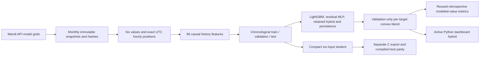

| Layer | Actual implementation |
| --- | --- |
| Acquisition and country/evidence controls | `ml/india_mandi/data.py` |
| Canonical feature/target construction | `ml/six_sensor_forecast/features.py` |
| Residual tree teacher/student fitting | `ml/six_sensor_forecast/train.py` |
| Linear temporal fitting and India-only evaluation | `ml/india_mandi/benchmark.py` |
| Active gateway ensemble | `ml/india_mandi/tabular_v2.py`, `ml/india_mandi/registry.py` |
| Public runnable entry point | `scripts/train_mandi_v2.py` |
| Delayed-label shadow learner | `ml/india_mandi/online.py`, `scripts/online_mandi_worker.py` |
| Six-output compact C export | `ml/six_sensor_forecast/export.py` |
| Active configuration; frozen historical export catalog | `configs/mandi_pipeline_v2.json`; `configs/model_catalog.json` |

The history teacher uses 66 features: per channel, current value, 1/3/6/12/24-hour
lags, one-hour delta, and trailing 6/24-hour mean/std. The compact student uses
only the current six values, with 16 depth-3 trees per output. The temporal
linear model uses the same 66-feature cohort, training-only standardization and
validation-selected regularization. No learned station ID, coordinates or future
reading enters these numeric models.

Tree prediction is `physical_clip(current + validation_weight * residual)`.
Linear prediction is `physical_clip(current + intercept + standardized_features
dot coefficients)`. Six separate heads preserve the output units. Each target's
best offline method is selected on validation; final errors never retune it.

This profile uses temporal-only splits with six-hour label purges, not fabricated
held-out stations. Historical teacher/linear inputs require a complete 24-hour
span. The compact student accepts one current snapshot. File hashes, feature
orders and source/config provenance are retained beside the weights.

**Active gateway:** `india_mandi_tabular_v2` combines six LightGBM residual heads,
a 66→64→32→6 residual MLP, the retained v1 hybrid and persistence. Per-target
nonnegative prediction coefficients sum to one and minimize validation MAE.
Train-only scalers and all component files are checksummed. It was fitted on
33,570 eligible rows from the expanded 35,520-position Mandi source. Its mixed
test results and optional TabPFN diagnostic are in the
[v2 report](#source-992f2b21c23a).

The persistent SGD residual learner saves forecasts before exact +6h truth
updates, with fixed scaling and source-isolated transactional state. It is
shadow-only; historical late inputs cannot create live learning scores. See
[operation and replay boundaries](EVERYTHING.md#source-699782d7781d).

**Retained v1 gateway component:** `india_mandi_hybrid_6h_v1` combines predictions from the saved
66→32→6 and 66→64→32→6 residual neural candidates, history XGBoost and ridge.
Validation selects a neural architecture and three convex coefficients per target.
No original model weights are rewritten. Complete history is required; otherwise
the API/UI explicitly reports persistence warm-up or unavailable current inputs.
The compact student remains the separate edge export. See
[hybrid report](#source-ca747230c68f).

The separate synthetic PM gap-fill dataset is excluded from these fits and
reported holdouts; see [its provenance](#source-6ba44f48673d).

**Evidence boundary:** India-only describes where INDRA's fit/evaluation records
come from and excludes Beijing records/pretrained weights. ECMWF/CAMS are global
model providers, not an IMD station archive. The Mandi profile contains modeled
weather/PM on different grids and modeled surface pressure. It does not validate
the transfer to actual sensors or historical information availability.

## Himalayan event warning: implemented labels/gates, no fitted real model

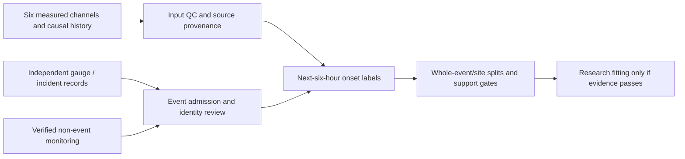

Actual modules are `ml/hazard_context/events.py`, `matching.py`, `warning.py`,
`policy.py`, `train.py`, `episodes.py` and `diagnostics.py`. The explicit protocol
is `configs/himalayan_warning_v2.json`. It supports cloudburst, storm, flash flood,
landslide and snowstorm. Rainfall/event records provide offline outcomes; they
do not silently become a seventh runtime input.

An onset and its entire timing-uncertainty interval must fall in `(issue, issue+H]`
for a positive. A negative needs complete compatible monitoring and no plausible
event/candidate overlap. Unknowns and post-onset windows remain unavailable.
Full six-channel history is mandatory. Current sources yield no admitted real
training corpus, so no hazard probabilities or field warning lead times exist.

## Embedded integration boundary

`ml/generated/india_mandi_modeled_6h_v1/` contains the new compact India/Mandi
C header and executed host-parity receipt. It is a research numeric forecast.
Physical ESP32 execution, timing, memory and sensor-distribution accuracy remain
untested. Existing firmware has not been silently switched to these weights.

`esp32/ml_integration` is the legacy serial forecast/rule integration.
`esp32/india_sensor` is the earlier India measurement-threshold smoke firmware.
`esp32/operational_node` prepares actual sensor readout with physical mode off
until wiring/calibration/UTC are supplied. These distinct applications must be
named separately in a submission. A compile or host-parity pass is not a field
test or an independent disaster-warning result.


---

</details>


<a id="source-6d85e1c96415"></a>

<details>
<summary>docs/CURRENT_MANDI_FEED.md</summary>

# Current Mandi API feed and delayed testing

Fetched 21 October 2026 for 31.71° N, 76.93° E. One query location is displayed;
it is not a physical mesh node. All six channels are present, with timestamps.

## Sources found and fetched

- Weather: Open-Meteo, explicitly pinned `models=ecmwf_ifs` — temperature,
  humidity, grid-surface pressure and wind in m/s.
- Particulates: Open-Meteo `domains=cams_global` — PM2.5 and PM10 in µg/m³.
- [ECMWF API documentation](https://open-meteo.com/en/docs/ecmwf-api) and
  [CAMS API documentation](https://open-meteo.com/en/docs/air-quality-api).

These are modeled estimates. CAMS global is approximately 45 km and three-hourly
underneath its hourly API output. The two providers return different grid cells;
their exact coordinates are saved. No six-channel co-located Mandi station stream
was verified. The reviewed [CPCB station-list snapshot](https://app.cpcbccr.com/ccr_docs/caaqms_list_All_India.pdf)
does not establish such a Mandi stream; its inventory may lag the live portal.

The initial current download has 89 past/current hourly positions through
21 October 16:00 UTC (21:30 IST), with all six channels. Seven future-valid hours
returned by the providers were excluded before inference. The latest frozen
forecast targets 22:00 UTC (03:30 IST on 22 October).

## How to run

Fetch once, update the local dashboard and record delayed shadow forecasts:

```sh
.venv/bin/python scripts/fetch_mandi_live.py --db data/himachal/mandi_dashboard.sqlite --online-state data/himachal/mandi_v2_online_live.sqlite
```

Collect every 15 minutes while the terminal/computer remains running:

```sh
.venv/bin/python scripts/fetch_mandi_live.py --db data/himachal/mandi_dashboard.sqlite --online-state data/himachal/mandi_v2_online_live.sqlite --watch-seconds 900
```

Only one collector may use the same output directory at a time. This job also
updates the shadow learner; a second online worker is not required. It is a local
process, not a hosted service or operating-system startup job. Ctrl+C stops it.
Interrupted downloads keep the previous dashboard data. Source identity changes
require a separate directory rather than silently mixing grids.

The existing backend serves http://127.0.0.1:8080. To start it after a restart:

```sh
.venv/bin/python -m server.dashboard --observations data/himachal/mandi_current_api_v1/history.json --db data/himachal/mandi_dashboard.sqlite --online-state data/himachal/mandi_v2_online_live.sqlite --ui apps/indra-himachal-ui/dist --port 8080
```

Raw receipts/history are under `data/himachal/mandi_current_api_v1/`, ignored by
Git. `history.json` preserves first-seen values and actual availability times.
Provider revisions are counted and retained in raw responses, not substituted
into existing predictions or truth. Missing values remain missing.

## What is being tested

The published numerical forecast remains the frozen v2 ensemble. The separate
shadow learner saves forecasts before any updates, waits for exact target-time
values acquired on later polls, then records errors and learns corrections.
The initial run has six pending eligible forecasts and zero updates. Earlier
historical positions initialize feature history; they cannot generate live
scores when their target time has already passed.

The nominal task is +6h from the input valid time. Actual issue/availability is
later than that valid time; report the actual remaining lead, not a full six
hours from retrieval. During bootstrap, eligible forecasts for several recent
hours may have substantially shorter remaining lead. No future API row is used
as an input or as early truth, even though provider forecasts are downloadable.

Later labels remain **model-grid values**, not measured weather. This can test
pipeline stability and adaptation to the API source; it cannot establish sensor
accuracy, improve the model by assumption, or validate cloudburst/flood/landslide
probabilities. Live-grid source state is namespaced separately from historical
replay and physical sensors. Online corrections remain in shadow mode.

## Archive test completed

The separate 30-day download covers 21 September–20 October: 720 complete hours,
690 eligible +6h pairs, including 24 target hours beyond the previous archive.
All six targets beat persistence MAE in both cohorts. The full period reuses
examined test dates, and 24 new target hours are a small sample. No weights were
retrained or selected on either cohort.

[Results and numerical errors](#source-bcd68c4a11c0).

Reproduce the download and evaluation:

```sh
.venv/bin/python scripts/fetch_mandi_data.py --start 2026-09-21 --end 2026-10-20
.venv/bin/python scripts/evaluate_mandi_snapshot.py --input data/himachal/mandi_api/2026-09-21_2026-10-20 --output reports/mandi_current_api_v1
```

Attribution: Open-Meteo, ECMWF IFS, Copernicus Atmosphere Monitoring Service (CAMS).

## Prospective collection progress

The collector received the 17:00 UTC API values on 21 October and completed its
first shadow update. That first forecast was saved at 16:48 UTC using an 11:00
input: its remaining issuance lead was only **11.65 minutes**. It verifies delayed
scoring/update plumbing, not a full six-hour forecast issued at 11:00.

The System/model panel now separates scored forecasts issued within their input
hour from those issued using delayed inputs, and shows actual remaining lead.
The ordinary rolling error summary still includes both groups; its interpretation
must retain that timing distinction. Issued within the input hour means a
processing delay below 60 minutes, not exactly six hours of wall-clock lead.

Regenerate the journal audit without fitting/promoting any model:

```sh
.venv/bin/python scripts/report_mandi_live.py
```

[Audited input/prediction/later-value comparisons](#source-5848110f26f8)
include issue, target, retrieval and update timestamps. The report checks that
predictions precede their target and labels are available before the update.
One scored case is insufficient to assess whether online learning improves errors.


---

</details>


<a id="source-8ef030a6160f"></a>

<details>
<summary>docs/DATA_LICENSES.md</summary>

# Data licenses and training-view admission

License evidence consolidated on 3 October 2026 from [the source registry](data/registry/sources.json), [the original dataset review](#source-3cab500f40fd) and retained source manifests. This is recorded evidence, not fresh provider confirmation or legal approval. Check and freeze the actual product/export terms before new use.

`training_open` is the clean, open-license observed-target view; `training_restricted` admits resolved restricted-license rows separately. Unresolved licenses, UTC/interval conventions, units, QC or pressure references block admission to both. Modeled products belong in separate background fields, not measured targets. Legacy CPCB research artifacts predate these gates and retain their explicitly assumed timezone.

## Every registered source

| Source ID / evidence | Recorded license | Commercial-use status | Present use / view |
|---|---|---|---|
| [uci_beijing_501](https://doi.org/10.24432/C5RK5G) | CC-BY-4.0 | Allowed under recorded terms; retain attribution/terms | Legacy forecast/event training; new view contracts incomplete |
| [india_cpcb_kaggle_v2](https://www.kaggle.com/datasets/abhisheksjha/time-series-air-quality-data-of-india-2010-2023) | CC-BY-NC-SA-4.0 | Non-commercial only; additional permission for commercial use | Legacy restricted research; new restricted admission awaits contracts |
| [delhi_opencity](https://data.opencity.in/dataset/delhi-hourly-air-quality-reports) | Other (Public Domain) | Unresolved; no commercial clearance | Quarantine; neither target view |
| [nwic_hp_temperature](https://www.nwdp.nwic.gov.in/dataset/temperature-telemetry-hourly-himachal-pradesh-water-department) | other-open | Unresolved; no commercial clearance | Quarantine; neither target view |
| [nwic_hp_humidity](https://www.nwdp.nwic.gov.in/dataset/relative-humidity-telemetry-hourly-himachal-pradesh) | other-open | Unresolved; no commercial clearance | Quarantine; neither target view |
| [nwic_hp_pressure](https://www.nwdp.nwic.gov.in/dataset/atmospheric-pressure-telemetry-hourly-himachal-pradesh) | other-open | Unresolved; no commercial clearance | Quarantine; neither target view |
| [nwic_hp_wind](https://www.nwdp.nwic.gov.in/dataset/wind-speed-telemetry-hourly-himachal-pradesh-department) | other-open | Unresolved; no commercial clearance | Quarantine; neither target view |
| [nwic_hp_rainfall](https://nwdp.nwic.gov.in/dataset/rainfall-telemetry-hourly-himachal-pradesh-department) | Other (Open) | Unresolved; no commercial clearance | Quarantine; neither target view |
| [nwic_hp_temperature_legacy](https://nwdp.nwic.gov.in/dataset/temperature-telemetry-hourly-himachal-pradesh-water-department) | UNVERIFIED | Unresolved; no commercial clearance | Quarantine; neither target view |
| [imd_station_catalogue](https://dsp.imdpune.gov.in/) | UNVERIFIED | Unresolved; no commercial clearance | No approved observation training rows |
| [srtm_gl1](https://portal.opentopography.org/raster?opentopoID=OTSRTM.082015.4326.1) | USGS public-domain product; mirror attribution | Allowed under recorded terms; retain attribution/terms | Static features/grouping; not weather targets |
| [era5_land](https://cds.climate.copernicus.eu/datasets/reanalysis-era5-land) | CC-BY | Allowed under recorded terms; retain attribution/terms | Not acquired; planned background only |
| [era5](https://cds.climate.copernicus.eu/datasets/reanalysis-era5-single-levels) | CC-BY | Allowed under recorded terms; retain attribution/terms | Not acquired; planned background only |
| [nasa_power](https://power.larc.nasa.gov/) | Free NASA data; attribution | Allowed under recorded terms; retain attribution/terms | Mandi diagnostic/background; not observed targets |
| [noaa_ghcnh](https://www.ncei.noaa.gov/products/global-historical-climatology-network-hourly) | CC0-1.0 | Allowed under recorded terms; retain attribution/terms | Clean observed targets after QC |
| [openaq](https://docs.openaq.org/resources/licenses) | Provider-specific | Unresolved; no commercial clearance | No approved observation training rows |
| [sensor_community](https://sensor.community/en/) | Database Contents License 1.0; database terms unresolved | Unresolved; no commercial clearance | No approved observation training rows |
| [cams_eac4](https://ads.atmosphere.copernicus.eu/datasets/cams-global-reanalysis-eac4) | CC-BY | Allowed under recorded terms; retain attribution/terms | Not acquired; planned background only |
| [koppen_geiger_1991_2020](https://www.gloh2o.org/koppen/) | CC-BY-4.0 | Allowed under recorded terms; retain attribution/terms | Static features/grouping; not weather targets |

## Important unresolved evidence

- NWIC: catalogue `other-open` labels do not resolve exact rights; all four-channel rows remain quarantined. Rainfall rights/clock semantics are unresolved too. The legacy temperature export contains only four rows, not the advertised long history.
- Delhi/OpenCity: catalogue says “Other (Public Domain)”, but primary-provider terms, pressure unit/reference and time convention are unresolved. Do not infer admission from that catalog label.
- NOAA: use station-level pressure only; UTC/QC contracts and CC0 evidence are recorded. Repeated/aliased sites and suspect elevations still need scientific review.
- ERA5/ERA5-Land/CAMS: recorded CC-BY class is not evidence of acquisition or acceptance of current service terms. CDS/ADS account terms must be accepted through authorized access. ERA5 pressure is grid-surface background; the registry station-reference placeholder is not a valid target mapping.
- POWER: explicit UTC is required; grid pressure is not station truth. Default local solar time must not be silently converted.
- OpenAQ: a key alone does not establish rights to each provider dataset. IMD permission/export terms and Sensor.Community content/database terms remain unresolved.
- UCI derived RH and uncertain pressure/interval contract in the new registry prevent treating the older forecast training as automatic spatial-view approval.
- Derived SRTM slope and climate classifications are inputs/group labels, not extra independently measured weather targets. Keep terrain product/datum/hash provenance.

No source terms were changed and no authenticated download was attempted in this documentation pass.


---

</details>


<a id="source-bfd8778290ff"></a>

<details>
<summary>docs/DOCUMENTATION_VERIFICATION.md</summary>

# Documentation consolidation verification — 3 October 2026

This pass changed documentation only. It did not retrain models, alter data, change firmware or run authenticated downloads.

## Executed in this pass

- Recursively inventoried all `.md`/`.mmd` files, including hidden/ignored files except Git internals: **43 original Markdown files, zero standalone Mermaid files**. Preserved all originals at their existing or recorded archive destinations. Four original inline Mermaid blocks were extracted verbatim to archive `.mmd` files.
- Rebased local Markdown links after 13 moves. Checked existence of all local link/image targets and heading anchors; external websites were not rechecked. Original names, modification times, hashes, classifications and actions are in [the manifest](docs/documentation_manifest.json).
- Checked the four core-target overview tables against the two-neighbor rows in [results.csv](reports/two_node_phase/results.csv) and the printed [report](#source-80bc09b6549d). Core MAE values retain the report's three decimals; persistence retains CSV precision. No new performance measurements were added.
- Ran `/tmp/indra-data-venv/bin/python -m pytest -q`: **97 passed, eight subtests passed in 10.57 s**, one existing pandas `verify_integrity` deprecation warning. Temporary log: `/tmp/indra-doc-tests.log`.
- Ran the physics-only demo and the learned-model demo on `reports/two_node_phase/examples/readings.json`, using `data/two_node_training/national5km/k2/model.json` for the latter. Both completed, returned status/contributor information and withheld unchecked bands. These are **synthetic software examples**, not field observations. Temporary outputs: `/tmp/indra-doc-demo-physics.json`, `/tmp/indra-doc-demo-model.json`.

## Not executed or established

Clean-environment dependency installation, NOAA reacquisition/full retraining, ERA5/IMD/OpenAQ access, field calibration/scoring, physical ESP32 execution, a fresh firmware build, hardware soak or security clearance were not run in consolidation. Earlier compile/evaluation claims are attributed to their original reports. No new claim of model accuracy, field uncertainty coverage, commercial clearance or invention novelty was made.

The overview is Markdown, not a paginated PDF. Its short sections and compact tables target approximately 6–8 pages; exact pagination depends on rendering. The two overview diagrams received source/syntax inspection, not a Mermaid renderer run. Archive diagrams preserve originals rather than asserting all historical syntax has been rendered.


---

</details>


<a id="source-dfea6b4a44c8"></a>

<details>
<summary>docs/FEATURES.md</summary>

# INDRA features — current implementation

Status: 21 October 2026. [Current v2 pipeline and results](EVERYTHING.md#source-699782d7781d). This is the feature list for the project submission.
"Implemented" describes software; its evidence column states what has been tested.

## Product and research features

| Feature | What is provided | Evidence and limitation |
| --- | --- | --- |
| Six-channel input | Temperature, RH, pressure, PM2.5, PM10, wind, units and timestamps | Canonical range/QC checks; no seventh physical channel |
| Six-hour numerical forecast | Six endpoint values at t+6h from the active neural/tree/ridge ensemble | Current v2 tested against 1,170 later Mandi API/model values; not measured station accuracy |
| History and fallback | 66 causal features, 24h history; explicit persistence warm-up or missing-input status | Gap/missing-channel and no-future-dependence tests |
| Dashboard telemetry | Node list/map, six values/mini-histories, forecasts, model identity, coefficients, source and timestamps | Local backend/browser integration; Mandi replay is historical and stale |
| Data quality and source | Units, pressure reference, source class, calibration identities and availability | Modeled source cannot silently become physical station evidence |
| Current rain/snowstorm/cloudburst rule cards | Experimental current-condition matches and evidence/abstention | Synthetic contract tests; not calibrated probabilities or six-hour hazard predictions |
| Weather category classification | Ten overlapping categories from a saved LightGBM/MLP blend | Trained/tested on independent synthetic proxy episodes; scores are not real-event probabilities. Six complete native hours required |
| Cloudburst / flash-flood / landslide scenarios | Six-hour Monte Carlo fractions with central/drier/wetter assumption ranges | [Research-informed simulator](EVERYTHING.md#source-76ac9fbe3adb); generated 786,432 synthetic futures. Rainfall/soil/catchment priors are assumptions; no observed-event accuracy or calibrated probabilities |
| Storm sequence | Six-hour pressure fall and native 15-minute rebound/cooling/washout sequence | Requires appropriate cadence/source; hourly Mandi API cannot provide 15-minute evidence |
| Anomaly detection | Bounded six-channel engineering detector and Python/C parity | Tested separately; not wired as a validated live dashboard alarm |
| Neighbour inference | Registration, health, authenticated consensus and radio simulation modules | Engineering tests only; live radios and dashboard corroboration remain incomplete |
| Six parameter heatmaps | All six numerical surfaces, units and selectable geographic overlays using IDW | Hull masks, exact synchronization, per-channel missingness and line-only two-point support; one Mandi grid cannot support an area map. No field spatial validation |
| ERA5 risk research panel | Optional owner-generated scores, anomaly markers and feature grids | Available example is synthetic engineering data, not actual Mandi event accuracy |
| Offline/cache operation | Versioned cache, stale notices and unavailable states | Does not manufacture current readings or physical acknowledgements |
| ESP32 research | Separate compiled C exports and firmware applications | Host/build receipts exist; physical execution and hybrid edge export remain untested |
| Online learning | Durable six-channel delayed-label SGD shadow worker, plus separate ERA5 replay | Predict/save before update, exact +6h truth and fixed scaler; shadow updates do not replace offline/ESP32 outputs |
| Hardware commands/alerts | Explicitly disabled RPC and public notifications | No live sensor bridge or public warning service |

## Six input/output channels

| Order | Input name | Unit | Label/output |
| --- | --- | --- | --- |
| 1 | `temperature_c` | °C | Same measurement at exact +6h |
| 2 | `relative_humidity_pct` | % | Same measurement at exact +6h |
| 3 | `pressure_hpa` | hPa | Same measurement at exact +6h |
| 4 | `pm25_ug_m3` | µg/m³ | Same measurement at exact +6h |
| 5 | `pm10_ug_m3` | µg/m³ | Same measurement at exact +6h |
| 6 | `wind_speed_mps` | m/s | Same measurement at exact +6h |

Station inputs require station pressure; the Mandi API source explicitly retains
modeled grid-surface pressure. Coordinates identify the displayed source location;
they are not learned inputs to the active numerical model.

## Derived features

For each channel the numerical model uses: current value; 1/3/6/12/24h lags;
1h difference; trailing 6/24h means and standard deviations. That is **11 per
channel, 66 total**. No future rows or filled gaps are allowed.

The separate native feature engine implements hourly/15-minute/six-hour changes,
rates and statistics, dew point, frost point, vapour-pressure deficit, NWS heat
index, PM2.5/PM10 ratio, washout proxies, wind/RH-change flags and seasonal context.
These estimates retain missing/domain/calibration states. They do not add sensors
or turn pollutant washout into measured precipitation. Actual source availability
is respected; a retrospectively downloaded file is not treated as known earlier.

## Retained v1 Mandi submission run

Seven comparisons use the same 954 labels: persistence, compact XGBoost, history
XGBoost, ridge, MLP32, MLP64→32 and the fixed active hybrid. Report MAE/RMSE/R²
per target; do not claim a general accuracy percentage or retune on this test.
The local replay uses the last 25 actual API positions with their original dates,
source retrieval time and separate weather/PM cell IDs. Hazard rules correctly
abstain on that modeled source. Artificial multi-node fixtures cannot establish
Mandi-wide, spatial or disaster prediction skill.

See [test results](#source-df4061ba2e16) and
[submission steps](EVERYTHING.md#source-32a01492adf5).


---

</details>


<a id="source-0e64d996660f"></a>

<details>
<summary>docs/FORECAST_MODEL_IMPROVEMENT.md</summary>

# Forecast architecture and online-learning status

Status: 21 October 2026. The active pipeline is now [Mandi v2](EVERYTHING.md#source-699782d7781d), with LightGBM and a durable delayed-label shadow worker. The v1 experiment below is retained history.

Earlier status: 16 October 2026. The active dashboard now uses
`india_mandi_hybrid_6h_v1`: a validation-selected residual neural network,
history XGBoost and temporal ridge blend. Both trained neural candidates are
included in its versioned component manifest. Every target has a nonzero neural
coefficient. The compact model remains the separate existing firmware export.

The gateway integration and persistence warm-up are described in
[the dashboard guide](EVERYTHING.md#source-88c6383f55c9). Selection coefficients,
retrospective metrics and verification are in
[the hybrid report](#source-ca747230c68f).

## Architecture implemented in this experiment

The same six channels feed the existing causal feature builder. It produces
66 numerical features from current values, lags, changes and trailing means/stds.
Complete inference requires 25 consecutive hourly snapshots spanning 24 hours.
Missing hours/channels are not filled. Coordinates and additional atmospheric
variables are not introduced as learned inputs.

Two shared multi-output neural architectures were fitted:

- **66 → 32 → 6**, with 2,342 learned weights/biases.
- **66 → 64 → 32 → 6**, with 6,566 learned weights/biases.

These are feed-forward networks over causal history features, not recurrent
networks or TCNs. ReLU hidden layers feed six residual predictions. Feature and
residual means/stds fit training rows only. Each endpoint is
`physical_clip(current + validation_selected_weight * residual)`.

The optimizer is Adam. Epoch selection uses the fixed chronological validation
period, not sklearn's random early-stopping split. Per-target persistence blends
are also selected on validation. The test period does not select epochs,
architecture, targets or blend weights.

Both candidates were compared with persistence, the saved six-input XGBoost
student, the existing 66-feature XGBoost teacher and temporal ridge on identical
rows. Feature/history differences mean improvement against the snapshot student
cannot be attributed solely to changing the learning algorithm. The teacher and
ridge are the matched history comparisons.

Data: the existing 24,336 hourly Mandi-location Open-Meteo/IFS/CAMS modeled rows,
2024-01-01 through 2026-10-10. Complete training/validation/test cohorts contain
22,602 / 738 / 954 rows. The six-hour target horizon is purged at the partition
boundaries. This is one location's retrospective modeled grid, not independently
measured Indian station accuracy. Previously examined September/October dates
remain a reused benchmark, not a new untouched test.

Results, including every candidate and physical-unit MAE/RMSE/R², are saved in
[the comparison report](#source-e04dfa98a03b) and
[JSON results](reports/india_mandi_neural_history_v1/results.json).

Weights and normalization are stored in bounded, checksum-verified NumPy archives
under `ml/models/india_mandi_neural_history_v1/`; no pickle/joblib loading is used.
Original trained models and exports remain byte-for-byte unchanged. The neural
candidates have no ESP32 export, quantization or on-board execution receipt.
They now contribute to the active dashboard hybrid. No firmware substitution
or neural edge export is claimed.

## Reproduce and run inference

Use the pinned `requirements-himachal.txt` environment. No new library is needed.

```sh
python scripts/compare_forecast_architectures.py
```

This evaluates the already saved neural candidates and checks the original data
manifest. The local raw observations must be present. `--train` fits a new
versioned experiment once and refuses to overwrite an existing model folder;
use a new configuration/output version for another training experiment.

Run a saved neural model on a six-channel hourly observation CSV:

```sh
python scripts/predict_neural_forecast.py \
  --input data/india_mandi_modeled/observations.csv \
  --output data/himachal/neural_prediction.csv
```

Input columns are `location_id`, timezone-aware `timestamp_utc`, and the six
canonical channel names. First-day/incomplete histories produce unavailable
predictions and an explicit status. The output has six numerical endpoints at
+6h plus a metadata receipt. It does not emit hazard classes or probabilities.

## Is online learning implemented?

**The historical v1 experiment had no live online-learning loop. Current v2 has an event-driven shadow worker; see the linked guide.** Recording, importing, plotting
and refreshing observations do not change learned weights. The new benchmark's
`partial_fit` calls implement offline training epochs over the historical
training partition; they do not wire online learning into the product.

For numerical +6h forecasts, a supervised update needs the actual six-channel
observation at exactly the forecast's target time, available no earlier than
six hours after its issue. A new input alone is not a training label, and the
model's own prediction is not ground truth.

A suitable next implementation is a gateway-side shadow learner or bounded
residual correction layer, with a frozen base model and scaler. It needs:

1. Persistent forecast records keyed by station/registration, issue/target time
   and exact model version; calibrated units, clock and source QC.
2. Exact delayed truth matching, duplicate prevention and gaps/missing-channel
   abstention. Keep modeled, synthetic and physical observations separate.
3. Training-only updates after labels mature; score each issued forecast before
   applying its update. Monitor drift and error against the frozen model and
   persistence. Preserve an independent future monitoring cohort.
4. Versioned checkpoints, shadow comparison, promotion criteria and rollback.
   Keep candidate updates off the ESP32 until size/parity/board tests pass.

Online hazard learning additionally requires independently observed event
outcomes and monitored negative periods. Threshold rules, high risk scores and
satellite candidate flags do not automatically supply verified cloudburst or
snowstorm labels.

## Work still needed for completion

- Connect the physical ESP32 telemetry bridge and verify clock, units, pressure,
  calibration and complete native histories.
- Evaluate the active gateway architecture on new measured Mandi data; build
  and verify a compact neural/hybrid edge export if that deployment is needed.
- Implement and replay-test the delayed-label shadow update service before
  enabling live adaptation.
- Obtain independent hazard labels and coverage evidence for rain, snowstorm,
  cloudburst, flash flood and landslide claims. Train/calibrate/evaluate each
  supported target separately; the current risk rules remain experimental.
- Finish the remaining network, spatial and deployment phases recorded in
  `docs/plans/INDRA_HIMACHAL_PLAN.md`; dashboard integration alone is not
  completion of the full product.

Implementation reference: sklearn supports multi-output MLP regression and
incremental fitting via `partial_fit`; using that API inside an offline training
script does not create a deployed learning service:
https://scikit-learn.org/1.7/modules/generated/sklearn.neural_network.MLPRegressor.html

A separate ERA5-context SGD online research replay has since been implemented; see [its scope and tests](EVERYTHING.md#source-2ecdaa4bae5d). It does not update the six-channel numerical forecast model or connect a live learning worker to the dashboard/ESP32.


---

</details>


<a id="source-88c6383f55c9"></a>

<details>
<summary>docs/HIMACHAL_DASHBOARD_INTEGRATION.md</summary>

# Connected INDRA dashboard

The supplied DP Mesh Dashboard is integrated in `apps/indra-himachal-ui`.
Its original source, reports and integration contract are retained unchanged in
`docs/reference/dp_mesh_dashboard_handoff/`, with SHA-256 identities in
`original_manifest.json` and `docs/plans/PROTECTED_PATHS.json`.
The original Downloads folder is unchanged.

The working application retains the teammate's React/Leaflet layout and IndexedDB
cache. Its API adapter now uses `server/dashboard.py`, independently of the
existing operational application. API version is **0.4.0**: the active six-channel
forecast is now the saved expanded Mandi LightGBM/neural/retained-hybrid ensemble, with explicit
history and fallback status. API-versioned caches discard older predictions.
This does not modify the team's firmware
contract automatically; the communications owner must adopt the versioned adapter.

See [current v2 and online-learning guide](EVERYTHING.md#source-699782d7781d) for the active model, mixed comparisons, shadow state and rollback.

## Run locally

Install once with Python 3.11–3.13 and Node 22:

```sh
python3 -m venv .venv
.venv/bin/python -m pip install -r requirements-dashboard.txt
cd apps/indra-himachal-ui
npm ci
cd ../..
```

Then start the complete local demonstration:

```sh
.venv/bin/python scripts/run_himachal_demo.py --offline
```

Open **http://127.0.0.1:8080**. The script builds and serves the PWA and API
from the same address. No weather API, NASA/CDS credentials, map downloads,
SMS/email, RF transmission or physical sensor connection is required. Dependencies
must already be installed; `--offline` does not install packages. The four demo
nodes are synthetic rain/snow/cloudburst-pattern/incomplete-history fixtures,
marked in the header and telemetry. They stop at a fixed observation time and
become stale; polling never manufactures new sensor readings.

The tested temporary environment on this computer is
`/private/tmp/indra-himachal-venv/bin/python`; its location is not a permanent
deployment dependency.

For frontend development, start `python -m server.dashboard --demo` from the
root, then `npm run dev` in the app directory. Vite proxies `/api` to port 8080.
For an independently hosted backend, set `VITE_MASTER_BASE_URL` at build time;
that deployment must configure its own authenticated gateway and CORS. No token
belongs in frontend environment variables. Optional OSM background tiles require
`VITE_OSM_TILES=true` and internet access; default node markers work offline.

## What is connected

| Dashboard content | Actual implementation/evidence |
| --- | --- |
| Six measurements with units and short histories | Native snapshots validated by `ml/himachal/contracts.py`; no seventh physical input |
| Six numerical +6h estimates | Active `india_mandi_tabular_v2`: validation-selected LightGBM + residual MLP + retained hybrid + persistence; checksum-verified components and bounds |
| Rain, snowstorm and cloudburst risk cards | Versioned `ml/himachal/features.py` and `rules.py`, including evidence and abstention |
| Storm sequence | Separate experimental six-hour pressure fall followed by native 15-minute rebound rule; not a fitted storm model |
| Node positions | Supplied WGS84 coordinates, with source class and observation age |
| Battery | Unavailable until measured; no invented voltage |
| Spatial surface | Explicitly unavailable; no invented kriging or smoothing of risk scores |
| Device commands | Disabled; HTTP 501, never a fake physical acknowledgement |

The numerical model was trained on **Mandi-location IFS/CAMS modeled grids**,
not verified six-channel Mandi station observations. This interface performs
inference, not a new accuracy evaluation. Forecasts are one endpoint at +6h,
not six hourly predictions. Risk assessments concern the input time and do not
inherit that six-hour forecast horizon.

The hybrid uses 66 causal features from **25 complete hourly snapshots spanning
24 hours**, selected at the latest observation's exact hourly phase. No missing
hour is interpolated. The UI shows the model identity, history count and each
target's three blend coefficients. Incomplete history uses explicitly named
`WARMING_UP_PERSISTENCE` (current values copied to +6h); a missing current channel
produces `MISSING_CURRENT_SENSOR` with unavailable outputs. Neither is presented
as hybrid inference. Startup recomputes legacy SQLite forecasts from retained
history; a legacy seven-hour cache warms up rather than retaining an old XGBoost
prediction under a new label.

Selection uses only the August validation partition; its report uses 954
previously examined September/October modeled rows, not a new untouched field
test. See [hybrid results](#source-ca747230c68f).
The existing compact ESP32 export is separate; this promotion runs on the
Python gateway and does not export the hybrid to firmware.

Risk scores remain **uncalibrated rule matches**, with `probability: null` and
no measured warning lead time. Missing channels/history or incompatible pressure
references cause explicit abstention. A high cloudburst score does not measure
rainfall intensity, and a high snowstorm score does not confirm snowfall.
Flood and landslide prediction remain unavailable. Public notifications are off.

## Import measured observations

The backend is a read-only local adapter, not a network telemetry collector.
An operator imports a JSON list of full native snapshot records following
`docs/HIMACHAL_FEATURE_CONTRACT.md`. Preserve actual units, station pressure,
measurement/availability times, site/registration, cadence, source class and
per-channel calibration identities. Source identity is operator-supplied and
does not establish cryptographic verification or voting privileges.

```sh
.venv/bin/python scripts/run_himachal_demo.py --offline --observations /absolute/path/snapshots.json
```

To refresh a running dashboard without restarting it:

```sh
.venv/bin/python scripts/import_dashboard_observations.py --input /absolute/path/snapshots.json
```

Validation and model inference finish before the SQLite snapshot is replaced
atomically. Polling updates the UI within eight seconds. Invalid imports preserve
the previous state. Use the same `--db` path for server and importer. Raw data
and the local SQLite store stay under ignored `data/himachal/`.
No source automatically falls back to synthetic values.

The firmware's positional serial JSON is **not** this full snapshot contract.
The remaining live bridge must add reviewed site/calibration/units metadata,
preserve serial quality flags and actual receipt times, and reject duplicates,
clock errors and invalid frames. Bench-test that bridge against the connected
ESP32 before declaring a live product. This change does not claim physical
execution, a LoRa link or a calibrated hazard probability.

## Contract and verification

Five teammate-compatible endpoint paths are implemented: `/api/nodes`,
`/api/nodes/{id}/telemetry`, `/api/status`, `/api/kriging/heatmap` and
`POST /api/rpc/{id}`. Telemetry now uses the canonical six channel names.
Additional fields identify source, history availability, forecast model,
rule evidence, stale state and unsupported capabilities. SQLite survives restart.
There is no public listening interface or write API; the server binds loopback.

Backend tests exercise the real saved model, partial-history abstention, missing
channels, invalid/future/relocated/duplicate observations, tampered model weights,
atomic import preservation, restart/staleness and original-source hashes.
Browser tests exercise desktop/mobile layouts, all three risk cards, node
selection, disabled RPC and cached/offline states. Cache keys include API version
and backend address. Cached or stale values are never shown as current warnings.

```sh
.venv/bin/python -m pytest tests/test_dashboard_integration.py -q
cd apps/indra-himachal-ui
npm test
npm run test:e2e
```

On macOS the browser tests use installed Google Chrome. CI uses Playwright
Chromium. `INDRA_PYTHON` selects the Python environment for the browser-test
backend. Local validation results and screenshots are recorded under
`reports/himachal/dashboard/`.


---

</details>


<a id="source-18f06f6ed4f8"></a>

<details>
<summary>docs/HIMACHAL_DATA_PIPELINE.md</summary>

# Himachal sources and independent label pipeline

The new source registry and adapters add to the existing `ml/hazard_context`
admission/matching engine. They do not weaken its gates or overwrite the v1/v2
warning experiments. The only shared target-set extension is independent `rain`;
the existing event schema already accepts text event types. The separate profile
is `configs/himachal_labels_v1.json`.

## Source access and immutable cache

`configs/himachal_sources_v1.json` records official provider documentation,
native cadence/resolution, source kind and unresolved reuse terms. Public JSON
adapters cover explicit ERA5 weather, global CAMS PM via Open-Meteo, and hourly
NASA POWER. They request UTC and explicit units/model selection. Context is
cached as modeled data, never an independent local gauge or six-channel station.

The [Open-Meteo historical API](https://open-meteo.com/en/docs/historical-weather-api),
[air-quality API](https://open-meteo.com/en/docs/air-quality-api) and
[NASA POWER hourly documentation](https://power.larc.nasa.gov/docs/services/api/temporal/hourly/)
are the request references. Native CAMS cadence remains three hours despite hourly
API positions. POWER must explicitly declare UTC; an LST response is rejected.

```sh
python -m ml.himachal.data.download \
  --config configs/himachal_sources_v1.json --source open_meteo_weather \
  --start 2024-01-01 --end 2024-01-31 --output data/himachal/context
# Repeat with --offline to require verified cache and prohibit network.
```

Dates split into bounded calendar-month chunks; responses have a 64 MiB cap,
three attempts, rate-limit backoff, fixed-ETag range resume, and provider-host
redirect checks. A changed/missing ETag cannot append bytes to a different file.
Raw response hashes, requests, provider role/version, units, returned coordinates,
retrieval clocks and source-resolution metadata are retained. Same requests reuse
the exact verified receipt; changed bytes fail. Station/cell IDs and original
issue-time availability remain **unverified** when the provider has not supplied
them. The adapter does not invent a grid ID from the requested coordinates.

CDS/IMERG, IMD, CPCB, OpenAQ and HPSDMA use audited manual imports in this adapter.
Existing authorized CDS download tooling remains available separately. No IMD/CPCB
bulk scraping route, private collection URL or rights grant is assumed.

```sh
python -m ml.himachal.data.download --source imerg_final_v07 \
  --start 2016-01-01 --end 2025-12-31 --output data/himachal/imerg \
  --input /path/to/legitimate-export.nc --metadata /path/to/reviewed-metadata.json
```

The metadata requires actual provider version, station/cell ID, native interval,
source units, retrieval time, rights evidence/reviewer and original request.
No metadata/export returns `NOT_READY`. Credentials and signed-token URLs are
rejected from provenance. Imports preserve immutable original bytes and filename;
they are cached, **not automatically admitted**. Source-specific terms still need
review. Raw/working data stays local under ignored `data/himachal/`.

## Normalization and virtual identity

`imerg_hourly` requires explicit half-hour start/end, mm/h rate, cell ID, quality,
random-error and fill metadata. Each rate contributes `rate × 0.5 h` accumulation;
two valid intervals are required for an hourly total. Gaps, rejected/fill values
and zero-as-fill ambiguity stay unavailable. Quality/error evidence is retained.
Satellite cell precipitation is not local gauge evidence for cloudburst admission.

`power_hourly` verifies UTC, declared units/fill values and kPa-to-hPa conversion.
Missing PM stays null. Source grid pressure remains grid-surface pressure. Neither
adapter declares original operational availability that the archive cannot prove.

`sensor_frame` accepts simultaneous six-channel snapshots through the canonical
adapter and separates physical-site/registration histories. A reviewed site table
must establish Indian/Himachal identity, coordinates, source and co-location;
country/state is never guessed from a rectangular bounding box. Grid/synthetic
records cannot become a measured six-channel Indian corpus.

Virtual-node ancestry deduplicates the true upstream station/cell and valid time,
so OpenAQ/CPCB copies and repeated model-cell queries do not manufacture stations.
Conflicting duplicates are rejected rather than silently fused. Variables/units,
elevation/datum, pressure reference, publication time, resolution, uncertainty,
ancestry, version and licence remain visible. All virtual nodes are excluded from
the minimum physical quorum, including external observed stations by default.

## Independent outcome profile

The offline JSONL envelope has `record` (existing nullable event schema),
`measurement` and `evidence_category`. Measurement intervals preserve amount,
unit, accumulation statistic, actual instrument and local-gauge review. Original
records keep time/location uncertainty, reviewed physical event groups, source
hashes, rights and reported-time text. Never create precise onset time from an
approximate incident date or hourly accumulation endpoint.

- Rain: gauge-sensitive initial research definition ≥0.2 mm liquid accumulation
  in one explicitly timed hour. It is not an official universal hazard definition.
- Snowstorm: independently confirmed occurrence under a reviewed definition;
  snowfall amount or cold/humid measurements alone are insufficient.
- Observed cloudburst: reviewed local gauge ≥100 mm over a verified hour, with
  independently reviewed event identity/onset. Public output remains
  `cloudburst_risk`; model/satellite/media candidates cannot supply this truth.

Rain/cloudburst structural intervals must agree with the legacy scalar measurement
and units. Daily totals cannot pass the hourly check. Unsupported definitions,
missing rights/identity/clocks/uncertainties and unapproved source roles remain
unadmitted. Possible cloudburst records block conflicting negative rain windows,
without creating positive rain labels. Candidates with unknown time/location stay
unknown and can conservatively exclude negatives.

```sh
python -m ml.himachal.data.labels --events /path/to/events.jsonl \
  --observations /path/to/native-snapshots.jsonl --monitoring /path/to/monitoring.json \
  --config /path/to/reviewed-himachal-label-profile.json \
  --output data/himachal/labels-v1 --offline
```

The reviewed profile adds `approved_sources` and `approved_sites` to the supplied
definitions. The existing source-admission fields remain mandatory. Monitoring
must match those sources, rights and exact outcome definition, cover the whole
six-hour future window and declared spatial radius, and have no candidate/event
overlap. Missing reports are not negatives. The adapter requires 24-hour complete
six-channel hourly history, preserves whole physical groups and never treats
ongoing/post-onset observations as new six-hour precursor positives.

Outputs are deterministic `labels.csv` plus a hash/config/input manifest, target
counts, rejected reasons, monitoring coverage and detailed `NOT_READY` branches.
Existing differing outputs refuse overwrite. Initial ≥50 groups/≥10 positive
sites are only a cohort-review screen, not final evaluation/deployment approval.
Further train/dev/calibration/test and season/valley gates remain mandatory.

The committed event/monitoring fixtures are **synthetic software contracts** and
never admit empirical training. Tests have an explicit internal contract mode to
exercise matching; it tags every row inadmissible and still returns `NOT_READY`.
The public CLI does not expose that override. Rules, simulations and satellite
rainfall cannot supply independent labels merely to make fitting succeed.


---

</details>


<a id="source-3660c603e9c8"></a>

<details>
<summary>docs/HIMACHAL_EDGE_VALIDATION.md</summary>

# Himachal local research node — Phase E

`esp32/himachal_node` is a separate application. It uses the existing operational
sensor abstractions and new generated local diagnostics/rules. It does not select
Beijing weights, invent an empirical hazard head or transmit external alerts.

## Diagnostics and generated identity

`configs/himachal_anomaly_v1.json` holds initial research settings: a fixed
16-reading ring per channel, eight valid samples of warm-up, median/MAD residuals
with explicit scale floors and an EWMA diagnostic. These settings have not been
fitted to independent local development observations. They are not sensor
accuracy or event-detection claims.

Python and generated C share configuration/hash, state meanings, float32
telemetry and double intermediate arithmetic. Range/Inf/self-test failures are
sensor faults; missing NaN is unavailable. CRC/time/clock rejection does not
advance the baseline. Long gaps rewarm the state. A valid fast weather change
is an environmental anomaly and remains valid input. Calm zero wind and a
constant reading alone are not diagnosed as failed sensors.

```sh
python -m ml.himachal.anomaly_codegen \
  --config configs/himachal_anomaly_v1.json \
  --output esp32/himachal_node/include/indra_anomaly.h --verify
python -m pytest -q tests/test_himachal_anomaly.py tests/test_himachal_anomaly_c.py
pio run -d esp32/himachal_node
```

The generator verifies the temporary header before publishing it and writes a
parity manifest. The local rule header is generated from the same feature/rule
configurations as Python. CI checks committed bytes and compiled stateful parity.
Tests include warm-up, boundary/adjacent values, gaps/replay/CRC/clock failures,
missing/range failures, reboot, slow drift, constant calm wind and abrupt weather.

## Local rule capabilities and missing states

The bounded local collector supports two explicit modes:

| Native interval | Supported local evidence | Unavailable evidence |
| --- | --- | --- |
| 60 seconds | Native 15-minute cloudburst-risk pattern after sufficient genuine history; preceding-hour PM baseline needs 75 minutes | Six-hour rain/snow pressure history: buffer intentionally spans only 75 minutes |
| 3600 seconds | Rain/snowstorm condition-risk rules after complete six-hour history and distinct hourly cloudburst companion | Native 15-minute pressure, temperature or wind changes |

The collector never expands hourly readings into minute samples. Missing
intervals restart collector history; missing channels remain null per channel.
The compact collector uses the initial PM floor/relative-decline proxy; it does
not accept independent calibrated PM noise sigmas. Use the server feature engine
when three-sigma noise adjustment or a longer native history is required.

Native mode must not be presented as a working local six-hour rain/snow detector.
The server can process longer complete native histories through the full feature
engine. Local probabilities remain null, trained-event-model mask is zero,
lead time is null and indication stays `LOCAL_ONLY` with dispatch `DISABLED`.
Local candidates are neither quorum decisions nor confirmed hazards.

## Serial synthetic demonstration

Default mode performs no physical IO. Supply one record per exact 60-second step:

```text
unix_seconds,T_C,RH_percent,station_P_hPa,PM25_ug_m3,PM10_ug_m3,wind_mps,crc_ok,clock_uncertainty_seconds
1767225600,20,60,900,25,50,0,1,2
```

`crc_ok` and clock uncertainty here are explicit test metadata supplied by the
host, not a verified physical link/clock. Serial records are always tagged
`synthetic_demo`; wind calibration in this path is a synthetic contract assumption.
They cannot become field evidence merely by passing the parser. Inputs are
bounded; malformed/extra fields refuse. `INFO` reports identities/capabilities;
`RESET` clears local state. Array order is always the six channels shown above.

JSON includes measured input array, diagnostic states/masks, rule scores/coverage,
abstention and local-candidate masks, source/profile/version, null probabilities
and disabled dispatch. `inference_latency_us` is instrumented around actual
on-board computation if the firmware is later run. No latency value has been
measured on a physical board in this phase.

## Physical enablement

Copy the example into ignored `include/device_config.h` only after the actual
board, pins, wind curve, surveyed EGM96 elevation, sensor calibration, native
cadence and clock uncertainty are known. Default pins are −1 and physical mode
is false. Enabling requires explicit cadence/calibration/site verification plus
valid clock uncertainty and wind/survey configuration. SensorHub additionally
checks pin validity/uniqueness and calibration inputs before acquiring.

The GPIO/RTC/GNSS/PMS drivers are prepared interfaces, not validated installation
claims. PMS CRC/staleness gates preserve missing PM. Physical wind averages the
actual encoder-derived readings over a complete native interval, with a small
sampling-boundary tolerance; incomplete/first intervals are unavailable. Actual
sampling/exposure/calibration must still be checked on the installed device.
No radio is enabled by this firmware. Actual peer protocol/RF readiness belongs
to later stages and cannot be inferred from successful compilation.

The configured compile target is the existing ESP32-S3 DevKitC-1 N8/no-PSRAM
profile. The actual board has not been identified or connected for this work.

## Measured software receipts and remaining hardware work

- [Generated host parity receipt](esp32/himachal_node/include/indra_anomaly.parity.json):
  220 stateful synthetic rows; 424-byte anomaly state. No heap in inference.
- [Xtensa object/static stack analysis](reports/himachal/anomaly_cross_object.json):
  5,252-byte object; 1,084-byte text, 80-byte literals, 144-byte read-only data,
  424-byte BSS. Static frames: 480-byte push, 176-byte median, 32-byte caller.
  This supports the proposed module budgets under static analysis; linked
  floating-point/libm helpers and real peak stack must not be silently omitted
  from a physical resource claim.
- [Four cross-build receipts](reports/himachal/edge_cross_builds.json):
  full firmware RAM/flash and ELF/bin identities. These include the framework
  and drivers; the 32 KiB proposal applies to the anomaly module, not the whole
  Arduino application. The history buffer is a separate bounded allocation.

All of the above are software/synthetic engineering evidence. Board execution,
installed pin/driver behavior, physical inference latency/peak stack, power,
calibration, cold/condensation performance, soak stability and radio operation
remain **NOT_TESTED**. No cloudburst accuracy follows from these receipts.


---

</details>


<a id="source-76a7be045d86"></a>

<details>
<summary>docs/HIMACHAL_FEATURE_CONTRACT.md</summary>

# Himachal native feature contract v1

`ml.himachal.features.build_packet(records, issue_time_utc)` produces deterministic
JSON input features. It does not train a model or supply independent event labels.
Definitions are frozen in `configs/himachal_features_v1.json`; the packet carries
its hash and a hash of the input snapshots actually available by issue time.

## Inputs and provenance

`ml.himachal.contracts.snapshot` accepts exactly the six named measurements and
their explicit units. It reuses the existing operational unit/range/QC adapters.
Kelvin/Celsius, Pa/hPa and km/h/m/s conversions are supported. Missing/rejected
channels remain null; original values/units are retained separately. NaN/Inf raw
values have a string representation; learned numerical inputs never contain them.

Required metadata includes node, physical-site and registration identities,
WGS84 position, elevation/datum, instrument and wind heights, native cadence,
source class/ID/cell, pressure reference, sensor model and per-channel calibration
IDs (null when unknown). Elevation/heights can explicitly be unknown. Model grids
must name the real provider cell. These fields are not extra physical sensors or
client-granted authentication privileges. They remain separate from six inputs.

Observation and valid time must agree. All timestamps require a timezone and are
converted to UTC; `available_at_utc` is mandatory and cannot precede observation.
For display use `Asia/Kolkata`, without changing calculation clocks. Native samples
must lie on their declared exact UTC grid; the cadence must divide an hour.

One feature history has one fixed site, registration, position, height, pressure
reference, source and calibration segment. Changes require a new segment rather
than mixing histories. Duplicate/reordered/off-grid input is rejected. Gaps are
not filled. A late packet can inform later issues only after its actual arrival.

Station and grid-surface pressure can produce separately tagged same-source
tendencies. Sea-level/unknown pressure stays unavailable. Grid context never
becomes a measured station pressure. Event-rule deployment separately requires
station pressure and observed/physical or explicitly synthetic-demo provenance.

## Features and units

Current values retain canonical units: degC, %, hPa, ug/m3, ug/m3, m/s. Each
channel has exact 15-minute, one-hour and six-hour changes and normalized rates
per elapsed hour, plus six-hour native-sample mean/population standard deviation.
Windows require every actual native sample from start through issue, inclusive.
RH changes use **percentage points**, with rates in percentage points/hour.
No hourly record can establish a quarter-hour change or a true instantaneous gust.
The storm-sequence pre-drop window is separately named: six hours ending at
issue−15 minutes, followed by a disjoint final 15-minute pressure-rebound window.
The feature packet does not infer a rebound from a six-hour total change.

Seven complete hourly snapshots span six hours; optional teacher history spans
24 hours. Their availability flags are distinct. At finer native cadence these
flags conservatively require complete native support throughout the window.

The PM ratio is PM2.5/PM10 and is null at zero/missing denominator. PM2.5 greater
than PM10 is flagged for review; the ratio is not silently clipped.

Hourly PM-decline baseline: median of the three preceding complete hourly values.
For finer native data, those hourly values are complete arithmetic means over
the three preceding completed hour windows. Native washout uses its separately
named preceding-hour median on `[issue−75 min, issue−15 min)` and current PM.
The baseline excludes the current decline interval. Both channels must decline:
PM2.5 by at least max(5 ug/m3, 20% baseline), PM10 by max(10 ug/m3, 20% baseline).
Baselines below 10/20 respectively make the proxy unavailable. An identified,
already available co-location noise calibration can additionally require a
three-sigma decline. Neither PM decline nor non-decline proves rainfall status.

Sharp hourly RH change starts at absolute 10 percentage points. The wind-increase
proxy starts at a genuine 15-minute increase of 3 m/s and current wind 8 m/s;
an explicit wind calibration ID is required. Calibration metadata is a source
claim until independently checked by the ingestion/registration layer. No gust
observation is inferred. June–September uses the Indian local calendar only.
The separate hourly companion applies that wind increase/current-wind setting
over a genuine full hour and retains a distinct name; it is not a 15-minute proxy.

## Meteorological estimates

The new helper uses [NPL water/ice Magnus equations](https://www.npl.co.uk/resources/q-a/dew-point-and-relative-humidity).
RH means saturation over liquid water. Water-domain computation is restricted
to −45…60 C, with result-domain checks. Zero RH has unavailable dew/frost point.
Below freezing, water dew point is explicitly labelled supercooled-water; frost
point is calculated from the same vapour pressure using ice coefficients and
returned only within −65…0 C. VPD uses liquid saturation, in kPa. No pressure
enhancement correction or instrument accuracy guarantee is claimed.

Heat index follows the [complete NWS calculation](https://www.weather.gov/tbw/heatindex):
preliminary simple index averaged with air temperature, then Rothfusz and the
low/high humidity adjustments where applicable. Fahrenheit intermediates convert
back to Celsius. A conservative implemented air-temperature screen of 40…112 F
returns null outside it; this screen is a research guard, not an NWS certification
of the entire temperature/humidity rectangle. Branch/status is always present.

## Packet and evidence

The packet has `schema_version`, issue/observation times, site/source metadata,
`features`, history flags and provenance/configuration hashes. Each feature has
a stable evidence ID, numerical/boolean value or null, unit, status and relevant
window/baseline detail. `training_label_admissible` is always false. Confidence,
rainfall measurements, event probabilities and forecast lead times are not
manufactured by the feature engine. Frozen existing model features/headers were
not changed; they require their original preprocessing.

The committed native CSV is a **synthetic software fixture**. It is not Indian
weather data and must not enter an empirical training or accuracy table.


---

</details>


<a id="source-cb346bd51639"></a>

<details>
<summary>docs/HIMACHAL_NEIGHBOUR_NETWORK.md</summary>

# Himachal neighbour and network research phase

This phase supplies tested Python registration, health, neighbour selection and
authenticated consensus components, a portable C frame codec/policy, and a
synthetic radio scheduler. It is not connected to the active dashboard or to a
physical radio. It does not change the active forecast model or event rules.

## Runtime contract

- Keep exactly six measurement channels. Three ordered event bits represent
  rain, snowstorm and cloudburst risk; these are current rule indications.
- An operator provisions reviewed registrations and distinct per-node keys.
  Provisioning files containing keys belong in ignored private storage with
  owner-only permissions, never in Git or an API response. Registration changes
  require new registration IDs and rotated keys; retired IDs remain reserved.
- Registration batch validation is atomic, including retired identity history.
- Health excludes missing/faulty channels, stale observations, uncertain clocks
  and critical batteries. Three good observations are required for recovery;
  confirmed persistent faults require a maintenance review. A regional change
  alone is not evidence of a sensor fault.
- Neighbours are selected within the configured 5 km / 750 m elevation limits,
  from at most 64 candidates, with at most six peers. A bounded scan reports
  unknown total coverage rather than claiming every eligible node was found.
- Requests and votes use an 82-byte application frame: a 64-byte body,
  16-byte truncated HMAC-SHA256 tag and 2-byte CRC. The host C codec is tested
  against Python, including tampering and quantization. The configured LoRa
  airtime is 0.472064 seconds per frame, before any additional MAC overhead.
- Queries lock the origin, observed time, registration, boot, profile and peer
  membership. Replays, changed duplicates, wrong-window and unsolicited votes
  are rejected. At least three agreeing independent physical nodes including
  the origin, two known failure domains, and two-thirds weighted agreement are
  required. Timeout means unavailable corroboration, not safe conditions.
- Outputs are risk-only, with probability unavailable and public dispatch off.

The C headers are included in the isolated ESP32 firmware build, but a live
packet receive/send loop and radio driver are not implemented. Compilation does
not establish on-board crypto execution, end-to-end mesh delivery or latency.

## Reproduce the engineering checks

Use the repository's Python dependency files and an activated environment:

```sh
python -m pytest tests/test_himachal_registration.py tests/test_himachal_health.py tests/test_himachal_consensus.py tests/test_himachal_radio.py -q
pio run -d esp32/himachal_node
python -m simulator.run_network --nodes 3 10 50 200 --scenarios nominal combined --seeds 1 --rounds 3 --output /tmp/indra_network_smoke.json
```

The retained stress receipt uses the default 30 seeds, 60 rounds, four node
counts and all six scenarios:

```sh
python -m simulator.run_network --output /tmp/indra_network_scale.json
```

This simulator calls the real registration/health/coordinator/codec/scheduler.
Local event flags and physical-role actors are explicitly synthetic fixtures.
It models a direct single-channel star, not a completed multihop mesh, terrain
propagation, measured RF losses, or trained weather inference.

## Results and remaining work

The retained scale receipt is `reports/himachal/network_scale.json`. Across
24 groups (four sizes, six scenarios), each with 30 seeds, no false
corroboration was observed. This must be read together with missed queries:
nominal missed-positive fractions are approximately 38.5% at three nodes,
89.6% at ten nodes, and 100% at 50 and 200 nodes. These fractions describe
injected protocol scenarios, not weather accuracy. The one-channel heartbeat
and query load is unsuitable at the larger scales under these assumptions.

Phase F therefore remains in progress. Remaining integration includes a real
transport/driver and verified provisioning, congestion-aware scheduling,
state recovery after gateway restart, dashboard corroboration displays, and
physical board/radio measurements. Full history-driven model/rule simulations
are a separate step; injected flags do not validate that pipeline.

The configured RF profile is disabled and conditional. Its power, equipment,
antenna and regulatory assumptions require verification for the actual setup.
No hardware configuration is inferred from this simulator.


---

</details>


<a id="source-17ef93fa72f4"></a>

<details>
<summary>docs/HIMACHAL_RULE_BASELINE.md</summary>

# Three-target current-condition rule baseline

`ml.himachal.rules.evaluate` consumes a versioned native feature packet and
returns exactly `rain`, `snowstorm` and `cloudburst_risk`. These are exploratory
sensor-pattern assessments. None confirms rainfall intensity, snowfall,
visibility, a blizzard or a cloudburst. No learned hazard head is fitted here.

All thresholds are research defaults in `configs/himachal_rules_v1.json`, derived
from the supplied review/build specification. They are not validated IMD warning
definitions. They must be evaluated/selected on independent development data
before any operational claim.

## Rain and snowstorm risk

Rain pattern is the complete conjunction of RH ≥85%, same-site six-hour pressure
fall ≤−1.5 hPa, temperature >3 C and the new hourly two-channel PM-decline proxy.
Snowstorm risk requires temperature ≤1 C, RH ≥85%, wind ≥9 m/s, six-hour pressure
fall ≤−3 hPa and the hourly PM-decline proxy. PM baselines and noise handling use
the feature contract; this is not the legacy classifier's non-increasing-PM rule.

Complete matches have rule score 1, complete non-matches score 0. The score is not
an event probability. Any unavailable required feature gives null score and
abstention. Clean-air rain can have unavailable PM evidence: the output is unknown,
not a certified absence of rain. Neither non-match nor missing evidence means safe.

An auxiliary `rainstorm_sequence` assessment explicitly separates a six-hour
pressure pre-drop ending 15 minutes ago (≤−3.5 hPa) from the following 15-minute
rebound (≥1.5 hPa). It additionally requires a 15-minute temperature fall ≤−3 C,
current temperature >3 C, wind ≥10 m/s and native PM-decline proxy. The pre-drop
duration is an explicitly chosen initial research setting; it was unspecified
in the older proposed matrix. This needs 6 h 15 min of native support and cannot
be established from a six-hour net delta alone. It is auxiliary sequence evidence,
not a fourth independent storm detector or a trained storm forecast.

## Cloudburst risk

The native profile's fixed weights are:

| Criterion | Weight |
| --- | ---: |
| RH ≥90% | .20 |
| Actual 15-minute pressure fall ≤−1 hPa | .20 |
| Actual 15-minute temperature fall ≤−2 C | .20 |
| Calibrated wind-increase proxy | .15 |
| Available native two-PM decline proxy | .15 |
| Indian local calendar June–September | .05 |
| Reviewed, already available terrain-exposure source | .05 |

Score is the sum of weights of observed matching criteria. Missing features do
not match and their weights are **not redistributed**. Availability and coverage
remain explicit even when a lower-bound observed score can be computed. No
terrain threshold is guessed from elevation. A terrain prior requires review,
source identity and an availability time no later than issue time.

The hourly companion has a different profile identity. Its experimental pressure
criterion is ≤−1.5 hPa/hour, temperature ≤−2 C/hour, and calibrated wind increase
≥3 m/s/hour with current wind ≥8 m/s. It uses hourly PM decline. These are hourly
patterns, with no implied quarter-hour precursor or actual gust. Both profiles
require the same explicit source/reference and evidence-status handling.

## Levels, missing states and next policy stages

Display defaults are watch ≥.4 and local warning-candidate ≥.7. A high local
candidate also requires ≥3 matching dynamic measurement criteria and ≥.9 available
weight. Fewer than three available dynamic criteria or insufficient coverage
abstains. Calendar/terrain alone cannot create a candidate.

This phase produces only `LOCAL_ONLY` assessments; `warning_candidate` remains
false, corroboration is `NOT_ASSESSED`, and dispatch is `DISABLED`. A complete
network/human-confirm policy must explicitly promote a candidate later. High
scores cannot bypass quorum or public-alert readiness gates. Unknown/stale states
must not be rendered as green zero risk.

Each output includes profile/version/config identity, source kind, evidence
IDs/values/units/operators/thresholds, triggered evidence, feature availability,
coverage, abstention and score interpretation. Probability and lead time remain
null; task is `current_condition_heuristic`. Cloudburst/snowstorm are always risk
only. These current-time patterns do not establish six-hour advance skill.

Grid-surface/sea-level/unknown pressure and modeled-only context cannot satisfy
the observed-station rule profile. Synthetic demo packets are visibly tagged
and must stay out of empirical model training, evaluation and field-accuracy
reports. Rule outputs are always inadmissible as independent training labels.


---

</details>


<a id="source-d7ebb8545407"></a>

<details>
<summary>docs/HIMALAYAN_EVENT_PREDICTIONS.md</summary>

# Required Himalayan event outputs — 12 October 2026

Cloudburst and storm predictions are required project outputs. The numerical
six-hour Mandi forecast is a separate task; it does not finish the event models.

The current protocol is `configs/himalayan_warning_v2.json`: **cloudburst,
storm, flash flood, landslide and snowstorm**. Version 1 remains unchanged for
prior evidence. Next-H-hour CLI defaults now use v2. No real hazard head is fitted.

## Independent target evidence

| Target | Required evidence |
| --- | --- |
| Cloudburst | Verified local one-hour gauge intensity, event identity and timing |
| Storm | Confirmed thunderstorm/squall under a reviewed definition, onset, location and identity |
| Flash flood | Confirmed rapid flood episode and catchment/location |
| Landslide | Confirmed slope-failure occurrence with reviewed onset/location |
| Snowstorm | Independently confirmed snowstorm, beyond snowfall or cold/humid readings |

The same six channels and causal history are predictors. Rain, gust and incident
records provide offline outcomes; they do not add a physical deployed channel.
An onset in the next six hours does not guarantee six hours of achieved warning.

## New observed storm evidence

Audited existing Indian NOAA GHCNh station-year files for Mandi, Sundernagar,
Bhuntar, two Shimla IDs and Kangra, 2023/2024. NOAA describes these observed
fields in its [dataset documentation](https://www.ncei.noaa.gov/products/global-historical-climatology-network-hourly).
Its [weather-code tables](https://www.ncei.noaa.gov/oa/global-historical-climatology-network/hourly/doc/ghcnh-present-weather-elements.pdf)
were downloaded, hashed and visually reviewed. Manual MW and automated AW codes
are interpreted separately; current and preceding-hour reports stay distinct.
AU combinations remain undecoded. Gust alone is not a thunderstorm label.

Found **869 distinct station/report timestamps**, including **26 at Mandi**.
These are not 869 independent storm episodes. Mandi's median report gap is
15 hours; several neighboring synoptic stations have three-hour gaps. Observed
report time is preserved separately from unknown episode onset. Unknown event
groups and timing/location uncertainty stay null. PM and verified continuous
non-event monitoring are absent.

Canonical candidates remain local/ignored in
`results/storm_evidence/ghcnh_hp_2023_24/candidates.jsonl`. Provenance/counts are
in `reports/hazard_context_phase/storm_observation_audit.json`.
**Admitted episodes: 0. Complete matched six-channel windows: 0. Models fitted: 0.**

```sh
python3 -m ml.hazard_context.storm_audit \
  --output results/storm-evidence-new-version \
  --audit-output reports/hazard_context_phase/storm-audit-new-version.json \
  --code-receipt results/storm_evidence/weather_codes.receipt.json
```

Use fresh paths; original station files are read-only and hashed.

## Fitting when evidence is admitted

Storm now requires confirmed occurrence in admission; a rain-gauge record
cannot admit it. Cloudburst retains verified local gauge evidence. Both route
into complete six-channel history, next-six-hour onset labels, whole-event/site
splits, validation alert budgets and event/lead-time evaluation.

```sh
python3 -m ml.hazard_context.cli train-hazards \
  --events data/hazard_context/reviewed_events.jsonl \
  --stations data/hazard_context/stations.csv \
  --observations data/hazard_context/six_channel_observations.csv \
  --monitoring data/hazard_context/monitoring.json \
  --config data/hazard_context/reviewed_sensor_config.json \
  --label-mode next_h_hours \
  --warning-protocol configs/himalayan_warning_v2.json \
  --targets cloudburst storm flash_flood landslide snowstorm \
  --output results/himalayan-events-v2
```

These are example paths, not acquired training data. Next, adjudicate the storm
episodes/onsets and obtain matched measured six-channel histories and monitoring.
Cloudburst still needs verified local hourly gauge evidence. The institutional
request now explicitly asks for realized thunderstorm/squall logs and gust
metadata; forecasts and nowcast warnings do not supply occurrence truth.

Until the evidence passes, event scores remain unavailable and accuracy is
undefined. The numeric Mandi API benchmark reports the same unavailable event
targets rather than learning them from modeled rain/weather proxies.


---

</details>


<a id="source-3f8f2800b552"></a>

<details>
<summary>docs/HIMALAYAN_EVENT_SCOPE.md</summary>

# Himalayan weather-event forecasting scope — 8 October 2026

Cloudburst and Himalayan weather-event forecasting remain project objectives.
The three currently fitted India measurement-threshold heads do not complete
this objective. Adding an event name or testing a rainfall proxy does not fit
an independent cloudburst detector.

The physical weather inputs remain temperature, relative humidity, station
pressure, PM2.5, PM10 and calibrated wind. Site coordinates, elevation and
timestamps describe the node. Rain/event records may provide offline targets
and validation without becoming additional deployed sensor channels.

| Requested research output | Current implementation/evidence | Next missing evidence |
| --- | --- | --- |
| Localized extreme-rainfall / cloudburst risk | Cloudburst event schema, admission, matching and training pipeline exist; no fitted head | Verified local rain-rate/event timing, locations, rainfall definition and monitored non-event periods |
| Heavy-rainfall risk | Hazard pipeline prepared; prior rain/flood scores imitate input rules | Independent rainfall targets and causal matched sensor histories |
| Storm / strong-wind risk | +6h high-wind measurement head fitted; independent storm head absent | Observed storm/gust labels; evaluate missed events and false alarms |
| Snowstorm / snowfall and freezing conditions | Legacy snowstorm head is untrained; frost/freezing rules are diagnostics | Independent snowfall/frost/freezing observations and target definitions |
| Fog, heat and cold episodes | Future near-saturation/hot measurement heads and current rule diagnostics exist | Visibility observations; local temperature normals, event duration and independent episode labels |
| Wildfire-conducive weather | Surface feature/rule diagnostics and hazard pipeline prepared | Independent fire attribution, event chronology and monitored negatives |
| Flash-flood or landslide weather contribution | Independent-event pipeline prepared; no fitted disaster head | Occurrence records and relevant rainfall/catchment/slope context; weather-only predictors do not establish total physical risk |

Future measured thresholds at exactly +6h differ from the occurrence of an
event at any time in the next six hours. The existing hazard matcher targets
exact future observed windows. A different warning window needs an explicit
target-definition change and fresh evaluation; no six-hour cloudburst lead-time
claim is currently established.

The subsequent [warning protocol v1](EVERYTHING.md#source-5f398dd76325) now implements
an explicit `next_h_hours` experiment alongside this preserved exact-window
benchmark. It still needs admitted real data and fresh model/evaluation results.

## Sources found for the cloudburst work

- [IMD Shimla July 2024 incident report](https://mausam.imd.gov.in/shimla/mcdata/disasterous_event.pdf)
  includes Padhar, Mandi in a 31 July multi-location incident entry. The
  underlying information is media-sourced, and rainfall intensity is blank.
  Preserve it as a reported incident candidate, not verified rain-rate truth.
- [HPSDMA major-event narrative](https://hpsdma.nic.in/admnis/admin/showimg.aspx?ID=3664)
  has a Rajvan/Rajban, Padhar, Mandi case in the primary site's search index.
  The direct fetch timed out. Its date/time must be reconciled against the IMD
  report before any hourly label is assigned. No UTC time or coordinates were
  guessed.
- [IMD MAUSAM 2022 Himalayan study](https://mausamjournal.imd.gov.in/index.php/MAUSAM/article/view/7150),
  published 1 October 2026, reports 66 cases. The abstract is a discovery lead,
  not 66 admitted labels; original records, rain-rate evidence and negative
  coverage remain unverified. The current archive also needs 2022 coverage for
  a matched experiment using those cases.

These sources are registered as **candidates** in
`configs/hazard_sources.json`. None was used for fitting or scored as ground
truth. Original source rights, event identity and spatial/time uncertainty still
need review. The [IMD cloudburst study](https://mausamjournal.imd.gov.in/index.php/MAUSAM/article/view/5084)
describes localized rainfall of at least 100 mm in an hour; the existing six
channels do not directly measure that quantity. They can be tested as predictors
of independently verified events, without claiming rainfall measurement.

## Work required to fit and test the event heads

1. Obtain the dated event records plus verified rain-rate evidence where the
   cloudburst definition requires it, and independently monitored negatives.
2. Match causal six-channel histories from the same area to the event windows.
   Keep unknown times, locations and outcomes unavailable.
3. Fit separate multilabel heads using the existing hazard pipeline; keep entire
   episodes and sites out of training for selection, calibration and final tests.
4. Report event recall, false alarms and measured lead time. Artificial data may
   exercise interfaces and failure cases; it cannot establish field event accuracy.

No cloudburst probability or fitted Himalayan disaster model is claimed by
this scope update. The blocking issue is missing independent target evidence,
not the absence of a named output in the software.

## Integration update — 9 October 2026

The independent-event pipeline now accepts `snowstorm`, alongside `cloudburst`,
`flash_flood` and `landslide`. Snowstorm admission requires a reviewed source
with independently confirmed occurrence, a documented event definition, time,
location and the existing provenance checks. A cold/humid reading or rain gauge
measurement alone cannot admit a snowstorm. This adds a research target; it
does not train the legacy untrained snowstorm head or enable an ESP32 warning.

Once canonical event JSONL, station metadata, synchronized observations and
verified monitoring coverage are available, select the four targets explicitly:

```sh
python3 -m ml.hazard_context.cli train-hazards \
  --events /path/to/reviewed-events.jsonl \
  --stations /path/to/stations.csv \
  --observations /path/to/observations.csv \
  --monitoring /path/to/monitoring.json \
  --targets cloudburst flash_flood landslide snowstorm \
  --output /tmp/indra-himalayan-research-v1
```

These are placeholder input paths, not an acquired dataset. Use a fresh output
directory. The command writes per-target admission/support results and fits
only targets whose evidence and independent split checks pass. The existing
research trainer uses the India feature builder and XGBoost; this update does
not introduce a neural model or certify six-complete-channel training data.

The implementation sequence is:

1. Define each outcome and its time window, then obtain matched observations
   and both confirmed events and monitored non-event intervals. Rainfall can
   supply offline cloudburst evidence without becoming a seventh runtime input.
2. Establish a baseline separately for each target. Hold out entire events and
   sites. Evaluate recall, false alarms, calibration and actual warning lead time.
3. Compare a small temporal neural model using causal histories of the same six
   channels only after there is enough independent data. Its architecture is
   an experiment, not a substitute for labels or a guaranteed improvement.
4. Export an eligible model, verify host/ESP32 prediction parity and measure
   board latency. Until then these disaster outputs remain unavailable.

The current evidence cannot establish whether six local atmospheric channels
alone provide sufficient skill for flash floods or landslides. Additional
catchment/terrain context is a separate research option that must be evaluated
explicitly, without silently changing the six-channel deployment contract.


---

</details>


<a id="source-5f398dd76325"></a>

<details>
<summary>docs/HIMALAYAN_WARNING_PROTOCOL.md</summary>

# Himalayan six-channel warning experiment — protocol v1

Historical v1 is preserved. The current CLI default is the expanded
[v2 event protocol](EVERYTHING.md#source-d7ebb8545407), adding independent storm.
Use `--warning-protocol configs/himalayan_warning_v1.json` for the exact v1
commands/manifests below. No real fitted hazard head exists in either version.

Implemented 9 October 2026. This is a tested labeling/training interface and a
research protocol. It has fitted no real hazard model and enables no deployed
warning. Institutional observations, admitted events and monitoring remain the
scientific bottleneck.

## Target and available software

`configs/himalayan_warning_v1.json` freezes the new experiment's six-hour window,
hourly cadence, 24-hour complete-input history, target definitions, spatial
association policy, metrics and validation alert budget. Its file SHA256 is
recorded in generated manifests and new model reports.

| Label | Meaning |
| --- | --- |
| 1 | Earliest independently admitted target-episode onset lies in `(issue, issue+6h]`, with its full timing-uncertainty interval inside that window |
| 0 | Compatible independently reviewed monitoring covers the whole future window, with no plausible event/candidate overlap or ongoing/post-event context |
| Unknown | Incomplete monitoring, unresolved event clock/location, ambiguous episode groups, timing at an uncertain boundary, or unavailable six-channel history |

All event sources still pass normal admission. Cloudburst requires independently
verified local one-hour gauge evidence of at least 100 mm/h; reported flood or
landslide occurrence is not automatically a cloudburst. Snowstorm requires
confirmed occurrence under a reviewed definition. Synthetic fixtures cannot
pass normal source admission or produce fitted research heads.

For an exact synthetic onset at 18:00 UTC, issue times 12:00–17:00 UTC are
positive if their histories are complete. At/after onset, they are unavailable
for early warning. A timing interval that crosses the issue time or six-hour
endpoint is also unavailable. Whole grouped episodes use the earliest target
onset so reactivation reports do not create post-onset precursor examples.

The original `exact_future_window` benchmark remains the default for backward
compatibility. Select `next_h_hours` explicitly for the new warning experiment.
Historical scores from the old mode are not scores for this new task.

## Inputs and monitoring

The predictor columns remain temperature, humidity, station pressure, PM2.5,
PM10 and wind. Coordinates/timestamps organize evidence; the new fitted
baseline excludes learned geographic features. No rainfall channel is added
to deployed inputs. Rainfall supplies cloudburst target evidence offline.

Use the canonical `ml.india_sensor.features.build` input contract. Every endpoint
from `t−24h` through `t` must contain valid measurements of all six channels at
the exact hourly cadence: **25 hourly endpoints** for a complete 24-hour span.
Missing PM, off-reference pressure, gaps and delayed observations remain
unavailable. This matches the existing baseline's 24-hour derived features;
a future raw-sequence architecture will have its own explicit window shape.

The v1 association radius is 20 km. Reviewed negative monitoring must cover
that radius; a single dry point gauge cannot establish a 20-km event-free area.
This is a conservative nearby-event experiment, not confirmation of conditions
at the sensor or a validated Mandi-wide warning. A different target location
or radius requires a separately versioned protocol and data-coverage review.

Compatible intervals from the same reviewed source/definition can join at a
shared endpoint. A one-second gap or a change in outcome definition prevents
claiming complete coverage. Unresolved nearby candidate events block negatives.

## Commands when reviewed data is available

Raw files and derived rows should live under the Git-ignored
`data/hazard_context/` directory. These are example paths, not acquired data.

```sh
python3 -m ml.hazard_context.cli warning-labels \
  --events data/hazard_context/events.jsonl \
  --stations data/hazard_context/stations.csv \
  --observations data/hazard_context/six_channel_observations.csv \
  --monitoring data/hazard_context/monitoring.json \
  --config data/hazard_context/reviewed_sensor_config.json \
  --warning-protocol configs/himalayan_warning_v1.json \
  --output data/hazard_context/warning_labels_v1.csv
```

The command writes labels plus a provenance manifest with source/config hashes,
protocol snapshot and positive/negative/unknown counts. It does not fit a model.
The sensor config must explicitly approve the acquired observation sources;
the old NOAA profile alone does not approve new institutional data.

```sh
python3 -m ml.hazard_context.cli train-hazards \
  --events data/hazard_context/events.jsonl \
  --stations data/hazard_context/stations.csv \
  --observations data/hazard_context/six_channel_observations.csv \
  --monitoring data/hazard_context/monitoring.json \
  --config data/hazard_context/reviewed_sensor_config.json \
  --label-mode next_h_hours \
  --warning-protocol configs/himalayan_warning_v1.json \
  --output results/hazards/next6h-v1
```

Use a fresh output directory. The sensor horizon/history/cadence must agree
with the protocol. Warning matching limits come from the protocol; they cannot
silently differ through `--matching-config`.

Admission/support is checked again on eligible warning labels after incomplete
histories are masked. The existing conservative event/site/year/district and
negative-day screens still apply, followed by per-role episode support and
whole-group/site/time isolation. Existing 2024 benchmark split dates are not
a suitable final split merely because they are already configured: freeze
coverage-appropriate dates in a versioned sensor config before model selection.

## Alert evaluation and model comparison

The conventional baseline reuses the small XGBoost fitter. Its model-weighting
candidates are selected by the existing validation F2/AP procedure. The new
**alert cutoff** is selected separately using validation episode recall within
the frozen budget of **one false-alert episode per 100 eligible monitored
negative site-days**, requiring at least three validation positive groups and
ten eligible negative site-days. Ties favor lower false-alert rate and a higher
cutoff. The tested candidate grid is 41 validation score quantiles plus 1.0.
If support/budget is unsatisfied, no cutoff is supplied. These are experimental
choices, not an operational safety standard.

Calibration uses its separate role; final testing never retunes the cutoff.
The original hourly threshold selection is retained in new head metadata for
traceability. New weights, if ever admitted, are named
`<target>_next_h_hours_research.ubj`, distinct from exact-window artifacts.

Episode evaluation collapses contiguous alerts, excludes unknown periods from
false-alert precision, reports achieved first-alert lead-time bounds and counts
each eligible negative issue interval once in the site-day denominator.
Overlapping six-hour target windows do not multiply monitoring days. This
denominator describes evaluated prediction opportunities, not all surveillance
time or all unevaluable/missing-sensor periods.

Once enough real evidence passes, compare no-alert/prevalence references, the
six-channel baseline, a four-weather-channel ablation on identical rows/splits,
and a small causal temporal model. No temporal model has been fitted by this
change. Choose it only if independent event/site performance improves. Model
export, board parity/latency and live sensors remain subsequent stages.

## Distinguish the two Mandi forecast tests

The older Himachal-file diagnostic has four weather channels and lacks PM.
The separate Open-Meteo test uses six API-modeled channels and 714 six-hour
forecast pairs. The compact Beijing model beat persistence MAE on two of those
six modeled targets. Its complete report is now committed in
`docs/reference/MODEL_TEST_RESULTS.md`; it is not an uncommitted result or an
observed six-channel IIT Mandi station test. Neither establishes Mandi hazard
warning skill. Keep both artifacts and their evidence descriptions separate.

## Institutional next action

The [request package](#source-fc3ce3132e99) now includes
HPSPCB Mandi for PM archive availability and more explicit HPSDMA log/coverage
questions. Fill its identity/supervisor fields and obtain the institution's
authorized signed undertaking. No emails, enrolment, signatures or orders have
been submitted by this software update.

## Executed verification

The full repository test suite passed **189 tests plus 14 subtests**, with the
optional research and operational dependencies available. Lint and diff checks
passed. The end-to-end synthetic CLI fixture is recorded in
`reports/hazard_context_phase/warning_window_contract.json`.

That fixture generates six ready pre-onset examples only through its unit-only
constructor override. Normal CLI admission produces zero positive labels and
blocks training: no model weights are created. This verifies interfaces and
evidence gates, not Himalayan event accuracy. Local fixture CSVs remain under
Git-ignored `results/`.


---

</details>


<a id="source-895004202eb0"></a>

<details>
<summary>docs/INDIA_SENSOR_RISK_PLAN.md</summary>

# India sensor models: audit and incremental plan — 5 October 2026

**Confidential: do not publish before IP review.** This is a reference supplement to [PROJECT_OVERVIEW.md](EVERYTHING.md#source-f795de9ca89c), not a replacement for measured spatial results.

## 1. Repository audit before changes

| Existing feature/model | Sensor/data source | Purpose | Implemented? | Reusable? | Required change |
|---|---|---|---|---|---|
| Six channels and bounds | BME280 T/RH/station P, PMS7003 PM2.5/10, calibrated wind | Measurement contract | Yes: `ml/six_sensor_forecast/contract.py` | Yes | PM stays optional in new India work; keep old six-input forecast intact |
| 1/3/6/12/24 h lags, 1 h changes, 6/24 h mean/std | Same six channels | Six-hour measurement forecasting, 66 teacher features | Yes: `six_sensor_forecast/features.py` | Yes | Minute tendencies need genuinely minute observations; no hourly upsampling |
| Dewpoint, VPD, heat index, PM ratio | T/RH/PM | Moisture/heat/particulate patterns | Yes: `event_classifier/features.py` | Yes | Reuse equations; distinguish sensor patterns from observed events |
| Pressure 1/6 h, T/RH/PM 1 h changes; PM monotonicity | Hourly history | Twelve generated event rules | Yes: same file | Yes | No inferred 10/30 min changes from hourly archives |
| Twelve event heads | Beijing with input-generated labels | Rule imitation | Ten trained; severe rainstorm and snowstorm skipped | Feature code yes; weights external reference only | No independent disaster validation, no India event release |
| Rain/fog/frost/heat/fire/dust/smoke/inversion/front rules | Input thresholds | Weak labels, not observed hazards | Yes: `apply_event_labels` | Benchmark only | Never reuse these as independent disaster truth |
| Node forecast teachers/students | Beijing; separate restricted CPCB Indian profiles | Six-hour numerical forecasts; compact C export | Yes | Keep legacy interface | Indian principal data must be source-isolated; no Beijing mixing |
| Elevation-aware spatial physics + boosting/NN residuals | NOAA India 2023/2024, SRTM | Current weather between nodes | Yes: `ml/spatial_ensemble/` | Yes | Do not retrain it as a disaster detector; serving skill still unverified |
| Distance, spherical lat/lon, elevation differences, time cycles, slope | GPS/site registry, terrain, clock | Interpolation features/domain guards | Yes | Yes | Latest K=2 omits query slope; GPS ellipsoid height needs datum conversion |
| ERA5 named feature slots | External modeled grid | Background only | Adapter/slots, no acquired files/join/ablation | Research only | New sensor-only models must exclude them at inference |
| Long schema/rights/source/QC views | `ml/datasets/schema.sql`, `registry.py` | Open/restricted/quarantine provenance | Yes | Yes | Add separate label evidence; keep rain/satellite labels out of sensor features |
| Physical-site/time blocks, buffers, metrics, band suppression | `episodes.py`, national/two-node evaluators | Spatial evaluation | Yes | Yes | Risk forecasts additionally purge target horizon and feature history |
| Relative offsets and hidden A/B/C scoring | `ml/field/two_node.py` | Field interpolation validation | Synthetic-tested only | Yes | Real calibrated sensor campaign still required |
| Firmware/serial history and logging | `esp32/ml_integration/` | Forecast/rule replay | Host parity/compile only | Yes | Live drivers, radio, authentication and spatial runtime remain missing |
| Cloudburst, flood and landslide trained heads | None with independent labels | Proposed new applications | No | No weights to reuse | Remain unavailable until evidence exists |

The prior principal spatial dataset already is Indian NOAA, not China. All 375 acquired 2024 station files and 360 2023 files have been processed; actual hourly core coverage differs by station. NWIC's 1,571,295 supplied weather rows remain quarantined. Delhi and restricted CPCB metadata do not establish approved new event labels. Existing rainfall has no explicit dry-hour records. No real disaster classifier can be validated from these alone. See [sources/rights](EVERYTHING.md#source-8ef030a6160f), [latest spatial results](#source-80bc09b6549d), and [event limitations](#source-6ba6b188f5fb).

## 2. Hardware and capability matrix

The user now specifies BME280, PMS7003, 600 PPR encoder, Neo-M8N GPS, INA219 and DS3231. Parts are specified; installed wiring, calibration and field operation are not verified. Encoder PPR alone does not determine m/s: rotor geometry, gearing and measured transfer function are needed. Rotation direction is not wind azimuth. INA219 provides health/power diagnostics, not rainfall evidence. RTC time must be set/verified as UTC; GPS altitude and SRTM height must not be silently mixed.

Classes: **A** measured quantity; **B** plausible pattern inference requiring independent validation; **C** conditions/risk indicator only; **D** event cannot reliably be detected with these sensors. Confidence below describes measurement/physics, not a trained event probability.

| Hazard/condition | Class | Available evidence / confidence | Recommended output |
|---|---|---|---|
| Ambient temperature, RH, station pressure | A | Shielded/calibrated BME280; device accuracy not yet measured | Measurements + QC |
| Elevated optical PM | A for sensor estimate | PMS7003 optical equivalent; humidity/calibration affect interpretation | `elevated_pm_measurement`, not certified AQI |
| High wind | A after mechanical calibration | Encoder-derived m/s; hourly means cannot establish gusts | `high_wind_measurement`; future-measurement forecast |
| Rapid pressure change | A | Time-aligned pressure tendency; drift/height changes must be excluded | `pressure_fall_pattern` |
| Heavy-rain precursor | C; B only after validation | Surface moisture/pressure/wind are nonspecific | Experimental `extreme_rainfall_risk`, unavailable until validated |
| Cloudburst occurrence | D | No measured rain rate or storm spatial extent | No `cloudburst_detected` head |
| Cloudburst precursor | C, feasibility unproven | Surface proxies do not observe vertical instability | Research hypothesis; risk probability unavailable |
| Thunderstorm occurrence | D; atmospheric patterns B | No lightning, radar or verified thunder observations | `storm_weather_pattern`, not thunder detection |
| Flash flood | D occurrence; C weather contribution | No upstream rain, river level, catchment/runoff state | `flash_flood_weather_risk` requires external truth |
| Landslide | D occurrence; C weather contribution | No slope moisture/geotechnical state or movement | `landslide_weather_risk` requires external truth |
| Wildfire-conducive conditions | C | VPD/RH/heat/wind; fuel/ignition absent | Weather contribution to fire risk, not active fire |
| Smoke/fire signature | B smoke-like pattern; D fire confirmation | PM spikes/ratio are not source-specific | `smoke_like_pm_pattern` |
| Dust event | B | PM coarse fraction/wind; other aerosols can match | `dust_like_pattern`, independently validate |
| Heat/cold anomaly | A temperature; C event criteria | Needs local normals, duration and official definitions | Measured threshold/anomaly, not automatic heat/cold wave |
| Fog/high humidity | A RH; B fog | No visibility measurement | `near_saturation_conditions`, not confirmed fog |

The old fixed 35°C/heat-index rule is not an official Indian heatwave declaration. Use [IMD guidance](https://mausam.imd.gov.in/responsive/heatwave_guidance.php) for independent regional/duration labels. Surface T/RH cannot yield true CAPE or convective instability profiles; no physically unsupported `CAPE` feature is added.

## 3. Cloudburst feasibility

IMD-published research describes localized rainfall of **100 mm or more in one hour**. INDRA has no rain-rate sensor, so it cannot confirm that quantity. [IMD MAUSAM study](https://mausamjournal.imd.gov.in/index.php/MAUSAM/article/view/5084).

A calibrated tipping-bucket or weighing rain gauge with timestamped increments is the most useful single added sensor for local confirmation. One gauge still cannot establish spatial extent or an entire catchment's flood risk. A gauge network/radar and independent reports would be needed for stronger storm labels.

Proposed hierarchy is **not operational**: ordinary background → moisture/pressure-change pattern → independently validated extreme-rainfall risk → independently validated localized-extreme-rainfall risk. “Normal” must not mean proven disaster-free when labels are absent. No numeric high-cloudburst risk is emitted without local gauge/event validation. Flood/landslide weather contribution must remain distinct from total physical risk. GSI describes terrain factors and rainfall-triggered landslides, reinforcing that weather alone is insufficient. [GSI explanation](https://gsi.gov.in/landslide-hazard/).

## 4. India dataset strategy

| Dataset / provider | Geography/resolution | Variables or label purpose | Recorded rights / commercial status | New fit / access |
|---|---|---|---|---|
| [NOAA GHCNh](https://www.ncei.noaa.gov/products/global-historical-climatology-network-hourly) | Indian point stations; actual hourly/synoptic coverage | Core weather, later observed sensor thresholds | CC0; recorded open/commercial use | Yes, principal clean archive |
| NWIC HP weather/rain | Himachal points; hourly export claims | Weather/rain candidates | Exact rights unresolved; no commercial clearance | No; clocks/P/rights quarantined; wet-only rain has no negatives |
| CPCB compilation / [OpenAQ](https://docs.openaq.org/resources/licenses) | Indian PM points; provider cadence | PM labels/measurements | Compilation CC-BY-NC-SA; OpenAQ provider-specific | No; restricted data stays separate; OpenAQ key/rights needed |
| [IMD AWS/ARG/events](https://dsp.imdpune.gov.in/) | Indian stations, instrument-dependent | Rain-rate, wind, official heat/cold/storm verification | Export/product permission unresolved | No; authorized exports needed |
| [IMD gridded rain](https://imdpune.gov.in/lrfindex.php) | India daily 0.25° | Broad rain/climatology, not hourly cloudbursts | Verify actual product terms | No; candidate |
| [GPM IMERG V07](https://gpm.nasa.gov/resources/documents/imerg-v07-technical-documentation) | 0.1°, half-hourly | Modeled rain research labels with grid/time uncertainty | Product/export rights not frozen here | No; authorized NASA/PPS/Earthdata acquisition pending |
| [MOSDAC INSAT](https://www.mosdac.gov.in/faq-page) | India; product-specific grid/cadence | Cloud/rain research labels only | Verify product terms | No; registered product access needed |
| [ERA5/ERA5-Land](https://cds.climate.copernicus.eu/datasets/reanalysis-era5-land) | India hourly grids | Research context/labels, never new sensor-only inputs | Recorded CC-BY; service terms still need acceptance | No; CDS token/manual download pending |
| [NASA FIRMS](https://firms.modaps.eosdis.nasa.gov/) | India; sensor-specific pixel/revisit | Active-fire corroboration; no hotspot is not a verified negative | Product/API terms unresolved here | No; candidate authorized API/export route |
| [GSI Bhusanket/Bhukosh](https://bhusanket.gsi.gov.in/index.html) | Indian inventory/maps; event-dependent dates | Landslide occurrence/susceptibility context | Dataset rights/ascertainment unresolved | No; preserve location/time uncertainty |
| [CWC](https://cwc.gov.in/iso/home)/NDMA records | River/basin or report polygons; cadence varies | Flood occurrence/river levels; warnings ≠ observations | Historical export permissions unresolved | No; explicit monitored negatives needed |
| SRTM/Köppen | Static 30m elevation/slope; 1km climate map | Registry/QC/evaluation grouping | Recorded SRTM public domain; Köppen CC-BY-4.0 | Yes: altitude/QC; climate groups are evaluation metadata |
| [UCI Beijing](https://doi.org/10.24432/C5RK5G) | China hourly point stations | Legacy/external research only | CC-BY-4.0 | No new India training or validation |

Primary routes: [IMD rainfall archive](https://imdpune.gov.in/lrfindex.php), [NASA IMERG documentation](https://gpm.nasa.gov/resources/documents/imerg-v07-technical-documentation), [MOSDAC access FAQ](https://www.mosdac.gov.in/faq-page), [GSI inventory](https://bhusanket.gsi.gov.in/index.html), [CWC](https://cwc.gov.in/iso/home), [FIRMS](https://firms.modaps.eosdis.nasa.gov/), and existing registry/provider links. NASA documents half-hour 0.1° fields; this grid can miss localized peaks, so satellite estimates are not certified cloudburst truth. MOSDAC FAQ describes registered ordering. These are investigated candidates, not fabricated acquired datasets or approved licenses.

## 5. Himalayan/Himachal strategy

Use the existing elevation/pressure QC and distinguish surveyed sensor height from SRTM ground height. Evaluate inversions, valleys, monsoon and winter/western-disturbance periods, exposure and altitude bands. Calendar monsoon flags are seasonal proxies, not observed monsoon onset. No surface sensor feature is called true convective instability.

The current Himalayan rectangle/elevation selection is a geographic proxy, not an official belt polygon. A Himachal rectangle is also only a proxy until verified administrative boundaries are obtained. Per-state/eastern-Himalaya/coastal claims require those boundaries; missing region metadata remains unknown. Do not treat sparse proxy results as all-Himalaya validation.

## 6. Incremental implementation plan

1. Preserve old forecasting, event artifacts and two-node interpolation. Reuse meteorological equations, physical ranges, hashes and global episode IDs.
2. Add sensor-only minute/hour feature configuration, strict UTC/units/country/provenance checks and causal windows. Add 10/30/60-minute tendencies only at a supporting cadence; gusts require native gust metadata.
3. Add separate long-form label evidence: target interval, source/version/hash, observed versus modeled versus weak, verified negatives, location/time uncertainty and event grouping. Missing labels never become zero. No inference join to satellite/rain/reanalysis variables.
4. Compare A sensor-only national, B national plus GPS/height, C B plus Himalayan calibration and D GPS/height regional experts with base fallback. Start with independently observed **future sensor-threshold forecasts**, named as measurements, not disasters. Risk heads remain unavailable without independent labels.
5. Use whole physical sites with buffers, chronological selection/calibration/test and target/history purge. Publish per-region/elevation metrics and losses, calibration, false alarms and missing coverage. Real disaster, weak-label, historical, geographic/time and physical-sensor evidence remain separate categories.
6. Write versioned metadata/configuration and meaningful regression tests; run actual Indian preparation/evaluation that available data supports. No trained disaster or ESP32 claim without its required evidence.

## 7. Dataset/model contract

Reuse the existing weather long schema. New wide sensor view adds verified UTC availability/cadence, country, physical site, coordinates and height datum. Derived feature categories: raw six channels; causal tendency/mean/std/min/max; dewpoint/depression/VPD/absolute-humidity estimate; PM ratio/spikes; GPS height/time cycles; static region/climate grouping. INA219 health and measurement counts stay diagnostics until independently justified as predictors. No invented wind direction or gust channel.

Labels are a separate table keyed by physical site and issue time. Records must identify forecast horizon, target window, label source/hash/version, definition and evidence category, whether zero means a verified non-event, and group ID spanning the whole event. Labels spanning splits are purged. Same-event records cannot appear across roles. Satellite/rain/water-level columns are not permitted in deployed feature lists. China's existing paths stay intact to avoid breaking legacy tests; an explicit country/source allowlist enforces logical isolation rather than moving artifacts.

## 8. Evidence and remaining limits

Prior measured spatial scores are unchanged. The existing clean-checkout suite recorded 97 tests plus eight subtests; new checks/runs will be recorded separately. There are **no approved independent Indian disaster labels**, real-minute wind/gust streams, official region polygons, field risk calibration or a deployed hazard model. No downloaded product or benchmark win is claimed merely from this plan. Missing or uncalibrated experts fall back to the national score when trained; a model failure produces unavailable output and a corrupt artifact is rejected. A national uncalibrated score is not emitted as a probability.

Implementation and actual runs: [phase report](#source-499649e4ba06), [measured-threshold tables](#source-ca41fe6e06bb), and [commands/feature contract](#source-1a8ee53d305b). Independent disaster-label ingestion/training and physical sensor validation are still pending.


---

</details>


<a id="source-699782d7781d"></a>

<details>
<summary>docs/MANDI_V2_PIPELINE.md</summary>

# Mandi v2 pipeline and online learning

Current gateway: `india_mandi_tabular_v2`, API/PWA 0.5.0. The six physical channels
and +6h numerical task are unchanged. This is a local research prototype.
The current [parameter-map and weather-category integration](EVERYTHING.md#source-4f516879b0b8)
adds separate current-pattern classification without changing these forecast weights.

## What changed

- Expanded the complete source from 24,336 to **35,520 hourly modeled positions**,
  October 2022–19 October 2026. Older PM probes were empty; no PM history was invented.
- Trained six LightGBM residual heads and a shared 66→64→32→6 residual MLP on the
  expanded training partition. The retained v1 hybrid and persistence remain candidates.
- Selected nonnegative per-target prediction blends using August validation only.
  Components are bounded, checksummed and versioned; originals remain unchanged.
- Added a model workspace: data coverage, per-channel v1/v2 errors, regressions,
  cohort selection, blend details, live-shadow status and separate replay diagnostics.
- Implemented durable delayed-label SGD residual learning with a file-watching worker.

## Results and evidence

[Full report](#source-992f2b21c23a), [metrics](reports/mandi_pipeline_v2/results.json),
[TabPFN comparison](reports/mandi_pipeline_v2/tabpfn.json), and
[online replay](reports/mandi_pipeline_v2/online_replay.json).

Train: 33,570 eligible rows before August. Validation: 738 August rows. Test:
1,170 September–October pairs, including 210 new-date pairs on 11–19 October.
Exact +6h targets are purged at split boundaries. The older test was examined
before; its reuse is explicit. Model selection never receives these test errors.

The v2 pipeline improves humidity/wind over v1 on the full test, but regresses
on several other channels. It improves five of six channels on the new-date
extension. Do not call it universally more accurate. V1 used a shorter history,
so this comparison changes both training data and architecture. No synchronized
station, geographic holdout or independently labelled hazard skill is established.

TabPFN v2 ran locally with 512 training-context rows and 96 fixed test rows.
Other models were scored on those same 96 rows, but their training histories
are longer. This is a bounded CPU diagnostic, not production selection. Its
prior weights have separate licensing/attribution and are not redistributed.

## Install, reproduce and retest

```sh
.venv/bin/python -m pip install -r requirements-dashboard.txt
# Download/cache the configured source if missing; raw files remain ignored:
.venv/bin/python scripts/train_mandi_v2.py --prepare
# Retest the committed, frozen models; no fitting or new blend selection:
.venv/bin/python scripts/train_mandi_v2.py --evaluate
```

`--train` fits a new experiment and refuses to overwrite an existing version.
Keep original source snapshots: if upstream values change, source checks fail
instead of silently relabelling the old model evaluation. The config is
`configs/mandi_pipeline_v2.json`; weights are in `ml/models/india_mandi_tabular_v2`.
Raw source is `data/himachal/mandi_expanded_v2`. API inference needs only committed
artifacts, not raw source or TabPFN/Torch.

Optional TabPFN reproduction uses an isolated `.venv/tabpfn` environment with
`tabpfn==2.2.1`; `scripts/benchmark_tabpfn_mandi.py` reads bounded local NumPy
inputs, downloads the public checkpoint on first use, and disables telemetry.
It never calls hosted inference. The local input archive/checkpoint stays ignored.
Prepare its frozen bounded input with `scripts/train_mandi_v2.py --tabpfn-inputs`
in the main environment, then run the benchmark using the isolated environment.

Older PM gaps are handled by a [separate synthetic experiment](#source-6ba44f48673d).
Those flagged rows do not enter the active v2 fit, validation or reported tests.

## Online learning: what is active

The worker is **implemented in shadow mode**. It produces and persists a separate
shadow forecast and learns residual corrections; it does not overwrite the
published offline v2 forecast or promote itself after looking at test errors.

For each source/site/calibration namespace it:

1. Validates an exact hourly six-channel arrival and actual availability.
2. Saves the base/shadow forecast and the current checkpoint revision first.
3. Matches truth at exactly issue+6h, only after that observation is available.
4. Records errors from the immutable pre-update forecast, then updates six
   `SGDRegressor(loss="huber")` heads with a fixed train-only scaler.
5. Saves numerical checkpoints and update state atomically in SQLite, with no pickle.

Duplicates do not train twice; later downloads retain first recorded availability.
Conflicting revisions, backward clocks or changed scaler/model identity fail closed.
Missing truth is not zero or nearest-hour truth. Source/site/location/calibration
identities separate state. High-rate observations are explicitly skipped; a reviewed
hourly aggregation must precede this worker. Public training/write APIs are absent.

Late historical inputs are ineligible for live forecast scoring or updates. Therefore
the current archived Mandi input correctly shows zero live updates. Future hourly
arrivals and their +6h outcomes will drive the same worker without a batch retrain.

The separate replay simulated timely arrivals: **1,170 updates, 6 pending forecasts**.
Its last-720-score MAEs improved over the frozen base on all six channels, but this
is retrospective prequential evidence. Original issue-time API availability is
unverified; do not present simulated timing as live sensor performance.

## Run locally

The stable input file is `data/himachal/live_hourly.json`, initially containing
historical modeled Mandi snapshots. Replace it atomically with reviewed hourly
arrivals. Keep source metadata honest; do not turn model grids into physical nodes.

```sh
.venv/bin/python scripts/run_himachal_demo.py --offline --observations data/himachal/live_hourly.json --db data/himachal/mandi_dashboard.sqlite --online-state data/himachal/mandi_v2_online_live.sqlite
# In another terminal, if new input files will arrive:
.venv/bin/python scripts/online_mandi_worker.py --input data/himachal/live_hourly.json --state data/himachal/mandi_v2_online_live.sqlite --watch-seconds 5
# Development frontend (optional; backend also serves the built UI on :8080):
npm run dev --prefix apps/indra-himachal-ui
```

Frontend: http://127.0.0.1:5173 · Backend: http://127.0.0.1:8080.
Importing refreshed readings can update both dashboard and learner explicitly:

```sh
.venv/bin/python scripts/import_dashboard_observations.py --input data/himachal/live_hourly.json --db data/himachal/mandi_dashboard.sqlite --online-state data/himachal/mandi_v2_online_live.sqlite
```

Rollback: start the backend/demo runner with
`--forecast-model ml/models/india_mandi_hybrid_6h_v1` and omit `--online-state`.
A new model/scaler requires a separate shadow-state database. The simulated replay
state `mandi_v2_online_replay.sqlite` is never the live state.

Cloudburst/storm/flood/landslide/snowstorm probabilities, physical ESP32 execution
and RF delivery remain independently unvalidated. Do not use the model workspace’s
numerical MAE or rule scores as evidence of those outcomes. Keep deployment local.


---

</details>


<a id="source-2ecdaa4bae5d"></a>

<details>
<summary>docs/ONLINE_STORM_RESEARCH.md</summary>

# Incremental storm-risk research pipeline

Implemented 15 October 2026. This is a separate **ERA5-context research learner**;
it does not change the six-channel forecasting model, ESP32 firmware or dashboard.
The deployed six-sensor product still has no live online-learning connection.

## What runs

`scripts/online_storm_risk.py` uses `SGDClassifier(loss="log_loss")` and
`partial_fit` to update an existing binary classifier once per daily replay step.
Its first call explicitly supplies `classes=[0,1]`. `StandardScaler` is fitted
once on the initial mature training cohort and never refitted. Per-class sample
weights are `N / (2 * class_count)`, computed from that same cohort and fixed for
later batches. Cloudburst and snowstorm use separate files, model states and runs.

Every daily step follows this order:

1. Predict the day's feature rows using the previous model version. Append and
   flush those immutable scores to `predictions.csv`.
2. Reveal only labels whose `available_at` is no later than the actual replay
   issue clock. Score the original stored prediction, including delayed labels
   for earlier days.
3. Apply one `partial_fit` update to the newly revealed, previously unconsumed
   labels. Unknown labels and missing features never become negatives.
4. Record rolling diagnostic metrics and save date-named checkpoints every
   30 replay days, plus a final checkpoint.

The feature day and issue clock are recorded separately. A daily feature batch
is issued after the observation day ends and all its declared features are
available. With delayed ERA5 data, issuance can be much later than the event.
This is **retrospective contemporaneous classification**, not a cloudburst
advance-warning forecast. It establishes no warning lead time.

## Inputs

ERA5 NetCDF is read with xarray. Supported short/long variable aliases are listed
in `ml/hazard_context/online_data.py`. Required quantities are CAPE, CIN, total
column water vapour, 2 m temperature/dew point, surface pressure, 10 m u/v wind,
gust and boundary-layer height. Temperature is converted K → °C, pressure
Pa → hPa, and dewpoint depression is derived as T − Td. CIN remains in its
provider-supplied convention; no invented shear, gust or atmospheric column
variables are derived from the six surface sensors.

These are **ten context features**, not the six physical deployment channels.
All variables must have explicit compatible units. Missing variables, ambiguous
ensemble/version dimensions, overlapping exports and unsupported units are
rejected. Complete monthly exports or disjoint variable files on identical
coordinates are supported. Only requested nearest cells are loaded, with a
maximum matching distance of 25 km. Actual grid coordinates and matching
separation are retained; matching does not prove physical co-location. Rows are
bounded to 200,000 and requested sites to 200 per replay.

The label CSV requires:

```text
time,lat,lon,label,available_at
2024-07-01T00:00:00Z,31.71,76.93,1,2024-10-15T00:00:00Z
```

`time` is the **start of the outcome hour**, not a model issue time. Known labels
must be 0 or 1; blanks remain unknown. Explicit times must include a timezone.
Optional `target` must match the selected head. Duplicate identities are rejected.
If `available_at` is absent, `--label-delay-hours` is mandatory. That records an
assumption, not verified publication availability. An hourly label cannot be
available before its outcome hour ends. `--feature-delay-hours` is also mandatory;
actual as-issued ERA5 availability is not verified by this loader.

Choose `--label-role satellite_proxy` for IMERG-derived rain labels, including
those associated with reported incidents. For native half-hourly IMERG rates in
mm/hour, compute hourly accumulation as `0.5*rate_1 + 0.5*rate_2`; a single
half-hour's rate is not the observed hour's rainfall. A threshold in a 0.1°
satellite cell is not a verified local cloudburst measurement. IMERG Final
publication can be delayed by months, so do not assume next-day Final labels.

Snowstorm labels require a separate supplied occurrence definition/source;
rain-rate proxy labels are explicitly rejected for that target. The role
`observed_event_unverified` preserves an operator declaration without bypassing
the existing independent-event/monitoring admission gates. This script does not
verify incident identity, source rights, gauge evidence or complete dry-hour
coverage. `label=0` must be supplied from a justified monitoring scheme; an
absent incident record is not automatically a negative.

## Warm-up, reference and drift

Default warm-up is 30 observation days: the first 23 form the initial training
window and the last 7 form a **prequential reference tail**. Initial training
uses only rows/features/labels available by the training cutoff. At least ten
positive and ten negative mature labels are required; otherwise the run returns
`NOT_READY`. Rare events or months-delayed labels may require a much longer
warm-up. Extend the window rather than pretending labels arrived sooner.

The reference tail is predicted before each update. Its scores are not
in-sample warm-up predictions. The baseline Brier score is fixed only after all
finite reference predictions have mature labels and at least 24 are scored.
Until then, drift baseline status is explicitly waiting. Reference predictions
may inform later daily updates after their labels mature: this is prequential
assessment, not a fully frozen holdout.

`metrics.csv` records date, actual as-of clock, window endpoint, sample/positive
counts, unweighted Brier score and ROC-AUC. AUC is unavailable when both classes
are not present. The 30-day outcome window ends at the newest mature scored
outcome; it is not falsely labeled the latest live month when labels lag. A
warning is emitted when Brier exceeds the fixed reference by more than 0.05.
This warning does not automatically certify drift, calibrate probabilities or
publish an alert.

For a fully frozen later holdout, set `settings.holdout_start` in a new config
copy to a UTC midnight after warm-up. All updates stop at that observation-day
boundary, including delayed training labels. Holdout metrics contain holdout
predictions only. Event-group, geographic and season independence still require
separate cohort design; adjacent grid cells/hours do not establish independent
event samples.

All scores are named `cloudburst_risk_uncal` or `snowstorm_risk_uncal`. They are
**experimental, uncalibrated scores**, including after incremental updates.
Class balancing changes the fitted class prior; `predict_proba` does not make
these outputs calibrated real-event probabilities. No real hazard accuracy is
claimed by the pipeline's manifests or synthetic tests.

## Run and resume

Install the pinned `requirements-online-research.txt` into the project's isolated
Python environment. For files you have already obtained:

```sh
python scripts/online_storm_risk.py \
  --era5 /absolute/path/era5.nc \
  --labels /absolute/path/hourly_labels.csv \
  --target cloudburst --label-role satellite_proxy \
  --feature-delay-hours 120 \
  --output data/hazard_context/online_cloudburst_run
```

The numerical delay in that example is an explicit research assumption, not a
verified ERA5 publication schedule. Use the actual evidence for your source.
If the CSV has only the four required columns, additionally supply the justified
`--label-delay-hours`. For snowstorm, use its own labels and
`--target snowstorm --label-role observed_event_unverified`.

Configuration is `configs/online_storm_research_v1.json`. `--until` is an
exclusive timezone-aware UTC midnight; by default replay stops after the last
feature day. A later explicit cutoff can drain pending delayed labels without
inventing new observations. The final manifest reports unscored pending labels.

Checkpoint files preserve the estimator's optimizer state, fixed scaler,
weights, pending features, issued predictions, metrics, audit and model version.
Each has a SHA-256/sklearn-version manifest. Resume into a **new** output folder:

```sh
python scripts/online_storm_risk.py \
  --era5 /absolute/path/era5.nc --labels /absolute/path/updated_labels.csv \
  --target cloudburst --label-role satellite_proxy --feature-delay-hours 120 \
  --resume data/hazard_context/online_cloudburst_run/cloudburst_DATE_final.joblib \
  --until 2026-11-01T00:00:00Z \
  --output data/hazard_context/online_cloudburst_continuation
```

Resume requires the same configuration, target, evidence role and sklearn
version; completed observation days are not processed again. Load only trusted
local joblib files: this is not an endpoint for uploaded/downloaded pickle models.
Keep the original run manifest/checkpoints with the continuation's parent hash.
Private data, raw synthetic fixtures and working checkpoints stay in ignored
`data/hazard_context/`; they are not committed to GitHub.

## Engineering verification

```sh
python scripts/demo_online_storm.py --output data/hazard_context/new_online_demo
python -m pytest tests/test_online_storm.py -q
```

The demo uses ERA5-shaped synthetic fields and random synthetic labels, not actual
ERA5/IMERG or confirmed events. Each target's 100-day fixture issued 3,696 scores
and performed 78 update batches; 30-day and final checkpoints were written.
Those counts establish execution, not predictive accuracy. Tests check future
feature/label poisoning, prediction-before-update ordering, delayed-label
admission, fixed scaling, missing inputs, warm-up class gates, frozen holdout,
single-class AUC, drift threshold, NetCDF units and exact checkpoint resume.

Official API/source references:

- https://scikit-learn.org/1.7/modules/generated/sklearn.linear_model.SGDClassifier.html
- https://scikit-learn.org/1.7/modules/generated/sklearn.preprocessing.StandardScaler.html
- https://docs.xarray.dev/en/stable/generated/xarray.open_dataset.html
- https://gpm.nasa.gov/data/imerg


---

</details>


<a id="source-4f516879b0b8"></a>

<details>
<summary>docs/PARAMETER_MAPS_AND_WEATHER_CATEGORIES.md</summary>

# Six parameter maps and sensor weather categories

Implemented in dashboard/API **0.5.0**. Both features operate on the same six
channels: temperature, RH, pressure, PM2.5, PM10 and wind. The existing numerical
+6h forecast remains a separate task and retains its v2 weights.

## Run the complete demonstration

```sh
.venv/bin/python scripts/run_himachal_demo.py --offline --weather-demo --db data/himachal/weather_demo.sqlite --port 8082
```

Open **http://127.0.0.1:8082**. The banner explicitly says SYNTHETIC DEMO.
Twelve geographically distinct synthetic locations exercise maps, complete and
incomplete histories, and multiple weather patterns. They are not measurements
from twelve Mandi stations. The real downloaded Mandi grid remains on :8080.

1. View the six parameter maps together. Each shows values in its own unit.
2. Click a parameter card to select and enable its geographic map overlay.
3. Select a node. Its telemetry includes numerical forecasts and a separate
   **Sensor weather categories** panel with ten category scores.
4. Example nodes: demo-05 heat stress, demo-06 fog, demo-07 frost,
   demo-08 dust, demo-10 hot/dry/windy, demo-11 snowstorm and demo-12
   overlapping rain/rainstorm/cloudburst-like patterns. Demo-04 lacks history
   and must show an unavailable classification. Predictions, including misses,
   are recorded in the report rather than replacing model outputs with rules.

## Parameter heatmaps

`ml/himachal/parameter_maps.py` converts geographic coordinates to a common
local east/north metre projection, then interpolates each channel with
inverse-square distance weighting (IDW). The legacy route name contains
"kriging", but response metadata identifies the actual IDW method; no kriging
or uncertainty claim is made.

- One location: readings only, no area surface.
- Two locations or collinear locations: their connecting segment only.
- Three or more noncollinear locations: cells wholly inside the contributing
  locations' convex hull. Outside cells remain null; no extrapolation occurs.
- Missing values change support for that channel, not the other five channels.
- Only exact synchronized latest timestamps are combined. Other nodes and
  duplicate positions/source cells are listed as excluded. Source classes and
  pressure references cannot be mixed.
- The local approximation is limited to a 100 km extent. There is no elevation,
  mountain-barrier or wind-direction transport correction. Model grids are not
  relabelled as physical stations. Historical/stale maps retain that status.

Colors span each map's numerical range, not hazard severity. Interpolation is
an estimate between points, not an observation or a validated spatial forecast.
Only one downloaded Mandi location is currently available, so its area map
correctly remains unavailable until more synchronized locations are supplied.

APIs:

```text
GET /api/parameter-heatmaps?resolution=24
GET /api/kriging/heatmap?channel=temperature_c&resolution=24
GET /api/nodes/{id}/telemetry
```

The first returns all six layers with units, supported-cell masks, coordinates,
source/timestamp and exclusions. The second returns the selected layer as
GeoJSON polygons or a line; resolution is bounded to 8–40.

## Weather category model

Saved model: `ml/models/himachal_sensor_patterns_v1/`. It has ten LightGBM binary
heads and a shared **13→64→32→10 sigmoid MLP**. Each category's tree/neural blend
and decision threshold were chosen on validation only. Models load numerical
arrays/text with checksums, never executable pickle.

Inputs are six current values, six one-hour changes, and six-hour pressure
change: **13 features from six physical channels**. Six complete hours of native
history are required. For hourly input this is seven snapshots at t−6h through t.
Minute/quarter-hour data must be complete at its own native cadence; missing
samples are not interpolated into classification history. Missing/out-of-domain
data abstains. Archived observations are classified as historical conditions
after import, not as information known at their original observation time.

The model supports overlapping patterns:

| Category | Engineering proxy definition used for labels |
| --- | --- |
| Rain-like | RH ≥85%, pressure falls ≥1.5 hPa/6h, T >3°C, PM2.5/PM10 fall ≥5/10 µg/m³ in one hour |
| Rainstorm | RH ≥80%, pressure falls ≥3 hPa/6h, cooling ≥3°C/h, wind ≥10 m/s, T >3°C |
| Snowstorm | T ≤1°C, RH ≥85%, wind ≥9 m/s, pressure falls ≥3 hPa/6h |
| Heat stress / heatwave-like | T ≥35°C; instantaneous, not a sustained regional heatwave definition |
| Fog-like | RH ≥95%, wind <1.5 m/s, T ≤25°C |
| Frost-like | T ≤0°C, wind <2 m/s |
| Dust storm | Wind ≥8 m/s, PM10 ≥250, PM2.5/PM10 ≤0.35, RH <40% |
| Smoke / pollution | PM2.5 ≥150, PM2.5/PM10 ≥0.7, RH <60% |
| Hot/dry/windy | T ≥30°C, RH ≤25%, wind ≥5 m/s |
| Cloudburst-like | RH ≥90%, pressure falls ≥1.5 hPa/h, cooling ≥2°C/h, wind ≥10 m/s, PM washout ≥5/10 µg/m³/h |

These are explicit **research proxy definitions, not official event definitions**.
PM washout does not measure precipitation. Cloudburst-like scores cannot establish
100 mm/h rainfall. Snowstorm, fog and smoke matches do not confirm those events.
Flood and landslide outcomes are not inferred from these categories.

## Synthetic data, results and probabilities

Training/validation/test contain **16,000 / 4,000 / 4,000 independent synthetic
episodes**, generated with separate seeds. Each episode has seven six-channel
snapshots. The generator covers broad background conditions plus overlapping
weather-pattern scenarios; train-only scaling is used. Data remains ignored at
`data/himachal/weather_patterns_v1/synthetic_episodes.npz`. This is separate from
the older synthetic PM archive and from downloaded Mandi forecast training data.

Two classifiers were actually fitted and compared. The selected blend recovered
the synthetic proxy labels with **0.9975 exact match and 0.998743 macro-F1**.
These are synthetic definition-recovery metrics, not measured weather accuracy.
Independent episode splitting does not establish independent real-world events.
No real event examples or monitored non-event periods entered this model.

Scores are in [0,1], displayed as **sensor-pattern scores**. They are not calibrated
probabilities of rainstorms, cloudbursts, fires or other real events. Synthetic
oversampling changes category priors. A value of 0.8 does not establish an 80%
event chance. Multiple categories can match; no match is not a safety certificate.
`probability` remains null and public alerts remain disabled.

## Reproduce and inspect

```sh
.venv/bin/python scripts/test_weather_features.py
.venv/bin/pytest -q tests/test_weather_features.py
```

The first retests the committed model without retraining and saves compact
classification/map results. Training code is `scripts/train_weather_categories.py`;
it refuses to overwrite an existing model version. Preserve old versions when
running a new training experiment. Both v2 numerical forecasting and older event
models remain unchanged. The original three evidence-gated rule cards are shown
separately from the new synthetic-trained classification.

Results: [feature report](#source-07c08e1cb257),
[classifier comparison](reports/weather_features_v1/classification_results.json),
[API/scenario results](reports/weather_features_v1/integration_results.json).


---

</details>


<a id="source-f795de9ca89c"></a>

<details>
<summary>docs/PROJECT_OVERVIEW.md</summary>

# INDRA project overview

Updated 21 October 2026. See [features](EVERYTHING.md#source-dfea6b4a44c8), [current pipeline](EVERYTHING.md#source-699782d7781d), [submission steps](EVERYTHING.md#source-32a01492adf5) and [results](#source-992f2b21c23a).

## Active numerical model

INDRA uses temperature, RH, pressure, PM2.5, PM10 and wind. Twenty-five hourly snapshots produce 66 causal current/lag/change/statistical features. The gateway combines six LightGBM residual heads, a 66→64→32→6 residual MLP, the retained v1 hybrid and persistence. Per-target convex weights were selected using August validation only. Outputs are six bounded numerical measurements at exactly +6h, not six intermediate hourly forecasts or future disaster probabilities.

The active `india_mandi_tabular_v2` profile checksums its weights and scaler. Missing history explicitly falls back to persistence; missing current channels produce unavailable outputs. The UI displays actual model identity and blend weights. Original v1 and compact firmware models remain preserved.

## Data and results

The v2 source has **35,520 complete hourly modeled positions**, October 2022–19 October 2026, from Open-Meteo/ECMWF IFS/CAMS for Mandi. It yields 33,570 training, 738 validation and 1,170 September–October test pairs after history and exact +6h split purging. Earlier test dates were previously examined; this is explicit retrospective reuse. No Chinese rows or weights enter this fitted pipeline. TabPFN's separately pretrained prior was tested as a bounded local diagnostic and is not in the active ensemble.

Against v1, v2 improves humidity and wind on the full test and five of six channels on the 210-pair new-date extension. Other errors regress. The report shows these differences rather than claiming universal improvement. No synchronized station or geographically independent Mandi accuracy is established. Weather/air grids differ, pressure is grid-surface pressure, and original issue-time API availability is unverified.

A separate synthetic PM experiment fills older archive gaps for simulation. Its flagged rows are excluded from v2 fitting and the reported accuracy benchmark. See `reports/mandi_synthetic_pm_v1/README.md`.

## Online learning and dashboard

The local React/FastAPI/SQLite dashboard shows nodes, source timestamps, measurements/history, +6h forecasts, components, risk evidence, cache/stale state and a model comparison workspace. A durable file-watching shadow learner saves forecasts before updating six SGD residual correctors on exact +6h outcomes. It uses fixed training scalers, isolates source/site identities, handles duplicates transactionally and rejects late historical forecasts for live scoring. Shadow learning does not automatically change published outputs.

The historical input has zero eligible live updates. A separate simulated timely-arrival replay completed 1,170 updates; its timing assumptions and errors are explicitly labelled. It is not a live sensor test.

## Submission boundaries

The source, versioned models, local dashboard and retrospective numerical tests form the project prototype. Current hazard rules abstain on modeled inputs. Cloudburst, flood, landslide and snowstorm probabilities require independent event/non-event evidence; synthetic pollution cannot supply it. Synthetic storm fixtures and the ERA5 research demonstration exercise software only. One Mandi grid cannot validate neighbour consensus or a spatial weather surface.

The active ensemble runs on the Python gateway. Physical ESP32 execution, sensor calibration, RF delivery and v2 edge export remain unverified. Public alerts and hardware RPC are disabled. Keep both services local. The [repository map](README.md#repository-map) distinguishes active code from retained research without breaking immutable artifact paths.


---

</details>


<a id="source-0b5ca119d2be"></a>

<details>
<summary>docs/README.md</summary>

# INDRA documentation index

The primary scope is six channels plus features, India/Mandi forecasting, and
independently labeled Himalayan hazards. Start with the current guides:

- [Active Mandi v2 and online-learning workflow](EVERYTHING.md#source-699782d7781d), [new report](#source-992f2b21c23a).

- [Submission guide](EVERYTHING.md#source-32a01492adf5) and [feature/status list](EVERYTHING.md#source-dfea6b4a44c8).
- [Current seven-model Mandi test](#source-df4061ba2e16): active hybrid, complete comparison and replay evidence.
- [Dashboard setup](EVERYTHING.md#source-88c6383f55c9) and [hybrid architecture](EVERYTHING.md#source-0e64d996660f).

- [Project overview](EVERYTHING.md#source-f795de9ca89c): current scope, modeled benchmark and remaining work.
- [Implemented architecture](EVERYTHING.md#source-ff21b6b9a3a3): code/data/model flow and deployment boundary.
- [Model catalog](configs/model_catalog.json): countries, datasets, channels and target roles.
- [India/Mandi results](#source-d0b906ec0c6c) and [commands](#source-346f6c3e64ab): retained compact/history baseline test; the current hybrid comparison is above.
- [Himalayan warning protocol](EVERYTHING.md#source-5f398dd76325): next-six-hour onset labels, evidence gates and metrics.
- [Cloudburst/storm event prediction update](EVERYTHING.md#source-d7ebb8545407): expanded v2 protocol and observed storm-report evidence.
- [Evidence acquisition review](#source-ced556e30eb8) and [institutional request package](#source-fc3ce3132e99).
- [Low-cost source check](#source-a14e58c02c0e): verified access routes, Baddi PM lead and remaining Mandi coverage gap.
- [Ten-year Copernicus download](#source-6cf349104447): 2016–2025 selections, request-size batching and private API setup.
- [Data rights](EVERYTHING.md#source-8ef030a6160f): source-specific rules remain applicable.
- [ESP32 integration](#source-5fac4eace466): existing legacy runtime; new Mandi model has host C parity only.

Research references retain their original evidence categories:

- [India weather-threshold pipeline](#source-1a8ee53d305b), [offline results](#source-5c14ecea9860): NOAA weather inputs with PM inactive.
- [CPCB five-channel forecast](#source-85599f2f703c): Indian secondary observations; pressure excluded.
- [Prior complete-model audit](#source-1fe1f60ac430): historical foreign/Indian and rule-proxy comparisons.
- [Spatial research overview](EVERYTHING.md#source-0b9b174d7db2), [two-node evidence](#source-80bc09b6549d): same-time estimation, secondary scope.
- [Archive](#source-160dc0b3e4b0), [inventory](#source-1e3a0ca6c259), [source documentation](#source-7842f572f19e).

Older reports remain reproducible references. Their four-channel or foreign-model
results are not six-channel Indian hazard validation. Model/raw data paths have
not been renamed or removed where code and immutable manifests depend on them.
# Current maps and categories

[Six parameter heatmaps and ten synthetic-trained weather categories](EVERYTHING.md#source-4f516879b0b8)
documents the API/UI 0.5.0 integration and isolated 12-location demonstration.


---

</details>


<a id="source-f51ffcf33d24"></a>

<details>
<summary>docs/SHOWCASE_RUNBOOK.md</summary>

# INDRA showcase — five-minute walkthrough

Prepared 22 October 2026, IST. The software demonstration does not require waiting
for the IMD data request. Field-accuracy and hardware claims remain separate.

## Before the examiner arrives

Open these two tabs and confirm the Connected indicator:

- **http://127.0.0.1:8082** — twelve simulated locations; demonstrates area maps,
  category matching and synthetic hazard scenarios.
- **http://127.0.0.1:8080** — one Mandi model-grid location; demonstrates the
  current API feed, numerical forecast and delayed shadow learning.

Keep the computer awake and connected for new Mandi fetches. Have a charger and
the supplied screenshots/reports available if the network or local process stops.
Use the built interface served on these ports; a Vite development server is not
required. Do not install dependencies, retrain or download years of data on stage.

If the local processes have stopped, use three separate terminals:

```sh
# Terminal 1: current Mandi feed dashboard
MPLCONFIGDIR=/private/tmp/indra-v2-mpl .venv/bin/python -m server.dashboard --observations data/himachal/mandi_current_api_v1/history.json --ui apps/indra-himachal-ui/dist --db data/himachal/mandi_dashboard.sqlite --online-state data/himachal/mandi_v2_online_live.sqlite --port 8080

# Terminal 2: separate simulated network
MPLCONFIGDIR=/private/tmp/indra-v2-mpl .venv/bin/python -m server.dashboard --weather-demo --ui apps/indra-himachal-ui/dist --db data/himachal/weather_demo.sqlite --port 8082

# Terminal 3: future API collection and shadow scoring
MPLCONFIGDIR=/private/tmp/indra-v2-mpl .venv/bin/python scripts/fetch_mandi_live.py --db data/himachal/mandi_dashboard.sqlite --online-state data/himachal/mandi_v2_online_live.sqlite --watch-seconds 900
```

Start each only once. The collector lock prevents two copies using the same data.
The dashboard imports a snapshot at startup; the collector subsequently refreshes
its database. A stopped collector means old values stay visible with their times.

## Presentation order

| Time | Action | Explain |
| --- | --- | --- |
| 0:00–0:40 | Open :8082, Observations | Each location has six channels: temperature, RH, pressure, PM2.5, PM10 and wind. The twelve locations are simulated. |
| 0:40–1:40 | Open Parameters; select each of the six maps | Known points are interpolated within supported geometry. Outside coverage is masked. Two points support a line; three noncollinear points support an area. |
| 1:40–2:30 | Return to Observations; select Location 05, then 08 and 12 | Show heat stress, dust and wet/storm-like patterns. Scores are learned synthetic pattern matches. Hazard scenarios separately sample future rainfall and ground conditions. |
| 2:30–3:15 | Open :8080 | Show the Mandi source label, timestamp, six inputs and six-hour numerical outputs. This is one API/model location, not twelve real stations. |
| 3:15–4:15 | Open System and the model workspace | Show the active LightGBM/neural/hybrid blend, history and persistence fallback, frozen weights, comparison table, pending outcomes and shadow updates. Read the live count rather than memorizing it. |
| 4:15–5:00 | Open the test/progress reports | Show MAE against persistence, actual issue/target times and one saved prediction versus its later API value. State exactly what the evidence supports. |

Use the incomplete-history location if asked about failures: unavailable/warm-up
is intentional. Do not change missing inputs into zeros or hide their status.

## Explain the three different outputs

1. **Numerical forecast:** six estimated measurements at input time +6 hours.
2. **Weather patterns:** current categories from the same six channels and history.
3. **Hazard scenarios:** fractions of simulated rainfall/runoff/landslide-trigger
   outcomes under explicit assumptions. These are not calibrated event probabilities.

The online learner saves predictions, waits for later target-time values and then
updates separate residual corrections. Published offline predictions stay frozen.
Startup forecasts can have short remaining lead; show the timing breakdown before
calling any result a six-hour prospective test. A few updates do not show that
learning has improved errors.

## Evidence to keep open

- [Current API test: 720 complete hours and baseline comparisons](#source-bcd68c4a11c0).
- [Latest showcase-time prospective audit](#source-de1912119a00).
- [Active model architecture and results](#source-992f2b21c23a).
- [Synthetic hazard source/assumption specification](EVERYTHING.md#source-76ac9fbe3adb).
- [Input/output and feature inventory](EVERYTHING.md#source-dfea6b4a44c8).
- [Current-feed restart and audit instructions](EVERYTHING.md#source-6d85e1c96415).

Fresh desktop/mobile checks and fallback screenshots are saved under
`reports/showcase_2026_10_22/`.

## What remains outside this software showcase

- Actual ESP32/sensors/radio demonstration, if included in the presentation scope.
- Co-located physical Mandi outcomes and independent event/non-event records for
  real accuracy and calibrated hazard-probability claims.
- More prospective outcomes to assess shadow improvement and actual forecast lead.
- Public hosting, only if an external URL is required. Local demonstration works
  without a deployment account.

Before presenting, rehearse this sequence once on the actual display and check
text size. A short backup recording is useful but is not required by the app.


---

</details>


<a id="source-0b9b174d7db2"></a>

<details>
<summary>docs/SPATIAL_RESEARCH_OVERVIEW.md</summary>

# INDRA: project overview

**Confidential: do not publish before IP review.** This includes the separate [INVENTION_NOTES.md](#source-c2387a915ca6). No claim of patent novelty is established.

Evidence cutoff: 3 October 2026. This is the main project guide. Original reports remain available through the source map and archive. **The software prototype works in offline tests; reliable field deployment between two ESP32 nodes has not been demonstrated.**

5 October supplement: [India sensor-risk audit](EVERYTHING.md#source-895004202eb0) and [executed sensor-only forecast phase](#source-499649e4ba06). This adds same-node future measurement thresholds, separate from interpolation; cloudburst/flood/landslide heads remain unavailable. Older spatial scores below are unchanged.

6 October software update: [offline completion report](#source-50d2d892a8be) and [A–D tables/losses](#source-5c14ecea9860). Four protocols now include whole-site, whole-Himalaya-proxy, temporal-only and Himalayan-only tests. All 374 archive feature matrices were exactly rechecked; 61 selected fits reproduce identical model bytes. Cutoffs/weights use validation only. Wind recall remains zero; geography does not consistently help. PM/hazard truth is still insufficient. A national same-node forecast C export is host-tested and ESP32-S3 cross-compiled; **not hardware validated**. The existing spatial results below are unchanged.

Independent-label/background update: [hazard audit](EVERYTHING.md#source-233befa42eae) and [ERA5 context phase](#source-e3b3e29a546d) prepare event admission, monitored negatives, event-disjoint matching and a separate retrospective S/SB comparison. Real event/ERA5 data is missing; no disaster output or previous score changed. The test-only GCC repair is verified by remote CI.

## 1. What this project is

INDRA is an AI weather mesh network project for a course at IIT Mandi. A mesh is a group of communicating sensor nodes. The intended deployment has exactly two transmitting nodes, A and B. Given their readings and a query latitude, longitude and elevation, a server estimates weather between them. A third instrument, C, measures the hidden test point; its readings are withheld from prediction and used only for scoring.

This is **current-weather interpolation**, meaning estimation at an unmeasured location. The repository also contains an older six-hour forecast and an event-rule experiment. Those answer different questions and do not validate between-node weather predictions.

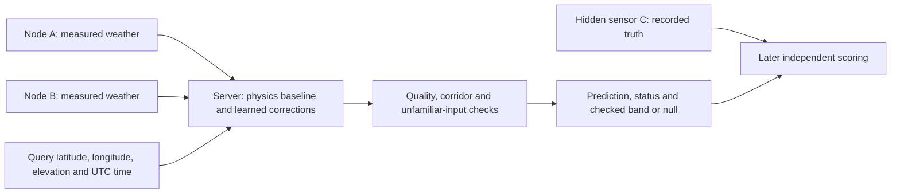

Arrows describe the intended system; live sensor drivers, radio transport and authenticated ingestion remain unfinished. The implemented demo reads files on a computer.

## 2. What has been built

“Done and tested” means software/archive tests, unless stated otherwise.

| Item | Status | Evidence and boundary |
|---|---|---|
| Six-channel contract | Done and tested | T °C, RH %, station pressure hPa, PM2.5/PM10 µg/m³, wind m/s, in that order; fewer than six physical devices may supply them. |
| India sensor-only threshold forecasts | Partly done | Indian NOAA A–D comparisons and causal features tested; independent field/hazard validation missing. PM optional; suspect pressure/height masked. |
| Four-channel spatial model; optional PM | Partly done | Weather works without PM. Separate target predictors (“heads”) mask missing labels; current spatial PM heads are untrained. |
| Registry and long-form store | Done and tested | One variable per row; source/site IDs, hashes, units, UTC intervals, quality/reference flags; clean/restricted separation. |
| All-source ingestion | Partly done | NOAA/NWIC/POWER have real execution evidence; other adapters limited/synthetic. Unresolved sources quarantined; ERA5 join pending. |
| Terrain | Partly done | SRTM elevation/slope and elevation differences implemented; some stations missing terrain. Latest two-node heads exclude query slope. |
| Spatial ensemble | Done and tested | Combines predictors; separately trained 2/3/4/5-neighbor models; boosting and small neural network correct physics baselines on the server. |
| Physics baselines | Done and tested | Lapse-adjusted T, dewpoint-based RH, common-height pressure; wind inverse-distance weighting (IDW). Losses reported below. |
| Geometry checks | Done and tested | Two-node corridor: ≤1 km from segment, ≤0.25 km beyond ends, A–B ≤20 km. 3–5 use a hull (enclosing polygon); refusal/flagging tested. |
| Out-of-distribution (OOD) and fallback | Done and tested | Unfamiliar inputs: selected fitted-range violations or learned failure fall back to available physics; missing contributors can refuse. |
| Sensor quality control (QC) | Partly done | Range/nonfinite/stale/coordinate/time and pressure/elevation checks; plausible wrong units, stuck sensors, drift/spoofing remain gaps. |
| Error bands | Partly done | Block calibration/check/revocation tested; no checked two-node 80/90% band. |
| A/B/C offsets and scorer | Done and tested | Frozen relative calibration and hidden-label isolation tested synthetically; no field campaign. |
| ESP32 firmware | Partly done | Serial forecast/event replay, host parity and compilation; no autonomous sensor/radio node or spatial model. |
| Field reliability/authentication | Not done | No hardware soak, authenticated mesh or field outage/accuracy proof. |

The ensemble combines a physics prediction with weighted learned **residuals**, differences from that baseline. Validation selects weights and correction strength, including zero. It protects aggregate validation error, not future/individual predictions. Bounded numeric JSON replaces executable pickle loading.

Pressure uses temperature-aware barometric reduction to 0 m EGM96, log-pressure interpolation, then query-height restoration; this is not certified sea-level pressure. Temperature uses 6.5 K/km; RH comes from interpolated dewpoint and adjusted temperature. Mountain inversions/exposure can violate these assumptions.

## 3. Requirements and running it

Validation needs three instruments: A/B transmit and C stays hidden. Existing firmware targets **ESP32-S3-DevKitC-1-N8, 8 MB flash**. User-specified parts: BME280 (T/RH/pressure), PMS7003 (PM), 600 PPR encoder (wind rotation), Neo-M8N GPS, INA219 power monitoring and DS3231 RTC. **Installed wiring, shielding, calibration and operation are unverified**; encoder PPR alone does not establish m/s or wind azimuth.

Use isolated Python 3.11.8; root dependency pins differ from the tested spatial phase. Full tests need a C/C++ compiler; firmware builds need PlatformIO.

```sh
# From the repository root; installation needs package access.
python3.11 -m venv .venv-physics
. .venv-physics/bin/activate
python -m pip install -r requirements-physics.txt xgboost==3.1.1
python -m pytest -q

# Synthetic A/B demo, with physics only; prints prediction/bands/status.
python -m reports.practicum.demo --input reports/two_node_phase/examples/readings.json

# Optional learned model, if the local trained artifact is present.
python -m reports.practicum.demo --input reports/two_node_phase/examples/readings.json --model data/two_node_training/national5km/k2/model.json

# Reproduce the eight archive experiments after acquiring the same NOAA inputs.
python -m ml.spatial_ensemble.evaluate_two_nodes
# Compile only; requires PlatformIO and its board packages.
pio run -d esp32/ml_integration -e esp32-s3-ml -e esp32-s3-ml-usb
```

Raw arrays/models may be absent in a fresh checkout. Clean installation/download commands were not replayed in consolidation. See [node collection and scoring](#source-ee2e6e8a3ad3) and [firmware build/replay](#source-5fac4eace466) for detailed contracts. Demo A/B values must already be offset-corrected; C readings are forbidden in its input.

CDS needs accepted terms/account/token or manual download; OpenAQ needs a v3 key/provider rights; IMD needs authorized access. None was bypassed. [ERA5 download specification](#source-7b5d5d246472) lists 24 monthly India requests for 2023–2024: all UTC hours, T2m, dewpoint, surface pressure and 10 m u/v wind, area `[38,68,6,98.5]`. Files belong in `data/backgrounds/raw/era5_land/`. Actual downloads and completed-hour joins remain pending.

## 4. Data sources and rights

“Clean” is the approved open-license target view, not certified quality. Restricted rows stay separate; unresolved rights/time/units/reference block both views. These are recorded terms, not new legal clearance. Full evidence: [DATA_LICENSES.md](EVERYTHING.md#source-8ef030a6160f).

| Source | What it gives / resolution | Recorded license; commercial use | Current view/use |
|---|---|---|---|
| NOAA GHCNh | Point hourly/synoptic T/RH/dewpoint, station pressure, wind; 2023–2024 | CC0-1.0; permitted under recorded terms | Clean observed targets; latest spatial fits |
| SRTM GL1 v3 | Static ~30 m elevation and derived slope | USGS public-domain product; mirror attribution | Terrain inputs, not weather targets |
| Köppen-Geiger | 1 km 1991–2020 climate zones | CC BY 4.0; with attribution | Registry/evaluation grouping |
| UCI Beijing 501 | 420,768 hourly rows, 12 sites, 2013–2017; six channels with RH derived | CC BY 4.0; with attribution | Older forecast/event models; not approved new spatial targets where contracts unresolved |
| CPCB/Kaggle v2 | Seven downloaded station samples, 368,462 hourly rows; weather/PM availability varies | CC BY-NC-SA 4.0; non-commercial only | Older restricted research models; new restricted-view admission still contract-gated |
| Delhi OpenCity/CPCB | Two 15-minute exports, 2024–2025; one weather+PM, one PM-only | “Other (Public Domain)”; primary rights unresolved | Quarantined audit only |
| NWIC Himachal weather | Four hourly channels, 30 identities; no PM | “other-open”; exact terms unresolved | All 1,571,295 supplied rows quarantined |
| NWIC rainfall / legacy T | 166,355 rain rows, no explicit dry hours; legacy T download only four rows | “Other (Open)” / unverified; unresolved | Audit only; neither target view |
| NASA POWER | Coarse modeled hourly weather; January Mandi diagnostic obtained | Free NASA data, attribution; recorded open class | Background/clock diagnostic, not observed truth |
| ERA5 / ERA5-Land | Hourly modeled grids: 0.25° / 0.1° (~9 km native Land) | Registry CC-BY; accept current CDS terms | Not acquired; planned `era5_*` background only |
| IMD | Station catalogs obtained; observations need authorization | Unverified export terms; commercial rights unresolved | No new observation targets |
| OpenAQ | Point PM; provider-dependent cadence and rights | Provider-specific; unresolved | Key/data not obtained; no PM training |
| Sensor.Community | Consumer PM and some weather, variable cadence | Content/database terms unresolved | Not acquired/approved |
| CAMS EAC4 | Modeled PM/background, 3-hourly 0.75° | Registry CC-BY; accept provider terms | Not acquired; never measured PM truth |

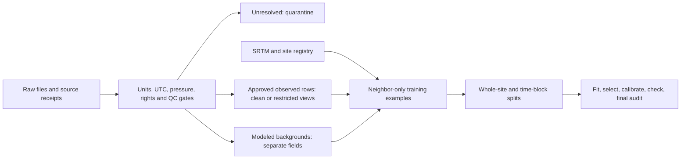

NOAA: 586 India-coded candidates; 375 acquired 2024 files, 360 also in 2023. Retained 1,516,003 hour buckets, including 775,778 calendar-2024 hour-end buckets; missing hours stay missing. Alias exclusion leaves 374 sites. Channel availability varies; hidden-site readings/aliases are excluded.

## 5. Results: wins and losses

**All numbers in the four core tables are real NOAA archive diagnostics, not synthetic or field deployment results.** These are separately fitted two-neighbor models, whole held-out stations, December audit, national 5 km buffer or Himalaya-proxy 20 km buffer. The Himalaya proxy is 28–37°N, 72–90°E, elevation ≥500 m. Models considered acquired 2023/2024 hours without row caps; national/Himalaya fits contain 462227/541231 rows. Only rows with eligible target truth enter each metric.

Mean absolute error (MAE) averages absolute prediction misses; lower is better. Core values copy the three-decimal [latest report](#source-80bc09b6549d). Persistence copies the full-precision [results.csv](reports/two_node_phase/results.csv): it holds the previous one-hour **neighbor IDW**, never hidden query history. Pressure persistence has zero pairs. The CSV retains root mean squared error (RMSE), station-resampled 95% MAE intervals and denominators; mean-error intervals are not prediction bands.

### Temperature (°C MAE; real archive)

| Hold-out / rows | Ensemble | Physics | IDW | Nearest | Mean | Persistence |
|---|---:|---:|---:|---:|---:|---:|
| National / 8313 | 1.735 | 2.159 | 2.696 | 2.799 | 2.677 | 2.6964614391326904 |
| Himalaya / 1878 | 4.507 | 4.942 | 8.540 | 8.325 | 8.938 | 6.822472095489502 |

### Relative humidity (percentage-point MAE; real archive)

| Hold-out / rows | Ensemble | Physics | IDW | Nearest | Mean | Persistence |
|---|---:|---:|---:|---:|---:|---:|
| National / 8305 | 10.871 | 13.797 | 10.768 | 11.692 | 10.543 | 11.096077919006348 |
| Himalaya / 1869 | 21.763 | 22.553 | 16.499 | 16.953 | 16.130 | 18.22036361694336 |

**Loss:** national RH loses to IDW and mean; Himalayan RH loses to all three raw spatial baselines and persistence.

### Station pressure (hPa MAE; real archive)

| Hold-out / rows | Ensemble | Physics | IDW | Nearest | Mean | Persistence |
|---|---:|---:|---:|---:|---:|---|
| National / 2688 | 4.059 | 4.059 | 36.541 | 35.092 | 39.447 | Unavailable |
| Himalaya / 1240 | 18.945 | 18.637 | 117.687 | 119.232 | 115.429 | Unavailable |

**Loss:** Himalayan residual correction worsens the physics baseline. Elevation correction greatly improves raw interpolation here, but Himalayan absolute error is still large.

### Wind (m/s MAE; real archive)

| Hold-out / rows | Ensemble | Physics | IDW | Nearest | Mean | Persistence |
|---|---:|---:|---:|---:|---:|---:|
| National / 8207 | 0.908 | 1.054 | 1.054 | 1.108 | 1.061 | 1.453328251838684 |
| Himalaya / 1904 | 0.611 | 0.632 | 0.632 | 0.789 | 0.688 | 1.4415870904922485 |

### PM2.5 (µg/m³; current spatial task)

| Evidence | Ensemble | IDW | Nearest | Mean | Persistence |
|---|---|---|---|---|---|
| No real spatial labels in latest fits | Untrained | Not evaluated | Not evaluated | Not evaluated | Not evaluated |

### PM10 (µg/m³; current spatial task)

| Evidence | Ensemble | IDW | Nearest | Mean | Persistence |
|---|---|---|---|---|---|
| No real spatial labels in latest fits | Untrained | Not evaluated | Not evaluated | Not evaluated | Not evaluated |

Synthetic fixtures test behavior, not real PM skill. Older PM forecasts and event-rule scores are different tasks.

K=3–5 does not uniformly improve errors; matched-row scores remain in the report. An earlier specialist won on eight Mandi reports, insufficient to establish a two-node winner.

**Deployment coverage: zero two-node audit rows pass the default corridor.** Minimum national test A–B spacing is 25.36 km; Himalayan is 79.75 km. Training has only 2828 national and 12958 Himalayan pair-time rows at 1–20 km; repeated hours are not independent sites. No checked two-node band exists at either 80% or 90%; outputs correctly return null.

## 6. Limitations

- No real fixed-node 1–20 km validation or hidden C campaign. Archive context pairs change with availability; deployment A/B are fixed.
- Pressure remains inaccurate in mountains. Suspect height/pressure stations are flagged, not repaired; QC can also exclude valid terrain differences.
- PM spatial heads are untrained; independent hazard labels are absent. Event-rule imitation is not hazard detection.
- Earlier bands under-covered. In the prior 32-neighbor Himalayan pressure trial, episode coverage was 20% at 50–100 km and 0% beyond 100 km at both trial levels; bands were revoked. Those trials cannot authorize current two-node bands.
- NWIC timezone, interval convention, pressure reference and exact license remain unresolved. A POWER daily-cycle comparison supports IST but cannot confirm it. Repeated 925 hPa, Kala Amb's height/pressure conflict and 11 wind rows dated 2007 remain quarantined.
- Himalaya, cold-desert/highland sites, eastern Himalaya and independent dense city meshes are poorly represented. Region labels are proxies; the full national archive is not complete coverage of India.
- Small independent samples remain despite many repeated hours. The earlier Mandi comparison had eight reports; some climate zones have only 1–2 sites. Pressure labels are especially sparse.
- Fixed lapse rates, grid terrain versus sensor height, exposure, inversions and humidity correction can be wrong. The ensemble can lose to simple baselines.
- No hardware soak, measured spatial-model RAM/flash/latency/watchdog test, live radio outage evaluation or node authentication. Build hashes do not authenticate senders.
- Broad QC cannot prove correct units, detect every frozen sensor or reject plausible spoofed data. Dependency scanning was limited, not a full security audit.
- ERA5-Land files were absent in the measured phase; no contribution is measured. Live archive availability and independence of weather blocks remain unverified.

## 7. Verified versus unverified

**Actually run in prior phases:** full-hour NOAA ingestion; eight uncapped K=2–5 experiments with hashes, site/query exclusion and time-block assertions; synthetic physics/field/demos; JSON/sklearn parity; firmware cross-compilation and host C parity. Latest verification records **97 tests plus eight subtests passed**, with one existing pandas deprecation warning. The recorded UART integration build used **316,853 B flash / 18,848 B static RAM**; these are whole-image compile figures for the older forecast/event firmware, not spatial-model measurements.

**This documentation pass:** inventory, reference reconciliation and local-link checks; current test/demo rerun evidence is recorded in [documentation verification](EVERYTHING.md#source-bfd8778290ff). No models were retrained or firmware rebuilt for consolidation.

**Not run/proven:** real A/B/C campaign, absolute calibration/drift, field error-band coverage, autonomous sensor/mesh operation, authenticated transport, ESP32 spatial execution, nationwide dense-mesh accuracy, ERA5 ablation, new authorized IMD/OpenAQ training or a systematic patent search.

## 8. Next steps

1. Run a field test with A/B plus hidden C. First colocate and freeze offsets, then separate instruments and physically rotate each through the middle in distinct episodes. Retain raw/corrected truth, refusals and untouched final episodes.
2. Validate and improve the **already implemented** elevation-aware pressure baseline: resolve suspect coordinates/heights/reference, survey sensor elevations and compare lapse/moisture assumptions. Keep weak RH corrections optional.
3. Obtain ERA5-Land through authorized CDS/manual access; implement and test completed-hour background joins and matched-row ablation. Keep `era5_*` fields separate from station targets.
4. Resolve NWIC/Delhi clocks, pressure and rights; obtain authorized IMD/OpenAQ exports and independent close-range city/valley stations. Preserve clean/restricted separation.
5. Add authenticated messages, replay/freshness checks, key provisioning, sensor integration and hardware soak tests; retain conservative refusal and fallback.
6. Train/export a compact spatial model for ESP32, then measure precision, RAM/flash, latency, energy and outage behavior. Recalibrate/check field bands on separate episodes before reporting nominal coverage.

## 9. Glossary

| Term | Meaning |
|---|---|
| IDW | Inverse-distance weighting: nearby observations receive more weight, here inverse squared distance. |
| Kriging | A spatial estimator using a fitted correlation model. Optional in older heatmaps; not the latest ensemble's fitted spatial member. |
| Ensemble / boosting | Combining predictors; boosting builds successive small decision trees to reduce error. |
| OOD / QC | Unfamiliar inputs / quality control. Current OOD envelope is a heuristic guard, not an OOD probability. |
| MAE / RMSE | Mean absolute error / root mean squared error; RMSE penalizes large errors more. Both use the target's units. |
| Station / sea-level pressure | Pressure at the instrument's height / pressure adjusted to sea level under assumptions. They cannot be interchanged silently. |
| Residual model | Learns corrections to a baseline rather than the full target. |
| Lapse rate / dewpoint | Temperature change with height / temperature at which air reaches saturation. |
| Error band / conformal | Prediction interval / calibration using held-out error ranks. Current whole-block method needs independent checks and can withhold a band. |
| Reanalysis / SRTM | Modeled historical weather using observations and physics / satellite-derived terrain elevation. Neither is a colocated sensor observation. |
| UTC / EGM96 | Common global time standard / height reference used by SRTM; distinct from raw GNSS ellipsoidal height. |
| Persistence | Keep a previous value unchanged; in current spatial scores, previous neighbor IDW. |

## 10. Source map

Archive paths preserve the original directory hierarchy. [DOC_INVENTORY.md](#source-1e3a0ca6c259) maps every original file to its destination and classification.

| Overview section | Original evidence (current location) |
|---|---|
| 1: purpose and tasks | [original architecture](#source-43768bf9b861), [model contracts](#source-924a897cc319), [two-node report](#source-80bc09b6549d); IIT Mandi/course scope from project brief |
| 2: implementation | [review](#source-404b2cf68e8e), [India report](#source-5529e98665ee), [physics report](#source-b9adb8ae1051), latest two-node report |
| 3: requirements/commands | [node spec](#source-ee2e6e8a3ad3), [firmware guide](#source-5fac4eace466), [ERA5 spec](#source-7b5d5d246472), phase requirements and latest report |
| 4: data/rights | [pipeline design](#source-3cab500f40fd), India/physics reports, [registry](data/registry/sources.json), retained `data/*` source notes; DATA_LICENSES is a consolidation of these |
| 5: current scores | [two-node REPORT](#source-80bc09b6549d), [results.csv](reports/two_node_phase/results.csv), [results.json](reports/two_node_phase/results.json), [pair support](reports/two_node_phase/pair_support.json); earlier Mandi comparison in India report |
| 6: limitations | Review, India/physics/two-node reports; [practicum results](#source-449e040c3c06), [source verification](#source-9e2f8a86c313), [event limitations](#source-6ba6b188f5fb) |
| 7: verification | [latest verification receipt](reports/two_node_phase/verification.json), review build evidence, [this pass](EVERYTHING.md#source-bfd8778290ff) |
| 8: next steps | Node spec, [ERA5 spec](#source-7b5d5d246472), [readiness history](#source-334bb239c445), physics/two-node reports |
| 9: glossary | Architecture, model contracts, pipeline and physics descriptions above |
| Resolved conflicts | Original README/architecture/model guides versus later India/physics/two-node evidence; registry versus ERA5 adapter/spec; invention notes |

## Resolved conflicts

- **Inputs:** older forecast/IMD guides require six channels for that forecast. Latest spatial models use four core channels plus optional PM.
- **Evidence:** old geographic forecasts used hidden-site readings; new interpolation excludes them. Forecast/synthetic scores do not prove deployment skill.
- **Geometry:** corridor supersedes hull for two nodes; hull remains for 3–5 and older heatmaps.
- **Metrics:** sampled India, 32-neighbor and K=2 cohorts differ. Latest K=2 evidence governs; historical scores are not a comparable trend.
- **Bands:** earlier p90/synthetic/32-neighbor coverage cannot authorize two-node bands. Latest eligible count is zero; bands are null.
- **Pressure/ERA5:** elevation-aware reduction is now implemented. ERA5 registry “station” pressure is a placeholder; adapter/spec correctly use grid-surface background. No ERA5 training occurred.
- **Firmware:** spatial JSON runs on the server; old C/compile evidence is for forecast/event firmware. Stale event README “not integrated” claims were corrected to the serial integration scope, with no hazard accuracy upgrade.
- **IP:** technical distinctions are not novelty claims; confidential notes require systematic scientific/patent review.


---

</details>


<a id="source-32a01492adf5"></a>

<details>
<summary>docs/SUBMISSION_GUIDE.md</summary>

# Submission and local demonstration

INDRA is a six-channel environmental forecasting and Himalayan risk research prototype. The active gateway is `india_mandi_tabular_v2`: LightGBM, a residual MLP, retained hybrid and persistence with validation-selected prediction blends. A persistent delayed-label learner runs in shadow mode. Physical station accuracy, disaster probabilities, promotion of adaptive outputs and ESP32/RF execution remain separate empirical work.

## Files for the examiner

**Current showcase:** follow the [five-minute runbook](EVERYTHING.md#source-f51ffcf33d24).
The :8080 view now uses the current API collector, not just the original frozen
archive. Its update count is live and must not be described as permanently zero.
Current values remain model grids, not physical station measurements. The
runbook covers both :8080 and the separate twelve-location :8082 demonstration.

The two newly completed features are documented in
[parameter maps and weather categories](EVERYTHING.md#source-4f516879b0b8)
and the [feature report](#source-07c08e1cb257).
Use the separate 12-location synthetic demo on :8082 to show both end to end;
the downloaded Mandi archive remains a one-location view on :8080.

1. [Features](EVERYTHING.md#source-dfea6b4a44c8), [overview](EVERYTHING.md#source-f795de9ca89c) and [architecture](EVERYTHING.md#source-ff21b6b9a3a3).
2. [Current Mandi report](#source-992f2b21c23a), its `results.json` and `verification.json`: data provenance, inputs, exact +6h targets, comparisons, software/browser checks and limits.
3. [Active profile](ml/models/india_mandi_tabular_v2/profile.json) and [blend coefficients](ml/models/india_mandi_tabular_v2/ensemble_weights.json). These reference checksummed learned artifacts; weights are not hidden in the frontend.
4. [Pipeline and online-learning guide](EVERYTHING.md#source-699782d7781d): reproduction, durable shadow state and rollback.
5. [Synthetic PM report](#source-6ba44f48673d): explicitly separate simulation data, excluded from reported forecast scores.

Retained v1 results are in `reports/submission/2026-10-21/`; `scripts/test_mandi_submission.py` reproduces that version. Preserve their original model/report paths. The frozen export catalog is historical; `ml/india_mandi/registry.py` selects the active gateway.

Submit source and committed trained artifacts. Raw CSVs, virtual environments, node_modules, SQLite state, credentials and downloaded TabPFN checkpoints stay local.

## Reproduce and show the model

From the repository root with Python 3.13 and Node 22:

```sh
python3 -m venv .venv
.venv/bin/python -m pip install -r requirements-dashboard.txt
npm ci --prefix apps/indra-himachal-ui
# Download the configured source if it is absent; does not train:
.venv/bin/python scripts/train_mandi_v2.py --prepare
# Evaluate frozen committed components; does not select new weights:
.venv/bin/python scripts/train_mandi_v2.py --evaluate
# Obtain the current input file on a fresh checkout, before starting its collector:
.venv/bin/python scripts/fetch_mandi_live.py
.venv/bin/python -m server.dashboard --observations data/himachal/mandi_current_api_v1/history.json --db data/himachal/mandi_dashboard.sqlite --online-state data/himachal/mandi_v2_online_live.sqlite --ui apps/indra-himachal-ui/dist --port 8080
```

Open http://127.0.0.1:8080. For development run `npm run dev --prefix apps/indra-himachal-ui` and open http://127.0.0.1:5173. The backend also serves the built UI. The preparation step initially creates the stable input file only when absent, preserving an existing live stream. Matching frozen source/model hashes are required; changed upstream values require a new version.

Demonstrate the weather-model source label, actual input time, one grid location,
six readings, `HYBRID_READY`, 25/25 hourly history, +6h numerical forecasts, blend
details and the model workspace's mixed v1/v2 results. The initial archive-only
replay had zero eligible live updates; the current collector can now show updates.
Read its actual count and issuance timing. The separate retrospective replay count
is simulated timely-arrival research, not the current worker count. Hazard
scenarios remain synthetic conditional fractions, not calibrated probabilities.

For the current API feed, run `scripts/fetch_mandi_live.py` as shown in the
runbook. It both publishes new snapshots and drives the shadow learner; no second
worker is needed. The older `scripts/online_mandi_worker.py` remains available
for separately supplied reviewed hourly files. Published offline outputs remain
unchanged by shadow updates.

Synthetic multi-node/current-rule fixtures are a separate demonstration. Use a separate database when running the demo without `--observations`; do not present those fixtures as measured Mandi weather.

## Software verification

```sh
.venv/bin/python -m pip install -r requirements-physics.txt -r requirements-hazard-context.txt -r requirements-operational.txt -r requirements-online-research.txt -r requirements-storm-risk.txt
.venv/bin/python -m pytest -q
npm test --prefix apps/indra-himachal-ui
# Browser tests require Chrome on macOS, Chromium in CI:
INDRA_PYTHON="$PWD/.venv/bin/python" npm run test:e2e --prefix apps/indra-himachal-ui
# With the actual current Mandi application running:
cd apps/indra-himachal-ui
node tests/verify-current-mandi.mjs
```

Synthetic browser fixtures verify wiring only. The current Mandi browser check
verifies source labels, numerical forecasts and timing diagnostics. The older
`npm run test:mandi` check targets the historical archive node specifically.

## Questions to answer

- **Labels:** the six modeled values exactly six hours later. Current sensor rules are not independent hazard labels.
- **Accuracy:** report MAE/RMSE/R² in channel units, including regressions. The test is retrospective/reused, not synchronized station truth.
- **Synthetic PM:** simulated missing history can exercise the pipeline; it cannot establish historical pollution or event accuracy.
- **Remaining work:** measured six-channel Mandi evaluation, independent event/non-event records, sensor/ESP32/RF tests, validated hazard fitting/calibration and controlled shadow-model promotion. Both services stay local as requested.


---

</details>


<a id="source-76ac9fbe3adb"></a>

<details>
<summary>docs/SYNTHETIC_HAZARD_SCENARIOS.md</summary>

# Cloudburst, flash-flood and landslide scenarios

Implemented 21 October 2026. The dashboard now has **Hazard scenarios** below
Weather patterns. It takes the same six measurement channels and six hours of
complete native history. There is no seventh sensor or invented rainfall input.

The new component is a **generative Monte Carlo model**, not another classifier
fitted to its own rules. It directly samples possible six-hour futures and reports
the fraction crossing each simulated target. It has no learned weights. Existing
forecast and weather-pattern weights are retained unchanged.

## What each output means

| Dashboard output | Synthetic outcome over the next six hours |
| --- | --- |
| Cloudburst rainfall threshold | At least one simulated rolling hour contains >=100 mm of rain. This does not establish the spatial footprint required to identify a real cloudburst. |
| Flash-flood runoff scenario | Simplified peak runoff exceeds an assumed drainage capacity. This is not a routed river forecast or confirmation of inundation. |
| Landslide rainfall trigger | A transferred intensity-duration threshold is exceeded on an assumed susceptible slope. This is not a geotechnical slope-failure prediction. |

For each target the API returns a central `scenario_fraction`, three separate
family fractions, an `assumption_range`, and a target-specific `*_risk_uncal` field.
A value of 0.20 means **20% of the generated worlds under that assumed setting**,
not a measured 20% chance of an event at Mandi. The range compares different
assumptions; it is not a confidence or credible interval. No family weights or
combined posterior are invented. A zero result does not establish safe conditions.

The API keeps `probability: null`, `calibrated: false`, `field_validated: false`
and `public_alerts_enabled: false`. Independent-event admission gates remain in
place. The six-hour numerical forecast, current pattern classification and these
future scenarios are separate tasks.

## Research basis and what was assumed

The reviewed sources support mechanisms and thresholds, **not a universal
P(hazard | temperature, humidity, pressure, PM2.5, PM10, wind)**. They are a bounded
source review, not a review of all published research.

1. Singh and Thapliyal (2022), [MAUSAM](https://mausamjournal.imd.gov.in/index.php/MAUSAM/article/view/5084),
   DOI 10.54302/mausam.v73i1.5084: supplies the 100 mm/hour threshold and discusses
   upper-air conditions and radar. Those fields cannot be recovered from our six
   surface channels. The simulator uses the threshold, not purported paper-derived
   probabilities.
2. Dahal and Hasegawa (2008), [Geomorphology](https://doi.org/10.1016/j.geomorph.2008.01.014):
   supplies a Nepal lower-envelope relation `I = 73.90 D^-0.79`, intensity mm/h
   and duration hours. The paper reports its fit for 5 hours to 30 days; this
   implementation uses only 5- and 6-hour windows. The study lacks non-landslide
   rainfall records and estimates some subdaily rainfall. Its threshold is neither
   an occurrence probability nor a Mandi calibration. The wetness adjustment and
   susceptibility gate here are explicitly additional assumptions.
3. [TxDOT Hydraulic Design Manual](https://www.txdot.gov/content/txdotoms/us/en/manuals/des/hyd/chapter-4--hydrology/section-12--rational-method/procedure-for-using-the-rational-method.html):
   supplies the Rational Method relationship among rainfall, runoff coefficient,
   area and concentration time. With area in km² and rain in mm/h,
   `Q = C * I * A / 3.6` gives m³/s. Our time-varying runoff coefficient and
   capacity distributions are simplifications, not a calibrated hydrologic model.
4. [WMO Flash Flood Guidance guide](https://etrp.wmo.int/pluginfile.php/99357/mod_resource/content/1/BSMEFFG_UserGuide-opt.pdf?forcedownload=1):
   identifies catchment/drainage properties and soil water deficit as necessary
   influences. These are sampled as unobserved variables here. This implementation
   does not run WMO's FFG system.
5. [Manali Valley July 2023 study](https://mausamjournal.imd.gov.in/index.php/MAUSAM/article/view/6447),
   DOI 10.54302/mausam.v75i4.6447: provides the regional terrain and circulation
   context. It supplies no numeric priors used in this simulator.

Every numerical prior is documented in
[`configs/himalayan_synthetic_scenarios_v1.json`](configs/himalayan_synthetic_scenarios_v1.json).
Only the rainfall threshold and Nepal intensity-duration coefficients are taken
numerically from the cited studies. Rain-link coefficients, latent ranges and
family settings are **engineering assumptions**, not fitted research results.

## Pipeline

1. Validate the six channels, native cadence and complete past six-hour history.
   Bounds follow the existing synthetic pattern domain. Missing/off-grid data,
   nonfinite inputs and inconsistent particulate readings stop the estimate.
2. Derive current values, six one-hour differences and six-hour pressure change
   from seven exact hourly positions. No future observation is an input.
3. Use a documented logistic surface-weather link to sample whether a rainy
   episode exists. Its liquid-phase factor is `sigmoid((T-1)/2)`. PM channels
   are retained and validated but do not drive rain generation.
4. Sample lognormal rain intensity with temporally correlated half-hour variation:
   AR coefficient 0.75, log-variation scale 0.45, and the configured rate cap.
   Rain activity is shared within each six-hour world; these assumptions do not
   reconstruct a measured storm lifecycle. Half-hour resolution is native to the
   simulation; observed hourly rainfall is never split into fake measurements.
5. Generate paired drier/central/wetter worlds using common random numbers.
   Sample soil wetness, storage, runoff coefficient, catchment area, concentration
   time, drainage capacity and susceptibility. These are latent scenario variables,
   not measured extra channels. Soil wetness rises with simulated accumulation;
   drainage/evaporation during the short simulation are omitted.
6. Compute the three outcomes. The Nepal threshold is multiplied by the assumed
   factor `1.4 - 0.7 * wetness` and gated by assumed terrain susceptibility.
7. Count outcomes separately per family. Runtime uses 2,048 draws per family.
   Report Monte Carlo standard error, which covers sampling noise under the fixed
   assumptions only. It does not cover error in those assumptions.

Equal six-channel histories can produce very different outcomes when unmeasured
rainfall or drainage changes. The tests explicitly demonstrate this identifiability
limit. Changing a random seed does not create independent observational evidence.

## Generated dataset and verification

Run from the repository root:

```sh
.venv/bin/python scripts/generate_hazard_scenarios.py
.venv/bin/python -m pytest tests/test_hazard_scenarios.py -q
```

The default run creates **2,048 parent sensor histories × 128 latent worlds ×
3 assumption families = 786,432 synthetic six-hour futures**. Each world has three
binary synthetic outcomes. These are not 786,432 independent weather observations.
Parent histories deliberately oversample engineered weather regimes, so aggregate
synthetic outcome shares do not estimate Mandi climate frequencies.
All worlds belonging to one parent episode must stay together in any later ML
train/test split. No classifier is fitted or selected in this phase.

- Local dataset: `data/himachal/hazard_scenarios_v1/scenarios.npz` (ignored by Git).
- Results and provenance: [`reports/hazard_scenarios_v1/results.json`](reports/hazard_scenarios_v1/results.json).
- Five fully synthetic examples: [`examples.json`](reports/hazard_scenarios_v1/examples.json).
- Implementation: [`ml/himachal/hazard_scenarios.py`](ml/himachal/hazard_scenarios.py).
- UI integration: the existing `/api/nodes/{id}/telemetry` response includes
  `hazardScenarios`. Persisted nodes are reassessed after the configuration changes.

Fresh-seed checks use 64 new parent episodes and two independent sets of 4,096
worlds per family. The average absolute fraction difference was **0.002081**
(0.208 percentage points), with a maximum of **0.026855** (2.686 points).
This measures numerical consistency of the simulator, not forecasting accuracy.
No observed-event accuracy is available; the results explicitly store it as null.

To view it locally, use the existing Mandi dashboard on port 8080 or the simulated
multi-location view on port 8082. Source labels and older-reading indicators remain
visible. These are Python/backend scenarios, not a new ESP32 firmware export.


---

</details>


<a id="source-ca1e9e721220"></a>

<details>
<summary>docs/UI_AND_DEPLOYMENT_STATUS.md</summary>

# INDRA interface and deployment handoff

Updated 21 October 2026. The app is presented as **INDRA — Local weather**.
The main interface no longer uses research/prototype/phase branding. Data-source
labels still distinguish simulated readings, archived modeled weather and actual
station readings. Changing the interface does not change the provenance of data.

## Current interface

- **Observations:** locations, an offline-capable geographic coordinate grid,
  selectable parameter overlays, six current readings, a six-hour numerical
  forecast, compact weather-pattern matches and three explicitly simulated
  [hazard scenarios](EVERYTHING.md#source-76ac9fbe3adb) with assumption ranges.
- **Parameters:** six measurement maps, ranges and units. Selecting a map returns
  to the matching geographic overlay. Unsupported areas stay unavailable.
- **System:** source identities, timestamps, forecast model/components, rule
  evidence, comparison results and separate online-learning status.

Technical IDs, calibration details and engineering checks are kept out of the
main reading flow. Unsupported device commands are not offered as functioning
controls. Older readings and saved offline data remain labelled. Times use IST.

Preview with all features: http://127.0.0.1:8082.
Downloaded historical Mandi view: http://127.0.0.1:8080.

## What remains

1. **Hosting:** choose the hosting account/service and public URL, configure HTTPS
   and persistent storage, then verify the deployed frontend and API together.
   Nothing has been publicly deployed by this UI change.
2. **Live input:** connect the actual sensor/gateway importer. Existing downloaded
   Mandi data is historical and contains one location. A live area map needs
   synchronized readings from multiple distinct locations; three noncollinear
   locations support an area, two only a connecting line.
3. **Field validation:** test real sensors/ESP32/RF and the numerical forecast on
   local outcomes. The current category model was trained on simulated patterns;
   independently observed events/non-events are needed to assess real hazard
   skill and calibrate event probabilities. No UI change establishes that skill.

The maps and category software are implemented and tested. These remaining tasks
concern hosting, live data and empirical product claims rather than missing UI
screens. The existing online learner stays in shadow mode; it is not silently
promoted into published forecasts.

## Deployment entry point

The Python server can serve the built frontend and API from one origin:

```sh
python -m pip install -r requirements-dashboard.txt
npm ci --prefix apps/indra-himachal-ui
npm run build --prefix apps/indra-himachal-ui
python -m server.dashboard --host 0.0.0.0 --port 8080 --ui apps/indra-himachal-ui/dist --db /persistent/indra/dashboard.sqlite --observations /persistent/indra/reviewed_observations.json
```

Use the host's assigned port and persistent paths in place of these examples.
The default listen address remains `127.0.0.1` for local work. No synthetic
source is automatically selected when the server starts without an input flag.
The command prepares the serving process; it does not create a sensor feed.
The existing reviewed importer must update the store when new measurements arrive.

Include the committed forecast components, category model and referenced reports
in the backend deployment. Raw training CSVs, synthetic working arrays, TabPFN,
PyTorch, credentials and local SQLite snapshots are not frontend assets.
With frontend/API split across domains, configure the API origin and server
cross-origin policy explicitly; the same-origin deployment above avoids that step.

## Verification

Browser workflows cover desktop/mobile navigation, source labels, all six maps,
saved-data handling, location replacement and access to model evidence. Runtime
checks exercise both the simulated twelve-location view and the historical Mandi
view. Screenshots and receipts are in `reports/ui_refresh_v1/`.


---

</details>


<a id="source-233befa42eae"></a>

<details>
<summary>docs/hazard_label_audit.md</summary>

# Independent Indian hazard-label audit

**Confidential: do not publish before IP review.** Audited 6 October 2026 before any new fit. Original locally verified baseline: `bc1d8be`; GitHub CI exposed one GCC portability issue in a test harness, repaired separately in `1e67bd9`. Frozen scores/model/export remain unchanged; remote status is recorded in the new phase receipt.

| Target | Existing source | Label type | Independent? | Suitable for training? | Main limitation |
|---|---|---|---|---|---|
| High wind, hot T, near saturation | NOAA future exact t+6h hourly measurements, `ml/india_sensor/labels.py` | Observed future measurement thresholds | Yes relative to issue-time inputs | Existing measurement research only | Hourly mean, rare positives; not gust/storm/heatwave/fog/disaster truth |
| Thunderstorm/storm-like conditions | `ml/event_classifier/features.py` Beijing sensor rules | Weak input-generated heuristic | No | No independent India event training | Matches its own rules, not storm records; China remains separate |
| Heatwave/cold-wave/heat-index patterns | Event classifier rules and fixed hot-T threshold | Weak heuristic / measurement threshold | Not independent official declaration | No official event head | Regional/duration criteria and independent declarations absent |
| Wildfire evaporative risk, fog, smoke/dust/AQI patterns | Beijing rule labels and optional PM fields | Weak patterns / optical PM measurements | No event independence | No wildfire/smoke-source/disaster head | PM source/clock/rights unresolved; no attribution |
| Rainfall | NWIC wet-only local files, existing registry/source receipts | Reported rainfall measurements, incomplete coverage | Potentially, once interpretation verified | No current hazard fit | Wet-only records cannot supply negatives; clock/unit/rights gates |
| Heavy/extreme rain | [IMD data supply](https://dsp.imdpune.gov.in/data_request_form_dsp.php), [daily gridded archive](https://imdpune.gov.in/lrfindex.php) | Gauge vs daily gridded analysis | Gauge can be independent; gridded analysis is distinct | Candidate, requires authorized export/definitions/coverage | Daily rain cannot establish hourly localized extremes; rights/access unresolved |
| Satellite rain | [NASA IMERG documentation](https://gpm.nasa.gov/resources/documents/imerg-v07-technical-documentation) | Satellite/gauge-adjusted estimate | External, but not direct local gauge truth | Research context/qualified estimated-rain target only | Product latency, grid smoothing and gauge dependence; no independent cloudburst label |
| Cloudburst | [IMD MAUSAM 2017 case study](https://mausamjournal.imd.gov.in/index.php/MAUSAM/article/view/5084) | Five reported gauge/AWS-observed cases, outside 2023/24 | Potential observed evidence | Candidate only; training DISABLED | No complete machine-readable records/monitored negatives here; event time/location detail needs full text; article CC-BY-NC notice conflicts with generic CC-BY text |
| Flood / flash flood | [CWC observation portal](https://cwc.gov.in/hydro-meteorological-observation), authorized state disaster reports | River gauge data vs occurrence reports | Potential independent occurrence evidence | Candidate; none admitted | River levels/forecast warnings/rain are not proof of local flash flood. CWC policy PDF returned 401; no access bypass |
| Landslide occurrence | [GSI field-validated inventory](https://bhusanket.gsi.gov.in/index.html) | Mapped occurrence vs susceptibility/forecast | Inventory potentially independent | Candidate; no admitted export | Source advertises public downloads; actual dated records/rights/negative survey coverage not verified. Static susceptibility is not an event |
| Landslide weather risk | No independent current target | Proposed environmental-risk model | No labels | DISABLED | Keep separate from actual landslide occurrence |
| Wildfire / fire | [NASA FIRMS API](https://firms.modaps.eosdis.nasa.gov/api/) | Thermal anomaly / active-fire detection | Satellite observation, not necessarily confirmed vegetation wildfire | Qualified thermal-anomaly research candidate only | [API requires MAP_KEY](https://firms.modaps.eosdis.nasa.gov/api/map_key/); coverage/non-detections and attribution need validation; FAQ fetch returned 403 |
| ERA5 atmospheric background | Existing `ml/datasets/era5_land.py`, 24 frozen CDS requests | Model-based retrospective reanalysis | Not independent event truth | SB context only, never hazard proof | No files/token; indirect observation assimilation; publication semantics required |

NASA describes IMERG as combined precipitation estimates with successive product runs; gauge-adjusted estimates retain satellite/model uncertainty. [NASA product directory](https://gpm.nasa.gov/data/directory). The MAUSAM paper describes localized hourly extreme rain observed using gauges/AWS, not detection from RH/pressure alone. Its license conflict is intentionally unresolved.

## Existing infrastructure and gaps

- `ml/india_sensor/labels.py` already validates independent observed exports, monitored negatives, source hashes and disjoint event IDs; it has no provider adapters, station-event association or independent occurrence corpus. Reuse its principles without refactoring stable code.
- `ml/datasets/schema.sql`, adapters and source registry preserve observation provenance, source clock/pressure interpretation and separate open/restricted views. Those views are not automatic event admission.
- `ml/spatial_ensemble/episodes.py` supplies fixed 72h time proxies; they are not physical storm identities. New grouping must keep duplicate/nearby multi-station reports together and purge intervals across split boundaries.
- Current inference returns null for every independent disaster head. Existing China sensor-rule scores remain explicitly separate diagnostics; no new model can relabel them as observed events.
- Coordinates, UTC times, measured intensity, confidence and monitored coverage must remain null if the provider does not supply evidence. No state/district centroid or guessed midnight event is inserted.

## Admission order

Prioritize gauge heavy/extreme rainfall, specifically evidenced cloudbursts, independent flood/flash-flood records, dated landslide occurrences, then qualified fire detections. Candidate discovery is not admission. Rights, independent definitions, uncertainty, adequate distinct events/sites/years, defensible negatives and event-disjoint split support are required. Minimum research support is a screening floor, never proof of scientific sufficiency or deployment approval.

## ERA5 availability audit

No `.nc/.nc4/.grib/.grib2/.zarr` ERA5 files were found under data. Neither `.cdsapirc` nor a CDSAPI_KEY was present; only existence was checked, no secrets read. **ERA5_DOWNLOAD_STATUS = BLOCKED_BY_ACCESS.** Validate the unchanged 24 2023/2024 monthly requests; download only after personal [CDS setup and manual terms acceptance](https://cds.climate.copernicus.eu/how-to-api). ERA5 is model-based, with indirect observation influence through atmospheric forcing; retain that dependence in any station holdout. [CDS dataset description](https://cds.climate.copernicus.eu/datasets/reanalysis-era5-land?tab=overview).

## PM admission update

| Source | Clock/interval | Units and PM identity | Country/station/QC/rights | Outcome |
|---|---|---|---|---|
| Existing CPCB-derived compilation | Assumed IST; interval unverified | Legacy canonical PM2.5/PM10 fields; provider metadata still needed | Restricted NC terms; legacy assumptions retained | No new clean admission/model |
| Delhi/OpenCity samples | Unresolved source convention | Source units/QC still need verification | Identity/rights incomplete | Candidate, no new fit |
| OpenAQ | API documents time handling; AWS archive has explicit ISO-offset datetimes, averaging interval still provider-specific | Archive documents pollutant/unit/sensor IDs | Provider license, country and QC metadata still required | Candidate; no acquired/admitted PM rows |
| Sensor.Community | Provider/native cadence/clock metadata unresolved locally | Optical PM fields require verified units/channel/QC | Provider rights and identity incomplete | Candidate, no new fit |

OpenAQ API authentication is key-based, but a **documented public S3 archive** is also a legitimate route—not an authentication bypass. Its rows include timestamps/coordinates, PM parameters/units and location/sensor IDs, but the documented narrow schema does not itself establish provider rights, country or complete QC/averaging semantics. [OpenAQ archive documentation](https://docs.openaq.org/aws/about), [API key documentation](https://docs.openaq.org/using-the-api/api-key). No raw PM export was acquired/admitted in this phase.

NASA fire products distinguish fire, no-fire and no-observation states. A missing detection CSV row is therefore not automatically a monitored negative; retain quality/coverage/attribution before a qualified fire target. [NASA LAADS product description](https://ladsweb.modaps.eosdis.nasa.gov/missions-and-measurements/science-domain/thermal-anomalies-fire/).


---

</details>


<a id="source-299ae1d7cc9f"></a>

<details>
<summary>docs/plans/BLOCKCHAIN_PROVENANCE_RESEARCH.md</summary>

# INDRA blockchain provenance: integration and research plan

Date: 23 October 2026. Status: proposed design; no blockchain integration or
blockchain benchmark is implemented by this document.

## Purpose and research question

Add independently verifiable provenance to the existing six-channel forecasting
pipeline. Keep the active LightGBM/neural/hybrid ensemble and numerical outputs.
Blockchain supplies an audit trail; it does not improve forecast accuracy or
validate synthetic hazard scores.

Research question: can batched blockchain commitments make INDRA's observation,
forecast, outcome and shadow-learning history independently auditable at
acceptable gateway latency, transaction cost and recovery overhead compared
with a signed append-only log?

Working paper title: **INDRA: Verifiable Provenance for Six-Channel Weather
Forecasting and Delayed Online Learning**. Novelty remains a hypothesis pending
a systematic related-work comparison and experiments.

## Existing integration points

- `ml/india_mandi/online.py`: SQLite observations, forecasts, model/scaler identity
  and shadow checkpoint state. Forecast rows precede delayed outcome updates.
  These are application-controlled records, not externally immutable evidence.
- `server/dashboard.py`: active forecast generation, issue timestamps and model
  profile hashes. The dashboard's latest-state store is mutable.
- `ml/india_mandi/live.py`: downloaded source receipts and availability tracking.
- `ml/models/india_mandi_tabular_v2/`: deployed Python profile and component files.

The provenance layer must link actual persisted records, not synthesize a new
forecast from the dashboard when an auditor requests a proof.

## Proposed architecture

```text
Sensor or API observations -> QC/history -> existing ML -> forecast + journal
                                  |               |              |
                                  +------- durable audit outbox --+
                                                   |
                                        canonical event + signature
                                                   |
                                      batch manifest + Merkle root
                                                   |
                                  gateway blockchain anchor worker
                                                   |
                                append-only smart-contract commitments
                                                   |
                          independent proof verifier + dashboard status

Later outcome -> evaluation event -> shadow-update/checkpoint event
                         \_________ same append-only audit path ______/
```

Keep readings, coordinates, histories, model files and checkpoints off-chain in
backed-up storage. Store their cryptographic commitments on-chain. A hash does
not preserve the original file or make predictable sensitive metadata private.
Do not upload restricted source data to public storage.

Start with a local EVM development chain and a minimal Solidity anchor contract.
Use synthetic transactions or existing API replay records, explicitly identified.
This local chain is a functional test, not independent decentralization or a
production consensus benchmark. Evaluate independent operators or a public
testnet before making those claims. No token, payments, real funds or public
deployment is required for the initial integration. A Fabric consortium is an
alternative if real institutional participants require permissioned governance.

Run anchoring on the gateway, outside the forecast request path. ESP32 devices
need not execute a ledger or hold blockchain transaction keys. A future device
signature can attest a device identity; the current API/gateway signature cannot
be presented as a physical sensor signature.

## Event contract and verification

Versioned events: `OBSERVATION`, `MODEL_RELEASE`, `FORECAST_ISSUED`,
`OUTCOME_OBSERVED`, `FORECAST_EVALUATED`, `SHADOW_UPDATE`, `CORRECTION`.
Never overwrite an original event to add its later truth or correct it.

Each event binds a schema/domain identifier, event type, source/site namespace,
unique event ID, sequence number, previous-event hash, observation valid time,
first availability time, gateway issue time, optional target time, payload hash,
model-component manifest hash and relevant parent-event hashes. Preserve units,
feature schema, source kind, fallback status and synthetic/scenario indicators.
Model release manifests must cover all component bytes, normalization, blending,
feature schema and preprocessing implementation, not only a profile JSON file.

Specify and test deterministic serialization before hashing, including UTC time,
numeric representation, explicit missing values and rejection of NaN/Infinity.
Use domain-separated SHA-256 Merkle leaf/internal-node hashing with a documented
ordering and odd-leaf rule. Bind batch ID, record count, sequence boundaries,
signer and previous batch to each committed manifest/root.

The contract must authorize submitters, reject reused batch IDs and prevent
replacement of accepted roots. Version identifiers must bind network ID and
contract address to avoid cross-deployment replay. Define key rotation/revocation
without invalidating historical receipts. Keep private keys out of Git and UI.

Verify event signature, canonical hash, parent links, Merkle inclusion, signer,
contract identity, transaction receipt and configured finality. Persist proof
material and independently witnessed batch checkpoints. Inclusion alone cannot
detect every omitted event: use sequence continuity, committed counts and
witnessed manifests, and document omission before capture as outside the claim.

An issue timestamp written inside a transaction is self-reported. Evidence that
a forecast predates its target requires a sufficiently finalized commitment
before that target, under the chain's timestamp/trust assumptions. A batch
anchored after the target cannot establish a prospective six-hour forecast.
Report actual remaining lead time and anchoring delay separately.

## Reliability and user interface

Use an atomic outbox with ingestion where possible, deterministic IDs, retry,
idempotent submission and reconciliation after restart or chain interruption.
Capture outcome and update events when they occur; exporting mutable SQLite
state later cannot retroactively prove the original sequence of changes.

Show separate states: `LOCAL_ONLY`, `PENDING_ANCHOR`, `ANCHORED`, `VERIFIED`,
`MISMATCH`, `UNAVAILABLE`. Display network, transaction reference, commitment time,
source type and what the proof covers. A local hash match is not an on-chain
verification. Anchoring outages must not block numerical forecasts or turn a
failed verification into a success. Track backlog age and finalized receipts.

## Experiments required for the paper

Compare the same workload and attack cases across:

1. Existing SQLite journal.
2. Signed hash-linked append-only log with an independent checkpoint witness.
3. Signed events plus batched blockchain commitments.

Test changed readings, changed forecast values, changed model bytes, replay,
unauthorized anchoring, reordered/removed records, rewritten local histories,
false issue timestamps, key rotation and gateway/network interruption. Distinguish
detectable post-commit changes from false inputs signed before commitment.

Measure detection rate by attack type, false alarms on honest records, median
and p95 forecast overhead, anchor/finality and verification latency, throughput,
bytes per record, gas per batch/record, backlog/recovery and actual forecast lead.
Compare batch sizes 1, 24 and 100 with a maximum flush delay. Declare hardware,
software versions, chain trust model and confirmations. Do not infer production
fees, energy use or consensus resilience from a single local development node.

Verify unchanged forecasts with anchoring enabled versus disabled. Report MAE,
RMSE and persistence comparison separately from security metrics. API/model-grid
data remains API/model-grid data. Synthetic hazard outcomes remain scenarios.

## Implementation sequence and completion criteria

1. Canonical event schema, signing, model manifest and Merkle verifier; deterministic
   fixtures and mutation/replay tests.
2. Minimal anchor contract with authorization/idempotency tests on a local chain.
3. Transactional outbox and gateway worker integrated with actual forecast and
   online-update creation, plus outage/restart tests.
4. Read-only verification API and dashboard evidence status.
5. Reproducible baseline/attack/overhead benchmark with raw receipts and results.
6. Paper draft: introduction, related work, threat model, methods, experimental
   setup, measured results, limitations and reproducibility instructions.

Completion requires a runnable end-to-end verification and measured baseline
comparison, not just a contract or architecture diagram. Independently controlled
verification requires a separate operator or witness; that is an external
deployment requirement, not an achieved property of the current laptop setup.

## Related work and claim boundaries

- [Sigwart et al., IoT provenance framework](https://link.springer.com/article/10.1007/s00779-020-01417-z):
  Ethereum-based provenance implementation and throughput/latency evaluation.
- [Heston, climate verification framework (2026)](https://doi.org/10.1371/journal.pclm.0000764):
  climate-data verification with on-chain commitments and off-chain records;
  conceptual blockchain parameters must be distinguished from measured deployment.
- [NISTIR 8202](https://doi.org/10.6028/NIST.IR.8202): blockchain fundamentals and
  the oracle problem; ledger integrity cannot establish physical input truth.
- [Hyperledger Fabric private data](https://hyperledger-fabric.readthedocs.io/en/latest/private-data/private-data.html):
  an alternative consortium design with restricted data and shared hash evidence.

Blockchain plus weather monitoring alone is not a new contribution. The proposed
INDRA-specific focus is the verifiable linkage of source availability, multi-model
forecast versions, actual issue/target timing, later outcomes and shadow updates.
Evaluate that contribution and its necessity against the signed-log baseline.


---

</details>


<a id="source-904adb4881e6"></a>

<details>
<summary>docs/plans/CURRENT_REPO_AUDIT.md</summary>

# Repository audit and export verification — Phase A

Baseline: `6bcda6b689868682cabfd95808eeb611dcb4aed3`. Supplied review dated
14 October 2026. Its complete package is preserved in
[the reference directory](#source-2ac2cdba9f35).
Every supplied package file matches its manifest SHA-256 and byte length.
The supplied root prompt and package prompt are byte-identical.

## Existing scope and preserved work

The active Indian numerical experiment is `india_mandi_modeled_6h_v1`: six
numerical targets at exactly +6 hours, using retrospective IFS/CAMS grids.
Station pressure and modeled grid-surface pressure have different source roles.
This benchmark is not field weather accuracy or a trained disaster detector.
The CPCB five-channel and two-PM experiments, NOAA India measurement-threshold
heads, and historical Beijing forecasts/current-rule imitation remain separate.
All catalogued training metadata/reports, fitted artifacts and shipping C headers
were inventoried; their original bytes are protected in `PROTECTED_PATHS.json`.

Current primary README, PROJECT_OVERVIEW and ARCHITECTURE agree about these
boundaries. Older 12-sensor/five-class descriptions under `docs/archive` are
historical, not the current contract. `MODEL_INPUTS_AND_OUTPUTS.md` describes
the retained legacy wrapper and its separate source roles, not Mandi deployment.
No `master/kriging` or current frontend/package.json was found. No AGENTS.md was
found in this checkout or its ancestors. The teammate UI/backend is external
and will be supplied later; new work is isolated until its exact paths can be
inventoried and protected.

## Actual firmware selection

| Firmware environment | Included model/export |
| --- | --- |
| `model_test:esp32-s3-model-test` | Beijing six-channel numerical forecast |
| `model_test:india-five-sensor-test` | CPCB five-channel numerical forecast |
| `model_test:india-pm-test` | CPCB two-PM numerical forecast |
| `ml_integration:esp32-s3-ml` / `esp32-s3-ml-usb` | Beijing numerical forecast and current-rule classifier |
| `india_sensor:india-sensor-research` | NOAA India future measurement-threshold heads and hourly preprocessing |
| `operational_node:operational-driver-preparation` | Sensor/packet preparation; no fitted ML header, physical mode disabled |
| Mandi active export | Separate host C export; not selected by the above firmware |

This audit does not switch any firmware to a different dataset/model.

## Closing the committed-export gap

`configs/committed_exports_v1.json` freezes all existing model artifacts/reports,
export reports/headers, generator sources and one synthetic contract CSV. The
catalog points to that versioned manifest. `ml.deployment.verify_exports` checks
identities before loading models, compiles each **committed** header, compares
it with frozen UBJ weights and regenerates into temporary folders. No original
dataset, training run, network connection or board is required.

Coverage includes every tree split and adjacent float32 thresholds, reachable
leaf paths, physical bounds, channel-wise NaN/+Inf/-Inf and just-outside limits,
null pointers, missing-branch behavior, calibration/threshold/status checks for
India measurement heads, and explicit alias contracts. Forecast aliasing passes;
the legacy event function rejects same-buffer calls. India serving uses distinct
arrays. Existing raw-to-hourly C preprocessing parity and deployment-wrapper
unavailable-head tests remain in the regression suite. Test fixtures are
software contracts and are not added to empirical training/evaluation.

Two compatibility cases are explicit:

1. Three older numerical headers predate country/evidence macros. Regeneration
   omits exactly those two named metadata lines for those named profiles. Every
   other byte must match; no numerical expression is normalized or rewritten.
2. The India threshold export receipt records metadata hash `70049f74…`, while
   the bundled metadata is `a6c95777…`. The exact original receipt and bundled
   metadata remain unchanged. Both hashes and this discrepancy are frozen in
   the new profile. The original receipt's referenced metadata bytes have not
   been recovered. Fresh verification instead checks the bundled metadata,
   exact weight identities, raw/calibrated outputs, flags and statuses, and
   requires both generated headers to reproduce byte-for-byte. The UBJ models
   have positional inputs; their feature names/order come from this hash-checked
   bundled metadata, not embedded UBJ names.

This is explicit legacy compatibility, not a claim that the historical metadata
receipt was correct. Future artifact changes need a new reviewed export identity.
No trained weight, historical report or existing header was modified.

## Executed checks

An isolated Python 3.13.0 host environment uses `requirements-physics.txt`,
`requirements-hazard-context.txt`, `requirements-operational.txt`, XGBoost 3.1.1
and Ruff 0.16.10. These are CI experiment pins, separate from historical training
pins. CI also runs on Python 3.11; this local run does not establish 3.11 execution.

- Existing baseline: **206 passed, 14 subtests passed**, 70.14 seconds.
- Ruff `ml tests esp32/ml_integration/tools --select E9,F63,F7,F82`: passed.
- Offline committed-export CLI: six profiles passed. Detailed rows, threshold
  counts, error maxima and identities are in the
  [fresh verification receipt](reports/deployment/committed_export_verification.json).
- Existing pandas deprecation and NumPy/netCDF binary-size warnings persist.
  Sandboxed Arrow CPU-cache probes also print permission diagnostics; parity
  checks complete. No demonstrated prediction failure follows from these warnings.

Expanded regression suite: **209 passed, 124 subtests passed**, 25.16 seconds.
Header, weight, report and generator tamper checks passed. Protected artifact
hashes remain unchanged. Physical execution, RF operation, local independent hazard
data, empirical calibration/accuracy and field power remain NOT_TESTED/NOT_READY.


---

</details>


<a id="source-70581c657aea"></a>

<details>
<summary>docs/plans/INDRA_HIMACHAL_PLAN.md</summary>

# INDRA Himachal implementation plan

Source: [review/build pack](#source-2ac2cdba9f35), verified against its SHA-256 manifest. Baseline `6bcda6b689868682cabfd95808eeb611dcb4aed3`.

Exactly six physical channels; derived history and metadata are separate. Conventional ML and deterministic rules only. Preserve all existing artifacts and applications. The supplied teammate dashboard is preserved under `docs/reference/dp_mesh_dashboard_handoff`; its working adaptation stays in `apps/indra-himachal-ui`.

| Phase | Deliverable | Status |
| --- | --- | --- |
| A | Audit, protected paths, offline committed-export checks and CI | COMPLETE |
| B | Causal native-cadence feature contract and meteorology | COMPLETE |
| C | Versioned rain/snowstorm/cloudburst risk rules | COMPLETE |
| D | Source provenance and independent observed labels | COMPLETE |
| E | Bounded anomaly engine and Python/C parity | COMPLETE |
| F | Dynamic registration, health, authenticated consensus and radio simulation | IN_PROGRESS |
| G | Independent supervised model pipeline and registry | PARTIAL — separate ERA5 risk pipeline implemented/tested; empirical training and six-channel promotion pending |
| H | Leakage-safe evaluation and evidence receipts | PENDING |
| I | Supported elevation-aware spatial estimates and uncertainty | PENDING |
| J | Isolated persistent backend and bounded jobs/SSE | PARTIAL — read-only SQLite dashboard adapter; jobs/SSE pending |
| K | Isolated English/Hindi dashboard | PARTIAL — teammate UI connected; Hindi and full spatial/incident workflows pending |
| L | Human-confirmed pilot incident lifecycle and local fake sink | PENDING |
| M | Offline demo, Docker, CI, deployment runbooks and readiness | PENDING |
| N | Runtime-driven end-to-end simulation at 3/10/50/200 nodes | PENDING |

Each phase requires its relevant tests, existing regression suite, evidence receipt and coherent commit. Synthetic engineering results remain separate from empirical weather skill. No data download or retraining is needed for export verification.

## External evidence and field gates

- Independent synchronized Himachal six-channel histories plus observed outcomes and complete monitored negatives: NOT_READY.
- Empirical rain/snowstorm/cloudburst accuracy, calibration and pre-onset lead time: NOT_EVALUATED until the above data pass admission.
- Physical ESP32, installed sensor calibration, radio/type approval, surveyed site/elevation and winter power: NOT_TESTED.
- Public notifications: DISABLED. No configured/authorized public recipients.
- Teammate UI supplied and preserved byte-for-byte; working six-channel integration tested. Master firmware transport is not connected.

## Phase A completed

Phase A: verify the supplied package, recreate the pinned host environment, establish baseline tests, compile each committed export and test numerical parity, exact regeneration, provenance and tamper rejection. Legacy country/evidence macro differences require explicit compatibility, not numerical changes.

Validation: 209 tests and 124 subtests passed; CI-equivalent Ruff and offline six-profile committed-export verification passed. All protected artifact hashes unchanged. See `CURRENT_REPO_AUDIT.md` and `reports/deployment/phase_a_verification.json`. Next: Phase B native feature engine, then Phase C rules.

Phase B: new snapshot provenance/QC adapter, exact native features, water/ice humidity estimates and NWS branch-aware heat index; hourly/native washout and wind-calibration availability. Relevant existing/new checks and full regression suite passed. Existing models/headers unchanged. Next: versioned current-condition risk rules (Phase C).

Phase C: three risk-only current-condition rules, distinct hourly/native cloudburst profiles, explicit non-renormalized missing evidence and auxiliary disjoint storm sequence. Focused 26-test suite passed; full regression and lint passed. No independent hazard weights fitted; no probabilities, lead times or dispatch enabled. Next: source/label pipeline (Phase D).

Phase D: bounded cached context acquisition, audited manual imports, IMERG/POWER normalization, source ancestry deduplication and independent onset-label adapter reuse existing conservative gates. Full suite: 248 tests / 146 subtests passed. Offline label and manual-access CLI smoke runs returned NOT_READY as required; fixtures are never empirical training evidence. No real source download or fitted hazard head. Next: Phase E ESP32 anomaly/C contracts.

Phase E: bounded diagnostics, generated Python/C stateful parity and capability-limited local risk indicator; isolated physical-default-disabled firmware. Full suite 258 tests / 153 subtests; four firmware cross-builds pass. Anomaly state 424 bytes; Xtensa object/static stack and full firmware sizes recorded. Native minute collector spans 75 min and cannot establish local rain/snow six-hour pressure history; hourly mode and server histories are separate supported paths. Board/RF/latency/peak stack remain NOT_TESTED. Next: Phase F dynamic nodes/health/authenticated consensus and radio scheduling.

Phase F in progress: dynamic registry and bounded spatial candidate index, per-channel health/recovery, locked authenticated consensus, exact 82-byte codec and conditional Indian RF profile. Runtime and stress evidence are published separately as F1 and F2. Host C/Python codec tests and the firmware cross-build pass; 30-seed scale results expose severe missed-confirmation rates under single-channel congestion. Physical radio wiring, dashboard corroboration, restart persistence and the full history-driven simulation remain unfinished. See `docs/HIMACHAL_NEIGHBOUR_NETWORK.md` and `reports/himachal/phase_f_verification.json`. A–E remain complete; F is not promoted to complete by these commits.

## Teammate dashboard integration steering (2026-10-15)

User supplied DP Mesh Dashboard and requested connection before the remaining phases. Working UI now consumes the saved Mandi student and current experimental risk rules through a separate read-only SQLite/FastAPI adapter. Original handoff is hashed and retained unchanged. Six channels, model/source evidence, missing-history abstention, stale/cache labels and disabled hardware commands replace the old browser mocks and extra sensors. This is a focused J/K subset, not completion of the wider G–N plan. See `docs/HIMACHAL_DASHBOARD_INTEGRATION.md` and `reports/himachal/dashboard/verification.json`.

## Numerical architecture improvement (2026-10-15)

User requested an architecture beyond XGBoost. Two six-channel, 66-history-feature residual neural networks were trained and compared on the existing Mandi modeled cohort. Validation chooses neural temperature/wind, ridge pressure and XGBoost teacher humidity/PM heads. The research candidates were initially saved separately; the subsequent dashboard promotion is recorded below. Existing weights/exports are preserved. This numerical experiment does not complete the independent hazard training/evaluation phases. Online learning remains NOT_IMPLEMENTED; see `docs/FORECAST_MODEL_IMPROVEMENT.md`.

## ERA5 online research replay (2026-10-15)

User supplied a specific SGDClassifier/partial_fit research specification. Implemented a separate ERA5-context daily learner with fixed warm-up scaling/weights, delayed outcome availability, durable prediction-before-update records, prequential reference/rolling diagnostics, frozen holdout and resumable local joblib checkpoints. Synthetic engineering runs verify causality/execution only. Existing six-channel forecasting, deployed risk rules and independent-event admission remain unchanged. No live service or empirical hazard probability is enabled. See `docs/ONLINE_STORM_RESEARCH.md`.

## Config-driven ERA5 ensemble and research UI (2026-10-15)

Implemented the supplied `STORM_RISK_IMPLEMENTATION_SPEC.md` as an isolated
`storm_risk` package: 588 causal features, independently recorded labels and
monitored negatives, chronological ridge/XGBoost/MLP fits, calibration-only
ensemble/mapping, held-out day-bootstrap gate, separate anomalies and grid
confirmation, optional frozen-holdout online replay, artifact exports and a
React research panel. All demonstrated models use synthetic engineering data;
the evidence gate remains closed. No real local ERA5/event files were present.
The six-channel student and all original weights remain unchanged. See
`storm_risk/README.md` and `reports/storm_risk_pipeline_v1/ACCEPTANCE.md`.

## Active six-channel hybrid promotion — 16 October 2026

The dashboard now calls `india_mandi_hybrid_6h_v1`: validation-selected residual MLP, history XGBoost and temporal ridge predictions. All six targets use nonzero neural coefficients. Its 66 causal features require 25 complete hourly snapshots spanning 24 hours; missing history is explicit persistence warm-up, and missing current inputs produce unavailable outputs. Legacy cached forecasts are recomputed rather than relabelled. Selection uses validation only; the 954-row test is a reused Mandi modeled-grid cohort, not independent sensor validation. This is a gateway promotion; original weights and ESP32 exports remain unchanged. It does not complete hazard training, live online adaptation or physical execution. See `reports/india_mandi_hybrid_6h_v1/REPORT.md` and `docs/HIMACHAL_DASHBOARD_INTEGRATION.md`.

## Mandi v2 and six-channel online shadow worker — 21 October 2026

Expanded the complete modeled source to 35,520 hourly positions. Trained new LightGBM/MLP candidates, froze validation-only per-target blends and retained v1 rollback. Mixed test performance is explicit. A separate local TabPFN v2 bounded comparison completed. Implemented persistent exact +6h delayed-label SGD shadow updates, idempotence/checkpoints/source separation, actual hourly file watching and a separate timely-arrival research replay. Shadow updates do not silently replace offline outputs. API/PWA 0.4.0 and the model workspace show comparisons, regressions, actual learning state and separate simulation. Field/hazard/ESP/RF gates remain unchanged. See `docs/MANDI_V2_PIPELINE.md` and `reports/mandi_pipeline_v2/REPORT.md`.


---

</details>


<a id="source-7f4288476f37"></a>

<details>
<summary>docs/reviews/2026-10-21-submission-review.md</summary>

# Submission review — 21 October 2026 (Asia/Kolkata)

The active project is a six-channel numerical forecasting prototype with separate
Himalayan hazard research. The root README, feature list, model index and submission
guide now point to the active hybrid rather than older compact-only results.

## Executed checks

- Frozen Mandi source: 24,336 modeled hourly positions; 954 reused test pairs.
- Seven identical-cohort comparisons: persistence, compact/history XGBoost, ridge,
  MLP32, MLP64→32 and the fixed active hybrid. No fitting/selection on this run.
- 322 Python tests and 172 subtests passed; 8 desktop/mobile workflow tests passed.
- 2 JavaScript contract tests, production build and targeted Ruff checks passed.
- Actual historical Mandi replay checked in Chrome on desktop/mobile, through the
  development frontend and backend-served production page. Source labels, one node,
  stale status, 25/25 history, hybrid outputs and hazard abstention were checked.
- Map cleanup now cancels queued callbacks; changing imported nodes replaces an
  invalid selection. The latter has a desktop/mobile regression test.
- All 129 protected original artifact/handoff identities and 108 frozen export
  identities remain unchanged. Old reports/models/raw source were not removed.

## Deliverable and remaining work

The submission includes runnable source, saved models, a reproducible numerical
test, input/output/label examples, learned-component paths and blend coefficients,
feature/status documentation and browser evidence. Raw CSVs and local stores stay
ignored. Both services remain local; no hosting deployment was made.

This does not establish measured Mandi station accuracy, calibrated disaster
probabilities, live online learning, physical ESP32/RF operation or validated
neighbour/spatial inference. Those claims need their own independent evidence.

See [submission guide](EVERYTHING.md#source-32a01492adf5), [features](EVERYTHING.md#source-dfea6b4a44c8),
[Mandi report](#source-df4061ba2e16) and
[verification receipt](reports/submission/2026-10-21/verification.json).

</details>


# Additional documentation index

- [Codex_prompts.md](#source-5eb4c35369d0)
- [DOC_INVENTORY.md](#source-1e3a0ca6c259)
- [INVENTION_NOTES.md](#source-c2387a915ca6)
- [apps/indra-himachal-ui/README.md](#source-34fef61d7729)
- [data/field_sources/README.md](#source-c6df48264a0b)
- [data/himachal_weather_audit/MODEL_DIAGNOSTIC.md](#source-7d9d77e77c3c)
- [data/himachal_weather_audit/README.md](#source-20d86a05411e)
- [data/imd_north_access/IMD_DATA_REQUEST.md](#source-d1fe66ecc20f)
- [data/imd_north_access/README.md](#source-b1cc84283c95)
- [data/india_cpcb_research/README.md](#source-9d4d7da2feba)
- [data/india_delhi_station_samples/README.md](#source-b96042f4c49c)
- [data/india_delhi_station_samples/SOURCE_VERIFICATION.md](#source-9e2f8a86c313)
- [data/india_mandi_modeled/README.md](#source-7842f572f19e)
- [data/india_station_audit/README.md](#source-6e4efce0cc62)
- [data/uci_beijing_air_quality/README.md](#source-395e27c19c09)
- [docs/archive/ARCHITECTURE.md](#source-43768bf9b861)
- [docs/archive/README.md](#source-160dc0b3e4b0)
- [docs/archive/ROOT_README.md](#source-2c0272c40a48)
- [docs/archive/docs/MODEL_INPUTS_AND_OUTPUTS.md](#source-924a897cc319)
- [docs/archive/docs/PROTOTYPE_READINESS.md](#source-334bb239c445)
- [docs/archive/docs/reference/ML_INFERENCE.md](#source-84ee9cb9023b)
- [docs/archive/ml/evaluation/INDIA_RESULTS.md](#source-d844c420f3c2)
- [docs/archive/reports/nwic_pipeline/INDIA_PLAN.md](#source-e41b48723a5f)
- [docs/archive/reports/nwic_pipeline/INDIA_REPORT.md](#source-5529e98665ee)
- [docs/archive/reports/physics_phase/PLAN.md](#source-0707c422a83d)
- [docs/archive/reports/physics_phase/REPORT.md](#source-b9adb8ae1051)
- [docs/archive/reports/review/DATASETS_AND_PIPELINE.md](#source-3cab500f40fd)
- [docs/archive/reports/review/REVIEW.md](#source-404b2cf68e8e)
- [docs/archive/reports/two_node_phase/PLAN.md](#source-b6943f8e11ef)
- [docs/reference/COPERNICUS_MANDI_DOWNLOAD.md](#source-6cf349104447)
- [docs/reference/FREE_DATA_SOURCE_REVIEW.md](#source-a14e58c02c0e)
- [docs/reference/HIFLO_DATA_REVIEW.md](#source-ceaa19e09083)
- [docs/reference/HIMALAYAN_EVIDENCE_PROGRESS.md](#source-ced556e30eb8)
- [docs/reference/IMD_HIMACHAL_DATA_REQUEST_PACKAGE.md](#source-fc3ce3132e99)
- [docs/reference/MAUSAM_6447_SOURCE_REVIEW.md](#source-f59c62b89220)
- [docs/reference/MODEL_TEST_RESULTS.md](#source-1fe1f60ac430)
- [docs/reference/STORM_RISK_IMPLEMENTATION_SPEC.md](#source-7f7d28e1e42b)
- [docs/reference/dp_mesh_dashboard_handoff/High_Level_Systems_Complete.md](#source-8e9d575b3532)
- [docs/reference/dp_mesh_dashboard_handoff/High_Level_Systems_Report.md](#source-42264d015a47)
- [docs/reference/dp_mesh_dashboard_handoff/integration/API_CONTRACT.md](#source-763c3e087f86)
- [docs/reference/dp_mesh_dashboard_handoff/integration/HANDOFF.md](#source-54178654838d)
- [docs/reference/dp_mesh_dashboard_handoff/mesh-dashboard/README.md](#source-33aa26a6212b)
- [docs/reference/indra_review_2026_10_14/Codex_prompts.md](#source-075749e4393e)
- [docs/reference/indra_review_2026_10_14/INDRA_review.md](#source-377426952c62)
- [docs/reference/indra_review_2026_10_14/README.md](#source-2ac2cdba9f35)
- [esp32/india_sensor/README.md](#source-186ba630dd9d)
- [esp32/ml_integration/README.md](#source-5fac4eace466)
- [esp32/model_test/README.md](#source-375bb7ef8813)
- [ml/event_classifier/EVENT_RELIABILITY.md](#source-6ba6b188f5fb)
- [ml/event_classifier/README.md](#source-3586797fafc9)
- [ml/generated/india_mandi_modeled_6h_v1/README.md](#source-d00265ffecd1)
- [ml/hazard_context/README.md](#source-af0e2062d8e8)
- [ml/india_mandi/README.md](#source-346f6c3e64ab)
- [ml/india_sensor/README.md](#source-1a8ee53d305b)
- [ml/models/README.md](#source-aeb2898c966b)
- [ml/models/himachal_sensor_patterns_v1/README.md](#source-461f36d88bff)
- [ml/models/india_cpcb_5sensor_6h/README.md](#source-85599f2f703c)
- [ml/models/india_cpcb_pm_6h/README.md](#source-6943e5595822)
- [ml/models/india_mandi_hybrid_6h_v1/README.md](#source-bd4489222064)
- [ml/models/india_mandi_modeled_6h_v1/README.md](#source-d458260de5a0)
- [ml/models/india_mandi_neural_history_v1/README.md](#source-e6725625cd83)
- [ml/models/india_mandi_tabular_v2/README.md](#source-1db15eb950d8)
- [ml/models/india_sensor_v1/README.md](#source-f310ffbab967)
- [ml/models/uci_beijing_5sensor_6h/README.md](#source-efa619c35923)
- [ml/models/uci_beijing_6h/README.md](#source-6f53c951bf55)
- [ml/models/uci_beijing_event_rules_6sensor/README.md](#source-432c13401939)
- [ml/models/uci_beijing_pm_6h/README.md](#source-3342b69555eb)
- [ml/operational/README.md](#source-83a96d26e216)
- [ml/six_sensor_forecast/README.md](#source-fb51c95c87e0)
- [reports/hazard_context_phase/ERA5_ACCESS.md](#source-fd79b0bf99d2)
- [reports/hazard_context_phase/PLAN.md](#source-82cb6b532fab)
- [reports/hazard_context_phase/REPORT.md](#source-e3b3e29a546d)
- [reports/india_mandi_hybrid_6h_v1/REPORT.md](#source-ca747230c68f)
- [reports/india_mandi_neural_history_v1/REPORT.md](#source-e04dfa98a03b)
- [reports/india_mandi_phase/REPORT.md](#source-d0b906ec0c6c)
- [reports/india_mandi_phase/REPOSITORY_REVIEW.md](#source-bc3f08a5dcbf)
- [reports/india_sensor_phase/REPORT.md](#source-499649e4ba06)
- [reports/india_sensor_phase/RESULTS.md](#source-ca41fe6e06bb)
- [reports/india_sensor_phase/patches/README.md](#source-08b36290b95a)
- [reports/mandi_current_api_v1/REPORT.md](#source-bcd68c4a11c0)
- [reports/mandi_current_api_v1/prospective/REPORT.md](#source-5848110f26f8)
- [reports/mandi_pipeline_v2/REPORT.md](#source-992f2b21c23a)
- [reports/mandi_refresh/2026-10-21/README.md](#source-c9f61ff617db)
- [reports/mandi_synthetic_pm_v1/README.md](#source-6ba44f48673d)
- [reports/nwic_pipeline/NODE_COLLECTION_SPEC.md](#source-ee2e6e8a3ad3)
- [reports/nwic_pipeline/patches/README.md](#source-fe592e9068c1)
- [reports/offline_phase/PLAN.md](#source-9bbe9e80d2cb)
- [reports/offline_phase/REPORT.md](#source-50d2d892a8be)
- [reports/offline_phase/RESULTS.md](#source-5c14ecea9860)
- [reports/online_storm_research_v1/REPORT.md](#source-94588694ea1a)
- [reports/operational_phase/ML_TEST_2026-10-07.md](#source-0d6c48373b02)
- [reports/operational_phase/PLAN.md](#source-022d03deb7e2)
- [reports/physics_phase/ERA5_DOWNLOAD.md](#source-7b5d5d246472)
- [reports/physics_phase/patches/README.md](#source-d6ae3bd3bede)
- [reports/practicum/RESULTS.md](#source-449e040c3c06)
- [reports/showcase_2026_10_22/prospective/REPORT.md](#source-de1912119a00)
- [reports/storm_risk_pipeline_v1/ACCEPTANCE.md](#source-d5b9c0dc96c6)
- [reports/storm_risk_pipeline_v1/REPORT.md](#source-f2a8b0276508)
- [reports/submission/2026-10-21/REPORT.md](#source-df4061ba2e16)
- [reports/two_node_phase/REPORT.md](#source-80bc09b6549d)
- [reports/two_node_phase/examples/README.md](#source-3cd48364cd17)
- [reports/two_node_phase/patches/README.md](#source-ff693540f472)
- [reports/ui_refresh_v1/REPORT.md](#source-4650cc3de371)
- [reports/weather_features_v1/REPORT.md](#source-07c08e1cb257)
- [scripts/README.md](#source-25b96aa16f8b)
- [storm_risk/ARCHITECTURE.md](#source-8b475407ed91)
- [storm_risk/README.md](#source-475f13cfdf66)


<a id="source-5eb4c35369d0"></a>

<details>
<summary>Codex_prompts.md</summary>

# INDRA — copy-paste Codex prompt set
Prepared 14 October 2026; corrected to conventional ML after user clarification. Use with INDRA_review.md, planning_simulation.py,
planning_results.json and export_probe.json in the accompanying package.
Paste the master prompt first. Paste one numbered phase prompt at a time.
Paths labelled “create” are proposed new paths, not claims that they already exist.

## 0. Master goal prompt

```text
Complete INDRA in https://github.com/arywk40-hue/DP-IC-202- using the supplied
INDRA_review.md and phases A-N in this file. Codex is the coding tool; the
INDRA application uses conventional machine learning and deterministic rules.
Do not add a runtime LLM, generative API client, chat interface or token billing.

First inspect current HEAD, working tree and AGENTS.md. The review inspected
6bcda6b689868682cabfd95808eeb611dcb4aed3; re-audit any later changes.
Current main already includes six-channel forecasts, Mandi modeled-data work,
India feature pipelines, independent-event evidence gates, operational ingestion
and spatial experiments. Extend useful modules and preserve existing work.

Goal: finish a separate Himachal research system for rain, snowstorm risk and
cloudburst_risk using temperature C, RH %, station pressure hPa, PM2.5/PM10
ug/m3 and wind m/s. Derived values, coordinates/elevation/time and health are
metadata/computations. Independent rain/snow outcomes may be offline labels;
they must not quietly become additional runtime sensor inputs.

Architecture:
1. ESP32-S3: calibrated sensor acquisition/QC, lightweight per-sample anomaly
   detection, compact local event model or rule fallback, buffered records and
   local operation during connectivity loss.
2. Dynamic N-node network: registration-only join, distance/elevation discovery,
   health and authentication, bounded peer queries, freshness, consensus and
   internet-independent local coordinator. No hard-coded peer IDs.
3. Server: conventional supervised event models, versioned model loading,
   calibration where independent evidence supports it, deterministic fallback,
   neighbour consensus, evidence summaries, alerts and FastAPI.
4. Spatial: elevation-aware regression kriging with returned variance/support,
   source-aware virtual backgrounds, sparse fallback, bounded local tiles.
5. NEW isolated React/Vite/Tailwind UI: all six charts, three risk cards, map
   layers/variance, source trust, node health, alert history and model/rule evidence;
   English/Hindi, mobile-first, low-bandwidth and offline/stale states.

Targets are explicit: current conditions versus onset in the next six hours.
The existing +6h numerical forecast does not itself establish event detection.
Cloudburst output is risk only; these channels do not measure rainfall intensity.
Snowstorm output does not establish measured snowfall, visibility or blizzard.
Use independently observed labels and complete monitored negatives.
Never train empirical hazard heads on rule-generated or synthetic labels.

Begin with rules and gradient-boosted trees; compare a small temporal model only
when independent local data supports that experiment. Distil/export an eligible
compact student separately. Preserve original model/feature/source versions.
When independent data is absent, finish the pipeline, tests and offline demo,
but report NOT_READY for empirical fitting/accuracy rather than inventing it.

Compute every feature deterministically: exact-window pressure/temperature/RH/PM
trends, dew point, VPD, NWS heat index and quality-aware PM-decline proxies.
Keep true native 15-minute data separate from hourly history. Never invent
finer samples, gusts, station pressure, availability times or event onset times.
Current Mandi/Beijing numerical teachers use history through 24h; the compact
student uses current values; seven-hour event snapshots are a separate contract.
Track sensor faults separately from environmental anomalies.

Design for arbitrary registered N; prototype 2-3, valley pilot 8-12 and regional
20+ across valleys/elevation bands. Bound work per incident/tile, not global N.
Three agreeing healthy physical nodes including origin are the proposed quorum;
record freshness, response coverage, distance/elevation weights and failure groups.
No quorum remains local-only/unknown, never safe.
Virtual IMD/ERA5/Open-Meteo nodes are source-tagged, lower/explicit trust and
excluded from consensus by default; correlated model cells cannot manufacture
physical votes or observed station coverage.
Kriging needs adequate spatial/elevation/pair-distance support, not just a count.

Run protocol/spatial/end-to-end simulation at 3,10,50,200 nodes with dropout,
packet loss, clock drift, duplicate/replayed records and common sensor faults.
Report latency including timeouts, frame/airtime load, synthetic false alarms,
missed episodes, CPU/memory and all denominators. Use actual scheduling/type-
approval-compatible Indian radio settings and verified airtime budgets.
Simulation does not establish field accuracy, range or board performance.

Reuse ml/six_sensor_forecast, ml/india_sensor, ml/india_mandi, ml/hazard_context,
ml/operational, ml/spatial_ensemble and existing ESP32 abstractions where useful.
master/kriging is absent; current heatmap code is ml/event_classifier/heatmap.py.
Create additive ml/himachal, server, simulator, esp32/himachal_node and
apps/indra-himachal-ui modules. Locate/hash protected teammate UI/shared paths;
the review found no frontend at inspected branch heads, so ask for its exact
location while working only in the isolated new application directory.

Requirements:
- Freeze strict request/response schemas, finite values, exact sensor order,
  source/pressure/cadence/time provenance and model/calibrator identities.
- Use null/abstain for unavailable probabilities/lead times. Raw scores are not
  calibrated probabilities. Unknown/stale data must never display as green zero.
- Explanation comes from actual rules/features/model contributions; no generated
  rationale or invented causal claims.
- No secrets in code/logs/browser. Weather-source credentials stay server-side.
- No fabricated accuracy/cost/latency or undocumented links/API capabilities.
- Preserve existing data/models/UI and user edits. Ask before destructive changes.
- Commit small coherent phases; run existing and relevant new tests each phase.
- Actual external notifications/public deployment need configured recipients and
  evidence readiness; tests use local fake sinks.

Complete the software with a documented one-command offline demo, committed
export verification, Python/C parity, dynamic registration/health/consensus,
three-target ML/rule interfaces, supported maps/uncertainty, API/UI, alerts,
Docker/CI/configuration/runbooks and 3/10/50/200 reproducible simulation receipts.
Maintain docs/plans/INDRA_HIMACHAL_PLAN.md and readiness.json.
Scientific completion additionally requires independent Himachal data, untouched
chronological/whole-event/station/season evaluation, measured false alarms,
calibration and real pre-onset lead time, plus physical ESP32/radio/power tests.
List these separately as blocked/untested when evidence is unavailable.
At each phase report files changed, commands/results, blockers and next steps.
```

## 1. Phase A — repo audit and CI/export-gap fix

```text
Objective: establish current truth, preserve teammate work and make committed
shipping model exports reproducible and directly tested.

Read: README.md, docs/ARCHITECTURE.md, docs/PROJECT_OVERVIEW.md,
configs/model_catalog.json, all requirements*.txt, .github/workflows/ci.yml,
ml/six_sensor_forecast/{contract,features,predict,c_codegen,export}.py,
tests/test_six_sensor_forecast.py, tests/test_esp32_ml_integration.py,
tests/test_india_mandi.py, all catalogued model reports and shipping headers.
Inspect firmware's actual included model paths. Search UI paths and AGENTS.md.

Create:
- docs/plans/INDRA_HIMACHAL_PLAN.md
- docs/plans/PROTECTED_PATHS.json
- docs/plans/CURRENT_REPO_AUDIT.md
- ml/deployment/verify_exports.py
- tests/test_committed_exports.py
- tests/fixtures/forecast_export_inputs.csv
- requirements-himachal.txt initially containing only the agreed common runtime
  dependencies for conventional ML and no generative API packages.

Change:
- .github/workflows/ci.yml to run the verifier explicitly.
- ml/six_sensor_forecast/export.py only as needed for a versioned deterministic
  export manifest and parity-fixture identity.
- Existing export reports/headers only for an explicitly documented provenance
  migration. Preserve model weights, numeric behavior and original evidence roles.

The review found legacy headers missing new country/evidence macros; today’s
active Mandi header reproduces. Do not mistake metadata differences for
demonstrated wrong predictions. Give exports an exporter/schema identity;
regenerate under its pinned version and compare committed bytes. If legacy
compatibility is retained, make it explicit and test it. Verify report/model
hashes, target order, model constraints, shipping header checksum and runtime
predictions for every firmware profile and the active Mandi export.

Compile the committed header, not only a new temporary header. Compare against
the exact committed model weights with physical bounds, every tree's threshold
and adjacent float32 values, missing/NaN/Inf/out-of-range rows and input/output
aliasing/null-pointer behavior as applicable. Put generated files in temporary
directories and fail if committed artifacts drift. No source dataset download
or retraining should be needed for CI.

CLI to implement:
python -m ml.deployment.verify_exports --catalog configs/model_catalog.json \
  --output reports/deployment/committed_export_verification.json --offline

Run:
python -m pip install -r requirements-physics.txt \
  -r requirements-hazard-context.txt -r requirements-operational.txt \
  xgboost==3.1.1 ruff==0.16.10
python -m pytest -q
ruff check ml tests esp32/ml_integration/tools --select E9,F63,F7,F82
python -m ml.deployment.verify_exports --catalog configs/model_catalog.json \
  --output reports/deployment/committed_export_verification.json --offline
git diff --check

Tests/acceptance:
- Header, weight and report tampering each fail verification.
- Active Mandi committed header is compiled and numerically checked in CI.
- No network/dataset/ESP32 board required for host tests.
- Existing source-country/research statuses remain correct.
- Protected-path hashes are unchanged. State explicitly if UI location is still
  unknown; do not invent an existing frontend.
- Summarize contradictory active docs versus clearly marked archived material.
- Commit only this phase after checks pass.
```

## 2. Phase B — deterministic native-cadence feature engine

```text
Objective: one versioned causal feature engine with explicit units, timing,
source reference and missing-state semantics, compatible with existing research.

Read ml/india_sensor/features.py, ml/operational/{contracts,aggregate,rules}.py,
ml/event_classifier/features.py and the forecast feature contract.

Create:
- ml/himachal/__init__.py
- ml/himachal/contracts.py
- ml/himachal/features.py
- ml/himachal/meteorology.py
- configs/himachal_features_v1.json
- tests/test_himachal_features.py
- tests/fixtures/himachal_native_observations.csv
- docs/HIMACHAL_FEATURE_CONTRACT.md

Reuse the existing canonical sensor order, unit conversions and timestamp/QC
rules through adapters. Do not rename or change frozen legacy feature meanings.
Include physical_site_id, registration ID, site elevation/datum, sensor/wind
height, native interval, source class/native cell identity, pressure reference,
observation/valid time and actual available_at. A relocated node starts a new
history. Extra measured sensor channels do not quietly enter model input.

Compute:
exact ΔP6h, ΔP1h and native ΔP15min; elapsed-time-normalized dP/dt/dT/dt;
temperature/PM/RH/wind trends; liquid-water dew point, documented ice-domain
behavior, VPD kPa, complete NWS heat index with its domain/status, PM2.5/PM10 ratio,
quality-aware six-hour summaries and explicit PM-decline proxies.

Initial washout setting is the median of the preceding three complete hourly PM
values, with PM2.5 decline >=max(5 ug/m3,20% baseline) and PM10 decline
>=max(10 ug/m3,20% baseline). Baselines <10/<20 respectively make evidence
unavailable. Calibration-derived noise criteria can add a required 3-sigma
decline when calibration exists. Native 15-minute washout uses a separately
versioned preceding-hour baseline; no implicit interpolation.
Initial sharp RH change is |ΔRH1h|>=10 percentage points. Wind-increase proxy
uses genuine ΔW15min>=3 m/s and current W>=8, never an inferred true gust.
All of these are research configuration choices, not validated meteorology.

Station, model-grid-surface and sea-level pressure remain separate source types.
Do not invent station pressure from grid inputs. Use same-site tendencies and
appropriate model-layer context. RH=0 dew point and PM10=0 ratio are unavailable.
Never silently replace missing values with zero, forward-fill gaps or use future
samples/publication times. Require true contiguous cadence per window.

Freeze a stable JSON feature packet. Event-model input can include seven complete hourly
snapshots plus native summaries; optional 24h teacher input availability must
be stated separately. Generate all numerical evidence IDs/units in code.

Run:
python -m pytest -q tests/test_himachal_features.py tests/test_india_sensor.py \
  tests/test_operational.py tests/test_six_sensor_forecast.py
python -m pytest -q
git diff --check

Tests/acceptance:
- Future perturbation cannot change earlier features.
- Missing, duplicate, reordered/off-grid, delayed, relocated and mixed-reference
  records produce the declared errors/missing states.
- Real 15-minute data passes; hourly-only data cannot produce Δ15min.
- Valid conversions include Pa/hPa, km/h/m/s, K/C and UTC/IST display conversion.
- NWS reference branches, 0/100% RH, subfreezing domain, PM denominator zero,
  washout/percentage-point boundaries and clean-air unavailable cases are tested.
- No old model/header fixtures change unless a separately justified migration
  is needed. All legacy tests continue to pass.
```

## 3. Phase C — rule baseline for the three requested targets

```text
Objective: offline research baseline using the new feature packet, with
deterministic evidence, availability and risk-only naming.

Create:
- ml/himachal/rules.py
- configs/himachal_rules_v1.json
- tests/test_himachal_rules.py
- docs/HIMACHAL_RULE_BASELINE.md

Use public keys rain, snowstorm and cloudburst_risk. Label snowstorm output
as snowstorm risk; do not claim confirmed snowfall/blizzard.
Implement the supplied rain and snow conjunctions as explicitly named current-
condition heuristic baselines, using complete same-site pressure history and
the versioned PM-decline proxy. A rule false is a non-match, not proof of safety.
An unavailable required feature yields abstention/unknown, not a negative label.

Provide a separate experimental cloudburst score, never a probability or
confirmation. Initial weighting proposal:
RH>=90: .20
real ΔP15min<=-1 hPa: .20
real ΔT15min<=-2 C: .20
wind-increase proxy: .15
quality-aware native washout: .15
calendar June-September proxy: .05
reviewed terrain-exposure prior: .05.
Terrain missing is missing, not a guessed elevation threshold. Do not renormalize
a partially observed score into artificial high confidence.
An hourly-only companion profile uses explicitly hourly/6h features and a
different profile name; never claim it is the 15-minute profile.

Proposed display thresholds watch>=.4 and warning-candidate>=.7 are configurable
research defaults. A warning candidate also needs at least three dynamic
measurement criteria, sufficient feature coverage, consensus policy and
human-confirm mode; month/elevation alone cannot trigger it. The supervised event model supplies the learned assessment when independently
fitted and available. Preserve raw rule and model results separately.

Output includes level, score, probability=null until an independently evaluated
calibration exists, feature availability, confidence kind, lead_time_h=null for
current conditions, triggered_evidence IDs/values/units, abstain, profile/version
and risk_only. Retain the required strict event fields; unknown status is
additional explicit metadata rather than a misleading green none.

Run:
python -m pytest -q tests/test_himachal_rules.py tests/test_himachal_features.py
python -m pytest -q

Tests/acceptance:
- Threshold equalities and missing/dirty PM baselines are covered.
- True rain in a synthetic clean-air scenario is not certified absent.
- Cloudburst text/API keys always retain risk meaning.
- Rules never produce independent training labels or measured detection metrics.
- No current-condition rule claims a measured six-hour advance warning.
- Storm pre-drop/rebound intervals cannot be confused with one same-time delta.
```

## 4. Phase D — downloads and independent labelling

```text
Objective: reproducible source acquisition, source-aware virtual-node material,
and independently admitted observed outcomes with monitored negatives.

Read the verified-source table in INDRA_review.md, docs/DATA_LICENSES.md,
ml/datasets, ml/hazard_context/{events,acquire,matching,warning,policy,cli}.py,
configs/hazard_sources.json, configs/himalayan_warning_v2.json and
docs/reference/IMD_HIMACHAL_DATA_REQUEST_PACKAGE.md. Reuse those gates.

Create:
- ml/himachal/data/__init__.py
- ml/himachal/data/sources.py
- ml/himachal/data/download.py
- ml/himachal/data/observations.py
- ml/himachal/data/labels.py
- ml/himachal/data/virtual_nodes.py
- configs/himachal_sources_v1.json
- configs/himachal_labels_v1.json
- tests/test_himachal_data.py
- tests/fixtures/himachal_reviewed_events.jsonl
- tests/fixtures/himachal_monitoring.json
- docs/HIMACHAL_DATA_PIPELINE.md

Change only as necessary:
ml/hazard_context/events.py and configs/hazard_event_schema.json to add an
independently defined rain target without breaking existing event schemas.
Use a new protocol profile rather than overwriting existing v1/v2 experiments.
Cloudburst observed labels remain separate from public cloudburst_risk output.

Verified entry links:
ERA5: https://cds.climate.copernicus.eu/datasets/reanalysis-era5-single-levels
IMERG: https://gpm.nasa.gov/data/imerg
       https://disc.gsfc.nasa.gov/datasets/GPM_3IMERGHH_07/summary
Open-Meteo: https://open-meteo.com/en/docs/historical-weather-api
            https://open-meteo.com/en/docs/air-quality-api
NASA POWER: https://power.larc.nasa.gov/docs/services/api/temporal/hourly/
IMD: https://dsp.imdpune.gov.in/
     https://mausam.imd.gov.in/shimla/
CPCB: https://cpcb.gov.in/air-quality-management-portals/
OpenAQ: https://docs.openaq.org/resources/measurements
        https://docs.openaq.org/resources/licenses
HPSDMA: https://hpsdma.hp.gov.in/
Candidate PDF: https://mausam.imd.gov.in/shimla/mcdata/disasterous_event.pdf

Use provider documentation and current portal-generated request formats.
Do not invent dataset IDs, file URLs or API paths. IMD/CPCB bulk permissions,
historical AWS access and source rights remain source-specific; provide an
audited manual-import adapter where an approved feed is unavailable.
Read credentials from environment/user-managed files. Mock network in CI.

Cache immutable raw downloads with request, provider/collection version,
retrieval time, checksum, licence/rights evidence, returned grid/station ID,
native cadence/resolution, units and provenance. Bound retries/resources.
Handle provider missing sentinels, rate limits, resumable chunks and partial
downloads. Use UTC explicitly; NASA POWER defaults to LST unless changed.

IMERG mm/h rates become half-hour accumulation before hourly summing. Missing
intervals stay missing. Daily IMD rainfall is not hourly cloudburst truth.
ERA5/Open-Meteo/POWER are background/reanalysis/model data, not an independent
local gauge. Weather/PM from different grid cells are not six co-located
measurements. Deduplicate OpenAQ/CPCB copies and model cell identities.

Use observed rain gauge/snow reports with source-defined measurement windows,
event definitions, original local time, coordinate/time uncertainty, QC and
reviewed physical event group IDs. Store accumulations, duration/statistic and
units structurally. Cloudburst admission needs reviewed local rainfall evidence
consistent with the one-hour definition; a media incident or 0.1-degree satellite
cell cannot satisfy it. Define rain onset/amount/duration with the user or a
documented gauge-sensitive research profile, not an undocumented universal rule.

Negative windows need complete compatible monitoring and no possible/candidate
event overlap. Unknown outcomes stay null. Whole events and sites remain grouped;
a date-only incident cannot become a guessed midnight UTC label.
Synthetic fixtures remain SYNTHETIC_CONTRACT_ONLY and cannot enter empirical
training. The existing admission engine must not be weakened to make training run.

CLI to implement:
python -m ml.himachal.data.download --config configs/himachal_sources_v1.json \
  --source SOURCE --start YYYY-MM-DD --end YYYY-MM-DD --output LOCAL_PATH
python -m ml.himachal.data.labels --events EVENTS --observations OBSERVATIONS \
  --monitoring MONITORING --config configs/himachal_labels_v1.json \
  --output LOCAL_PATH --offline

Run mocked fixture commands and:
python -m pytest -q tests/test_himachal_data.py tests/test_hazard_context.py \
  tests/test_warning_windows.py tests/test_dataset_pipeline.py
python -m pytest -q

Acceptance:
- Repeated offline processing reproduces manifests/labels.
- No fabricated co-location, pressure, time, coordinates, negatives or rights.
- Observed/virtual/reanalysis/synthetic roles survive to output.
- Unsupported or insufficient datasets yield NOT_READY with detailed counts.
- Public candidate events remain candidates until reviewed evidence passes.
```

## 5. Phase E — ESP32-sized anomaly inference and C parity

```text
Objective: per-sample local anomaly/QC and a compact rule indicator, independent
of server connectivity. No fake fitted hazard model.

Create:
- ml/himachal/anomaly.py
- ml/himachal/anomaly_codegen.py
- configs/himachal_anomaly_v1.json
- esp32/himachal_node/platformio.ini
- esp32/himachal_node/include/indra_anomaly.h
- esp32/himachal_node/include/indra_local_rules.h
- esp32/himachal_node/include/device_config.example.h
- esp32/himachal_node/src/main.cpp
- tests/test_himachal_anomaly.py
- tests/test_himachal_anomaly_c.py
- docs/HIMACHAL_EDGE_VALIDATION.md

Reuse/adapt esp32/operational_node sensor abstractions and canonical order;
preserve its compile-only/default-disabled boundary.
Implement finite/range/CRC/time/missing checks and robust EWMA/median-MAD residual
inference. Distinguish sensor_fault, environmental_anomaly, warmup and unavailable.
Train/select any thresholds on appropriate development data only. Maintain
explicit minimum scale/noise floors so MAD=0 cannot divide by zero.
An abrupt valid meteorological change is not automatically rejected as sensor
failure. Encoder-zero during calm weather is not a sufficient fault diagnosis.

Initial proposed module budgets: anomaly flash<=32 KiB, working RAM<=4 KiB.
Use fixed-size ring buffers/state and bounded operations; no heap in inference.
Derive actual board flash/PSRAM/pins/cadence from supplied configuration.
Implement the current-condition/risk-only rule indicator where supported.
If an independently fitted edge event model is unavailable, return unavailable
for its model probability; never relabel a rule imitator as a real event model.

C and Python must share constants/version/state semantics and a generated
parity manifest. Test reading boundaries, warmup, time gaps/reboot, slow drift,
stuck/CRC-fault scenarios and fast genuine weather changes. Keep skipped heads
unavailable rather than constant zero.

CLI to implement:
python -m ml.himachal.anomaly_codegen --config configs/himachal_anomaly_v1.json \
  --output esp32/himachal_node/include/indra_anomaly.h --verify

Run:
python -m pytest -q tests/test_himachal_anomaly.py tests/test_himachal_anomaly_c.py
python -m pytest -q
pio run -d esp32/himachal_node
pio run -d esp32/operational_node
pio run -d esp32/ml_integration -e esp32-s3-ml -e esp32-s3-ml-usb

Acceptance:
- Host-compiled C matches Python on the declared corpus/tolerance and status flags.
- Actual compile/object/firmware sizes are recorded, not guessed.
- Hardware execution/latency remains NOT_TESTED without a connected board.
- Physical mode requires real pin/calibration/clock configuration.
- Local indication works without server/API; no external alert is sent in tests.
```

## 6. Phase F — N-node registration, health, neighbours, radio protocol

```text
Objective: dynamic bounded consensus with internet-independent local operation,
a source-aware node-health layer and a real scheduling stress simulator.

Create:
- ml/himachal/nodes.py
- ml/himachal/health.py
- ml/himachal/neighbours.py
- ml/himachal/radio.py
- ml/himachal/consensus.py
- configs/himachal_network_v1.json
- configs/india_radio_profile_v1.json
- simulator/network.py
- simulator/radio.py
- simulator/run_network.py
- esp32/himachal_node/include/indra_peer_protocol.h
- esp32/himachal_node/include/indra_consensus_policy.h
- tests/test_himachal_registration.py
- tests/test_himachal_health.py
- tests/test_himachal_consensus.py
- tests/test_himachal_radio.py
- docs/HIMACHAL_NETWORK_PROTOCOL.md

Registration/config supplies coordinates/elevation/datum, native cadence,
capabilities, source/trust, per-node auth and failure-domain metadata.
New nodes join without editing source. Use a spatial index and dynamic updates,
not an all-N hard-coded ID list or an unbounded all-pairs query.
Default nearest eligible radius<=5 km and elevation difference<=750 m; weight
quality*exp(-d/3km-|dz|/500m). Query at most six peers; global N is unrestricted.
Validate observed freshness<=120 s and clock uncertainty<=30 s for the
minute-sampling initial profile; longer-cadence sources need an explicit profile.

Require origin+at least two distinct agreeing healthy authenticated physical
peers, weighted agreement>=2/3 and at least two known failure domains.
Expose eligible/queried/responding/agreeing counts and response coverage.
Known or hidden common faults need explicit tests; multiple IDs are not
independent physical evidence. Never compare altitude-mismatched absolute P.
Virtual/model nodes default to no vote. Configured external observed stations
may supply qualified supplemental evidence; model-only votes cannot meet the
physical corroboration minimum.

Health handles heartbeat gaps, clock drift, persistent calibrated residuals,
self-tests, CRC/missing/range issues, battery and source validity.
Automatic exclusions are per affected channel/map/event where appropriate.
Do not remove a true regional weather shift as common sensor drift without
independent fault evidence. Recovery/warmup must be explicit and hysteretic.

Specify unique query/boot IDs, sequence, observation epoch, snapshot membership,
deadline, versions, bounded TTL, vote authentication, duplicate cache, timeout,
idempotent result, response slots/jitter, capped retries and local coalescing.
Queries must not recursively trigger a broadcast storm. Same policy runs on
server and an offline gateway/edge coordinator; key verification/provisioning
must actually support that offline path. Do not rely on the internet to verify
a local vote. A degraded node can display local evidence without clearing risk.

The package's 62-byte frame/airtime and Monte Carlo reference are planning input.
Define and sizeof-test actual binary frames and quantization/missing sentinels.
Per-node auth tags, LoRaWAN or routing overhead may change airtime. Verify actual
regional MAC payload limits; a raw-LoRa 62-byte frame is not automatically an
allowed LoRaWAN app payload at all data rates.

Implement airtime budgets and channel scheduling using the approved Indian
equipment profile. Reference GSR 853(E) Table II meteorology/pollution category:
500mW ERP, APC, <=200kHz, 2.5% device / 10% access-point duty cycle, subject to
actual applicable type approval. Verify current primary rules and count antenna
gain/cable loss. Do not import EU1%, old no-duty-cycle IN865 assumptions or RFID
2W rules. Reject an incompatible radio config and fail RF enablement clearly.
Duty accounting includes heartbeats, queries, replies, ACKs, retries and relays.

CLI to implement:
python -m simulator.run_network --config configs/himachal_network_v1.json \
  --nodes 3 10 50 200 --scenarios nominal dropouts clock_drift common_faults \
  packet_loss combined --seeds 30 --output reports/himachal/network_scale.json

Run the CLI, host C parity/codec tests and:
python -m pytest -q tests/test_himachal_registration.py \
  tests/test_himachal_health.py tests/test_himachal_consensus.py \
  tests/test_himachal_radio.py
python -m pytest -q
pio run -d esp32/himachal_node

Acceptance:
- 2-node no-quorum and 3-node degraded modes are explicit.
- Registration/removal/reboot/clock changes work without code edits.
- No duplicate, stale, replayed or incompatible vote increments agreement.
- Offline coordinator/server outage does not block local behavior.
- Actual airtime/scheduler receipts report p50/p95 latency including timeouts,
  frames/bytes/channel load, per-device TX budgets, timeout rate, false warning
  episodes and missed synthetic episodes by N/scenario/seed.
- Saturation thresholds are conditional on topology/SF/traffic, not universal N.
- Do not optimize thresholds on final stress seeds and call them evaluated.
```

## 7. Phase G — conventional event-model training, registry and inference

```text
Objective: conventional supervised rain/snowstorm/cloudburst-risk inference,
with evidence-gated fitting, versioned artifacts and deterministic fallback.

Create:
- ml/himachal/models/__init__.py
- ml/himachal/models/train.py
- ml/himachal/models/registry.py
- ml/himachal/models/predict.py
- ml/himachal/models/calibrate.py
- ml/himachal/models/explain.py
- ml/himachal/models/export_student.py
- configs/himachal_models_v1.json
- schemas/himachal_detection_request_v1.json
- schemas/himachal_detection_response_v1.json
- tests/test_himachal_model_training.py
- tests/test_himachal_model_inference.py
- tests/test_himachal_model_export.py
- docs/HIMACHAL_EVENT_MODEL_CONTRACT.md

Read the D independent-label pipeline, B feature contract, existing
ml/hazard_context training/warning/episode support and six-sensor C exporter.
Use three public target keys: rain, snowstorm and cloudburst_risk.
Observed cloudburst outcomes are labels only, never a runtime confirmation.

Start with separate gradient-boosted binary heads on the same causal feature
cohort as the rule baseline; preserve multilabel outputs.
Train/development/calibration/test partitions are chronological and isolate
whole events/sites/valleys/seasons with horizon purges. Fit preprocessing,
class weighting, early stopping, thresholds and calibration in their respective
development partitions only. Reserve final tests for H.
Select temporal-model experiments only after baseline/support gates pass.

Reject circular rule labels, synthetic empirical corpora, country/source
misclassification, fabricated full-six-channel coverage, future information,
post-onset positives and absent-monitoring negatives.
If real independent data is missing, produce a readiness receipt and runnable
rule fallback; do not emit an invented trained hazard artifact.
Synthetic models may exist only as explicitly separate contract-test fixtures.

Registry records task/window, feature order/versions, source roles, training
commit/input hashes, target counts, splits, fitted parameters, model checksum,
calibrator/threshold versions, evidence class and deployment readiness.
Atomic load/warm-up must verify artifacts and prevent incompatible substitution.
Distinguish active Mandi numerical forecast, legacy rule imitation and newly
admitted event heads. Beijing transfer is a separate evaluated comparison.

Response per event: level none|watch|warning, model_score when available,
probability [0,1] or null, calibration_status, lead_time_h or null, availability,
abstain, grounded feature/rule evidence, model/version and risk_only.
Only use probability when independent calibration applies. Never claim a
measured lead time from a configured six-hour horizon. Missing/current-data
failures return unavailable, not zero risk. Failed model load falls back to
versioned rules with explicit reason/source.

Explain exact rule conditions and verified model feature contributions using a
tested attribution method supported by the model, with deterministic wording.
Attributions explain model behavior, not physical causation.
Optional numerical-forecast inputs are causal predictions generated at issue time,
with the necessary history/profile; never substitute observed future values.

Prepare compact depth/tree-bounded students only from eligible teacher outputs
on training partitions. Record their independent evaluation separately.
Export model plus preprocessing and any calibrator exactly; verify host C parity,
status, thresholds, missing states and resource limits. Board validation remains
untested without real hardware. Do not force a large temporal model onto ESP32.

CLI to create:
python -m ml.himachal.models.train --config configs/himachal_models_v1.json --dataset LOCAL_DATA --output LOCAL_MODELS --offline
python -m ml.himachal.models.predict --input OBSERVATIONS --model LOCAL_MODELS --output PREDICTIONS --offline
python -m ml.himachal.models.export_student --model LOCAL_MODELS --output LOCAL_EXPORT --verify

Run:
python -m pytest -q tests/test_himachal_model_training.py tests/test_himachal_model_inference.py tests/test_himachal_model_export.py
python -m pytest -q

Acceptance:
- Leakage, circular-label, insufficient-class and tamper tests fail safely.
- Missing real labels yield NOT_READY and a functional rule-only path.
- Model/calibrator/feature/schema incompatibility cannot silently load.
- Inference is deterministic for fixed inputs/artifacts; no generative API/client.
- Compact C parity and measured host size/latency are recorded honestly.
```

## 8. Phase H — independent ML evaluation and calibration

```text
Objective: compare rules and conventional ML fairly without claiming synthetic
or rule-imitation metrics as weather skill.

Create:
- ml/himachal/evaluation/__init__.py
- ml/himachal/evaluation/splits.py
- ml/himachal/evaluation/baselines.py
- ml/himachal/evaluation/metrics.py
- ml/himachal/evaluation/calibration.py
- ml/himachal/evaluation/drift.py
- ml/himachal/evaluation/run.py
- configs/himachal_evaluation_v1.json
- tests/test_himachal_evaluation.py
- docs/HIMACHAL_EVALUATION_PROTOCOL.md

Reuse independent monitoring/whole-event/site gates from ml/hazard_context.
Separate current conditions, exact +6h sensor values, and onset in (issue,issue+6h].
Use chronological training/development/calibration/final test, held-out stations/
valleys/seasons, whole physical episodes and horizon purges.
Training-only preprocessing/weights and development-selected hyperparameters,
feature selections and thresholds must never access final labels.

Compare matched data/information: deterministic rules, persistence/climatology
where appropriate, gradient boosting, and an optional small temporal model if
independent data supports it. Include teacher/student accuracy/resource tradeoffs
and with/without causal numerical-forecast outputs as separate ablations.
Do not use true future readings as forecasts.
Keep modeled grids, real sensor observations, Beijing transfers, rule imitation
and synthetic interface tests in explicitly separate evidence tables.

Report PR-AUC, event-level recall at a pre-registered false-alerts-per-monitored-
station-day budget, precision, false alarm episodes, missed events, Brier/log loss,
calibration/reliability, abstention coverage, and real pre-onset lead-time
distributions. Show class counts, independent episode counts and monitored
negative exposure. Cluster bootstrap by event/site instead of pretending every
positive time window is an independent disaster.
No-class/insufficient-support branches yield NOT_EVALUATED with reasons.

Measure repeated deterministic inference, sensitivity to realistic calibrated
sensor noise, feature missingness, elevation/season/source domain shift and model
version regressions on frozen canaries. Record model fit/inference/queue/map
p50/p95/p99 CPU latency, memory, flash and actual board results when available.
Measure complete training-to-calibration-to-test pipeline with frozen seeds,
commits, dataset/split hashes and model identities.
Empirical calibration and event thresholds require independent development
outcomes; otherwise probability remains unavailable.

CLI:
python -m ml.himachal.evaluation.run --config configs/himachal_evaluation_v1.json --dataset LOCAL_DATA --output reports/himachal/evaluation --offline

Run the offline contract fixtures and:
python -m pytest -q tests/test_himachal_evaluation.py tests/test_warning_windows.py tests/test_hazard_context.py
python -m pytest -q

Acceptance:
- Future/source/label/split leakage tests reject contaminated datasets.
- Synthetic and rule-derived labels cannot enter empirical skill reports.
- Sparse support is explicit; missing labels do not become a fabricated accuracy.
- All compared models use the intended causal cohort and untouched final test.
- Calibration/abstention/lead-time claims match actual evaluated evidence.
```

## 9. Phase I — elevation-aware spatial maps and uncertainty

```text
Objective: server-side feature/risk mapping with source trust, elevation drift,
conditional variance, support masks and bounded N-node work.

Read ml/event_classifier/heatmap.py, ml/spatial_ensemble,
ml/operational/{terrain,map_data,map_view}.py and available source/DEM metadata.
master/kriging is absent. Historical ml/kriging/kriging.py may be inspected
read-only at the verified legacy branch commit; do not reinstate its unmeasured
ESP32 timing claims or fixed-variogram matrix inverse as production evidence.

Create:
- ml/himachal/spatial/__init__.py
- ml/himachal/spatial/coordinates.py
- ml/himachal/spatial/variogram.py
- ml/himachal/spatial/kriging.py
- ml/himachal/spatial/virtual_background.py
- ml/himachal/spatial/service.py
- configs/himachal_spatial_v1.json
- tests/test_himachal_spatial.py
- tests/test_himachal_spatial_scale.py
- docs/HIMACHAL_SPATIAL_METHODS.md

Preserve the legacy heatmap API; use an additive adapter/new API.
Use a documented metre-based local projection/geodesic treatment and surveyed
elevation covariates. Fit drift plus residual variogram per appropriate
feature/region/season on development observations. Use stable factorization/
linear solves, duplicate-site handling, nugget/measurement error, condition
checks and explicit fitting failures. Return the PyKrige/custom solver variance;
never discard it or invent IDW variance.

Initial fit screen: >=8 healthy observed training stations, >=5 occupied pair
distance bins, noncollinear useful spread and sufficient elevation support.
Those screens are not statistical certification. Use withheld-node validation
and fitted-parameter stability. Sparse/clustered/collinear modes are station
points or support-limited IDW with uncertainty_available=false.
For <3 healthy physical nodes no fitted hazard surface should imply coverage.

Virtual IMD station data retains actual capabilities/source trust. ERA5/IFS/CAMS
provide separate model/background fields with native cell identity, coarse
resolution and source covariance. Do not count repeated API queries as stations.
Fit observed residuals against a model background instead of pseudo-replicating
virtual values. Pressure is adjusted/interpreted according to explicitly
documented reference/elevation, not silently relabelled measured station P.

N registration is dynamic. Tile maps, cap local solves at a configurable 64
nearest eligible observed stations, bound distance-pair sampling/grid size,
reuse factors and cache by station/source/time/health/model identity.
Map event scores only after local assessment, using bounded cached model inference.
Keep raw score surfaces distinct from independently calibrated probabilities.
A logit transform is allowed only with documented bounds/variance propagation.

Return mean, variance with units, support mask, age, method, conditional
uncertainty kind, sample/source count, physical/virtual composition and versions.
Do not fill an unsupported statewide polygon just because two nodes exist.
Use a licensed verified Himachal boundary; if absent, state missing geometry.

CLI to implement:
python -m ml.himachal.spatial.service --fixture SYNTHETIC_FIXTURE \
  --config configs/himachal_spatial_v1.json --output LOCAL_MAP --offline

Run:
python -m pytest -q tests/test_himachal_spatial.py \
  tests/test_himachal_spatial_scale.py tests/test_spatial_readiness.py
python -m pytest -q

Acceptance:
- Zero/one/two nodes, colocated/collinear sites, stale/faulty nodes, altitude
  offsets, correlated virtual cells and nonfinite data degrade explicitly.
- Controlled synthetic spatial fixtures cover 3/10/50/200 nodes with dropout,
  drift, common faults and simulated loss; measure CPU/latency and support.
- Validate finite nonnegative variance and its stated conditional meaning.
- Held-out physical nodes never influence drift/variogram/calibration fitting.
- No synthetic RMSE/interval coverage becomes real-Himachal map accuracy.
```

## 10. Phase J — versioned FastAPI backend and streaming

```text
Objective: one new API coordinates validated readings, health, dynamic nodes,
consensus, ML/rule fallback, map layers and stored incident results.

Create:
- server/__init__.py
- server/app.py
- server/settings.py
- server/schemas.py
- server/store.py
- server/jobs.py
- server/routes/__init__.py
- server/routes/detect.py
- server/routes/neighbours.py
- server/routes/heatmap.py
- server/routes/health.py
- server/routes/nodes.py
- server/routes/stream.py
- server/routes/alerts.py
- tests/test_himachal_api.py
- docs/HIMACHAL_API.md

Expose POST /detect, /neighbours, /heatmap; GET /health and /stream (SSE), with
documented /api/v1 equivalents if namespaced. Add registered-node listing,
history/pagination, registration, health exclusions and operator acknowledgement.
Keep ml.operational.server's current behavior and any protected shared backend
unchanged; adapt its validated ingestion where useful.

Server-side source/identity/availability checks cannot be supplied by a client
boolean. Preserve per-node auth, replay protection and actual receipt clocks.
Provide a distinct authenticated backfill path for buffered old observations;
it stores original time plus receipt time and never promotes old evidence into
a fresh live warning. Index site/time/event queries and implement observation,
nonce, message and job retention.

Use a persistent store/outbox, bounded async worker queue, request coalescing,
deadline/fallback and idempotent incident IDs. Do not block the request/event
loop on model fitting or repeated global kriging inversion. SSE supports Last-Event-ID,
bounded retention/backpressure and reconnect. A slow viewer cannot grow memory
without bounds. Expose measured queue/age/service state in health.

Return feature/schema/model/consensus/calibration/source versions,
valid-time vs issue-time, research availability and clear risk-only flags.
Use null for unavailable values/variance/probability. No default zero risk.
Secrets stay in backend env; validate CORS/origin/auth/request sizes and
registration roles. Use sanitized logs.

Run:
uvicorn server.app:app --host 127.0.0.1 --port 8000
python -m pytest -q tests/test_himachal_api.py
python -m pytest -q

Acceptance:
- Offline detect works through rules; eligible model inference returns grounded evidence.
- Invalid/oversized/incompatible/stale/unauthenticated requests are rejected.
- 3/10/50/200 registered nodes work with bounded requests and pagination.
- Virtual nodes and unhealthy exclusion state are visible, not silently counted.
- Concurrent duplicate requests/SSE reconnect/backfill/reboot/outbox behavior
  is idempotent and tested; existing backend/interface tests still pass.
```

## 11. Phase K — NEW React/Vite/Tailwind UI

```text
Objective: a usable mobile-first live research dashboard for the new API,
separate from the teammate's application.

Only create/change apps/indra-himachal-ui and its own tests/configuration.
Do not edit protected UI files, shared package.json or teammate backend routes.
Verify docs/plans/PROTECTED_PATHS.json before and after. Use current official
framework documentation and pin a compatible React/Vite/Tailwind version set;
commit the lockfile. Do not assume an obsolete Tailwind setup command.

Create:
- apps/indra-himachal-ui/package.json and package-lock.json
- apps/indra-himachal-ui/index.html
- apps/indra-himachal-ui/vite.config.ts
- apps/indra-himachal-ui/tsconfig.json
- apps/indra-himachal-ui/src/main.tsx
- apps/indra-himachal-ui/src/App.tsx
- apps/indra-himachal-ui/src/styles.css
- apps/indra-himachal-ui/src/api/client.ts
- apps/indra-himachal-ui/src/api/types.ts
- apps/indra-himachal-ui/src/components/SensorCharts.tsx
- apps/indra-himachal-ui/src/components/EventCards.tsx
- apps/indra-himachal-ui/src/components/RiskGauge.tsx
- apps/indra-himachal-ui/src/components/HimachalMap.tsx
- apps/indra-himachal-ui/src/components/NodeStatus.tsx
- apps/indra-himachal-ui/src/components/AlertHistory.tsx
- apps/indra-himachal-ui/src/components/EvidencePanel.tsx
- apps/indra-himachal-ui/src/i18n/en.json and hi.json
- apps/indra-himachal-ui/src/hooks/useStream.ts
- apps/indra-himachal-ui/tests/dashboard.spec.ts
- apps/indra-himachal-ui/README.md

Show all six sensor charts with units/window/source/age; three event cards for
rain risk, snowstorm risk and cloudburst risk; level/abstain/offline status;
source-labelled risk score gauge; Himachal feature/risk layers; variance/support
toggle; physical versus observed-external versus model-grid styling; node health,
quorum/timeout state and alert history; brief input-grounded evidence panel.

Unknown/stale/missing data is grey/unavailable and never rendered as zero or safe.
Uncalibrated score is not a percent event probability. Conditional kriging
variance is not an event-model confidence meter. Snowfall/blizzard and cloudburst
confirmation must not be inferred from card titles/icons. Make research status
and source/coverage gaps visible where they affect a user's decision.

English/Hindi toggle uses static reviewed strings, keeps numerical units stable,
and includes risk-only meaning in both languages. Use accessible contrast,
keyboard labels, responsive layouts and text/severity cues beyond color.
Low-bandwidth mode reduces chart updates/data points and fetches supported map
tiles only; SSE reconnect falls back to capped polling. Never require a huge
statewide raster on mobile. Cached data clearly retains its timestamp.

Implement realistic offline demo fixtures with SYNTHETIC_DEMO identity; no fake
live source attribution. VITE variables contain backend/public configuration
only; weather-source and node secrets never enter the browser bundle.

Run from the new directory:
npm ci
npm run typecheck
npm run build
npm run test
npm run test:e2e

Acceptance:
- Inspect desktop and mobile renders for all six channels, risk cards, maps,
  explanations and English/Hindi.
- Test registration appearance, node failure, sparse map, missing data,
  consensus timeout, model/rule fallback, SSE reconnect and alert acknowledgement.
- Clean browser build has no secrets or unsupported probability/confirmation
  claims. Protected path hashes remain unchanged.
```

## 12. Phase L — alerting, debounce, consensus gating and human confirm

```text
Objective: deterministic incident lifecycle and safe, idempotent research
notifications with explicit local/offline behavior.

Create:
- ml/himachal/alerts.py
- configs/himachal_alerts_v1.json
- server/notifications.py
- tests/test_himachal_alerts.py
- docs/HIMACHAL_ALERT_POLICY.md

Change only the new backend alert routes/store and new UI AlertHistory.

Model lifecycle: local indication -> watch candidate -> corroborated warning
candidate -> operator confirmed (pilot) -> resolved. Store separate event
assessment and dispatch status; the operator cannot rewrite raw sensor evidence.
Use stable incident IDs, event-window/spatial identity, versioned thresholds,
debounce, hysteresis, cooldown, expiry and an idempotent outbox. Escalation,
update and resolution are distinct events. Do not emit one alert per hourly
positive window or every retry.

Three-node consensus can strengthen confidence/dispatch eligibility, but an
uncorroborated localized cloudburst indicator must not become "safe."
Maintain local-only watch/evidence during gateway/server outages. A severe
local observation can request operator attention without pretending to have
quorum or calibrated probability. Cloudburst always remains risk-only.

Pilot warning candidates require human confirmation; public disaster
notification remains disabled until field/evaluation gates and recipients/
channels are explicitly configured. Rule fallback and degraded-source modes
retain their identities. Confidence/probability remains unavailable unless
independently evaluated calibration applies.

Implement local/in-app notification sink and a mock external adapter.
Do not actually contact people or public channels during implementation/tests.
No recipient or credential may be guessed.

Run:
python -m pytest -q tests/test_himachal_alerts.py tests/test_himachal_api.py
python -m pytest -q
Run the new UI alert/reconnect E2E cases.

Acceptance:
- Duplicate/replayed/concurrent retries create one incident/dispatch.
- Threshold chatter, clock rollback, recovery, node dropouts and common faults
  are covered. Confirmation/expiry/resolution survive service restart.
- Offline local indication remains functional.
- Human-confirm/public-disabled states are enforced by the backend, not only UI.
```

## 13. Phase M — Docker, CI, configuration and small-VM runbook

```text
Objective: reproducible local deployment, restrained operation and reviewable
VM packaging without claiming unavailable field readiness.

Create:
- Dockerfile
- compose.himachal.yml
- .env.example
- scripts/run_himachal_demo.py
- scripts/check_protected_paths.py
- scripts/check_himachal_readiness.py
- docs/HIMACHAL_DEPLOYMENT.md
- docs/HIMACHAL_FIELD_CHECKLIST.md
- docs/HIMACHAL_NODE_PLACEMENT.md
- requirements-himachal.lock or a compatible documented lock mechanism.

Change:
- .github/workflows/ci.yml with isolated backend/edge/UI jobs and offline
  simulation smoke tests; fuller scale receipts can be a separate scheduled/
  explicit job that does not use paid APIs.
- requirements-himachal.txt with only verified compatible dependency versions.
- docs/README.md and README.md with additive setup/navigation, preserving honest
  evidence status and existing experiments.

Environment example includes actual variable names for database, public UI/API
origins, node-key management, weather-source credentials, local model directory,
inference/queue/retention budgets, model/calibrator profiles, radio profile,
human-confirm, public-alert disabled, demo/offline modes. Values are empty or
safe synthetic examples, never real secrets. Document incompatible legacy/root/
research environments rather than forcing conflicting pins into one resolver.

Use persistent volumes, bounded retention/queues, backups and migration policy,
least-privilege container execution, health checks, TLS/auth proxy and proper
viewer/operator separation. Keep field positions/raw private data out of public
debug logs and source credentials outside the browser.

Provide a resource budget and measured load procedure for an initial small VM,
with CPU/RAM/storage/API limits, not invented host prices or throughput.
Measure 200-node synthetic ingestion/map/queue behavior and choose tile/cache/
worker settings from the results. An arbitrary N-cap is not the scaling design.
Document gateways/valley grouping/relay limits, battery/solar/snow installation,
surveyed elevation bands/spacing and total-cost categories from the review.

Commands:
docker compose -f compose.himachal.yml build
docker compose -f compose.himachal.yml up -d
python scripts/check_protected_paths.py
python scripts/check_himachal_readiness.py --output reports/himachal/readiness.json
python -m pytest -q
pio run -d esp32/himachal_node
Run npm ci, typecheck, build and tests in the new UI directory.

Acceptance:
- Fresh checkout starts a useful offline demo without production secrets.
- Missing real data/API/board/radio evidence yields explicit NOT_READY gates.
- Existing CI plus new jobs pass with locked environments.
- Backup/restore, restart, stale-source and offline fallback behavior is tested.
- Do not publish/enable public warnings or deploy to an external account
  incidentally. Deliver concrete deployment artifacts and explain outstanding
  configuration/evidence requirements.
```

## 14. Phase N — synthetic multi-node end-to-end replay and final verification

```text
Objective: reproducible replay of all three target scenarios and engineering
failures through edge-equivalent features, consensus, local ML/rule inference, API, maps and UI.

Create:
- simulator/__init__.py
- simulator/scenarios.py
- simulator/replay.py
- simulator/run_end_to_end.py
- configs/himachal_simulation_v1.json
- tests/test_himachal_replay.py
- tests/test_himachal_end_to_end.py
- reports/himachal/SIMULATION_REPORT.md generated from actual receipts.

Keep network/radio modules from F and spatial tests from I.
Use actual physical-channel-like synthetic histories at true native cadence,
with current-condition and next-window semantics explicit.
Create rain, cold/windy snow-risk, and localized convective cloudburst-risk
episodes, plus fog/high-RH nuisance, clean-air rain, dry windy dust, cold without
snow, sensor saturation/PM humidity artifact, battery/clock/CRC failures,
relocation, weather-source outage, virtual-data staleness and common-mode drift.
Known synthetic scenario labels are separate oracle fields never included in
runtime requests or empirical training. No synthetic rainfall channel is added
to the six-sensor runtime interface.

Run 3/10/50/200 registered nodes for every target and required failure condition:
dropout, LoRa loss, duplicate/reordered/replayed packets, clock drift, faulty/
common-mode sensors, gateway/server outage and recovery.
Include dense single-domain and multiple-valley collision-domain topologies.
A sparse isolated event must remain local-only/unknown when corroboration fails;
do not call it absent. Add dynamic join/remove without source edits.

Use the actual airtime/duty scheduler from F, not only the supplied simplified
Monte Carlo planning reference. Persist seeds/config/commit/model/
feature/source versions, frames/bytes/airtime per node/channel/relay,
ingestion/consensus/model/fallback/map end-to-end p50/p95/p99 with timeouts,
false warning episodes per monitored synthetic-negative interval,
missed synthetic events, invalid/abstain/timeout rates and CPU/memory.
Show denominators and sample counts. Run-to-run timings may differ; seeded
semantic results should reproduce.

CLI:
python -m simulator.run_end_to_end --config configs/himachal_simulation_v1.json \
  --nodes 3 10 50 200 --targets rain snowstorm cloudburst_risk \
  --seeds 30 --offline --output reports/himachal/end_to_end
python scripts/run_himachal_demo.py --offline

Run:
python -m pytest -q
python -m ml.deployment.verify_exports --catalog configs/model_catalog.json \
  --output reports/deployment/committed_export_verification.json --offline
pio run -d esp32/himachal_node
Run new UI typecheck/build/unit/E2E tests.
python scripts/check_protected_paths.py
python scripts/check_himachal_readiness.py --output reports/himachal/readiness.json
git diff --check

Acceptance/definition of finish:
- Offline end-to-end demo is runnable and visually verified.
- Dynamic registration, three-event displays, virtual-node separation, health
  exclusions, sparse spatial uncertainty and outages behave as documented.
- Simulation receipts and actual radio scheduling limits exist at all four scales.
- No test fabricated real event accuracy, calibrated probability, physical
  board/RF measurements or six-hour weather lead time.
- List software completed, empirical evaluation blocked, hardware untested,
  data/access and hardware questions and protected-UI location as separate actual facts.
- Small commits, clean required checks, no secrets and no unrelated changes.
- Scientific/operational readiness remains NOT_READY until independent evidence
  and physical validation pass. Give the user exact remaining inputs and
  procedures, not a misleading "production-ready" declaration.
```

## Practical order

Use A → B → C first. D develops independent source acquisition/admission; E → F
prepares edge/network work. G implements the conventional model pipeline and
fallback; fitting waits for D's admitted real data. H provides the independent
comparison. I/J work in sparse/offline mode, followed by K → L → M → N.

Start coding now from the reviewed repository; do not ask for an LLM provider,
model API, context limit, token price or fine-tuning capability.
Resolve only genuinely blocking sensor/data/UI/radio questions while continuing
independent implementation.


</details>


<a id="source-1e3a0ca6c259"></a>

<details>
<summary>DOC_INVENTORY.md</summary>

# Documentation inventory and change manifest

Inventory taken before edits on 3 October 2026. **43 original `.md` files, zero standalone `.mmd` files**; four inline Mermaid blocks were found. Recursive filesystem enumeration included hidden/ignored files and the generated pytest note, excluding `.git` internals. Dates below are filesystem modification timestamps with local UTC offset, not evidence dates or Git commit dates.

“Current” can mean a valid narrow artifact/source reference, not deployment readiness. “Superseded” means replaced as project guidance, not invalidated numerical evidence. No standalone duplicate files were found; duplicated architecture/result explanations were consolidated in the overview. [Machine-readable manifest](docs/documentation_manifest.json) preserves original hashes and destinations.

## Original inventory

| Original path | One-line purpose | Last modified (before edits) | Classification | Current path |
|---|---|---|---|---|
| `.pytest_cache/README.md` | Generated pytest cache instructions; not project documentation | 2026-10-03T13:57:48+05:30 | current (generated cache; excluded from project guidance) | [.pytest_cache/README.md](.pytest_cache/README.md) |
| `ARCHITECTURE.md` | Original six-hour Beijing forecast architecture, export and compile evidence | 2026-09-10T11:08:35+05:30 | superseded | [docs/archive/ARCHITECTURE.md](#source-43768bf9b861) |
| `INVENTION_NOTES.md` | Evidence-only technical distinctions and prior-art/IP research needs | 2026-10-03T13:58:58+05:30 | current | [INVENTION_NOTES.md](#source-c2387a915ca6) |
| `README.md` | Former project entry point for the six-hour forecast release contract | 2026-10-01T23:48:45+05:30 | superseded | [docs/archive/ROOT_README.md](#source-2c0272c40a48) |
| `data/field_sources/README.md` | NWIC rainfall acquisition, wet-only coverage and matching limitations | 2026-09-29T17:10:06+05:30 | current | [data/field_sources/README.md](#source-c6df48264a0b) |
| `data/himachal_weather_audit/MODEL_DIAGNOSTIC.md` | Unsupported missing-PM forecast stress test on supplied Himachal data | 2026-09-11T17:23:50+05:30 | current reference; historical protocol | [data/himachal_weather_audit/MODEL_DIAGNOSTIC.md](#source-7d9d77e77c3c) |
| `data/himachal_weather_audit/README.md` | Four supplied NWIC weather-file counts, overlap and unresolved QC | 2026-09-11T17:16:07+05:30 | current | [data/himachal_weather_audit/README.md](#source-20d86a05411e) |
| `data/imd_north_access/IMD_DATA_REQUEST.md` | Unsent IMD historical-data request with variables and access questions | 2026-09-11T14:47:09+05:30 | current | [data/imd_north_access/IMD_DATA_REQUEST.md](#source-d1fe66ecc20f) |
| `data/imd_north_access/README.md` | IMD catalogue/API access receipts; no acquired observations | 2026-09-11T14:47:09+05:30 | current reference; historical protocol | [data/imd_north_access/README.md](#source-b1cc84283c95) |
| `data/india_cpcb_research/README.md` | Restricted CPCB-derived temporal research data and explicit assumptions | 2026-09-10T11:07:49+05:30 | current | [data/india_cpcb_research/README.md](#source-9d4d7da2feba) |
| `data/india_delhi_station_samples/README.md` | Delhi 15-minute source audit; unresolved units and timestamps | 2026-10-01T23:30:51+05:30 | current | [data/india_delhi_station_samples/README.md](#source-b96042f4c49c) |
| `data/india_delhi_station_samples/SOURCE_VERIFICATION.md` | Evidence for unresolved Delhi pressure units and clock conventions | 2026-10-01T23:30:51+05:30 | current | [data/india_delhi_station_samples/SOURCE_VERIFICATION.md](#source-9e2f8a86c313) |
| `data/india_station_audit/README.md` | Seven CPCB station samples, source rights and channel availability | 2026-09-10T11:08:35+05:30 | current reference; historical protocol | [data/india_station_audit/README.md](#source-6e4efce0cc62) |
| `data/uci_beijing_air_quality/README.md` | Pinned Beijing forecast/event source, units, license and provenance | 2026-09-10T09:25:02+05:30 | current | [data/uci_beijing_air_quality/README.md](#source-395e27c19c09) |
| `docs/MODEL_INPUTS_AND_OUTPUTS.md` | Earlier forecast/event/heatmap interfaces and sensor-rule definitions | 2026-09-29T17:39:32+05:30 | superseded | [docs/archive/docs/MODEL_INPUTS_AND_OUTPUTS.md](#source-924a897cc319) |
| `docs/PROTOTYPE_READINESS.md` | Earlier forecast/event bench and field gates; not current spatial protocol | 2026-10-01T23:48:45+05:30 | superseded | [docs/archive/docs/PROTOTYPE_READINESS.md](#source-334bb239c445) |
| `docs/reference/ML_INFERENCE.md` | Earlier forecast/event inference and planar heatmap reference | 2026-09-28T12:13:17+05:30 | superseded | [docs/archive/docs/reference/ML_INFERENCE.md](#source-84ee9cb9023b) |
| `esp32/ml_integration/README.md` | Serial ESP32 forecast/event build, replay, telemetry and field capture | 2026-10-01T15:54:49+05:30 | current | [esp32/ml_integration/README.md](#source-5fac4eace466) |
| `esp32/model_test/README.md` | Isolated forecast model ESP32 compile/upload instructions | 2026-09-11T16:50:05+05:30 | current | [esp32/model_test/README.md](#source-375bb7ef8813) |
| `ml/evaluation/INDIA_RESULTS.md` | Historical restricted Indian temporal transfer/Baddi measurements | 2026-09-11T16:50:05+05:30 | superseded | [docs/archive/ml/evaluation/INDIA_RESULTS.md](#source-d844c420f3c2) |
| `ml/event_classifier/EVENT_RELIABILITY.md` | Why learned sensor-rule matches are not real hazard probabilities | 2026-09-28T12:13:17+05:30 | current | [ml/event_classifier/EVENT_RELIABILITY.md](#source-6ba6b188f5fb) |
| `ml/event_classifier/README.md` | Event-rule training/export interface and limitations | 2026-09-25T23:29:39+05:30 | current | [ml/event_classifier/README.md](#source-3586797fafc9) |
| `ml/models/india_cpcb_5sensor_6h/README.md` | Retained india_cpcb_5sensor_6h model profile, artifact contract and research limitations | 2026-09-10T11:07:49+05:30 | current | [ml/models/india_cpcb_5sensor_6h/README.md](#source-85599f2f703c) |
| `ml/models/india_cpcb_pm_6h/README.md` | Retained india_cpcb_pm_6h model profile, artifact contract and research limitations | 2026-09-10T11:07:49+05:30 | current | [ml/models/india_cpcb_pm_6h/README.md](#source-6943e5595822) |
| `ml/models/uci_beijing_5sensor_6h/README.md` | Retained uci_beijing_5sensor_6h model profile, artifact contract and research limitations | 2026-09-10T11:07:49+05:30 | current | [ml/models/uci_beijing_5sensor_6h/README.md](#source-efa619c35923) |
| `ml/models/uci_beijing_6h/README.md` | Retained uci_beijing_6h model profile, artifact contract and research limitations | 2026-09-10T09:25:03+05:30 | current | [ml/models/uci_beijing_6h/README.md](#source-6f53c951bf55) |
| `ml/models/uci_beijing_event_rules_6sensor/README.md` | Retained uci_beijing_event_rules_6sensor model profile, artifact contract and research limitations | 2026-09-25T23:36:59+05:30 | current | [ml/models/uci_beijing_event_rules_6sensor/README.md](#source-432c13401939) |
| `ml/models/uci_beijing_pm_6h/README.md` | Retained uci_beijing_pm_6h model profile, artifact contract and research limitations | 2026-09-10T11:07:49+05:30 | current | [ml/models/uci_beijing_pm_6h/README.md](#source-3342b69555eb) |
| `reports/nwic_pipeline/INDIA_PLAN.md` | Earlier sampled India extension plan and acceptance gates | 2026-10-03T12:45:37+05:30 | superseded | [docs/archive/reports/nwic_pipeline/INDIA_PLAN.md](#source-e41b48723a5f) |
| `reports/nwic_pipeline/INDIA_REPORT.md` | Sampled India spatial results, NWIC quarantine and source coverage | 2026-10-03T13:28:08+05:30 | superseded | [docs/archive/reports/nwic_pipeline/INDIA_REPORT.md](#source-5529e98665ee) |
| `reports/nwic_pipeline/NODE_COLLECTION_SPEC.md` | Current A/B/C collection, calibration, rotation and scoring protocol | 2026-10-03T14:55:12+05:30 | current | [reports/nwic_pipeline/NODE_COLLECTION_SPEC.md](#source-ee2e6e8a3ad3) |
| `reports/nwic_pipeline/patches/README.md` | Historical patch ordering and already-applied warning | 2026-10-03T13:29:32+05:30 | current | [reports/nwic_pipeline/patches/README.md](#source-fe592e9068c1) |
| `reports/physics_phase/ERA5_DOWNLOAD.md` | Current exact authorized ERA5-Land prerequisites and join caveats | 2026-10-03T14:15:38+05:30 | current | [reports/physics_phase/ERA5_DOWNLOAD.md](#source-7b5d5d246472) |
| `reports/physics_phase/PLAN.md` | Prior physics implementation plan | 2026-10-03T13:40:14+05:30 | superseded | [docs/archive/reports/physics_phase/PLAN.md](#source-0707c422a83d) |
| `reports/physics_phase/REPORT.md` | Earlier 32-neighbor full-hour physics results and band failures | 2026-10-03T14:17:01+05:30 | superseded | [docs/archive/reports/physics_phase/REPORT.md](#source-b9adb8ae1051) |
| `reports/physics_phase/patches/README.md` | Physics patch scopes, application warning and verification receipt | 2026-10-03T14:18:42+05:30 | current | [reports/physics_phase/patches/README.md](#source-d6ae3bd3bede) |
| `reports/practicum/RESULTS.md` | Measured 32-neighbor practicum tables/figures with current demo routing | 2026-10-03T15:02:54+05:30 | current reference; historical protocol | [reports/practicum/RESULTS.md](#source-449e040c3c06) |
| `reports/review/DATASETS_AND_PIPELINE.md` | Original dataset inventory and unified long-form design | 2026-10-03T11:26:15+05:30 | superseded | [docs/archive/reports/review/DATASETS_AND_PIPELINE.md](#source-3cab500f40fd) |
| `reports/review/REVIEW.md` | Original focused code/security review and synthetic ensemble evidence | 2026-10-03T11:37:21+05:30 | superseded | [docs/archive/reports/review/REVIEW.md](#source-404b2cf68e8e) |
| `reports/two_node_phase/PLAN.md` | Completed exactly-two-node implementation plan | 2026-10-03T14:41:10+05:30 | superseded | [docs/archive/reports/two_node_phase/PLAN.md](#source-b6943f8e11ef) |
| `reports/two_node_phase/REPORT.md` | Latest uncapped K=2–5 archive scores, losses and corridor eligibility | 2026-10-03T15:09:53+05:30 | current | [reports/two_node_phase/REPORT.md](#source-80bc09b6549d) |
| `reports/two_node_phase/examples/README.md` | Synthetic CLI fixtures; no physical weather validation | 2026-10-03T15:06:12+05:30 | current | [reports/two_node_phase/examples/README.md](#source-3cd48364cd17) |
| `reports/two_node_phase/patches/README.md` | Two-node patch scopes, already-applied warning and verification receipt | 2026-10-03T15:25:20+05:30 | current | [reports/two_node_phase/patches/README.md](#source-ff693540f472) |

## Created

- `DOC_INVENTORY.md` (this file).
- `docs/PROJECT_OVERVIEW.md`, `docs/README.md`, `docs/DATA_LICENSES.md`, `docs/DOCUMENTATION_VERIFICATION.md`.
- `docs/archive/README.md`, `docs/documentation_manifest.json`.
- Replacement root `README.md` routing to the single overview; the former README was moved, not discarded.
- `docs/archive/diagrams/ARCHITECTURE__1.mmd`: verbatim extraction from `ARCHITECTURE.md`.
- `docs/archive/diagrams/reports__nwic_pipeline__INDIA_REPORT__1.mmd`: verbatim extraction from `reports/nwic_pipeline/INDIA_REPORT.md`.
- `docs/archive/diagrams/reports__physics_phase__REPORT__1.mmd`: verbatim extraction from `reports/physics_phase/REPORT.md`.
- `docs/archive/diagrams/reports__review__REVIEW__1.mmd`: verbatim extraction from `reports/review/REVIEW.md`.

## Moved original files

- `ARCHITECTURE.md` → `docs/archive/ARCHITECTURE.md`.
- `README.md` → `docs/archive/ROOT_README.md`.
- `docs/MODEL_INPUTS_AND_OUTPUTS.md` → `docs/archive/docs/MODEL_INPUTS_AND_OUTPUTS.md`.
- `docs/PROTOTYPE_READINESS.md` → `docs/archive/docs/PROTOTYPE_READINESS.md`.
- `docs/reference/ML_INFERENCE.md` → `docs/archive/docs/reference/ML_INFERENCE.md`.
- `ml/evaluation/INDIA_RESULTS.md` → `docs/archive/ml/evaluation/INDIA_RESULTS.md`.
- `reports/nwic_pipeline/INDIA_PLAN.md` → `docs/archive/reports/nwic_pipeline/INDIA_PLAN.md`.
- `reports/nwic_pipeline/INDIA_REPORT.md` → `docs/archive/reports/nwic_pipeline/INDIA_REPORT.md`.
- `reports/physics_phase/PLAN.md` → `docs/archive/reports/physics_phase/PLAN.md`.
- `reports/physics_phase/REPORT.md` → `docs/archive/reports/physics_phase/REPORT.md`.
- `reports/review/DATASETS_AND_PIPELINE.md` → `docs/archive/reports/review/DATASETS_AND_PIPELINE.md`.
- `reports/review/REVIEW.md` → `docs/archive/reports/review/REVIEW.md`.
- `reports/two_node_phase/PLAN.md` → `docs/archive/reports/two_node_phase/PLAN.md`.

## Updated original files

- `INVENTION_NOTES.md`.
- `data/himachal_weather_audit/MODEL_DIAGNOSTIC.md`.
- `data/imd_north_access/README.md`.
- `data/india_cpcb_research/README.md`.
- `data/india_station_audit/README.md`.
- `esp32/ml_integration/README.md`.
- `esp32/model_test/README.md`.
- `ml/event_classifier/README.md`.
- `ml/models/india_cpcb_5sensor_6h/README.md`.
- `ml/models/india_cpcb_pm_6h/README.md`.
- `ml/models/uci_beijing_5sensor_6h/README.md`.
- `ml/models/uci_beijing_6h/README.md`.
- `ml/models/uci_beijing_event_rules_6sensor/README.md`.
- `ml/models/uci_beijing_pm_6h/README.md`.
- `reports/physics_phase/patches/README.md`.
- `reports/practicum/RESULTS.md`.

## Unchanged original files

- `.pytest_cache/README.md`.
- `data/field_sources/README.md`.
- `data/himachal_weather_audit/README.md`.
- `data/imd_north_access/IMD_DATA_REQUEST.md`.
- `data/india_delhi_station_samples/README.md`.
- `data/india_delhi_station_samples/SOURCE_VERIFICATION.md`.
- `data/uci_beijing_air_quality/README.md`.
- `ml/event_classifier/EVENT_RELIABILITY.md`.
- `reports/nwic_pipeline/NODE_COLLECTION_SPEC.md`.
- `reports/nwic_pipeline/patches/README.md`.
- `reports/physics_phase/ERA5_DOWNLOAD.md`.
- `reports/two_node_phase/REPORT.md`.
- `reports/two_node_phase/examples/README.md`.
- `reports/two_node_phase/patches/README.md`.

No documentation files were deleted: archived guides retain their bodies and protocol evidence, with archive notices and rebased links. Narrow current references received only scope corrections/link repairs where needed. Data, model artifacts, firmware, tests, raw source receipts, result CSV/JSON, patch snapshots and Python code were left unchanged by consolidation.


## New documentation inventory

Dates are current filesystem timestamps. Original inventory dates above remain frozen.

| Path | One-line purpose | Last modified | Classification |
|---|---|---|---|
| [DOC_INVENTORY.md](#source-1e3a0ca6c259) | Complete original/new inventory and created/moved/unchanged manifest | 2026-10-03T16:32:56+05:30 | current |
| [README.md](README.md) | Verbatim original inline Mermaid diagram; historical reference | 2026-10-03T16:22:40+05:30 | current |
| [docs/DATA_LICENSES.md](EVERYTHING.md#source-8ef030a6160f) | Recorded source rights and training-view admission gates | 2026-10-03T16:22:40+05:30 | current |
| [docs/DOCUMENTATION_VERIFICATION.md](EVERYTHING.md#source-bfd8778290ff) | Checks run during consolidation and explicit unverified work | 2026-10-03T16:31:03+05:30 | current |
| [docs/PROJECT_OVERVIEW.md](EVERYTHING.md#source-f795de9ca89c) | Single current project guide and reconciled evidence | 2026-10-03T16:32:17+05:30 | current |
| [docs/README.md](EVERYTHING.md#source-0b5ca119d2be) | Short index of main guide, retained references and archive | 2026-10-03T16:22:40+05:30 | current |
| [docs/archive/README.md](#source-160dc0b3e4b0) | Archive scope and original-path mapping instructions | 2026-10-03T16:22:40+05:30 | current |
| [docs/archive/diagrams/ARCHITECTURE__1.mmd](docs/archive/diagrams/ARCHITECTURE__1.mmd) | Verbatim original inline Mermaid diagram; historical reference | 2026-10-03T16:22:40+05:30 | superseded; archived original diagram |
| [docs/archive/diagrams/reports__nwic_pipeline__INDIA_REPORT__1.mmd](docs/archive/diagrams/reports__nwic_pipeline__INDIA_REPORT__1.mmd) | Verbatim original inline Mermaid diagram; historical reference | 2026-10-03T16:22:40+05:30 | superseded; archived original diagram |
| [docs/archive/diagrams/reports__physics_phase__REPORT__1.mmd](docs/archive/diagrams/reports__physics_phase__REPORT__1.mmd) | Verbatim original inline Mermaid diagram; historical reference | 2026-10-03T16:22:40+05:30 | superseded; archived original diagram |
| [docs/archive/diagrams/reports__review__REVIEW__1.mmd](docs/archive/diagrams/reports__review__REVIEW__1.mmd) | Verbatim original inline Mermaid diagram; historical reference | 2026-10-03T16:22:40+05:30 | superseded; archived original diagram |

## India sensor research update — 5 October 2026

The original inventory snapshot above remains historical evidence. No documentation was moved or deleted in this phase. Current additions/updates are listed below; the new audit/commands/reports are references linked from the single main overview. Existing invention/license/archive documents remain unchanged.

| Path | Current purpose | Last modified (Asia/Kolkata) | Status |
|---|---|---|---|
| [docs/INDIA_SENSOR_RISK_PLAN.md](EVERYTHING.md#source-895004202eb0) | India sensor audit, capability matrix, source rights and incremental plan | 2026-10-05T19:57:23+05:30 | current; reference or main guide as stated |
| [ml/india_sensor/README.md](#source-1a8ee53d305b) | Sensor-only feature/label contract and exact prepare/train/calibrate/demo commands | 2026-10-05T19:48:49+05:30 | current; reference or main guide as stated |
| [reports/india_sensor_phase/REPORT.md](#source-499649e4ba06) | Executed India research phase, measured results, losses and pending evidence | 2026-10-05T19:55:48+05:30 | current; reference or main guide as stated |
| [reports/india_sensor_phase/RESULTS.md](#source-ca41fe6e06bb) | Frozen A-D/baseline tables and station-bootstrap Brier intervals | 2026-10-05T19:49:49+05:30 | current; reference or main guide as stated |
| [reports/india_sensor_phase/patches/README.md](#source-08b36290b95a) | Ordered already-applied review patches and evidence exclusions | 2026-10-05T19:55:48+05:30 | current; reference or main guide as stated |
| [docs/PROJECT_OVERVIEW.md](EVERYTHING.md#source-f795de9ca89c) | Main guide: India research supplement and user-specified hardware, spatial results unchanged | 2026-10-05T19:53:36+05:30 | current; reference or main guide as stated |
| [docs/README.md](EVERYTHING.md#source-0b5ca119d2be) | Main guide and updated reference index | 2026-10-05T19:53:36+05:30 | current; reference or main guide as stated |
| [reports/nwic_pipeline/NODE_COLLECTION_SPEC.md](#source-ee2e6e8a3ad3) | Retained A/B/hidden-C protocol, specified parts and encoder/RTC/health requirements | 2026-10-05T19:53:36+05:30 | current; reference or main guide as stated |

## Offline update — 6 October 2026

October 5 reports/patches remain historical evidence; newer offline reports supersede their model-selection, calibration and export status. No files were moved or deleted.

| Path | Purpose | Last modified (Asia/Kolkata) | Status |
|---|---|---|---|
| [reports/offline_phase/PLAN.md](#source-9bbe9e80d2cb) | Predeclared software/physical/data-access separation | 2026-10-05T23:17:59+05:30 | current |
| [reports/offline_phase/REPORT.md](#source-50d2d892a8be) | Executed offline results, losses and blockers | 2026-10-06T10:58:53+05:30 | current |
| [reports/offline_phase/RESULTS.md](#source-5c14ecea9860) | Frozen four-protocol A–D metrics and support | 2026-10-06T10:42:25+05:30 | current |
| [esp32/india_sensor/README.md](#source-186ba630dd9d) | Updated commands, interface or main reference as named | 2026-10-06T10:49:32+05:30 | current |
| [ml/models/india_sensor_v1/README.md](#source-f310ffbab967) | Updated commands, interface or main reference as named | 2026-10-06T10:49:32+05:30 | current |
| [ml/india_sensor/README.md](#source-1a8ee53d305b) | Updated commands, interface or main reference as named | 2026-10-06T10:49:32+05:30 | current |
| [README.md](README.md) | Updated commands, interface or main reference as named | 2026-10-06T10:49:32+05:30 | current |
| [docs/PROJECT_OVERVIEW.md](EVERYTHING.md#source-f795de9ca89c) | Updated commands, interface or main reference as named | 2026-10-06T10:49:32+05:30 | current |
| [docs/README.md](EVERYTHING.md#source-0b5ca119d2be) | Updated commands, interface or main reference as named | 2026-10-06T10:49:32+05:30 | current |
| [reports/nwic_pipeline/NODE_COLLECTION_SPEC.md](#source-ee2e6e8a3ad3) | Updated commands, interface or main reference as named | 2026-10-06T10:54:21+05:30 | current |

## Independent-label/context phase — 6 October 2026

Additive references; frozen earlier evidence was neither overwritten nor moved.

| Path | Purpose | Last modified (Asia/Calcutta) | Status |
|---|---|---|---|
| [docs/hazard_label_audit.md](EVERYTHING.md#source-233befa42eae) | hazard label audit phase reference | 2026-10-06T14:04:14+05:30 | current |
| [ml/hazard_context/README.md](#source-af0e2062d8e8) | README phase reference | 2026-10-06T14:04:14+05:30 | current |
| [reports/hazard_context_phase/PLAN.md](#source-82cb6b532fab) | PLAN phase reference | 2026-10-06T13:43:49+05:30 | current |
| [reports/hazard_context_phase/REPORT.md](#source-e3b3e29a546d) | REPORT phase reference | 2026-10-06T14:06:07+05:30 | current |
| [reports/hazard_context_phase/ERA5_ACCESS.md](#source-fd79b0bf99d2) | ERA5 ACCESS phase reference | 2026-10-06T14:04:14+05:30 | current |

## Six-channel India/Mandi update — 11 October 2026

The original October 3 inventory above remains historical. The active project
overview now covers six channels, Mandi modeled-data numerical testing and
independent Himalayan hazards. Its earlier spatial content is retained at
`docs/SPATIAL_RESEARCH_OVERVIEW.md`; model/data paths were preserved.

New active entry points are `scripts/test_india_mandi.py`, `ml/india_mandi/`,
`configs/model_catalog.json`, `configs/mandi_modeled_forecast_v1.json`,
`ml/models/india_mandi_modeled_6h_v1/`,
`ml/generated/india_mandi_modeled_6h_v1/`, and
`reports/india_mandi_phase/`. `docs/ARCHITECTURE.md` documents actual code.
The comprehensive earlier `scripts/test_models.py` remains a historical audit.
Raw Mandi API/CSV files are local and ignored; manifests/models/results are kept.

Current static review and file counts: `reports/india_mandi_phase/repository_review.json`.
The review distinguishes modeled, secondary observational, synthetic and
independently observed event evidence rather than combining their scores.

## Low-cost source review — 12 October 2026

`docs/reference/FREE_DATA_SOURCE_REVIEW.md` records checked public access
documentation, a concrete OpenAQ Baddi station lead, the unverified Mandi PM
coverage, and the difference between satellite/model context and independent
local event evidence. Linked from `docs/README.md`. No new raw data or model
weights were added in this documentation update.

## Copernicus ten-year acquisition setup — 12 October 2026

`docs/reference/COPERNICUS_MANDI_DOWNLOAD.md` records the 2016–2025 selections,
portal size limit, setup and other access needs. Source-only monthly requests
are in `data/registry/copernicus_mandi_context_requests_v1.json`; the downloader
is `scripts/download_copernicus_mandi.py`. Existing ERA5-Land/physics requests
and model weights are unchanged. Raw data stays ignored. Browser selection and
licence acceptance do not mean a request or download completed.


</details>


<a id="source-c2387a915ca6"></a>

<details>
<summary>INVENTION_NOTES.md</summary>

**Confidential: do not publish before IP review.**

# Evidence and prior-art notes

This is a research prototype, not a demonstrated new meteorological interpolation invention. Current two-node evidence and losses are in [the two-node report](#source-80bc09b6549d); earlier protocols remain in [the archived physics report](#source-b9adb8ae1051) and [practicum results](#source-449e040c3c06). Claims below describe implemented behavior, not patent novelty.

| Claim | Evidence / distinction from bare IDW | Relationship to kriging / prior art |
|---|---|---|
| Source-aware QC and quarantine | Source quality flags, coordinate agreement, prior-period SRTM/catalogue height comparison and pressure plausibility masks precede interpolation (`ml/datasets/hourly_noaa.py`). Suspect pressures do not become labels or predictors. | Operational preprocessing, usable with IDW **or** kriging; not established as novel. Thresholds are heuristics and can exclude valid mountain observations. |
| Channel-specific fallback | A failed learned residual or fitted-envelope violation returns the same physics baseline; missing PM does not block T/RH/P/wind (`physics_residual.py`). | Control flow beyond bare interpolation, but fallbacks and hybrid models have broad prior art. Failure tests establish behavior, not operational reliability. |
| Refusal outside the network | Snapshot serving checks current contributors, the two-node corridor (or convex hull for larger networks), the 20 km limit, and withholds missing-elevation pressure (`physics_serving.py`). | An explicit abstention policy rather than unrestricted IDW prediction. Kriging has uncertainty/domain controls too; no unique algorithmic claim. No outage-field validation. |
| Elevation-aware pressure reduction | Reversible hydrostatic ideal-gas reduction to 0 m EGM96 with fixed lapse and optional virtual-temperature correction, log-space IDW, then query-height restoration (`physics.py`). | Established barometric/hypsometric physics, not a novel pressure equation. Kriging could interpolate the same transformed field. This is modeled reference pressure, **not** certified sea-level pressure. |
| Elevation-aware T and dewpoint RH | Fixed 6.5 K/km temperature adjustment, dewpoint interpolation and RH recovery at query T. | Terrain correction, moisture transforms and residual interpolation have established literature. This implementation's humidity baseline loses to raw RH IDW in the national evaluation. |
| Physics-residual boosting + NN | Learned corrections, selection-only shrinkage gate, OOD fallback. | Different fit from ordinary IDW and ordinary kriging; regression/residual kriging also separates trend and residual. No guarantee of smaller future or pointwise error. Test losses remain visible. |
| Checked block error bands | Global 72 h block-max scores; separate calibration, independent checking, and target/distance-specific withholding (`episodes.py`). | Split conformal/block methods have prior art. Calendar blocks are weather-episode proxies; exchangeability and nominal future coverage are unverified. |
| ESP32/server split | Heavy model training/inference stays in Python; the existing firmware provides mesh/sensor work. | A deployment partition, not an ESP32 ensemble implementation. No distillation, quantization, artifact export, RAM/flash timing or watchdog evidence for the new model. Embedded/server division has extensive prior art. |

Scientific references establish that constituent ideas predate this prototype:

- [ICAMS Federal Meteorological Handbook 3](https://www.icams-portal.gov/resources/ofcm/fmh/FMH3/00-entire-FMH3.pdf): hypsometric/virtual-temperature pressure reduction.
- [Pressure reduction uncertainty, Pauley (1998)](https://journals.ametsoc.org/view/journals/wefo/13/3/1520-0434_1998_013_0833_aeouis_2_0_co_2.xml): terrain and temperature assumptions matter.
- [Stahl et al. (2006), air-temperature interpolation in complex topography](https://www.sciencedirect.com/science/article/abs/pii/S0168192306001638): lapse/elevation correction and interpolation comparisons. Publisher abstract/search evidence consulted; full paper not obtained.
- [KrigR (2021)](https://arxiv.org/abs/2106.12046): terrain covariates with kriging of climate reanalysis.
- [Chernozhukov, Wüthrich and Zhu (2018)](https://arxiv.org/abs/1802.06300): conformal inference for dependent data with block structures.
- [CDS ERA5-Land documentation](https://cds.climate.copernicus.eu/datasets/reanalysis-era5-land?tab=overview): altitude correction of atmospheric forcing already exists in reanalysis.

A systematic prior-art search remains necessary for **each** combination claim: authenticated/QC mesh interpolation; contributor-specific refusal with fallback; pressure-reference reduction plus learned residual stacking; distance/terrain-dependent conformal abstention; and distilled weather models with server/device failover. Search patent families as well as scientific and deployed systems, with dates and claim charts. This phase checked selected scientific sources, not patents, freedom to operate, or legal novelty. Do not claim “first”, “never worse”, “calibrated 90% everywhere”, “all-India mesh validated”, or “ESP32 deployed”.


</details>


<a id="source-34fef61d7729"></a>

<details>
<summary>apps/indra-himachal-ui/README.md</summary>

# INDRA six-channel dashboard

Adapted from the supplied DP Mesh Dashboard handoff. Original teammate files are
preserved in `docs/reference/dp_mesh_dashboard_handoff/` at the repository root.
The working API version is **0.3.0**.

From the repository root, install `requirements-dashboard.txt` into your Python
environment. In this directory run `npm ci`. Then, from the root:

```sh
python scripts/run_himachal_demo.py --offline
```

Open http://127.0.0.1:8080. The demo is labelled synthetic throughout. It runs the
saved Mandi neural/history-XGBoost/ridge six-hour hybrid and the current rain/snowstorm/cloudburst
risk rules. Scores are not calibrated hazard probabilities. Hardware/RPC and
spatial surfaces are unavailable until their integration and validation pass.

For imported native snapshots use `--observations /absolute/path/snapshots.json`.
For development start `python -m server.dashboard --demo` in the root and
`npm run dev` here; Vite proxies `/api` to port 8080. No silent mock fallback.

Full setup, input contract, limitations and tests:
[Dashboard integration](EVERYTHING.md#source-88c6383f55c9).

```sh
npm test
npm run test:e2e
npm run build
```


</details>


<a id="source-c6df48264a0b"></a>

<details>
<summary>data/field_sources/README.md</summary>

# Independent Himachal observations: access and screening

Checked 28–29 September 2026. This folder records downloaded source evidence,
not a new trained or validated model.

The official [NWIC Himachal climate catalogue](https://www.nwdp.nwic.gov.in/dataset/?groups=climate&organization=himachal-pradesh)
lists hourly rainfall in addition to the four weather channels already supplied.
The [rainfall dataset](https://nwdp.nwic.gov.in/dataset/rainfall-telemetry-hourly-himachal-pradesh-department)
has a [2021–2025 CSV resource](https://nwdp.nwic.gov.in/dataset/30da9f29-3aab-408b-8b03-01d66a9a449e/resource/42966187-af6f-46aa-815f-81acbe4a284b/download/rainfall_tel_hr_himachal_pradesh_hp_2021_2025.csv).
`rainfall_catalogue.json` preserves its metadata and license fields.

## What was actually downloaded

- 21,007,727 bytes; 166,355 rows at 110 stations.
- Actual timestamps: 8 May 2021–22 December 2025.
- 42,634 rows belong to duplicated station/coordinate/time keys; all were
  excluded from the conservative matching screen.
- 98 negative rainfall values were excluded. The maximum reported value is
  938 mm; gauge interval and quality need confirmation before interpreting it.
- **Zero records report 0 mm.** There are no dry-hour negatives in this file.
  This could reflect reporting/export behavior; its cause is not established.
  Missing hours must remain unknown, not be filled as dry conditions.

Exact matching with the screened four-channel files produced 1,431 rows,
including 45 at AWS IIT Mandi. All 1,431 are positive rainfall reports.
There are 269 exact six-hour future matches, also all positive. Neither set
can establish binary rain-detection performance, calibrate rain probability,
or train a defensible future-rain classifier without observed negatives.

`reports/deployment/rainfall_overlap.json` includes hashes and per-station
coverage. `raw/screened_weather_rain_candidates.csv` is a local exploratory
join, explicitly using source time strings without claiming verified UTC.
It still lacks both particulate channels and verified pressure quality.
A positive rainfall record is not automatically a light/moderate-rain,
squall, snowstorm, or any of the other model event labels.

Reproduce after downloading the resource into `raw/`:

```sh
python3 -m ml.deployment.audit_himachal
python3 -m ml.deployment.audit_rainfall
```

## Particulate sources checked

The [Himachal Pollution Control Board annual report](https://hppcb.nic.in/Publications/AR-2021-22.pdf)
documents the Baddi continuous air-quality station. This is a candidate source
for PM observations at Baddi, not proof of a colocated IIT Mandi PM dataset.
The [CPCB air-quality portals](https://cpcb.gov.in/air-quality-management-portals/)
are the official access route for further station/time exports.
No new hourly, colocated Mandi PM2.5/PM10 download was obtained in this run.
Annual air-quality summaries and city AQI values cannot replace these channels.

## Required next source evidence

Obtain a continuous gauge export including explicit zero/dry periods and quality
flags, timezone and accumulation-interval definitions, and station-matched
PM2.5/PM10 histories. Keep source measurements and independently observed labels
separate from the model's threshold-generated targets.


</details>


<a id="source-7d9d77e77c3c"></a>

<details>
<summary>data/himachal_weather_audit/MODEL_DIAGNOSTIC.md</summary>

> Scope: historical source/experiment reference. Statements about mandatory six inputs apply to the older forecast, not the current four-core-channel spatial task. See [current overview](#source-f795de9ca89c). This file does not establish two-node deployment skill.

# Himachal missing-PM model diagnostic

Tested the unchanged `uci_beijing_6h` ESP32 student against observations exactly six hours later. No retraining or tuning was performed. All four weather inputs were present; both particulate inputs were NaN. Direct XGBoost missing-value routing was exercised for this offline diagnostic. Normal production inference rejects these incomplete inputs; this is not a validated six-input deployment test.

Evaluated 32,281 pairs across 12 stations, after excluding all duplicate keys and applying broad physical ranges. Input CSV and model-report hashes, per-station scores, RMSE and R² are in [model_diagnostic.json](data/himachal_weather_audit/model_diagnostic.json). Station coordinates and original timestamps were joined exactly; timezone was not assumed. No interpolation was used.

## All evaluated stations

Errors below are MAE (mean absolute error); lower is better. Persistence predicts the current observation unchanged six hours ahead. There is no single classification accuracy percentage for these continuous measurements.

| Measurement | Model MAE | Persistence MAE | MAE reduction |
|---|---:|---:|---:|
| Temperature (°C) | 4.150 | 4.485 | 7.46% |
| Humidity (percentage points) | 12.737 | 13.094 | 2.72% |
| Pressure (hPa) | 2.304 | 1.799 | -28.10% |
| Wind speed (m/s) | 1.257 | 1.112 | -12.98% |

## AWS IIT Mandi

Evaluated 1,152 pairs.

| Measurement | Model MAE | Persistence MAE |
|---|---:|---:|
| Temperature (°C) | 5.325 | 5.306 |
| Humidity (percentage points) | 16.721 | 14.560 |
| Pressure (hPa) | 4.699 | 3.926 |
| Wind speed (m/s) | 1.011 | 1.033 |

## Interpretation

Temperature and humidity modestly outperform persistence in pooled MAE; pressure and wind do not. At IIT Mandi, temperature is essentially unchanged, humidity and pressure are worse, and wind is slightly better by MAE. All four IIT Mandi R² values are negative. The baseline itself is weak here, so small relative gains do not demonstrate adequate forecasts. Pooled R² can reflect differences between stations and should not be presented as percentage accuracy.

Pressure reference, sensor freezing and spikes remain unresolved. A sensitivity check excludes pairs with pressure exactly 925 or 1021.5 hPa at either endpoint (heuristic values, not certified missing codes). It leaves 24,216 pairs; pressure and wind still lose to persistence by MAE. This does not establish that the remaining observations are clean.

Missing particulate inputs and uncertain telemetry quality prevent attributing the errors solely to climate differences. No PM accuracy, C-export execution, physical sensor test or hardware performance was measured. Model artifacts and the six-input deployment requirement remain unchanged.

## Reproduce

```bash
python3 -m ml.six_sensor_forecast.evaluate_himachal
```


</details>


<a id="source-20d86a05411e"></a>

<details>
<summary>data/himachal_weather_audit/README.md</summary>

# Himachal four-weather-input file audit

This is the retained source audit. Its later [model diagnostic](#source-7d9d77e77c3c)
uses a historical foreign comparison and is not the current India-only result.
Use the [Mandi six-channel modeled benchmark](#source-d0b906ec0c6c)
for the current numerical experiment. Measured PM, verified pressure and clock
semantics are still missing here.

Audited the four user-provided CSV files in `himachal 4-sensor dataset/`.
Run `python3 data/himachal_weather_audit/audit.py` from the repository root to reproduce
`audit_report.json`. Original files are unchanged. No model was trained or tested.

| Measurement | Rows | Station/coordinate identities | Observed date span |
|---|---:|---:|---|
| Air temperature | 611,048 | 30 | Jan 2022–Dec 2025 |
| Relative humidity | 609,428 | 30 | Jan 2022–Dec 2025 |
| Atmospheric pressure | 113,594 | 12 | Oct 2023–Dec 2025 |
| Wind speed | 237,225 | 13 | Jan 2007–Dec 2025 |

These are observed timestamp extrema, not continuous coverage. Wind timestamps before
2021 warrant checking against source metadata. Temperature header explicitly identifies
AIR temperature, resolving the ambiguous catalogue description; its `AoC` unit text
still warrants checking. Pressure is labelled mb, numerically equivalent to hPa;
station-level versus sea-level reference remains unverified. Wind is labelled km/h
and converted to m/s for range checks. Timezone is not specified in the CSV columns.

## Overlap and limitations

All four share 112,799 exact station/coordinate/timestamp keys across 12 stations,
including AWS IIT Mandi. A conservative screen excludes every duplicated key in
any input and values outside the project's broad physical ranges, leaving 43,909
four-input rows, including 2,047 at AWS IIT Mandi. There are 32,281 exact six-hour
pairs in this screened subset. These are NOT quality-approved training samples:
duplicate values have not yet been reconciled, pressure artifacts have not been
removed, and sensor freezing and spikes have not been screened.

Temperature has 19,387 out-of-range or missing rows; humidity has 14,146.
Pressure passes broad range checks, yet exactly 925 hPa appears in 49,130 of
113,594 rows (43.25%). At AWS IIT Mandi it appears in 6,763 of 10,817 pressure rows;
at Jogindernagar, 11,057 of 11,307. These repeated values require investigation
before being accepted as observations; the audit does not infer a missing-value code.

PM2.5 and PM10 are absent. The daily AQI file cannot supply these concentrations.
Six-input Indian training requires matching measured particulate records as well as
verified weather units, pressure reference, timezone, and quality controls.


</details>


<a id="source-d1fe66ecc20f"></a>

<details>
<summary>data/imd_north_access/IMD_DATA_REQUEST.md</summary>

# Draft IMD historical observation request — not sent

For the current Himalayan event study, use the expanded
[IMD/Himachal request package](#source-fc3ce3132e99),
checked on 8 October 2026. It adds rainfall/event evidence, staged availability
and cost enquiries, HPSDMA/NWIC requests and product-specific publication/IP
questions. This older specification is retained as historical source context.

Purpose: academic evaluation and training of an ESP32-S3 environmental forecasting
model using six measured channels. Research location: Mandi, Himachal Pradesh;
initial evaluation scope: northern India. Please confirm data-use, research
publication, redistribution and any commercial-use conditions separately.

Please provide machine-readable historical observations (CSV preferred) for
2018–2025 where available, with a station-by-station availability statement.
For the initial join to existing Baddi air-quality data, March 2022–March 2023
is the minimum overlapping period of interest; overlap at a valid nearby weather
station must be checked rather than assumed.

Priority IMD catalogue stations:

| Station | IMD code | Catalogue surface observation hours |
|---|---|---|
| Mandi | 42078 | 03, 12 |
| Sundernagar | 42079 | 00, 03, 06, 09, 12, 15, 18, 21 |
| Bhuntar | 42081 | 03, 06, 09, 12 |
| Shimla | 42083 | 03, 06, 09, 12 |
| Chandigarh | 42105 | 00, 03, 06, 09, 12, 15, 18, 21 |
| Dehradun | 42111 | 00, 03, 06, 09, 12, 15, 18, 21 |
| Patiala | 42101 | 00, 03, 06, 09, 12, 15, 18, 21 |

These codes and schedules come from the public surface station catalogue;
they do not prove record availability in the requested years. Please confirm
the schedule time standard. In particular, the listed Mandi schedule alone
does not provide exact six-hour target pairs. Please identify hourly AWS
stations near Mandi/Baddi and other northern air-quality monitoring sites.

Required meteorological variables:

1. Dry-bulb air temperature, degrees Celsius.
2. Relative humidity, percent.
3. **Station-level atmospheric pressure, hPa**, clearly distinguished from
   mean-sea-level pressure or pressure reduced to a standard altitude.
4. Wind speed, with its unit and anemometer height specified.

Prefer hourly AWS observations. If only Surface Table-III synoptic records
are available, supply their actual cadence; do not interpolate records to hourly.
Please include timestamp/timezone, averaging interval and start/end convention,
station identifier, latitude, longitude, elevation, instrument/relocation dates,
missing-value codes and quality-control flags.

PM2.5 and PM10 will require matching measured concentrations from an appropriate
air-quality provider unless equivalent co-located IMD observations are available.
Please identify any co-located air-quality stations. A join will not assume that
stations in the same city have equivalent altitude or meteorology.

Access route: https://dsp.imdpune.gov.in/
Data-format query: Surface -> SYNOPTIC HOUR (TABLE-III).
This is a draft specification only; no account registration, order, payment or
message to IMD has been submitted by the assistant.


</details>


<a id="source-b1cc84283c95"></a>

<details>
<summary>data/imd_north_access/README.md</summary>

> Scope: historical source/experiment reference. Statements about mandatory six inputs apply to the older forecast, not the current four-core-channel spatial task. See [current overview](#source-f795de9ca89c). This file does not establish two-node deployment skill.

# Official IMD northern India access check

**Six required inputs remain mandatory. No new IMD-trained model is claimed.**
The five-/two-input experiments do not meet this release contract.

## What was actually obtained

- Downloaded the public IMD surface and autographic station catalogues and the
  Surface Table-III data description.
- Saved the northern subset as `northern_surface_stations.csv`, including Mandi
  (42078), Sundernagar (42079), Bhuntar (42081), Shimla (42083), Chandigarh (42105),
  Dehradun (42111) and Patiala (42101).
- Saved URL, query, HTTP status, byte count and SHA-256 receipts in
  `access_report.json`; original responses are local and Git-ignored.
- Checked current official `aws_data?sid=3` and `current_wx` APIs. Both returned
  **HTTP 401 with `{"error":"API key missing"}`**. No authentication bypass was attempted.
- Checked the historical portal's public free-data page: it links monthly/seasonal
  temperature/rainfall series and cyclone information, not the required aligned
  hourly station observations. The historical procurement route describes account
  enrolment/login. An API key for current observations alone does not supply years
  of historical training data.

**Downloaded weather observation rows: 0. Complete new six-input rows: 0.**
The catalogue is station metadata, not a training dataset. Training and testing
on an official northern six-input dataset remain blocked on acquiring observations.

## Why pressure and timing need care

Surface Table-III lists station-level pressure, mean-sea-level pressure, dry-bulb
temperature, humidity and wind. Station-level pressure is the appropriate input
for a BME280 pressure reading. The current-weather API documents MSLP; it cannot
be relabelled as station pressure, especially for Himalayan sites. Wind units
also require explicit conversion rather than assumptions.

The surface catalogue lists Mandi hours `03 12`, and Sundernagar every three
hours. These are not automatically hourly datasets. Do not fabricate hourly
observations or six-hour targets where the observed schedule does not support them.
Hourly AWS availability must be obtained from IMD. Matching PM2.5 and PM10 data
must also have verified concentration units, timestamps and station locations;
weather-only records do not complete the six-input contract.

## Concrete next step

Use [IMD_DATA_REQUEST.md](#source-d1fe66ecc20f) for the exact variables, station
codes, date ranges and metadata required. It is a draft and has not been sent.
Once official exports are available, verify units/cadence, join measured PM data
using a documented spatial/time policy, keep all six current inputs mandatory,
and train/test on station and future-time holdouts. Do not replace unavailable
pressure with a constant, reanalysis field or a reduced-input model without an
explicitly revised research design.

The existing trainer defaults to all six inputs; the default ESP32 environment
has been restored to the original six-input model. Reduced-input research builds
remain available only when explicitly selected by name.

## Official sources checked

- [IMD Data Service Portal](https://dsp.imdpune.gov.in/)
- [Station catalogue](https://dsp.imdpune.gov.in/home_station_list.php), public form selections SURFACE and AUTOGRAPHIC.
- [Data formats](https://dsp.imdpune.gov.in/home_sampledata_costestimate.php), public form selection SURFACE.
- [Free-data page](https://dsp.imdpune.gov.in/home_freedataaccess.php)
- [Current IMD API reference](https://api.imd.gov.in/public/api_reference.html)

`training_readiness.json` records the outstanding dependencies. No scores or
six-input Indian training artifacts were generated from missing observations.


</details>


<a id="source-9d4d7da2feba"></a>

<details>
<summary>data/india_cpcb_research/README.md</summary>

# Indian CPCB-derived research observations

Prepared from the seven raw station samples in `data/india_station_audit/`.
All 368,462 hourly rows are retained; physically invalid readings become NaN.
No missing sensor values are invented. The source is a secondary compilation
published under CC BY-NC-SA 4.0, distinct from the Beijing dataset license.

- Pressure: excluded everywhere because units/reference remain unresolved.
- Temperature: accept only explicit Celsius headers; Dehradun's ambiguous
  `AT (degree)` is excluded.
- Time: assumed local Asia/Kolkata, converted to UTC at interval END to avoid
  using a completed hourly mean before it could have been observed. UTC hours
  fall at :30. Timezone is an explicit research assumption, not provider verification.
- Inputs/targets: observed temperature, humidity, PM2.5, PM10 and wind when
  available. Targets are hourly measurements ending exactly six hours later.
- Coverage: seven sample stations, no Mandi. Complete five-channel observations
  occur at Guwahati, Srinagar, Jodhpur and Baddi only.
- Baddi is entirely held out of Indian fitting/validation.

`dataset_manifest.json` contains source hashes, accepted column mappings,
per-station finite counts, exclusions and assumptions. `observations.csv` is
local and Git-ignored. Regenerate with `python3 -m ml.six_sensor_forecast.prepare_india`.

[Training and paired test results](#source-d844c420f3c2)


</details>


<a id="source-b96042f4c49c"></a>

<details>
<summary>data/india_delhi_station_samples/README.md</summary>

# Delhi CPCB station samples (2024–2025)

Two original 15-minute station exports supplied by the project owner are kept
locally in `raw/` and excluded from Git. Their source and SHA-256 hashes are
recorded in `audit_report.json`. The source is the
[OpenCity Delhi air-quality collection](https://data.opencity.in/dataset/delhi-hourly-air-quality-reports),
which attributes the measurements to the CPCB data repository and marks these
resources as “Other (Public Domain)”. The resources are
[Jahangirpuri DPCC](https://data.opencity.in/dataset/delhi-hourly-air-quality-reports/resource/734c459f-3e47-44c7-b0b8-8270090cecf0)
and [CRRI Mathura Road IMD](https://data.opencity.in/dataset/delhi-hourly-air-quality-reports/resource/c4ec16f3-edfc-465e-8fb8-5bfaa14f8baa).
`audit_report.json` records hashes, source URLs and per-channel coverage.
To rerun the audit, place the original downloaded files at the two `raw/`
paths listed there; the script checks their columns and regenerates the report.

| Source | Timestamped station rows | Rows with all six listed values | Hours with four complete 15-minute readings |
| --- | ---: | ---: | ---: |
| Jahangirpuri DPCC | 70,176 | 55,309 | 7,191 |
| CRRI Mathura Road IMD | 70,176 | 0 | 0 |

Each CSV has one malformed separator row between years. The audit excludes it
from counts; it does not edit the original file. CRRI has particulate readings
but no temperature, humidity, pressure or wind in this export, so it cannot
train or evaluate the required six-input model by itself.

The six listed columns are `AT (degC)`, `RH (%)`, `BP (mmHg)`, `PM2.5 (ug/m3)`,
`PM10 (ug/m3)` and `WS (m/s)`. **Listed values are not yet approved six-channel
training records.** Jahangirpuri's pressure median is near 976 under a header
that claims mmHg. Its true units and whether it is station or sea-level
pressure must be confirmed with the provider before converting it to the
model's station-pressure hPa input. CSV timestamps have no UTC offset and the
resource page does not establish their timezone. The local solar-radiation
pattern suggests the timestamps are in India Standard Time, but this remains
an inference. See [source verification](#source-9e2f8a86c313) for evidence
and the exact questions still open. Missing values, outliers and
15-minute-to-hourly aggregation need a documented quality review. These Delhi
stations cannot validate Mandi
performance and contain no independent hazard event labels.

Reproduce the source audit from the repository root:

```sh
python3 data/india_delhi_station_samples/audit.py
```

Do not fill missing channels with values from a different station or silently
reinterpret the pressure column. After source verification, a preparation step
can generate hourly records and evaluate the saved six-input Beijing model on a
held-out Delhi period before trying Indian retraining.


</details>


<a id="source-9e2f8a86c313"></a>

<details>
<summary>data/india_delhi_station_samples/SOURCE_VERIFICATION.md</summary>

# Jahangirpuri source verification: pressure and time

Checked 1 October 2026 against the locally held original Jahangirpuri DPCC 2024–2025 CSV (`raw/jahangirpuri_dpcc_2024_2025.csv`). The raw file is excluded from Git; its SHA-256 and origin are in `audit_report.json`. No pressure conversion, hourly aggregation, model evaluation, or training was done in this step.

## Pressure

- The source CSV and [OpenCity resource](https://data.opencity.in/dataset/delhi-hourly-air-quality-reports/resource/734c459f-3e47-44c7-b0b8-8270090cecf0) label the field `BP (mmHg)`. The [CPCB CAAQM transmission protocol](https://www.airquality.cpcb.gov.in/ccr_docs/Protocol_CAAQM.pdf) also specifies mmHg for barometric pressure.
- In this particular export, 66,866 BP entries are numeric. Minimum: 712; 1st percentile: 971; median: 976; 99th percentile: 995; maximum: 1000. Of these, 66,819 (99.93%) exceed 850; only 23 are between 650 and 800.
- Treating the median literally as 976 mmHg yields about 1301 hPa, inconsistent with ordinary atmospheric pressure. Treating it as 976 hPa looks plausible but contradicts both the CSV header and CPCB protocol. These comparisons flag a likely unit or export problem; they **do not establish** the actual unit. The field also does not state whether it is station pressure or sea-level-adjusted pressure. The six-input forecast requires **station pressure in hPa**.
- **Decision:** quarantine this BP field for ML use until DPCC/CPCB or the publisher confirms the stored unit, pressure reference (station versus sea level), and whether a known export conversion or labelling error occurred. Do not silently divide, multiply, or relabel it.

## Timestamps

- The CSV uses offset-free strings such as `2024-01-01T00:00:00`. The 70,176 valid timestamped rows span 1 January 2024 through 31 December 2025 at 15-minute grid positions; one malformed separator row is excluded. The [OpenCity resource](https://data.opencity.in/dataset/delhi-hourly-air-quality-reports/resource/734c459f-3e47-44c7-b0b8-8270090cecf0) does not identify the records' timezone. Its webpage's UTC *metadata update times* do not specify the CSV timestamp timezone.
- As an internal cross-check, the same CSV's `SR (W/mt2)` solar-radiation column has its highest mean in timestamp hour 12 (337.4 W/m²), with near-night baseline around 6–7 W/m² in hours 0–5 and 20–23. That pattern strongly suggests the CSV clock is local India time rather than UTC, but it is **not proof** of the source's timestamp convention. Other derivative CPCB datasets have described timestamps differently and cannot establish the convention for this exact export.
- The CPCB protocol describes 15-minute averages and regular transmission intervals. It does not resolve whether this export's timestamp denotes the beginning, end, or midpoint of each averaging window.
- **Decision:** preserve timestamps as naive source strings. Do not assign UTC or IST, shift time, or construct six-hour targets until the publisher confirms the timezone and interval timestamp convention.

## Exact source questions before the next preparation step

1. For `site_1423`, Jahangirpuri DPCC, 2024–2025: what unit do the **stored numeric values** in `BP (mmHg)` actually use?
2. Are those values measured at station elevation or corrected to sea level? Was any conversion applied during export?
3. Are `Timestamp` values UTC or IST, and do they label the start, end, or midpoint of each 15-minute average?

The source-page and protocol labels are documented facts. The unit mismatch and solar-time interpretation above are inferences from the local CSV. Neither resolves the three source questions.


</details>


<a id="source-7842f572f19e"></a>

<details>
<summary>data/india_mandi_modeled/README.md</summary>

# Mandi modeled-grid dataset

24,336 hourly API positions, 1 January 2024–10 October 2026, at requested
31.71 N / 76.93 E. All six numeric variables are present. This is a retrospective
model-grid corpus, **not 24,336 physical station observations or independent events**.

`dataset_manifest.json` records query URLs, immutable hashes, units and returned
weather/air grid coordinates for every monthly response. Original responses,
`observations.csv` and `context.csv` remain local and Git-ignored. No source CSVs
are pushed. Recreate with `python3 scripts/test_india_mandi.py --prepare`.

Weather: ECMWF IFS through Open-Meteo; PM: CAMS global. The PM product is
approximately 45 km and 3-hourly beneath the hourly API output; no new interpolation
is performed by this adapter. Grid surface pressure is not verified station
pressure. The separate grids are not declared physically colocated. Original
issue-time data availability is unverified.

The six learned channels are T/RH/P/PM2.5/PM10/wind. Rain, snow and gust data in
`context.csv` are separate modeled context, not additional predictors or confirmed
hazard labels. This source is not admitted to the independent hazard pipeline.

Attribution: Open-Meteo, ECMWF IFS, Copernicus Atmosphere Monitoring Service (CAMS).
Source methods: [weather](https://open-meteo.com/en/docs/historical-weather-api),
[air quality](https://open-meteo.com/en/docs/air-quality-api).


</details>


<a id="source-6e4efce0cc62"></a>

<details>
<summary>data/india_station_audit/README.md</summary>

> Scope: historical source/experiment reference. Statements about mandatory six inputs apply to the older forecast, not the current four-core-channel spatial task. See [current overview](#source-f795de9ca89c). This file does not establish two-node deployment skill.

# Indian six-sensor source audit — downloaded samples, not training data

**Outcome:** retrieved the complete file inventory and seven station samples
from [Time Series Air Quality Data of India (2010–2023)](https://www.kaggle.com/datasets/abhisheksjha/time-series-air-quality-data-of-india-2010-2023),
version 2, published by Abhishek S. Jha as a secondary CPCB compilation.
Publisher metadata declares **CC BY-NC-SA 4.0**; this is not the CC BY license
of the existing Beijing data. Keep that distinction in research attribution
and assess permissions separately for any intended commercial use.

The station metadata actually contains **453 stations, 241 distinct city names,
and 31 state/UT names**. The full inventory contains 454 files, approximately
1.70 GB uncompressed. We downloaded only the seven samples below and the
station metadata: **368,462 station-hour rows**, not the complete archive.
A station list is not evidence of complete national six-sensor coverage.

| Station | City | Sample rows | Rows with six finite raw values | Main issue |
|---|---|---:|---:|---|
| HP001 | Baddi, Himachal Pradesh | 9,247 | 0 | Pressure column absent |
| UK001 | Dehradun | 8,240 | 5,456 | Temperature unit ambiguous; pressure metadata needs verification |
| JK001 | Srinagar | 18,733 | 0 | Pressure column absent |
| DL001 | ITO, Delhi | 116,112 | 0 | Sample has particulate fields but no four required weather channels |
| RJ001 | Jodhpur | 64,272 | 48,486 | Pressure reference/units and time semantics need verification |
| KA001 | Bengaluru | 116,050 | 0 | No overlap of all six finite fields; pressure units suspicious |
| AS001 | Guwahati | 35,808 | 22,633 | Pressure header conflicts with many numeric values |

Finite raw values do **not** imply valid physical readings, verified units,
or suitability for model testing. No sample has been approved for evaluation.
For example, Guwahati pressure is labelled `BP (mmHg)` but its median is 994.16;
converting every finite value according to that label places 24,060 observations
outside the model's 300–1100 hPa range. We do not silently reinterpret the units.
Bengaluru has the same kind of issue. Source times are interval starts/ends;
verify timezone and label availability before constructing causal forecasts.

## Mandi / Himachal findings

There is **no city listed as Mandi in Himachal Pradesh in this archive**. The
Himachal entry is Baddi. Mandi Gobindgarh in Punjab and New Mandi in Uttar
Pradesh must not be confused with Mandi, Himachal Pradesh. Baddi is not a local
Mandi validation set, and its missing pressure cannot be filled with a constant.

Additional first-party sources identified online:

- [National Water Data Portal: Himachal climate datasets](https://www.nwdp.nwic.gov.in/dataset/?groups=climate&organization=himachal-pradesh)
  lists hourly telemetry temperature, relative humidity, pressure and wind.
  Individual station locations, overlapping timestamps and download access
  still require inspection. These data were **not downloaded in this audit**.
- [Himachal PCB Annual Report 2022–23](https://hppcb.nic.in/Publications/AR-2022-23.pdf)
  records monitoring in Sunder Nagar and other Himachal towns. Annual/report
  summaries are not a substitute for aligned hourly six-input observations.
- [CPCB air-quality portal](https://airquality.cpcb.gov.in/AQI_India/)
  is a primary-provider route for particulate data. Its web page presents
  CAPTCHA verification; this audit did not bypass it or obtain a direct bulk export.

## Files and reproduction

- `file_inventory.json`: complete published filename/byte inventory.
- `source_metadata.json`: publisher description, version and license evidence.
- `coverage_report.json`: reproducible per-station counts, units, hashes and blockers.
- `raw/`: downloaded original responses, Git-ignored. Some `.csv` download
  responses are actually ZIP containers; the reader detects this by content.

From the repository root:

```bash
python3 -m ml.six_sensor_forecast.audit_india --download
# Re-audit downloaded files without network access:
python3 -m ml.six_sensor_forecast.audit_india
```

Next steps are to verify the candidate station units/time metadata, obtain
aligned missing measurements from a documented primary source or separately
labelled reanalysis join, and build a frozen Indian evaluation dataset. Then
score the unchanged Beijing teacher/student before Indian retraining. Station
and region holdouts must remain untouched by fitting and model selection.

**The existing model remains trained on Beijing data. No Indian accuracy result,
retraining, Mandi validation or nationwide applicability is claimed by this audit.**


Subsequent work: [Indian profile training](#source-d844c420f3c2)
uses only explicit-unit channels, excluding pressure and ambiguous temperature,
under documented interval/timezone assumptions. This original audit remains
the record of why complete six-input evaluation is unavailable.


</details>


<a id="source-395e27c19c09"></a>

<details>
<summary>data/uci_beijing_air_quality/README.md</summary>

# Training dataset: UCI Beijing Multi-Site Air Quality (501)

All models in `ml/models/uci_beijing_6h/` use this dataset.

- Source: https://archive.ics.uci.edu/dataset/501/beijing
- Citation: Chen, S. (2017). Beijing Multi-Site Air Quality. UCI Machine Learning Repository.
- DOI: https://doi.org/10.24432/C5RK5G
- License: Creative Commons Attribution 4.0 (CC BY 4.0).
- Coverage: 420,768 hourly rows, 12 Beijing stations, March 2013–February 2017.
- Input fields retained: temperature, relative humidity, pressure, PM2.5, PM10, wind speed.
- Humidity: derived using the Magnus relation from observed temperature and dew point.
- Targets: observed values of the same six measurements exactly six hours later.
- Station/time: metadata for causal alignment and holdout splitting only.
- Missing readings: remain unknown; no future filling or synthetic sensor readings.
- Geography: Beijing benchmark; not India field validation or verified hazard-event labels.

| File | Purpose | In Git? |
|---|---|---|
| `dataset_manifest.json` | Source hash, processed data hash, license, dates, columns and missing counts | Yes |
| `source.zip` | Complete pinned original UCI archive | No; downloadable |
| `observations.csv` | Adapted six-channel station-hour observations | No; regenerated |

From the repository root, run `python3 -m ml.six_sensor_forecast.data` to download
and rebuild the observations. The downloader verifies the original archive
checksum. `training_report.json` in the model directory contains a copy of the
manifest from the actual training run, plus exact split and fitted row counts.


</details>


<a id="source-43768bf9b861"></a>

<details>
<summary>docs/archive/ARCHITECTURE.md</summary>

> Archived evidence / superseded guide. Original path: `ARCHITECTURE.md`. Protocol-specific results are preserved; use [PROJECT_OVERVIEW.md](#source-f795de9ca89c) for current scope.

# Original Six-Input Baseline: Implementation, Training and ESP32 Testing

The current Indian five-input and two-input candidates, matched Beijing
baselines, profile-aware architecture, and measured Indian/Baddi results are
specified in [INDIA_RESULTS.md](#source-d844c420f3c2). This document
describes the original six-input Beijing baseline, whose artifacts are retained.

## Scope and actual completion

This work covers model preparation, training, evaluation, C export, and an
isolated ESP32-S3 model-test build. The trained task is **six-hour-ahead
regression of the six environmental measurements**. The delivered ESP32 model
accepts exactly six floating-point readings and returns six forecast values.
The repository contains model preparation, training, evaluation and export code
and an isolated board test. It does not include a full sensor application.

Training, host tests, Python/C parity, and ESP32 compilation are complete.
Physical flashing and on-device tests are not complete: no ESP32 serial device
was connected during this run. A perfect or production-validated model is not
claimed. The results below are measured offline benchmark results.

## Dataset used by the original six-input baseline

The retained model family is **`uci_beijing_6h`**. All six teacher heads and all
six ESP32 student heads were trained on the **UCI Beijing Multi-Site Air
Quality dataset (501)**: 420,768 hourly observations at 12 stations from March
2013 to February 2017. Per-head fitting uses 216,849–219,194 rows after time,
station and missing-measurement filtering; remaining eligible rows evaluate
validation and test performance. The prediction horizon is six hours.

Source: [UCI dataset 501](https://archive.ics.uci.edu/dataset/501/beijing).
Attribution: Chen, S. (2017). *Beijing Multi-Site Air Quality*.
[DOI: 10.24432/C5RK5G](https://doi.org/10.24432/C5RK5G). License: CC BY 4.0.

The adapter verifies the archive SHA-256 and reads only the original 12 station
CSVs. It rejects duplicate keys, converts Beijing local time to UTC, masks
out-of-range measurements, and records provenance and missingness. The source
matches each air-quality site to its nearest meteorological station, so
station separation does not guarantee independent weather sources.

Downloaded observations and the source ZIP are Git-ignored in
`data/uci_beijing_air_quality/`. Its `dataset_manifest.json` is retained as the
dataset record and is also embedded in the model's `training_report.json`.
The removed legacy experiments and synthetic datasets are not dependencies.

## Exactly six model inputs

| Index | Input | Unit | Device source | UCI mapping |
|---|---|---|---|---|
| 0 | `temperature_c` | °C | BME280 | TEMP |
| 1 | `relative_humidity_pct` | % | BME280 | Derived from TEMP and DEWP with the Magnus relation |
| 2 | `pressure_hpa` | hPa | BME280 | PRES |
| 3 | `pm25_ug_m3` | µg/m³ | PMS7003 | PM2.5 |
| 4 | `pm10_ug_m3` | µg/m³ | PMS7003 | PM10 |
| 5 | `wind_speed_mps` | m/s | Wind encoder | WSPM |

Humidity in this training source is an approximation derived from observed
temperature and dew point, not a directly measured RH field. Dew point is used
only in the dataset adapter; it is **not a seventh model input**. The deployed
input remains measured BME280 relative humidity. This source/device difference
must be evaluated with local six-sensor logs before field use.

Gas, CO, CO2, SO2, NO2, ozone, VOC, rainfall, lightning, wind direction, GPS,
station identity, calendar time, and coordinates are not predictive inputs.
Time and station IDs are used only for sorting, history alignment, label joins,
and dataset splits. No GPS coordinates are invented to fit the hazard schema.

## Implemented architecture

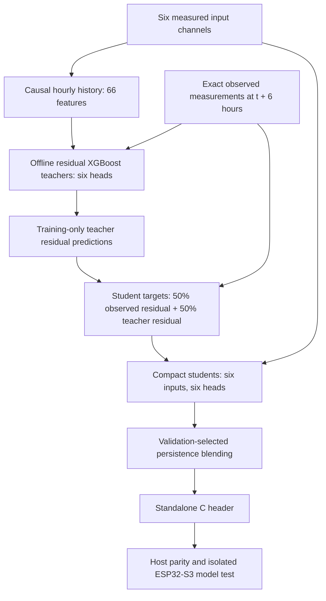

### Offline teacher

Each target has its own residual regressor. Its features come exclusively from
the same six input channels: current value; exact 1, 3, 6, 12 and 24-hour lags;
one-hour change; and trailing 6/24-hour means and standard deviations. This
makes 11 features per channel and 66 total. All windows are causal and stay
inside a station. Missing hours are explicitly reindexed; no future fill or
interpolation is used. XGBoost handles missing historical features through its
missing-value branches.

Two depths (4 and 6) are compared on validation MAE. Each candidate uses at most
250 trees, learning rate 0.05, regularization, subsampling, and early stopping
with patience 25. Only trees through the best iteration are saved. Training
uses CPU histogram trees, four threads and seed 42. The choice provides a
measured nonlinear temporal baseline with practical CPU training and a small
export path; a larger neural network was not assumed to be better without data.

### ESP32 student

Each of six heads has **16 trees of maximum depth 3**. All heads take the same
six current inputs; no historical buffer, missing sensor synthesis, or teacher
execution is required on the ESP32. Training targets average the observed
future-minus-current residual and the teacher's predicted residual on training
rows. Validation and test labels are never used to fit the student.

The final prediction for each head is:

```text
clip_to_physical_range(current_value + selected_weight * predicted_residual)
```

Weights in `{0, 0.25, 0.5, 0.75, 1}` are selected by validation MAE. A zero weight
is a persistence fallback. The compact student's own metrics are reported;
its accuracy is not presented as equal to the larger teacher's accuracy.

The C export uses raw input units and float32 tree thresholds/leaf values,
includes the regression base score, and applies the saved blend weights.
It uses no heap allocation. Missing, infinite and out-of-range current inputs
return failure with NaN outputs. Outputs are measurements, not probabilities
or hazard classes. Training cadence is hourly; arbitrary live sampling cadence
and sensor noise have not been field-validated.

## Leakage controls and evaluation

Targets are independently observed measurements at **exactly t + 6 hours**, joined
by station and timestamp. An absent future reading remains unknown and is not
filled or turned into a negative event.

- Training: nine development stations, target timestamp before 2016-01-01 UTC.
- Validation: those stations, input timestamp from 2016-01-01, target timestamp
  before 2016-07-01 UTC.
- Future test: those stations, input timestamp from 2016-07-01 onward.
- Geographic test: Changping, Dingling and Huairou, never used for fitting or
  model selection, evaluated from 2016-07-01 onward.
- Forecast windows crossing train/validation or validation/test boundaries are
  purged. Earlier held-out-station rows are unused for fitting or scoring.

Before missing-label filtering, the partitions contain 223,794 train, 39,258
validation, 52,416 future-test and 17,472 geographic-test rows; 87,828 rows are
unused by those partitions. The actual number fitted is **216,849–219,194 rows
per head**, because training requires all six current readings and an observed
future target. Thus 420,768 is the source size, not the fitted count per head.

Persistence predicts that the future value equals the current reading.
Model/depth/blend selection uses validation only; test scores are reported
without selecting another model from them. MAE, RMSE, R², row counts and skill
against persistence are saved separately for each split. Empirical validation
90th-percentile absolute-error bands have measured test coverage in the report;
these are not guaranteed calibrated intervals under geographic/domain shift.

## Measured results

Lower MAE is better. The following is the future-time test at the nine
training-region stations. Improvement means MAE reduction versus persistence,
not classification accuracy.

| Forecast target | Unit | Persistence MAE | Offline teacher MAE | ESP32 student MAE | Student improvement |
|---|---|---:|---:|---:|---:|
| `temperature_c` | °C | 3.608 | 1.830 | 3.198 | 11.4% |
| `relative_humidity_pct` | percentage points | 15.928 | 9.653 | 14.334 | 10.0% |
| `pressure_hpa` | hPa | 1.839 | 1.301 | 1.793 | 2.5% |
| `pm25_ug_m3` | µg/m³ | 36.382 | 32.301 | 34.919 | 4.0% |
| `pm10_ug_m3` | µg/m³ | 45.851 | 39.858 | 43.525 | 5.1% |
| `wind_speed_mps` | m/s | 0.892 | 0.657 | 0.732 | 18.0% |

Held-out stations, evaluated in the same future period:

| Target | Persistence MAE | Teacher MAE | ESP32 student MAE |
|---|---:|---:|---:|
| `temperature_c` | 3.869 | 2.025 | 3.525 |
| `relative_humidity_pct` | 15.248 | 9.625 | 13.974 |
| `pressure_hpa` | 1.843 | 1.306 | 1.784 |
| `pm25_ug_m3` | 26.887 | 25.844 | 26.243 |
| `pm10_ug_m3` | 35.144 | 33.457 | 34.328 |
| `wind_speed_mps` | 0.924 | 0.697 | 0.746 |

Both model sizes improved MAE for all six targets on both test partitions in
this run. Student improvements are modest for pressure and particulate
forecasts; retaining the teacher's larger accuracy gains would require more
edge capacity or a history-aware student and a new measured comparison.
Beijing performance does not establish performance in Indian mountain terrain.

Full metrics, selected architectures, data hashes, software versions and
provenance: [`ml/models/uci_beijing_6h/training_report.json`](ml/models/uci_beijing_6h/training_report.json).

## Implementation files and reproduction

Run commands from the repository root with Python 3.11 or newer:

```bash
python3 -m pip install -r requirements.txt
python3 -m ml.six_sensor_forecast.data --output data/uci_beijing_air_quality
python3 -m ml.six_sensor_forecast.train --data data/uci_beijing_air_quality --output ml/models/uci_beijing_6h
python3 -m ml.six_sensor_forecast.predict --input data/uci_beijing_air_quality/observations.csv --model ml/models/uci_beijing_6h --kind student --output /tmp/indra_forecasts.csv
python3 -m ml.six_sensor_forecast.export --model ml/models/uci_beijing_6h --observations data/uci_beijing_air_quality/observations.csv --output ml/models/uci_beijing_6h/esp32_student/export
python3 -m unittest tests.test_six_sensor_forecast
pio run -d esp32/model_test
```

`data.py` downloads and validates the source. `features.py` is shared by
training and batch inference. `train.py` fits and evaluates both model sizes.
`predict.py` checks model hashes and writes keyed forecasts. `export.py` emits
and verifies C. The 12 saved `.ubj` files are real trained models, not drafts.
The generated C header is used directly by the isolated ESP32 model test.

The dedicated requirements file records the tested package versions.
`training_report.json` also records the training environment. Source hashes are pinned;
replacing the source requires an explicit reviewed checksum change. Re-running
training can produce different binary bytes across toolchain/platform versions;
regenerate and re-run parity after changing model artifacts.

## ESP32 export and test status

- Export: [`indra_six_sensor_forecast.h`](ml/models/uci_beijing_6h/esp32_student/export/indra_six_sensor_forecast.h).
- Model structure: six heads, 96 trees total, maximum depth 3, 1,438 total nodes.
- Header source size: see `c_export_report.json`. This is source text size, not flash/RAM use.
- Python/C parity: **4,063 valid rows**, including tree-threshold neighbors and
  physical boundaries, plus **18 rejected invalid cases**. Maximum absolute
  difference across outputs: approximately **0.0000311**, below 0.0002 tolerance.
- Unit/integration tests: causal features, station isolation, missing-hour
  alignment, horizon purging, schema rejection, saved-model inference,
  invalid-input behavior, checksum tampering and compiled C parity.
- ESP32-S3 build: **passed**. Complete isolated Arduino test image uses
  **282,445 bytes flash and 18,448 bytes static RAM**. These figures include the
  framework. They are not model-only memory measurements or runtime stack peaks.
- Physical flashing, measured device latency and live sensor tests: **not run**;
  no connected ESP32 was detected.

The smoke test reads its fixed test vector through volatile storage so the
compiler cannot remove the model by folding constant predictions. It prints
six forecast values, model status and inference time when actually run on a
board. For its `[20, 50, 1013, 35, 60, 2]` input, host-verified expected outputs
are approximately `[18.554806, 56.758118, 1012.819641, 41.744591, 72.887955, 1.689997]`.

To upload the isolated test after connecting the intended ESP32-S3:

```bash
pio run -d esp32/model_test -t upload --upload-port /dev/cu.YOUR_ESP32_PORT
pio device monitor --port /dev/cu.YOUR_ESP32_PORT --baud 115200
```

Uploading replaces the board's current application with this model-only test.
The source is at `esp32/model_test/src/main.cpp`. The build output is
local under its `.pio/build/esp32-s3-model-test/` directory. Export/build evidence
is saved in `ml/models/uci_beijing_6h/esp32_student/export/c_export_report.json` and
`ml/models/uci_beijing_6h/esp32_build_report.json`.

## Remaining model evidence

The model implementation and offline test work are complete. Physical ESP32
execution and validation with local measured six-channel logs remain. If the
required deliverable is storm/flood event classification, independently
verified event labels and a separate hazard evaluation are also still needed;
this forecasting benchmark cannot substitute for them.


</details>


<a id="source-160dc0b3e4b0"></a>

<details>
<summary>docs/archive/README.md</summary>

# Documentation archive

Superseded guides and completed plans are retained here without deletion. Paths preserve their original hierarchy; original inline Mermaid blocks are also copied verbatim into `diagrams/`. There were no standalone `.mmd` files before consolidation.

Use [PROJECT_OVERVIEW.md](#source-f795de9ca89c) for current claims. Historical results describe their own protocols and must not be pooled with latest two-node results. [DOC_INVENTORY.md](#source-1e3a0ca6c259) maps every original path, original modification date, classification and current location.

Reproduction commands run from the repository root, including those in archived guides. Data/model result artifacts remain at their original paths. Original source receipts and patch snapshots are unchanged.


</details>


<a id="source-2c0272c40a48"></a>

<details>
<summary>docs/archive/ROOT_README.md</summary>

> Archived evidence / superseded guide. Original path: `README.md`. Protocol-specific results are preserved; use [PROJECT_OVERVIEW.md](#source-f795de9ca89c) for current scope.

# INDRA Six-Sensor Forecast Model

Train, test and export a six-hour environmental forecast model for ESP32-S3.
Inputs: **temperature, relative humidity, pressure, PM2.5, PM10 and wind speed**.
Outputs: the same six measurements, forecast six hours ahead.

**First field site: Mandi, Himachal Pradesh.** The six-channel input contract,
ESP32 replay procedure and evaluation tools can be used at another site with
its own synchronized measurements. This makes the prototype *testable* at other
locations; forecast accuracy must be measured separately at each site. The
current saved six-input model has not yet been validated on Mandi observations.

## Required release: all six inputs

The deployment requirement is temperature, humidity, **station-level pressure**,
PM2.5, PM10 and wind. The existing five-/two-input Indian experiments do not
meet that requirement and are not the default ESP32 build. The original six-input
Beijing model is the only complete six-input trained baseline currently retained.

[Official IMD northern data access findings](#source-b1cc84283c95)
record the downloaded station catalogue, actual API responses, and the historical
observations still needed before six-input Indian training/testing can run.

## Indian reduced-input experiments (not the required six-input release)

Two research candidates now use the available Indian measurements:

| Family | Sensors used | Evidence |
|---|---|---|
| `india_cpcb_5sensor_6h` | Temperature, humidity, PM2.5, PM10, wind | Improves all five future-time MAEs over matched Beijing student; Baddi humidity regresses |
| `india_cpcb_pm_6h` | PM2.5, PM10 | PM-only student does not beat matched Beijing student; PM2.5 falls back to persistence |

Pressure is excluded because the Indian source units are unresolved. Baddi is
held out entirely; there is no Mandi field validation. Profiles are selected
subsets of the six funded channels, with no invented measurements.

Read [Indian results and reproduction commands](#source-d844c420f3c2).
The original six-input model remains unchanged; model comparisons also retain
explicitly named five-input and two-input Beijing baselines.

## Original six-input baseline and dataset

The original baseline model family is **`uci_beijing_6h`**, trained on
[UCI Beijing Multi-Site Air Quality (501)](https://doi.org/10.24432/C5RK5G):
420,768 hourly observations, 12 stations, March 2013–February 2017, CC BY 4.0.
After splitting and missing-value filtering, each head uses 216,849–219,194
training rows. Humidity is derived from temperature/dew point in this source;
the model itself accepts only the six listed inputs.

| Model directory | Purpose | Architecture | Training data |
|---|---|---|---|
| [teacher](ml/models/uci_beijing_6h/teacher) | Offline accuracy benchmark and student training | Six temporal XGBoost heads, 66 features derived from six sensor channels | UCI Beijing 501 |
| [esp32_student](ml/models/uci_beijing_6h/esp32_student) | Compact model exported to ESP32 | Six XGBoost heads, six current inputs, 16 trees/head, depth 3 | UCI Beijing 501, with teacher-assisted targets |

Both beat persistence MAE on all six targets in the future-time and held-out
station tests. This is a research measurement forecast, not validated
storm/flood detection or India field performance. ESP32 compilation and host
C parity passed; physical flashing is pending a connected board.

## Repository layout

```text
ARCHITECTURE.md                  Architecture, measured results and limitations
requirements.txt                 Tested Python dependency versions
data/uci_beijing_air_quality/     Dataset description and provenance manifest
ml/six_sensor_forecast/           Download, features, training, inference, C export
ml/models/                       Named Beijing/Indian profiles and reports
ml/evaluation/                   Paired Indian and Baddi test results
esp32/model_test/                 Isolated ESP32-S3 forecast test
tests/                           Pipeline, model artifact and C parity tests
.github/workflows/ci.yml          Python checks and ESP32 build
```

See [model files and target names](#source-6f53c951bf55),
[dataset details](#source-395e27c19c09), and
[architecture/results](#source-43768bf9b861).

An [Indian station coverage audit](#source-6e4efce0cc62) now
records seven downloaded station samples and their missing-input/unit issues.
The Indian research profiles exclude unresolved channels and document their
remaining source assumptions.

Two newer [Delhi station exports](#source-b96042f4c49c)
are retained locally with a reproducible audit in Git. The raw CSVs are
excluded from Git. Jahangirpuri has
simultaneous values for all six channels in many 15-minute rows, but its
pressure header conflicts with its numeric values; CRRI Mathura Road lacks all
four weather channels in this export. Neither is approved for six-input
training or Mandi validation until source units, pressure reference, time and
quality checks are resolved.

## Run from the repository root

Python 3.11 or newer and a C compiler are required for host tests/export.

```bash
python3 -m pip install -r requirements.txt
python3 -m unittest discover -s tests

# Download the pinned dataset, train, and verify the C export:
python3 -m ml.six_sensor_forecast.data
python3 -m ml.six_sensor_forecast.train
python3 -m ml.six_sensor_forecast.export

# Run the saved compact model:
python3 -m ml.six_sensor_forecast.predict --input data/uci_beijing_air_quality/observations.csv --kind student --output /tmp/indra_forecasts.csv

# Build the isolated board test (requires PlatformIO):
pio run -d esp32/model_test
```

Download/train commands are optional when using the retained trained artifacts.
The raw ZIP and observation CSV are local, Git-ignored files; the provenance
manifest and trained models are retained in the repository. Board upload
instructions are in [esp32/model_test/README.md](#source-375bb7ef8813).

## ESP32-S3 forecast and event integration

[ML integration firmware and board test](#source-5fac4eace466) runs
both retained models, computes event features from seven hourly snapshots,
and verifies serial replay against Python reference predictions. Both UART
and native-USB build targets are provided. This stage uses serial inputs;
LoRa transport and live sensor drivers remain separate integration work.

## Prototype readiness and field validation

[Readiness guide](#source-334bb239c445) documents synchronized,
history-aware heatmaps (both strategies), verified event inference, independent
field evaluation and chronological calibration. The supplied Himachal files
and newly downloaded official rainfall source have reproducible coverage audits.
The first field evaluation should use complete Mandi measurements and a
connected ESP32-S3. Independent event labels are needed if event detection is
claimed; spatial validation is needed if heatmaps are claimed. The same
protocol can then be repeated at other locations without assuming Mandi
results transfer to them.
See [model inputs and outputs](#source-924a897cc319) for the exact
six-channel and event-score contracts.


</details>


<a id="source-924a897cc319"></a>

<details>
<summary>docs/archive/docs/MODEL_INPUTS_AND_OUTPUTS.md</summary>

> Archived evidence / superseded guide. Original path: `docs/MODEL_INPUTS_AND_OUTPUTS.md`. Protocol-specific results are preserved; use [PROJECT_OVERVIEW.md](#source-f795de9ca89c) for current scope.

# INDRA: Model Inputs, Features, Predictions and Outputs

This document describes the currently implemented models and interfaces.

## 1. What the system does

INDRA uses **six environmental measurement channels** in two distinct ML models:

| Component | Question it answers | Output time |
| --- | --- | --- |
| Six-hour forecasting model | What will the six environmental measurements be six hours from now? | Future: input time + 6 hours |
| Event-rule classifier | Which learned weather/pollution sensor patterns match the current readings and recent history? | Current observation time |
| Spatial heatmap utility | What measurement values or event-rule scores can we estimate between measurement nodes? | Same time as the supplied node observations |

**The current system does not predict hazard events six hours ahead.** Its six-hour outputs are numerical measurements. Its event outputs describe current sensor-rule patterns.

## 2. The six physical input channels

Both models use the following channels, in this exact order:

| Position | Channel | Code name | Unit | Accepted software range |
| --- | --- | --- | --- | --- |
| 1 | Temperature | `temperature_c` | °C | −60 to 85 |
| 2 | Relative humidity | `relative_humidity_pct` | % | 0 to 100 |
| 3 | Station atmospheric pressure | `pressure_hpa` | hPa | 300 to 1100 |
| 4 | PM2.5 concentration | `pm25_ug_m3` | µg/m³ | 0 to 5000 |
| 5 | PM10 concentration | `pm10_ug_m3` | µg/m³ | 0 to 5000 |
| 6 | Wind speed | `wind_speed_mps` | m/s | 0 to 100 |

These are six measurement channels, not necessarily six separate physical devices. For example, one environmental sensor may provide temperature, humidity and pressure.

The ranges above reject obviously invalid inputs; they do not certify sensor calibration or accuracy. Use station pressure, not an undocumented sea-level-adjusted pressure. Convert wind speed from km/h to m/s by dividing by 3.6.

Timestamps and station/node identifiers organize records and history. They are not additional learned inputs to the compact forecasting model. Coordinates belong to the spatial layer, not the forecasting model.

## 3. Model A — Six-hour measurement forecast

### Input

The deployed-format **student model** accepts one complete current snapshot of the six channels. It does not need six hours of history.

Example input:

```text
[20, 50, 1013, 35, 60, 2]
```

Meaning: 20 °C, 50% humidity, 1013 hPa, 35 µg/m³ PM2.5, 60 µg/m³ PM10 and 2 m/s wind.

### Outputs

It returns six numerical predictions in the same order:

| Output | Meaning |
| --- | --- |
| Forecast temperature | Estimated temperature at t + 6 hours |
| Forecast relative humidity | Estimated humidity at t + 6 hours |
| Forecast pressure | Estimated pressure at t + 6 hours |
| Forecast PM2.5 | Estimated PM2.5 concentration at t + 6 hours |
| Forecast PM10 | Estimated PM10 concentration at t + 6 hours |
| Forecast wind speed | Estimated wind speed at t + 6 hours |

The saved software test vector above produces approximately:

```text
[18.554806, 56.758118, 1012.819641, 41.744591, 72.887955, 1.689997]
```

This is a software example, not an observed weather forecast at a deployment site. The output is one six-hour endpoint, not a forecast for every intervening hour. It does not include uncertainty intervals.

### Model structure and training

- Model family: XGBoost regression, not a neural network.
- Six independent output heads.
- Compact student: 16 trees per head, maximum depth 3, six current inputs.
- Predictions use a learned change from the current measurement, blended with persistence and bounded to accepted physical ranges.
- A larger **teacher** exists for offline benchmarking/training. It uses 66 causal features from current and historical values. It is not the compact six-input ESP32 student.
- Training source: UCI Beijing Multi-Site Air Quality, 420,768 hourly station records across 12 stations, 2013–2017. Humidity is derived from temperature/dew point in that source.
- Saved future-time and held-out-station tests beat persistence MAE on all six targets. This does not establish performance in Mandi.

Retained complete-input model: `ml/models/uci_beijing_6h/`.

## 4. Model B — Current event-rule classification

### Input history

The deployment inference path requires **seven complete consecutive hourly observations**, covering six hours from the first reading to the latest.

```text
Six-channel observations at t−6h, t−5h, …, t−1h, t
                         ↓
Six current values + eleven derived features
                         ↓
17 numerical model inputs
                         ↓
Twelve output positions, ten with trained heads
```

All eleven derived features are computed from the same six sensor channels. No additional physical sensor is introduced.

### The eleven derived features

The feature order below follows the six raw inputs in Section 2.

| Model position | Feature | Code name | Meaning |
| --- | --- | --- | --- |
| 7 | Dew point | `T_dew` | Derived from temperature and humidity using the Magnus formula; °C |
| 8 | Vapour pressure deficit | `VPD` | Derived atmospheric drying potential; kPa |
| 9 | Heat index | `HI` | Implemented temperature/humidity heat-index approximation; °C |
| 10 | Particulate ratio | `PM_ratio` | PM2.5 divided by PM10; undefined when PM10 is zero |
| 11 | One-hour pressure change | `dP_dt` | P(t) − P(t−1h); hPa over one hour |
| 12 | Six-hour pressure change | `dP_6h` | P(t) − P(t−6h); hPa over six hours |
| 13 | One-hour temperature change | `dT_dt` | T(t) − T(t−1h); °C over one hour |
| 14 | One-hour PM2.5 change | `dPM25_dt` | PM2.5(t) − PM2.5(t−1h); µg/m³ |
| 15 | One-hour PM10 change | `dPM10_dt` | PM10(t) − PM10(t−1h); µg/m³ |
| 16 | One-hour humidity change | `dRH_dt` | RH(t) − RH(t−1h); percentage points |
| 17 | Continuously rising PM2.5 | `pm25_mono_6h` | 1 when PM2.5 increases at every step of the seven-reading window; otherwise 0 for complete history |

The current model uses hourly changes. It does not measure fifteen-minute trends.

### Output classes and implemented label rules

The model has twelve ordered binary output slots. Each trained head returns a separate score between 0 and 1. Multiple heads may score highly at the same time: this is **multi-label**, not a single exclusive category.

The rules below describe the targets used to train the saved model, not independently verified definitions of actual hazards. `Δ` values refer to the intervals listed above.

| Output position | Event name / code | Implemented training-rule summary | Saved status |
| --- | --- | --- | --- |
| 1 | Light/moderate rain — `light_moderate_rain` | RH ≥ 85%, six-hour pressure change ≤ −1.5 hPa, T > 3 °C, PM2.5 and PM10 changes ≤ 0 | Trained |
| 2 | Severe rainstorm/squall — `severe_rainstorm_squall` | Six-hour pressure change ≤ −3.5 hPa, one-hour temperature change ≤ −3 °C, T > 3 °C, wind ≥ 10 m/s, PM changes ≤ 0 | **Untrained: no positive training labels** |
| 3 | Snowstorm/blizzard — `snowstorm_blizzard` | Six-hour pressure change ≤ −3 hPa, T ≤ 1 °C, RH ≥ 85%, wind ≥ 9 m/s, PM changes ≤ 0 | **Untrained: no positive training labels** |
| 4 | Freezing rain/sleet — `freezing_rain_sleet` | Falling pressure, RH ≥ 90%, −2 ≤ T ≤ 0.5 °C | Trained |
| 5 | Radiation fog — `radiation_fog` | T − dew point ≤ 2 °C, RH ≥ 95%, wind < 1.5 m/s, PM2.5 > 80 µg/m³ | Trained |
| 6 | Ground frost — `ground_frost` | T ≤ 0 °C, dew point ≤ 0 °C, wind < 2 m/s, non-falling pressure | Trained |
| 7 | Extreme heatwave — `extreme_heatwave` | T ≥ 35 °C **or** implemented heat index ≥ 41 °C | Trained |
| 8 | Wildfire/evaporative risk — `wildfire_evaporative_risk` | VPD ≥ 2.5 kPa, RH ≤ 25%, wind ≥ 5 m/s | Trained |
| 9 | Dust storm/haboob — `dust_storm_haboob` | Wind ≥ 8 m/s, PM2.5/PM10 ≤ 0.35, PM10 > 250 µg/m³, RH < 40% | Trained; sparse evidence |
| 10 | Smoke plume — `smoke_plume` | PM2.5 > 150 µg/m³, PM2.5/PM10 ≥ 0.70, RH < 60%, wind > 1.5 m/s | Trained |
| 11 | Smog/inversion trap — `smog_inversion_trap` | Wind < 1 m/s, pressure ≥ 1010 hPa, PM2.5 > 120 µg/m³ and continuously rising for six hours | Trained |
| 12 | Cold frontal passage — `cold_frontal_passage` | One-hour temperature change ≤ −4 °C, pressure change ≥ 1.5 hPa, wind ≥ 6 m/s, absolute humidity change ≥ 5 percentage points | Trained; sparse evidence |

The saved heatwave rule is an instantaneous 35 °C/heat-index rule, not the proposed region-specific, six-hour sustained rule. The saved squall rule does not implement the proposed fifteen-minute pressure-rebound sequence. These differences are preserved here so the document describes the actual model.

### What an event score means

A high score means the classifier strongly matches a **learned sensor-derived rule**. It is not a calibrated probability of a real event.

For example:

```text
smoke_plume score = 0.8
```

This does **not** establish an 80% chance of smoke or fire. The model was trained against rules calculated from the input measurements, not independently confirmed smoke/fire observations.

- Wildfire/evaporative risk does not locate or confirm an active fire.
- Fog, rain and frost scores do not replace direct observations of those events.
- The pressure threshold in the inversion rule is fixed at 1010 hPa; its suitability for high-altitude sites is not established.
- Dust has no positive rule examples in the saved evaluation splits; the cold-front head has only twelve positive training examples. A fitted head is not proof of reliability.

### Availability and architecture

- Saved classifier: one binary XGBoost head per trainable event, 16 trees per trained head, maximum depth 4.
- Training source: the Beijing observations, with sensor-rule-generated labels.
- The two skipped heads have no learned detector.
- The low-level exported C header returns zero for skipped heads. **The deployment wrapper replaces these with unavailable values** (`NaN` internally, `null` in serial JSON).
- The Python deployment predictor and heatmaps also retain unavailable scores rather than reporting them as negatives.
- A field calibration/evaluation tool exists, but the deployed scores have not been calibrated against independent local events.

Model artifacts: `ml/models/uci_beijing_event_rules_6sensor/`.

## 5. Spatial heatmap outputs

The heatmap utility takes two or more synchronized nodes with:

- Distinct planar `x, y` coordinates in one common local projection.
- A timezone-aware observation timestamp shared by all nodes.
- The six measurement channels.
- Seven consecutive hourly historical records when event maps are requested.

It can produce:

| Output | Contents |
| --- | --- |
| Feature maps | Six grids: temperature, humidity, pressure, PM2.5, PM10 and wind |
| Event maps | Twelve ordered grids, with unavailable values for untrained heads or insufficient history |
| Support mask | Grid cells supported by the node geometry |
| Strategy comparison | Mean absolute difference between strategies on cells where both produce scores |
| Manifest | Input provenance, timestamps, interpolation methods and experimental status |

**Strategy A:** classify each measured node using its history, then interpolate its event scores. This is the default.

**Strategy B:** interpolate each of the seven raw measurement time slices, derive features at each grid cell, then classify those cells.

Interpolation uses IDW, with optional ordinary kriging for at least three nodes when the dependency is available and fitting succeeds. Extrapolation outside the node geometry is masked by default. With two nodes, supported geometry is their connecting segment, not a validated two-dimensional area.

These are spatial estimates, not measured conditions at unsampled locations. Agreement between strategies is not a measure of real spatial accuracy. The CLI exports arrays in `maps.npz` plus `manifest.json`; it does not itself establish a validated dashboard or automatically render images.

## 6. Separate midpoint estimator

`ml/six_sensor_forecast/midpoint.py` accepts two complete, simultaneous six-channel endpoint snapshots and their geographic coordinates.

It returns:

1. The spherical geographic midpoint.
2. Six midpoint input estimates obtained by averaging the endpoint readings.
3. Six-hour forecasts produced from those estimated inputs by the existing student model.

This is an experimental interpolation-plus-forecast operation. Coordinates alone do not predict weather, and no terrain/elevation correction or independent midpoint accuracy has been established.

## 7. ESP32-S3 interface and outputs

The current integration application accepts serial input as:

```text
unix_seconds,temperature_c,relative_humidity_pct,pressure_hpa,pm25_ug_m3,pm10_ug_m3,wind_speed_mps
```

Example:

```text
1767225600,20,50,1013,35,60,2
```

The timestamp organizes hourly history; the six following values are the measured channels.

### Prediction record fields

| Field | Meaning |
| --- | --- |
| `protocol_version` | Serial record schema version |
| `boot_id`, `sequence` | Restart identity and record sequence |
| `build_sha256` | Source/configuration fingerprint for the selected firmware build environment |
| `measurements` | The six original input values |
| `timestamp_utc` | Input time as UTC Unix seconds |
| `forecast_timestamp_utc` | Input timestamp + 21,600 seconds |
| `status` | Input/history/inference state listed below |
| `research_only` | True: experimental outputs, not validated operational warnings |
| `history_rows` | Number of stored hourly observations, up to seven |
| `latency_us` | On-board time spent processing that input, when actually executed on hardware |
| `forecast_6h` | Six numerical measurement forecasts |
| `event_valid_mask` | Which event scores are available |
| `event_scores` | Twelve ordered event-score positions; unavailable values are `null` |

### Status values

| Status | Interpretation |
| --- | --- |
| `WARMING_UP` | Current readings are accepted and forecasts are available; event history is incomplete |
| `READY` | Forecasts and the ten trained event-rule scores are available; this is **not** a field-validation certificate |
| `FEATURES_UNAVAILABLE` | Forecasting can run, but event features are unavailable—for example, PM10 is zero and the ratio is undefined |
| `INVALID_INPUT` | Invalid timestamp or missing/nonfinite/out-of-range measurement; prediction is rejected |
| `OUT_OF_ORDER` | Timestamp duplicates or precedes the previous accepted reading; prediction is rejected |

When events are ready, `event_valid_mask` is **4089 (`0x0ff9`)**. Bits are zero-based; bits 1 and 2 are unset because output positions 2 and 3 are untrained. Otherwise the event mask is zero.

A missing or off-grid hour restarts event warmup. History is held in RAM and is lost after reboot. Send one observation per exact hourly interval; do not reinterpret high-frequency readings as consecutive hours.

Commands:

- `INFO`: report device, build/model identity and self-test state.
- `SELFTEST`: run the synthetic on-board reference test.
- `RESET`: clear stream history.

The application currently receives measurements through the serial ML interface. Live sensor drivers and LoRa transport are not provided by this integration application. ESP32 builds and host parity tests have passed; actual physical execution and latency still need a connected-board test.

## 8. Other trained profiles in the repository

| Profile | Inputs/outputs | Role |
| --- | --- | --- |
| `uci_beijing_6h` | All six channels | Retained complete-input forecast baseline |
| `india_cpcb_5sensor_6h` | Temperature, humidity, PM2.5, PM10, wind | Indian research model; pressure excluded |
| `india_cpcb_pm_6h` | PM2.5 and PM10 | Indian particulate-only research model |
| `uci_beijing_5sensor_6h` | Same five-channel subset | Matched comparison baseline |
| `uci_beijing_pm_6h` | PM2.5 and PM10 | Matched comparison baseline |

Reduced-input profiles are separate experiments. They do not replace the required six-input ESP32 integration model, and their existence does not prove validated six-channel performance in India.

## 9. What the current model does not establish

The present evidence does not establish:

- Accurate Mandi-wide or India-wide forecasting.
- Independently validated detection of the named hazards.
- Six-hour advance predictions of the twelve hazard classes.
- Working trained detectors for severe rainstorm and snowstorm.
- Calibrated real-event probabilities from the raw event scores.
- Independently validated spatial heatmaps or midpoint forecasts.
- Successful physical ESP32 operation, measured device latency, or LoRa delivery.

The supplied Himachal weather files have only four channels. The downloaded rainfall source adds candidate rainfall observations, but its absence of dry-hour records prevents treating missing observations as negative rain labels. No retraining can manufacture the missing ground truth.

## 10. Code and evidence references

Paths below are relative to the repository root:

- Six-channel contract: `ml/six_sensor_forecast/contract.py`
- Forecast inference: `ml/six_sensor_forecast/predict.py`
- Forecast results and architecture: `ml/models/uci_beijing_6h/training_report.json`
- Event features, output order and label rules: `ml/event_classifier/features.py`
- Verified history-aware event inference: `ml/event_classifier/predict.py`
- Event training results: `ml/models/uci_beijing_event_rules_6sensor/event_training_report.json`
- Spatial strategies: `ml/event_classifier/heatmap.py`
- Midpoint estimator: `ml/six_sensor_forecast/midpoint.py`
- ESP32 runtime: `esp32/ml_integration/include/indra_ml_runtime.h`
- ESP32 serial interface: `esp32/ml_integration/src/main.cpp`
- Build/upload guide: [ESP32 ML integration](#source-5fac4eace466)
- Validation requirements: [Prototype readiness](#source-334bb239c445)


</details>


<a id="source-334bb239c445"></a>

<details>
<summary>docs/archive/docs/PROTOTYPE_READINESS.md</summary>

> Archived evidence / superseded guide. Original path: `docs/PROTOTYPE_READINESS.md`. Protocol-specific results are preserved; use [PROJECT_OVERVIEW.md](#source-f795de9ca89c) for current scope.

# Prototype readiness and field deployment gates

The retained models are ready for a supervised software/ESP32 bench prototype.
Field hazard alert deployment is not approved by the available evidence.
No model weights were retrained as part of this preparation; preserving their
provenance prevents silently changing model behavior without validation.

## Field-test scope

Mandi, Himachal Pradesh is the first target site. Start with a connected-board
replay, then collect six synchronized, calibrated local measurements at hourly
times and compare the six-hour forecasts with observed outcomes and persistence.
Record the station location, elevation, sensor identity, pressure reference and
clock source. This tests the saved model in Mandi; it does not require a Delhi
dataset. The existing Delhi export has unresolved pressure units and timestamp
semantics and should remain outside six-channel evaluation until verified.

The firmware's input format and field evaluator are location-independent, so
the **same test procedure** can be repeated at any site with the six channels
and verified timestamps. A successful Mandi test establishes Mandi-site
performance for the tested period, not accuracy throughout India. Each new
site needs its own held-out evaluation; retraining should follow the baseline
test only if the local evidence warrants it.

## Fixed software gaps

- Event inference checks model hashes, feature order and objective.
- Inference requires seven complete consecutive hourly readings. An interior
  history gap now suppresses scores in Python, as in the ESP32 runtime.
- Heatmaps never fill missing temporal features with zeros. Untrained heads
  remain unavailable.
- Strategy A classifies measured nodes then interpolates scores. Strategy B
  interpolates all seven raw history slices then derives features and classifies
  each cell. Both can be compared on the same grid.
- Nodes must have distinct finite coordinates and synchronized explicit times.
  Raw observations are checked against physical ranges. Out-of-range values
  cannot produce apparently valid event maps.
- By default, maps mask cells outside the node convex hull. Two nodes support
  only their connecting segment. Explicit extrapolation remains experimental.
- Independent-field evaluation supports exact six-hour matching, persistence
  comparisons, per-station measurement errors, and chronological event-score
  calibration. Test labels never fit the calibration model.

## Reproduce the bench prototype

```sh
python3 -m unittest tests.test_field_validation tests.test_spatial_readiness tests.test_event_classifier tests.test_esp32_ml_integration tests.test_six_sensor_forecast tests.test_midpoint -v
python3 -m ml.deployment.readiness
python3 -m ml.deployment.audit_himachal
python3 -m ml.event_classifier.heatmap --input reports/deployment/synthetic_nodes.json --strategy both --extent 0 100 0 100 --grid-size 10 --idw-only --output reports/deployment/synthetic_heatmap
```

The map command produces `maps.npz` and `manifest.json`. The fixture is explicitly
synthetic; this demonstrates software operation, not field accuracy. Coordinates
are planar meters in a shared local projection, not latitude/longitude.
Real node JSON uses the same structure: x, y, timestamp_utc, the six canonical
channels and seven `history` dictionaries. Default CLI strategy is A.

ESP32 builds, upload commands and automated physical replay are in
[the ML integration guide](#source-5fac4eace466). No new hardware
execution is claimed by this update. LoRa integration remains deferred per the
ML-first scope; it is not tested by these host checks.

## What the existing Himachal files support

The fresh audit in `reports/deployment/himachal_readiness.json` fingerprints all
four supplied CSVs and checks units, duplicates and broad physical ranges.
There are 43,909 exact station/coordinate/time matches after screening, including
2,047 at AWS IIT Mandi. These are four-channel matches, not a six-channel dataset.
Wind is converted from km/h to m/s; mb is numerically hPa. Pressure reference,
repeated values and source timezone remain unresolved.

Missing PM channels must not be filled with arbitrary constants, borrowed from
a distant city, or inferred from AQI and then presented as observed readings.
The earlier missing-PM diagnostic is not a valid production evaluation.

## Independent field evaluation

The six-hour forecast can be tested without event labels. Once a verified
six-channel file exists, use `ml.deployment.evaluate_forecast` before local
retraining. It rejects incomplete/out-of-range rows, naive timestamps and
unverified source declarations. Each test forecast is paired only with an
observation from the same station at exactly `t + 6 hours`; the saved student
is compared with the unchanged-current-value (persistence) baseline.

To create that CSV from recorder journals, run
`python3 -m ml.deployment.convert_field --input results/field/session-001.jsonl --output results/field/observations.csv --report results/field/conversion_report.json`.
See the [conversion guide](#source-5fac4eace466)
for exclusions, duplicate handling and provenance requirements. The evaluator
checks the selected model's six-hour horizon, six outputs and ordered six-input
student contract before inference; reduced-input models are unsupported here.

`observations.csv` must have exactly `timestamp_utc,location_id,temperature_c,relative_humidity_pct,pressure_hpa,pm25_ug_m3,pm10_ug_m3,wind_speed_mps`.
Every timestamp needs an explicit UTC offset, and all six measurements must be
observed at the same location and hour. The provenance JSON needs
`observation_source`, `timezone_verified: true`, `units_verified: true`, and
`pressure_reference: "station"`, supported by the provider's metadata.
Choose and freeze the test start before inspecting model errors:

```sh
python3 -m ml.deployment.evaluate_forecast --observations observations.csv --provenance provenance.json --test-start 2025-01-01T00:00:00Z --output reports/deployment/local_forecast_test.json
```

The date is an example. The four Himachal weather files cannot be passed to
this command as a six-input test because neither PM channel is present. The
Indian five-channel experiment also lacks verified station pressure. Potential
particulate routes are the [CPCB data repository](https://airquality.cpcb.gov.in/AQI_India/)
and [government hourly AQI data](https://www.data.gov.in/catalog/real-time-air-quality-index),
but neither source has yet yielded verified, colocated hourly PM2.5 **and** PM10
measurements for AWS IIT Mandi. AQI values or other-town PM must not be used as
substitutes. The IIT Mandi environmental-engineering lab
[lists a PM2.5 sampler](https://scene.iitmandi.ac.in/teaching_labs_details/environmental-engineering-lab),
which is a possible inquiry route, not evidence of hourly PM10 coverage.

For board testing, no ESP32 serial port was visible during the latest local
check. Once a board is connected, follow the upload and replay commands in
[the ML integration guide](#source-5fac4eace466); the generated
`results/esp32_board_test.json` will contain measured inference latency.

For event validation, collect independently recorded positive and negative
examples with timestamps and sites. Unknown labels stay blank. The current
rainfall file contains only wet records, so it cannot supply negative examples.

Prepare three files after obtaining observations:

1. `observations.csv`: timestamp_utc, location_id, temperature_c,
   relative_humidity_pct, pressure_hpa, pm25_ug_m3, pm10_ug_m3, wind_speed_mps.
   Use verified UTC or explicit UTC offsets, matching hourly station samples.
2. `labels.csv`: timestamp_utc, location_id and the twelve event-name columns
   in `ml/event_classifier/features.py`. Use independently observed 0/1 labels;
   leave unknown labels blank. Do not use the input-derived rules as ground truth.
3. `provenance.json`: observation_source, label_source,
   independent_event_labels=true, timezone_verified=true, units_verified=true,
   pressure_reference="station". These declarations need supporting source
   evidence; the evaluator cannot independently certify a user declaration.

Choose a cutoff before inspecting test results, then run:

```sh
python3 -m ml.deployment.field_validation --observations observations.csv --labels labels.csv --provenance provenance.json --test-start 2025-01-01T00:00:00Z --output reports/deployment/field_evaluation.json
```

The date above is an example, not a prescribed cutoff. Calibration fits only
pre-cutoff records. It needs at least 20 positives and 20 negatives; this is a
minimum software guard, not proof of adequate sample size or independent events.
Post-cutoff Brier score, AUC, precision/recall and false positives/negatives are
reported, alongside uncalibrated metrics. Correlated hours are not independent
weather episodes. Review performance by site/season and on untouched sites,
and quantify uncertainty before any release decision. The report does not
automatically approve deployment or install calibration into ESP32 firmware.

## Gates that still require evidence

| Claim | Required evidence |
| --- | --- |
| Accurate Mandi forecasting | Aligned six-channel local holdouts, acceptable per-variable errors and persistence comparison |
| Reliable actual hazards | Independent observed events; per-class false-alarm/miss analysis across time and sites |
| Six-hour hazard warning | Future-event targets, a separately trained model and lead-time evaluation; current event model is contemporaneous |
| All twelve events work | Adequate positives/negatives and held-out evidence for skipped/rare classes; no synthetic positives presented as field data |
| Calibrated probability | Calibration learned separately and evaluated on untouched independent observations |
| Spatially validated heatmap | Withhold real node observations and evaluate reconstruction; both synthetic-strategy agreement and interpolation are insufficient |
| Physical deployment | On-board replay, inference timing, power/sensor checks; LoRa packet loss/delivery testing when that integration resumes |

`reports/deployment/readiness.json` records all twelve classes and their data
sparsity flags. Its alert gates remain closed. Dust has no positive examples in
the saved evaluation splits; the cold-front rule has only twelve training
positives. A trained model file is not sufficient evidence of reliability.

## Newly downloaded independent rainfall source

The official hourly Himachal rainfall download has 166,355 rows. Matching it
with the screened weather data gives 1,431 candidate rows, including 45 at
IIT Mandi. However, the entire rainfall file contains no zero-rainfall rows;
all matched examples are wet. It cannot support binary detection validation
or calibrated rain probabilities without independently observed dry periods.
See [source details](#source-c6df48264a0b) and the reproducible
`ml.deployment.audit_rainfall` command. This is progress in acquiring independent
measurements, not evidence that the model now detects real rain reliably.

## Field-trial preparation update

The ML integration firmware now exposes build/model identity, boot IDs,
monotonic record sequences, original measurements and forecast timestamps.
The serial recorder journals accepted and rejected records with host reception
times, enforces the intended build ID, and quarantines stale observations.
See the integration guide for commands. This closes traceability and logging
gaps but does not provide live sensor drivers, LoRa transport, calibrated
hazard warnings or physical device validation. Board/sensor models, wiring,
site and the first deployment mode still need to be specified.


</details>


<a id="source-84ee9cb9023b"></a>

<details>
<summary>docs/archive/docs/reference/ML_INFERENCE.md</summary>

> Archived evidence / superseded guide. Original path: `docs/reference/ML_INFERENCE.md`. Protocol-specific results are preserved; use [PROJECT_OVERVIEW.md](#source-f795de9ca89c) for current scope.

# INDRA model inference reference

## Six-hour measurement forecast

The retained `uci_beijing_6h` forecast has six regression outputs: temperature,
relative humidity, pressure, PM2.5, PM10, and wind speed six hours after the
input reading. Its ESP32 student accepts the same six measured values in that
order and has six independent 16-tree, depth-3 XGBoost heads. The teacher uses
causal history features for offline benchmarking. The training source is the
UCI Beijing Multi-Site Air Quality dataset; neither Indian field accuracy nor
physical ESP32 timing has been measured. The generated C header is
`ml/models/uci_beijing_6h/esp32_student/export/indra_six_sensor_forecast.h`.

The full source, split, model weights, metrics, and export checksum are in
`ml/models/uci_beijing_6h/training_report.json` and its export report.
The `india_cpcb_5sensor_6h` and `india_cpcb_pm_6h` directories are separate
reduced-input research profiles, not replacements for the six-input release.

```bash
python3 -m ml.six_sensor_forecast.train
python3 -m ml.six_sensor_forecast.export
python3 -m unittest discover -s tests
```

## Event-rule classifier experiment

`ml/event_classifier/` contains a distinct twelve-head, binary XGBoost
experiment. It uses the same six physical sensor channels plus eleven
quantities derived from them: dew point, vapour pressure deficit, heat index,
PM2.5/PM10 ratio, one-hour and six-hour pressure change, one-hour temperature,
PM2.5, PM10, and humidity change, and a six-hour PM2.5 rising flag. Several
features need up to six hours of history; a single sensor snapshot cannot
provide the full input vector.

The labels are deterministic conditions calculated from these inputs. They are
**not observed event ground truth**. Reported precision, recall, F1, and AUC
measure how well a student imitates those conditions on future-time and
held-out Beijing stations. They do not measure detection of actual rain,
blizzards, smoke, or other hazards in Himachal Pradesh. No event classifier is
included in the default ESP32 firmware.

The model files and `event_training_report.json` are in
`ml/models/uci_beijing_event_rules_6sensor/`. The optional C export is
`esp32_student/export/indra_event_classifier.h`; it accepts 17 finite values
and returns twelve rule-match scores in the order recorded in the report. A
skipped rule returns zero and is explicitly marked in the report.

```bash
python3 -m ml.event_classifier.train
python3 -m ml.event_classifier.export
```

The exporter compiles the header and checks C predictions against XGBoost.
This parity check does not establish weather-event accuracy or board timing.

## Spatial interpolation experiment

`ml/event_classifier/heatmap.py` interpolates measured channels from two or
more sensor nodes with inverse-distance weighting. With three or more nodes,
it attempts ordinary kriging when `pykrige` is installed and falls back to
inverse-distance weighting if kriging fails. Event-score maps first classify
the supplied nodes, then interpolate their rule scores. The implementation
expects planar `x, y` coordinates; latitude and longitude require a suitable
local projection before use. It has no independent spatial validation.

See [event experiment details](#source-3586797fafc9) and
[rule limitations](#source-6ba6b188f5fb).

## Deployment preparation update

`ml/event_classifier/predict.py` verifies model checksums and suppresses event
scores unless seven complete consecutive observations are present. Untrained
heads return NaN in Python and null in serial JSON.

Heatmaps now require synchronized timezone-aware node snapshots and real
history for event inference. Strategy A classifies nodes then interpolates;
strategy B interpolates all seven raw history slices then classifies grid cells.
Use `strategy="both"` to compare them. Extrapolation outside node geometry is
masked by default. See `docs/PROTOTYPE_READINESS.md` for commands and field
validation requirements. These changes do not convert rule scores into
validated hazard probabilities or six-hour hazard forecasts.


</details>


<a id="source-d844c420f3c2"></a>

<details>
<summary>docs/archive/ml/evaluation/INDIA_RESULTS.md</summary>

> Archived evidence / superseded guide. Original path: `ml/evaluation/INDIA_RESULTS.md`. Protocol-specific results are preserved; use [PROJECT_OVERVIEW.md](#source-f795de9ca89c) for current scope.

# Indian climate evaluation and training results

## What was trained

Two Indian research model profiles were fitted on the downloaded CPCB-derived
station observations. They use only available channels from the funded six
measurements. Every pressure column remains excluded; no pressure model was
fine-tuned or validated on India. Dehradun temperature with the unit `degree`
also remains excluded. No unavailable value was filled with a constant.

| Family | Inputs/outputs | Source and role |
|---|---|---|
| `india_cpcb_5sensor_6h` | Temperature, humidity, PM2.5, PM10, wind | Indian teacher and ESP32 student |
| `india_cpcb_pm_6h` | PM2.5, PM10 | Indian particulate-only teacher and student |
| `uci_beijing_5sensor_6h` | Same five-channel profile | Matched-input Beijing transfer baseline |
| `uci_beijing_pm_6h` | Same particulate-only profile | Matched-input Beijing transfer baseline |
| `uci_beijing_6h` | Original six measurements including pressure | Original saved model, unchanged |

The matched Beijing models use the same selection/training procedure as the
Indian variants. They are new baseline fits, not the original six-input model.
The original model has zero complete six-input Indian rows available. Its
low-level NaN-input stress-test scores are retained in the JSON report as
diagnostics outside its supported complete-input deployment contract; they
are not the primary comparison shown here.

## Dataset and split

- Canonical source: 368,462 rows from seven sampled stations. This is not the
  entire national archive. All stored input values originate in measurements.
- Five-channel complete current readings occur only at Guwahati, Srinagar,
  Jodhpur and Baddi. Bengaluru has no simultaneous five-channel coverage.
- Five-channel model fitting: 75,289–76,861 rows per target from the three
  development stations. PM-only fitting: 127,064–127,072 rows per target.
- Training labels end before 2022-07-01 UTC. Validation inputs start then and
  labels end before 2023-01-01. Future test is January–March 2023.
- Baddi (`HP001`) is excluded entirely from fitting and validation, and tested
  in January–March 2023. It is a single unseen Himachal station, not Mandi.
- Six-hour labels crossing split boundaries are purged. Missing future
  measurements remain unknown. Every comparison uses identical eligible rows.
- Source timezone is assumed to be Asia/Kolkata, documented rather than
  claimed as provider-confirmed. Hourly interval END is the availability time;
  UTC times therefore fall at :30. Features support consistent hourly offsets.
- The Indian source gives hourly interval measurements; aggregation equivalence
  with the Beijing hourly source has not been independently established.
- Source is a secondary CPCB compilation, publisher license CC BY-NC-SA 4.0.
  Metadata and hashes are in `data/india_cpcb_research/dataset_manifest.json`.

## Five-input ESP32 student: future-time test

Lower MAE is better. Units are °C, humidity percentage points, µg/m³ for both
particulate channels, and m/s. These are research forecast errors, not accuracy percentages.

| Target | Test rows | Persistence MAE | Matched Beijing student | Indian student | Indian teacher |
|---|---:|---:|---:|---:|---:|
| temperature_c | 3,592 | 5.148 | 4.412 | 4.336 | 1.982 |
| relative_humidity_pct | 3,592 | 16.520 | 14.696 | 14.433 | 7.938 |
| pm25_ug_m3 | 3,468 | 56.436 | 52.130 | 45.610 | 31.147 |
| pm10_ug_m3 | 3,459 | 109.126 | 93.255 | 87.193 | 61.615 |
| wind_speed_mps | 3,591 | 0.419 | 0.584 | 0.349 | 0.295 |

## Baddi: station held out entirely

| Target | Test rows | Persistence MAE | Matched Beijing student | Indian student | Indian teacher |
|---|---:|---:|---:|---:|---:|
| temperature_c | 1,705 | 1.727 | 1.709 | 1.672 | 1.309 |
| relative_humidity_pct | 1,597 | 14.048 | 12.457 | 13.186 | 10.018 |
| pm25_ug_m3 | 1,689 | 46.660 | 43.427 | 40.503 | 35.352 |
| pm10_ug_m3 | 1,684 | 80.769 | 70.527 | 69.072 | 58.745 |
| wind_speed_mps | 1,705 | 0.834 | 0.673 | 0.665 | 0.580 |

The Indian student improves all five pooled future-time MAEs and four of five
Baddi MAEs versus the matched Beijing student. **Baddi humidity regresses**
(13.186 versus 12.457 percentage points). The Indian temporal teacher improves
all five versus its matched teacher baseline in both pooled test splits.

## Two-input PM-only student

| Target | Future persistence | Future Beijing student | Future Indian student | Baddi Beijing student | Baddi Indian student |
|---|---:|---:|---:|---:|---:|
| pm25_ug_m3 | 36.851 | 35.753 | 36.851 | 46.127 | 48.820 |
| pm10_ug_m3 | 66.730 | 64.758 | 64.972 | 78.969 | 79.696 |

**The PM-only student is not an improvement over the matched Beijing student.**
Its PM2.5 validation-selected blend weight is zero, so that head outputs
persistence. It is retained as a measured candidate/fallback experiment, not
promoted as a better release. The teacher benefits from history, but that
accuracy must not be attributed to the compact current-input student.

## Architecture and inference

Profiles are validated, ordered subsets of the original six channels. Temporal
features use current readings, lags, changes and rolling statistics only from
the selected channels. ESP32 students still use 16 depth-3 trees per head.
Validation chooses direct residual supervision versus 50% teacher-assisted
supervision, and the persistence blend weight. Test data is never used for
selection. Profile names and feature order are stored with the saved models.

Raw CSV inference keeps the canonical six columns for interoperability; ignored
channels may be NaN. The exported C function accepts exactly five or two floats
according to `INDRA_FORECAST_INPUTS`, in the order printed in each header.

## Reproduce from the repository root

```bash
python3 -m ml.six_sensor_forecast.audit_india --download
python3 -m ml.six_sensor_forecast.prepare_india
python3 -m ml.six_sensor_forecast.train --data data/india_cpcb_research --output ml/models/india_cpcb_5sensor_6h --sensors temperature_c relative_humidity_pct pm25_ug_m3 pm10_ug_m3 wind_speed_mps --validation-start 2022-07-01T00:00:00Z --test-start 2023-01-01T00:00:00Z --holdout-locations HP001
python3 -m ml.six_sensor_forecast.train --data data/india_cpcb_research --output ml/models/india_cpcb_pm_6h --sensors pm25_ug_m3 pm10_ug_m3 --validation-start 2022-07-01T00:00:00Z --test-start 2023-01-01T00:00:00Z --holdout-locations HP001
python3 -m ml.six_sensor_forecast.train --data data/uci_beijing_air_quality --output ml/models/uci_beijing_5sensor_6h --sensors temperature_c relative_humidity_pct pm25_ug_m3 pm10_ug_m3 wind_speed_mps
python3 -m ml.six_sensor_forecast.train --data data/uci_beijing_air_quality --output ml/models/uci_beijing_pm_6h --sensors pm25_ug_m3 pm10_ug_m3
python3 -m ml.six_sensor_forecast.evaluate_india
python3 -m ml.six_sensor_forecast.export --model ml/models/india_cpcb_5sensor_6h --observations data/india_cpcb_research/observations.csv --output ml/models/india_cpcb_5sensor_6h/esp32_student/export
python3 -m ml.six_sensor_forecast.export --model ml/models/india_cpcb_pm_6h --observations data/india_cpcb_research/observations.csv --output ml/models/india_cpcb_pm_6h/esp32_student/export
python3 -m unittest discover -s tests
pio run -d esp32/model_test -e esp32-s3-model-test -e india-five-sensor-test -e india-pm-test
```

For saved-model inference choose the Indian model explicitly:

```bash
python3 -m ml.six_sensor_forecast.predict --input data/india_cpcb_research/observations.csv --model ml/models/india_cpcb_5sensor_6h --kind student --output /tmp/india_forecasts.csv
```

## Limits and release status

These are research candidates under documented source assumptions, not a
perfect or India-wide validated model. No Mandi field data, on-board physical
execution, or storm/flood classification is established. Original Beijing
artifacts remain unchanged. Only a broader frozen multi-station, multi-season
evaluation plus local sensor validation can support stronger deployment claims.

Full paired MAE/RMSE/R² and per-station results: [india_transfer_report.json](ml/evaluation/india_transfer_report.json).

## Completed verification

- Ten unit/integration tests passed, including five-/two-input fitting, saved
  inference, C export, invalid sensor profiles and India UTC half-hour alignment.
- Indian five-input C parity: 3,730 valid cases and 15 invalid-input rejections.
- Indian two-input C parity: 2,659 valid cases and 6 invalid-input rejections.
- All three ESP32-S3 test environments compiled successfully; Indian build
  evidence is in each candidate's `esp32_build_report.json`.
- Batch inference inspected all 368,462 canonical Indian rows: 101,680 produced
  five-input forecasts; 266,782 correctly returned `MISSING_CURRENT_SENSOR`.
- All new saved-model/export hashes and documentation links were verified.
- Physical board execution and flashing were not performed.


</details>


<a id="source-e41b48723a5f"></a>

<details>
<summary>docs/archive/reports/nwic_pipeline/INDIA_PLAN.md</summary>

> Archived evidence / superseded guide. Original path: `reports/nwic_pipeline/INDIA_PLAN.md`. Protocol-specific results are preserved; use [PROJECT_OVERVIEW.md](#source-f795de9ca89c) for current scope.

# India extension: ordered patch plan and acceptance gates

1. **Registry and canonical store** — immutable raw SHA256, source/row lineage, UTC interval and availability, physical-site aliases, canonical units, pressure reference, QC and rights gates. `training_open` and `training_restricted` remain separate; unresolved sources enter neither.
2. **Station evidence** — enumerate all NOAA ISO-IN candidates; flag country/location conflicts; full-history inventory counts plus actual 2024 unique-hour/variable screen. Import NWIC four channels without guessing timestamps; examine POWER daily cycle, pressure plateau against elevation/background and 2007 source rows. Quarantine unresolved evidence.
3. **Terrain and background** — true SRTM GL1 v3 elevation/EGM96, 3x3 slope, Köppen class, separately named grid background. CDS requests are prepared; user download/authentication remains required. No substitute is mislabeled ERA5.
4. **Masked ensemble and guards** — weather four heads plus optional PM heads; neighbor-only IDW + gradient boosting + small MLP residual ensemble, validation-selected weights, independent calibration rows. Explicit elevation difference, distance, terrain and `era5_*`; maximum distance/hull/OOD flags/refusal.
5. **Measured transfer tests** — deterministic 2024 sample across national stations, whole-site buffer, whole climate-zone/Himalaya proxy hold-outs, per-zone/elevation scores; nearest/mean/IDW/neighbor persistence; station-bootstrap error CI, uncertainty coverage and actual training-context distances. This bounded first experiment does not claim full historical India training or field validation.
6. **Deployment and own-node collection** — honest national-versus-Himalaya proxy comparison, identify unavailable sources and gaps. Full ensemble runs on server; ESP32 remains a separate distilled-model task requiring deployment profiling and field validation.

Each stage is a separate patch; generated raw archives/databases/rasters are excluded. Report evidence and failed acquisitions separately from implemented code. All-source adapters require acquired data, verified coordinate/units/time/license contracts; adapter availability is not dataset acquisition.


</details>


<a id="source-5529e98665ee"></a>

<details>
<summary>docs/archive/reports/nwic_pipeline/INDIA_REPORT.md</summary>

> Archived evidence / superseded guide. Original path: `reports/nwic_pipeline/INDIA_REPORT.md`. Protocol-specific results are preserved; use [PROJECT_OVERVIEW.md](#source-f795de9ca89c) for current scope.

# India extension — measured results and remaining work

**Implemented and tested; not deployment-ready.** This is a bounded 2024 national archive experiment, not full-history/all-source training or validated 1–20 km mesh inference. Plan: [INDIA_PLAN.md](#source-e41b48723a5f). Separate patches: [patches](reports/nwic_pipeline/patches).

## Verified data and implementation

- Screened **all 586 ISO-IN NOAA GHCNh catalogue candidates** and the complete historical report inventory; downloaded/read **375 2024 station files**. Valid T/RH at 375, station pressure at 195, wind at 373. [Per-station years, variables, unique-hour completeness](reports/nwic_pipeline/noaa_station_coverage.csv); [raw-file hashes and full inventory receipt](data/noaa_ghcnh/coverage.json). Inventory report counts are not hourly completeness; actual historical hourly/variable completeness beyond 2024 is **not measured**.
- Registry: [India stations](data/registry/india_stations.csv), [NWIC stations](data/registry/nwic_stations.csv). Sampled SRTM elevation/slope at **558/586** NOAA candidates, all **30/30** NWIC sites; missing terrain stays unresolved. Climate classifications and missing pixels are explicit. Source coordinates are not a verified survey. MALE ISLAND is incorrectly India-coded and excluded; exact-coordinate aliases are merged, nearby/WMO/ICAO aliases/relocations still need verification.
- Long schema, source/row SHA256 lineage, canonical units, UTC intervals, pressure references, QC, separate **open / restricted-license** target views and modeled-background view: `ml/datasets/schema.sql:1`, `registry.py:14`, `adapters.py:28`. Non-commercial data never enters open training; unresolved licenses/time/pressure never enter target views. NOAA approved sample: **111,323 long rows / 33,636 station-time rows**, deterministic UTC hours 00/06/12/18 on days 1/8/15/22, 2024. Raw files remain intact. [Manifest](data/india_training/manifest.json).
- Source-native adapters: NOAA, NWIC, PRSA CSV, CPCB/OpenCity CSV, user-acquired OpenAQ v3 measurements; explicit-column export adapters for IMD/Sensor.Community. POWER modeled background and local ERA5-Land NetCDF adapters. Only NOAA/NWIC/POWER paths have real-data execution evidence; other adapters and provider response variations are **unverified**. Rainfall/legacy-temperature/CAMS export contracts remain partial; no rainfall is fabricated as a core target.

## NWIC evidence and quarantine

All **1,571,295** supplied rows are retained in the compressed long-form Parquet artifact, **zero approved training rows**. [Build receipt](data/nwic_himachal/build_report.json), [catalogue evidence](reports/nwic_pipeline/source_evidence/nwic_catalogue_receipt.json), [diagnostics](reports/nwic_pipeline/nwic_diagnostics.json).

- January daily temperature cycle nearest Mandi: POWER correlation **0.814 assuming IST**, **−0.579 assuming UTC**. Supports IST but does not prove timezone or instantaneous/interval semantics. Keep quarantined pending provider confirmation.
- Repeated 925 hPa is inconsistent across elevations. Bara Bhangal: **2,997/3,005 rows =925**, SRTM **2,510 m**, standard atmosphere approximately **746 hPa**; Arki: **1,962 m**, approximately **799 hPa**. Standard atmosphere is a diagnostic, not ERA5 or a correction. Kala Amb's supplied location samples at **5,069 m** despite median **964.6 hPa**: pressure and/or coordinates need provider investigation. **ERA5 surface-pressure comparison not performed**; POWER is grid-surface pressure, not station truth.
- The wind resource explicitly spans **1970–2025**; **11 rows dated 2007** are in the documented period but lack corroborating contemporaneous channels or correction evidence. They remain quarantined with the rest. No invented timestamp corrections.
- Hence an approved NWIC held-out-station evaluation is **blocked by unresolved source contracts**, not claimed as completed.

## Ensemble and transfer results

`ml/spatial_ensemble/model.py:85`: per-target IDW + small gradient boosting + 16/8-unit MLP residual heads, inverse-validation-MAE weights, separate calibration rows. Four core labels work directly; absent PM labels mask optional heads. Query sensors never enter features. `network.py:7` adds query elevation/slope, neighbor elevation, elevation difference, distance and separately named `era5_*`. Maximum distance, convex hull and fitted-envelope OOD checks include **per-channel valid nodes**; use `SpatialEnsemble(extended_features=True,max_distance_km=20)` for refusal. Diagnostic experiments deliberately permit flagged long-distance outputs and do not claim them as deployment-valid.

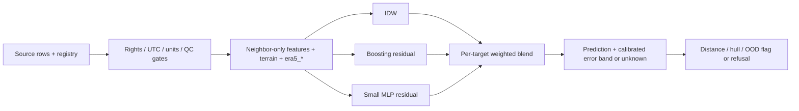

314 unique candidate sites entered the sample after geometry/terrain/climate screening. Train Jan–Aug, separate whole validation stations Sep–Oct, whole test stations Nov–Dec; 20 km buffer excludes nearby training/context sites, including aliases. Each experiment caps 2,500/600/1,000 rows; this is **not full national model training**. PM heads have no approved labels. Persistence is previous available **neighbor IDW within six hours**, not privileged hidden query-site history. Paired comparison uses rows finite for all baselines; per-method availability also reported. Validation halves follow deterministic station/time row order, not independent weather episodes. MAE CIs use 200 station bootstrap draws.

National 20 km-buffer scores, **MAE / RMSE**; ensemble MAE CI is 95% station bootstrap:

| Target | Ensemble | MAE CI | IDW | Nearest | Node mean | Neighbor persistence | Paired rows |
|---|---:|---:|---:|---:|---:|---:|---:|
| temperature_c (degC) | 1.94 / 3.30 | 1.41–2.61 | 2.38 / 3.79 | 2.47 / 3.68 | 2.79 / 4.31 | 4.76 / 6.31 | 800 |
| relative_humidity_pct (%) | 8.26 / 11.38 | 7.21–9.66 | 8.21 / 11.33 | 10.45 / 13.90 | 9.44 / 12.41 | 18.67 / 22.94 | 797 |
| pressure_hpa (hPa) | 23.79 / 55.80 | 9.63–47.19 | 35.67 / 65.12 | 35.35 / 63.02 | 41.32 / 67.19 | 35.24 / 65.55 | 348 |
| wind_speed_mps (m/s) | 0.88 / 1.16 | 0.74–1.02 | 0.88 / 1.18 | 1.02 / 1.46 | 0.84 / 1.10 | 1.10 / 1.40 | 802 |

**Losses matter:** national RH loses to IDW; wind loses to node mean. Himalaya proxy hold-out MAE T/RH/P/wind = **6.20 / 16.62 / 110.95 / 0.76**, versus IDW **7.77 / 14.62 / 124.32 / 0.67**; RH and wind lose, pressure is unacceptable. Leave-zone-out pressure in Cwa loses to node mean (54.22 vs 45.30 hPa); BWh/Cwb wind also loses. [Full MAE/RMSE/CIs, per-climate and elevation-band reports](reports/nwic_pipeline/india_evaluation.json). BWk/Cfa/Cfb/Dfb/Dwb have only 1–2 sample sites and cannot support required disjoint regional tests. “Himalaya” is explicitly a **western/central geographic proxy** (28–37 N,72–90 E, elevation >=500 m), not a verified complete Himalayan boundary; full eastern-Himalaya region hold-out remains unverified.

Short range: only **35/49,141 static candidate pairs (0.071%)** lie at 1–20 km; some may be unresolved aliases. Actual training-context distances in the main experiment: 1–5 km **94**, 5–20 km **250**, out of **80,000** context incidences (**0.43%** at 1–20 km, repeated over time). Dense independent city clusters are **not established**; CPCB/OpenAQ rights, clocks and coordinates need resolution. With the 5 km buffer only **76/1,000** test queries pass 20 km/hull geometry; serving-band coverage T/RH/P/wind = **73.7% / 77.6% / 100% / 65.3%**, on only **76/76/8/75** rows. Nominal 90% bands are not reliable. The 20 km-buffer test has zero valid 20 km serving-band rows by construction. Offline diagnostic validation-band coverage is separately labeled and must not be treated as safe serving uncertainty.

## Mandi comparison

Both ensembles use the **same seven observed context sites**, same held-out Mandi station and same eight Nov–Dec UTC reports. Core MAE:

| Model | T degC | RH % | P hPa | Wind m/s |
|---|---:|---:|---:|---:|
| National | 4.27 | 11.58 | 110.32 | 0.20 |
| Himalaya-only | 3.34 | 8.92 | 83.10 | 0.09 |

**Himalaya-specific wins this tiny matched archive comparison on all four channels.** Eight reports at one source site cannot establish a production winner or confidence interval. Pressure is still unusable; node mean beats both for RH and nearest node has zero wind error during these calm observations. NOAA Mandi is an archive-site proxy; own-node/NWIC validation remains absent.

## Missing access, coverage and next steps

- **CDS / ERA5-Land:** user account, accepted dataset terms and personal access token or manual NetCDF download required. [Official instructions](https://cds.climate.copernicus.eu/how-to-api), [monthly India + Mandi request files](data/registry/cds_requests.json). No authentication bypass attempted. Request receipt/NetCDF adapter are implemented; actual downloads, latency and trained `era5_*` contribution are unverified.
- **OpenAQ:** v3 API key and per-provider license/coordinates required; no data obtained through its authenticated API. [Official API](https://docs.openaq.org/api). **IMD:** request/export via [data supply portal](https://dsp.imdpune.gov.in/), verify terms/timestamps/reference; no new national station observations obtained. No credentials requested or logged.
- Existing CPCB non-commercial compilation stays restricted; Delhi/OpenCity time/rights/site contracts, Sensor.Community historical coverage/rights, CAMS/download terms, legacy NWIC and rainfall alignment remain unresolved or unacquired. UCI is Chinese and does not establish Indian spatial coverage. POWER obtained only for January Mandi diagnostics; no nationwide POWER training. NOAA is [public CC0 GHCNh](https://registry.opendata.aws/noaa-ghcnh/), hourly/synoptic; [SRTM GL1 v3](https://portal.opentopography.org/raster?opentopoID=OTSRTM.082015.4326.1) is 30 m terrain; [Köppen-Geiger](https://www.gloh2o.org/koppen/) is 1 km 1991–2020 climate classification, CC-BY-4.0. ERA5-Land is hourly ~9 km background, not station truth.
- Poorly supported: alpine/cold-desert sites, eastern Himalaya and other sparse highlands, desert pressure, independent dense-city meshes, PM in every region, and nearly all 1–20 km interpolation. [Catalogue/sample climate counts and caveats](reports/nwic_pipeline/coverage_summary.json), [1-degree station coverage cells](reports/nwic_pipeline/coverage_cells.csv); these are source coverage, not a claim that India has no instruments in empty cells.

**Quick wins:** provider-confirm NWIC clocks/reference/coordinate conflicts; resolve nearby aliases; obtain CDS exports and OpenAQ/IMD contracts; expand actual unique-hour/variable audit to all historical years; recalibrate on whole weather episodes; explicitly model flatline/uptime reliability and actual data publication latency. **Larger work:** independent urban/valley 1–20 km reference campaigns, full historical national training, official climate/Himalayan polygons, elevation-adjusted pressure physics baseline, dense-city PM heads, safe versioned model export and ESP32 distillation/quantization. The Python ensemble runs on a server; this change adds no ESP32 deployment artifact or board-level validation. [Own-node collection specification](#source-ee2e6e8a3ad3).

Validation: **67 tests pass** in the isolated Python environment, including masked core-only fitting, malformed/stale nodes, target-specific distance refusal, missing/QC source rows, modeled-vs-target isolation and finite-value checks. Firmware validation remains the prior review's compile-only evidence; no board testing. Download jobs use bounded caches; partial artifacts are quarantined/atomically replaced. Generic/non-NOAA adapters remain unverified on provider exports.


</details>


<a id="source-0707c422a83d"></a>

<details>
<summary>docs/archive/reports/physics_phase/PLAN.md</summary>

> Archived evidence / superseded guide. Original path: `reports/physics_phase/PLAN.md`. Protocol-specific results are preserved; use [PROJECT_OVERVIEW.md](#source-f795de9ca89c) for current scope.

# Ordered, separate patches

1. Shared pressure-height reduction, temperature lapse correction and dewpoint interpolation; documented assumptions and fail-closed station QC.
2. All-hour NOAA preparation with source hashes, UTC hour-END availability and raw QC; download public 2023 station-year files where available. Screen every 2024 source station, preserve exclusions and alias rules.
3. Vectorized neighbor-only physics features and gradient-boosting/MLP residual ensemble. Include zero residual in a validation-MAE shrinkage gate. Guarantee applies only to the selection set, never to future unknown labels.
4. Whole 72-hour-block calibration, independent episode checking, 80/90% and distance-bin coverage. No unchecked nominal band in serving output; old row-wise bands disabled.
5. Capped-versus-all-hour/all-year national and Himalaya-proxy experiments, same QC/baselines/chronological episodes, error bars and losses; ERA5 availability audit/ablation if files exist.
6. Evidence-only invention notes (no novelty/patentability assertion), practicum tables/figures/limitations and executable demo. List unavailable evidence explicitly.

This is server training/inference. ESP32 distillation, actual storm segmentation, independent 1–20 km mesh field validation and a patent prior-art search are separate unverified work.


</details>


<a id="source-b9adb8ae1051"></a>

<details>
<summary>docs/archive/reports/physics_phase/REPORT.md</summary>

> Archived evidence / superseded guide. Original path: `reports/physics_phase/REPORT.md`. Protocol-specific results are preserved; use [PROJECT_OVERVIEW.md](#source-f795de9ca89c) for current scope.

# Physics phase — measured results and remaining risks

Implemented as separate review patches; original plans are in [PLAN.md](#source-0707c422a83d). Full scores, RMSE, station-bootstrap MAE intervals, coverage and losses: [practicum results](#source-449e040c3c06), [machine-readable experiments](reports/physics_phase/results.json). No production or ESP32 deployment claim. Tested Python 3.11.8/package versions are pinned separately in `requirements-physics.txt`; the older root pins differ.

## Findings ranked by severity

**High — uncertainty still fails under regional/seasonal shift.** The legacy unchecked p90 serving output is disabled (`ml/spatial_ensemble/model.py:214`). New block calibration uses global 72-hour UTC blocks, not independently sampled rows (`episodes.py:15`, `:47`). Calibration Sep–Oct, independent check Nov, untouched audit Dec; all sites in a block share the fold. Failed check/audit or sparse target-distance bins withhold bands. Himalayan pressure trial bands fail: episode coverage is **20% at 50–100 km and 0% at 100–250/250+ km** at both trial 80/90 levels; corresponding trial-90 point coverage is 84.5%, 51.3%, 25.5%. All Himalayan pressure bands are revoked. Calendar blocks approximate episodes; dependence/exchangeability is unverified. No future nominal coverage guarantee.

**High — residuals and humidity do not consistently win.** Selection-only shrinkage allows zero correction, but cannot ensure smaller error on unknown future truth (`physics_residual.py:36`). Himalayan residual pressure **18.915** loses to physics **18.738 hPa**; national RH **10.887 percentage points** loses to RH IDW **8.889**; Himalayan RH **21.572** loses to IDW **14.920**. National wind **0.940 m/s** loses to IDW **0.919** and mean **0.872**. These losses are retained in every output.

**High — archive skill is mostly outside mesh serving range.** 20 km buffered national and Himalayan tests have **zero** rows eligible for the current 20 km + per-channel hull serving policy. With a 5 km buffer, eligibility is T 617 rows/9 stations (MAE 0.759°C), RH 616/9 (7.544 pp), pressure 131/**one** station (0.256 hPa), wind 626/9 (0.872 m/s). These small subsets do not establish general 1–20 km mesh performance. Nearby undocumented aliases may remain. The Himalayan hold-out is the existing latitude/longitude/elevation proxy (28–37°N, 72–90°E, SRTM ≥500 m), not a verified complete ecological Himalaya boundary.

**Medium — suspect elevation/pressure is quarantined, not repaired.** All 375 NOAA source stations screened: 27 lose pressure eligibility (19 missing SRTM, eight >250 m catalogue/SRTM disagreements; two also fail prior pressure plausibility). Flags and evidence are in [station_qc.csv](data/physics_training/station_qc.csv). Exact-coordinate alias `INM00043291` is removed, leaving 374 sites. QC uses observations before July 2024 and fixed thresholds, not test residuals (`hourly_noaa.py:70`). Flags do not establish which height is correct and may exclude valid terrain differences. NWIC Kala Amb remains quarantined: supplied coordinate SRTM ≈5069 m and median pressure ≈964.6 hPa conflict; source location/clock/reference/licensing still unresolved. Its data never enter these NOAA fits. Pressure reduction also rejects implausible reference pressure at each snapshot.

**Medium — ERA5 and embedded execution are unverified.** No ERA5 files found; background slots are missing, excluded from active fitted features, and have no measured contribution. [Exact authenticated/manual download requirements](#source-7b5d5d246472). New models stay in server memory; no exported/distilled/quantized ESP32 artifact or measured RAM/flash/watchdog timing. The existing firmware was not changed in this phase. Small NN iteration budget/convergence and model tuning remain limitations.

## Pressure results (hPa MAE, same QC-valid paired rows)

| Hold-out / training | Rows / stations | Residual | Physics | Raw IDW | Nearest | Node mean |
|---|---:|---:|---:|---:|---:|---:|
| National 20 km, 2023+2024 | 2688 / 31 | 5.829 | 5.829 | 49.156 | 52.970 | 52.733 |
| National 5 km, 2023+2024 | 2688 / 31 | 3.586 | 3.586 | 37.950 | 34.982 | 49.472 |
| Himalaya 20 km, 2023+2024 | 1238 / 8 | **18.915** | **18.738** | 114.793 | 119.306 | 112.864 |

Residual pressure station-bootstrap 95% MAE intervals: national 20 km **[3.377, 9.558]**, national 5 km **[2.021, 5.639]**, Himalaya **[5.763, 43.898]**. They are descriptive, not a paired significance test. One-hour neighbor persistence has no valid pressure pairs in these tests. Exact 3-hour **physics** persistence is available on a separate subset: national 20 km 2679 rows/5.692 hPa; Himalaya 1235/18.584. Separate denominators prevent a claimed paired win. Earlier phase pressure scores used a different, unfiltered/sample-time protocol and are not directly comparable.

## More rows / extra year (identical complete December test)

All 735 acquired station-year files read: 375 in 2024, 360 in 2023; other 15 have no 2023 file. **1,516,003** hour buckets retained, including **775,778** calendar-2024 hour-end buckets; no manufactured missing hours. Every hourly row has `source_id` and `location_id`; raw-row/hash lineage is retained separately. Hour means close at UTC hour-end; archive publication latency is unknown. Whole station hold-outs/buffers and chronological blocks mean not all stations/hours can be training labels in a leakage-safe evaluation.

| Fit / selection rows | T MAE °C | RH MAE pp | P MAE hPa | Wind MAE m/s |
|---|---:|---:|---:|---:|
| Capped 2500 / 600; complete test | 1.867 | 11.026 | **5.597** | **0.930** |
| 2024: 230102 / 18618 | **1.824** | 10.909 | 5.829 | 0.957 |
| 2023+2024: 655962 / 18618 | 1.867 | **10.887** | 5.829 | 0.940 |

Test has 12,604 rows before per-target masks. More data is not a uniform improvement. Original 1000-test cap also retained as a sensitivity run. National 5 km fits 693,632 rows; Himalayan hold-out fits 770,877. Station splits and all counts are versioned in `results.json`.

## Baselines / ensemble / checked bands

[Physics](ml/spatial_ensemble/physics.py): fixed 6.5 K/km T lapse → interpolate common-height T → restore query height. RH: interpolate native QC dewpoint (otherwise derive from T/RH) → recover RH at adjusted query T. P: hydrostatic ideal-gas constant-lapse reference transform with optional virtual temperature; missing T uses an explicit ISA approximation → IDW **log reference pressure at 0 m EGM96** → restore at query elevation/T/RH. This is not official MSLP; high terrain/below-ground extrapolation is uncertain. Missing query height refuses pressure. Physics values/deltas/reference P/dewpoint are separate ensemble features.

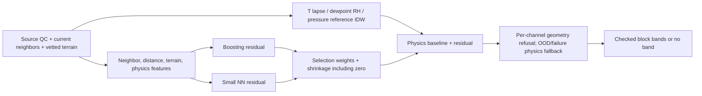

Full 80/90 trial coverage vs distance, widths and episode counts are in [coverage_by_distance.csv](reports/practicum/coverage_by_distance.csv). At 5–20 km in the 5 km buffered run: T trial 80/90 episode coverage **100/100%** (754 rows, 10 blocks); RH **80/80%** (751; 90 revoked); P **90/100%** (131, one station); wind **80/90%** (763; 80 failed November check). T trial-90 width ±12.64°C illustrates how weak/usefully wide block-max bands can be. No 0–5 km evidence. Archive-approved bins beyond 20 km still cannot pass serving geometry; OOD/failure serving branches withhold bands.

## Verified / unverified and next priorities

**Verified:** full-hour ingestion/rerun with input hashes; station/episode separation assertions; baseline round trips and synthetic physics; selection aggregate non-inferiority check; masked PM, model failure/OOD fallback, pressure/elevation rejection, coordinate/dewpoint QC, query-truth feature independence, snapshot/batch feature parity, unchecked-band suppression and audit revocation. **87 tests passed plus eight subtests**, one existing pandas deprecation warning. Figures rendered and inspected; demo executed. Small patch syntax/round-trip checks recorded in `verification.json`.

**Unverified:** source clocks/reference/rights for NWIC; true meteorological episode independence; live publication latency; national dense-mesh/general Himalayan uncertainty coverage; PM learning; ERA5 improvement; NN convergence/tuning; distilled model export, ESP32 runtime and live security/field reliability. No systematic patent prior-art search: [evidence-only invention notes](#source-c2387a915ca6).

Quick wins: prefer raw RH IDW until a disjoint validation regime supports a humidity correction; manually resolve flagged site heights; preserve band refusal and a no-learning physics mode. Larger work: local lapse/moisture models with inversion/season features, real dense node data and regional calibration, actual ERA5 join/ablation after authorized downloads, then model export/distillation and device measurements. Do not promote the residual model or nominal bands on December-driven retuning without another untouched evaluation.


</details>


<a id="source-3cab500f40fd"></a>

<details>
<summary>docs/archive/reports/review/DATASETS_AND_PIPELINE.md</summary>

> Archived evidence / superseded guide. Original path: `reports/review/DATASETS_AND_PIPELINE.md`. Protocol-specific results are preserved; use [PROJECT_OVERVIEW.md](#source-f795de9ca89c) for current scope.

# Datasets and unified pipeline — 3 October 2026

Sources below were inspected online or recorded in repository manifests. New datasets are recommendations, **not downloaded or used in fitted models during this review**. Open access does not establish identical redistribution rights. Freeze product version, exact license text, retrieval time and SHA-256 before ingestion.

## Existing inventory

| Dataset / source | Variables, resolution, coverage | License / current use |
|---|---|---|
| [UCI Beijing 501](https://doi.org/10.24432/C5RK5G); `data/uci_beijing_air_quality/` | 420,768 hourly station rows, 12 sites, 2013–2017. Original TEMP, DEWP, PRES, PM2.5, PM10, WSPM; adapter derives RH. Original pollutants, rain and wind direction are not retained by six-channel adapter. Weather was matched to nearest meteorological stations, not necessarily measured at each pollution station. | CC BY 4.0. Trains six-input teacher/student, reduced-input comparison models and event-rule models. Adapted CSV has no lat/lon/elevation. |
| [Indian CPCB secondary compilation, Kaggle v2](https://www.kaggle.com/datasets/abhisheksjha/time-series-air-quality-data-of-india-2010-2023); `data/india_station_audit/`, derived `data/india_cpcb_research/` | Seven downloaded station files, 368,462 hourly rows; variable availability differs. Metadata: 453 stations, full archive **not** downloaded. PM2.5/10, T, RH, wind accepted where explicit units; pressure and ambiguous Dehradun T excluded. IST interval-end assumption gives UTC :30 grid. | Publisher CC BY-NC-SA 4.0. Trains Indian five-/two-input research profiles; not six-input Indian release. Station catalogue lacks verified coordinates for the new evaluator. Derived CSV is the same source, not independent evidence. |
| [OpenCity Delhi CPCB exports](https://data.opencity.in/dataset/delhi-hourly-air-quality-reports); `data/india_delhi_station_samples/` | Jahangirpuri DPCC and CRRI Mathura Road IMD, each 70,176 timestamped 15-minute rows, 2024–2025. Jahangirpuri lists all six; CRRI only PM in these exports. Pressure units/reference and timezone unresolved. | Catalogue says Other (Public Domain); primary-provider terms still need preservation. Audit only, no training. |
| [NWIC Himachal climate telemetry](https://www.nwdp.nwic.gov.in/dataset/?groups=climate&organization=himachal-pradesh); four files in `himachal 4-sensor dataset/` | Hourly T: 611,048 rows/30 station identities; RH: 609,428/30; pressure: 113,594/12; wind: 237,225/13. Mostly 2022–2025, pressure starts 2023, wind includes 2007 anomalies. Coordinates available. 43,909 screened four-channel joins; no PM. Wind km/h; pressure mb, reference unverified; timezone absent. | Exact resource license not established in supplied-file provenance. Quarantine pending verification. Audits/diagnostics only. Repeated pressure 925 hPa requires investigation. |
| [NWIC hourly Himachal rainfall](https://nwdp.nwic.gov.in/dataset/rainfall-telemetry-hourly-himachal-pradesh-department); `data/field_sources/` | 166,355 rows/110 stations, actual 2021–2025. Rainfall mm, station/lat/lon/time. 1,431 screened exact weather joins, 269 six-hour pairs; **all positive**, no explicit dry observations. | Preserved catalogue: Other (Open), precise terms unresolved. Audit only; cannot measure rain specificity or calibrate rain probability. |
| [NWIC temperature resource labelled 1961–2020](https://nwdp.nwic.gov.in/dataset/temperature-telemetry-hourly-himachal-pradesh-water-department/resource/c9c19391-51cc-48bd-94a0-154f493f24de); `data/himachal_weather_audit/temperature_1961_2020_download.csv` | Actual download: four hourly T rows, two stations, 2007; not a 60-year history. | License unresolved; access diagnostic only. |
| [IMD surface/autographic station catalogues and API receipts](https://dsp.imdpune.gov.in/); `data/imd_north_access/` | Station metadata and format documentation; **zero downloaded observation rows**. Mandi listed twice daily, Sundernagar every three hours; do not claim hourly historical coverage. | Observation access/terms not established; catalogue/access audit only. |

Generated event thresholds, serial replay fixtures and synthetic ensemble fixtures are software tests, **not independent weather datasets**. No additional daily-AQI file was found in the supplied four-file folder; mentions of daily AQI do not establish a usable PM dataset.

## Additional sources

| Dataset / primary link | Resolution / access / license | Contribution |
|---|---|---|
| [ERA5 single levels](https://cds.climate.copernicus.eu/datasets/reanalysis-era5-single-levels?tab=overview) | Hourly, 0.25° atmosphere grid; 1940–present; CDS registration/terms. Catalogue CC-BY. Uncertainty ensemble products at 0.5°, three-hourly. | T2m/dewpoint → T/RH, surface pressure, 10m wind components, precipitation, radiation; background/weather regime and station-minus-background targets. Coarse background cannot establish valley-scale accuracy. |
| [ERA5-Land](https://cds.climate.copernicus.eu/datasets/reanalysis-era5-land?tab=overview) | Hourly, 0.1° regular grid, native ~9 km; 1950–present; CC-BY. | Finer surface T/RH/pressure/wind, soil moisture/snow/land context. Shares ERA5 forcing: these are correlated sources, not independent validation sets. |
| [NASA POWER](https://power.larc.nasa.gov/docs/tutorials/service-data-request/api/) | Hourly API; meteorology 0.5° × 0.625°, solar typically coarser. Free globally available NASA product; record attribution/product terms. [Explicit UTC needed](https://power.larc.nasa.gov/docs/faqs/other/): hourly default is local solar time; timestamps denote hour start. | T2M, RH2M, PS, WS10M and solar/rain parameters where available. Broad climatological/regime features; no observed particulate labels. Completed hourly means become available at interval end, not start. |
| [NOAA GHCNh](https://www.ncei.noaa.gov/products/global-historical-climatology-network-hourly) and [legacy ISD](https://www.ncei.noaa.gov/products/land-based-station/integrated-surface-database) | Point-station hourly/synoptic files, bulk PSV/parquet; coverage/cadence by station. GHCNh replaces ISD. Public access; preserve product and contributing-provider use constraints. | Measured T/dewpoint/RH, station/sea-level pressure distinctly, wind, visibility/cloud/rain, quality flags. Independent withheld-station targets; screen actual northern-India coverage. No PM guarantee. |
| [IMD station observations](https://api.imd.gov.in/public/api_reference.html) / [historical portal](https://dsp.imdpune.gov.in/) | Station-specific current/historical schedules. Current API documents UTC, wind km/h and **MSLP**, not station pressure. Keys/account/export permission may be required; not established as an unrestricted open bulk dataset. | Local validation and weather/precipitation targets. Acquire historical AWS records with station pressure and full QC. Never bypass authentication or silently substitute MSLP. |
| [OpenAQ](https://openaq.org/platform/) / [API/provider licenses](https://docs.openaq.org/resources/licenses) | Point PM observations, variable cadence; hourly aggregates; API v3 key required. License is provider-specific. | PM2.5/PM10 independent labels and neighbors, provider/instrument/unit/coverage metadata. Deduplicate CPCB records already present through other sources. |
| [Sensor.Community](https://sensor.community/en/) / [API and archives](https://github.com/opendata-stuttgart/meta/wiki/EN-APIs) | Point consumer sensors; raw variable cadence, hourly aggregates and daily CSV archives. Site links Database Contents License 1.0; preserve database/license terms as well as content terms. | Dense PM2.5/PM10 and BME280 T/RH/pressure where present. Device calibration/humidity bias, drift and untrusted uploads require QC; six-channel availability is not guaranteed. |
| [USGS SRTM global 1 arc-second](https://www.usgs.gov/centers/eros/science/usgs-eros-archive-digital-elevation-shuttle-radar-topography-mission-srtm) | Static ~30 m DEM, February 2000 mission. Public-domain USGS/NASA elevation product; retain product citation and vertical datum. | Query/node elevation, elevation differences, slope/aspect, valley/ridge exposure, pressure/lapse-rate adjustments. DEM height is not automatically surveyed sensor elevation. |
| [CAMS EAC4](https://ads.atmosphere.copernicus.eu/datasets/cams-global-reanalysis-eac4?tab=overview) | Three-hourly, 0.75°; 2003 onward; catalogue CC-BY, delayed reanalysis. | PM2.5/PM10 backgrounds, dust/smoke/transport regimes and wind. Convert kg/m³ × 10⁹ to µg/m³. Modeled pollution is an auxiliary feature/pretraining target, never mislabeled as a measured PM sensor. |

## One versioned training store, with separate observed and modeled fields

1. **Immutable landing and registry.** Ingest ALL listed sources through individual adapters. Record `source_id`, `source_version`, URI, raw hash, retrieval timestamp, license text/hash, provider/instrument, QC definitions, timezone and pressure reference. Unresolved sources enter quarantine, not model fitting. Keep research/noncommercial and other restricted licenses in separate admissible training views.
2. **Common long-form observation schema.** `record_id, source_id, source_row_id, station_id, physical_site_id, instrument_id, latitude_deg, longitude_deg, elevation_m, elevation_datum, interval_start_utc, interval_end_utc, available_at_utc, variable, value, unit, pressure_reference, measurement_height_m, qc_flags, observed_or_modeled, uncertainty`. Null values remain null. Station aliases share `physical_site_id`; provenance survives every aggregate/join. Grid sources additionally retain grid-cell ID and native grid spacing. Long form accommodates rainfall and terrain without forcing them into the six sensor channels.
3. **Units.** T in °C (K − 273.15), RH %, **station** pressure hPa (Pa/100, verified mmHg × ~1.33322), PM µg/m³, wind m/s (km/h /3.6); rain mm per explicitly defined interval; heights m. Compute RH from T/dewpoint with a derived flag. Retain original units. Wind at 10 m is not automatically equivalent to a ground anemometer. Suspect pressure headers stay unresolved; plausible numeric ranges alone cannot identify units.
4. **Time alignment.** Preserve original timestamps/interval semantics; localize only confirmed timezones. Request POWER UTC explicitly. Aggregate verified 15-minute means to hourly interval-end values using all four quarters and QC/coverage counts; no forward fill across gaps. Keep :30 UTC Indian hourly grids or document reaggregation onto a common UTC boundary from underlying intervals; never simply round :30 to :00. As-of joins require `available_at_utc <= issue_time`. Rain accumulation is summed only over known intervals; missing rain is unknown, not zero.
5. **Spatial alignment.** WGS84 registry with relocation epochs; use geodesic distances or one local metre projection. Station rows are points; ERA5/POWER/CAMS remain grid backgrounds, sampled bilinearly with interpolation weights/grid provenance. Join terrain with datum and nodata masks. Retain distances, elevation differences and mismatch indicators; do not overwrite PM at a weather station using a distant city reading. Site relocation changes the split identity.
6. **Training examples.** Wide materialized view: six measured targets and target masks, neighbor six-channel readings/masks/ages, query/node coordinates and distance, node count, terrain, cyclical time, separately named `era5_*`, `power_*`, `cams_*`, source/QC flags. For current interpolation, label is the independently observed query-site value at the same aligned instant; for six-hour forecast it is the exact future value. Hide the query site's readings and aliases from ALL feature views. Weather-only/PM-only sources can train masked target heads; they do not invent complete six-input observations. Fit learned imputation/scaling on training only; missing-target loss is skipped, never zero-filled.
7. **Leakage controls.** Split entire physical sites and geographic blocks with a buffer determined from measured spatial correlation, then independent time blocks. Purge at least the forecast horizon and feature-history overlap for strict temporal independence. Separate weight selection, uncertainty calibration and untouched final test locations/times. Neighbor context in strict spatial evaluation uses only allowed training nodes; no query history or target-site lags. Group shared meteorological stations/duplicate provider records and coarse grid cells across splits. Reanalysis assimilates observations and can use data unavailable at issue time: use it for offline pretraining/background diagnostics or replay archived operational forecasts for live-equivalent evaluation. Never let interpolated labels or rule-generated events become measured ground truth.
8. **Release evidence.** Hash frozen views/split manifests/code/model versions, seeds and dependency lock. Report paired MAE/RMSE per variable vs nearest-node, mean-node, IDW, and temporal persistence where appropriate; per region/elevation/node-density bins, outage/stuck-sensor stress, empirical interval coverage and interval width. Require separately surveyed withheld nodes *inside* network support. The new experimental evaluator implements station/time isolation and query exclusion, but not the complete adapter/QC/terrain/spatial-buffer pipeline above.


</details>


<a id="source-404b2cf68e8e"></a>

<details>
<summary>docs/archive/reports/review/REVIEW.md</summary>

> Archived evidence / superseded guide. Original path: `reports/review/REVIEW.md`. Protocol-specific results are preserved; use [PROJECT_OVERVIEW.md](#source-f795de9ca89c) for current scope.

# Focused review — 3 October 2026

**Verdict: a tested node-forecast research prototype, not yet a validated, deployable weather mesh interpolator.** Small fixes and an isolated experimental ensemble are in the working tree; saved models and deployment selection are unchanged. No commits were created. Dataset access, the full ingestion pipeline and field validation remain larger work.

## Findings by severity

| Severity | Finding / evidence | Action |
|---|---|---|
| **Critical — release blocker** | Existing models explicitly exclude GPS/time/station features (`ml/six_sensor_forecast/train.py:97`). Geographic tests still feed the held-out station's own six readings (`predict.py:28`). `midpoint.py:82` averages endpoints before forecasting. These do not prove predictions between nodes. | New neighbor-only spatial ensemble/evaluator added separately. Real six-target interpolation MAE/RMSE remain **unverified**, requiring independently measured withheld nodes and verified coordinates. |
| **High** | No approved six-channel Mandi training/validation dataset. Indian pressure units/reference and some timezones unresolved; Himachal lacks PM and shows repeated pressure artifacts. UCI weather is nearest-meteorological-station matched (`data.py:105`), potentially shared across pollution sites. | Quarantine unresolved data; verify physical site/met-station identities and blocked splits. See dataset inventory/pipeline. |
| **High** | Event outputs imitate rules generated from input sensors (`ml/event_classifier/features.py:156`); two heads untrained, no independent hazard validation. Heatmaps interpolate these scores (`heatmap.py:199,217`). | Do not interpret as calibrated hazards or six-hour event forecasts. Acquire independent labels and calibration evidence. |
| **High — fixed** | Hourly reindexing could expand two observations separated by centuries into huge allocations (`six_sensor_forecast/features.py:57`, `event_classifier/features.py:103`, `event_classifier/predict.py:63`). Naive timestamps were silently treated as UTC. | Shared validator now rejects naive/missing times and bounds station/total hourly expansion (`features.py:20–40`); regression tests cover both model pipelines. Quotas are offline limits, not a production API memory budget. |
| **High — integration gap** | No LoRa mesh, live sensor drivers or network API in reviewed deployment. Serial CSV/RESET are unauthenticated (`esp32/ml_integration/src/main.cpp:75,92`); INFO hashes identify a build but do not authenticate senders. Spoofed plausible measurements would be accepted. | Add per-node authenticated messages, counters/boot epochs, freshness/replay protection, key provisioning/rotation and authenticated server ingestion before radio/API rollout. No nonexistent network endpoint was labelled vulnerable. |
| **Medium — fixed** | Initially 3/50 tests failed during model export: installed pandas/XGBoost combination discarded inferred feature names. | Explicit feature names on training/prediction matrices (`train.py:136,190`); all export/parity tests now pass. Tested installed versions differ from requirements pins. |
| **Medium — fixed / residual risk** | Embedded NUL could truncate serial input into a valid command; unbounded serial draining could starve loop yielding (`main.cpp:113`). | Reject control/non-ASCII bytes; drain at most 256 bytes per loop. Host tests execute actual receiver with a shim. Serial printing and SELFTEST can still block; watchdog stress on hardware remains unverified. |
| **Medium** | Original forecast batch reloads six models each call, aborts on any artifact failure (`predict.py:49–55`), emits no uncertainty despite stored validation error bands, and requires all current channels. Firmware rejects a faulty snapshot entirely (`indra_ml_runtime.h:43–48`). Broad physical ranges cannot detect plausible wrong units or frozen sensors. | New ensemble isolates model failures, has per-target missing-node fallback and OOD checks. Original node path still needs a cached predictor, freshness/stuck/spike QC and separately validated fallback. |
| **Low** | Four direct Python pins and seeded/versioned reports exist, but transitive dependencies, lint tools/actions and artifact authenticity are not fully locked. Checksums detect accidental changes, not an attacker replacing report and models together. | Lock full tested environment; signed/immutable release manifest; CI dependency scans. OSV returned no advisories for 9 inspected installed runtime packages and 4 requirement pins; this is not a full Python/Arduino/transitive audit. |

No unsafe pickle/joblib loading, `eval` of user payloads, or hardcoded credentials were found in scanned Python/C++/header sources. Models use checked UBJ artifacts. Secret scanning did not include Git history or every raw response; malformed CLI/file inputs are not a hardened public service boundary.

## What exists

Six measurement channels (not necessarily six physical devices): **T °C, RH %, station pressure hPa, PM2.5 µg/m³, PM10 µg/m³, wind m/s** (`contract.py:3–19`). Each has a current input and same-variable six-hour target. Every channel supplies lags 1/3/6/12/24 h, one-hour delta, trailing 6/24-hour mean/std: **66 teacher features** (`features.py:61`). The compact student takes six current channels only. UCI RH is derived from T/dewpoint, not a directly measured RH channel.

Pipeline: pinned/hash-checked UCI download → timezone/unit adapter → causal hourly features/exact keyed future labels → geographic plus future-time splits with label-horizon purge → six residual XGBoost teachers, depth/weight selection → six 16-tree/depth-3 distilled XGBoost students → UBJ reports → bounded C99 inference with host parity. Inference is current value plus weighted predicted residual, physically clipped. Indian five-/two-channel experimental families and paired comparisons also exist.

The separate event path has **17 features**: six raw plus dewpoint, vapor-pressure deficit, heat index, PM2.5/PM10 ratio, pressure deltas 1/6 h, T/PM2.5/PM10/RH one-hour deltas and six-hour PM monotonicity (`event_classifier/features.py:45`). Firmware stores seven hourly snapshots for these. Optional kriging with IDW fallback builds planar, support-masked heatmaps; PyKrige is not a required installed dependency. Latitude/longitude locate the midpoint only; heatmap x/y require a common local projection. **Elevation, terrain, learned geographic distances and cyclical time are absent from saved models.**

Working: model training/export tests, artifact checks, host Python/C parity, chronological/held-out-station splits, gap/duplicate handling, serial replay/recording and field-evaluation tooling. Partial: midpoint/heatmaps, event-rule evidence, Indian data adaptation and calibration interfaces. Missing: field-proven six-target spatial model, complete verified local data, live sensor/radio integration, authenticated transport, production ingestion/service, on-device latency/power/outage measurements.

## New ensemble (implemented, experimental server library)

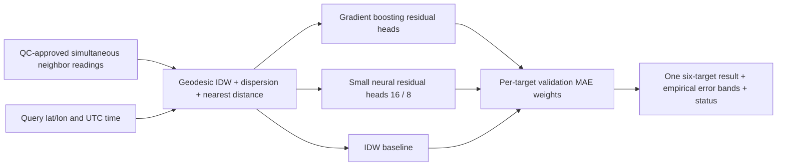

`ml/spatial_ensemble/model.py:29,89,134`: 25 neighbor/context features, six independently fitted heads. Latitude/longitude use spherical embedding and haversine distances; UTC hour/year use sine/cosine. Histogram gradient boosting and scaled small MLP learn corrections to IDW. Inverse validation-MAE weights are simpler to inspect and less data-hungry than a stacking meta-model. A separate later validation half estimates the 90th-percentile absolute-error band. This is an empirical interval, **not guaranteed 90% coverage**, particularly with correlated stations/times.

Exceptions/nonfinite model outputs remove that member and renormalize weights. Invalid/stale nodes and channels are excluded; colocated values are averaged; one surviving node yields a labelled degraded estimate. No valid observations → null/UNAVAILABLE. OOD envelope or incomplete features fall back to IDW. Degraded output has unknown uncertainty rather than fabricated confidence. This fallback is a bounded research estimate, not a certified safe hazard decision. Maximum supported radius, convex-hull/elevation checks and stuck-sensor QC remain release requirements. Fit-time model failures are recorded.

`evaluate.py:25,50` hides query readings, uses only training-node context, reserves entire validation/test stations and later time blocks, rejects split overlap/colocated cross-split aliases, and reports paired per-target MAE/RMSE vs IDW/nearest/mean. It does not implement geographic buffer splits, terrain adapters, complete model persistence or a service. Models remain in memory; no new unsafe deserialization is introduced. Extending this current-time interpolator to six-hour mesh forecasts needs separately labelled/evaluated neighbor-history training.

## Evaluation evidence

**Saved results, read from `ml/models/uci_beijing_6h/training_report.json`; not retrained/re-scored on the full dataset during this review.** Geographic test at Changping/Dingling/Huairou, six-hour node forecasts; entries are MAE / RMSE in each target's units:

| Target | Persistence | Teacher | ESP32 student |
|---|---:|---:|---:|
| Temperature | 3.869 / 4.829 | 2.025 / 2.605 | 3.525 / 4.154 |
| RH | 15.248 / 19.481 | 9.625 / 12.798 | 13.974 / 16.905 |
| Pressure | 1.843 / 2.393 | 1.306 / 1.738 | 1.784 / 2.297 |
| PM2.5 | 26.887 / 48.089 | 25.844 / 44.128 | 26.243 / 45.358 |
| PM10 | 35.144 / 58.077 | 33.457 / 52.749 | 34.328 / 54.436 |
| Wind | 0.924 / 1.318 | 0.697 / 0.990 | 0.746 / 1.059 |

**New synthetic harness run ONLY — not weather accuracy evidence.** Four context stations, separate interior validation/test nodes and later time blocks; 50 test rows/target. MAE/RMSE:

| Target | Ensemble | IDW | Nearest node | Node mean |
|---|---:|---:|---:|---:|
| Temperature | .067/.087 | .071/.092 | .094/.112 | .077/.092 |
| RH | .339/.388 | .313/.357 | .367/.431 | .309/.354 |
| Pressure | .090/.106 | .091/.108 | .105/.127 | .095/.111 |
| PM2.5 | .459/.588 | .461/.605 | .614/.775 | .446/.587 |
| PM10 | .605/.755 | .561/.719 | .781/.959 | .572/.712 |
| Wind | .046/.054 | .040/.050 | .048/.059 | .041/.052 |

Ensemble does **not** beat IDW on every synthetic target; no accuracy superiority is claimed. Synthetic band coverage ranges 86–96%. Full outputs: `synthetic_metrics.json`; reproduce with `python -m reports.review.run_synthetic_evaluation`. Real between-node metrics cannot responsibly be produced without a frozen coordinate-verified six-target dataset; the evaluator is ready for that input.

## ESP32 / verification

Ran all **56 tests, passing** (original 50 plus 6 new), including model training, regenerated C export, Python/C runtime parity, NaN/inf/ranges, missing/gapped readings, duplicate/out-of-order times, station splits, model tampering and serial receiver. New tests cover naive/century-spanning time inputs, invalid geographic coordinates, colocated/offline nodes, wrong Pa units, missing targets, failing/nonfinite models and query-label exclusion. Existing heatmaps intentionally reject duplicate positions or fewer than two nodes; new ensemble degrades rather than crashing on an outage. Frozen plausible readings are still accepted: automated stuck-sensor detection is **missing**, not proven fixed.

Fresh PlatformIO builds passed:

| ESP32-S3 build | Flash | Static RAM |
|---|---:|---:|
| UART | 316,853 B | 18,848 B |
| Native USB | 314,101 B | 19,080 B |

Board target: 240 MHz, 320 KiB RAM, 8 MiB flash; application limit ~3.34 MB. Forecast export has 96 trees, depth ≤3, 1,438 nodes, ~66.6 KB C source; runtime uses fixed buffers (~168 B history, 192 B serial line) and no dynamic inference allocation. Double intermediates aid event-feature parity, forecasts use float32, timestamp addition uses uint64; uint32 input timestamps stop in 2106. Serial output/boot delay can block; no heap leak observed in portable runtime, but board/framework behavior is unverified. No hardware flash, long soak, latency, stack high-water, radio coexistence or watchdog stress was run.

**Split recommendation:** full Python ensemble on gateway/server; ESP32 samples/QCs/authenticates readings and runs retained compact local forecast/offline fallback. For on-device spatial inference, distill neighbor-based ensemble into a separately trained/exported compact tree model (existing C exporter) or int8 MLP/TFLite Micro, with fixed neighbor count and feature/schema parity. An illustrative 25→16→8→6 MLP has 606 weights/biases (~606 B int8 or 2,424 B float), excluding runtime/scales/activation arena. No distilled spatial model or quantization has been implemented/benchmarked; measured old firmware fit is not evidence the full sklearn ensemble fits ESP32.

Test environment: Python 3.11.8, NumPy 2.3.4, pandas 3.0.3, sklearn 1.7.2, XGBoost 3.1.1. Exact requirements environment was not installed. OSV query receipts are in `dependency_audit.json`; no returned advisories, limited scope. Ruff unavailable; changed Python sources passed AST syntax checks. A broad compileall/Git check stalled in this environment; no completion is claimed. No claim of full vulnerability clearance.

## Prioritized roadmap

**Quick wins:** (1) Review/apply separate patches; retain passing CI/parity and exact environment lock. (2) Confirm source timezone, pressure reference, station coordinates/aliases and licenses; quarantine ambiguity. (3) Add sensor QC flags for freeze/spikes/staleness, explicit unit contract and conservative OOD/offline handling to original node inference. (4) Cache verified node predictors and expose empirically calibrated uncertainty. (5) Enforce signed artifact releases and message authentication when transport is introduced.

**Larger changes:** (1) Build ALL-source versioned store with observed/modeled provenance and missing-target views using [the dataset/pipeline design](#source-3cab500f40fd). (2) Collect colocated six-channel ground truth in Mandi, reserve unseen interior nodes and spatial/time buffers; compare ensemble vs IDW before claiming spatial skill. (3) Add DEM/elevation, wind transport and background residual views; spatial-block tuning and independent interval calibration. (4) Implement/measure authenticated LoRa delivery, outage recovery and field firmware soak. (5) Distill spatial model, validate float/int8 parity and error, then release with measured RAM/flash/latency and independent accuracy evidence.

Small review patches: `patches/01-observation-validation.patch`, `02-feature-names.patch`, `03-serial-receiver.patch`. Experimental ensemble/tests: `04-spatial-ensemble.patch`. These export the working-tree changes; **do not reapply to this already modified checkout**.


</details>


<a id="source-b6943f8e11ef"></a>

<details>
<summary>docs/archive/reports/two_node_phase/PLAN.md</summary>

> Archived evidence / superseded guide. Original path: `reports/two_node_phase/PLAN.md`. Protocol-specific results are preserved; use [PROJECT_OVERVIEW.md](#source-f795de9ca89c) for current scope.

# Two-node phase plan

1. Add configurable geodesic A–B corridor distances/end limits; keep hull mode for 3–5-node comparison.
2. Make neighbor count explicit in archive features and train 2/3/4/5-neighbor residual models, with exactly K QC-valid core-weather nodes and identical held-out-site/episode splits. Report all archive rows, common-row comparisons and deployment geometry separately.
3. Evaluate physics versus residual, IDW, nearest and node mean. Calibrate/check/audit bands using whole blocks inside the declared serving geometry. Sparse/failed bands remain unavailable.
4. Export bounded JSON residual model parameters and verify predictions against sklearn; no pickle or ESP32 execution claim.
5. Add A/B JSON-input demo, predeployment side-by-side corrections, A/B/C role-rotation hidden-sensor scorer, and update node collection spec. Keep C values out of prediction features and fit offsets only from the calibration session.
6. Run tests and archive evaluation, produce small patches and concise verified/unverified report. No physical field data is presumed available.


</details>


<a id="source-6cf349104447"></a>

<details>
<summary>docs/reference/COPERNICUS_MANDI_DOWNLOAD.md</summary>

# Copernicus Mandi download — 2016–2025

Prepared 12 October 2026. Ten complete years, every season and all UTC hours.
The two-year monsoon pilot is optional, not the requested final dataset.
The user selected manual browser downloads; the API route below is optional.

## Browser selection

Use [ERA5 hourly data on single levels](https://cds.climate.copernicus.eu/datasets/reanalysis-era5-single-levels?tab=download):

- Product: **Reanalysis**.
- Variables: **2m temperature**, **2m dewpoint temperature**, **surface pressure**,
  **10m u-component of wind**, **10m v-component of wind**, **total precipitation**,
  **snowfall**. Humidity and wind speed derive from these fields.
- Full period: **2016–2025**, all months, valid days and 00:00–23:00 UTC.
- Area selection: **north 32.5, south 31.0, west 76.0, east 78.0**.
  This is a Mandi/Kullu regional grid, not all Himachal or India.
- Format: **NetCDF4 (Experimental)**; unarchived download. Multiple resulting
  files may still arrive in a ZIP, which must be retained and inspected.

These seven archive fields do not change the six physical deployed channels.
Weather supplies four modeled channels after derivation; PM2.5 and PM10 are
absent. Precipitation and snowfall are offline context, not verified cloudburst
or snowstorm occurrence labels. Surface pressure refers to grid elevation,
not a verified local station. The product's [overview](https://cds.climate.copernicus.eu/datasets/reanalysis-era5-single-levels?tab=overview)
describes hourly reanalysis at a 0.25-degree grid; it is retrospective and is
not a live input available at each historical prediction time.

## Request-size limit

Safari was filled and the user accepted the product licence. The ten-year form
then displayed **“Request too large. Cost 3682224 over 121000 limit.”** This is a
request-size constraint, not a quoted monetary charge. No request was submitted
or downloaded during this setup. Further browser batching attempts encountered
stale-control errors; no smaller batch is claimed to have been submitted.

The script instead makes **120 monthly requests**, preserving all ten years.
There are **87,672 hourly time positions per grid cell** in that period before
checking actual provider coverage. This is planned coverage, not an acquired
row count. Small batches avoid the oversized combined request and allow resume
using original file hashes and matching receipts. A successful real request
still has to confirm the provider accepts the current API fields.

For manual downloads, keep the variables/area/hours above, but select one year
and a small group of months at a time. Check the form's size validation before
submitting. Repeat until the full 2016–2025 period is covered.

Start with **2016, January–March**. Use four quarter batches for each year:
January–March, April–June, July–September and October–December. Repeat for
2016, 2017, 2018, 2019, 2020, 2021, 2022, 2023, 2024 and 2025: **40 batches**.
If the portal's validation changes or rejects a quarter, use individual months.
Retain all days and hours in each batch. Record year/quarter in the local file
name and preserve provider metadata/receipts. Do not claim all ten years are
downloaded until the files have been checked for full timestamp coverage.

At handoff the form still retained the oversized full-period selection.
Safari automation could not reduce it reliably (`elementHasNoFrame` / stale
element errors), even after reconnection. The required variables, bounds and
format had been verified, and licence acceptance was verified; submission and
acquisition had not completed. The user must clear/select the year and month
boxes for the first batch in the visible form.

## API setup and commands

Follow the [official CDS setup](https://cds.climate.copernicus.eu/how-to-api).
Sign in and save the displayed configuration in
`/Users/ariyanbhakat/.cdsapirc`, outside the repository:

```yaml
url: https://cds.climate.copernicus.eu/api
key: YOUR_PERSONAL_ACCESS_TOKEN
```

Replace the placeholder locally. Never send the token in chat or commit it.
The official `cdsapi==0.7.7` client was installed in an isolated local environment
at `/private/tmp/indra-cds-venv`; this temporary environment may need recreation
after cleanup. To recreate it:

```sh
python3 -m venv /private/tmp/indra-cds-venv
/private/tmp/indra-cds-venv/bin/python -m pip install 'cdsapi>=0.7.7'
```

From the repository root, inspect requests without authentication:

```sh
python3 scripts/download_copernicus_mandi.py --stage full
```

After manually accepting this product's licence and configuring the token,
start with a three-day format/access check, then the ten-year download:

```sh
/private/tmp/indra-cds-venv/bin/python scripts/download_copernicus_mandi.py \
  --stage smoke --execute --accepted-terms reanalysis-era5-single-levels
/private/tmp/indra-cds-venv/bin/python scripts/download_copernicus_mandi.py \
  --stage full --execute --accepted-terms reanalysis-era5-single-levels
```

Source bytes and receipts stay in the ignored
`data/backgrounds/raw/copernicus_mandi_v1/`. A `.download` suffix deliberately
does not assume the returned container. NetCDF/HDF5 or ZIP magic is screened;
this alone does not validate variables, units, coordinates, timestamps or rain
accumulation semantics. Interrupted `.part` files are preserved for inspection.
Originals are never overwritten; completed files resume only when request and
hash match the receipt. No model fitting, label admission or firmware change
occurs in this downloader.

The new single-level requests are separate from the frozen earlier ERA5-Land
physics requests. Do not pass single-level files to the existing Land normalizer
with fabricated `era5_land` provenance. Real content inspection and the proper
product-specific normalization must follow acquisition.

## Other useful access

- **Measured PM:** OpenAQ/CPCB/HPSPCB exports matching weather locations and
  dates remain the priority. OpenAQ's [API setup](https://docs.openaq.org/using-the-api/api-key)
  uses its own key; its public S3 archive is an alternative for known locations.
  A usable Mandi hourly archive has not been verified.
- **Optional modeled PM:** [CAMS EAC4 on the Atmosphere Data Store](https://ads.atmosphere.copernicus.eu/datasets/cams-global-reanalysis-eac4?tab=overview)
  lists PM2.5/PM10, but at a 0.75-degree grid and three-hour cadence. ADS has its
  own [API setup](https://ads.atmosphere.copernicus.eu/how-to-api). It cannot
  replace measured Mandi PM or create independent hourly station truth.
- **Actual hazards:** IMD gauge rain and realized-event records plus HPSDMA
  incident/monitoring records still require reviewed evidence. The prepared
  [request package](#source-fc3ce3132e99) gives contacts/specs.

No API account permission alone establishes cloudburst, flood or landslide
accuracy. Keep archive-context experiments separate from the independent-event
admission and held-out episode evaluation.


</details>


<a id="source-a14e58c02c0e"></a>

<details>
<summary>docs/reference/FREE_DATA_SOURCE_REVIEW.md</summary>

# Low-cost data routes for Mandi — checked 12 October 2026

Scope: six fixed measurement channels plus causal features; next-six-hour
cloudburst, storm, flash-flood, landslide and snowstorm research. Pilot event
periods remain July–August 2023 and 2024. Numerical modeled-data testing already
covers 2024-01-01 through 2026-10-10.

This review checked public documentation and published location metadata. It
did not download a new observational corpus, confirm complete coverage, admit
new hazard labels, fit new models or send requests. Web search failing to find
a station is not evidence that no such station exists.

## Which routes help

| Source | Role for this project | What still needs checking |
| --- | --- | --- |
| ERA5 / Open-Meteo archive | Gridded weather context and numerical research benchmarks | Product, grid/elevation, surface-pressure reference, revisions and issue-time availability; not IMD station observations |
| NASA GPM IMERG | Satellite precipitation context around candidate events | Retrieval uncertainty, rain-rate versus accumulation units, run/version and latency; not a local cloudburst gauge |
| NOAA GHCNh / SYNOP / METAR | Observed weather and present-weather reports | Station identity, reporting gaps, pressure type, report time versus event onset, and matched PM |
| OpenAQ / CPCB / HPSPCB | Candidate measured PM2.5 and PM10 plus station metadata | Exact location, original provider, dates, cadence, units, QC and source-specific use terms |
| HPSDMA / IMD realized-event records | Candidate local event identity, timing and locations | Occurrence versus warning, onset uncertainty, duplicate episodes and monitored non-event coverage |
| DesInventar / EM-DAT | Disaster discovery and historical context where covered | Actual Himachal coverage and timing detail; cannot infer non-events from an absent record |

The [Open-Meteo archive documentation](https://open-meteo.com/en/docs/historical-weather-api)
describes several reanalysis/model products. The existing Mandi benchmark
explicitly uses ECMWF IFS weather and CAMS global PM, not measured six-channel
station data. Downloading another modeled source alone does not resolve that
validation limitation.

[NASA's IMERG documentation](https://gpm.nasa.gov/resources/documents/imerg-v07-technical-documentation)
describes half-hourly 0.1-degree precipitation estimates. Use these as satellite
context or explicitly satellite-defined targets. They do not establish the
project's independently verified local one-hour cloudburst label.

## Concrete particulate lead

OpenAQ lists [HIMUDA Complex Phase-1, Baddi — HPPCB, location 301389](https://explore.openaq.org/locations/301389)
as a stationary reference-grade CPCB-provider location, reporting since
24 March 2022. Published channels include PM2.5, PM10, temperature, humidity and
wind speed. Pressure is not listed. This metadata is a discovery lead, not proof
of complete valid pilot-period measurements. Baddi observations cannot be
relabeled as Mandi observations or joined to Mandi weather solely by timestamp.

No hourly measured PM archive near Mandi has been verified in this review.
Also, [New Mandi, Muzaffarnagar — UPPCB, location 6923](https://explore.openaq.org/locations/6923)
is in Uttar Pradesh, not Mandi in Himachal Pradesh; name matching is insufficient.

The [OpenAQ v3 API requires an API key](https://docs.openaq.org/using-the-api/api-key).
Its [location query](https://docs.openaq.org/api/operations/locations_get_v3_locations_get)
uses latitude,longitude and supports a maximum radius of 25 km. For Mandi,
start with `coordinates=31.7100,76.9300&radius=25000&iso=IN`; review both PM
parameters and original station metadata. Wider searches require a bounding
box or multiple queries, not silently increasing the radius beyond its limit.
Keep any key in a local environment variable, never a committed file or report.

OpenAQ also documents a [public S3 measurement archive](https://docs.openaq.org/aws/about),
organized by location ID, year, month and day. Known location IDs provide an
alternative route to historical files. Confirm actual objects before relying
on coverage; files can be patched. API availability, archive availability,
source rights and measurement quality are separate checks. AWS Athena is not
required for direct file downloads and can incur charges if used.

## Disaster-record corrections

The [DesInventar database selector](https://www.desinventar.net/DesInventar/)
lists Orissa (India), 1970–2014. This review did not verify a Himachal database
there; do not assume nationwide local-event coverage from the platform name.

[EM-DAT access documentation](https://doc.emdat.be/docs/data-accessibility/)
provides registered non-commercial public access and a separate archive.
Its [FAQ](https://doc.emdat.be/docs/additional-resources-and-tutorials/faq/)
describes entry thresholds and country-level impact reporting, with some
subnational location information. It is a discovery source, not an exhaustive
hourly Mandi event/non-event monitoring log. Product terms must be checked
before use or redistribution, including patent-related or commercial plans.

HPSDMA advisories and IMD warnings can identify leads; a forecast warning is
not evidence that the event occurred. Seek realized-event records and review
their timing and locations against the existing admission protocol.

## Acquisition order

1. Verify measured PM station inventory near Mandi and pilot-date availability
   through OpenAQ/CPCB and the HPSPCB Mandi office. If no suitable archive
   exists, arrange co-located six-channel field recording; do not fill the
   observational gap with distant stations or modeled PM without naming a
   separate experiment.
2. Review the existing NOAA storm candidates: 869 station/report timestamps,
   including 26 at Mandi, across six station IDs in 2023/2024. These are not
   independent episodes or known onsets. See the
   [storm evidence audit](reports/hazard_context_phase/storm_observation_audit.json).
3. Obtain gauge rain intensity, realized-event onsets and independently reviewed
   monitoring intervals using the already drafted
   [institutional request package](#source-fc3ce3132e99).
4. Add IMERG as separately identified satellite context if useful. Keep original
   downloads local and ignored, with URL, retrieval time, hashes and metadata.
5. Admit evidence, construct complete causal six-channel histories, then fit and
   evaluate held-out event episodes. Until then, real hazard accuracy remains
   undefined. Synthetic data can test software behavior, not establish it.


</details>


<a id="source-ceaa19e09083"></a>

<details>
<summary>docs/reference/HIFLO_DATA_REVIEW.md</summary>

# HiFlo-DAT acquisition and model suitability — 8 October 2026

The database has been released. Its [public collection](https://doi.org/10.17870/bathspa.c.7589948)
contains the [event spreadsheets](https://data.bathspa.ac.uk/articles/dataset/_HiFlo-DAT_Database/28053218)
and [geospatial file](https://data.bathspa.ac.uk/articles/dataset/_HiFlo-DAT_Database_Geospatial_Data/28053254).
Both repository items specify **CC BY 4.0**. Their originals were downloaded
into `results/field_sources/hiflo/`, which is Git-ignored. Published file sizes
and MD5 checksums matched; SHA-256 receipts are recorded in
`reports/hazard_context_phase/hiflo_audit.json`. No raw spreadsheets were added
to Git or modified.

Read-only workbook inspection found 128 merged event records spanning
1846–2020 and 59 geospatial placemarks. There are 71 complete start calendar
dates. Nineteen records give start-time information: twelve Excel time-of-day
values and seven qualified text entries. Unknown or approximate times were not
converted to invented midnight UTC timestamps. Coordinates are degree-labelled
text, with source precision categories retained.

The records include river floods, flash floods and other processes. They are
not 128 verified cloudbursts. No monitored non-event periods or aligned
deployment weather channels are supplied. The database ends before our current
2023–2024 weather archive, so there is no temporal overlap for fitting against
that archive. Earlier matched observations and record-specific time/location
validation are required.

One consistency flag requires source clarification: event 94 lists 62.6 mm
over three hours alongside a 25 mm/h mean intensity. The ratio is about
20.87 mm/h. The published fields were preserved; none was accepted as a
verified one-hour cloudburst measurement.

The source is registered as `hiflo_dat_kullu_v1`, with open-license metadata
verified and event admission still **candidate**. Training labels created: 0.
Model weights fitted from this source: 0. The updated
[request package](#source-fc3ce3132e99) addresses the weather,
event and negative-monitoring exports still needed.


</details>


<a id="source-ced556e30eb8"></a>

<details>
<summary>docs/reference/HIMALAYAN_EVIDENCE_PROGRESS.md</summary>

# Six-channel Himalayan research: evidence progress — 9 October 2026

The six deployed channels are temperature, humidity, station pressure, PM2.5,
PM10 and wind. They are a fixed experimental predictor set. Whether they supply
useful event-warning skill must be measured on independent events and sites;
neither a new architecture nor artificial training examples can establish it.

## Response to the supplied scope audit

The missing `snowstorm` and CLI `--targets` changes were local at the time of
the connected-repository audit. They are now pushed to `main` in commit
`295e292`, with a regression test preventing rainfall-only snowstorm admission.
No trained disaster head or ESP32 disaster warning was enabled.

The audit correctly distinguishes exact +6h measurement forecasts from events
occurring anywhere within the next six hours. The current independent-event
trainer still associates exact future observed windows. A warning-window model
requires an explicit target change and fresh evaluation. No six-hour achieved
cloudburst lead time is claimed.

A subsequent [warning protocol update](#source-5f398dd76325) adds
explicit next-H-hour onset labels and keeps this exact-window benchmark. Real
data admission, training and measured warning skill remain pending.

## Acquired evidence and remaining gaps

| Target | Available now | Remaining before model fitting |
| --- | --- | --- |
| Cloudburst | Registered IMD/MAUSAM discovery leads and prepared institutional data request | Verified local one-hour rainfall criterion, exact intervals, locations/uncertainty, matched inputs and monitored negatives |
| Flash flood | Locally acquired HiFlo-DAT historical compilation: 128 records, 1846–2020; remains candidate-only | Adjudicated flood episodes/definitions and time/location uncertainties, contemporaneous six-channel observations, monitored negatives |
| Landslide | New NASA report download and two reviewed 2023 GSI leads, described below | Original-source/clock/group review, matched causal inputs and monitored negatives |

### NASA report acquisition

The live [NASA COOLR report layer](https://gis.earthdata.nasa.gov/portal/rest/services/Landslides/COOLR_Reports_Points/FeatureServer/0)
returned **731** reports in the declared Indian bounding box, of which **208**
are listed in Himachal Pradesh. **46** reported coordinates are within 50 km of
Mandi; distance to a reported point does not prove that a sensor measured the
event location. The box also includes other Indian states; it is not a state
boundary or a complete Himalayan inventory.

Dates in this snapshot span 1990–2020; **none overlap the current 2023/2024
India weather archive**. Most reports have kilometre-scale or unknown location
accuracy. They are discovery candidates, not a new gold-standard label set.
NASA describes COOLR as a mixture of catalog, volunteer and research reports
in its [source overview](https://gpm.nasa.gov/applications/landslides/coolr).

The downloader verifies the complete object-ID inventory and page hashes.
Originals, source links, reported clocks and canonical candidate rows are kept
locally in `results/field_sources/coolr_north_2026-10-09/` and are Git-ignored.
Serialized ArcGIS dates do not automatically become verified UTC event onset.
The committed audit is `reports/hazard_context_phase/coolr_north_audit.json`.

### GSI leads overlapping 2023

The official [Kullu assessment report](https://bhusanket.gsi.gov.in/Output/LS_Incidence_Report/2023/Landslides%20in%20Kullu%20District,%20Himachal%20Pradesh%20on%20July%20and%20August%202023.pdf)
provides a Nigloodhar occurrence on 14 August 2023, described as early morning
(PDF page 40), and Gungi reactivation on 18 July 2023 at a reported 3:30 pm
(page 42). Two candidate rows preserve published coordinates and these clocks.
Unknown UTC interpretation, time/position uncertainty and physical groups stay
null. Calendar overlap alone does not establish matching sensor observations.

The locally retained original PDF is hashed; its publication/use rights remain
unresolved, and its content is not redistributed in Git. The review summary is
`reports/hazard_context_phase/gsi_kullu_review.json`; candidate rows are in the
ignored `results/field_sources/gsi_kullu_2023/` directory.

**New admitted training labels: 0. New model weights: 0.**

## Experiment that preserves the six-channel contract

1. Obtain continuous, synchronized observations of all six channels around
   independently monitored event and non-event periods. Existing NOAA weather
   records do not supply the missing particulate measurements. Do not join
   distant/elevation-mismatched stations or replace missing measurements with
   artificial values to declare a complete six-channel corpus.
2. Freeze a target definition, covered area and warning window separately for
   each event. Request rain gauges for cloudburst labels and occurrence logs for
   flash floods/landslides. These offline labels do not add a runtime sensor.
3. Compare persistence/simple baselines and a compact temporal model using
   causal histories. Split entire event groups and sites; keep calibration and
   final testing separate. Report event recall, false alerts per monitored day
   and achieved lead time, including uncertainty.
4. Study terrain/catchment context only as a separately named experiment if
   useful. Its physical role in flood/slope failure cannot be replaced by
   relabelling temperature/humidity patterns. The six-channel experiment may
   show limited skill; report that result rather than hide it.
5. Export a successfully tested model and verify host/ESP32 parity and physical
   board performance before any operational warning claim.

The institutional [IMD/Himachal request package](#source-fc3ce3132e99)
has also been updated with the [IMD student-category page](https://dsp.imdpune.gov.in/home_categories.php):
eligible students up to postgraduate level have a listed data-charge waiver,
subject to identity and authorized institutional undertaking requirements.
Availability and permitted use still need provider confirmation. No email,
enrolment or order has been submitted by the assistant.


</details>


<a id="source-fc3ce3132e99"></a>

<details>
<summary>docs/reference/IMD_HIMACHAL_DATA_REQUEST_PACKAGE.md</summary>

# IMD and Himachal data request package — draft, not sent

Prepared 8 October 2026. Fill the bracketed fields, confirm the intended use with
your supervisor, and arrange the institute's endorsement and authorized
signatures. Request availability and an estimate first; this draft is not an
order, payment, undertaking or permission to release supplied data.

## Where to email — checked 9 October 2026

Send separate requests, with your supervisor copied and the applicable letter
attached. Use your IIT Mandi email account. These are publicly listed enquiry
addresses; approval and the final enrolment/order route remain with the provider.

| Request | To | Suggested CC | Attach |
| --- | --- | --- | --- |
| IMD station weather/rainfall | `data.service@imd.gov.in` | `awslabpune@gmail.com`, `rameshchand66@imd.gov.in`, supervisor | IMD letter and Annexes A/B |
| HPSDMA event logs | `sdma-hp@nic.in` | Supervisor | Section 2 request |
| NWIC rainfall export/metadata | `helpdesk-nwic@gov.in` | Supervisor | Section 3 request and source dataset URLs |
| HPSPCB Mandi PM archive availability | `pcbromandi@gmail.com` | Supervisor | Section 4 request |

The [current IMD portal contact listing](https://dsp.imdpune.gov.in/data_request_form_auto.php)
lists the observation-data and AWS/ARG addresses above.
[IMD Shimla's directory](https://mausam.imd.gov.in/shimla/contactus.php) lists
Ramesh Chand for Data Supply/Training at `rameshchand66@imd.gov.in`; its general
centre mailbox is `metcentresml@gmail.com` if local routing is needed.
[HPSDMA](https://hpsdma.nic.in/index1.aspx?langid=1&lev=2&lid=41&lsid=44)
lists the state authority address; [NWIC's portal](https://nwdp.nwic.gov.in/)
lists its helpdesk address. Start with an inventory/availability and quotation
enquiry. No email has been sent by the assistant.

The [HPSPCB regional-office directory](https://hppcb.nic.in/regionaloffice.html),
checked 9 October 2026, lists the Mandi office at Gutkar and its mailbox above.
This contact listing does not prove the existence of an hourly particulate archive.

The [IMD user-category page](https://dsp.imdpune.gov.in/home_categories.php),
checked 9 October 2026, lists a 100% data-charge waiver for eligible students up
to postgraduate level. It requires an identity card and an institutional
undertaking signed and stamped by the authorized signatory. Ask IMD to confirm
the appropriate category and availability for this request; the waiver does
not guarantee that the requested observations exist or that later commercial
use is authorized.

## 1. IMD letter

**To:** National Data Centre / appropriate AWS–ARG data authority, IMD

**Subject:** Station inventory, pilot data availability and cost estimate for
academic Himalayan extreme-weather forecasting research at IIT Mandi

Dear Sir/Madam,

I am [full name], [programme and roll number] at Indian Institute of Technology
Mandi, working under [supervisor name, designation and department]. We request
guidance and a data-availability statement for an academic study of extreme
rainfall and related Himalayan weather events, initially focused on Mandi and
the Kullu–Manali region.

Our prototype's deployed environmental inputs are temperature, relative
humidity, station pressure, PM2.5, PM10 and wind speed. Requested rainfall and
event records will provide independent targets and validation. Meteorological
inputs and event labels will be kept separate. Missing particulate measurements
will not be fabricated; any reduced-input experiment will be separately named.

As a first stage, please provide:

1. The AWS/ARG/SRRG and relevant synoptic station inventory for Himachal Pradesh,
   including coordinates, elevation, operation dates, native sampling intervals,
   available variables and missing-period coverage.
2. Availability and a cost estimate for the pilot in Annex A, before any wider
   order. Please identify the custodian of Bahang/DGRE measurements where these
   are outside IMD's holdings.
3. Available independent event evidence and radar products in Annex B.
4. Written product-specific terms for institutional processing, derived model
   weights, academic publication, patent-related research, redistribution and
   possible future commercial use. The present study is proposed as
   [confirm non-commercial academic scope with supervisor]. Potential patent
   review or later commercialization must be disclosed and cleared separately;
   we do not seek to use an academic permission as commercial authorization.

We will complete the relevant enrolment and official undertaking through the
authorized institutional signatory after receiving your guidance. Please advise
on required endorsement, applicable academic concessions, charges and the
correct submission route.

Yours faithfully,

[Full name]
[Programme / roll number]
[Institutional email and phone]
Indian Institute of Technology Mandi

**Supervisor endorsement:** [Name, designation, department, signature/date]
**Authorized institutional signatory, if required:** [Name, office, seal]

### Annex A — observations and metadata

**Pilot:** complete July–August 2023 and July–August 2024 at available stations
in Mandi, Sundernagar, Bhuntar/Kullu, Manali/Bahang, Padhar and Shimla. Include
all records, not only rain days or disaster hours. These months provide event
context, not an assumption that all remaining hours are disaster-free.

**Extended availability enquiry:** 2018–2025, year-round where available.
The surface catalogue's identifiers Mandi 42078, Sundernagar 42079, Bhuntar
42081 and Shimla 42083 are enquiry references, not proof of hourly AWS coverage.
Please confirm current identifiers and station continuity.

| Field | Requested interpretation |
| --- | --- |
| Air temperature | Native observations and documented unit/exposure |
| Relative humidity | Percentage with QC and missing-value codes |
| Pressure | Station pressure with units/reference; keep MSL pressure separately identified |
| Wind speed | Native averaging interval, units, anemometer height; gusts separately identified if measured |
| Rainfall | Native timestamped increments or rate; 5–15-minute records preferred when available; hourly/3-hour/daily totals distinguished |
| Time | Timezone, interval start/end convention, clock changes and data availability/receipt information |
| Site | Identifier, coordinates, coordinate accuracy, elevation and datum, relocation/instrument history |
| Coverage/QC | Original flags, calibration metadata, outages, whether zero means observed dry or missing |

CSV is preferred for station tables; documented native formats are acceptable.
Please preserve actual cadence and avoid interpolating hourly values from
synoptic or daily records. Identify particulate measurements only if actually
colocated and available; otherwise indicate their absence and any known separate
data custodian.

### Annex B — event and radar evidence

Please identify available dated and located observations of localized extreme
rainfall/cloudbursts, storms, snowfall/freezing episodes, visibility/fog and
heat/cold episodes. For each record, please include its definition, original
date/time text and timezone, location/footprint, uncertainty, reporting and
measurement source, revision/QC status and stable event identifier.

For storms, please provide **realized thunderstorm/squall observations**,
observation codes and definitions, onset/end/report times, measured gusts where
available (units, sensor height and sampling interval), quality flags and
related episode IDs. Please distinguish confirmed occurrence from forecast or
nowcast warnings and identify observation/monitoring outages. Hourly mean wind
alone does not provide the intended event label.

For a cloudburst label, we need the underlying rain-rate or rolling one-hour
measurement, instrument/site and exact accumulation window; a daily total or
the event name alone cannot establish the intensity criterion. Please distinguish
gauged events from media reports, impacts, warnings and modeled estimates.

Please state which sites/periods were monitored and how non-occurrence is
established. Missing incident reports or observation outages are not verified
negative labels.

For the July 2023 Manali episode, the referenced case study is
[MAUSAM 6447](https://mausamjournal.imd.gov.in/index.php/MAUSAM/article/view/6447).
Please advise on underlying DGRE/IMD subhourly station records. If archived
Doppler radar coverage exists for these locations and event periods, please
provide its inventory, available reflectivity/rainfall products, spatial/time
resolution, QC, permitted use and a separate cost estimate. Do not substitute
forecast alerts for observed event truth.

## 2. HPSDMA / district disaster authority request

**Subject:** Located and timed incident records for academic research at IIT Mandi

Dear Sir/Madam,

For the research described above, please provide available machine-readable
incident logs for Mandi and Kullu districts (2018–2025), with state-wide coverage
listed separately if available. We seek reported cloudbursts, flash floods and
rainfall-associated landslides, with stable record IDs, original times, locations,
coordinates/footprints and uncertainty, report revisions, supporting evidence
and the source of any rainfall intensity measurement.

Please identify separately whether an incident's cloudburst classification was
gauge-verified, inferred from damage or obtained from media. Please describe the
reporting/monitoring coverage, outages, log-completeness conventions, related
incident IDs, record-creation timestamps and revision history. In particular,
please confirm whether the logs continuously cover specified dates/areas and
whether absence of an entry has any verified non-event meaning. Provide the conditions for research use and
publication. District incident counts alone do not provide hourly training labels.

[Requester and supervisor details/signatures as above]

## 3. NWIC / Himachal water department request

**Subject:** Complete weather/rainfall export and measurement metadata

Dear Sir/Madam,

Please provide available Himachal telemetry rainfall and weather records for
the pilot periods above, including observed zero-rainfall hours, missing values,
quality flags and station inventory. Please clarify whether the rainfall export
contains only wet records, whether rainfall is an increment or cumulative
counter, reset conventions, native interval and timestamp timezone.

For the supplied temperature/humidity/pressure/wind files, please confirm units,
station-pressure reference, station elevation/datum and interpretation of
repeated values. Please specify access, retention, institutional research,
derivative/publication and redistribution permissions independently.

[Requester and supervisor details/signatures as above]

## 4. HPSPCB Mandi particulate archive enquiry

**Subject:** Hourly PM2.5/PM10 archive availability for IIT Mandi research

Dear Sir/Madam,

For the academic project described above, please advise whether PM2.5 and PM10
were measured at any Mandi-district NAMP/CAAQMS or other station during
July–August 2023 and July–August 2024, with 2018–2025 availability listed
separately. We specifically need hourly or finer measurements if available;
please state the actual cadence rather than converting daily/periodic samples
to hourly values.

Please provide the station inventory, coordinates, elevation, measurement
units, averaging intervals, original timestamps/timezone, QC flags, outage
periods and instrument/relocation history. Please identify any colocated
temperature/humidity/station-pressure/wind or rain instrumentation. If no
suitable historical particulate archive exists, a written availability
statement would help define our prospective sensor-data collection.

Please advise the access route, academic-use terms and requirements for
publication, derived models and possible patent-related research. We will not
assume readings from distant stations represent the same physical site.

[Requester and supervisor details/signatures as above]

## 5. IIT Mandi internal enquiry

Ask the supervisor or relevant campus lab for weather-station inventory,
calibrated T/RH/station pressure/wind records, rain-gauge records, colocated PM
coverage, explicit timestamps and QC. Confirm campus and external data permissions
and whether historical event-period measurements exist before arranging a new
sensor campaign.

## Checked routes and terms

- The [IMD Data Service Portal](https://dsp.imdpune.gov.in/index.php?error_code=E1)
  advertises historical data procurement, enrolment, availability and cost
  enquiries. Its listed correspondence address is **data.service@imd.gov.in**;
  ask it to confirm the current AWS/ARG route.
- A [3 October 2025 AWS RTI reply](https://internal.imd.gov.in/section/rti/rticases/20260112_rti_212.pdf)
  lists **sankar.nath@imd.gov.in** for purpose-specific organizational requests
  and says commercial AWS use is prohibited. This is a dated reference, not a
  guarantee of the current contact or a universal rule for every IMD product.
- The [official undertaking](https://dsp.imdpune.gov.in/documents/COU-1.pdf)
  requires purpose-limited use, permission before passing supplied data to others,
  acknowledgement and an institutional signature. It does not state a requirement
  to publish openly. Confirm applicable product terms before signing.
- The asserted 2025 public-portal closure date, present AWS station counts,
  proposed-station counts and delivery times were not verified in this check and
  are not used as facts in these letters. No letter, form, account, order,
  undertaking, payment or external message has been submitted.

The repository's 50-independent-event floor is a predeclared research screening
policy, not an IMD eligibility rule or proof that 50 events ensure model skill.
The initial availability request need not wait until that floor can be met.
HiFlo-DAT's public spreadsheets have now been acquired separately; see
[their data review](#source-ceaa19e09083). They provide historical flood leads,
not verified hourly cloudburst labels or current sensor observations.


</details>


<a id="source-f59c62b89220"></a>

<details>
<summary>docs/reference/MAUSAM_6447_SOURCE_REVIEW.md</summary>

# MAUSAM 6447: suitability for the Himalayan models

Reviewed 8 October 2026: [article](https://mausamjournal.imd.gov.in/index.php/MAUSAM/article/view/6447)
and its [six-page PDF](https://mausamjournal.imd.gov.in/index.php/MAUSAM/article/download/6447/5765/29952).

The July 2023 Manali case is relevant to our target area. The paper reports
100.6 mm over three hours at Bahang and six daily rainfall totals, with daily
windows ending at 17:30 IST. Its historical table contains twelve incident
leads, six named as cloudbursts. These are leads for separate record verification.

**100.6 mm in three hours does not establish 100 mm in one hour.** It also
does not rule out a shorter peak: the hourly breakdown is absent. Daily and
district aggregates cannot be converted into hourly cloudburst labels.

The article provides no complete six-channel series, monitored negatives or
ready ML dataset. It is registered as a candidate; no labels or weights were
created. Unknown event times and coordinates remain unknown. The article page
also has differing non-commercial/general licensing notices, so the precise
use terms need clarification before admitting derived records.

The useful next request is the underlying DGRE/IMD station weather-and-rainfall
export before, during and after this episode, with original timestamps, units,
station metadata, accumulation intervals and QC. Request particulate records
only where actually colocated and measured. Rainfall is label/validation evidence;
the deployment's six measurement channels remain the input contract.

Machine-readable review: `reports/hazard_context_phase/mausam_6447_review.json`.
Source status: `configs/hazard_sources.json`, dataset `mausam_6447_manali2023`.


</details>


<a id="source-1fe1f60ac430"></a>

<details>
<summary>docs/reference/MODEL_TEST_RESULTS.md</summary>

# XGBoost model test results

Run date: 2026-10-07. No model or training code was changed.

## Scope and interpretation

The requested 14-feature pipeline is absent from the current tree. Its exact source, weatherHistory.csv and compatible weights were recovered into an ignored cache from Git history. Current models were evaluated on their own feature/target contracts and native held-out splits. A single accuracy ranking across regression, rule classification and future-threshold classification would be invalid.

The archived training labels are computed from the same features, with synthetic PM2.5, CO2 and lightning. High weatherHistory accuracy measures rule reproduction and is not independently observed hazard accuracy. Random row splitting and full-series pressure interpolation also weaken the independence of that test.

Mandi scores below are agreement with explicitly defined research proxies on Open-Meteo/CAMS modeled data, not real hazard labels or sensor validation. CO2, lightning distance and lightning threat remain NaN. VOC is not one of the 14 features. CO and NO2 are not CO2; they are downloaded but never substituted. The historical dewpoint approximation is reused despite downloading source dewpoint.

[Open-Meteo weather documentation](https://open-meteo.com/en/docs/historical-weather-api) · [Open-Meteo air-quality documentation](https://open-meteo.com/en/docs/air-quality-api)

## Run contract

```json
{
  "commit": "bd862890dfce48f810fc9efc02748a407b6a3b37",
  "dataset": "ml/dataset/weatherHistory.csv",
  "dataset_sha256": "22c028ceb97c6ad405831dfda61f0235532d9ab873229ff57ce4240853ef0a1f",
  "source_sha256": {
    "prepare_dataset.py": "6102fe03d4e81f995686fe58952a3dc8867eb65f059108cebd0de22f0df5ab6e",
    "train_model.py": "0050f9cc32a5f582625ba0dcc52fbbb4794675ccbeae4df167670b3dea295dae",
    "convert_to_c.py": "67c8cc734583599ddd00a2ed407dbdf132b2abfe493cc19690f3dec6a59cdb33"
  },
  "features": [
    "temp_current",
    "humidity_current",
    "pressure_current",
    "wind_speed_current",
    "pm25_current",
    "co2_current",
    "lightning_dist_current",
    "temp_humidity_ratio",
    "pressure_trend",
    "heat_index",
    "dew_point",
    "fire_risk_index",
    "flood_risk_index",
    "lightning_threat"
  ],
  "class_order": [
    "wildfire",
    "flood",
    "storm",
    "air_quality"
  ],
  "split": "random seed 42; test 20%; validation 12.5% of remaining 80%",
  "evidence": "Input-derived rule labels; synthetic PM2.5/CO2/lightning; random split is not temporal or site validation",
  "rows": 96453,
  "train": 67516,
  "validation": 9646,
  "test": 19291,
  "generated_feature_sha256": "4c74b9ad74edb1b246a5e5b1ace38c5ed6de58a05abdb9d905a36d4956cfc970",
  "generated_label_sha256": "3f6ee0342e8c0e7facde886bec30ed1a0c816f03a06307a2426417decf2365c5",
  "missing_mandi_features": [
    "co2_current",
    "lightning_dist_current",
    "lightning_threat"
  ],
  "no_voc_feature": true,
  "unused_downloaded_variables": [
    "pm10",
    "carbon_monoxide",
    "nitrogen_dioxide",
    "cloud_cover",
    "dew_point_2m"
  ],
  "proxy_rule": "flood: preceding 3h rain >= 30.0 mm; storm: wind >40 km/h; wildfire: T>30C, RH<35%, wind>20 km/h; air_quality: PM2.5>60 ug/m3; else normal",
  "proxy_priority": [
    "flood",
    "storm",
    "wildfire",
    "air_quality"
  ],
  "usable_proxy_hours": 718,
  "derivation_notes": "Historical compute_derived_features reused exactly. RH fraction; wind km/h. API dewpoint retained but historical approximation used. Surface pressure preserved; no sea-level substitution or >900hPa imputation."
}
```

## Mandi source and missing-data audit

```json
{
  "start_date": "2026-09-07",
  "end_date": "2026-10-06",
  "expected_hours": 720,
  "weather": {
    "url": "https://archive-api.open-meteo.com/v1/archive?latitude=31.71&longitude=76.93&start_date=2026-09-07&end_date=2026-10-06&timezone=UTC&hourly=temperature_2m%2Crelative_humidity_2m%2Cdew_point_2m%2Csurface_pressure%2Cwind_speed_10m%2Ccloud_cover%2Cprecipitation",
    "sha256": "4ab4cab1afb5c5972f61db7d8a3236e0f323d41b6b4d4630ec91a4ff647e3cf6",
    "cache": "results/model_tests/cache/weather_8023cc058ceef603.json",
    "returned_latitude": 31.669594,
    "returned_longitude": 76.942444,
    "elevation": 770.0,
    "units": {
      "time": "iso8601",
      "temperature_2m": "\u00b0C",
      "relative_humidity_2m": "%",
      "dew_point_2m": "\u00b0C",
      "surface_pressure": "hPa",
      "wind_speed_10m": "km/h",
      "cloud_cover": "%",
      "precipitation": "mm"
    }
  },
  "air": {
    "url": "https://air-quality-api.open-meteo.com/v1/air-quality?latitude=31.71&longitude=76.93&start_date=2026-09-07&end_date=2026-10-06&timezone=UTC&hourly=pm10%2Cpm2_5%2Ccarbon_monoxide%2Cnitrogen_dioxide",
    "sha256": "8df5b6864da4063e5318f103a52618ecae4b37f5fe28def30378d2cfd5d0cf96",
    "cache": "results/model_tests/cache/air_dba581a002fa23ea.json",
    "returned_latitude": 31.700005,
    "returned_longitude": 76.899994,
    "elevation": 770.0,
    "units": {
      "time": "iso8601",
      "pm10": "\u03bcg/m\u00b3",
      "pm2_5": "\u03bcg/m\u00b3",
      "carbon_monoxide": "\u03bcg/m\u00b3",
      "nitrogen_dioxide": "\u03bcg/m\u00b3"
    }
  },
  "missing_per_variable": {
    "temperature_2m": 0,
    "relative_humidity_2m": 0,
    "dew_point_2m": 0,
    "surface_pressure": 0,
    "wind_speed_10m": 0,
    "cloud_cover": 0,
    "precipitation": 0,
    "pm10": 0,
    "pm2_5": 0,
    "carbon_monoxide": 0,
    "nitrogen_dioxide": 0
  },
  "evidence": "Open-Meteo gridded weather reanalysis and CAMS air-quality model data, not local sensor ground truth"
}
```

## Archived bundle ranking on the reconstructed native holdout

| Rank | Bundle | Exact four-label accuracy | Macro-F1 across four hazards | Mean binary accuracy |
| --- | --- | ---: | ---: | ---: |
| 1 | archive:ml/model | 0.996216 | 0.996063 | 0.999054 |
| 2 | archive:ml/model_baseline | 0.996216 | 0.996063 | 0.999054 |

Best comparable native legacy bundle(s): **archive:ml/model, archive:ml/model_baseline**. This names the best rule-reproduction score, not a field deployment winner.

## Archived bundles: Mandi exclusive proxy ranking

| Rank | Bundle | Proxy accuracy | Macro-F1 (all five classes) | Normal-only baseline accuracy | Predicted class shares |
| --- | --- | ---: | ---: | ---: | --- |
| 1 | archive:ml/model_india_26_distilled | 0.993036 | 0.394000 | 0.945682 | normal 94.4%, wildfire 0.4%, flood 0.0%, storm 0.0%, air_quality 5.2% |
| 2 | archive:ml/model_india_26_distilled_context | 0.993036 | 0.394000 | 0.945682 | normal 94.4%, wildfire 0.4%, flood 0.0%, storm 0.0%, air_quality 5.2% |
| 3 | archive:ml/model_india_26_masked_distilled_edge | 0.993036 | 0.394000 | 0.945682 | normal 94.4%, wildfire 0.4%, flood 0.0%, storm 0.0%, air_quality 5.2% |
| 4 | archive:ml/model_india_26_verified_storm_candidate | 0.993036 | 0.394000 | 0.945682 | normal 94.4%, wildfire 0.4%, flood 0.0%, storm 0.0%, air_quality 5.2% |
| 5 | archive:ml/model_india_pilot | 0.809192 | 0.251144 | 0.945682 | normal 75.5%, wildfire 0.4%, flood 0.0%, storm 0.0%, air_quality 24.1% |
| 6 | archive:ml/model_india_26_baseline_repro | 0.548747 | 0.175041 | 0.945682 | normal 50.0%, wildfire 0.4%, flood 0.0%, storm 0.0%, air_quality 49.6% |
| 7 | archive:ml/model_india_26_geo_temporal | 0.548747 | 0.175041 | 0.945682 | normal 50.0%, wildfire 0.4%, flood 0.0%, storm 0.0%, air_quality 49.6% |
| 8 | archive:ml/model | 0.437326 | 0.149894 | 0.945682 | normal 38.3%, wildfire 4.3%, flood 0.0%, storm 0.0%, air_quality 57.4% |
| 9 | archive:ml/model_baseline | 0.437326 | 0.149894 | 0.945682 | normal 38.3%, wildfire 4.3%, flood 0.0%, storm 0.0%, air_quality 57.4% |
| 10 | archive:ml/model_india_26 | 0.306407 | 0.110733 | 0.945682 | normal 25.8%, wildfire 0.4%, flood 0.0%, storm 0.0%, air_quality 73.8% |

## All classifier accuracy results

Rank resets for each target, identical test-row key set, split and evidence category. Order: macro-F1, then accuracy; exact score ties receive equal ranks. Regression models are listed separately with their continuous errors.

| Rank within comparable task | Model | Target / split | Accuracy | Binary macro-F1 | Evidence |
| ---: | --- | --- | ---: | ---: | --- |
| 1 | archive:ml/model/air_quality | air_quality / weatherHistory_seed42_test20 | 0.998134 | 0.998105 | native_random_holdout |
| 1 | archive:ml/model_baseline/air_quality | air_quality / weatherHistory_seed42_test20 | 0.998134 | 0.998105 | native_random_holdout |
| 1 | archive:ml/model_india_26/air_quality | air_quality / weatherHistory_seed42_test20 | 0.439272 | 0.307463 | weatherHistory_transfer_diagnostic_not_original_test |
| 2 | archive:ml/model_india_pilot/air_quality | air_quality / weatherHistory_seed42_test20 | 0.438132 | 0.305200 | weatherHistory_transfer_diagnostic_not_original_test |
| 3 | archive:ml/model_india_26_baseline_repro/air_quality | air_quality / weatherHistory_seed42_test20 | 0.438028 | 0.304994 | weatherHistory_transfer_diagnostic_not_original_test |
| 3 | archive:ml/model_india_26_geo_temporal/air_quality | air_quality / weatherHistory_seed42_test20 | 0.438028 | 0.304994 | weatherHistory_transfer_diagnostic_not_original_test |
| 5 | archive:ml/model_india_26_distilled/air_quality | air_quality / weatherHistory_seed42_test20 | 0.437821 | 0.304581 | weatherHistory_transfer_diagnostic_not_original_test |
| 5 | archive:ml/model_india_26_distilled_context/air_quality | air_quality / weatherHistory_seed42_test20 | 0.437821 | 0.304581 | weatherHistory_transfer_diagnostic_not_original_test |
| 5 | archive:ml/model_india_26_masked_distilled_edge/air_quality | air_quality / weatherHistory_seed42_test20 | 0.437821 | 0.304581 | weatherHistory_transfer_diagnostic_not_original_test |
| 5 | archive:ml/model_india_26_verified_storm_candidate/air_quality | air_quality / weatherHistory_seed42_test20 | 0.437821 | 0.304581 | weatherHistory_transfer_diagnostic_not_original_test |
| 1 | ml/models/uci_beijing_event_rules_6sensor/esp32_student/cold_frontal_passage.ubj | cold_frontal_passage / future_test | 0.999980 | 0.961534 | RECORDED_ONLY_NATIVE_RAW_CLOUD_ONLY_NOT_FRESHLY_REPRODUCED |
| 1 | ml/models/uci_beijing_event_rules_6sensor/esp32_student/cold_frontal_passage.ubj | cold_frontal_passage / geographic_test | 1.000000 | 1.000000 | RECORDED_ONLY_NATIVE_RAW_CLOUD_ONLY_NOT_FRESHLY_REPRODUCED |
| 1 | ml/models/uci_beijing_event_rules_6sensor/esp32_student/dust_storm_haboob.ubj | dust_storm_haboob / future_test | 1.000000 | 0.500000 | RECORDED_ONLY_NATIVE_RAW_CLOUD_ONLY_NOT_FRESHLY_REPRODUCED |
| 1 | ml/models/uci_beijing_event_rules_6sensor/esp32_student/dust_storm_haboob.ubj | dust_storm_haboob / geographic_test | 1.000000 | 0.500000 | RECORDED_ONLY_NATIVE_RAW_CLOUD_ONLY_NOT_FRESHLY_REPRODUCED |
| 1 | ml/models/uci_beijing_event_rules_6sensor/esp32_student/extreme_heatwave.ubj | extreme_heatwave / future_test | 0.992213 | 0.833863 | RECORDED_ONLY_NATIVE_RAW_CLOUD_ONLY_NOT_FRESHLY_REPRODUCED |
| 1 | ml/models/uci_beijing_event_rules_6sensor/esp32_student/extreme_heatwave.ubj | extreme_heatwave / geographic_test | 0.991513 | 0.755487 | RECORDED_ONLY_NATIVE_RAW_CLOUD_ONLY_NOT_FRESHLY_REPRODUCED |
| 1 | archive:ml/model/flood | flood / weatherHistory_seed42_test20 | 0.999119 | 0.996713 | native_random_holdout |
| 1 | archive:ml/model_baseline/flood | flood / weatherHistory_seed42_test20 | 0.999119 | 0.996713 | native_random_holdout |
| 1 | archive:ml/model_india_26/flood | flood / weatherHistory_seed42_test20 | 0.952309 | 0.738828 | weatherHistory_transfer_diagnostic_not_original_test |
| 2 | archive:ml/model_india_pilot/flood | flood / weatherHistory_seed42_test20 | 0.952050 | 0.736733 | weatherHistory_transfer_diagnostic_not_original_test |
| 3 | archive:ml/model_india_26_baseline_repro/flood | flood / weatherHistory_seed42_test20 | 0.951635 | 0.733358 | weatherHistory_transfer_diagnostic_not_original_test |
| 3 | archive:ml/model_india_26_distilled/flood | flood / weatherHistory_seed42_test20 | 0.951635 | 0.733358 | weatherHistory_transfer_diagnostic_not_original_test |
| 3 | archive:ml/model_india_26_distilled_context/flood | flood / weatherHistory_seed42_test20 | 0.951635 | 0.733358 | weatherHistory_transfer_diagnostic_not_original_test |
| 3 | archive:ml/model_india_26_geo_temporal/flood | flood / weatherHistory_seed42_test20 | 0.951635 | 0.733358 | weatherHistory_transfer_diagnostic_not_original_test |
| 3 | archive:ml/model_india_26_verified_storm_candidate/flood | flood / weatherHistory_seed42_test20 | 0.951635 | 0.733358 | weatherHistory_transfer_diagnostic_not_original_test |
| 8 | archive:ml/model_india_26_masked_distilled_edge/flood | flood / weatherHistory_seed42_test20 | 0.949147 | 0.712493 | weatherHistory_transfer_diagnostic_not_original_test |
| 1 | ml/models/uci_beijing_event_rules_6sensor/esp32_student/freezing_rain_sleet.ubj | freezing_rain_sleet / future_test | 0.999822 | 0.981737 | RECORDED_ONLY_NATIVE_RAW_CLOUD_ONLY_NOT_FRESHLY_REPRODUCED |
| 1 | ml/models/uci_beijing_event_rules_6sensor/esp32_student/freezing_rain_sleet.ubj | freezing_rain_sleet / geographic_test | 0.999941 | 0.992943 | RECORDED_ONLY_NATIVE_RAW_CLOUD_ONLY_NOT_FRESHLY_REPRODUCED |
| 1 | ml/models/uci_beijing_event_rules_6sensor/esp32_student/ground_frost.ubj | ground_frost / future_test | 0.999704 | 0.999172 | RECORDED_ONLY_NATIVE_RAW_CLOUD_ONLY_NOT_FRESHLY_REPRODUCED |
| 1 | ml/models/uci_beijing_event_rules_6sensor/esp32_student/ground_frost.ubj | ground_frost / geographic_test | 0.999881 | 0.999708 | RECORDED_ONLY_NATIVE_RAW_CLOUD_ONLY_NOT_FRESHLY_REPRODUCED |
| 1 | data/india_sensor/models/himalaya_holdout_high_wind_measurement_at_6h_D_northern_plains_proxy.ubj | high_wind_measurement_at_6h / india_sensor_phase/himalaya_holdout/test/northern_plains_proxy | 1.000000 | 0.500000 | cross_region_transfer_no_native_routed_test_rows |
| 1 | data/india_sensor/offline/models/himalaya_holdout_high_wind_measurement_at_6h_D_peninsula_proxy.ubj | high_wind_measurement_at_6h / india_sensor_phase/himalaya_holdout/test/peninsula_proxy | 1.000000 | 0.500000 | cross_region_transfer_no_native_routed_test_rows |
| 1 | data/india_sensor/offline/models/himalaya_holdout_high_wind_measurement_at_6h_D_western_arid_proxy.ubj | high_wind_measurement_at_6h / india_sensor_phase/himalaya_holdout/test/western_arid_proxy | 1.000000 | 0.500000 | cross_region_transfer_no_native_routed_test_rows |
| 1 | data/india_sensor/models/himalaya_holdout_high_wind_measurement_at_6h_A.ubj | high_wind_measurement_at_6h / india_sensor_phase/himalaya_holdout/test/A | 1.000000 | 0.500000 | native_holdout_future_measured_threshold |
| 1 | data/india_sensor/models/himalaya_holdout_high_wind_measurement_at_6h_B.ubj | high_wind_measurement_at_6h / india_sensor_phase/himalaya_holdout/test/B | 1.000000 | 0.500000 | native_holdout_future_measured_threshold |
| 1 | data/india_sensor/offline/models/national_high_wind_measurement_at_6h_D_western_arid_proxy.ubj | high_wind_measurement_at_6h / india_sensor_phase/national/test/western_arid_proxy | 1.000000 | 0.500000 | native_holdout_future_measured_threshold |
| 1 | data/india_sensor/offline/models/national_high_wind_measurement_at_6h_D_peninsula_proxy.ubj | high_wind_measurement_at_6h / india_sensor_phase/national/test/peninsula_proxy | 0.999797 | 0.499949 | native_holdout_future_measured_threshold |
| 1 | data/india_sensor/models/national_high_wind_measurement_at_6h_A.ubj | high_wind_measurement_at_6h / india_sensor_phase/national/test/A | 0.999888 | 0.499972 | native_holdout_future_measured_threshold |
| 1 | ml/models/india_sensor_v1/national_high_wind_measurement_at_6h_B.ubj | high_wind_measurement_at_6h / india_sensor_phase/national/test/B | 0.999888 | 0.499972 | native_holdout_future_measured_threshold |
| 1 | data/india_sensor/offline/models/national_high_wind_measurement_at_6h_D_northern_plains_proxy.ubj | high_wind_measurement_at_6h / india_sensor_phase/national/test/northern_plains_proxy | 1.000000 | 0.500000 | native_holdout_future_measured_threshold |
| 1 | data/india_sensor/offline/models/himalaya_holdout_high_wind_measurement_at_6h_D_northern_plains_proxy.ubj | high_wind_measurement_at_6h / offline_phase/himalaya_holdout/test/northern_plains_proxy | 1.000000 | 0.500000 | cross_region_transfer_no_native_routed_test_rows |
| 1 | data/india_sensor/offline/models/himalaya_holdout_high_wind_measurement_at_6h_D_peninsula_proxy.ubj | high_wind_measurement_at_6h / offline_phase/himalaya_holdout/test/peninsula_proxy | 1.000000 | 0.500000 | cross_region_transfer_no_native_routed_test_rows |
| 1 | data/india_sensor/offline/models/himalaya_holdout_high_wind_measurement_at_6h_D_western_arid_proxy.ubj | high_wind_measurement_at_6h / offline_phase/himalaya_holdout/test/western_arid_proxy | 1.000000 | 0.500000 | cross_region_transfer_no_native_routed_test_rows |
| 1 | data/india_sensor/offline/models/himalaya_holdout_high_wind_measurement_at_6h_A.ubj | high_wind_measurement_at_6h / offline_phase/himalaya_holdout/test/A | 1.000000 | 0.500000 | native_holdout_future_measured_threshold |
| 1 | data/india_sensor/offline/models/himalaya_holdout_high_wind_measurement_at_6h_B.ubj | high_wind_measurement_at_6h / offline_phase/himalaya_holdout/test/B | 1.000000 | 0.500000 | native_holdout_future_measured_threshold |
| 1 | data/india_sensor/offline/models/national_high_wind_measurement_at_6h_D_western_arid_proxy.ubj | high_wind_measurement_at_6h / offline_phase/national/test/western_arid_proxy | 1.000000 | 0.500000 | native_holdout_future_measured_threshold |
| 1 | data/india_sensor/offline/models/national_high_wind_measurement_at_6h_D_peninsula_proxy.ubj | high_wind_measurement_at_6h / offline_phase/national/test/peninsula_proxy | 0.999797 | 0.499949 | native_holdout_future_measured_threshold |
| 1 | data/india_sensor/offline/models/national_high_wind_measurement_at_6h_A.ubj | high_wind_measurement_at_6h / offline_phase/national/test/A | 0.999888 | 0.499972 | native_holdout_future_measured_threshold |
| 1 | ml/models/india_sensor_v1/national_high_wind_measurement_at_6h_B.ubj | high_wind_measurement_at_6h / offline_phase/national/test/B | 0.999888 | 0.499972 | native_holdout_future_measured_threshold |
| 1 | data/india_sensor/offline/models/national_high_wind_measurement_at_6h_D_northern_plains_proxy.ubj | high_wind_measurement_at_6h / offline_phase/national/test/northern_plains_proxy | 1.000000 | 0.500000 | native_holdout_future_measured_threshold |
| 1 | data/india_sensor/offline/models/temporal_high_wind_measurement_at_6h_A.ubj | high_wind_measurement_at_6h / offline_phase/temporal/test/A | 0.999762 | 0.499940 | native_holdout_future_measured_threshold |
| 2 | data/india_sensor/offline/models/temporal_high_wind_measurement_at_6h_B.ubj | high_wind_measurement_at_6h / offline_phase/temporal/test/B | 0.999750 | 0.499938 | native_holdout_future_measured_threshold |
| 1 | data/india_sensor/offline/models/temporal_high_wind_measurement_at_6h_D_peninsula_proxy.ubj | high_wind_measurement_at_6h / offline_phase/temporal/test/peninsula_proxy | 0.999664 | 0.499916 | native_holdout_future_measured_threshold |
| 1 | data/india_sensor/offline/models/temporal_high_wind_measurement_at_6h_D_western_arid_proxy.ubj | high_wind_measurement_at_6h / offline_phase/temporal/test/western_arid_proxy | 1.000000 | 0.500000 | native_holdout_future_measured_threshold |
| 1 | data/india_sensor/offline/models/temporal_high_wind_measurement_at_6h_D_northern_plains_proxy.ubj | high_wind_measurement_at_6h / offline_phase/temporal/test/northern_plains_proxy | 0.999878 | 0.499969 | native_holdout_future_measured_threshold |
| 1 | data/india_sensor/models/himalaya_holdout_hot_measurement_at_6h_D_northeast_proxy.ubj | hot_measurement_at_6h / india_sensor_phase/himalaya_holdout/test/northeast_proxy | 1.000000 | 0.500000 | cross_region_transfer_no_native_routed_test_rows |
| 1 | data/india_sensor/models/himalaya_holdout_hot_measurement_at_6h_D_northern_plains_proxy.ubj | hot_measurement_at_6h / india_sensor_phase/himalaya_holdout/test/northern_plains_proxy | 1.000000 | 0.500000 | cross_region_transfer_no_native_routed_test_rows |
| 1 | data/india_sensor/models/himalaya_holdout_hot_measurement_at_6h_D_peninsula_proxy.ubj | hot_measurement_at_6h / india_sensor_phase/himalaya_holdout/test/peninsula_proxy | 1.000000 | 0.500000 | cross_region_transfer_no_native_routed_test_rows |
| 1 | data/india_sensor/offline/models/himalaya_holdout_hot_measurement_at_6h_D_western_arid_proxy.ubj | hot_measurement_at_6h / india_sensor_phase/himalaya_holdout/test/western_arid_proxy | 1.000000 | 0.500000 | cross_region_transfer_no_native_routed_test_rows |
| 1 | data/india_sensor/models/himalaya_holdout_hot_measurement_at_6h_A.ubj | hot_measurement_at_6h / india_sensor_phase/himalaya_holdout/test/A | 1.000000 | 0.500000 | native_holdout_future_measured_threshold |
| 1 | data/india_sensor/models/himalaya_holdout_hot_measurement_at_6h_B.ubj | hot_measurement_at_6h / india_sensor_phase/himalaya_holdout/test/B | 1.000000 | 0.500000 | native_holdout_future_measured_threshold |
| 1 | data/india_sensor/offline/models/national_hot_measurement_at_6h_D_northern_plains_proxy.ubj | hot_measurement_at_6h / india_sensor_phase/national/test/northern_plains_proxy | 1.000000 | 0.500000 | native_holdout_future_measured_threshold |
| 1 | data/india_sensor/models/national_hot_measurement_at_6h_D_peninsula_proxy.ubj | hot_measurement_at_6h / india_sensor_phase/national/test/peninsula_proxy | 0.997974 | 0.499493 | native_holdout_future_measured_threshold |
| 1 | data/india_sensor/offline/models/national_hot_measurement_at_6h_D_northeast_proxy.ubj | hot_measurement_at_6h / india_sensor_phase/national/test/northeast_proxy | 1.000000 | 0.500000 | native_holdout_future_measured_threshold |
| 1 | data/india_sensor/offline/models/national_hot_measurement_at_6h_D_mountain_proxy.ubj | hot_measurement_at_6h / india_sensor_phase/national/test/mountain_proxy | 1.000000 | 0.500000 | native_holdout_future_measured_threshold |
| 1 | ml/models/india_sensor_v1/national_hot_measurement_at_6h_B.ubj | hot_measurement_at_6h / india_sensor_phase/national/test/B | 0.996345 | 0.499085 | native_holdout_future_measured_threshold |
| 2 | data/india_sensor/models/national_hot_measurement_at_6h_A.ubj | hot_measurement_at_6h / india_sensor_phase/national/test/A | 0.996177 | 0.499042 | native_holdout_future_measured_threshold |
| 1 | data/india_sensor/models/national_hot_measurement_at_6h_D_western_arid_proxy.ubj | hot_measurement_at_6h / india_sensor_phase/national/test/western_arid_proxy | 0.985036 | 0.496231 | native_holdout_future_measured_threshold |
| 1 | data/india_sensor/offline/models/himalaya_holdout_hot_measurement_at_6h_D_northeast_proxy.ubj | hot_measurement_at_6h / offline_phase/himalaya_holdout/test/northeast_proxy | 1.000000 | 0.500000 | cross_region_transfer_no_native_routed_test_rows |
| 1 | data/india_sensor/offline/models/himalaya_holdout_hot_measurement_at_6h_D_northern_plains_proxy.ubj | hot_measurement_at_6h / offline_phase/himalaya_holdout/test/northern_plains_proxy | 1.000000 | 0.500000 | cross_region_transfer_no_native_routed_test_rows |
| 1 | data/india_sensor/offline/models/himalaya_holdout_hot_measurement_at_6h_D_peninsula_proxy.ubj | hot_measurement_at_6h / offline_phase/himalaya_holdout/test/peninsula_proxy | 1.000000 | 0.500000 | cross_region_transfer_no_native_routed_test_rows |
| 1 | data/india_sensor/offline/models/himalaya_holdout_hot_measurement_at_6h_D_western_arid_proxy.ubj | hot_measurement_at_6h / offline_phase/himalaya_holdout/test/western_arid_proxy | 1.000000 | 0.500000 | cross_region_transfer_no_native_routed_test_rows |
| 1 | data/india_sensor/offline/models/himalaya_holdout_hot_measurement_at_6h_A.ubj | hot_measurement_at_6h / offline_phase/himalaya_holdout/test/A | 1.000000 | 0.500000 | native_holdout_future_measured_threshold |
| 1 | data/india_sensor/offline/models/himalaya_holdout_hot_measurement_at_6h_B.ubj | hot_measurement_at_6h / offline_phase/himalaya_holdout/test/B | 1.000000 | 0.500000 | native_holdout_future_measured_threshold |
| 1 | data/india_sensor/offline/models/himalaya_only_hot_measurement_at_6h_A.ubj | hot_measurement_at_6h / offline_phase/himalaya_only/test/A | 1.000000 | 0.500000 | native_holdout_future_measured_threshold |
| 1 | data/india_sensor/offline/models/himalaya_only_hot_measurement_at_6h_D_mountain_proxy.ubj | hot_measurement_at_6h / offline_phase/himalaya_only/test/B | 1.000000 | 0.500000 | native_holdout_future_measured_threshold |
| 1 | data/india_sensor/offline/models/himalaya_only_hot_measurement_at_6h_D_mountain_proxy.ubj | hot_measurement_at_6h / offline_phase/himalaya_only/test/mountain_proxy | 1.000000 | 0.500000 | native_holdout_future_measured_threshold |
| 1 | data/india_sensor/offline/models/national_hot_measurement_at_6h_D_northern_plains_proxy.ubj | hot_measurement_at_6h / offline_phase/national/test/northern_plains_proxy | 1.000000 | 0.500000 | native_holdout_future_measured_threshold |
| 1 | data/india_sensor/offline/models/national_hot_measurement_at_6h_D_peninsula_proxy.ubj | hot_measurement_at_6h / offline_phase/national/test/peninsula_proxy | 0.997974 | 0.499493 | native_holdout_future_measured_threshold |
| 1 | data/india_sensor/offline/models/national_hot_measurement_at_6h_D_northeast_proxy.ubj | hot_measurement_at_6h / offline_phase/national/test/northeast_proxy | 1.000000 | 0.500000 | native_holdout_future_measured_threshold |
| 1 | data/india_sensor/offline/models/national_hot_measurement_at_6h_D_mountain_proxy.ubj | hot_measurement_at_6h / offline_phase/national/test/mountain_proxy | 1.000000 | 0.500000 | native_holdout_future_measured_threshold |
| 1 | ml/models/india_sensor_v1/national_hot_measurement_at_6h_B.ubj | hot_measurement_at_6h / offline_phase/national/test/B | 0.996345 | 0.499085 | native_holdout_future_measured_threshold |
| 2 | data/india_sensor/offline/models/national_hot_measurement_at_6h_A.ubj | hot_measurement_at_6h / offline_phase/national/test/A | 0.996177 | 0.499042 | native_holdout_future_measured_threshold |
| 1 | data/india_sensor/offline/models/national_hot_measurement_at_6h_D_western_arid_proxy.ubj | hot_measurement_at_6h / offline_phase/national/test/western_arid_proxy | 0.985401 | 0.520132 | native_holdout_future_measured_threshold |
| 1 | data/india_sensor/offline/models/temporal_hot_measurement_at_6h_D_western_arid_proxy.ubj | hot_measurement_at_6h / offline_phase/temporal/test/western_arid_proxy | 0.993024 | 0.555392 | native_holdout_future_measured_threshold |
| 1 | data/india_sensor/offline/models/temporal_hot_measurement_at_6h_D_northern_plains_proxy.ubj | hot_measurement_at_6h / offline_phase/temporal/test/northern_plains_proxy | 0.999816 | 0.499954 | native_holdout_future_measured_threshold |
| 1 | data/india_sensor/offline/models/temporal_hot_measurement_at_6h_D_mountain_proxy.ubj | hot_measurement_at_6h / offline_phase/temporal/test/mountain_proxy | 1.000000 | 0.500000 | native_holdout_future_measured_threshold |
| 1 | data/india_sensor/offline/models/temporal_hot_measurement_at_6h_D_northeast_proxy.ubj | hot_measurement_at_6h / offline_phase/temporal/test/northeast_proxy | 1.000000 | 0.500000 | native_holdout_future_measured_threshold |
| 1 | data/india_sensor/offline/models/temporal_hot_measurement_at_6h_B.ubj | hot_measurement_at_6h / offline_phase/temporal/test/B | 0.997892 | 0.499473 | native_holdout_future_measured_threshold |
| 2 | data/india_sensor/offline/models/temporal_hot_measurement_at_6h_A.ubj | hot_measurement_at_6h / offline_phase/temporal/test/A | 0.997870 | 0.499467 | native_holdout_future_measured_threshold |
| 1 | data/india_sensor/offline/models/temporal_hot_measurement_at_6h_D_peninsula_proxy.ubj | hot_measurement_at_6h / offline_phase/temporal/test/peninsula_proxy | 0.998110 | 0.499527 | native_holdout_future_measured_threshold |
| 1 | ml/models/uci_beijing_event_rules_6sensor/esp32_student/light_moderate_rain.ubj | light_moderate_rain / future_test | 1.000000 | 1.000000 | RECORDED_ONLY_NATIVE_RAW_CLOUD_ONLY_NOT_FRESHLY_REPRODUCED |
| 1 | ml/models/uci_beijing_event_rules_6sensor/esp32_student/light_moderate_rain.ubj | light_moderate_rain / geographic_test | 1.000000 | 1.000000 | RECORDED_ONLY_NATIVE_RAW_CLOUD_ONLY_NOT_FRESHLY_REPRODUCED |
| 1 | data/india_sensor/models/himalaya_holdout_near_saturation_measurement_at_6h_D_northern_plains_proxy.ubj | near_saturation_measurement_at_6h / india_sensor_phase/himalaya_holdout/test/northern_plains_proxy | 0.884601 | 0.676395 | cross_region_transfer_no_native_routed_test_rows |
| 2 | data/india_sensor/models/himalaya_holdout_near_saturation_measurement_at_6h_D_western_arid_proxy.ubj | near_saturation_measurement_at_6h / india_sensor_phase/himalaya_holdout/test/western_arid_proxy | 0.868331 | 0.655715 | cross_region_transfer_no_native_routed_test_rows |
| 3 | data/india_sensor/models/himalaya_holdout_near_saturation_measurement_at_6h_D_peninsula_proxy.ubj | near_saturation_measurement_at_6h / india_sensor_phase/himalaya_holdout/test/peninsula_proxy | 0.894060 | 0.647084 | cross_region_transfer_no_native_routed_test_rows |
| 4 | data/india_sensor/offline/models/himalaya_holdout_near_saturation_measurement_at_6h_D_northeast_proxy.ubj | near_saturation_measurement_at_6h / india_sensor_phase/himalaya_holdout/test/northeast_proxy | 0.894438 | 0.626975 | cross_region_transfer_no_native_routed_test_rows |
| 1 | data/india_sensor/models/himalaya_holdout_near_saturation_measurement_at_6h_B.ubj | near_saturation_measurement_at_6h / india_sensor_phase/himalaya_holdout/test/B | 0.893303 | 0.688539 | native_holdout_future_measured_threshold |
| 2 | data/india_sensor/models/himalaya_holdout_near_saturation_measurement_at_6h_A.ubj | near_saturation_measurement_at_6h / india_sensor_phase/himalaya_holdout/test/A | 0.890276 | 0.658758 | native_holdout_future_measured_threshold |
| 1 | data/india_sensor/models/national_near_saturation_measurement_at_6h_D_northern_plains_proxy.ubj | near_saturation_measurement_at_6h / india_sensor_phase/national/test/northern_plains_proxy | 0.906160 | 0.740396 | native_holdout_future_measured_threshold |
| 1 | data/india_sensor/models/national_near_saturation_measurement_at_6h_D_peninsula_proxy.ubj | near_saturation_measurement_at_6h / india_sensor_phase/national/test/peninsula_proxy | 0.939204 | 0.660079 | native_holdout_future_measured_threshold |
| 1 | data/india_sensor/offline/models/national_near_saturation_measurement_at_6h_D_mountain_proxy.ubj | near_saturation_measurement_at_6h / india_sensor_phase/national/test/mountain_proxy | 0.991597 | 0.497890 | native_holdout_future_measured_threshold |
| 1 | data/india_sensor/models/national_near_saturation_measurement_at_6h_B.ubj | near_saturation_measurement_at_6h / india_sensor_phase/national/test/B | 0.941160 | 0.681876 | native_holdout_future_measured_threshold |
| 2 | data/india_sensor/models/national_near_saturation_measurement_at_6h_A.ubj | near_saturation_measurement_at_6h / india_sensor_phase/national/test/A | 0.941497 | 0.681250 | native_holdout_future_measured_threshold |
| 1 | data/india_sensor/models/national_near_saturation_measurement_at_6h_D_northeast_proxy.ubj | near_saturation_measurement_at_6h / india_sensor_phase/national/test/northeast_proxy | 0.933646 | 0.761231 | native_holdout_future_measured_threshold |
| 1 | data/india_sensor/models/national_near_saturation_measurement_at_6h_D_western_arid_proxy.ubj | near_saturation_measurement_at_6h / india_sensor_phase/national/test/western_arid_proxy | 0.996713 | 0.499177 | native_holdout_future_measured_threshold |
| 1 | data/india_sensor/offline/models/himalaya_holdout_near_saturation_measurement_at_6h_D_northern_plains_proxy.ubj | near_saturation_measurement_at_6h / offline_phase/himalaya_holdout/test/northern_plains_proxy | 0.884222 | 0.675886 | cross_region_transfer_no_native_routed_test_rows |
| 2 | data/india_sensor/offline/models/himalaya_holdout_near_saturation_measurement_at_6h_D_peninsula_proxy.ubj | near_saturation_measurement_at_6h / offline_phase/himalaya_holdout/test/peninsula_proxy | 0.898222 | 0.663078 | cross_region_transfer_no_native_routed_test_rows |
| 3 | data/india_sensor/offline/models/himalaya_holdout_near_saturation_measurement_at_6h_D_western_arid_proxy.ubj | near_saturation_measurement_at_6h / offline_phase/himalaya_holdout/test/western_arid_proxy | 0.875899 | 0.662847 | cross_region_transfer_no_native_routed_test_rows |
| 4 | data/india_sensor/offline/models/himalaya_holdout_near_saturation_measurement_at_6h_D_northeast_proxy.ubj | near_saturation_measurement_at_6h / offline_phase/himalaya_holdout/test/northeast_proxy | 0.894438 | 0.626975 | cross_region_transfer_no_native_routed_test_rows |
| 1 | data/india_sensor/offline/models/himalaya_holdout_near_saturation_measurement_at_6h_B.ubj | near_saturation_measurement_at_6h / offline_phase/himalaya_holdout/test/B | 0.891033 | 0.679615 | native_holdout_future_measured_threshold |
| 2 | data/india_sensor/offline/models/himalaya_holdout_near_saturation_measurement_at_6h_A.ubj | near_saturation_measurement_at_6h / offline_phase/himalaya_holdout/test/A | 0.889141 | 0.653210 | native_holdout_future_measured_threshold |
| 1 | data/india_sensor/offline/models/himalaya_only_near_saturation_measurement_at_6h_A.ubj | near_saturation_measurement_at_6h / offline_phase/himalaya_only/test/A | 0.871688 | 0.561643 | native_holdout_future_measured_threshold |
| 1 | data/india_sensor/offline/models/himalaya_only_near_saturation_measurement_at_6h_D_mountain_proxy.ubj | near_saturation_measurement_at_6h / offline_phase/himalaya_only/test/B | 0.871688 | 0.561643 | native_holdout_future_measured_threshold |
| 1 | data/india_sensor/offline/models/himalaya_only_near_saturation_measurement_at_6h_D_mountain_proxy.ubj | near_saturation_measurement_at_6h / offline_phase/himalaya_only/test/mountain_proxy | 0.871688 | 0.561643 | native_holdout_future_measured_threshold |
| 1 | data/india_sensor/offline/models/national_near_saturation_measurement_at_6h_D_northern_plains_proxy.ubj | near_saturation_measurement_at_6h / offline_phase/national/test/northern_plains_proxy | 0.902130 | 0.731297 | native_holdout_future_measured_threshold |
| 1 | data/india_sensor/offline/models/national_near_saturation_measurement_at_6h_D_peninsula_proxy.ubj | near_saturation_measurement_at_6h / offline_phase/national/test/peninsula_proxy | 0.935860 | 0.618176 | native_holdout_future_measured_threshold |
| 1 | data/india_sensor/offline/models/national_near_saturation_measurement_at_6h_D_mountain_proxy.ubj | near_saturation_measurement_at_6h / offline_phase/national/test/mountain_proxy | 0.991597 | 0.497890 | native_holdout_future_measured_threshold |
| 1 | data/india_sensor/offline/models/national_near_saturation_measurement_at_6h_A.ubj | near_saturation_measurement_at_6h / offline_phase/national/test/A | 0.943973 | 0.702309 | native_holdout_future_measured_threshold |
| 2 | ml/models/india_sensor_v1/national_near_saturation_measurement_at_6h_B.ubj | near_saturation_measurement_at_6h / offline_phase/national/test/B | 0.943579 | 0.696785 | native_holdout_future_measured_threshold |
| 1 | data/india_sensor/offline/models/national_near_saturation_measurement_at_6h_D_northeast_proxy.ubj | near_saturation_measurement_at_6h / offline_phase/national/test/northeast_proxy | 0.931768 | 0.746693 | native_holdout_future_measured_threshold |
| 1 | data/india_sensor/offline/models/national_near_saturation_measurement_at_6h_D_western_arid_proxy.ubj | near_saturation_measurement_at_6h / offline_phase/national/test/western_arid_proxy | 0.996713 | 0.499177 | native_holdout_future_measured_threshold |
| 1 | data/india_sensor/offline/models/temporal_near_saturation_measurement_at_6h_D_western_arid_proxy.ubj | near_saturation_measurement_at_6h / offline_phase/temporal/test/western_arid_proxy | 0.979209 | 0.763464 | native_holdout_future_measured_threshold |
| 1 | data/india_sensor/offline/models/temporal_near_saturation_measurement_at_6h_D_northeast_proxy.ubj | near_saturation_measurement_at_6h / offline_phase/temporal/test/northeast_proxy | 0.930982 | 0.677022 | native_holdout_future_measured_threshold |
| 1 | data/india_sensor/offline/models/temporal_near_saturation_measurement_at_6h_B.ubj | near_saturation_measurement_at_6h / offline_phase/temporal/test/B | 0.953389 | 0.699533 | native_holdout_future_measured_threshold |
| 2 | data/india_sensor/offline/models/temporal_near_saturation_measurement_at_6h_A.ubj | near_saturation_measurement_at_6h / offline_phase/temporal/test/A | 0.953777 | 0.698857 | native_holdout_future_measured_threshold |
| 1 | data/india_sensor/offline/models/temporal_near_saturation_measurement_at_6h_D_peninsula_proxy.ubj | near_saturation_measurement_at_6h / offline_phase/temporal/test/peninsula_proxy | 0.959111 | 0.702717 | native_holdout_future_measured_threshold |
| 1 | data/india_sensor/offline/models/temporal_near_saturation_measurement_at_6h_D_mountain_proxy.ubj | near_saturation_measurement_at_6h / offline_phase/temporal/test/mountain_proxy | 0.890276 | 0.724177 | native_holdout_future_measured_threshold |
| 1 | data/india_sensor/offline/models/temporal_near_saturation_measurement_at_6h_D_northern_plains_proxy.ubj | near_saturation_measurement_at_6h / offline_phase/temporal/test/northern_plains_proxy | 0.945070 | 0.706668 | native_holdout_future_measured_threshold |
| 1 | ml/models/uci_beijing_event_rules_6sensor/esp32_student/radiation_fog.ubj | radiation_fog / future_test | 0.999209 | 0.985615 | RECORDED_ONLY_NATIVE_RAW_CLOUD_ONLY_NOT_FRESHLY_REPRODUCED |
| 1 | ml/models/uci_beijing_event_rules_6sensor/esp32_student/radiation_fog.ubj | radiation_fog / geographic_test | 0.999703 | 0.992507 | RECORDED_ONLY_NATIVE_RAW_CLOUD_ONLY_NOT_FRESHLY_REPRODUCED |
| 1 | ml/models/uci_beijing_event_rules_6sensor/esp32_student/smog_inversion_trap.ubj | smog_inversion_trap / future_test | 1.000000 | 1.000000 | RECORDED_ONLY_NATIVE_RAW_CLOUD_ONLY_NOT_FRESHLY_REPRODUCED |
| 1 | ml/models/uci_beijing_event_rules_6sensor/esp32_student/smog_inversion_trap.ubj | smog_inversion_trap / geographic_test | 1.000000 | 1.000000 | RECORDED_ONLY_NATIVE_RAW_CLOUD_ONLY_NOT_FRESHLY_REPRODUCED |
| 1 | ml/models/uci_beijing_event_rules_6sensor/esp32_student/smoke_plume.ubj | smoke_plume / future_test | 0.999881 | 0.998134 | RECORDED_ONLY_NATIVE_RAW_CLOUD_ONLY_NOT_FRESHLY_REPRODUCED |
| 1 | ml/models/uci_beijing_event_rules_6sensor/esp32_student/smoke_plume.ubj | smoke_plume / geographic_test | 0.999941 | 0.998713 | RECORDED_ONLY_NATIVE_RAW_CLOUD_ONLY_NOT_FRESHLY_REPRODUCED |
| 1 | archive:ml/model/storm | storm / weatherHistory_seed42_test20 | 0.999637 | 0.999263 | native_random_holdout |
| 1 | archive:ml/model_baseline/storm | storm / weatherHistory_seed42_test20 | 0.999637 | 0.999263 | native_random_holdout |
| 1 | archive:ml/model_india_26/storm | storm / weatherHistory_seed42_test20 | 0.920844 | 0.787751 | weatherHistory_transfer_diagnostic_not_original_test |
| 2 | archive:ml/model_india_26_baseline_repro/storm | storm / weatherHistory_seed42_test20 | 0.920637 | 0.787007 | weatherHistory_transfer_diagnostic_not_original_test |
| 2 | archive:ml/model_india_26_distilled/storm | storm / weatherHistory_seed42_test20 | 0.920637 | 0.787007 | weatherHistory_transfer_diagnostic_not_original_test |
| 2 | archive:ml/model_india_26_distilled_context/storm | storm / weatherHistory_seed42_test20 | 0.920637 | 0.787007 | weatherHistory_transfer_diagnostic_not_original_test |
| 2 | archive:ml/model_india_26_geo_temporal/storm | storm / weatherHistory_seed42_test20 | 0.920637 | 0.787007 | weatherHistory_transfer_diagnostic_not_original_test |
| 6 | archive:ml/model_india_pilot/storm | storm / weatherHistory_seed42_test20 | 0.920274 | 0.785702 | weatherHistory_transfer_diagnostic_not_original_test |
| 7 | archive:ml/model_india_26_masked_distilled_edge/storm | storm / weatherHistory_seed42_test20 | 0.856358 | 0.461311 | weatherHistory_transfer_diagnostic_not_original_test |
| 8 | archive:ml/model_india_26_verified_storm_candidate/storm | storm / weatherHistory_seed42_test20 | 0.855736 | 0.461130 | weatherHistory_transfer_diagnostic_not_original_test |
| 8 | archive:ml/model_india_storm_verified/storm | storm / weatherHistory_seed42_test20 | 0.855736 | 0.461130 | weatherHistory_transfer_diagnostic_not_original_test |
| 1 | archive:ml/model/wildfire | wildfire / weatherHistory_seed42_test20 | 0.999326 | 0.996460 | native_random_holdout |
| 1 | archive:ml/model_baseline/wildfire | wildfire / weatherHistory_seed42_test20 | 0.999326 | 0.996460 | native_random_holdout |
| 1 | archive:ml/model_india_26/wildfire | wildfire / weatherHistory_seed42_test20 | 0.950184 | 0.487228 | weatherHistory_transfer_diagnostic_not_original_test |
| 1 | archive:ml/model_india_26_baseline_repro/wildfire | wildfire / weatherHistory_seed42_test20 | 0.950184 | 0.487228 | weatherHistory_transfer_diagnostic_not_original_test |
| 1 | archive:ml/model_india_26_distilled/wildfire | wildfire / weatherHistory_seed42_test20 | 0.950184 | 0.487228 | weatherHistory_transfer_diagnostic_not_original_test |
| 1 | archive:ml/model_india_26_distilled_context/wildfire | wildfire / weatherHistory_seed42_test20 | 0.950184 | 0.487228 | weatherHistory_transfer_diagnostic_not_original_test |
| 1 | archive:ml/model_india_26_geo_temporal/wildfire | wildfire / weatherHistory_seed42_test20 | 0.950184 | 0.487228 | weatherHistory_transfer_diagnostic_not_original_test |
| 1 | archive:ml/model_india_26_masked_distilled_edge/wildfire | wildfire / weatherHistory_seed42_test20 | 0.950184 | 0.487228 | weatherHistory_transfer_diagnostic_not_original_test |
| 1 | archive:ml/model_india_26_verified_storm_candidate/wildfire | wildfire / weatherHistory_seed42_test20 | 0.950184 | 0.487228 | weatherHistory_transfer_diagnostic_not_original_test |
| 1 | archive:ml/model_india_pilot/wildfire | wildfire / weatherHistory_seed42_test20 | 0.950184 | 0.487228 | weatherHistory_transfer_diagnostic_not_original_test |
| 1 | ml/models/uci_beijing_event_rules_6sensor/esp32_student/wildfire_evaporative_risk.ubj | wildfire_evaporative_risk / future_test | 1.000000 | 1.000000 | RECORDED_ONLY_NATIVE_RAW_CLOUD_ONLY_NOT_FRESHLY_REPRODUCED |
| 1 | ml/models/uci_beijing_event_rules_6sensor/esp32_student/wildfire_evaporative_risk.ubj | wildfire_evaporative_risk / geographic_test | 1.000000 | 0.500000 | RECORDED_ONLY_NATIVE_RAW_CLOUD_ONLY_NOT_FRESHLY_REPRODUCED |

## Regression results (classification accuracy is not applicable)

| Model | Split | Rows | MAE | RMSE | R² | Persistence MAE |
| --- | --- | ---: | ---: | ---: | ---: | ---: |
| ml/models/india_cpcb_5sensor_6h/teacher/temperature_c.ubj | future_test | 3592 | 1.981658 | 2.737575 | 0.764699 | 5.147608 |
| ml/models/india_cpcb_5sensor_6h/teacher/temperature_c.ubj | geographic_test | 1705 | 1.309136 | 1.649961 | 0.556182 | 1.727226 |
| ml/models/india_cpcb_5sensor_6h/teacher/temperature_c.ubj | Mandi_modeled_future_values | 714 | 2.287655 | 2.880535 | 0.549433 | 5.095938 |
| ml/models/india_cpcb_5sensor_6h/esp32_student/temperature_c.ubj | future_test | 3592 | 4.335957 | 5.101009 | 0.183033 | 5.147608 |
| ml/models/india_cpcb_5sensor_6h/esp32_student/temperature_c.ubj | geographic_test | 1705 | 1.672177 | 2.086537 | 0.290243 | 1.727226 |
| ml/models/india_cpcb_5sensor_6h/esp32_student/temperature_c.ubj | Mandi_modeled_future_values | 714 | 4.616579 | 5.201662 | -0.469256 | 5.095938 |
| ml/models/india_cpcb_5sensor_6h/teacher/relative_humidity_pct.ubj | future_test | 3592 | 7.938032 | 10.990524 | 0.788654 | 16.520306 |
| ml/models/india_cpcb_5sensor_6h/teacher/relative_humidity_pct.ubj | geographic_test | 1597 | 10.017673 | 12.740023 | 0.353900 | 14.048429 |
| ml/models/india_cpcb_5sensor_6h/teacher/relative_humidity_pct.ubj | Mandi_modeled_future_values | 714 | 9.288037 | 12.214745 | 0.497496 | 19.560225 |
| ml/models/india_cpcb_5sensor_6h/esp32_student/relative_humidity_pct.ubj | future_test | 3592 | 14.433320 | 17.441578 | 0.467734 | 16.520306 |
| ml/models/india_cpcb_5sensor_6h/esp32_student/relative_humidity_pct.ubj | geographic_test | 1597 | 13.185810 | 15.976697 | -0.016092 | 14.048429 |
| ml/models/india_cpcb_5sensor_6h/esp32_student/relative_humidity_pct.ubj | Mandi_modeled_future_values | 714 | 15.927847 | 18.031891 | -0.095099 | 19.560225 |
| ml/models/india_cpcb_5sensor_6h/teacher/pm25_ug_m3.ubj | future_test | 3468 | 31.147482 | 44.536021 | 0.591736 | 56.435699 |
| ml/models/india_cpcb_5sensor_6h/teacher/pm25_ug_m3.ubj | geographic_test | 1689 | 35.352367 | 53.353031 | 0.405033 | 46.659618 |
| ml/models/india_cpcb_5sensor_6h/teacher/pm25_ug_m3.ubj | Mandi_modeled_future_values | 714 | 10.797235 | 14.418850 | 0.201446 | 10.345098 |
| ml/models/india_cpcb_5sensor_6h/esp32_student/pm25_ug_m3.ubj | future_test | 3468 | 45.609791 | 67.926510 | 0.050278 | 56.435699 |
| ml/models/india_cpcb_5sensor_6h/esp32_student/pm25_ug_m3.ubj | geographic_test | 1689 | 40.503017 | 60.108201 | 0.244834 | 46.659618 |
| ml/models/india_cpcb_5sensor_6h/esp32_student/pm25_ug_m3.ubj | Mandi_modeled_future_values | 714 | 10.330226 | 13.045453 | 0.346326 | 10.345098 |
| ml/models/india_cpcb_5sensor_6h/teacher/pm10_ug_m3.ubj | future_test | 3459 | 61.614597 | 89.750887 | 0.444280 | 109.125877 |
| ml/models/india_cpcb_5sensor_6h/teacher/pm10_ug_m3.ubj | geographic_test | 1684 | 58.745102 | 87.473235 | 0.285612 | 80.768517 |
| ml/models/india_cpcb_5sensor_6h/teacher/pm10_ug_m3.ubj | Mandi_modeled_future_values | 714 | 22.669132 | 32.441210 | -1.472309 | 12.168907 |
| ml/models/india_cpcb_5sensor_6h/esp32_student/pm10_ug_m3.ubj | future_test | 3459 | 87.193176 | 126.164099 | -0.098120 | 109.125877 |
| ml/models/india_cpcb_5sensor_6h/esp32_student/pm10_ug_m3.ubj | geographic_test | 1684 | 69.072189 | 99.311699 | 0.079160 | 80.768517 |
| ml/models/india_cpcb_5sensor_6h/esp32_student/pm10_ug_m3.ubj | Mandi_modeled_future_values | 714 | 17.978313 | 22.578704 | -0.197586 | 12.168907 |
| ml/models/india_cpcb_5sensor_6h/teacher/wind_speed_mps.ubj | future_test | 3591 | 0.295423 | 0.432542 | 0.203813 | 0.418535 |
| ml/models/india_cpcb_5sensor_6h/teacher/wind_speed_mps.ubj | geographic_test | 1705 | 0.580134 | 0.786731 | 0.079974 | 0.834481 |
| ml/models/india_cpcb_5sensor_6h/teacher/wind_speed_mps.ubj | Mandi_modeled_future_values | 714 | 0.375689 | 0.465219 | 0.171402 | 0.607532 |
| ml/models/india_cpcb_5sensor_6h/esp32_student/wind_speed_mps.ubj | future_test | 3591 | 0.349038 | 0.521262 | -0.156299 | 0.418535 |
| ml/models/india_cpcb_5sensor_6h/esp32_student/wind_speed_mps.ubj | geographic_test | 1705 | 0.664565 | 0.883129 | -0.159299 | 0.834481 |
| ml/models/india_cpcb_5sensor_6h/esp32_student/wind_speed_mps.ubj | Mandi_modeled_future_values | 714 | 0.479916 | 0.608533 | -0.417741 | 0.607532 |
| ml/models/india_cpcb_pm_6h/teacher/pm25_ug_m3.ubj | future_test | 10157 | 27.986094 | 48.005572 | 0.673070 | 36.850834 |
| ml/models/india_cpcb_pm_6h/teacher/pm25_ug_m3.ubj | geographic_test | 1897 | 39.014366 | 57.387326 | 0.408070 | 48.820160 |
| ml/models/india_cpcb_pm_6h/teacher/pm25_ug_m3.ubj | Mandi_modeled_future_values | 714 | 9.780781 | 12.055710 | 0.441750 | 10.345098 |
| ml/models/india_cpcb_pm_6h/esp32_student/pm25_ug_m3.ubj | future_test | 10157 | 36.850834 | 65.300145 | 0.395078 | 36.850834 |
| ml/models/india_cpcb_pm_6h/esp32_student/pm25_ug_m3.ubj | geographic_test | 1897 | 48.820160 | 73.248930 | 0.035636 | 48.820160 |
| ml/models/india_cpcb_pm_6h/esp32_student/pm25_ug_m3.ubj | Mandi_modeled_future_values | 714 | 10.345098 | 13.104827 | 0.340362 | 10.345098 |
| ml/models/india_cpcb_pm_6h/teacher/pm10_ug_m3.ubj | future_test | 10159 | 50.199879 | 80.042216 | 0.568099 | 66.730232 |
| ml/models/india_cpcb_pm_6h/teacher/pm10_ug_m3.ubj | geographic_test | 1891 | 62.031693 | 88.460120 | 0.348878 | 82.545311 |
| ml/models/india_cpcb_pm_6h/teacher/pm10_ug_m3.ubj | Mandi_modeled_future_values | 714 | 14.310702 | 17.510634 | 0.279702 | 12.168907 |
| ml/models/india_cpcb_pm_6h/esp32_student/pm10_ug_m3.ubj | future_test | 10159 | 64.971741 | 107.203916 | 0.225241 | 66.730232 |
| ml/models/india_cpcb_pm_6h/esp32_student/pm10_ug_m3.ubj | geographic_test | 1891 | 79.695648 | 112.114491 | -0.045902 | 82.545311 |
| ml/models/india_cpcb_pm_6h/esp32_student/pm10_ug_m3.ubj | Mandi_modeled_future_values | 714 | 13.068712 | 16.625457 | 0.350684 | 12.168907 |
| ml/models/uci_beijing_5sensor_6h/teacher/temperature_c.ubj | future_test | 50964 | 1.864628 | 2.389007 | 0.961634 | 3.608204 |
| ml/models/uci_beijing_5sensor_6h/teacher/temperature_c.ubj | geographic_test | 16964 | 2.019476 | 2.609836 | 0.955061 | 3.868699 |
| ml/models/uci_beijing_5sensor_6h/teacher/temperature_c.ubj | Mandi_modeled_future_values | 714 | 2.630439 | 3.241900 | 0.429294 | 5.095938 |
| ml/models/uci_beijing_5sensor_6h/esp32_student/temperature_c.ubj | future_test | 50964 | 3.195529 | 3.850549 | 0.900331 | 3.608204 |
| ml/models/uci_beijing_5sensor_6h/esp32_student/temperature_c.ubj | geographic_test | 16964 | 3.513340 | 4.158574 | 0.885900 | 3.868699 |
| ml/models/uci_beijing_5sensor_6h/esp32_student/temperature_c.ubj | Mandi_modeled_future_values | 714 | 4.781465 | 5.351039 | -0.554853 | 5.095938 |
| ml/models/uci_beijing_5sensor_6h/teacher/relative_humidity_pct.ubj | future_test | 50964 | 9.923376 | 13.117053 | 0.705387 | 15.927876 |
| ml/models/uci_beijing_5sensor_6h/teacher/relative_humidity_pct.ubj | geographic_test | 16964 | 9.580147 | 12.787230 | 0.718825 | 15.247670 |
| ml/models/uci_beijing_5sensor_6h/teacher/relative_humidity_pct.ubj | Mandi_modeled_future_values | 714 | 10.471743 | 13.597958 | 0.377244 | 19.560225 |
| ml/models/uci_beijing_5sensor_6h/esp32_student/relative_humidity_pct.ubj | future_test | 50964 | 14.292105 | 17.739757 | 0.461141 | 15.927876 |
| ml/models/uci_beijing_5sensor_6h/esp32_student/relative_humidity_pct.ubj | geographic_test | 16964 | 13.936581 | 16.920732 | 0.507663 | 15.247670 |
| ml/models/uci_beijing_5sensor_6h/esp32_student/relative_humidity_pct.ubj | Mandi_modeled_future_values | 714 | 17.248194 | 19.513289 | -0.282424 | 19.560225 |
| ml/models/uci_beijing_5sensor_6h/teacher/pm25_ug_m3.ubj | future_test | 50479 | 32.719501 | 54.762970 | 0.656707 | 36.381683 |
| ml/models/uci_beijing_5sensor_6h/teacher/pm25_ug_m3.ubj | geographic_test | 16831 | 26.143990 | 44.354082 | 0.645128 | 26.886639 |
| ml/models/uci_beijing_5sensor_6h/teacher/pm25_ug_m3.ubj | Mandi_modeled_future_values | 714 | 11.467820 | 14.565305 | 0.185142 | 10.345098 |
| ml/models/uci_beijing_5sensor_6h/esp32_student/pm25_ug_m3.ubj | future_test | 50479 | 34.993904 | 59.368990 | 0.596531 | 36.381683 |
| ml/models/uci_beijing_5sensor_6h/esp32_student/pm25_ug_m3.ubj | geographic_test | 16831 | 26.144169 | 45.870692 | 0.620445 | 26.886639 |
| ml/models/uci_beijing_5sensor_6h/esp32_student/pm25_ug_m3.ubj | Mandi_modeled_future_values | 714 | 10.869210 | 13.612113 | 0.288305 | 10.345098 |
| ml/models/uci_beijing_5sensor_6h/teacher/pm10_ug_m3.ubj | future_test | 50625 | 40.339012 | 63.759759 | 0.616606 | 45.850567 |
| ml/models/uci_beijing_5sensor_6h/teacher/pm10_ug_m3.ubj | geographic_test | 16868 | 33.674496 | 52.764929 | 0.584150 | 35.143528 |
| ml/models/uci_beijing_5sensor_6h/teacher/pm10_ug_m3.ubj | Mandi_modeled_future_values | 714 | 13.208736 | 17.144865 | 0.309479 | 12.168907 |
| ml/models/uci_beijing_5sensor_6h/esp32_student/pm10_ug_m3.ubj | future_test | 50625 | 43.595249 | 68.363334 | 0.559244 | 45.850567 |
| ml/models/uci_beijing_5sensor_6h/esp32_student/pm10_ug_m3.ubj | geographic_test | 16868 | 34.627460 | 54.210802 | 0.561048 | 35.143528 |
| ml/models/uci_beijing_5sensor_6h/esp32_student/pm10_ug_m3.ubj | Mandi_modeled_future_values | 714 | 15.235689 | 18.830379 | 0.167035 | 12.168907 |
| ml/models/uci_beijing_5sensor_6h/teacher/wind_speed_mps.ubj | future_test | 51019 | 0.668380 | 0.938083 | 0.287291 | 0.892391 |
| ml/models/uci_beijing_5sensor_6h/teacher/wind_speed_mps.ubj | geographic_test | 16988 | 0.694632 | 0.999212 | 0.214567 | 0.923634 |
| ml/models/uci_beijing_5sensor_6h/teacher/wind_speed_mps.ubj | Mandi_modeled_future_values | 714 | 0.428306 | 0.536848 | -0.103395 | 0.607532 |
| ml/models/uci_beijing_5sensor_6h/esp32_student/wind_speed_mps.ubj | future_test | 51019 | 0.730691 | 0.999322 | 0.191200 | 0.892391 |
| ml/models/uci_beijing_5sensor_6h/esp32_student/wind_speed_mps.ubj | geographic_test | 16988 | 0.746537 | 1.060477 | 0.115300 | 0.923634 |
| ml/models/uci_beijing_5sensor_6h/esp32_student/wind_speed_mps.ubj | Mandi_modeled_future_values | 714 | 0.631073 | 0.751912 | -1.164521 | 0.607532 |
| ml/models/uci_beijing_6h/teacher/temperature_c.ubj | future_test | 50964 | 1.829963 | 2.353383 | 0.962770 | 3.608204 |
| ml/models/uci_beijing_6h/teacher/temperature_c.ubj | geographic_test | 16964 | 2.025021 | 2.604741 | 0.955236 | 3.868699 |
| ml/models/uci_beijing_6h/teacher/temperature_c.ubj | Mandi_modeled_future_values | 714 | 2.978722 | 3.666120 | 0.270162 | 5.095938 |
| ml/models/uci_beijing_6h/esp32_student/temperature_c.ubj | future_test | 50964 | 3.198492 | 3.849232 | 0.900399 | 3.608204 |
| ml/models/uci_beijing_6h/esp32_student/temperature_c.ubj | geographic_test | 16964 | 3.525070 | 4.154021 | 0.886150 | 3.868699 |
| ml/models/uci_beijing_6h/esp32_student/temperature_c.ubj | Mandi_modeled_future_values | 714 | 4.767087 | 5.292156 | -0.520822 | 5.095938 |
| ml/models/uci_beijing_6h/teacher/relative_humidity_pct.ubj | future_test | 50964 | 9.653330 | 12.807555 | 0.719126 | 15.927876 |
| ml/models/uci_beijing_6h/teacher/relative_humidity_pct.ubj | geographic_test | 16964 | 9.625280 | 12.797803 | 0.718359 | 15.247670 |
| ml/models/uci_beijing_6h/teacher/relative_humidity_pct.ubj | Mandi_modeled_future_values | 714 | 14.003953 | 17.255196 | -0.002791 | 19.560225 |
| ml/models/uci_beijing_6h/esp32_student/relative_humidity_pct.ubj | future_test | 50964 | 14.334477 | 17.755448 | 0.460188 | 15.927876 |
| ml/models/uci_beijing_6h/esp32_student/relative_humidity_pct.ubj | geographic_test | 16964 | 13.973976 | 16.905364 | 0.508557 | 15.247670 |
| ml/models/uci_beijing_6h/esp32_student/relative_humidity_pct.ubj | Mandi_modeled_future_values | 714 | 17.158398 | 19.162110 | -0.236680 | 19.560225 |
| ml/models/uci_beijing_6h/teacher/pressure_hpa.ubj | future_test | 50964 | 1.300574 | 1.756313 | 0.972026 | 1.839361 |
| ml/models/uci_beijing_6h/teacher/pressure_hpa.ubj | geographic_test | 16970 | 1.306415 | 1.737833 | 0.971283 | 1.843270 |
| ml/models/uci_beijing_6h/teacher/pressure_hpa.ubj | Mandi_modeled_future_values | 714 | 2.142903 | 2.476763 | 0.063984 | 1.696918 |
| ml/models/uci_beijing_6h/esp32_student/pressure_hpa.ubj | future_test | 50964 | 1.793230 | 2.302370 | 0.951927 | 1.839361 |
| ml/models/uci_beijing_6h/esp32_student/pressure_hpa.ubj | geographic_test | 16970 | 1.783909 | 2.297490 | 0.949808 | 1.843270 |
| ml/models/uci_beijing_6h/esp32_student/pressure_hpa.ubj | Mandi_modeled_future_values | 714 | 1.771123 | 2.131616 | 0.306682 | 1.696918 |
| ml/models/uci_beijing_6h/teacher/pm25_ug_m3.ubj | future_test | 50479 | 32.301071 | 54.311637 | 0.662342 | 36.381683 |
| ml/models/uci_beijing_6h/teacher/pm25_ug_m3.ubj | geographic_test | 16831 | 25.843815 | 44.128120 | 0.648735 | 26.886639 |
| ml/models/uci_beijing_6h/teacher/pm25_ug_m3.ubj | Mandi_modeled_future_values | 714 | 10.152187 | 13.764261 | 0.272306 | 10.345098 |
| ml/models/uci_beijing_6h/esp32_student/pm25_ug_m3.ubj | future_test | 50479 | 34.918980 | 58.743482 | 0.604988 | 36.381683 |
| ml/models/uci_beijing_6h/esp32_student/pm25_ug_m3.ubj | geographic_test | 16831 | 26.242636 | 45.357669 | 0.628888 | 26.886639 |
| ml/models/uci_beijing_6h/esp32_student/pm25_ug_m3.ubj | Mandi_modeled_future_values | 714 | 11.525719 | 14.305036 | 0.214003 | 10.345098 |
| ml/models/uci_beijing_6h/teacher/pm10_ug_m3.ubj | future_test | 50625 | 39.857838 | 63.368938 | 0.621292 | 45.850567 |
| ml/models/uci_beijing_6h/teacher/pm10_ug_m3.ubj | geographic_test | 16868 | 33.457298 | 52.749352 | 0.584396 | 35.143528 |
| ml/models/uci_beijing_6h/teacher/pm10_ug_m3.ubj | Mandi_modeled_future_values | 714 | 13.271233 | 17.278959 | 0.298635 | 12.168907 |
| ml/models/uci_beijing_6h/esp32_student/pm10_ug_m3.ubj | future_test | 50625 | 43.524796 | 68.728221 | 0.554527 | 45.850567 |
| ml/models/uci_beijing_6h/esp32_student/pm10_ug_m3.ubj | geographic_test | 16868 | 34.328148 | 54.435921 | 0.557395 | 35.143528 |
| ml/models/uci_beijing_6h/esp32_student/pm10_ug_m3.ubj | Mandi_modeled_future_values | 714 | 14.054061 | 17.626074 | 0.270173 | 12.168907 |
| ml/models/uci_beijing_6h/teacher/wind_speed_mps.ubj | future_test | 51019 | 0.657017 | 0.927486 | 0.303302 | 0.892391 |
| ml/models/uci_beijing_6h/teacher/wind_speed_mps.ubj | geographic_test | 16988 | 0.696781 | 0.989580 | 0.229636 | 0.923634 |
| ml/models/uci_beijing_6h/teacher/wind_speed_mps.ubj | Mandi_modeled_future_values | 714 | 0.518810 | 0.626601 | -0.503180 | 0.607532 |
| ml/models/uci_beijing_6h/esp32_student/wind_speed_mps.ubj | future_test | 51019 | 0.731567 | 1.000842 | 0.188738 | 0.892391 |
| ml/models/uci_beijing_6h/esp32_student/wind_speed_mps.ubj | geographic_test | 16988 | 0.745657 | 1.059038 | 0.117698 | 0.923634 |
| ml/models/uci_beijing_6h/esp32_student/wind_speed_mps.ubj | Mandi_modeled_future_values | 714 | 0.641030 | 0.762887 | -1.228174 | 0.607532 |
| ml/models/uci_beijing_pm_6h/teacher/pm25_ug_m3.ubj | future_test | 50639 | 35.038342 | 59.100197 | 0.599420 | 36.491142 |
| ml/models/uci_beijing_pm_6h/teacher/pm25_ug_m3.ubj | geographic_test | 16889 | 26.453533 | 45.826119 | 0.620504 | 27.013382 |
| ml/models/uci_beijing_pm_6h/teacher/pm25_ug_m3.ubj | Mandi_modeled_future_values | 714 | 11.390447 | 14.145485 | 0.231439 | 10.345098 |
| ml/models/uci_beijing_pm_6h/esp32_student/pm25_ug_m3.ubj | future_test | 50639 | 35.355247 | 59.627477 | 0.592240 | 36.491142 |
| ml/models/uci_beijing_pm_6h/esp32_student/pm25_ug_m3.ubj | geographic_test | 16889 | 26.478022 | 46.038532 | 0.616978 | 27.013382 |
| ml/models/uci_beijing_pm_6h/esp32_student/pm25_ug_m3.ubj | Mandi_modeled_future_values | 714 | 11.527678 | 14.280983 | 0.216644 | 10.345098 |
| ml/models/uci_beijing_pm_6h/teacher/pm10_ug_m3.ubj | future_test | 50785 | 43.833199 | 68.427689 | 0.557699 | 45.923325 |
| ml/models/uci_beijing_pm_6h/teacher/pm10_ug_m3.ubj | geographic_test | 16926 | 34.654583 | 54.180482 | 0.560854 | 35.248672 |
| ml/models/uci_beijing_pm_6h/teacher/pm10_ug_m3.ubj | Mandi_modeled_future_values | 714 | 15.401896 | 18.615920 | 0.185900 | 12.168907 |
| ml/models/uci_beijing_pm_6h/esp32_student/pm10_ug_m3.ubj | future_test | 50785 | 44.613991 | 70.680951 | 0.528091 | 45.923325 |
| ml/models/uci_beijing_pm_6h/esp32_student/pm10_ug_m3.ubj | geographic_test | 16926 | 34.614071 | 55.863308 | 0.533151 | 35.248672 |
| ml/models/uci_beijing_pm_6h/esp32_student/pm10_ug_m3.ubj | Mandi_modeled_future_values | 714 | 13.179580 | 16.632233 | 0.350155 | 12.168907 |

## Per-class reports and confusion matrices

Binary matrix order is [negative, positive], rows=true and columns=predicted. Zero-support classes have zero F1 by explicit convention.

### archive:ml/model/wildfire — weatherHistory_seed42_test20 / heldout

Rows 19291; accuracy 0.999326; macro-F1 0.996460.

```json
{
  "class_order": [
    "negative",
    "positive"
  ],
  "classification_report": {
    "negative": {
      "precision": 1.0,
      "recall": 0.9992908188314876,
      "f1-score": 0.9996452836366613,
      "support": 18331.0
    },
    "positive": {
      "precision": 0.986639260020555,
      "recall": 1.0,
      "f1-score": 0.9932747025349198,
      "support": 960.0
    },
    "accuracy": 0.9993261106215333,
    "macro avg": {
      "precision": 0.9933196300102776,
      "recall": 0.9996454094157439,
      "f1-score": 0.9964599930857905,
      "support": 19291.0
    },
    "weighted avg": {
      "precision": 0.9993351142822939,
      "recall": 0.9993261106215333,
      "f1-score": 0.9993282571550028,
      "support": 19291.0
    }
  },
  "confusion_matrix": [
    [
      18318,
      13
    ],
    [
      0,
      960
    ]
  ],
  "true_share": {
    "negative": 0.9502358612824633,
    "positive": 0.049764138717536675
  },
  "predicted_share": {
    "negative": 0.9495619719039967,
    "positive": 0.05043802809600332
  }
}
```

### archive:ml/model/wildfire — weatherHistory_seed42_test20 / mandi_proxy

Rows 718; accuracy 0.956825; macro-F1 0.488968.

```json
{
  "class_order": [
    "negative",
    "positive"
  ],
  "classification_report": {
    "negative": {
      "precision": 1.0,
      "recall": 0.9568245125348189,
      "f1-score": 0.9779359430604982,
      "support": 718.0
    },
    "positive": {
      "precision": 0.0,
      "recall": 0.0,
      "f1-score": 0.0,
      "support": 0.0
    },
    "accuracy": 0.9568245125348189,
    "macro avg": {
      "precision": 0.5,
      "recall": 0.47841225626740946,
      "f1-score": 0.4889679715302491,
      "support": 718.0
    },
    "weighted avg": {
      "precision": 1.0,
      "recall": 0.9568245125348189,
      "f1-score": 0.9779359430604982,
      "support": 718.0
    }
  },
  "confusion_matrix": [
    [
      687,
      31
    ],
    [
      0,
      0
    ]
  ],
  "true_share": {
    "negative": 1.0,
    "positive": 0.0
  },
  "predicted_share": {
    "negative": 0.9568245125348189,
    "positive": 0.04317548746518106
  }
}
```

### archive:ml/model/flood — weatherHistory_seed42_test20 / heldout

Rows 19291; accuracy 0.999119; macro-F1 0.996713.

```json
{
  "class_order": [
    "negative",
    "positive"
  ],
  "classification_report": {
    "negative": {
      "precision": 1.0,
      "recall": 0.999050597565062,
      "f1-score": 0.9995250733342645,
      "support": 17906.0
    },
    "positive": {
      "precision": 0.9878744650499287,
      "recall": 1.0,
      "f1-score": 0.9939002511661285,
      "support": 1385.0
    },
    "accuracy": 0.9991187600435436,
    "macro avg": {
      "precision": 0.9939372325249644,
      "recall": 0.9995252987825309,
      "f1-score": 0.9967126622501965,
      "support": 19291.0
    },
    "weighted avg": {
      "precision": 0.9991294455494351,
      "recall": 0.9991187600435436,
      "f1-score": 0.9991212384525648,
      "support": 19291.0
    }
  },
  "confusion_matrix": [
    [
      17889,
      17
    ],
    [
      0,
      1385
    ]
  ],
  "true_share": {
    "negative": 0.9282048623710538,
    "positive": 0.07179513762894614
  },
  "predicted_share": {
    "negative": 0.9273236224145974,
    "positive": 0.07267637758540252
  }
}
```

### archive:ml/model/flood — weatherHistory_seed42_test20 / mandi_proxy

Rows 718; accuracy 1.000000; macro-F1 0.500000.

```json
{
  "class_order": [
    "negative",
    "positive"
  ],
  "classification_report": {
    "negative": {
      "precision": 1.0,
      "recall": 1.0,
      "f1-score": 1.0,
      "support": 718.0
    },
    "positive": {
      "precision": 0.0,
      "recall": 0.0,
      "f1-score": 0.0,
      "support": 0.0
    },
    "accuracy": 1.0,
    "macro avg": {
      "precision": 0.5,
      "recall": 0.5,
      "f1-score": 0.5,
      "support": 718.0
    },
    "weighted avg": {
      "precision": 1.0,
      "recall": 1.0,
      "f1-score": 1.0,
      "support": 718.0
    }
  },
  "confusion_matrix": [
    [
      718,
      0
    ],
    [
      0,
      0
    ]
  ],
  "true_share": {
    "negative": 1.0,
    "positive": 0.0
  },
  "predicted_share": {
    "negative": 1.0,
    "positive": 0.0
  }
}
```

### archive:ml/model/storm — weatherHistory_seed42_test20 / heldout

Rows 19291; accuracy 0.999637; macro-F1 0.999263.

```json
{
  "class_order": [
    "negative",
    "positive"
  ],
  "classification_report": {
    "negative": {
      "precision": 1.0,
      "recall": 0.9995762711864407,
      "f1-score": 0.9997880906971816,
      "support": 16520.0
    },
    "positive": {
      "precision": 0.9974802015838733,
      "recall": 1.0,
      "f1-score": 0.9987385114435033,
      "support": 2771.0
    },
    "accuracy": 0.9996371364885179,
    "macro avg": {
      "precision": 0.9987401007919366,
      "recall": 0.9997881355932203,
      "f1-score": 0.9992633010703424,
      "support": 19291.0
    },
    "weighted avg": {
      "precision": 0.9996380508314195,
      "recall": 0.9996371364885179,
      "f1-score": 0.9996373269155246,
      "support": 19291.0
    }
  },
  "confusion_matrix": [
    [
      16513,
      7
    ],
    [
      0,
      2771
    ]
  ],
  "true_share": {
    "negative": 0.8563578870976103,
    "positive": 0.1436421129023897
  },
  "predicted_share": {
    "negative": 0.8559950235861282,
    "positive": 0.14400497641387175
  }
}
```

### archive:ml/model/storm — weatherHistory_seed42_test20 / mandi_proxy

Rows 718; accuracy 1.000000; macro-F1 0.500000.

```json
{
  "class_order": [
    "negative",
    "positive"
  ],
  "classification_report": {
    "negative": {
      "precision": 1.0,
      "recall": 1.0,
      "f1-score": 1.0,
      "support": 718.0
    },
    "positive": {
      "precision": 0.0,
      "recall": 0.0,
      "f1-score": 0.0,
      "support": 0.0
    },
    "accuracy": 1.0,
    "macro avg": {
      "precision": 0.5,
      "recall": 0.5,
      "f1-score": 0.5,
      "support": 718.0
    },
    "weighted avg": {
      "precision": 1.0,
      "recall": 1.0,
      "f1-score": 1.0,
      "support": 718.0
    }
  },
  "confusion_matrix": [
    [
      718,
      0
    ],
    [
      0,
      0
    ]
  ],
  "true_share": {
    "negative": 1.0,
    "positive": 0.0
  },
  "predicted_share": {
    "negative": 1.0,
    "positive": 0.0
  }
}
```

### archive:ml/model/air_quality — weatherHistory_seed42_test20 / heldout

Rows 19291; accuracy 0.998134; macro-F1 0.998105.

```json
{
  "class_order": [
    "negative",
    "positive"
  ],
  "classification_report": {
    "negative": {
      "precision": 0.9957552175451008,
      "recall": 1.0,
      "f1-score": 0.9978730946472882,
      "support": 8445.0
    },
    "positive": {
      "precision": 1.0,
      "recall": 0.9966808039830353,
      "f1-score": 0.9983376431473956,
      "support": 10846.0
    },
    "accuracy": 0.9981338447980924,
    "macro avg": {
      "precision": 0.9978776087725504,
      "recall": 0.9983404019915176,
      "f1-score": 0.9981053688973419,
      "support": 19291.0
    },
    "weighted avg": {
      "precision": 0.9981417662209515,
      "recall": 0.9981338447980924,
      "f1-score": 0.9981342782578924,
      "support": 19291.0
    }
  },
  "confusion_matrix": [
    [
      8445,
      0
    ],
    [
      36,
      10810
    ]
  ],
  "true_share": {
    "negative": 0.43776890778083044,
    "positive": 0.5622310922191696
  },
  "predicted_share": {
    "negative": 0.4396350629827381,
    "positive": 0.560364937017262
  }
}
```

### archive:ml/model/air_quality — weatherHistory_seed42_test20 / mandi_proxy

Rows 718; accuracy 0.456825; macro-F1 0.381887.

```json
{
  "class_order": [
    "negative",
    "positive"
  ],
  "classification_report": {
    "negative": {
      "precision": 1.0,
      "recall": 0.4256259204712813,
      "f1-score": 0.5971074380165289,
      "support": 679.0
    },
    "positive": {
      "precision": 0.09090909090909091,
      "recall": 1.0,
      "f1-score": 0.16666666666666666,
      "support": 39.0
    },
    "accuracy": 0.4568245125348189,
    "macro avg": {
      "precision": 0.5454545454545454,
      "recall": 0.7128129602356407,
      "f1-score": 0.38188705234159775,
      "support": 718.0
    },
    "weighted avg": {
      "precision": 0.950620410230438,
      "recall": 0.4568245125348189,
      "f1-score": 0.5737269504362439,
      "support": 718.0
    }
  },
  "confusion_matrix": [
    [
      289,
      390
    ],
    [
      0,
      39
    ]
  ],
  "true_share": {
    "negative": 0.9456824512534819,
    "positive": 0.054317548746518104
  },
  "predicted_share": {
    "negative": 0.4025069637883008,
    "positive": 0.5974930362116991
  }
}
```

### archive:ml/model_baseline/wildfire — weatherHistory_seed42_test20 / heldout

Rows 19291; accuracy 0.999326; macro-F1 0.996460.

```json
{
  "class_order": [
    "negative",
    "positive"
  ],
  "classification_report": {
    "negative": {
      "precision": 1.0,
      "recall": 0.9992908188314876,
      "f1-score": 0.9996452836366613,
      "support": 18331.0
    },
    "positive": {
      "precision": 0.986639260020555,
      "recall": 1.0,
      "f1-score": 0.9932747025349198,
      "support": 960.0
    },
    "accuracy": 0.9993261106215333,
    "macro avg": {
      "precision": 0.9933196300102776,
      "recall": 0.9996454094157439,
      "f1-score": 0.9964599930857905,
      "support": 19291.0
    },
    "weighted avg": {
      "precision": 0.9993351142822939,
      "recall": 0.9993261106215333,
      "f1-score": 0.9993282571550028,
      "support": 19291.0
    }
  },
  "confusion_matrix": [
    [
      18318,
      13
    ],
    [
      0,
      960
    ]
  ],
  "true_share": {
    "negative": 0.9502358612824633,
    "positive": 0.049764138717536675
  },
  "predicted_share": {
    "negative": 0.9495619719039967,
    "positive": 0.05043802809600332
  }
}
```

### archive:ml/model_baseline/wildfire — weatherHistory_seed42_test20 / mandi_proxy

Rows 718; accuracy 0.956825; macro-F1 0.488968.

```json
{
  "class_order": [
    "negative",
    "positive"
  ],
  "classification_report": {
    "negative": {
      "precision": 1.0,
      "recall": 0.9568245125348189,
      "f1-score": 0.9779359430604982,
      "support": 718.0
    },
    "positive": {
      "precision": 0.0,
      "recall": 0.0,
      "f1-score": 0.0,
      "support": 0.0
    },
    "accuracy": 0.9568245125348189,
    "macro avg": {
      "precision": 0.5,
      "recall": 0.47841225626740946,
      "f1-score": 0.4889679715302491,
      "support": 718.0
    },
    "weighted avg": {
      "precision": 1.0,
      "recall": 0.9568245125348189,
      "f1-score": 0.9779359430604982,
      "support": 718.0
    }
  },
  "confusion_matrix": [
    [
      687,
      31
    ],
    [
      0,
      0
    ]
  ],
  "true_share": {
    "negative": 1.0,
    "positive": 0.0
  },
  "predicted_share": {
    "negative": 0.9568245125348189,
    "positive": 0.04317548746518106
  }
}
```

### archive:ml/model_baseline/flood — weatherHistory_seed42_test20 / heldout

Rows 19291; accuracy 0.999119; macro-F1 0.996713.

```json
{
  "class_order": [
    "negative",
    "positive"
  ],
  "classification_report": {
    "negative": {
      "precision": 1.0,
      "recall": 0.999050597565062,
      "f1-score": 0.9995250733342645,
      "support": 17906.0
    },
    "positive": {
      "precision": 0.9878744650499287,
      "recall": 1.0,
      "f1-score": 0.9939002511661285,
      "support": 1385.0
    },
    "accuracy": 0.9991187600435436,
    "macro avg": {
      "precision": 0.9939372325249644,
      "recall": 0.9995252987825309,
      "f1-score": 0.9967126622501965,
      "support": 19291.0
    },
    "weighted avg": {
      "precision": 0.9991294455494351,
      "recall": 0.9991187600435436,
      "f1-score": 0.9991212384525648,
      "support": 19291.0
    }
  },
  "confusion_matrix": [
    [
      17889,
      17
    ],
    [
      0,
      1385
    ]
  ],
  "true_share": {
    "negative": 0.9282048623710538,
    "positive": 0.07179513762894614
  },
  "predicted_share": {
    "negative": 0.9273236224145974,
    "positive": 0.07267637758540252
  }
}
```

### archive:ml/model_baseline/flood — weatherHistory_seed42_test20 / mandi_proxy

Rows 718; accuracy 1.000000; macro-F1 0.500000.

```json
{
  "class_order": [
    "negative",
    "positive"
  ],
  "classification_report": {
    "negative": {
      "precision": 1.0,
      "recall": 1.0,
      "f1-score": 1.0,
      "support": 718.0
    },
    "positive": {
      "precision": 0.0,
      "recall": 0.0,
      "f1-score": 0.0,
      "support": 0.0
    },
    "accuracy": 1.0,
    "macro avg": {
      "precision": 0.5,
      "recall": 0.5,
      "f1-score": 0.5,
      "support": 718.0
    },
    "weighted avg": {
      "precision": 1.0,
      "recall": 1.0,
      "f1-score": 1.0,
      "support": 718.0
    }
  },
  "confusion_matrix": [
    [
      718,
      0
    ],
    [
      0,
      0
    ]
  ],
  "true_share": {
    "negative": 1.0,
    "positive": 0.0
  },
  "predicted_share": {
    "negative": 1.0,
    "positive": 0.0
  }
}
```

### archive:ml/model_baseline/storm — weatherHistory_seed42_test20 / heldout

Rows 19291; accuracy 0.999637; macro-F1 0.999263.

```json
{
  "class_order": [
    "negative",
    "positive"
  ],
  "classification_report": {
    "negative": {
      "precision": 1.0,
      "recall": 0.9995762711864407,
      "f1-score": 0.9997880906971816,
      "support": 16520.0
    },
    "positive": {
      "precision": 0.9974802015838733,
      "recall": 1.0,
      "f1-score": 0.9987385114435033,
      "support": 2771.0
    },
    "accuracy": 0.9996371364885179,
    "macro avg": {
      "precision": 0.9987401007919366,
      "recall": 0.9997881355932203,
      "f1-score": 0.9992633010703424,
      "support": 19291.0
    },
    "weighted avg": {
      "precision": 0.9996380508314195,
      "recall": 0.9996371364885179,
      "f1-score": 0.9996373269155246,
      "support": 19291.0
    }
  },
  "confusion_matrix": [
    [
      16513,
      7
    ],
    [
      0,
      2771
    ]
  ],
  "true_share": {
    "negative": 0.8563578870976103,
    "positive": 0.1436421129023897
  },
  "predicted_share": {
    "negative": 0.8559950235861282,
    "positive": 0.14400497641387175
  }
}
```

### archive:ml/model_baseline/storm — weatherHistory_seed42_test20 / mandi_proxy

Rows 718; accuracy 1.000000; macro-F1 0.500000.

```json
{
  "class_order": [
    "negative",
    "positive"
  ],
  "classification_report": {
    "negative": {
      "precision": 1.0,
      "recall": 1.0,
      "f1-score": 1.0,
      "support": 718.0
    },
    "positive": {
      "precision": 0.0,
      "recall": 0.0,
      "f1-score": 0.0,
      "support": 0.0
    },
    "accuracy": 1.0,
    "macro avg": {
      "precision": 0.5,
      "recall": 0.5,
      "f1-score": 0.5,
      "support": 718.0
    },
    "weighted avg": {
      "precision": 1.0,
      "recall": 1.0,
      "f1-score": 1.0,
      "support": 718.0
    }
  },
  "confusion_matrix": [
    [
      718,
      0
    ],
    [
      0,
      0
    ]
  ],
  "true_share": {
    "negative": 1.0,
    "positive": 0.0
  },
  "predicted_share": {
    "negative": 1.0,
    "positive": 0.0
  }
}
```

### archive:ml/model_baseline/air_quality — weatherHistory_seed42_test20 / heldout

Rows 19291; accuracy 0.998134; macro-F1 0.998105.

```json
{
  "class_order": [
    "negative",
    "positive"
  ],
  "classification_report": {
    "negative": {
      "precision": 0.9957552175451008,
      "recall": 1.0,
      "f1-score": 0.9978730946472882,
      "support": 8445.0
    },
    "positive": {
      "precision": 1.0,
      "recall": 0.9966808039830353,
      "f1-score": 0.9983376431473956,
      "support": 10846.0
    },
    "accuracy": 0.9981338447980924,
    "macro avg": {
      "precision": 0.9978776087725504,
      "recall": 0.9983404019915176,
      "f1-score": 0.9981053688973419,
      "support": 19291.0
    },
    "weighted avg": {
      "precision": 0.9981417662209515,
      "recall": 0.9981338447980924,
      "f1-score": 0.9981342782578924,
      "support": 19291.0
    }
  },
  "confusion_matrix": [
    [
      8445,
      0
    ],
    [
      36,
      10810
    ]
  ],
  "true_share": {
    "negative": 0.43776890778083044,
    "positive": 0.5622310922191696
  },
  "predicted_share": {
    "negative": 0.4396350629827381,
    "positive": 0.560364937017262
  }
}
```

### archive:ml/model_baseline/air_quality — weatherHistory_seed42_test20 / mandi_proxy

Rows 718; accuracy 0.456825; macro-F1 0.381887.

```json
{
  "class_order": [
    "negative",
    "positive"
  ],
  "classification_report": {
    "negative": {
      "precision": 1.0,
      "recall": 0.4256259204712813,
      "f1-score": 0.5971074380165289,
      "support": 679.0
    },
    "positive": {
      "precision": 0.09090909090909091,
      "recall": 1.0,
      "f1-score": 0.16666666666666666,
      "support": 39.0
    },
    "accuracy": 0.4568245125348189,
    "macro avg": {
      "precision": 0.5454545454545454,
      "recall": 0.7128129602356407,
      "f1-score": 0.38188705234159775,
      "support": 718.0
    },
    "weighted avg": {
      "precision": 0.950620410230438,
      "recall": 0.4568245125348189,
      "f1-score": 0.5737269504362439,
      "support": 718.0
    }
  },
  "confusion_matrix": [
    [
      289,
      390
    ],
    [
      0,
      39
    ]
  ],
  "true_share": {
    "negative": 0.9456824512534819,
    "positive": 0.054317548746518104
  },
  "predicted_share": {
    "negative": 0.4025069637883008,
    "positive": 0.5974930362116991
  }
}
```

### archive:ml/model_india_26/wildfire — weatherHistory_seed42_test20 / heldout

Rows 19291; accuracy 0.950184; macro-F1 0.487228.

```json
{
  "class_order": [
    "negative",
    "positive"
  ],
  "classification_report": {
    "negative": {
      "precision": 0.9502332814930016,
      "recall": 0.9999454476024221,
      "f1-score": 0.9744557560936711,
      "support": 18331.0
    },
    "positive": {
      "precision": 0.0,
      "recall": 0.0,
      "f1-score": 0.0,
      "support": 960.0
    },
    "accuracy": 0.9501840236379658,
    "macro avg": {
      "precision": 0.4751166407465008,
      "recall": 0.49997272380121105,
      "f1-score": 0.48722787804683554,
      "support": 19291.0
    },
    "weighted avg": {
      "precision": 0.9029457406587637,
      "recall": 0.9501840236379658,
      "f1-score": 0.9259628046733236,
      "support": 19291.0
    }
  },
  "confusion_matrix": [
    [
      18330,
      1
    ],
    [
      960,
      0
    ]
  ],
  "true_share": {
    "negative": 0.9502358612824633,
    "positive": 0.049764138717536675
  },
  "predicted_share": {
    "negative": 0.9999481623555025,
    "positive": 5.183764449743404e-05
  }
}
```

### archive:ml/model_india_26/wildfire — weatherHistory_seed42_test20 / mandi_proxy

Rows 718; accuracy 0.995822; macro-F1 0.498953.

```json
{
  "class_order": [
    "negative",
    "positive"
  ],
  "classification_report": {
    "negative": {
      "precision": 1.0,
      "recall": 0.9958217270194986,
      "f1-score": 0.9979064898813678,
      "support": 718.0
    },
    "positive": {
      "precision": 0.0,
      "recall": 0.0,
      "f1-score": 0.0,
      "support": 0.0
    },
    "accuracy": 0.9958217270194986,
    "macro avg": {
      "precision": 0.5,
      "recall": 0.4979108635097493,
      "f1-score": 0.4989532449406839,
      "support": 718.0
    },
    "weighted avg": {
      "precision": 1.0,
      "recall": 0.9958217270194986,
      "f1-score": 0.9979064898813677,
      "support": 718.0
    }
  },
  "confusion_matrix": [
    [
      715,
      3
    ],
    [
      0,
      0
    ]
  ],
  "true_share": {
    "negative": 1.0,
    "positive": 0.0
  },
  "predicted_share": {
    "negative": 0.9958217270194986,
    "positive": 0.004178272980501393
  }
}
```

### archive:ml/model_india_26/flood — weatherHistory_seed42_test20 / heldout

Rows 19291; accuracy 0.952309; macro-F1 0.738828.

```json
{
  "class_order": [
    "negative",
    "positive"
  ],
  "classification_report": {
    "negative": {
      "precision": 0.9511314140019123,
      "recall": 1.0,
      "f1-score": 0.9749537188282696,
      "support": 17906.0
    },
    "positive": {
      "precision": 1.0,
      "recall": 0.33574007220216606,
      "f1-score": 0.5027027027027027,
      "support": 1385.0
    },
    "accuracy": 0.9523093670623607,
    "macro avg": {
      "precision": 0.9755657070009561,
      "recall": 0.667870036101083,
      "f1-score": 0.7388282107654862,
      "support": 19291.0
    },
    "weighted avg": {
      "precision": 0.954639940859377,
      "recall": 0.9523093670623607,
      "f1-score": 0.941048392130125,
      "support": 19291.0
    }
  },
  "confusion_matrix": [
    [
      17906,
      0
    ],
    [
      920,
      465
    ]
  ],
  "true_share": {
    "negative": 0.9282048623710538,
    "positive": 0.07179513762894614
  },
  "predicted_share": {
    "negative": 0.9758954953086931,
    "positive": 0.024104504691306827
  }
}
```

### archive:ml/model_india_26/flood — weatherHistory_seed42_test20 / mandi_proxy

Rows 718; accuracy 1.000000; macro-F1 0.500000.

```json
{
  "class_order": [
    "negative",
    "positive"
  ],
  "classification_report": {
    "negative": {
      "precision": 1.0,
      "recall": 1.0,
      "f1-score": 1.0,
      "support": 718.0
    },
    "positive": {
      "precision": 0.0,
      "recall": 0.0,
      "f1-score": 0.0,
      "support": 0.0
    },
    "accuracy": 1.0,
    "macro avg": {
      "precision": 0.5,
      "recall": 0.5,
      "f1-score": 0.5,
      "support": 718.0
    },
    "weighted avg": {
      "precision": 1.0,
      "recall": 1.0,
      "f1-score": 1.0,
      "support": 718.0
    }
  },
  "confusion_matrix": [
    [
      718,
      0
    ],
    [
      0,
      0
    ]
  ],
  "true_share": {
    "negative": 1.0,
    "positive": 0.0
  },
  "predicted_share": {
    "negative": 1.0,
    "positive": 0.0
  }
}
```

### archive:ml/model_india_26/storm — weatherHistory_seed42_test20 / heldout

Rows 19291; accuracy 0.920844; macro-F1 0.787751.

```json
{
  "class_order": [
    "negative",
    "positive"
  ],
  "classification_report": {
    "negative": {
      "precision": 0.915387599046933,
      "recall": 1.0,
      "f1-score": 0.9558249197211213,
      "support": 16520.0
    },
    "positive": {
      "precision": 1.0,
      "recall": 0.4489354023818116,
      "f1-score": 0.6196762141967621,
      "support": 2771.0
    },
    "accuracy": 0.9208439168524182,
    "macro avg": {
      "precision": 0.9576937995234664,
      "recall": 0.7244677011909058,
      "f1-score": 0.7877505669589417,
      "support": 19291.0
    },
    "weighted avg": {
      "precision": 0.9275415030975757,
      "recall": 0.9208439168524182,
      "f1-score": 0.9075398094101993,
      "support": 19291.0
    }
  },
  "confusion_matrix": [
    [
      16520,
      0
    ],
    [
      1527,
      1244
    ]
  ],
  "true_share": {
    "negative": 0.8563578870976103,
    "positive": 0.1436421129023897
  },
  "predicted_share": {
    "negative": 0.935513970245192,
    "positive": 0.06448602975480794
  }
}
```

### archive:ml/model_india_26/storm — weatherHistory_seed42_test20 / mandi_proxy

Rows 718; accuracy 1.000000; macro-F1 0.500000.

```json
{
  "class_order": [
    "negative",
    "positive"
  ],
  "classification_report": {
    "negative": {
      "precision": 1.0,
      "recall": 1.0,
      "f1-score": 1.0,
      "support": 718.0
    },
    "positive": {
      "precision": 0.0,
      "recall": 0.0,
      "f1-score": 0.0,
      "support": 0.0
    },
    "accuracy": 1.0,
    "macro avg": {
      "precision": 0.5,
      "recall": 0.5,
      "f1-score": 0.5,
      "support": 718.0
    },
    "weighted avg": {
      "precision": 1.0,
      "recall": 1.0,
      "f1-score": 1.0,
      "support": 718.0
    }
  },
  "confusion_matrix": [
    [
      718,
      0
    ],
    [
      0,
      0
    ]
  ],
  "true_share": {
    "negative": 1.0,
    "positive": 0.0
  },
  "predicted_share": {
    "negative": 1.0,
    "positive": 0.0
  }
}
```

### archive:ml/model_india_26/air_quality — weatherHistory_seed42_test20 / heldout

Rows 19291; accuracy 0.439272; macro-F1 0.307463.

```json
{
  "class_order": [
    "negative",
    "positive"
  ],
  "classification_report": {
    "negative": {
      "precision": 0.4384279929394663,
      "recall": 1.0,
      "f1-score": 0.6095932435846537,
      "support": 8445.0
    },
    "positive": {
      "precision": 1.0,
      "recall": 0.00267379679144385,
      "f1-score": 0.005333333333333333,
      "support": 10846.0
    },
    "accuracy": 0.439272199471256,
    "macro avg": {
      "precision": 0.7192139964697332,
      "recall": 0.5013368983957219,
      "f1-score": 0.3074632884589935,
      "support": 19291.0
    },
    "weighted avg": {
      "precision": 0.7541612358288214,
      "recall": 0.439272199471256,
      "f1-score": 0.26985953425979653,
      "support": 19291.0
    }
  },
  "confusion_matrix": [
    [
      8445,
      0
    ],
    [
      10817,
      29
    ]
  ],
  "true_share": {
    "negative": 0.43776890778083044,
    "positive": 0.5622310922191696
  },
  "predicted_share": {
    "negative": 0.9984967083095744,
    "positive": 0.001503291690425587
  }
}
```

### archive:ml/model_india_26/air_quality — weatherHistory_seed42_test20 / mandi_proxy

Rows 718; accuracy 0.309192; macro-F1 0.278538.

```json
{
  "class_order": [
    "negative",
    "positive"
  ],
  "classification_report": {
    "negative": {
      "precision": 0.9893048128342246,
      "recall": 0.27245949926362295,
      "f1-score": 0.42725173210161665,
      "support": 679.0
    },
    "positive": {
      "precision": 0.0696798493408663,
      "recall": 0.9487179487179487,
      "f1-score": 0.12982456140350876,
      "support": 39.0
    },
    "accuracy": 0.30919220055710306,
    "macro avg": {
      "precision": 0.5294923310875455,
      "recall": 0.6105887239907858,
      "f1-score": 0.2785381467525627,
      "support": 718.0
    },
    "weighted avg": {
      "precision": 0.9393530390511592,
      "recall": 0.309192200557103,
      "f1-score": 0.4110962172586832,
      "support": 718.0
    }
  },
  "confusion_matrix": [
    [
      185,
      494
    ],
    [
      2,
      37
    ]
  ],
  "true_share": {
    "negative": 0.9456824512534819,
    "positive": 0.054317548746518104
  },
  "predicted_share": {
    "negative": 0.2604456824512535,
    "positive": 0.7395543175487466
  }
}
```

### archive:ml/model_india_26_baseline_repro/wildfire — weatherHistory_seed42_test20 / heldout

Rows 19291; accuracy 0.950184; macro-F1 0.487228.

```json
{
  "class_order": [
    "negative",
    "positive"
  ],
  "classification_report": {
    "negative": {
      "precision": 0.9502332814930016,
      "recall": 0.9999454476024221,
      "f1-score": 0.9744557560936711,
      "support": 18331.0
    },
    "positive": {
      "precision": 0.0,
      "recall": 0.0,
      "f1-score": 0.0,
      "support": 960.0
    },
    "accuracy": 0.9501840236379658,
    "macro avg": {
      "precision": 0.4751166407465008,
      "recall": 0.49997272380121105,
      "f1-score": 0.48722787804683554,
      "support": 19291.0
    },
    "weighted avg": {
      "precision": 0.9029457406587637,
      "recall": 0.9501840236379658,
      "f1-score": 0.9259628046733236,
      "support": 19291.0
    }
  },
  "confusion_matrix": [
    [
      18330,
      1
    ],
    [
      960,
      0
    ]
  ],
  "true_share": {
    "negative": 0.9502358612824633,
    "positive": 0.049764138717536675
  },
  "predicted_share": {
    "negative": 0.9999481623555025,
    "positive": 5.183764449743404e-05
  }
}
```

### archive:ml/model_india_26_baseline_repro/wildfire — weatherHistory_seed42_test20 / mandi_proxy

Rows 718; accuracy 0.995822; macro-F1 0.498953.

```json
{
  "class_order": [
    "negative",
    "positive"
  ],
  "classification_report": {
    "negative": {
      "precision": 1.0,
      "recall": 0.9958217270194986,
      "f1-score": 0.9979064898813678,
      "support": 718.0
    },
    "positive": {
      "precision": 0.0,
      "recall": 0.0,
      "f1-score": 0.0,
      "support": 0.0
    },
    "accuracy": 0.9958217270194986,
    "macro avg": {
      "precision": 0.5,
      "recall": 0.4979108635097493,
      "f1-score": 0.4989532449406839,
      "support": 718.0
    },
    "weighted avg": {
      "precision": 1.0,
      "recall": 0.9958217270194986,
      "f1-score": 0.9979064898813677,
      "support": 718.0
    }
  },
  "confusion_matrix": [
    [
      715,
      3
    ],
    [
      0,
      0
    ]
  ],
  "true_share": {
    "negative": 1.0,
    "positive": 0.0
  },
  "predicted_share": {
    "negative": 0.9958217270194986,
    "positive": 0.004178272980501393
  }
}
```

### archive:ml/model_india_26_baseline_repro/flood — weatherHistory_seed42_test20 / heldout

Rows 19291; accuracy 0.951635; macro-F1 0.733358.

```json
{
  "class_order": [
    "negative",
    "positive"
  ],
  "classification_report": {
    "negative": {
      "precision": 0.9504750782950263,
      "recall": 1.0,
      "f1-score": 0.9746087903116071,
      "support": 17906.0
    },
    "positive": {
      "precision": 1.0,
      "recall": 0.3263537906137184,
      "f1-score": 0.49210669569951004,
      "support": 1385.0
    },
    "accuracy": 0.951635477683894,
    "macro avg": {
      "precision": 0.9752375391475132,
      "recall": 0.6631768953068592,
      "f1-score": 0.7333577430055586,
      "support": 19291.0
    },
    "weighted avg": {
      "precision": 0.9540307268648976,
      "recall": 0.951635477683894,
      "f1-score": 0.9399674860226769,
      "support": 19291.0
    }
  },
  "confusion_matrix": [
    [
      17906,
      0
    ],
    [
      933,
      452
    ]
  ],
  "true_share": {
    "negative": 0.9282048623710538,
    "positive": 0.07179513762894614
  },
  "predicted_share": {
    "negative": 0.9765693846871598,
    "positive": 0.023430615312840186
  }
}
```

### archive:ml/model_india_26_baseline_repro/flood — weatherHistory_seed42_test20 / mandi_proxy

Rows 718; accuracy 1.000000; macro-F1 0.500000.

```json
{
  "class_order": [
    "negative",
    "positive"
  ],
  "classification_report": {
    "negative": {
      "precision": 1.0,
      "recall": 1.0,
      "f1-score": 1.0,
      "support": 718.0
    },
    "positive": {
      "precision": 0.0,
      "recall": 0.0,
      "f1-score": 0.0,
      "support": 0.0
    },
    "accuracy": 1.0,
    "macro avg": {
      "precision": 0.5,
      "recall": 0.5,
      "f1-score": 0.5,
      "support": 718.0
    },
    "weighted avg": {
      "precision": 1.0,
      "recall": 1.0,
      "f1-score": 1.0,
      "support": 718.0
    }
  },
  "confusion_matrix": [
    [
      718,
      0
    ],
    [
      0,
      0
    ]
  ],
  "true_share": {
    "negative": 1.0,
    "positive": 0.0
  },
  "predicted_share": {
    "negative": 1.0,
    "positive": 0.0
  }
}
```

### archive:ml/model_india_26_baseline_repro/storm — weatherHistory_seed42_test20 / heldout

Rows 19291; accuracy 0.920637; macro-F1 0.787007.

```json
{
  "class_order": [
    "negative",
    "positive"
  ],
  "classification_report": {
    "negative": {
      "precision": 0.9151847543072406,
      "recall": 1.0,
      "f1-score": 0.955714327037112,
      "support": 16520.0
    },
    "positive": {
      "precision": 1.0,
      "recall": 0.4474918801876579,
      "f1-score": 0.618299675891299,
      "support": 2771.0
    },
    "accuracy": 0.9206365662744285,
    "macro avg": {
      "precision": 0.9575923771536203,
      "recall": 0.723745940093829,
      "f1-score": 0.7870070014642054,
      "support": 19291.0
    },
    "weighted avg": {
      "precision": 0.9273677954048838,
      "recall": 0.9206365662744285,
      "f1-score": 0.9072473736223048,
      "support": 19291.0
    }
  },
  "confusion_matrix": [
    [
      16520,
      0
    ],
    [
      1531,
      1240
    ]
  ],
  "true_share": {
    "negative": 0.8563578870976103,
    "positive": 0.1436421129023897
  },
  "predicted_share": {
    "negative": 0.9357213208231818,
    "positive": 0.0642786791768182
  }
}
```

### archive:ml/model_india_26_baseline_repro/storm — weatherHistory_seed42_test20 / mandi_proxy

Rows 718; accuracy 1.000000; macro-F1 0.500000.

```json
{
  "class_order": [
    "negative",
    "positive"
  ],
  "classification_report": {
    "negative": {
      "precision": 1.0,
      "recall": 1.0,
      "f1-score": 1.0,
      "support": 718.0
    },
    "positive": {
      "precision": 0.0,
      "recall": 0.0,
      "f1-score": 0.0,
      "support": 0.0
    },
    "accuracy": 1.0,
    "macro avg": {
      "precision": 0.5,
      "recall": 0.5,
      "f1-score": 0.5,
      "support": 718.0
    },
    "weighted avg": {
      "precision": 1.0,
      "recall": 1.0,
      "f1-score": 1.0,
      "support": 718.0
    }
  },
  "confusion_matrix": [
    [
      718,
      0
    ],
    [
      0,
      0
    ]
  ],
  "true_share": {
    "negative": 1.0,
    "positive": 0.0
  },
  "predicted_share": {
    "negative": 1.0,
    "positive": 0.0
  }
}
```

### archive:ml/model_india_26_baseline_repro/air_quality — weatherHistory_seed42_test20 / heldout

Rows 19291; accuracy 0.438028; macro-F1 0.304994.

```json
{
  "class_order": [
    "negative",
    "positive"
  ],
  "classification_report": {
    "negative": {
      "precision": 0.4378824017421964,
      "recall": 1.0,
      "f1-score": 0.6090656665825249,
      "support": 8445.0
    },
    "positive": {
      "precision": 1.0,
      "recall": 0.0004609994468006638,
      "f1-score": 0.0009215740484747949,
      "support": 10846.0
    },
    "accuracy": 0.4380280960033176,
    "macro avg": {
      "precision": 0.7189412008710983,
      "recall": 0.5002304997234003,
      "f1-score": 0.30499362031549987,
      "support": 19291.0
    },
    "weighted avg": {
      "precision": 0.7539223929662977,
      "recall": 0.4380280960033176,
      "f1-score": 0.26714814921047014,
      "support": 19291.0
    }
  },
  "confusion_matrix": [
    [
      8445,
      0
    ],
    [
      10841,
      5
    ]
  ],
  "true_share": {
    "negative": 0.43776890778083044,
    "positive": 0.5622310922191696
  },
  "predicted_share": {
    "negative": 0.9997408117775128,
    "positive": 0.00025918822248717017
  }
}
```

### archive:ml/model_india_26_baseline_repro/air_quality — weatherHistory_seed42_test20 / mandi_proxy

Rows 718; accuracy 0.552925; macro-F1 0.439492.

```json
{
  "class_order": [
    "negative",
    "positive"
  ],
  "classification_report": {
    "negative": {
      "precision": 0.994475138121547,
      "recall": 0.5301914580265096,
      "f1-score": 0.69164265129683,
      "support": 679.0
    },
    "positive": {
      "precision": 0.10393258426966293,
      "recall": 0.9487179487179487,
      "f1-score": 0.18734177215189873,
      "support": 39.0
    },
    "accuracy": 0.552924791086351,
    "macro avg": {
      "precision": 0.5492038611956049,
      "recall": 0.7394547033722292,
      "f1-score": 0.43949221172436437,
      "support": 718.0
    },
    "weighted avg": {
      "precision": 0.9461030495418487,
      "recall": 0.552924791086351,
      "f1-score": 0.6642502637109633,
      "support": 718.0
    }
  },
  "confusion_matrix": [
    [
      360,
      319
    ],
    [
      2,
      37
    ]
  ],
  "true_share": {
    "negative": 0.9456824512534819,
    "positive": 0.054317548746518104
  },
  "predicted_share": {
    "negative": 0.5041782729805014,
    "positive": 0.4958217270194986
  }
}
```

### archive:ml/model_india_26_distilled/wildfire — weatherHistory_seed42_test20 / heldout

Rows 19291; accuracy 0.950184; macro-F1 0.487228.

```json
{
  "class_order": [
    "negative",
    "positive"
  ],
  "classification_report": {
    "negative": {
      "precision": 0.9502332814930016,
      "recall": 0.9999454476024221,
      "f1-score": 0.9744557560936711,
      "support": 18331.0
    },
    "positive": {
      "precision": 0.0,
      "recall": 0.0,
      "f1-score": 0.0,
      "support": 960.0
    },
    "accuracy": 0.9501840236379658,
    "macro avg": {
      "precision": 0.4751166407465008,
      "recall": 0.49997272380121105,
      "f1-score": 0.48722787804683554,
      "support": 19291.0
    },
    "weighted avg": {
      "precision": 0.9029457406587637,
      "recall": 0.9501840236379658,
      "f1-score": 0.9259628046733236,
      "support": 19291.0
    }
  },
  "confusion_matrix": [
    [
      18330,
      1
    ],
    [
      960,
      0
    ]
  ],
  "true_share": {
    "negative": 0.9502358612824633,
    "positive": 0.049764138717536675
  },
  "predicted_share": {
    "negative": 0.9999481623555025,
    "positive": 5.183764449743404e-05
  }
}
```

### archive:ml/model_india_26_distilled/wildfire — weatherHistory_seed42_test20 / mandi_proxy

Rows 718; accuracy 0.995822; macro-F1 0.498953.

```json
{
  "class_order": [
    "negative",
    "positive"
  ],
  "classification_report": {
    "negative": {
      "precision": 1.0,
      "recall": 0.9958217270194986,
      "f1-score": 0.9979064898813678,
      "support": 718.0
    },
    "positive": {
      "precision": 0.0,
      "recall": 0.0,
      "f1-score": 0.0,
      "support": 0.0
    },
    "accuracy": 0.9958217270194986,
    "macro avg": {
      "precision": 0.5,
      "recall": 0.4979108635097493,
      "f1-score": 0.4989532449406839,
      "support": 718.0
    },
    "weighted avg": {
      "precision": 1.0,
      "recall": 0.9958217270194986,
      "f1-score": 0.9979064898813677,
      "support": 718.0
    }
  },
  "confusion_matrix": [
    [
      715,
      3
    ],
    [
      0,
      0
    ]
  ],
  "true_share": {
    "negative": 1.0,
    "positive": 0.0
  },
  "predicted_share": {
    "negative": 0.9958217270194986,
    "positive": 0.004178272980501393
  }
}
```

### archive:ml/model_india_26_distilled/flood — weatherHistory_seed42_test20 / heldout

Rows 19291; accuracy 0.951635; macro-F1 0.733358.

```json
{
  "class_order": [
    "negative",
    "positive"
  ],
  "classification_report": {
    "negative": {
      "precision": 0.9504750782950263,
      "recall": 1.0,
      "f1-score": 0.9746087903116071,
      "support": 17906.0
    },
    "positive": {
      "precision": 1.0,
      "recall": 0.3263537906137184,
      "f1-score": 0.49210669569951004,
      "support": 1385.0
    },
    "accuracy": 0.951635477683894,
    "macro avg": {
      "precision": 0.9752375391475132,
      "recall": 0.6631768953068592,
      "f1-score": 0.7333577430055586,
      "support": 19291.0
    },
    "weighted avg": {
      "precision": 0.9540307268648976,
      "recall": 0.951635477683894,
      "f1-score": 0.9399674860226769,
      "support": 19291.0
    }
  },
  "confusion_matrix": [
    [
      17906,
      0
    ],
    [
      933,
      452
    ]
  ],
  "true_share": {
    "negative": 0.9282048623710538,
    "positive": 0.07179513762894614
  },
  "predicted_share": {
    "negative": 0.9765693846871598,
    "positive": 0.023430615312840186
  }
}
```

### archive:ml/model_india_26_distilled/flood — weatherHistory_seed42_test20 / mandi_proxy

Rows 718; accuracy 1.000000; macro-F1 0.500000.

```json
{
  "class_order": [
    "negative",
    "positive"
  ],
  "classification_report": {
    "negative": {
      "precision": 1.0,
      "recall": 1.0,
      "f1-score": 1.0,
      "support": 718.0
    },
    "positive": {
      "precision": 0.0,
      "recall": 0.0,
      "f1-score": 0.0,
      "support": 0.0
    },
    "accuracy": 1.0,
    "macro avg": {
      "precision": 0.5,
      "recall": 0.5,
      "f1-score": 0.5,
      "support": 718.0
    },
    "weighted avg": {
      "precision": 1.0,
      "recall": 1.0,
      "f1-score": 1.0,
      "support": 718.0
    }
  },
  "confusion_matrix": [
    [
      718,
      0
    ],
    [
      0,
      0
    ]
  ],
  "true_share": {
    "negative": 1.0,
    "positive": 0.0
  },
  "predicted_share": {
    "negative": 1.0,
    "positive": 0.0
  }
}
```

### archive:ml/model_india_26_distilled/storm — weatherHistory_seed42_test20 / heldout

Rows 19291; accuracy 0.920637; macro-F1 0.787007.

```json
{
  "class_order": [
    "negative",
    "positive"
  ],
  "classification_report": {
    "negative": {
      "precision": 0.9151847543072406,
      "recall": 1.0,
      "f1-score": 0.955714327037112,
      "support": 16520.0
    },
    "positive": {
      "precision": 1.0,
      "recall": 0.4474918801876579,
      "f1-score": 0.618299675891299,
      "support": 2771.0
    },
    "accuracy": 0.9206365662744285,
    "macro avg": {
      "precision": 0.9575923771536203,
      "recall": 0.723745940093829,
      "f1-score": 0.7870070014642054,
      "support": 19291.0
    },
    "weighted avg": {
      "precision": 0.9273677954048838,
      "recall": 0.9206365662744285,
      "f1-score": 0.9072473736223048,
      "support": 19291.0
    }
  },
  "confusion_matrix": [
    [
      16520,
      0
    ],
    [
      1531,
      1240
    ]
  ],
  "true_share": {
    "negative": 0.8563578870976103,
    "positive": 0.1436421129023897
  },
  "predicted_share": {
    "negative": 0.9357213208231818,
    "positive": 0.0642786791768182
  }
}
```

### archive:ml/model_india_26_distilled/storm — weatherHistory_seed42_test20 / mandi_proxy

Rows 718; accuracy 1.000000; macro-F1 0.500000.

```json
{
  "class_order": [
    "negative",
    "positive"
  ],
  "classification_report": {
    "negative": {
      "precision": 1.0,
      "recall": 1.0,
      "f1-score": 1.0,
      "support": 718.0
    },
    "positive": {
      "precision": 0.0,
      "recall": 0.0,
      "f1-score": 0.0,
      "support": 0.0
    },
    "accuracy": 1.0,
    "macro avg": {
      "precision": 0.5,
      "recall": 0.5,
      "f1-score": 0.5,
      "support": 718.0
    },
    "weighted avg": {
      "precision": 1.0,
      "recall": 1.0,
      "f1-score": 1.0,
      "support": 718.0
    }
  },
  "confusion_matrix": [
    [
      718,
      0
    ],
    [
      0,
      0
    ]
  ],
  "true_share": {
    "negative": 1.0,
    "positive": 0.0
  },
  "predicted_share": {
    "negative": 1.0,
    "positive": 0.0
  }
}
```

### archive:ml/model_india_26_distilled/air_quality — weatherHistory_seed42_test20 / heldout

Rows 19291; accuracy 0.437821; macro-F1 0.304581.

```json
{
  "class_order": [
    "negative",
    "positive"
  ],
  "classification_report": {
    "negative": {
      "precision": 0.43779160186625193,
      "recall": 1.0,
      "f1-score": 0.6089778258518118,
      "support": 8445.0
    },
    "positive": {
      "precision": 1.0,
      "recall": 9.219988936013277e-05,
      "f1-score": 0.00018438277864847423,
      "support": 10846.0
    },
    "accuracy": 0.4378207454253279,
    "macro avg": {
      "precision": 0.718895800933126,
      "recall": 0.5000460999446801,
      "f1-score": 0.30458110431523017,
      "support": 19291.0
    },
    "weighted avg": {
      "precision": 0.7538826436037789,
      "recall": 0.4378207454253279,
      "f1-score": 0.26669522341691837,
      "support": 19291.0
    }
  },
  "confusion_matrix": [
    [
      8445,
      0
    ],
    [
      10845,
      1
    ]
  ],
  "true_share": {
    "negative": 0.43776890778083044,
    "positive": 0.5622310922191696
  },
  "predicted_share": {
    "negative": 0.9999481623555025,
    "positive": 5.183764449743404e-05
  }
}
```

### archive:ml/model_india_26_distilled/air_quality — weatherHistory_seed42_test20 / mandi_proxy

Rows 718; accuracy 0.997214; macro-F1 0.986107.

```json
{
  "class_order": [
    "negative",
    "positive"
  ],
  "classification_report": {
    "negative": {
      "precision": 0.9970631424375918,
      "recall": 1.0,
      "f1-score": 0.9985294117647059,
      "support": 679.0
    },
    "positive": {
      "precision": 1.0,
      "recall": 0.9487179487179487,
      "f1-score": 0.9736842105263158,
      "support": 39.0
    },
    "accuracy": 0.9972144846796658,
    "macro avg": {
      "precision": 0.9985315712187959,
      "recall": 0.9743589743589743,
      "f1-score": 0.9861068111455109,
      "support": 718.0
    },
    "weighted avg": {
      "precision": 0.9972226653413995,
      "recall": 0.9972144846796658,
      "f1-score": 0.9971798813353226,
      "support": 718.0
    }
  },
  "confusion_matrix": [
    [
      679,
      0
    ],
    [
      2,
      37
    ]
  ],
  "true_share": {
    "negative": 0.9456824512534819,
    "positive": 0.054317548746518104
  },
  "predicted_share": {
    "negative": 0.9484679665738162,
    "positive": 0.05153203342618384
  }
}
```

### archive:ml/model_india_26_distilled_context/wildfire — weatherHistory_seed42_test20 / heldout

Rows 19291; accuracy 0.950184; macro-F1 0.487228.

```json
{
  "class_order": [
    "negative",
    "positive"
  ],
  "classification_report": {
    "negative": {
      "precision": 0.9502332814930016,
      "recall": 0.9999454476024221,
      "f1-score": 0.9744557560936711,
      "support": 18331.0
    },
    "positive": {
      "precision": 0.0,
      "recall": 0.0,
      "f1-score": 0.0,
      "support": 960.0
    },
    "accuracy": 0.9501840236379658,
    "macro avg": {
      "precision": 0.4751166407465008,
      "recall": 0.49997272380121105,
      "f1-score": 0.48722787804683554,
      "support": 19291.0
    },
    "weighted avg": {
      "precision": 0.9029457406587637,
      "recall": 0.9501840236379658,
      "f1-score": 0.9259628046733236,
      "support": 19291.0
    }
  },
  "confusion_matrix": [
    [
      18330,
      1
    ],
    [
      960,
      0
    ]
  ],
  "true_share": {
    "negative": 0.9502358612824633,
    "positive": 0.049764138717536675
  },
  "predicted_share": {
    "negative": 0.9999481623555025,
    "positive": 5.183764449743404e-05
  }
}
```

### archive:ml/model_india_26_distilled_context/wildfire — weatherHistory_seed42_test20 / mandi_proxy

Rows 718; accuracy 0.995822; macro-F1 0.498953.

```json
{
  "class_order": [
    "negative",
    "positive"
  ],
  "classification_report": {
    "negative": {
      "precision": 1.0,
      "recall": 0.9958217270194986,
      "f1-score": 0.9979064898813678,
      "support": 718.0
    },
    "positive": {
      "precision": 0.0,
      "recall": 0.0,
      "f1-score": 0.0,
      "support": 0.0
    },
    "accuracy": 0.9958217270194986,
    "macro avg": {
      "precision": 0.5,
      "recall": 0.4979108635097493,
      "f1-score": 0.4989532449406839,
      "support": 718.0
    },
    "weighted avg": {
      "precision": 1.0,
      "recall": 0.9958217270194986,
      "f1-score": 0.9979064898813677,
      "support": 718.0
    }
  },
  "confusion_matrix": [
    [
      715,
      3
    ],
    [
      0,
      0
    ]
  ],
  "true_share": {
    "negative": 1.0,
    "positive": 0.0
  },
  "predicted_share": {
    "negative": 0.9958217270194986,
    "positive": 0.004178272980501393
  }
}
```

### archive:ml/model_india_26_distilled_context/flood — weatherHistory_seed42_test20 / heldout

Rows 19291; accuracy 0.951635; macro-F1 0.733358.

```json
{
  "class_order": [
    "negative",
    "positive"
  ],
  "classification_report": {
    "negative": {
      "precision": 0.9504750782950263,
      "recall": 1.0,
      "f1-score": 0.9746087903116071,
      "support": 17906.0
    },
    "positive": {
      "precision": 1.0,
      "recall": 0.3263537906137184,
      "f1-score": 0.49210669569951004,
      "support": 1385.0
    },
    "accuracy": 0.951635477683894,
    "macro avg": {
      "precision": 0.9752375391475132,
      "recall": 0.6631768953068592,
      "f1-score": 0.7333577430055586,
      "support": 19291.0
    },
    "weighted avg": {
      "precision": 0.9540307268648976,
      "recall": 0.951635477683894,
      "f1-score": 0.9399674860226769,
      "support": 19291.0
    }
  },
  "confusion_matrix": [
    [
      17906,
      0
    ],
    [
      933,
      452
    ]
  ],
  "true_share": {
    "negative": 0.9282048623710538,
    "positive": 0.07179513762894614
  },
  "predicted_share": {
    "negative": 0.9765693846871598,
    "positive": 0.023430615312840186
  }
}
```

### archive:ml/model_india_26_distilled_context/flood — weatherHistory_seed42_test20 / mandi_proxy

Rows 718; accuracy 1.000000; macro-F1 0.500000.

```json
{
  "class_order": [
    "negative",
    "positive"
  ],
  "classification_report": {
    "negative": {
      "precision": 1.0,
      "recall": 1.0,
      "f1-score": 1.0,
      "support": 718.0
    },
    "positive": {
      "precision": 0.0,
      "recall": 0.0,
      "f1-score": 0.0,
      "support": 0.0
    },
    "accuracy": 1.0,
    "macro avg": {
      "precision": 0.5,
      "recall": 0.5,
      "f1-score": 0.5,
      "support": 718.0
    },
    "weighted avg": {
      "precision": 1.0,
      "recall": 1.0,
      "f1-score": 1.0,
      "support": 718.0
    }
  },
  "confusion_matrix": [
    [
      718,
      0
    ],
    [
      0,
      0
    ]
  ],
  "true_share": {
    "negative": 1.0,
    "positive": 0.0
  },
  "predicted_share": {
    "negative": 1.0,
    "positive": 0.0
  }
}
```

### archive:ml/model_india_26_distilled_context/storm — weatherHistory_seed42_test20 / heldout

Rows 19291; accuracy 0.920637; macro-F1 0.787007.

```json
{
  "class_order": [
    "negative",
    "positive"
  ],
  "classification_report": {
    "negative": {
      "precision": 0.9151847543072406,
      "recall": 1.0,
      "f1-score": 0.955714327037112,
      "support": 16520.0
    },
    "positive": {
      "precision": 1.0,
      "recall": 0.4474918801876579,
      "f1-score": 0.618299675891299,
      "support": 2771.0
    },
    "accuracy": 0.9206365662744285,
    "macro avg": {
      "precision": 0.9575923771536203,
      "recall": 0.723745940093829,
      "f1-score": 0.7870070014642054,
      "support": 19291.0
    },
    "weighted avg": {
      "precision": 0.9273677954048838,
      "recall": 0.9206365662744285,
      "f1-score": 0.9072473736223048,
      "support": 19291.0
    }
  },
  "confusion_matrix": [
    [
      16520,
      0
    ],
    [
      1531,
      1240
    ]
  ],
  "true_share": {
    "negative": 0.8563578870976103,
    "positive": 0.1436421129023897
  },
  "predicted_share": {
    "negative": 0.9357213208231818,
    "positive": 0.0642786791768182
  }
}
```

### archive:ml/model_india_26_distilled_context/storm — weatherHistory_seed42_test20 / mandi_proxy

Rows 718; accuracy 1.000000; macro-F1 0.500000.

```json
{
  "class_order": [
    "negative",
    "positive"
  ],
  "classification_report": {
    "negative": {
      "precision": 1.0,
      "recall": 1.0,
      "f1-score": 1.0,
      "support": 718.0
    },
    "positive": {
      "precision": 0.0,
      "recall": 0.0,
      "f1-score": 0.0,
      "support": 0.0
    },
    "accuracy": 1.0,
    "macro avg": {
      "precision": 0.5,
      "recall": 0.5,
      "f1-score": 0.5,
      "support": 718.0
    },
    "weighted avg": {
      "precision": 1.0,
      "recall": 1.0,
      "f1-score": 1.0,
      "support": 718.0
    }
  },
  "confusion_matrix": [
    [
      718,
      0
    ],
    [
      0,
      0
    ]
  ],
  "true_share": {
    "negative": 1.0,
    "positive": 0.0
  },
  "predicted_share": {
    "negative": 1.0,
    "positive": 0.0
  }
}
```

### archive:ml/model_india_26_distilled_context/air_quality — weatherHistory_seed42_test20 / heldout

Rows 19291; accuracy 0.437821; macro-F1 0.304581.

```json
{
  "class_order": [
    "negative",
    "positive"
  ],
  "classification_report": {
    "negative": {
      "precision": 0.43779160186625193,
      "recall": 1.0,
      "f1-score": 0.6089778258518118,
      "support": 8445.0
    },
    "positive": {
      "precision": 1.0,
      "recall": 9.219988936013277e-05,
      "f1-score": 0.00018438277864847423,
      "support": 10846.0
    },
    "accuracy": 0.4378207454253279,
    "macro avg": {
      "precision": 0.718895800933126,
      "recall": 0.5000460999446801,
      "f1-score": 0.30458110431523017,
      "support": 19291.0
    },
    "weighted avg": {
      "precision": 0.7538826436037789,
      "recall": 0.4378207454253279,
      "f1-score": 0.26669522341691837,
      "support": 19291.0
    }
  },
  "confusion_matrix": [
    [
      8445,
      0
    ],
    [
      10845,
      1
    ]
  ],
  "true_share": {
    "negative": 0.43776890778083044,
    "positive": 0.5622310922191696
  },
  "predicted_share": {
    "negative": 0.9999481623555025,
    "positive": 5.183764449743404e-05
  }
}
```

### archive:ml/model_india_26_distilled_context/air_quality — weatherHistory_seed42_test20 / mandi_proxy

Rows 718; accuracy 0.997214; macro-F1 0.986107.

```json
{
  "class_order": [
    "negative",
    "positive"
  ],
  "classification_report": {
    "negative": {
      "precision": 0.9970631424375918,
      "recall": 1.0,
      "f1-score": 0.9985294117647059,
      "support": 679.0
    },
    "positive": {
      "precision": 1.0,
      "recall": 0.9487179487179487,
      "f1-score": 0.9736842105263158,
      "support": 39.0
    },
    "accuracy": 0.9972144846796658,
    "macro avg": {
      "precision": 0.9985315712187959,
      "recall": 0.9743589743589743,
      "f1-score": 0.9861068111455109,
      "support": 718.0
    },
    "weighted avg": {
      "precision": 0.9972226653413995,
      "recall": 0.9972144846796658,
      "f1-score": 0.9971798813353226,
      "support": 718.0
    }
  },
  "confusion_matrix": [
    [
      679,
      0
    ],
    [
      2,
      37
    ]
  ],
  "true_share": {
    "negative": 0.9456824512534819,
    "positive": 0.054317548746518104
  },
  "predicted_share": {
    "negative": 0.9484679665738162,
    "positive": 0.05153203342618384
  }
}
```

### archive:ml/model_india_26_geo_temporal/wildfire — weatherHistory_seed42_test20 / heldout

Rows 19291; accuracy 0.950184; macro-F1 0.487228.

```json
{
  "class_order": [
    "negative",
    "positive"
  ],
  "classification_report": {
    "negative": {
      "precision": 0.9502332814930016,
      "recall": 0.9999454476024221,
      "f1-score": 0.9744557560936711,
      "support": 18331.0
    },
    "positive": {
      "precision": 0.0,
      "recall": 0.0,
      "f1-score": 0.0,
      "support": 960.0
    },
    "accuracy": 0.9501840236379658,
    "macro avg": {
      "precision": 0.4751166407465008,
      "recall": 0.49997272380121105,
      "f1-score": 0.48722787804683554,
      "support": 19291.0
    },
    "weighted avg": {
      "precision": 0.9029457406587637,
      "recall": 0.9501840236379658,
      "f1-score": 0.9259628046733236,
      "support": 19291.0
    }
  },
  "confusion_matrix": [
    [
      18330,
      1
    ],
    [
      960,
      0
    ]
  ],
  "true_share": {
    "negative": 0.9502358612824633,
    "positive": 0.049764138717536675
  },
  "predicted_share": {
    "negative": 0.9999481623555025,
    "positive": 5.183764449743404e-05
  }
}
```

### archive:ml/model_india_26_geo_temporal/wildfire — weatherHistory_seed42_test20 / mandi_proxy

Rows 718; accuracy 0.995822; macro-F1 0.498953.

```json
{
  "class_order": [
    "negative",
    "positive"
  ],
  "classification_report": {
    "negative": {
      "precision": 1.0,
      "recall": 0.9958217270194986,
      "f1-score": 0.9979064898813678,
      "support": 718.0
    },
    "positive": {
      "precision": 0.0,
      "recall": 0.0,
      "f1-score": 0.0,
      "support": 0.0
    },
    "accuracy": 0.9958217270194986,
    "macro avg": {
      "precision": 0.5,
      "recall": 0.4979108635097493,
      "f1-score": 0.4989532449406839,
      "support": 718.0
    },
    "weighted avg": {
      "precision": 1.0,
      "recall": 0.9958217270194986,
      "f1-score": 0.9979064898813677,
      "support": 718.0
    }
  },
  "confusion_matrix": [
    [
      715,
      3
    ],
    [
      0,
      0
    ]
  ],
  "true_share": {
    "negative": 1.0,
    "positive": 0.0
  },
  "predicted_share": {
    "negative": 0.9958217270194986,
    "positive": 0.004178272980501393
  }
}
```

### archive:ml/model_india_26_geo_temporal/flood — weatherHistory_seed42_test20 / heldout

Rows 19291; accuracy 0.951635; macro-F1 0.733358.

```json
{
  "class_order": [
    "negative",
    "positive"
  ],
  "classification_report": {
    "negative": {
      "precision": 0.9504750782950263,
      "recall": 1.0,
      "f1-score": 0.9746087903116071,
      "support": 17906.0
    },
    "positive": {
      "precision": 1.0,
      "recall": 0.3263537906137184,
      "f1-score": 0.49210669569951004,
      "support": 1385.0
    },
    "accuracy": 0.951635477683894,
    "macro avg": {
      "precision": 0.9752375391475132,
      "recall": 0.6631768953068592,
      "f1-score": 0.7333577430055586,
      "support": 19291.0
    },
    "weighted avg": {
      "precision": 0.9540307268648976,
      "recall": 0.951635477683894,
      "f1-score": 0.9399674860226769,
      "support": 19291.0
    }
  },
  "confusion_matrix": [
    [
      17906,
      0
    ],
    [
      933,
      452
    ]
  ],
  "true_share": {
    "negative": 0.9282048623710538,
    "positive": 0.07179513762894614
  },
  "predicted_share": {
    "negative": 0.9765693846871598,
    "positive": 0.023430615312840186
  }
}
```

### archive:ml/model_india_26_geo_temporal/flood — weatherHistory_seed42_test20 / mandi_proxy

Rows 718; accuracy 1.000000; macro-F1 0.500000.

```json
{
  "class_order": [
    "negative",
    "positive"
  ],
  "classification_report": {
    "negative": {
      "precision": 1.0,
      "recall": 1.0,
      "f1-score": 1.0,
      "support": 718.0
    },
    "positive": {
      "precision": 0.0,
      "recall": 0.0,
      "f1-score": 0.0,
      "support": 0.0
    },
    "accuracy": 1.0,
    "macro avg": {
      "precision": 0.5,
      "recall": 0.5,
      "f1-score": 0.5,
      "support": 718.0
    },
    "weighted avg": {
      "precision": 1.0,
      "recall": 1.0,
      "f1-score": 1.0,
      "support": 718.0
    }
  },
  "confusion_matrix": [
    [
      718,
      0
    ],
    [
      0,
      0
    ]
  ],
  "true_share": {
    "negative": 1.0,
    "positive": 0.0
  },
  "predicted_share": {
    "negative": 1.0,
    "positive": 0.0
  }
}
```

### archive:ml/model_india_26_geo_temporal/storm — weatherHistory_seed42_test20 / heldout

Rows 19291; accuracy 0.920637; macro-F1 0.787007.

```json
{
  "class_order": [
    "negative",
    "positive"
  ],
  "classification_report": {
    "negative": {
      "precision": 0.9151847543072406,
      "recall": 1.0,
      "f1-score": 0.955714327037112,
      "support": 16520.0
    },
    "positive": {
      "precision": 1.0,
      "recall": 0.4474918801876579,
      "f1-score": 0.618299675891299,
      "support": 2771.0
    },
    "accuracy": 0.9206365662744285,
    "macro avg": {
      "precision": 0.9575923771536203,
      "recall": 0.723745940093829,
      "f1-score": 0.7870070014642054,
      "support": 19291.0
    },
    "weighted avg": {
      "precision": 0.9273677954048838,
      "recall": 0.9206365662744285,
      "f1-score": 0.9072473736223048,
      "support": 19291.0
    }
  },
  "confusion_matrix": [
    [
      16520,
      0
    ],
    [
      1531,
      1240
    ]
  ],
  "true_share": {
    "negative": 0.8563578870976103,
    "positive": 0.1436421129023897
  },
  "predicted_share": {
    "negative": 0.9357213208231818,
    "positive": 0.0642786791768182
  }
}
```

### archive:ml/model_india_26_geo_temporal/storm — weatherHistory_seed42_test20 / mandi_proxy

Rows 718; accuracy 1.000000; macro-F1 0.500000.

```json
{
  "class_order": [
    "negative",
    "positive"
  ],
  "classification_report": {
    "negative": {
      "precision": 1.0,
      "recall": 1.0,
      "f1-score": 1.0,
      "support": 718.0
    },
    "positive": {
      "precision": 0.0,
      "recall": 0.0,
      "f1-score": 0.0,
      "support": 0.0
    },
    "accuracy": 1.0,
    "macro avg": {
      "precision": 0.5,
      "recall": 0.5,
      "f1-score": 0.5,
      "support": 718.0
    },
    "weighted avg": {
      "precision": 1.0,
      "recall": 1.0,
      "f1-score": 1.0,
      "support": 718.0
    }
  },
  "confusion_matrix": [
    [
      718,
      0
    ],
    [
      0,
      0
    ]
  ],
  "true_share": {
    "negative": 1.0,
    "positive": 0.0
  },
  "predicted_share": {
    "negative": 1.0,
    "positive": 0.0
  }
}
```

### archive:ml/model_india_26_geo_temporal/air_quality — weatherHistory_seed42_test20 / heldout

Rows 19291; accuracy 0.438028; macro-F1 0.304994.

```json
{
  "class_order": [
    "negative",
    "positive"
  ],
  "classification_report": {
    "negative": {
      "precision": 0.4378824017421964,
      "recall": 1.0,
      "f1-score": 0.6090656665825249,
      "support": 8445.0
    },
    "positive": {
      "precision": 1.0,
      "recall": 0.0004609994468006638,
      "f1-score": 0.0009215740484747949,
      "support": 10846.0
    },
    "accuracy": 0.4380280960033176,
    "macro avg": {
      "precision": 0.7189412008710983,
      "recall": 0.5002304997234003,
      "f1-score": 0.30499362031549987,
      "support": 19291.0
    },
    "weighted avg": {
      "precision": 0.7539223929662977,
      "recall": 0.4380280960033176,
      "f1-score": 0.26714814921047014,
      "support": 19291.0
    }
  },
  "confusion_matrix": [
    [
      8445,
      0
    ],
    [
      10841,
      5
    ]
  ],
  "true_share": {
    "negative": 0.43776890778083044,
    "positive": 0.5622310922191696
  },
  "predicted_share": {
    "negative": 0.9997408117775128,
    "positive": 0.00025918822248717017
  }
}
```

### archive:ml/model_india_26_geo_temporal/air_quality — weatherHistory_seed42_test20 / mandi_proxy

Rows 718; accuracy 0.552925; macro-F1 0.439492.

```json
{
  "class_order": [
    "negative",
    "positive"
  ],
  "classification_report": {
    "negative": {
      "precision": 0.994475138121547,
      "recall": 0.5301914580265096,
      "f1-score": 0.69164265129683,
      "support": 679.0
    },
    "positive": {
      "precision": 0.10393258426966293,
      "recall": 0.9487179487179487,
      "f1-score": 0.18734177215189873,
      "support": 39.0
    },
    "accuracy": 0.552924791086351,
    "macro avg": {
      "precision": 0.5492038611956049,
      "recall": 0.7394547033722292,
      "f1-score": 0.43949221172436437,
      "support": 718.0
    },
    "weighted avg": {
      "precision": 0.9461030495418487,
      "recall": 0.552924791086351,
      "f1-score": 0.6642502637109633,
      "support": 718.0
    }
  },
  "confusion_matrix": [
    [
      360,
      319
    ],
    [
      2,
      37
    ]
  ],
  "true_share": {
    "negative": 0.9456824512534819,
    "positive": 0.054317548746518104
  },
  "predicted_share": {
    "negative": 0.5041782729805014,
    "positive": 0.4958217270194986
  }
}
```

### archive:ml/model_india_26_masked_distilled_edge/wildfire — weatherHistory_seed42_test20 / heldout

Rows 19291; accuracy 0.950184; macro-F1 0.487228.

```json
{
  "class_order": [
    "negative",
    "positive"
  ],
  "classification_report": {
    "negative": {
      "precision": 0.9502332814930016,
      "recall": 0.9999454476024221,
      "f1-score": 0.9744557560936711,
      "support": 18331.0
    },
    "positive": {
      "precision": 0.0,
      "recall": 0.0,
      "f1-score": 0.0,
      "support": 960.0
    },
    "accuracy": 0.9501840236379658,
    "macro avg": {
      "precision": 0.4751166407465008,
      "recall": 0.49997272380121105,
      "f1-score": 0.48722787804683554,
      "support": 19291.0
    },
    "weighted avg": {
      "precision": 0.9029457406587637,
      "recall": 0.9501840236379658,
      "f1-score": 0.9259628046733236,
      "support": 19291.0
    }
  },
  "confusion_matrix": [
    [
      18330,
      1
    ],
    [
      960,
      0
    ]
  ],
  "true_share": {
    "negative": 0.9502358612824633,
    "positive": 0.049764138717536675
  },
  "predicted_share": {
    "negative": 0.9999481623555025,
    "positive": 5.183764449743404e-05
  }
}
```

### archive:ml/model_india_26_masked_distilled_edge/wildfire — weatherHistory_seed42_test20 / mandi_proxy

Rows 718; accuracy 0.995822; macro-F1 0.498953.

```json
{
  "class_order": [
    "negative",
    "positive"
  ],
  "classification_report": {
    "negative": {
      "precision": 1.0,
      "recall": 0.9958217270194986,
      "f1-score": 0.9979064898813678,
      "support": 718.0
    },
    "positive": {
      "precision": 0.0,
      "recall": 0.0,
      "f1-score": 0.0,
      "support": 0.0
    },
    "accuracy": 0.9958217270194986,
    "macro avg": {
      "precision": 0.5,
      "recall": 0.4979108635097493,
      "f1-score": 0.4989532449406839,
      "support": 718.0
    },
    "weighted avg": {
      "precision": 1.0,
      "recall": 0.9958217270194986,
      "f1-score": 0.9979064898813677,
      "support": 718.0
    }
  },
  "confusion_matrix": [
    [
      715,
      3
    ],
    [
      0,
      0
    ]
  ],
  "true_share": {
    "negative": 1.0,
    "positive": 0.0
  },
  "predicted_share": {
    "negative": 0.9958217270194986,
    "positive": 0.004178272980501393
  }
}
```

### archive:ml/model_india_26_masked_distilled_edge/flood — weatherHistory_seed42_test20 / heldout

Rows 19291; accuracy 0.949147; macro-F1 0.712493.

```json
{
  "class_order": [
    "negative",
    "positive"
  ],
  "classification_report": {
    "negative": {
      "precision": 0.9480595118335363,
      "recall": 1.0,
      "f1-score": 0.9733373195988367,
      "support": 17906.0
    },
    "positive": {
      "precision": 1.0,
      "recall": 0.29169675090252706,
      "f1-score": 0.45164896590273895,
      "support": 1385.0
    },
    "accuracy": 0.9491472707480172,
    "macro avg": {
      "precision": 0.9740297559167681,
      "recall": 0.6458483754512635,
      "f1-score": 0.7124931427507879,
      "support": 19291.0
    },
    "weighted avg": {
      "precision": 0.9517885863299622,
      "recall": 0.9491472707480172,
      "f1-score": 0.9358826324458069,
      "support": 19291.0
    }
  },
  "confusion_matrix": [
    [
      17906,
      0
    ],
    [
      981,
      404
    ]
  ],
  "true_share": {
    "negative": 0.9282048623710538,
    "positive": 0.07179513762894614
  },
  "predicted_share": {
    "negative": 0.9790575916230366,
    "positive": 0.020942408376963352
  }
}
```

### archive:ml/model_india_26_masked_distilled_edge/flood — weatherHistory_seed42_test20 / mandi_proxy

Rows 718; accuracy 1.000000; macro-F1 0.500000.

```json
{
  "class_order": [
    "negative",
    "positive"
  ],
  "classification_report": {
    "negative": {
      "precision": 1.0,
      "recall": 1.0,
      "f1-score": 1.0,
      "support": 718.0
    },
    "positive": {
      "precision": 0.0,
      "recall": 0.0,
      "f1-score": 0.0,
      "support": 0.0
    },
    "accuracy": 1.0,
    "macro avg": {
      "precision": 0.5,
      "recall": 0.5,
      "f1-score": 0.5,
      "support": 718.0
    },
    "weighted avg": {
      "precision": 1.0,
      "recall": 1.0,
      "f1-score": 1.0,
      "support": 718.0
    }
  },
  "confusion_matrix": [
    [
      718,
      0
    ],
    [
      0,
      0
    ]
  ],
  "true_share": {
    "negative": 1.0,
    "positive": 0.0
  },
  "predicted_share": {
    "negative": 1.0,
    "positive": 0.0
  }
}
```

### archive:ml/model_india_26_masked_distilled_edge/storm — weatherHistory_seed42_test20 / heldout

Rows 19291; accuracy 0.856358; macro-F1 0.461311.

```json
{
  "class_order": [
    "negative",
    "positive"
  ],
  "classification_report": {
    "negative": {
      "precision": 0.8563578870976103,
      "recall": 1.0,
      "f1-score": 0.9226215408673313,
      "support": 16520.0
    },
    "positive": {
      "precision": 0.0,
      "recall": 0.0,
      "f1-score": 0.0,
      "support": 2771.0
    },
    "accuracy": 0.8563578870976103,
    "macro avg": {
      "precision": 0.42817894354880515,
      "recall": 0.5,
      "f1-score": 0.46131077043366564,
      "support": 19291.0
    },
    "weighted avg": {
      "precision": 0.7333488307942835,
      "recall": 0.8563578870976103,
      "f1-score": 0.7900942333278893,
      "support": 19291.0
    }
  },
  "confusion_matrix": [
    [
      16520,
      0
    ],
    [
      2771,
      0
    ]
  ],
  "true_share": {
    "negative": 0.8563578870976103,
    "positive": 0.1436421129023897
  },
  "predicted_share": {
    "negative": 1.0,
    "positive": 0.0
  }
}
```

### archive:ml/model_india_26_masked_distilled_edge/storm — weatherHistory_seed42_test20 / mandi_proxy

Rows 718; accuracy 1.000000; macro-F1 0.500000.

```json
{
  "class_order": [
    "negative",
    "positive"
  ],
  "classification_report": {
    "negative": {
      "precision": 1.0,
      "recall": 1.0,
      "f1-score": 1.0,
      "support": 718.0
    },
    "positive": {
      "precision": 0.0,
      "recall": 0.0,
      "f1-score": 0.0,
      "support": 0.0
    },
    "accuracy": 1.0,
    "macro avg": {
      "precision": 0.5,
      "recall": 0.5,
      "f1-score": 0.5,
      "support": 718.0
    },
    "weighted avg": {
      "precision": 1.0,
      "recall": 1.0,
      "f1-score": 1.0,
      "support": 718.0
    }
  },
  "confusion_matrix": [
    [
      718,
      0
    ],
    [
      0,
      0
    ]
  ],
  "true_share": {
    "negative": 1.0,
    "positive": 0.0
  },
  "predicted_share": {
    "negative": 1.0,
    "positive": 0.0
  }
}
```

### archive:ml/model_india_26_masked_distilled_edge/air_quality — weatherHistory_seed42_test20 / heldout

Rows 19291; accuracy 0.437821; macro-F1 0.304581.

```json
{
  "class_order": [
    "negative",
    "positive"
  ],
  "classification_report": {
    "negative": {
      "precision": 0.43779160186625193,
      "recall": 1.0,
      "f1-score": 0.6089778258518118,
      "support": 8445.0
    },
    "positive": {
      "precision": 1.0,
      "recall": 9.219988936013277e-05,
      "f1-score": 0.00018438277864847423,
      "support": 10846.0
    },
    "accuracy": 0.4378207454253279,
    "macro avg": {
      "precision": 0.718895800933126,
      "recall": 0.5000460999446801,
      "f1-score": 0.30458110431523017,
      "support": 19291.0
    },
    "weighted avg": {
      "precision": 0.7538826436037789,
      "recall": 0.4378207454253279,
      "f1-score": 0.26669522341691837,
      "support": 19291.0
    }
  },
  "confusion_matrix": [
    [
      8445,
      0
    ],
    [
      10845,
      1
    ]
  ],
  "true_share": {
    "negative": 0.43776890778083044,
    "positive": 0.5622310922191696
  },
  "predicted_share": {
    "negative": 0.9999481623555025,
    "positive": 5.183764449743404e-05
  }
}
```

### archive:ml/model_india_26_masked_distilled_edge/air_quality — weatherHistory_seed42_test20 / mandi_proxy

Rows 718; accuracy 0.997214; macro-F1 0.986107.

```json
{
  "class_order": [
    "negative",
    "positive"
  ],
  "classification_report": {
    "negative": {
      "precision": 0.9970631424375918,
      "recall": 1.0,
      "f1-score": 0.9985294117647059,
      "support": 679.0
    },
    "positive": {
      "precision": 1.0,
      "recall": 0.9487179487179487,
      "f1-score": 0.9736842105263158,
      "support": 39.0
    },
    "accuracy": 0.9972144846796658,
    "macro avg": {
      "precision": 0.9985315712187959,
      "recall": 0.9743589743589743,
      "f1-score": 0.9861068111455109,
      "support": 718.0
    },
    "weighted avg": {
      "precision": 0.9972226653413995,
      "recall": 0.9972144846796658,
      "f1-score": 0.9971798813353226,
      "support": 718.0
    }
  },
  "confusion_matrix": [
    [
      679,
      0
    ],
    [
      2,
      37
    ]
  ],
  "true_share": {
    "negative": 0.9456824512534819,
    "positive": 0.054317548746518104
  },
  "predicted_share": {
    "negative": 0.9484679665738162,
    "positive": 0.05153203342618384
  }
}
```

### archive:ml/model_india_26_verified_storm_candidate/wildfire — weatherHistory_seed42_test20 / heldout

Rows 19291; accuracy 0.950184; macro-F1 0.487228.

```json
{
  "class_order": [
    "negative",
    "positive"
  ],
  "classification_report": {
    "negative": {
      "precision": 0.9502332814930016,
      "recall": 0.9999454476024221,
      "f1-score": 0.9744557560936711,
      "support": 18331.0
    },
    "positive": {
      "precision": 0.0,
      "recall": 0.0,
      "f1-score": 0.0,
      "support": 960.0
    },
    "accuracy": 0.9501840236379658,
    "macro avg": {
      "precision": 0.4751166407465008,
      "recall": 0.49997272380121105,
      "f1-score": 0.48722787804683554,
      "support": 19291.0
    },
    "weighted avg": {
      "precision": 0.9029457406587637,
      "recall": 0.9501840236379658,
      "f1-score": 0.9259628046733236,
      "support": 19291.0
    }
  },
  "confusion_matrix": [
    [
      18330,
      1
    ],
    [
      960,
      0
    ]
  ],
  "true_share": {
    "negative": 0.9502358612824633,
    "positive": 0.049764138717536675
  },
  "predicted_share": {
    "negative": 0.9999481623555025,
    "positive": 5.183764449743404e-05
  }
}
```

### archive:ml/model_india_26_verified_storm_candidate/wildfire — weatherHistory_seed42_test20 / mandi_proxy

Rows 718; accuracy 0.995822; macro-F1 0.498953.

```json
{
  "class_order": [
    "negative",
    "positive"
  ],
  "classification_report": {
    "negative": {
      "precision": 1.0,
      "recall": 0.9958217270194986,
      "f1-score": 0.9979064898813678,
      "support": 718.0
    },
    "positive": {
      "precision": 0.0,
      "recall": 0.0,
      "f1-score": 0.0,
      "support": 0.0
    },
    "accuracy": 0.9958217270194986,
    "macro avg": {
      "precision": 0.5,
      "recall": 0.4979108635097493,
      "f1-score": 0.4989532449406839,
      "support": 718.0
    },
    "weighted avg": {
      "precision": 1.0,
      "recall": 0.9958217270194986,
      "f1-score": 0.9979064898813677,
      "support": 718.0
    }
  },
  "confusion_matrix": [
    [
      715,
      3
    ],
    [
      0,
      0
    ]
  ],
  "true_share": {
    "negative": 1.0,
    "positive": 0.0
  },
  "predicted_share": {
    "negative": 0.9958217270194986,
    "positive": 0.004178272980501393
  }
}
```

### archive:ml/model_india_26_verified_storm_candidate/flood — weatherHistory_seed42_test20 / heldout

Rows 19291; accuracy 0.951635; macro-F1 0.733358.

```json
{
  "class_order": [
    "negative",
    "positive"
  ],
  "classification_report": {
    "negative": {
      "precision": 0.9504750782950263,
      "recall": 1.0,
      "f1-score": 0.9746087903116071,
      "support": 17906.0
    },
    "positive": {
      "precision": 1.0,
      "recall": 0.3263537906137184,
      "f1-score": 0.49210669569951004,
      "support": 1385.0
    },
    "accuracy": 0.951635477683894,
    "macro avg": {
      "precision": 0.9752375391475132,
      "recall": 0.6631768953068592,
      "f1-score": 0.7333577430055586,
      "support": 19291.0
    },
    "weighted avg": {
      "precision": 0.9540307268648976,
      "recall": 0.951635477683894,
      "f1-score": 0.9399674860226769,
      "support": 19291.0
    }
  },
  "confusion_matrix": [
    [
      17906,
      0
    ],
    [
      933,
      452
    ]
  ],
  "true_share": {
    "negative": 0.9282048623710538,
    "positive": 0.07179513762894614
  },
  "predicted_share": {
    "negative": 0.9765693846871598,
    "positive": 0.023430615312840186
  }
}
```

### archive:ml/model_india_26_verified_storm_candidate/flood — weatherHistory_seed42_test20 / mandi_proxy

Rows 718; accuracy 1.000000; macro-F1 0.500000.

```json
{
  "class_order": [
    "negative",
    "positive"
  ],
  "classification_report": {
    "negative": {
      "precision": 1.0,
      "recall": 1.0,
      "f1-score": 1.0,
      "support": 718.0
    },
    "positive": {
      "precision": 0.0,
      "recall": 0.0,
      "f1-score": 0.0,
      "support": 0.0
    },
    "accuracy": 1.0,
    "macro avg": {
      "precision": 0.5,
      "recall": 0.5,
      "f1-score": 0.5,
      "support": 718.0
    },
    "weighted avg": {
      "precision": 1.0,
      "recall": 1.0,
      "f1-score": 1.0,
      "support": 718.0
    }
  },
  "confusion_matrix": [
    [
      718,
      0
    ],
    [
      0,
      0
    ]
  ],
  "true_share": {
    "negative": 1.0,
    "positive": 0.0
  },
  "predicted_share": {
    "negative": 1.0,
    "positive": 0.0
  }
}
```

### archive:ml/model_india_26_verified_storm_candidate/storm — weatherHistory_seed42_test20 / heldout

Rows 19291; accuracy 0.855736; macro-F1 0.461130.

```json
{
  "class_order": [
    "negative",
    "positive"
  ],
  "classification_report": {
    "negative": {
      "precision": 0.8562684786555319,
      "recall": 0.999273607748184,
      "f1-score": 0.9222603983351491,
      "support": 16520.0
    },
    "positive": {
      "precision": 0.0,
      "recall": 0.0,
      "f1-score": 0.0,
      "support": 2771.0
    },
    "accuracy": 0.8557358353636411,
    "macro avg": {
      "precision": 0.42813423932776595,
      "recall": 0.499636803874092,
      "f1-score": 0.46113019916757453,
      "support": 19291.0
    },
    "weighted avg": {
      "precision": 0.7332722651697365,
      "recall": 0.8557358353636411,
      "f1-score": 0.7897849660720887,
      "support": 19291.0
    }
  },
  "confusion_matrix": [
    [
      16508,
      12
    ],
    [
      2771,
      0
    ]
  ],
  "true_share": {
    "negative": 0.8563578870976103,
    "positive": 0.1436421129023897
  },
  "predicted_share": {
    "negative": 0.9993779482660308,
    "positive": 0.0006220517339692084
  }
}
```

### archive:ml/model_india_26_verified_storm_candidate/storm — weatherHistory_seed42_test20 / mandi_proxy

Rows 718; accuracy 1.000000; macro-F1 0.500000.

```json
{
  "class_order": [
    "negative",
    "positive"
  ],
  "classification_report": {
    "negative": {
      "precision": 1.0,
      "recall": 1.0,
      "f1-score": 1.0,
      "support": 718.0
    },
    "positive": {
      "precision": 0.0,
      "recall": 0.0,
      "f1-score": 0.0,
      "support": 0.0
    },
    "accuracy": 1.0,
    "macro avg": {
      "precision": 0.5,
      "recall": 0.5,
      "f1-score": 0.5,
      "support": 718.0
    },
    "weighted avg": {
      "precision": 1.0,
      "recall": 1.0,
      "f1-score": 1.0,
      "support": 718.0
    }
  },
  "confusion_matrix": [
    [
      718,
      0
    ],
    [
      0,
      0
    ]
  ],
  "true_share": {
    "negative": 1.0,
    "positive": 0.0
  },
  "predicted_share": {
    "negative": 1.0,
    "positive": 0.0
  }
}
```

### archive:ml/model_india_26_verified_storm_candidate/air_quality — weatherHistory_seed42_test20 / heldout

Rows 19291; accuracy 0.437821; macro-F1 0.304581.

```json
{
  "class_order": [
    "negative",
    "positive"
  ],
  "classification_report": {
    "negative": {
      "precision": 0.43779160186625193,
      "recall": 1.0,
      "f1-score": 0.6089778258518118,
      "support": 8445.0
    },
    "positive": {
      "precision": 1.0,
      "recall": 9.219988936013277e-05,
      "f1-score": 0.00018438277864847423,
      "support": 10846.0
    },
    "accuracy": 0.4378207454253279,
    "macro avg": {
      "precision": 0.718895800933126,
      "recall": 0.5000460999446801,
      "f1-score": 0.30458110431523017,
      "support": 19291.0
    },
    "weighted avg": {
      "precision": 0.7538826436037789,
      "recall": 0.4378207454253279,
      "f1-score": 0.26669522341691837,
      "support": 19291.0
    }
  },
  "confusion_matrix": [
    [
      8445,
      0
    ],
    [
      10845,
      1
    ]
  ],
  "true_share": {
    "negative": 0.43776890778083044,
    "positive": 0.5622310922191696
  },
  "predicted_share": {
    "negative": 0.9999481623555025,
    "positive": 5.183764449743404e-05
  }
}
```

### archive:ml/model_india_26_verified_storm_candidate/air_quality — weatherHistory_seed42_test20 / mandi_proxy

Rows 718; accuracy 0.997214; macro-F1 0.986107.

```json
{
  "class_order": [
    "negative",
    "positive"
  ],
  "classification_report": {
    "negative": {
      "precision": 0.9970631424375918,
      "recall": 1.0,
      "f1-score": 0.9985294117647059,
      "support": 679.0
    },
    "positive": {
      "precision": 1.0,
      "recall": 0.9487179487179487,
      "f1-score": 0.9736842105263158,
      "support": 39.0
    },
    "accuracy": 0.9972144846796658,
    "macro avg": {
      "precision": 0.9985315712187959,
      "recall": 0.9743589743589743,
      "f1-score": 0.9861068111455109,
      "support": 718.0
    },
    "weighted avg": {
      "precision": 0.9972226653413995,
      "recall": 0.9972144846796658,
      "f1-score": 0.9971798813353226,
      "support": 718.0
    }
  },
  "confusion_matrix": [
    [
      679,
      0
    ],
    [
      2,
      37
    ]
  ],
  "true_share": {
    "negative": 0.9456824512534819,
    "positive": 0.054317548746518104
  },
  "predicted_share": {
    "negative": 0.9484679665738162,
    "positive": 0.05153203342618384
  }
}
```

### archive:ml/model_india_pilot/wildfire — weatherHistory_seed42_test20 / heldout

Rows 19291; accuracy 0.950184; macro-F1 0.487228.

```json
{
  "class_order": [
    "negative",
    "positive"
  ],
  "classification_report": {
    "negative": {
      "precision": 0.9502332814930016,
      "recall": 0.9999454476024221,
      "f1-score": 0.9744557560936711,
      "support": 18331.0
    },
    "positive": {
      "precision": 0.0,
      "recall": 0.0,
      "f1-score": 0.0,
      "support": 960.0
    },
    "accuracy": 0.9501840236379658,
    "macro avg": {
      "precision": 0.4751166407465008,
      "recall": 0.49997272380121105,
      "f1-score": 0.48722787804683554,
      "support": 19291.0
    },
    "weighted avg": {
      "precision": 0.9029457406587637,
      "recall": 0.9501840236379658,
      "f1-score": 0.9259628046733236,
      "support": 19291.0
    }
  },
  "confusion_matrix": [
    [
      18330,
      1
    ],
    [
      960,
      0
    ]
  ],
  "true_share": {
    "negative": 0.9502358612824633,
    "positive": 0.049764138717536675
  },
  "predicted_share": {
    "negative": 0.9999481623555025,
    "positive": 5.183764449743404e-05
  }
}
```

### archive:ml/model_india_pilot/wildfire — weatherHistory_seed42_test20 / mandi_proxy

Rows 718; accuracy 0.995822; macro-F1 0.498953.

```json
{
  "class_order": [
    "negative",
    "positive"
  ],
  "classification_report": {
    "negative": {
      "precision": 1.0,
      "recall": 0.9958217270194986,
      "f1-score": 0.9979064898813678,
      "support": 718.0
    },
    "positive": {
      "precision": 0.0,
      "recall": 0.0,
      "f1-score": 0.0,
      "support": 0.0
    },
    "accuracy": 0.9958217270194986,
    "macro avg": {
      "precision": 0.5,
      "recall": 0.4979108635097493,
      "f1-score": 0.4989532449406839,
      "support": 718.0
    },
    "weighted avg": {
      "precision": 1.0,
      "recall": 0.9958217270194986,
      "f1-score": 0.9979064898813677,
      "support": 718.0
    }
  },
  "confusion_matrix": [
    [
      715,
      3
    ],
    [
      0,
      0
    ]
  ],
  "true_share": {
    "negative": 1.0,
    "positive": 0.0
  },
  "predicted_share": {
    "negative": 0.9958217270194986,
    "positive": 0.004178272980501393
  }
}
```

### archive:ml/model_india_pilot/flood — weatherHistory_seed42_test20 / heldout

Rows 19291; accuracy 0.952050; macro-F1 0.736733.

```json
{
  "class_order": [
    "negative",
    "positive"
  ],
  "classification_report": {
    "negative": {
      "precision": 0.9508788699484892,
      "recall": 1.0,
      "f1-score": 0.9748210251245338,
      "support": 17906.0
    },
    "positive": {
      "precision": 1.0,
      "recall": 0.33212996389891697,
      "f1-score": 0.4986449864498645,
      "support": 1385.0
    },
    "accuracy": 0.9520501788398735,
    "macro avg": {
      "precision": 0.9754394349742446,
      "recall": 0.6660649819494585,
      "f1-score": 0.7367330057871991,
      "support": 19291.0
    },
    "weighted avg": {
      "precision": 0.9544055282410268,
      "recall": 0.9520501788398735,
      "f1-score": 0.9406339008922795,
      "support": 19291.0
    }
  },
  "confusion_matrix": [
    [
      17906,
      0
    ],
    [
      925,
      460
    ]
  ],
  "true_share": {
    "negative": 0.9282048623710538,
    "positive": 0.07179513762894614
  },
  "predicted_share": {
    "negative": 0.9761546835311803,
    "positive": 0.02384531646881966
  }
}
```

### archive:ml/model_india_pilot/flood — weatherHistory_seed42_test20 / mandi_proxy

Rows 718; accuracy 1.000000; macro-F1 0.500000.

```json
{
  "class_order": [
    "negative",
    "positive"
  ],
  "classification_report": {
    "negative": {
      "precision": 1.0,
      "recall": 1.0,
      "f1-score": 1.0,
      "support": 718.0
    },
    "positive": {
      "precision": 0.0,
      "recall": 0.0,
      "f1-score": 0.0,
      "support": 0.0
    },
    "accuracy": 1.0,
    "macro avg": {
      "precision": 0.5,
      "recall": 0.5,
      "f1-score": 0.5,
      "support": 718.0
    },
    "weighted avg": {
      "precision": 1.0,
      "recall": 1.0,
      "f1-score": 1.0,
      "support": 718.0
    }
  },
  "confusion_matrix": [
    [
      718,
      0
    ],
    [
      0,
      0
    ]
  ],
  "true_share": {
    "negative": 1.0,
    "positive": 0.0
  },
  "predicted_share": {
    "negative": 1.0,
    "positive": 0.0
  }
}
```

### archive:ml/model_india_pilot/storm — weatherHistory_seed42_test20 / heldout

Rows 19291; accuracy 0.920274; macro-F1 0.785702.

```json
{
  "class_order": [
    "negative",
    "positive"
  ],
  "classification_report": {
    "negative": {
      "precision": 0.9148299922472034,
      "recall": 1.0,
      "f1-score": 0.9555208514084099,
      "support": 16520.0
    },
    "positive": {
      "precision": 1.0,
      "recall": 0.44496571634788884,
      "f1-score": 0.6158841158841158,
      "support": 2771.0
    },
    "accuracy": 0.9202737027629464,
    "macro avg": {
      "precision": 0.9574149961236017,
      "recall": 0.7224828581739444,
      "f1-score": 0.7857024836462629,
      "support": 19291.0
    },
    "weighted avg": {
      "precision": 0.9270639921167281,
      "recall": 0.9202737027629464,
      "f1-score": 0.9067347130984302,
      "support": 19291.0
    }
  },
  "confusion_matrix": [
    [
      16520,
      0
    ],
    [
      1538,
      1233
    ]
  ],
  "true_share": {
    "negative": 0.8563578870976103,
    "positive": 0.1436421129023897
  },
  "predicted_share": {
    "negative": 0.9360841843346638,
    "positive": 0.06391581566533616
  }
}
```

### archive:ml/model_india_pilot/storm — weatherHistory_seed42_test20 / mandi_proxy

Rows 718; accuracy 1.000000; macro-F1 0.500000.

```json
{
  "class_order": [
    "negative",
    "positive"
  ],
  "classification_report": {
    "negative": {
      "precision": 1.0,
      "recall": 1.0,
      "f1-score": 1.0,
      "support": 718.0
    },
    "positive": {
      "precision": 0.0,
      "recall": 0.0,
      "f1-score": 0.0,
      "support": 0.0
    },
    "accuracy": 1.0,
    "macro avg": {
      "precision": 0.5,
      "recall": 0.5,
      "f1-score": 0.5,
      "support": 718.0
    },
    "weighted avg": {
      "precision": 1.0,
      "recall": 1.0,
      "f1-score": 1.0,
      "support": 718.0
    }
  },
  "confusion_matrix": [
    [
      718,
      0
    ],
    [
      0,
      0
    ]
  ],
  "true_share": {
    "negative": 1.0,
    "positive": 0.0
  },
  "predicted_share": {
    "negative": 1.0,
    "positive": 0.0
  }
}
```

### archive:ml/model_india_pilot/air_quality — weatherHistory_seed42_test20 / heldout

Rows 19291; accuracy 0.438132; macro-F1 0.305200.

```json
{
  "class_order": [
    "negative",
    "positive"
  ],
  "classification_report": {
    "negative": {
      "precision": 0.4379278158058494,
      "recall": 1.0,
      "f1-score": 0.6091095964513686,
      "support": 8445.0
    },
    "positive": {
      "precision": 1.0,
      "recall": 0.0006453992255209294,
      "f1-score": 0.0012899659080438588,
      "support": 10846.0
    },
    "accuracy": 0.43813177129231246,
    "macro avg": {
      "precision": 0.7189639079029246,
      "recall": 0.5003226996127604,
      "f1-score": 0.30519978117970625,
      "support": 19291.0
    },
    "weighted avg": {
      "precision": 0.7539422738313409,
      "recall": 0.43813177129231246,
      "f1-score": 0.26737450169874305,
      "support": 19291.0
    }
  },
  "confusion_matrix": [
    [
      8445,
      0
    ],
    [
      10839,
      7
    ]
  ],
  "true_share": {
    "negative": 0.43776890778083044,
    "positive": 0.5622310922191696
  },
  "predicted_share": {
    "negative": 0.9996371364885179,
    "positive": 0.00036286351148203825
  }
}
```

### archive:ml/model_india_pilot/air_quality — weatherHistory_seed42_test20 / mandi_proxy

Rows 718; accuracy 0.813370; macro-F1 0.629224.

```json
{
  "class_order": [
    "negative",
    "positive"
  ],
  "classification_report": {
    "negative": {
      "precision": 1.0,
      "recall": 0.8026509572901326,
      "f1-score": 0.8905228758169934,
      "support": 679.0
    },
    "positive": {
      "precision": 0.2254335260115607,
      "recall": 1.0,
      "f1-score": 0.36792452830188677,
      "support": 39.0
    },
    "accuracy": 0.8133704735376045,
    "macro avg": {
      "precision": 0.6127167630057804,
      "recall": 0.9013254786450663,
      "f1-score": 0.6292237020594401,
      "support": 718.0
    },
    "weighted avg": {
      "precision": 0.9579274477917142,
      "recall": 0.8133704735376045,
      "f1-score": 0.8621366146009917,
      "support": 718.0
    }
  },
  "confusion_matrix": [
    [
      545,
      134
    ],
    [
      0,
      39
    ]
  ],
  "true_share": {
    "negative": 0.9456824512534819,
    "positive": 0.054317548746518104
  },
  "predicted_share": {
    "negative": 0.7590529247910863,
    "positive": 0.24094707520891365
  }
}
```

### archive:ml/model_india_storm_verified/storm — weatherHistory_seed42_test20 / heldout

Rows 19291; accuracy 0.855736; macro-F1 0.461130.

```json
{
  "class_order": [
    "negative",
    "positive"
  ],
  "classification_report": {
    "negative": {
      "precision": 0.8562684786555319,
      "recall": 0.999273607748184,
      "f1-score": 0.9222603983351491,
      "support": 16520.0
    },
    "positive": {
      "precision": 0.0,
      "recall": 0.0,
      "f1-score": 0.0,
      "support": 2771.0
    },
    "accuracy": 0.8557358353636411,
    "macro avg": {
      "precision": 0.42813423932776595,
      "recall": 0.499636803874092,
      "f1-score": 0.46113019916757453,
      "support": 19291.0
    },
    "weighted avg": {
      "precision": 0.7332722651697365,
      "recall": 0.8557358353636411,
      "f1-score": 0.7897849660720887,
      "support": 19291.0
    }
  },
  "confusion_matrix": [
    [
      16508,
      12
    ],
    [
      2771,
      0
    ]
  ],
  "true_share": {
    "negative": 0.8563578870976103,
    "positive": 0.1436421129023897
  },
  "predicted_share": {
    "negative": 0.9993779482660308,
    "positive": 0.0006220517339692084
  }
}
```

### archive:ml/model_india_storm_verified/storm — weatherHistory_seed42_test20 / mandi_proxy

Rows 718; accuracy 1.000000; macro-F1 0.500000.

```json
{
  "class_order": [
    "negative",
    "positive"
  ],
  "classification_report": {
    "negative": {
      "precision": 1.0,
      "recall": 1.0,
      "f1-score": 1.0,
      "support": 718.0
    },
    "positive": {
      "precision": 0.0,
      "recall": 0.0,
      "f1-score": 0.0,
      "support": 0.0
    },
    "accuracy": 1.0,
    "macro avg": {
      "precision": 0.5,
      "recall": 0.5,
      "f1-score": 0.5,
      "support": 718.0
    },
    "weighted avg": {
      "precision": 1.0,
      "recall": 1.0,
      "f1-score": 1.0,
      "support": 718.0
    }
  },
  "confusion_matrix": [
    [
      718,
      0
    ],
    [
      0,
      0
    ]
  ],
  "true_share": {
    "negative": 1.0,
    "positive": 0.0
  },
  "predicted_share": {
    "negative": 1.0,
    "positive": 0.0
  }
}
```

### data/india_sensor/offline/models/national_high_wind_measurement_at_6h_A.ubj — offline_phase/national/test/A / heldout

Rows 17858; accuracy 0.999888; macro-F1 0.499972.

```json
{
  "class_order": [
    "negative",
    "positive"
  ],
  "classification_report": {
    "negative": {
      "precision": 0.999888005375742,
      "recall": 1.0,
      "f1-score": 0.9999439995519964,
      "support": 17856.0
    },
    "positive": {
      "precision": 0.0,
      "recall": 0.0,
      "f1-score": 0.0,
      "support": 2.0
    },
    "accuracy": 0.999888005375742,
    "macro avg": {
      "precision": 0.499944002687871,
      "recall": 0.5,
      "f1-score": 0.4999719997759982,
      "support": 17858.0
    },
    "weighted avg": {
      "precision": 0.9997760232942798,
      "recall": 0.999888005375742,
      "f1-score": 0.9998320111994875,
      "support": 17858.0
    }
  },
  "confusion_matrix": [
    [
      17856,
      0
    ],
    [
      2,
      0
    ]
  ],
  "true_share": {
    "negative": 0.999888005375742,
    "positive": 0.00011199462425803562
  },
  "predicted_share": {
    "negative": 1.0,
    "positive": 0.0
  }
}
```

### ml/models/india_sensor_v1/national_high_wind_measurement_at_6h_B.ubj — offline_phase/national/test/B / heldout

Rows 17858; accuracy 0.999888; macro-F1 0.499972.

```json
{
  "class_order": [
    "negative",
    "positive"
  ],
  "classification_report": {
    "negative": {
      "precision": 0.999888005375742,
      "recall": 1.0,
      "f1-score": 0.9999439995519964,
      "support": 17856.0
    },
    "positive": {
      "precision": 0.0,
      "recall": 0.0,
      "f1-score": 0.0,
      "support": 2.0
    },
    "accuracy": 0.999888005375742,
    "macro avg": {
      "precision": 0.499944002687871,
      "recall": 0.5,
      "f1-score": 0.4999719997759982,
      "support": 17858.0
    },
    "weighted avg": {
      "precision": 0.9997760232942798,
      "recall": 0.999888005375742,
      "f1-score": 0.9998320111994875,
      "support": 17858.0
    }
  },
  "confusion_matrix": [
    [
      17856,
      0
    ],
    [
      2,
      0
    ]
  ],
  "true_share": {
    "negative": 0.999888005375742,
    "positive": 0.00011199462425803562
  },
  "predicted_share": {
    "negative": 1.0,
    "positive": 0.0
  }
}
```

### data/india_sensor/offline/models/national_high_wind_measurement_at_6h_D_northern_plains_proxy.ubj — offline_phase/national/test/northern_plains_proxy / heldout

Rows 1761; accuracy 1.000000; macro-F1 0.500000.

```json
{
  "class_order": [
    "negative",
    "positive"
  ],
  "classification_report": {
    "negative": {
      "precision": 1.0,
      "recall": 1.0,
      "f1-score": 1.0,
      "support": 1761.0
    },
    "positive": {
      "precision": 0.0,
      "recall": 0.0,
      "f1-score": 0.0,
      "support": 0.0
    },
    "accuracy": 1.0,
    "macro avg": {
      "precision": 0.5,
      "recall": 0.5,
      "f1-score": 0.5,
      "support": 1761.0
    },
    "weighted avg": {
      "precision": 1.0,
      "recall": 1.0,
      "f1-score": 1.0,
      "support": 1761.0
    }
  },
  "confusion_matrix": [
    [
      1761,
      0
    ],
    [
      0,
      0
    ]
  ],
  "true_share": {
    "negative": 1.0,
    "positive": 0.0
  },
  "predicted_share": {
    "negative": 1.0,
    "positive": 0.0
  }
}
```

### data/india_sensor/offline/models/national_high_wind_measurement_at_6h_D_peninsula_proxy.ubj — offline_phase/national/test/peninsula_proxy / heldout

Rows 9875; accuracy 0.999797; macro-F1 0.499949.

```json
{
  "class_order": [
    "negative",
    "positive"
  ],
  "classification_report": {
    "negative": {
      "precision": 0.9997974683544304,
      "recall": 1.0,
      "f1-score": 0.9998987239214098,
      "support": 9873.0
    },
    "positive": {
      "precision": 0.0,
      "recall": 0.0,
      "f1-score": 0.0,
      "support": 2.0
    },
    "accuracy": 0.9997974683544304,
    "macro avg": {
      "precision": 0.4998987341772152,
      "recall": 0.5,
      "f1-score": 0.4999493619607049,
      "support": 9875.0
    },
    "weighted avg": {
      "precision": 0.9995949777279282,
      "recall": 0.9997974683544304,
      "f1-score": 0.999696212787451,
      "support": 9875.0
    }
  },
  "confusion_matrix": [
    [
      9873,
      0
    ],
    [
      2,
      0
    ]
  ],
  "true_share": {
    "negative": 0.9997974683544304,
    "positive": 0.00020253164556962027
  },
  "predicted_share": {
    "negative": 1.0,
    "positive": 0.0
  }
}
```

### data/india_sensor/offline/models/national_high_wind_measurement_at_6h_D_western_arid_proxy.ubj — offline_phase/national/test/western_arid_proxy / heldout

Rows 2787; accuracy 1.000000; macro-F1 0.500000.

```json
{
  "class_order": [
    "negative",
    "positive"
  ],
  "classification_report": {
    "negative": {
      "precision": 1.0,
      "recall": 1.0,
      "f1-score": 1.0,
      "support": 2787.0
    },
    "positive": {
      "precision": 0.0,
      "recall": 0.0,
      "f1-score": 0.0,
      "support": 0.0
    },
    "accuracy": 1.0,
    "macro avg": {
      "precision": 0.5,
      "recall": 0.5,
      "f1-score": 0.5,
      "support": 2787.0
    },
    "weighted avg": {
      "precision": 1.0,
      "recall": 1.0,
      "f1-score": 1.0,
      "support": 2787.0
    }
  },
  "confusion_matrix": [
    [
      2787,
      0
    ],
    [
      0,
      0
    ]
  ],
  "true_share": {
    "negative": 1.0,
    "positive": 0.0
  },
  "predicted_share": {
    "negative": 1.0,
    "positive": 0.0
  }
}
```

### data/india_sensor/offline/models/national_hot_measurement_at_6h_A.ubj — offline_phase/national/test/A / heldout

Rows 17785; accuracy 0.996177; macro-F1 0.499042.

```json
{
  "class_order": [
    "negative",
    "positive"
  ],
  "classification_report": {
    "negative": {
      "precision": 0.9965687928900889,
      "recall": 0.9996050552922591,
      "f1-score": 0.9980846149512703,
      "support": 17724.0
    },
    "positive": {
      "precision": 0.0,
      "recall": 0.0,
      "f1-score": 0.0,
      "support": 61.0
    },
    "accuracy": 0.9961765532752319,
    "macro avg": {
      "precision": 0.49828439644504446,
      "recall": 0.49980252764612954,
      "f1-score": 0.49904230747563516,
      "support": 17785.0
    },
    "weighted avg": {
      "precision": 0.9931507048177641,
      "recall": 0.9961765532752319,
      "f1-score": 0.9946613278266132,
      "support": 17785.0
    }
  },
  "confusion_matrix": [
    [
      17717,
      7
    ],
    [
      61,
      0
    ]
  ],
  "true_share": {
    "negative": 0.9965701433792522,
    "positive": 0.003429856620747821
  },
  "predicted_share": {
    "negative": 0.9996064098959797,
    "positive": 0.0003935901040202418
  }
}
```

### ml/models/india_sensor_v1/national_hot_measurement_at_6h_B.ubj — offline_phase/national/test/B / heldout

Rows 17785; accuracy 0.996345; macro-F1 0.499085.

```json
{
  "class_order": [
    "negative",
    "positive"
  ],
  "classification_report": {
    "negative": {
      "precision": 0.996569371801361,
      "recall": 0.9997743173098623,
      "f1-score": 0.9981692719335304,
      "support": 17724.0
    },
    "positive": {
      "precision": 0.0,
      "recall": 0.0,
      "f1-score": 0.0,
      "support": 61.0
    },
    "accuracy": 0.9963452347483834,
    "macro avg": {
      "precision": 0.4982846859006805,
      "recall": 0.49988715865493116,
      "f1-score": 0.4990846359667652,
      "support": 17785.0
    },
    "weighted avg": {
      "precision": 0.9931512817434535,
      "recall": 0.9963452347483834,
      "f1-score": 0.9947456944475622,
      "support": 17785.0
    }
  },
  "confusion_matrix": [
    [
      17720,
      4
    ],
    [
      61,
      0
    ]
  ],
  "true_share": {
    "negative": 0.9965701433792522,
    "positive": 0.003429856620747821
  },
  "predicted_share": {
    "negative": 0.9997750913691313,
    "positive": 0.00022490863086870958
  }
}
```

### data/india_sensor/offline/models/national_hot_measurement_at_6h_D_mountain_proxy.ubj — offline_phase/national/test/mountain_proxy / heldout

Rows 238; accuracy 1.000000; macro-F1 0.500000.

```json
{
  "class_order": [
    "negative",
    "positive"
  ],
  "classification_report": {
    "negative": {
      "precision": 1.0,
      "recall": 1.0,
      "f1-score": 1.0,
      "support": 238.0
    },
    "positive": {
      "precision": 0.0,
      "recall": 0.0,
      "f1-score": 0.0,
      "support": 0.0
    },
    "accuracy": 1.0,
    "macro avg": {
      "precision": 0.5,
      "recall": 0.5,
      "f1-score": 0.5,
      "support": 238.0
    },
    "weighted avg": {
      "precision": 1.0,
      "recall": 1.0,
      "f1-score": 1.0,
      "support": 238.0
    }
  },
  "confusion_matrix": [
    [
      238,
      0
    ],
    [
      0,
      0
    ]
  ],
  "true_share": {
    "negative": 1.0,
    "positive": 0.0
  },
  "predicted_share": {
    "negative": 1.0,
    "positive": 0.0
  }
}
```

### data/india_sensor/offline/models/national_hot_measurement_at_6h_D_northeast_proxy.ubj — offline_phase/national/test/northeast_proxy / heldout

Rows 3197; accuracy 1.000000; macro-F1 0.500000.

```json
{
  "class_order": [
    "negative",
    "positive"
  ],
  "classification_report": {
    "negative": {
      "precision": 1.0,
      "recall": 1.0,
      "f1-score": 1.0,
      "support": 3197.0
    },
    "positive": {
      "precision": 0.0,
      "recall": 0.0,
      "f1-score": 0.0,
      "support": 0.0
    },
    "accuracy": 1.0,
    "macro avg": {
      "precision": 0.5,
      "recall": 0.5,
      "f1-score": 0.5,
      "support": 3197.0
    },
    "weighted avg": {
      "precision": 1.0,
      "recall": 1.0,
      "f1-score": 1.0,
      "support": 3197.0
    }
  },
  "confusion_matrix": [
    [
      3197,
      0
    ],
    [
      0,
      0
    ]
  ],
  "true_share": {
    "negative": 1.0,
    "positive": 0.0
  },
  "predicted_share": {
    "negative": 1.0,
    "positive": 0.0
  }
}
```

### data/india_sensor/offline/models/national_hot_measurement_at_6h_D_northern_plains_proxy.ubj — offline_phase/national/test/northern_plains_proxy / heldout

Rows 1737; accuracy 1.000000; macro-F1 0.500000.

```json
{
  "class_order": [
    "negative",
    "positive"
  ],
  "classification_report": {
    "negative": {
      "precision": 1.0,
      "recall": 1.0,
      "f1-score": 1.0,
      "support": 1737.0
    },
    "positive": {
      "precision": 0.0,
      "recall": 0.0,
      "f1-score": 0.0,
      "support": 0.0
    },
    "accuracy": 1.0,
    "macro avg": {
      "precision": 0.5,
      "recall": 0.5,
      "f1-score": 0.5,
      "support": 1737.0
    },
    "weighted avg": {
      "precision": 1.0,
      "recall": 1.0,
      "f1-score": 1.0,
      "support": 1737.0
    }
  },
  "confusion_matrix": [
    [
      1737,
      0
    ],
    [
      0,
      0
    ]
  ],
  "true_share": {
    "negative": 1.0,
    "positive": 0.0
  },
  "predicted_share": {
    "negative": 1.0,
    "positive": 0.0
  }
}
```

### data/india_sensor/offline/models/national_hot_measurement_at_6h_D_peninsula_proxy.ubj — offline_phase/national/test/peninsula_proxy / heldout

Rows 9873; accuracy 0.997974; macro-F1 0.499493.

```json
{
  "class_order": [
    "negative",
    "positive"
  ],
  "classification_report": {
    "negative": {
      "precision": 0.9979742732705358,
      "recall": 1.0,
      "f1-score": 0.9989861097029301,
      "support": 9853.0
    },
    "positive": {
      "precision": 0.0,
      "recall": 0.0,
      "f1-score": 0.0,
      "support": 20.0
    },
    "accuracy": 0.9979742732705358,
    "macro avg": {
      "precision": 0.4989871366352679,
      "recall": 0.5,
      "f1-score": 0.49949305485146506,
      "support": 9873.0
    },
    "weighted avg": {
      "precision": 0.995952650109854,
      "recall": 0.9979742732705358,
      "f1-score": 0.9969624368381413,
      "support": 9873.0
    }
  },
  "confusion_matrix": [
    [
      9853,
      0
    ],
    [
      20,
      0
    ]
  ],
  "true_share": {
    "negative": 0.9979742732705358,
    "positive": 0.0020257267294641955
  },
  "predicted_share": {
    "negative": 1.0,
    "positive": 0.0
  }
}
```

### data/india_sensor/offline/models/national_hot_measurement_at_6h_D_western_arid_proxy.ubj — offline_phase/national/test/western_arid_proxy / heldout

Rows 2740; accuracy 0.985401; macro-F1 0.520132.

```json
{
  "class_order": [
    "negative",
    "positive"
  ],
  "classification_report": {
    "negative": {
      "precision": 0.9853961299744433,
      "recall": 1.0,
      "f1-score": 0.9926443545421111,
      "support": 2699.0
    },
    "positive": {
      "precision": 1.0,
      "recall": 0.024390243902439025,
      "f1-score": 0.047619047619047616,
      "support": 41.0
    },
    "accuracy": 0.9854014598540146,
    "macro avg": {
      "precision": 0.9926980649872217,
      "recall": 0.5121951219512195,
      "f1-score": 0.5201317010805794,
      "support": 2740.0
    },
    "weighted avg": {
      "precision": 0.9856146550368695,
      "recall": 0.9854014598540146,
      "f1-score": 0.9785034649129702,
      "support": 2740.0
    }
  },
  "confusion_matrix": [
    [
      2699,
      0
    ],
    [
      40,
      1
    ]
  ],
  "true_share": {
    "negative": 0.9850364963503649,
    "positive": 0.014963503649635036
  },
  "predicted_share": {
    "negative": 0.9996350364963503,
    "positive": 0.000364963503649635
  }
}
```

### data/india_sensor/offline/models/national_near_saturation_measurement_at_6h_A.ubj — offline_phase/national/test/A / heldout

Rows 17777; accuracy 0.943973; macro-F1 0.702309.

```json
{
  "class_order": [
    "negative",
    "positive"
  ],
  "classification_report": {
    "negative": {
      "precision": 0.9482479472649474,
      "recall": 0.9938787878787879,
      "f1-score": 0.9705273125406877,
      "support": 16500.0
    },
    "positive": {
      "precision": 0.7908902691511387,
      "recall": 0.29913860610806575,
      "f1-score": 0.4340909090909091,
      "support": 1277.0
    },
    "accuracy": 0.9439725487990099,
    "macro avg": {
      "precision": 0.869569108208043,
      "recall": 0.6465086969934268,
      "f1-score": 0.7023091108157984,
      "support": 17777.0
    },
    "weighted avg": {
      "precision": 0.9369442540123551,
      "recall": 0.9439725487990099,
      "f1-score": 0.9319927292473665,
      "support": 17777.0
    }
  },
  "confusion_matrix": [
    [
      16399,
      101
    ],
    [
      895,
      382
    ]
  ],
  "true_share": {
    "negative": 0.9281656072453169,
    "positive": 0.07183439275468302
  },
  "predicted_share": {
    "negative": 0.9728300613151826,
    "positive": 0.02716993868481746
  }
}
```

### ml/models/india_sensor_v1/national_near_saturation_measurement_at_6h_B.ubj — offline_phase/national/test/B / heldout

Rows 17777; accuracy 0.943579; macro-F1 0.696785.

```json
{
  "class_order": [
    "negative",
    "positive"
  ],
  "classification_report": {
    "negative": {
      "precision": 0.9475021657522379,
      "recall": 0.9943030303030304,
      "f1-score": 0.9703386071270146,
      "support": 16500.0
    },
    "positive": {
      "precision": 0.7965367965367965,
      "recall": 0.28817541111981204,
      "f1-score": 0.42323174238067857,
      "support": 1277.0
    },
    "accuracy": 0.9435787815716937,
    "macro avg": {
      "precision": 0.8720194811445172,
      "recall": 0.6412392207114213,
      "f1-score": 0.6967851747538466,
      "support": 17777.0
    },
    "weighted avg": {
      "precision": 0.93665766012766,
      "recall": 0.9435787815716937,
      "f1-score": 0.9310375177260432,
      "support": 17777.0
    }
  },
  "confusion_matrix": [
    [
      16406,
      94
    ],
    [
      909,
      368
    ]
  ],
  "true_share": {
    "negative": 0.9281656072453169,
    "positive": 0.07183439275468302
  },
  "predicted_share": {
    "negative": 0.9740113629971311,
    "positive": 0.025988637002868877
  }
}
```

### data/india_sensor/offline/models/national_near_saturation_measurement_at_6h_D_mountain_proxy.ubj — offline_phase/national/test/mountain_proxy / heldout

Rows 238; accuracy 0.991597; macro-F1 0.497890.

```json
{
  "class_order": [
    "negative",
    "positive"
  ],
  "classification_report": {
    "negative": {
      "precision": 0.9915966386554622,
      "recall": 1.0,
      "f1-score": 0.9957805907172996,
      "support": 236.0
    },
    "positive": {
      "precision": 0.0,
      "recall": 0.0,
      "f1-score": 0.0,
      "support": 2.0
    },
    "accuracy": 0.9915966386554622,
    "macro avg": {
      "precision": 0.4957983193277311,
      "recall": 0.5,
      "f1-score": 0.4978902953586498,
      "support": 238.0
    },
    "weighted avg": {
      "precision": 0.9832638937928112,
      "recall": 0.9915966386554622,
      "f1-score": 0.9874126865936248,
      "support": 238.0
    }
  },
  "confusion_matrix": [
    [
      236,
      0
    ],
    [
      2,
      0
    ]
  ],
  "true_share": {
    "negative": 0.9915966386554622,
    "positive": 0.008403361344537815
  },
  "predicted_share": {
    "negative": 1.0,
    "positive": 0.0
  }
}
```

### data/india_sensor/offline/models/national_near_saturation_measurement_at_6h_D_northeast_proxy.ubj — offline_phase/national/test/northeast_proxy / heldout

Rows 3195; accuracy 0.931768; macro-F1 0.746693.

```json
{
  "class_order": [
    "negative",
    "positive"
  ],
  "classification_report": {
    "negative": {
      "precision": 0.9372742200328408,
      "recall": 0.990628254078445,
      "f1-score": 0.963212959838002,
      "support": 2881.0
    },
    "positive": {
      "precision": 0.82,
      "recall": 0.39171974522292996,
      "f1-score": 0.5301724137931034,
      "support": 314.0
    },
    "accuracy": 0.9317683881064163,
    "macro avg": {
      "precision": 0.8786371100164203,
      "recall": 0.6911739996506875,
      "f1-score": 0.7466926868155528,
      "support": 3195.0
    },
    "weighted avg": {
      "precision": 0.9257486785335255,
      "recall": 0.9317683881064163,
      "f1-score": 0.9206543584426661,
      "support": 3195.0
    }
  },
  "confusion_matrix": [
    [
      2854,
      27
    ],
    [
      191,
      123
    ]
  ],
  "true_share": {
    "negative": 0.9017214397496087,
    "positive": 0.09827856025039124
  },
  "predicted_share": {
    "negative": 0.9530516431924883,
    "positive": 0.046948356807511735
  }
}
```

### data/india_sensor/offline/models/national_near_saturation_measurement_at_6h_D_northern_plains_proxy.ubj — offline_phase/national/test/northern_plains_proxy / heldout

Rows 1737; accuracy 0.902130; macro-F1 0.731297.

```json
{
  "class_order": [
    "negative",
    "positive"
  ],
  "classification_report": {
    "negative": {
      "precision": 0.9066339066339066,
      "recall": 0.9879518072289156,
      "f1-score": 0.9455477258167841,
      "support": 1494.0
    },
    "positive": {
      "precision": 0.8348623853211009,
      "recall": 0.37448559670781895,
      "f1-score": 0.5170454545454546,
      "support": 243.0
    },
    "accuracy": 0.9021301093839954,
    "macro avg": {
      "precision": 0.8707481459775037,
      "recall": 0.6812187019683673,
      "f1-score": 0.7312965901811194,
      "support": 1737.0
    },
    "weighted avg": {
      "precision": 0.8965933311134623,
      "recall": 0.9021301093839954,
      "f1-score": 0.8856018122192407,
      "support": 1737.0
    }
  },
  "confusion_matrix": [
    [
      1476,
      18
    ],
    [
      152,
      91
    ]
  ],
  "true_share": {
    "negative": 0.8601036269430051,
    "positive": 0.13989637305699482
  },
  "predicted_share": {
    "negative": 0.9372481289579735,
    "positive": 0.06275187104202648
  }
}
```

### data/india_sensor/offline/models/national_near_saturation_measurement_at_6h_D_peninsula_proxy.ubj — offline_phase/national/test/peninsula_proxy / heldout

Rows 9869; accuracy 0.935860; macro-F1 0.618176.

```json
{
  "class_order": [
    "negative",
    "positive"
  ],
  "classification_report": {
    "negative": {
      "precision": 0.9386515697375193,
      "recall": 0.9959589340323285,
      "f1-score": 0.9664564675957819,
      "support": 9156.0
    },
    "positive": {
      "precision": 0.7597402597402597,
      "recall": 0.1640953716690042,
      "f1-score": 0.2698961937716263,
      "support": 713.0
    },
    "accuracy": 0.9358597628939103,
    "macro avg": {
      "precision": 0.8491959147388894,
      "recall": 0.5800271528506663,
      "f1-score": 0.618176330683704,
      "support": 9869.0
    },
    "weighted avg": {
      "precision": 0.9257258666239266,
      "recall": 0.9358597628939103,
      "f1-score": 0.916132475779324,
      "support": 9869.0
    }
  },
  "confusion_matrix": [
    [
      9119,
      37
    ],
    [
      596,
      117
    ]
  ],
  "true_share": {
    "negative": 0.9277535717904549,
    "positive": 0.07224642820954504
  },
  "predicted_share": {
    "negative": 0.9843955821258487,
    "positive": 0.015604417874151384
  }
}
```

### data/india_sensor/offline/models/national_near_saturation_measurement_at_6h_D_western_arid_proxy.ubj — offline_phase/national/test/western_arid_proxy / heldout

Rows 2738; accuracy 0.996713; macro-F1 0.499177.

```json
{
  "class_order": [
    "negative",
    "positive"
  ],
  "classification_report": {
    "negative": {
      "precision": 0.9981711777615215,
      "recall": 0.9985364068788877,
      "f1-score": 0.9983537589171392,
      "support": 2733.0
    },
    "positive": {
      "precision": 0.0,
      "recall": 0.0,
      "f1-score": 0.0,
      "support": 5.0
    },
    "accuracy": 0.9967129291453616,
    "macro avg": {
      "precision": 0.49908558888076077,
      "recall": 0.49926820343944384,
      "f1-score": 0.4991768794585696,
      "support": 2738.0
    },
    "weighted avg": {
      "precision": 0.9963483669913215,
      "recall": 0.9967129291453616,
      "f1-score": 0.9965306147262752,
      "support": 2738.0
    }
  },
  "confusion_matrix": [
    [
      2729,
      4
    ],
    [
      5,
      0
    ]
  ],
  "true_share": {
    "negative": 0.9981738495252008,
    "positive": 0.0018261504747991235
  },
  "predicted_share": {
    "negative": 0.9985390796201608,
    "positive": 0.0014609203798392988
  }
}
```

### data/india_sensor/offline/models/himalaya_holdout_high_wind_measurement_at_6h_A.ubj — offline_phase/himalaya_holdout/test/A / heldout

Rows 2680; accuracy 1.000000; macro-F1 0.500000.

```json
{
  "class_order": [
    "negative",
    "positive"
  ],
  "classification_report": {
    "negative": {
      "precision": 1.0,
      "recall": 1.0,
      "f1-score": 1.0,
      "support": 2680.0
    },
    "positive": {
      "precision": 0.0,
      "recall": 0.0,
      "f1-score": 0.0,
      "support": 0.0
    },
    "accuracy": 1.0,
    "macro avg": {
      "precision": 0.5,
      "recall": 0.5,
      "f1-score": 0.5,
      "support": 2680.0
    },
    "weighted avg": {
      "precision": 1.0,
      "recall": 1.0,
      "f1-score": 1.0,
      "support": 2680.0
    }
  },
  "confusion_matrix": [
    [
      2680,
      0
    ],
    [
      0,
      0
    ]
  ],
  "true_share": {
    "negative": 1.0,
    "positive": 0.0
  },
  "predicted_share": {
    "negative": 1.0,
    "positive": 0.0
  }
}
```

### data/india_sensor/offline/models/himalaya_holdout_high_wind_measurement_at_6h_B.ubj — offline_phase/himalaya_holdout/test/B / heldout

Rows 2680; accuracy 1.000000; macro-F1 0.500000.

```json
{
  "class_order": [
    "negative",
    "positive"
  ],
  "classification_report": {
    "negative": {
      "precision": 1.0,
      "recall": 1.0,
      "f1-score": 1.0,
      "support": 2680.0
    },
    "positive": {
      "precision": 0.0,
      "recall": 0.0,
      "f1-score": 0.0,
      "support": 0.0
    },
    "accuracy": 1.0,
    "macro avg": {
      "precision": 0.5,
      "recall": 0.5,
      "f1-score": 0.5,
      "support": 2680.0
    },
    "weighted avg": {
      "precision": 1.0,
      "recall": 1.0,
      "f1-score": 1.0,
      "support": 2680.0
    }
  },
  "confusion_matrix": [
    [
      2680,
      0
    ],
    [
      0,
      0
    ]
  ],
  "true_share": {
    "negative": 1.0,
    "positive": 0.0
  },
  "predicted_share": {
    "negative": 1.0,
    "positive": 0.0
  }
}
```

### data/india_sensor/offline/models/himalaya_holdout_high_wind_measurement_at_6h_D_northern_plains_proxy.ubj — offline_phase/himalaya_holdout/test/northern_plains_proxy / heldout

Rows 2680; accuracy 1.000000; macro-F1 0.500000.

```json
{
  "class_order": [
    "negative",
    "positive"
  ],
  "classification_report": {
    "negative": {
      "precision": 1.0,
      "recall": 1.0,
      "f1-score": 1.0,
      "support": 2680.0
    },
    "positive": {
      "precision": 0.0,
      "recall": 0.0,
      "f1-score": 0.0,
      "support": 0.0
    },
    "accuracy": 1.0,
    "macro avg": {
      "precision": 0.5,
      "recall": 0.5,
      "f1-score": 0.5,
      "support": 2680.0
    },
    "weighted avg": {
      "precision": 1.0,
      "recall": 1.0,
      "f1-score": 1.0,
      "support": 2680.0
    }
  },
  "confusion_matrix": [
    [
      2680,
      0
    ],
    [
      0,
      0
    ]
  ],
  "true_share": {
    "negative": 1.0,
    "positive": 0.0
  },
  "predicted_share": {
    "negative": 1.0,
    "positive": 0.0
  }
}
```

### data/india_sensor/offline/models/himalaya_holdout_high_wind_measurement_at_6h_D_peninsula_proxy.ubj — offline_phase/himalaya_holdout/test/peninsula_proxy / heldout

Rows 2680; accuracy 1.000000; macro-F1 0.500000.

```json
{
  "class_order": [
    "negative",
    "positive"
  ],
  "classification_report": {
    "negative": {
      "precision": 1.0,
      "recall": 1.0,
      "f1-score": 1.0,
      "support": 2680.0
    },
    "positive": {
      "precision": 0.0,
      "recall": 0.0,
      "f1-score": 0.0,
      "support": 0.0
    },
    "accuracy": 1.0,
    "macro avg": {
      "precision": 0.5,
      "recall": 0.5,
      "f1-score": 0.5,
      "support": 2680.0
    },
    "weighted avg": {
      "precision": 1.0,
      "recall": 1.0,
      "f1-score": 1.0,
      "support": 2680.0
    }
  },
  "confusion_matrix": [
    [
      2680,
      0
    ],
    [
      0,
      0
    ]
  ],
  "true_share": {
    "negative": 1.0,
    "positive": 0.0
  },
  "predicted_share": {
    "negative": 1.0,
    "positive": 0.0
  }
}
```

### data/india_sensor/offline/models/himalaya_holdout_high_wind_measurement_at_6h_D_western_arid_proxy.ubj — offline_phase/himalaya_holdout/test/western_arid_proxy / heldout

Rows 2680; accuracy 1.000000; macro-F1 0.500000.

```json
{
  "class_order": [
    "negative",
    "positive"
  ],
  "classification_report": {
    "negative": {
      "precision": 1.0,
      "recall": 1.0,
      "f1-score": 1.0,
      "support": 2680.0
    },
    "positive": {
      "precision": 0.0,
      "recall": 0.0,
      "f1-score": 0.0,
      "support": 0.0
    },
    "accuracy": 1.0,
    "macro avg": {
      "precision": 0.5,
      "recall": 0.5,
      "f1-score": 0.5,
      "support": 2680.0
    },
    "weighted avg": {
      "precision": 1.0,
      "recall": 1.0,
      "f1-score": 1.0,
      "support": 2680.0
    }
  },
  "confusion_matrix": [
    [
      2680,
      0
    ],
    [
      0,
      0
    ]
  ],
  "true_share": {
    "negative": 1.0,
    "positive": 0.0
  },
  "predicted_share": {
    "negative": 1.0,
    "positive": 0.0
  }
}
```

### data/india_sensor/offline/models/himalaya_holdout_hot_measurement_at_6h_A.ubj — offline_phase/himalaya_holdout/test/A / heldout

Rows 2651; accuracy 1.000000; macro-F1 0.500000.

```json
{
  "class_order": [
    "negative",
    "positive"
  ],
  "classification_report": {
    "negative": {
      "precision": 1.0,
      "recall": 1.0,
      "f1-score": 1.0,
      "support": 2651.0
    },
    "positive": {
      "precision": 0.0,
      "recall": 0.0,
      "f1-score": 0.0,
      "support": 0.0
    },
    "accuracy": 1.0,
    "macro avg": {
      "precision": 0.5,
      "recall": 0.5,
      "f1-score": 0.5,
      "support": 2651.0
    },
    "weighted avg": {
      "precision": 1.0,
      "recall": 1.0,
      "f1-score": 1.0,
      "support": 2651.0
    }
  },
  "confusion_matrix": [
    [
      2651,
      0
    ],
    [
      0,
      0
    ]
  ],
  "true_share": {
    "negative": 1.0,
    "positive": 0.0
  },
  "predicted_share": {
    "negative": 1.0,
    "positive": 0.0
  }
}
```

### data/india_sensor/offline/models/himalaya_holdout_hot_measurement_at_6h_B.ubj — offline_phase/himalaya_holdout/test/B / heldout

Rows 2651; accuracy 1.000000; macro-F1 0.500000.

```json
{
  "class_order": [
    "negative",
    "positive"
  ],
  "classification_report": {
    "negative": {
      "precision": 1.0,
      "recall": 1.0,
      "f1-score": 1.0,
      "support": 2651.0
    },
    "positive": {
      "precision": 0.0,
      "recall": 0.0,
      "f1-score": 0.0,
      "support": 0.0
    },
    "accuracy": 1.0,
    "macro avg": {
      "precision": 0.5,
      "recall": 0.5,
      "f1-score": 0.5,
      "support": 2651.0
    },
    "weighted avg": {
      "precision": 1.0,
      "recall": 1.0,
      "f1-score": 1.0,
      "support": 2651.0
    }
  },
  "confusion_matrix": [
    [
      2651,
      0
    ],
    [
      0,
      0
    ]
  ],
  "true_share": {
    "negative": 1.0,
    "positive": 0.0
  },
  "predicted_share": {
    "negative": 1.0,
    "positive": 0.0
  }
}
```

### data/india_sensor/offline/models/himalaya_holdout_hot_measurement_at_6h_D_northeast_proxy.ubj — offline_phase/himalaya_holdout/test/northeast_proxy / heldout

Rows 2651; accuracy 1.000000; macro-F1 0.500000.

```json
{
  "class_order": [
    "negative",
    "positive"
  ],
  "classification_report": {
    "negative": {
      "precision": 1.0,
      "recall": 1.0,
      "f1-score": 1.0,
      "support": 2651.0
    },
    "positive": {
      "precision": 0.0,
      "recall": 0.0,
      "f1-score": 0.0,
      "support": 0.0
    },
    "accuracy": 1.0,
    "macro avg": {
      "precision": 0.5,
      "recall": 0.5,
      "f1-score": 0.5,
      "support": 2651.0
    },
    "weighted avg": {
      "precision": 1.0,
      "recall": 1.0,
      "f1-score": 1.0,
      "support": 2651.0
    }
  },
  "confusion_matrix": [
    [
      2651,
      0
    ],
    [
      0,
      0
    ]
  ],
  "true_share": {
    "negative": 1.0,
    "positive": 0.0
  },
  "predicted_share": {
    "negative": 1.0,
    "positive": 0.0
  }
}
```

### data/india_sensor/offline/models/himalaya_holdout_hot_measurement_at_6h_D_northern_plains_proxy.ubj — offline_phase/himalaya_holdout/test/northern_plains_proxy / heldout

Rows 2651; accuracy 1.000000; macro-F1 0.500000.

```json
{
  "class_order": [
    "negative",
    "positive"
  ],
  "classification_report": {
    "negative": {
      "precision": 1.0,
      "recall": 1.0,
      "f1-score": 1.0,
      "support": 2651.0
    },
    "positive": {
      "precision": 0.0,
      "recall": 0.0,
      "f1-score": 0.0,
      "support": 0.0
    },
    "accuracy": 1.0,
    "macro avg": {
      "precision": 0.5,
      "recall": 0.5,
      "f1-score": 0.5,
      "support": 2651.0
    },
    "weighted avg": {
      "precision": 1.0,
      "recall": 1.0,
      "f1-score": 1.0,
      "support": 2651.0
    }
  },
  "confusion_matrix": [
    [
      2651,
      0
    ],
    [
      0,
      0
    ]
  ],
  "true_share": {
    "negative": 1.0,
    "positive": 0.0
  },
  "predicted_share": {
    "negative": 1.0,
    "positive": 0.0
  }
}
```

### data/india_sensor/offline/models/himalaya_holdout_hot_measurement_at_6h_D_peninsula_proxy.ubj — offline_phase/himalaya_holdout/test/peninsula_proxy / heldout

Rows 2651; accuracy 1.000000; macro-F1 0.500000.

```json
{
  "class_order": [
    "negative",
    "positive"
  ],
  "classification_report": {
    "negative": {
      "precision": 1.0,
      "recall": 1.0,
      "f1-score": 1.0,
      "support": 2651.0
    },
    "positive": {
      "precision": 0.0,
      "recall": 0.0,
      "f1-score": 0.0,
      "support": 0.0
    },
    "accuracy": 1.0,
    "macro avg": {
      "precision": 0.5,
      "recall": 0.5,
      "f1-score": 0.5,
      "support": 2651.0
    },
    "weighted avg": {
      "precision": 1.0,
      "recall": 1.0,
      "f1-score": 1.0,
      "support": 2651.0
    }
  },
  "confusion_matrix": [
    [
      2651,
      0
    ],
    [
      0,
      0
    ]
  ],
  "true_share": {
    "negative": 1.0,
    "positive": 0.0
  },
  "predicted_share": {
    "negative": 1.0,
    "positive": 0.0
  }
}
```

### data/india_sensor/offline/models/himalaya_holdout_hot_measurement_at_6h_D_western_arid_proxy.ubj — offline_phase/himalaya_holdout/test/western_arid_proxy / heldout

Rows 2651; accuracy 1.000000; macro-F1 0.500000.

```json
{
  "class_order": [
    "negative",
    "positive"
  ],
  "classification_report": {
    "negative": {
      "precision": 1.0,
      "recall": 1.0,
      "f1-score": 1.0,
      "support": 2651.0
    },
    "positive": {
      "precision": 0.0,
      "recall": 0.0,
      "f1-score": 0.0,
      "support": 0.0
    },
    "accuracy": 1.0,
    "macro avg": {
      "precision": 0.5,
      "recall": 0.5,
      "f1-score": 0.5,
      "support": 2651.0
    },
    "weighted avg": {
      "precision": 1.0,
      "recall": 1.0,
      "f1-score": 1.0,
      "support": 2651.0
    }
  },
  "confusion_matrix": [
    [
      2651,
      0
    ],
    [
      0,
      0
    ]
  ],
  "true_share": {
    "negative": 1.0,
    "positive": 0.0
  },
  "predicted_share": {
    "negative": 1.0,
    "positive": 0.0
  }
}
```

### data/india_sensor/offline/models/himalaya_holdout_near_saturation_measurement_at_6h_A.ubj — offline_phase/himalaya_holdout/test/A / heldout

Rows 2643; accuracy 0.889141; macro-F1 0.653210.

```json
{
  "class_order": [
    "negative",
    "positive"
  ],
  "classification_report": {
    "negative": {
      "precision": 0.9074519230769231,
      "recall": 0.9733562526858617,
      "f1-score": 0.9392494298154676,
      "support": 2327.0
    },
    "positive": {
      "precision": 0.5782312925170068,
      "recall": 0.2689873417721519,
      "f1-score": 0.367170626349892,
      "support": 316.0
    },
    "accuracy": 0.8891411275066212,
    "macro avg": {
      "precision": 0.742841607796965,
      "recall": 0.6211717972290067,
      "f1-score": 0.6532100280826798,
      "support": 2643.0
    },
    "weighted avg": {
      "precision": 0.8680899407625328,
      "recall": 0.8891411275066212,
      "f1-score": 0.8708510560375176,
      "support": 2643.0
    }
  },
  "confusion_matrix": [
    [
      2265,
      62
    ],
    [
      231,
      85
    ]
  ],
  "true_share": {
    "negative": 0.8804388951948543,
    "positive": 0.11956110480514567
  },
  "predicted_share": {
    "negative": 0.9443813847900113,
    "positive": 0.05561861520998865
  }
}
```

### data/india_sensor/offline/models/himalaya_holdout_near_saturation_measurement_at_6h_B.ubj — offline_phase/himalaya_holdout/test/B / heldout

Rows 2643; accuracy 0.891033; macro-F1 0.679615.

```json
{
  "class_order": [
    "negative",
    "positive"
  ],
  "classification_report": {
    "negative": {
      "precision": 0.9139261063743402,
      "recall": 0.9673399226471853,
      "f1-score": 0.939874739039666,
      "support": 2327.0
    },
    "positive": {
      "precision": 0.5777777777777777,
      "recall": 0.3291139240506329,
      "f1-score": 0.41935483870967744,
      "support": 316.0
    },
    "accuracy": 0.8910329171396141,
    "macro avg": {
      "precision": 0.745851942076059,
      "recall": 0.6482269233489091,
      "f1-score": 0.6796147888746717,
      "support": 2643.0
    },
    "weighted avg": {
      "precision": 0.873735840828932,
      "recall": 0.8910329171396141,
      "f1-score": 0.8776408046831483,
      "support": 2643.0
    }
  },
  "confusion_matrix": [
    [
      2251,
      76
    ],
    [
      212,
      104
    ]
  ],
  "true_share": {
    "negative": 0.8804388951948543,
    "positive": 0.11956110480514567
  },
  "predicted_share": {
    "negative": 0.9318955732122588,
    "positive": 0.0681044267877412
  }
}
```

### data/india_sensor/offline/models/himalaya_holdout_near_saturation_measurement_at_6h_D_northeast_proxy.ubj — offline_phase/himalaya_holdout/test/northeast_proxy / heldout

Rows 2643; accuracy 0.894438; macro-F1 0.626975.

```json
{
  "class_order": [
    "negative",
    "positive"
  ],
  "classification_report": {
    "negative": {
      "precision": 0.9009397024275646,
      "recall": 0.9888268156424581,
      "f1-score": 0.942839582052858,
      "support": 2327.0
    },
    "positive": {
      "precision": 0.7078651685393258,
      "recall": 0.19936708860759494,
      "f1-score": 0.3111111111111111,
      "support": 316.0
    },
    "accuracy": 0.8944381384790011,
    "macro avg": {
      "precision": 0.8044024354834451,
      "recall": 0.5940969521250266,
      "f1-score": 0.6269753465819845,
      "support": 2643.0
    },
    "weighted avg": {
      "precision": 0.8778554978461481,
      "recall": 0.8944381384790011,
      "f1-score": 0.8673094281301974,
      "support": 2643.0
    }
  },
  "confusion_matrix": [
    [
      2301,
      26
    ],
    [
      253,
      63
    ]
  ],
  "true_share": {
    "negative": 0.8804388951948543,
    "positive": 0.11956110480514567
  },
  "predicted_share": {
    "negative": 0.9663261445327279,
    "positive": 0.033673855467272036
  }
}
```

### data/india_sensor/offline/models/himalaya_holdout_near_saturation_measurement_at_6h_D_northern_plains_proxy.ubj — offline_phase/himalaya_holdout/test/northern_plains_proxy / heldout

Rows 2643; accuracy 0.884222; macro-F1 0.675886.

```json
{
  "class_order": [
    "negative",
    "positive"
  ],
  "classification_report": {
    "negative": {
      "precision": 0.9149897330595482,
      "recall": 0.9574559518693597,
      "f1-score": 0.9357412851742966,
      "support": 2327.0
    },
    "positive": {
      "precision": 0.5240384615384616,
      "recall": 0.3449367088607595,
      "f1-score": 0.41603053435114506,
      "support": 316.0
    },
    "accuracy": 0.8842224744608399,
    "macro avg": {
      "precision": 0.7195140972990048,
      "recall": 0.6511963303650596,
      "f1-score": 0.6758859097627208,
      "support": 2643.0
    },
    "weighted avg": {
      "precision": 0.8682471671115105,
      "recall": 0.8842224744608399,
      "f1-score": 0.8736040936267687,
      "support": 2643.0
    }
  },
  "confusion_matrix": [
    [
      2228,
      99
    ],
    [
      207,
      109
    ]
  ],
  "true_share": {
    "negative": 0.8804388951948543,
    "positive": 0.11956110480514567
  },
  "predicted_share": {
    "negative": 0.921301551267499,
    "positive": 0.07869844873250094
  }
}
```

### data/india_sensor/offline/models/himalaya_holdout_near_saturation_measurement_at_6h_D_peninsula_proxy.ubj — offline_phase/himalaya_holdout/test/peninsula_proxy / heldout

Rows 2643; accuracy 0.898222; macro-F1 0.663078.

```json
{
  "class_order": [
    "negative",
    "positive"
  ],
  "classification_report": {
    "negative": {
      "precision": 0.9076862123613312,
      "recall": 0.9845294370434036,
      "f1-score": 0.9445475159760874,
      "support": 2327.0
    },
    "positive": {
      "precision": 0.6974789915966386,
      "recall": 0.2626582278481013,
      "f1-score": 0.3816091954022989,
      "support": 316.0
    },
    "accuracy": 0.8982217177449867,
    "macro avg": {
      "precision": 0.8025826019789849,
      "recall": 0.6235938324457524,
      "f1-score": 0.6630783556891932,
      "support": 2643.0
    },
    "weighted avg": {
      "precision": 0.8825536048086854,
      "recall": 0.8982217177449867,
      "f1-score": 0.877241988431132,
      "support": 2643.0
    }
  },
  "confusion_matrix": [
    [
      2291,
      36
    ],
    [
      233,
      83
    ]
  ],
  "true_share": {
    "negative": 0.8804388951948543,
    "positive": 0.11956110480514567
  },
  "predicted_share": {
    "negative": 0.9549754067347711,
    "positive": 0.04502459326522891
  }
}
```

### data/india_sensor/offline/models/himalaya_holdout_near_saturation_measurement_at_6h_D_western_arid_proxy.ubj — offline_phase/himalaya_holdout/test/western_arid_proxy / heldout

Rows 2643; accuracy 0.875899; macro-F1 0.662847.

```json
{
  "class_order": [
    "negative",
    "positive"
  ],
  "classification_report": {
    "negative": {
      "precision": 0.9135291683905669,
      "recall": 0.9488611946712505,
      "f1-score": 0.9308600337268128,
      "support": 2327.0
    },
    "positive": {
      "precision": 0.47345132743362833,
      "recall": 0.33860759493670883,
      "f1-score": 0.3948339483394834,
      "support": 316.0
    },
    "accuracy": 0.8758986000756716,
    "macro avg": {
      "precision": 0.6934902479120976,
      "recall": 0.6437343948039796,
      "f1-score": 0.662846991033148,
      "support": 2643.0
    },
    "weighted avg": {
      "precision": 0.8609129755254921,
      "recall": 0.8758986000756716,
      "f1-score": 0.8667721627535263,
      "support": 2643.0
    }
  },
  "confusion_matrix": [
    [
      2208,
      119
    ],
    [
      209,
      107
    ]
  ],
  "true_share": {
    "negative": 0.8804388951948543,
    "positive": 0.11956110480514567
  },
  "predicted_share": {
    "negative": 0.914491108588725,
    "positive": 0.08550889141127507
  }
}
```

### data/india_sensor/offline/models/temporal_high_wind_measurement_at_6h_A.ubj — offline_phase/temporal/test/A / heldout

Rows 88169; accuracy 0.999762; macro-F1 0.499940.

```json
{
  "class_order": [
    "negative",
    "positive"
  ],
  "classification_report": {
    "negative": {
      "precision": 0.9997844998695657,
      "recall": 0.999977311401021,
      "f1-score": 0.9998808963401147,
      "support": 88150.0
    },
    "positive": {
      "precision": 0.0,
      "recall": 0.0,
      "f1-score": 0.0,
      "support": 19.0
    },
    "accuracy": 0.9997618210482142,
    "macro avg": {
      "precision": 0.4998922499347829,
      "recall": 0.4999886557005105,
      "f1-score": 0.49994044817005734,
      "support": 88169.0
    },
    "weighted avg": {
      "precision": 0.9995690510667267,
      "recall": 0.9997618210482142,
      "f1-score": 0.9996654267642948,
      "support": 88169.0
    }
  },
  "confusion_matrix": [
    [
      88148,
      2
    ],
    [
      19,
      0
    ]
  ],
  "true_share": {
    "negative": 0.9997845047579081,
    "positive": 0.0002154952420918917
  },
  "predicted_share": {
    "negative": 0.9999773162903061,
    "positive": 2.2683709693883338e-05
  }
}
```

### data/india_sensor/offline/models/temporal_high_wind_measurement_at_6h_B.ubj — offline_phase/temporal/test/B / heldout

Rows 88169; accuracy 0.999750; macro-F1 0.499938.

```json
{
  "class_order": [
    "negative",
    "positive"
  ],
  "classification_report": {
    "negative": {
      "precision": 0.9997844974253114,
      "recall": 0.9999659671015315,
      "f1-score": 0.9998752240295833,
      "support": 88150.0
    },
    "positive": {
      "precision": 0.0,
      "recall": 0.0,
      "f1-score": 0.0,
      "support": 19.0
    },
    "accuracy": 0.9997504791933672,
    "macro avg": {
      "precision": 0.4998922487126557,
      "recall": 0.49998298355076576,
      "f1-score": 0.49993761201479164,
      "support": 88169.0
    },
    "weighted avg": {
      "precision": 0.999569048622999,
      "recall": 0.9997504791933672,
      "f1-score": 0.9996597556761193,
      "support": 88169.0
    }
  },
  "confusion_matrix": [
    [
      88147,
      3
    ],
    [
      19,
      0
    ]
  ],
  "true_share": {
    "negative": 0.9997845047579081,
    "positive": 0.0002154952420918917
  },
  "predicted_share": {
    "negative": 0.9999659744354592,
    "positive": 3.4025564540825004e-05
  }
}
```

### data/india_sensor/offline/models/temporal_high_wind_measurement_at_6h_D_northern_plains_proxy.ubj — offline_phase/temporal/test/northern_plains_proxy / heldout

Rows 16389; accuracy 0.999878; macro-F1 0.499969.

```json
{
  "class_order": [
    "negative",
    "positive"
  ],
  "classification_report": {
    "negative": {
      "precision": 0.9998779669290377,
      "recall": 1.0,
      "f1-score": 0.9999389797412741,
      "support": 16387.0
    },
    "positive": {
      "precision": 0.0,
      "recall": 0.0,
      "f1-score": 0.0,
      "support": 2.0
    },
    "accuracy": 0.9998779669290377,
    "macro avg": {
      "precision": 0.49993898346451887,
      "recall": 0.5,
      "f1-score": 0.49996948987063705,
      "support": 16389.0
    },
    "weighted avg": {
      "precision": 0.9997559487501458,
      "recall": 0.9998779669290377,
      "f1-score": 0.9998169541168014,
      "support": 16389.0
    }
  },
  "confusion_matrix": [
    [
      16387,
      0
    ],
    [
      2,
      0
    ]
  ],
  "true_share": {
    "negative": 0.9998779669290377,
    "positive": 0.00012203307096223076
  },
  "predicted_share": {
    "negative": 1.0,
    "positive": 0.0
  }
}
```

### data/india_sensor/offline/models/temporal_high_wind_measurement_at_6h_D_peninsula_proxy.ubj — offline_phase/temporal/test/peninsula_proxy / heldout

Rows 47652; accuracy 0.999664; macro-F1 0.499916.

```json
{
  "class_order": [
    "negative",
    "positive"
  ],
  "classification_report": {
    "negative": {
      "precision": 0.9996852112232691,
      "recall": 0.9999790079140164,
      "f1-score": 0.9998320879858954,
      "support": 47637.0
    },
    "positive": {
      "precision": 0.0,
      "recall": 0.0,
      "f1-score": 0.0,
      "support": 15.0
    },
    "accuracy": 0.9996642323512129,
    "macro avg": {
      "precision": 0.49984260561163457,
      "recall": 0.4999895039570082,
      "f1-score": 0.4999160439929477,
      "support": 47652.0
    },
    "weighted avg": {
      "precision": 0.9993705281424257,
      "recall": 0.9996642323512129,
      "f1-score": 0.9995173586708659,
      "support": 47652.0
    }
  },
  "confusion_matrix": [
    [
      47636,
      1
    ],
    [
      15,
      0
    ]
  ],
  "true_share": {
    "negative": 0.9996852178292621,
    "positive": 0.0003147821707378494
  },
  "predicted_share": {
    "negative": 0.9999790145219508,
    "positive": 2.0985478049189962e-05
  }
}
```

### data/india_sensor/offline/models/temporal_high_wind_measurement_at_6h_D_western_arid_proxy.ubj — offline_phase/temporal/test/western_arid_proxy / heldout

Rows 13526; accuracy 1.000000; macro-F1 0.500000.

```json
{
  "class_order": [
    "negative",
    "positive"
  ],
  "classification_report": {
    "negative": {
      "precision": 1.0,
      "recall": 1.0,
      "f1-score": 1.0,
      "support": 13526.0
    },
    "positive": {
      "precision": 0.0,
      "recall": 0.0,
      "f1-score": 0.0,
      "support": 0.0
    },
    "accuracy": 1.0,
    "macro avg": {
      "precision": 0.5,
      "recall": 0.5,
      "f1-score": 0.5,
      "support": 13526.0
    },
    "weighted avg": {
      "precision": 1.0,
      "recall": 1.0,
      "f1-score": 1.0,
      "support": 13526.0
    }
  },
  "confusion_matrix": [
    [
      13526,
      0
    ],
    [
      0,
      0
    ]
  ],
  "true_share": {
    "negative": 1.0,
    "positive": 0.0
  },
  "predicted_share": {
    "negative": 1.0,
    "positive": 0.0
  }
}
```

### data/india_sensor/offline/models/temporal_hot_measurement_at_6h_A.ubj — offline_phase/temporal/test/A / heldout

Rows 87777; accuracy 0.997870; macro-F1 0.499467.

```json
{
  "class_order": [
    "negative",
    "positive"
  ],
  "classification_report": {
    "negative": {
      "precision": 0.9979150763902339,
      "recall": 0.999954334771788,
      "f1-score": 0.9989336648286166,
      "support": 87594.0
    },
    "positive": {
      "precision": 0.0,
      "recall": 0.0,
      "f1-score": 0.0,
      "support": 183.0
    },
    "accuracy": 0.9978696013762147,
    "macro avg": {
      "precision": 0.49895753819511696,
      "recall": 0.499977167385894,
      "f1-score": 0.4994668324143083,
      "support": 87777.0
    },
    "weighted avg": {
      "precision": 0.9958345944988567,
      "recall": 0.9978696013762147,
      "f1-score": 0.9968510593549317,
      "support": 87777.0
    }
  },
  "confusion_matrix": [
    [
      87590,
      4
    ],
    [
      183,
      0
    ]
  ],
  "true_share": {
    "negative": 0.9979151714002529,
    "positive": 0.0020848285997470866
  },
  "predicted_share": {
    "negative": 0.9999544299759618,
    "positive": 4.557002403818768e-05
  }
}
```

### data/india_sensor/offline/models/temporal_hot_measurement_at_6h_B.ubj — offline_phase/temporal/test/B / heldout

Rows 87777; accuracy 0.997892; macro-F1 0.499473.

```json
{
  "class_order": [
    "negative",
    "positive"
  ],
  "classification_report": {
    "negative": {
      "precision": 0.9979151238963259,
      "recall": 0.999977167385894,
      "f1-score": 0.9989450815138365,
      "support": 87594.0
    },
    "positive": {
      "precision": 0.0,
      "recall": 0.0,
      "f1-score": 0.0,
      "support": 183.0
    },
    "accuracy": 0.9978923863882339,
    "macro avg": {
      "precision": 0.49895756194816293,
      "recall": 0.499988583692947,
      "f1-score": 0.49947254075691827,
      "support": 87777.0
    },
    "weighted avg": {
      "precision": 0.9958346419059066,
      "recall": 0.9978923863882339,
      "f1-score": 0.9968624522383197,
      "support": 87777.0
    }
  },
  "confusion_matrix": [
    [
      87592,
      2
    ],
    [
      183,
      0
    ]
  ],
  "true_share": {
    "negative": 0.9979151714002529,
    "positive": 0.0020848285997470866
  },
  "predicted_share": {
    "negative": 0.9999772149879809,
    "positive": 2.278501201909384e-05
  }
}
```

### data/india_sensor/offline/models/temporal_hot_measurement_at_6h_D_mountain_proxy.ubj — offline_phase/temporal/test/mountain_proxy / heldout

Rows 2651; accuracy 1.000000; macro-F1 0.500000.

```json
{
  "class_order": [
    "negative",
    "positive"
  ],
  "classification_report": {
    "negative": {
      "precision": 1.0,
      "recall": 1.0,
      "f1-score": 1.0,
      "support": 2651.0
    },
    "positive": {
      "precision": 0.0,
      "recall": 0.0,
      "f1-score": 0.0,
      "support": 0.0
    },
    "accuracy": 1.0,
    "macro avg": {
      "precision": 0.5,
      "recall": 0.5,
      "f1-score": 0.5,
      "support": 2651.0
    },
    "weighted avg": {
      "precision": 1.0,
      "recall": 1.0,
      "f1-score": 1.0,
      "support": 2651.0
    }
  },
  "confusion_matrix": [
    [
      2651,
      0
    ],
    [
      0,
      0
    ]
  ],
  "true_share": {
    "negative": 1.0,
    "positive": 0.0
  },
  "predicted_share": {
    "negative": 1.0,
    "positive": 0.0
  }
}
```

### data/india_sensor/offline/models/temporal_hot_measurement_at_6h_D_northeast_proxy.ubj — offline_phase/temporal/test/northeast_proxy / heldout

Rows 7921; accuracy 1.000000; macro-F1 0.500000.

```json
{
  "class_order": [
    "negative",
    "positive"
  ],
  "classification_report": {
    "negative": {
      "precision": 1.0,
      "recall": 1.0,
      "f1-score": 1.0,
      "support": 7921.0
    },
    "positive": {
      "precision": 0.0,
      "recall": 0.0,
      "f1-score": 0.0,
      "support": 0.0
    },
    "accuracy": 1.0,
    "macro avg": {
      "precision": 0.5,
      "recall": 0.5,
      "f1-score": 0.5,
      "support": 7921.0
    },
    "weighted avg": {
      "precision": 1.0,
      "recall": 1.0,
      "f1-score": 1.0,
      "support": 7921.0
    }
  },
  "confusion_matrix": [
    [
      7921,
      0
    ],
    [
      0,
      0
    ]
  ],
  "true_share": {
    "negative": 1.0,
    "positive": 0.0
  },
  "predicted_share": {
    "negative": 1.0,
    "positive": 0.0
  }
}
```

### data/india_sensor/offline/models/temporal_hot_measurement_at_6h_D_northern_plains_proxy.ubj — offline_phase/temporal/test/northern_plains_proxy / heldout

Rows 16265; accuracy 0.999816; macro-F1 0.499954.

```json
{
  "class_order": [
    "negative",
    "positive"
  ],
  "classification_report": {
    "negative": {
      "precision": 0.9998155548724255,
      "recall": 1.0,
      "f1-score": 0.999907768930427,
      "support": 16262.0
    },
    "positive": {
      "precision": 0.0,
      "recall": 0.0,
      "f1-score": 0.0,
      "support": 3.0
    },
    "accuracy": 0.9998155548724255,
    "macro avg": {
      "precision": 0.49990777743621273,
      "recall": 0.5,
      "f1-score": 0.4999538844652135,
      "support": 16265.0
    },
    "weighted avg": {
      "precision": 0.9996311437648561,
      "recall": 0.9998155548724255,
      "f1-score": 0.9997233408144238,
      "support": 16265.0
    }
  },
  "confusion_matrix": [
    [
      16262,
      0
    ],
    [
      3,
      0
    ]
  ],
  "true_share": {
    "negative": 0.9998155548724255,
    "positive": 0.00018444512757454656
  },
  "predicted_share": {
    "negative": 1.0,
    "positive": 0.0
  }
}
```

### data/india_sensor/offline/models/temporal_hot_measurement_at_6h_D_peninsula_proxy.ubj — offline_phase/temporal/test/peninsula_proxy / heldout

Rows 47608; accuracy 0.998110; macro-F1 0.499527.

```json
{
  "class_order": [
    "negative",
    "positive"
  ],
  "classification_report": {
    "negative": {
      "precision": 0.998109561418249,
      "recall": 1.0,
      "f1-score": 0.9990538864243215,
      "support": 47518.0
    },
    "positive": {
      "precision": 0.0,
      "recall": 0.0,
      "f1-score": 0.0,
      "support": 90.0
    },
    "accuracy": 0.998109561418249,
    "macro avg": {
      "precision": 0.4990547807091245,
      "recall": 0.5,
      "f1-score": 0.49952694321216073,
      "support": 47608.0
    },
    "weighted avg": {
      "precision": 0.9962226965945294,
      "recall": 0.998109561418249,
      "f1-score": 0.9971652364121767,
      "support": 47608.0
    }
  },
  "confusion_matrix": [
    [
      47518,
      0
    ],
    [
      90,
      0
    ]
  ],
  "true_share": {
    "negative": 0.998109561418249,
    "positive": 0.0018904385817509661
  },
  "predicted_share": {
    "negative": 1.0,
    "positive": 0.0
  }
}
```

### data/india_sensor/offline/models/temporal_hot_measurement_at_6h_D_western_arid_proxy.ubj — offline_phase/temporal/test/western_arid_proxy / heldout

Rows 13332; accuracy 0.993024; macro-F1 0.555392.

```json
{
  "class_order": [
    "negative",
    "positive"
  ],
  "classification_report": {
    "negative": {
      "precision": 0.9936922730344673,
      "recall": 0.9993203443588582,
      "f1-score": 0.9964983621371286,
      "support": 13242.0
    },
    "positive": {
      "precision": 0.4,
      "recall": 0.06666666666666667,
      "f1-score": 0.11428571428571428,
      "support": 90.0
    },
    "accuracy": 0.993024302430243,
    "macro avg": {
      "precision": 0.6968461365172336,
      "recall": 0.5329935055127625,
      "f1-score": 0.5553920382114215,
      "support": 13332.0
    },
    "weighted avg": {
      "precision": 0.989684449409122,
      "recall": 0.993024302430243,
      "f1-score": 0.9905428312110389,
      "support": 13332.0
    }
  },
  "confusion_matrix": [
    [
      13233,
      9
    ],
    [
      84,
      6
    ]
  ],
  "true_share": {
    "negative": 0.9932493249324933,
    "positive": 0.0067506750675067504
  },
  "predicted_share": {
    "negative": 0.9988748874887489,
    "positive": 0.0011251125112511251
  }
}
```

### data/india_sensor/offline/models/temporal_near_saturation_measurement_at_6h_A.ubj — offline_phase/temporal/test/A / heldout

Rows 87726; accuracy 0.953777; macro-F1 0.698857.

```json
{
  "class_order": [
    "negative",
    "positive"
  ],
  "classification_report": {
    "negative": {
      "precision": 0.9610963645505677,
      "recall": 0.9912204534491076,
      "f1-score": 0.9759260028853175,
      "support": 82920.0
    },
    "positive": {
      "precision": 0.670140462165836,
      "recall": 0.30774032459425715,
      "f1-score": 0.42178810779980036,
      "support": 4806.0
    },
    "accuracy": 0.9537765314729955,
    "macro avg": {
      "precision": 0.8156184133582018,
      "recall": 0.6494803890216824,
      "f1-score": 0.6988570553425589,
      "support": 87726.0
    },
    "weighted avg": {
      "precision": 0.9451565739883511,
      "recall": 0.9537765314729955,
      "f1-score": 0.9455679935861246,
      "support": 87726.0
    }
  },
  "confusion_matrix": [
    [
      82192,
      728
    ],
    [
      3327,
      1479
    ]
  ],
  "true_share": {
    "negative": 0.9452157855139868,
    "positive": 0.05478421448601327
  },
  "predicted_share": {
    "negative": 0.9748421220618745,
    "positive": 0.025157877938125527
  }
}
```

### data/india_sensor/offline/models/temporal_near_saturation_measurement_at_6h_B.ubj — offline_phase/temporal/test/B / heldout

Rows 87726; accuracy 0.953389; macro-F1 0.699533.

```json
{
  "class_order": [
    "negative",
    "positive"
  ],
  "classification_report": {
    "negative": {
      "precision": 0.9613183366299551,
      "recall": 0.9905451037144235,
      "f1-score": 0.9757129026318446,
      "support": 82920.0
    },
    "positive": {
      "precision": 0.6568927789934355,
      "recall": 0.31231793591344154,
      "f1-score": 0.4233535467494006,
      "support": 4806.0
    },
    "accuracy": 0.9533889610833732,
    "macro avg": {
      "precision": 0.8091055578116952,
      "recall": 0.6514315198139325,
      "f1-score": 0.6995332246906226,
      "support": 87726.0
    },
    "weighted avg": {
      "precision": 0.9446406215853718,
      "recall": 0.9533889610833732,
      "f1-score": 0.9454523292058248,
      "support": 87726.0
    }
  },
  "confusion_matrix": [
    [
      82136,
      784
    ],
    [
      3305,
      1501
    ]
  ],
  "true_share": {
    "negative": 0.9452157855139868,
    "positive": 0.05478421448601327
  },
  "predicted_share": {
    "negative": 0.9739529899915647,
    "positive": 0.026047010008435355
  }
}
```

### data/india_sensor/offline/models/temporal_near_saturation_measurement_at_6h_D_mountain_proxy.ubj — offline_phase/temporal/test/mountain_proxy / heldout

Rows 2643; accuracy 0.890276; macro-F1 0.724177.

```json
{
  "class_order": [
    "negative",
    "positive"
  ],
  "classification_report": {
    "negative": {
      "precision": 0.9302915082382763,
      "recall": 0.9462827675118178,
      "f1-score": 0.9382190029825309,
      "support": 2327.0
    },
    "positive": {
      "precision": 0.5471014492753623,
      "recall": 0.4778481012658228,
      "f1-score": 0.5101351351351351,
      "support": 316.0
    },
    "accuracy": 0.8902762012864169,
    "macro avg": {
      "precision": 0.7386964787568193,
      "recall": 0.7120654343888203,
      "f1-score": 0.724177069058833,
      "support": 2643.0
    },
    "weighted avg": {
      "precision": 0.8844768814383215,
      "recall": 0.8902762012864169,
      "f1-score": 0.8870368227934362,
      "support": 2643.0
    }
  },
  "confusion_matrix": [
    [
      2202,
      125
    ],
    [
      165,
      151
    ]
  ],
  "true_share": {
    "negative": 0.8804388951948543,
    "positive": 0.11956110480514567
  },
  "predicted_share": {
    "negative": 0.8955732122587968,
    "positive": 0.10442678774120318
  }
}
```

### data/india_sensor/offline/models/temporal_near_saturation_measurement_at_6h_D_northeast_proxy.ubj — offline_phase/temporal/test/northeast_proxy / heldout

Rows 7911; accuracy 0.930982; macro-F1 0.677022.

```json
{
  "class_order": [
    "negative",
    "positive"
  ],
  "classification_report": {
    "negative": {
      "precision": 0.943693398083738,
      "recall": 0.9839879567537977,
      "f1-score": 0.9634195363794721,
      "support": 7307.0
    },
    "positive": {
      "precision": 0.5993150684931506,
      "recall": 0.2897350993377483,
      "f1-score": 0.390625,
      "support": 604.0
    },
    "accuracy": 0.9309821767159651,
    "macro avg": {
      "precision": 0.7715042332884443,
      "recall": 0.636861528045773,
      "f1-score": 0.677022268189736,
      "support": 7911.0
    },
    "weighted avg": {
      "precision": 0.9174003237476598,
      "recall": 0.9309821767159651,
      "f1-score": 0.9196870246902797,
      "support": 7911.0
    }
  },
  "confusion_matrix": [
    [
      7190,
      117
    ],
    [
      429,
      175
    ]
  ],
  "true_share": {
    "negative": 0.9236506130704083,
    "positive": 0.07634938692959171
  },
  "predicted_share": {
    "negative": 0.9630893692327139,
    "positive": 0.036910630767286054
  }
}
```

### data/india_sensor/offline/models/temporal_near_saturation_measurement_at_6h_D_northern_plains_proxy.ubj — offline_phase/temporal/test/northern_plains_proxy / heldout

Rows 16257; accuracy 0.945070; macro-F1 0.706668.

```json
{
  "class_order": [
    "negative",
    "positive"
  ],
  "classification_report": {
    "negative": {
      "precision": 0.9509630005068423,
      "recall": 0.9921343115870183,
      "f1-score": 0.9711124769514444,
      "support": 15129.0
    },
    "positive": {
      "precision": 0.7484143763213531,
      "recall": 0.31382978723404253,
      "f1-score": 0.44222361024359774,
      "support": 1128.0
    },
    "accuracy": 0.9450698160792275,
    "macro avg": {
      "precision": 0.8496886884140977,
      "recall": 0.6529820494105304,
      "f1-score": 0.7066680435975211,
      "support": 16257.0
    },
    "weighted avg": {
      "precision": 0.9369090638591687,
      "recall": 0.9450698160792275,
      "f1-score": 0.9344152608816622,
      "support": 16257.0
    }
  },
  "confusion_matrix": [
    [
      15010,
      119
    ],
    [
      774,
      354
    ]
  ],
  "true_share": {
    "negative": 0.9306145045211294,
    "positive": 0.06938549547887064
  },
  "predicted_share": {
    "negative": 0.9709048409915728,
    "positive": 0.02909515900842714
  }
}
```

### data/india_sensor/offline/models/temporal_near_saturation_measurement_at_6h_D_peninsula_proxy.ubj — offline_phase/temporal/test/peninsula_proxy / heldout

Rows 47592; accuracy 0.959111; macro-F1 0.702717.

```json
{
  "class_order": [
    "negative",
    "positive"
  ],
  "classification_report": {
    "negative": {
      "precision": 0.9640948599635154,
      "recall": 0.9939595087952207,
      "f1-score": 0.9787994334894868,
      "support": 45195.0
    },
    "positive": {
      "precision": 0.7261785356068204,
      "recall": 0.3020442219440968,
      "f1-score": 0.4266352386564526,
      "support": 2397.0
    },
    "accuracy": 0.9591107749201546,
    "macro avg": {
      "precision": 0.845136697785168,
      "recall": 0.6480018653696588,
      "f1-score": 0.7027173360729697,
      "support": 47592.0
    },
    "weighted avg": {
      "precision": 0.9521120597138306,
      "recall": 0.9591107749201546,
      "f1-score": 0.9509893482857807,
      "support": 47592.0
    }
  },
  "confusion_matrix": [
    [
      44922,
      273
    ],
    [
      1673,
      724
    ]
  ],
  "true_share": {
    "negative": 0.9496343923348461,
    "positive": 0.05036560766515381
  },
  "predicted_share": {
    "negative": 0.9790511010253824,
    "positive": 0.02094889897461758
  }
}
```

### data/india_sensor/offline/models/temporal_near_saturation_measurement_at_6h_D_western_arid_proxy.ubj — offline_phase/temporal/test/western_arid_proxy / heldout

Rows 13323; accuracy 0.979209; macro-F1 0.763464.

```json
{
  "class_order": [
    "negative",
    "positive"
  ],
  "classification_report": {
    "negative": {
      "precision": 0.9847153228888039,
      "recall": 0.9940595587100756,
      "f1-score": 0.9893653779705917,
      "support": 12962.0
    },
    "positive": {
      "precision": 0.6764705882352942,
      "recall": 0.44598337950138506,
      "f1-score": 0.5375626043405676,
      "support": 361.0
    },
    "accuracy": 0.9792088868873376,
    "macro avg": {
      "precision": 0.830592955562049,
      "recall": 0.7200214691057303,
      "f1-score": 0.7634639911555796,
      "support": 13323.0
    },
    "weighted avg": {
      "precision": 0.9763631237437226,
      "recall": 0.9792088868873376,
      "f1-score": 0.9771233302876045,
      "support": 13323.0
    }
  },
  "confusion_matrix": [
    [
      12885,
      77
    ],
    [
      200,
      161
    ]
  ],
  "true_share": {
    "negative": 0.9729040006004653,
    "positive": 0.02709599939953464
  },
  "predicted_share": {
    "negative": 0.9821361555205285,
    "positive": 0.01786384447947159
  }
}
```

### data/india_sensor/offline/models/himalaya_only_hot_measurement_at_6h_A.ubj — offline_phase/himalaya_only/test/A / heldout

Rows 724; accuracy 1.000000; macro-F1 0.500000.

```json
{
  "class_order": [
    "negative",
    "positive"
  ],
  "classification_report": {
    "negative": {
      "precision": 1.0,
      "recall": 1.0,
      "f1-score": 1.0,
      "support": 724.0
    },
    "positive": {
      "precision": 0.0,
      "recall": 0.0,
      "f1-score": 0.0,
      "support": 0.0
    },
    "accuracy": 1.0,
    "macro avg": {
      "precision": 0.5,
      "recall": 0.5,
      "f1-score": 0.5,
      "support": 724.0
    },
    "weighted avg": {
      "precision": 1.0,
      "recall": 1.0,
      "f1-score": 1.0,
      "support": 724.0
    }
  },
  "confusion_matrix": [
    [
      724,
      0
    ],
    [
      0,
      0
    ]
  ],
  "true_share": {
    "negative": 1.0,
    "positive": 0.0
  },
  "predicted_share": {
    "negative": 1.0,
    "positive": 0.0
  }
}
```

### data/india_sensor/offline/models/himalaya_only_hot_measurement_at_6h_D_mountain_proxy.ubj — offline_phase/himalaya_only/test/B / heldout

Rows 724; accuracy 1.000000; macro-F1 0.500000.

```json
{
  "class_order": [
    "negative",
    "positive"
  ],
  "classification_report": {
    "negative": {
      "precision": 1.0,
      "recall": 1.0,
      "f1-score": 1.0,
      "support": 724.0
    },
    "positive": {
      "precision": 0.0,
      "recall": 0.0,
      "f1-score": 0.0,
      "support": 0.0
    },
    "accuracy": 1.0,
    "macro avg": {
      "precision": 0.5,
      "recall": 0.5,
      "f1-score": 0.5,
      "support": 724.0
    },
    "weighted avg": {
      "precision": 1.0,
      "recall": 1.0,
      "f1-score": 1.0,
      "support": 724.0
    }
  },
  "confusion_matrix": [
    [
      724,
      0
    ],
    [
      0,
      0
    ]
  ],
  "true_share": {
    "negative": 1.0,
    "positive": 0.0
  },
  "predicted_share": {
    "negative": 1.0,
    "positive": 0.0
  }
}
```

### data/india_sensor/offline/models/himalaya_only_hot_measurement_at_6h_D_mountain_proxy.ubj — offline_phase/himalaya_only/test/mountain_proxy / heldout

Rows 724; accuracy 1.000000; macro-F1 0.500000.

```json
{
  "class_order": [
    "negative",
    "positive"
  ],
  "classification_report": {
    "negative": {
      "precision": 1.0,
      "recall": 1.0,
      "f1-score": 1.0,
      "support": 724.0
    },
    "positive": {
      "precision": 0.0,
      "recall": 0.0,
      "f1-score": 0.0,
      "support": 0.0
    },
    "accuracy": 1.0,
    "macro avg": {
      "precision": 0.5,
      "recall": 0.5,
      "f1-score": 0.5,
      "support": 724.0
    },
    "weighted avg": {
      "precision": 1.0,
      "recall": 1.0,
      "f1-score": 1.0,
      "support": 724.0
    }
  },
  "confusion_matrix": [
    [
      724,
      0
    ],
    [
      0,
      0
    ]
  ],
  "true_share": {
    "negative": 1.0,
    "positive": 0.0
  },
  "predicted_share": {
    "negative": 1.0,
    "positive": 0.0
  }
}
```

### data/india_sensor/offline/models/himalaya_only_near_saturation_measurement_at_6h_A.ubj — offline_phase/himalaya_only/test/A / heldout

Rows 717; accuracy 0.871688; macro-F1 0.561643.

```json
{
  "class_order": [
    "negative",
    "positive"
  ],
  "classification_report": {
    "negative": {
      "precision": 0.8746438746438746,
      "recall": 0.9935275080906149,
      "f1-score": 0.9303030303030303,
      "support": 618.0
    },
    "positive": {
      "precision": 0.7333333333333333,
      "recall": 0.1111111111111111,
      "f1-score": 0.19298245614035087,
      "support": 99.0
    },
    "accuracy": 0.8716875871687587,
    "macro avg": {
      "precision": 0.803988603988604,
      "recall": 0.552319309600863,
      "f1-score": 0.5616427432216906,
      "support": 717.0
    },
    "weighted avg": {
      "precision": 0.8551323773081095,
      "recall": 0.8716875871687587,
      "f1-score": 0.8284972606487689,
      "support": 717.0
    }
  },
  "confusion_matrix": [
    [
      614,
      4
    ],
    [
      88,
      11
    ]
  ],
  "true_share": {
    "negative": 0.8619246861924686,
    "positive": 0.13807531380753138
  },
  "predicted_share": {
    "negative": 0.9790794979079498,
    "positive": 0.02092050209205021
  }
}
```

### data/india_sensor/offline/models/himalaya_only_near_saturation_measurement_at_6h_D_mountain_proxy.ubj — offline_phase/himalaya_only/test/B / heldout

Rows 717; accuracy 0.871688; macro-F1 0.561643.

```json
{
  "class_order": [
    "negative",
    "positive"
  ],
  "classification_report": {
    "negative": {
      "precision": 0.8746438746438746,
      "recall": 0.9935275080906149,
      "f1-score": 0.9303030303030303,
      "support": 618.0
    },
    "positive": {
      "precision": 0.7333333333333333,
      "recall": 0.1111111111111111,
      "f1-score": 0.19298245614035087,
      "support": 99.0
    },
    "accuracy": 0.8716875871687587,
    "macro avg": {
      "precision": 0.803988603988604,
      "recall": 0.552319309600863,
      "f1-score": 0.5616427432216906,
      "support": 717.0
    },
    "weighted avg": {
      "precision": 0.8551323773081095,
      "recall": 0.8716875871687587,
      "f1-score": 0.8284972606487689,
      "support": 717.0
    }
  },
  "confusion_matrix": [
    [
      614,
      4
    ],
    [
      88,
      11
    ]
  ],
  "true_share": {
    "negative": 0.8619246861924686,
    "positive": 0.13807531380753138
  },
  "predicted_share": {
    "negative": 0.9790794979079498,
    "positive": 0.02092050209205021
  }
}
```

### data/india_sensor/offline/models/himalaya_only_near_saturation_measurement_at_6h_D_mountain_proxy.ubj — offline_phase/himalaya_only/test/mountain_proxy / heldout

Rows 717; accuracy 0.871688; macro-F1 0.561643.

```json
{
  "class_order": [
    "negative",
    "positive"
  ],
  "classification_report": {
    "negative": {
      "precision": 0.8746438746438746,
      "recall": 0.9935275080906149,
      "f1-score": 0.9303030303030303,
      "support": 618.0
    },
    "positive": {
      "precision": 0.7333333333333333,
      "recall": 0.1111111111111111,
      "f1-score": 0.19298245614035087,
      "support": 99.0
    },
    "accuracy": 0.8716875871687587,
    "macro avg": {
      "precision": 0.803988603988604,
      "recall": 0.552319309600863,
      "f1-score": 0.5616427432216906,
      "support": 717.0
    },
    "weighted avg": {
      "precision": 0.8551323773081095,
      "recall": 0.8716875871687587,
      "f1-score": 0.8284972606487689,
      "support": 717.0
    }
  },
  "confusion_matrix": [
    [
      614,
      4
    ],
    [
      88,
      11
    ]
  ],
  "true_share": {
    "negative": 0.8619246861924686,
    "positive": 0.13807531380753138
  },
  "predicted_share": {
    "negative": 0.9790794979079498,
    "positive": 0.02092050209205021
  }
}
```

### data/india_sensor/models/national_high_wind_measurement_at_6h_A.ubj — india_sensor_phase/national/test/A / heldout

Rows 17858; accuracy 0.999888; macro-F1 0.499972.

```json
{
  "class_order": [
    "negative",
    "positive"
  ],
  "classification_report": {
    "negative": {
      "precision": 0.999888005375742,
      "recall": 1.0,
      "f1-score": 0.9999439995519964,
      "support": 17856.0
    },
    "positive": {
      "precision": 0.0,
      "recall": 0.0,
      "f1-score": 0.0,
      "support": 2.0
    },
    "accuracy": 0.999888005375742,
    "macro avg": {
      "precision": 0.499944002687871,
      "recall": 0.5,
      "f1-score": 0.4999719997759982,
      "support": 17858.0
    },
    "weighted avg": {
      "precision": 0.9997760232942798,
      "recall": 0.999888005375742,
      "f1-score": 0.9998320111994875,
      "support": 17858.0
    }
  },
  "confusion_matrix": [
    [
      17856,
      0
    ],
    [
      2,
      0
    ]
  ],
  "true_share": {
    "negative": 0.999888005375742,
    "positive": 0.00011199462425803562
  },
  "predicted_share": {
    "negative": 1.0,
    "positive": 0.0
  }
}
```

### ml/models/india_sensor_v1/national_high_wind_measurement_at_6h_B.ubj — india_sensor_phase/national/test/B / heldout

Rows 17858; accuracy 0.999888; macro-F1 0.499972.

```json
{
  "class_order": [
    "negative",
    "positive"
  ],
  "classification_report": {
    "negative": {
      "precision": 0.999888005375742,
      "recall": 1.0,
      "f1-score": 0.9999439995519964,
      "support": 17856.0
    },
    "positive": {
      "precision": 0.0,
      "recall": 0.0,
      "f1-score": 0.0,
      "support": 2.0
    },
    "accuracy": 0.999888005375742,
    "macro avg": {
      "precision": 0.499944002687871,
      "recall": 0.5,
      "f1-score": 0.4999719997759982,
      "support": 17858.0
    },
    "weighted avg": {
      "precision": 0.9997760232942798,
      "recall": 0.999888005375742,
      "f1-score": 0.9998320111994875,
      "support": 17858.0
    }
  },
  "confusion_matrix": [
    [
      17856,
      0
    ],
    [
      2,
      0
    ]
  ],
  "true_share": {
    "negative": 0.999888005375742,
    "positive": 0.00011199462425803562
  },
  "predicted_share": {
    "negative": 1.0,
    "positive": 0.0
  }
}
```

### data/india_sensor/offline/models/national_high_wind_measurement_at_6h_D_northern_plains_proxy.ubj — india_sensor_phase/national/test/northern_plains_proxy / heldout

Rows 1761; accuracy 1.000000; macro-F1 0.500000.

```json
{
  "class_order": [
    "negative",
    "positive"
  ],
  "classification_report": {
    "negative": {
      "precision": 1.0,
      "recall": 1.0,
      "f1-score": 1.0,
      "support": 1761.0
    },
    "positive": {
      "precision": 0.0,
      "recall": 0.0,
      "f1-score": 0.0,
      "support": 0.0
    },
    "accuracy": 1.0,
    "macro avg": {
      "precision": 0.5,
      "recall": 0.5,
      "f1-score": 0.5,
      "support": 1761.0
    },
    "weighted avg": {
      "precision": 1.0,
      "recall": 1.0,
      "f1-score": 1.0,
      "support": 1761.0
    }
  },
  "confusion_matrix": [
    [
      1761,
      0
    ],
    [
      0,
      0
    ]
  ],
  "true_share": {
    "negative": 1.0,
    "positive": 0.0
  },
  "predicted_share": {
    "negative": 1.0,
    "positive": 0.0
  }
}
```

### data/india_sensor/offline/models/national_high_wind_measurement_at_6h_D_peninsula_proxy.ubj — india_sensor_phase/national/test/peninsula_proxy / heldout

Rows 9875; accuracy 0.999797; macro-F1 0.499949.

```json
{
  "class_order": [
    "negative",
    "positive"
  ],
  "classification_report": {
    "negative": {
      "precision": 0.9997974683544304,
      "recall": 1.0,
      "f1-score": 0.9998987239214098,
      "support": 9873.0
    },
    "positive": {
      "precision": 0.0,
      "recall": 0.0,
      "f1-score": 0.0,
      "support": 2.0
    },
    "accuracy": 0.9997974683544304,
    "macro avg": {
      "precision": 0.4998987341772152,
      "recall": 0.5,
      "f1-score": 0.4999493619607049,
      "support": 9875.0
    },
    "weighted avg": {
      "precision": 0.9995949777279282,
      "recall": 0.9997974683544304,
      "f1-score": 0.999696212787451,
      "support": 9875.0
    }
  },
  "confusion_matrix": [
    [
      9873,
      0
    ],
    [
      2,
      0
    ]
  ],
  "true_share": {
    "negative": 0.9997974683544304,
    "positive": 0.00020253164556962027
  },
  "predicted_share": {
    "negative": 1.0,
    "positive": 0.0
  }
}
```

### data/india_sensor/offline/models/national_high_wind_measurement_at_6h_D_western_arid_proxy.ubj — india_sensor_phase/national/test/western_arid_proxy / heldout

Rows 2787; accuracy 1.000000; macro-F1 0.500000.

```json
{
  "class_order": [
    "negative",
    "positive"
  ],
  "classification_report": {
    "negative": {
      "precision": 1.0,
      "recall": 1.0,
      "f1-score": 1.0,
      "support": 2787.0
    },
    "positive": {
      "precision": 0.0,
      "recall": 0.0,
      "f1-score": 0.0,
      "support": 0.0
    },
    "accuracy": 1.0,
    "macro avg": {
      "precision": 0.5,
      "recall": 0.5,
      "f1-score": 0.5,
      "support": 2787.0
    },
    "weighted avg": {
      "precision": 1.0,
      "recall": 1.0,
      "f1-score": 1.0,
      "support": 2787.0
    }
  },
  "confusion_matrix": [
    [
      2787,
      0
    ],
    [
      0,
      0
    ]
  ],
  "true_share": {
    "negative": 1.0,
    "positive": 0.0
  },
  "predicted_share": {
    "negative": 1.0,
    "positive": 0.0
  }
}
```

### data/india_sensor/models/national_hot_measurement_at_6h_A.ubj — india_sensor_phase/national/test/A / heldout

Rows 17785; accuracy 0.996177; macro-F1 0.499042.

```json
{
  "class_order": [
    "negative",
    "positive"
  ],
  "classification_report": {
    "negative": {
      "precision": 0.9965687928900889,
      "recall": 0.9996050552922591,
      "f1-score": 0.9980846149512703,
      "support": 17724.0
    },
    "positive": {
      "precision": 0.0,
      "recall": 0.0,
      "f1-score": 0.0,
      "support": 61.0
    },
    "accuracy": 0.9961765532752319,
    "macro avg": {
      "precision": 0.49828439644504446,
      "recall": 0.49980252764612954,
      "f1-score": 0.49904230747563516,
      "support": 17785.0
    },
    "weighted avg": {
      "precision": 0.9931507048177641,
      "recall": 0.9961765532752319,
      "f1-score": 0.9946613278266132,
      "support": 17785.0
    }
  },
  "confusion_matrix": [
    [
      17717,
      7
    ],
    [
      61,
      0
    ]
  ],
  "true_share": {
    "negative": 0.9965701433792522,
    "positive": 0.003429856620747821
  },
  "predicted_share": {
    "negative": 0.9996064098959797,
    "positive": 0.0003935901040202418
  }
}
```

### ml/models/india_sensor_v1/national_hot_measurement_at_6h_B.ubj — india_sensor_phase/national/test/B / heldout

Rows 17785; accuracy 0.996345; macro-F1 0.499085.

```json
{
  "class_order": [
    "negative",
    "positive"
  ],
  "classification_report": {
    "negative": {
      "precision": 0.996569371801361,
      "recall": 0.9997743173098623,
      "f1-score": 0.9981692719335304,
      "support": 17724.0
    },
    "positive": {
      "precision": 0.0,
      "recall": 0.0,
      "f1-score": 0.0,
      "support": 61.0
    },
    "accuracy": 0.9963452347483834,
    "macro avg": {
      "precision": 0.4982846859006805,
      "recall": 0.49988715865493116,
      "f1-score": 0.4990846359667652,
      "support": 17785.0
    },
    "weighted avg": {
      "precision": 0.9931512817434535,
      "recall": 0.9963452347483834,
      "f1-score": 0.9947456944475622,
      "support": 17785.0
    }
  },
  "confusion_matrix": [
    [
      17720,
      4
    ],
    [
      61,
      0
    ]
  ],
  "true_share": {
    "negative": 0.9965701433792522,
    "positive": 0.003429856620747821
  },
  "predicted_share": {
    "negative": 0.9997750913691313,
    "positive": 0.00022490863086870958
  }
}
```

### data/india_sensor/offline/models/national_hot_measurement_at_6h_D_mountain_proxy.ubj — india_sensor_phase/national/test/mountain_proxy / heldout

Rows 238; accuracy 1.000000; macro-F1 0.500000.

```json
{
  "class_order": [
    "negative",
    "positive"
  ],
  "classification_report": {
    "negative": {
      "precision": 1.0,
      "recall": 1.0,
      "f1-score": 1.0,
      "support": 238.0
    },
    "positive": {
      "precision": 0.0,
      "recall": 0.0,
      "f1-score": 0.0,
      "support": 0.0
    },
    "accuracy": 1.0,
    "macro avg": {
      "precision": 0.5,
      "recall": 0.5,
      "f1-score": 0.5,
      "support": 238.0
    },
    "weighted avg": {
      "precision": 1.0,
      "recall": 1.0,
      "f1-score": 1.0,
      "support": 238.0
    }
  },
  "confusion_matrix": [
    [
      238,
      0
    ],
    [
      0,
      0
    ]
  ],
  "true_share": {
    "negative": 1.0,
    "positive": 0.0
  },
  "predicted_share": {
    "negative": 1.0,
    "positive": 0.0
  }
}
```

### data/india_sensor/offline/models/national_hot_measurement_at_6h_D_northeast_proxy.ubj — india_sensor_phase/national/test/northeast_proxy / heldout

Rows 3197; accuracy 1.000000; macro-F1 0.500000.

```json
{
  "class_order": [
    "negative",
    "positive"
  ],
  "classification_report": {
    "negative": {
      "precision": 1.0,
      "recall": 1.0,
      "f1-score": 1.0,
      "support": 3197.0
    },
    "positive": {
      "precision": 0.0,
      "recall": 0.0,
      "f1-score": 0.0,
      "support": 0.0
    },
    "accuracy": 1.0,
    "macro avg": {
      "precision": 0.5,
      "recall": 0.5,
      "f1-score": 0.5,
      "support": 3197.0
    },
    "weighted avg": {
      "precision": 1.0,
      "recall": 1.0,
      "f1-score": 1.0,
      "support": 3197.0
    }
  },
  "confusion_matrix": [
    [
      3197,
      0
    ],
    [
      0,
      0
    ]
  ],
  "true_share": {
    "negative": 1.0,
    "positive": 0.0
  },
  "predicted_share": {
    "negative": 1.0,
    "positive": 0.0
  }
}
```

### data/india_sensor/offline/models/national_hot_measurement_at_6h_D_northern_plains_proxy.ubj — india_sensor_phase/national/test/northern_plains_proxy / heldout

Rows 1737; accuracy 1.000000; macro-F1 0.500000.

```json
{
  "class_order": [
    "negative",
    "positive"
  ],
  "classification_report": {
    "negative": {
      "precision": 1.0,
      "recall": 1.0,
      "f1-score": 1.0,
      "support": 1737.0
    },
    "positive": {
      "precision": 0.0,
      "recall": 0.0,
      "f1-score": 0.0,
      "support": 0.0
    },
    "accuracy": 1.0,
    "macro avg": {
      "precision": 0.5,
      "recall": 0.5,
      "f1-score": 0.5,
      "support": 1737.0
    },
    "weighted avg": {
      "precision": 1.0,
      "recall": 1.0,
      "f1-score": 1.0,
      "support": 1737.0
    }
  },
  "confusion_matrix": [
    [
      1737,
      0
    ],
    [
      0,
      0
    ]
  ],
  "true_share": {
    "negative": 1.0,
    "positive": 0.0
  },
  "predicted_share": {
    "negative": 1.0,
    "positive": 0.0
  }
}
```

### data/india_sensor/models/national_hot_measurement_at_6h_D_peninsula_proxy.ubj — india_sensor_phase/national/test/peninsula_proxy / heldout

Rows 9873; accuracy 0.997974; macro-F1 0.499493.

```json
{
  "class_order": [
    "negative",
    "positive"
  ],
  "classification_report": {
    "negative": {
      "precision": 0.9979742732705358,
      "recall": 1.0,
      "f1-score": 0.9989861097029301,
      "support": 9853.0
    },
    "positive": {
      "precision": 0.0,
      "recall": 0.0,
      "f1-score": 0.0,
      "support": 20.0
    },
    "accuracy": 0.9979742732705358,
    "macro avg": {
      "precision": 0.4989871366352679,
      "recall": 0.5,
      "f1-score": 0.49949305485146506,
      "support": 9873.0
    },
    "weighted avg": {
      "precision": 0.995952650109854,
      "recall": 0.9979742732705358,
      "f1-score": 0.9969624368381413,
      "support": 9873.0
    }
  },
  "confusion_matrix": [
    [
      9853,
      0
    ],
    [
      20,
      0
    ]
  ],
  "true_share": {
    "negative": 0.9979742732705358,
    "positive": 0.0020257267294641955
  },
  "predicted_share": {
    "negative": 1.0,
    "positive": 0.0
  }
}
```

### data/india_sensor/models/national_hot_measurement_at_6h_D_western_arid_proxy.ubj — india_sensor_phase/national/test/western_arid_proxy / heldout

Rows 2740; accuracy 0.985036; macro-F1 0.496231.

```json
{
  "class_order": [
    "negative",
    "positive"
  ],
  "classification_report": {
    "negative": {
      "precision": 0.9850364963503649,
      "recall": 1.0,
      "f1-score": 0.9924618496047067,
      "support": 2699.0
    },
    "positive": {
      "precision": 0.0,
      "recall": 0.0,
      "f1-score": 0.0,
      "support": 41.0
    },
    "accuracy": 0.9850364963503649,
    "macro avg": {
      "precision": 0.49251824817518247,
      "recall": 0.5,
      "f1-score": 0.49623092480235337,
      "support": 2740.0
    },
    "weighted avg": {
      "precision": 0.9702968991422025,
      "recall": 0.9850364963503649,
      "f1-score": 0.977611143096023,
      "support": 2740.0
    }
  },
  "confusion_matrix": [
    [
      2699,
      0
    ],
    [
      41,
      0
    ]
  ],
  "true_share": {
    "negative": 0.9850364963503649,
    "positive": 0.014963503649635036
  },
  "predicted_share": {
    "negative": 1.0,
    "positive": 0.0
  }
}
```

### data/india_sensor/models/national_near_saturation_measurement_at_6h_A.ubj — india_sensor_phase/national/test/A / heldout

Rows 17777; accuracy 0.941497; macro-F1 0.681250.

```json
{
  "class_order": [
    "negative",
    "positive"
  ],
  "classification_report": {
    "negative": {
      "precision": 0.9457900807381776,
      "recall": 0.9939393939393939,
      "f1-score": 0.9692671394799054,
      "support": 16500.0
    },
    "positive": {
      "precision": 0.7711670480549199,
      "recall": 0.2638997650743931,
      "f1-score": 0.39323220536756126,
      "support": 1277.0
    },
    "accuracy": 0.9414974405130224,
    "macro avg": {
      "precision": 0.8584785643965487,
      "recall": 0.6289195795068935,
      "f1-score": 0.6812496724237334,
      "support": 17777.0
    },
    "weighted avg": {
      "precision": 0.9332461412243945,
      "recall": 0.9414974405130224,
      "f1-score": 0.9278880197824614,
      "support": 17777.0
    }
  },
  "confusion_matrix": [
    [
      16400,
      100
    ],
    [
      940,
      337
    ]
  ],
  "true_share": {
    "negative": 0.9281656072453169,
    "positive": 0.07183439275468302
  },
  "predicted_share": {
    "negative": 0.9754176745232604,
    "positive": 0.024582325476739608
  }
}
```

### data/india_sensor/models/national_near_saturation_measurement_at_6h_B.ubj — india_sensor_phase/national/test/B / heldout

Rows 17777; accuracy 0.941160; macro-F1 0.681876.

```json
{
  "class_order": [
    "negative",
    "positive"
  ],
  "classification_report": {
    "negative": {
      "precision": 0.9459771441763823,
      "recall": 0.9933333333333333,
      "f1-score": 0.9690770413291551,
      "support": 16500.0
    },
    "positive": {
      "precision": 0.7560975609756098,
      "recall": 0.26703210649960846,
      "f1-score": 0.39467592592592593,
      "support": 1277.0
    },
    "accuracy": 0.9411599257467514,
    "macro avg": {
      "precision": 0.851037352575996,
      "recall": 0.6301827199164709,
      "f1-score": 0.6818764836275405,
      "support": 17777.0
    },
    "weighted avg": {
      "precision": 0.9323372596206426,
      "recall": 0.9411599257467514,
      "f1-score": 0.9278152860065515,
      "support": 17777.0
    }
  },
  "confusion_matrix": [
    [
      16390,
      110
    ],
    [
      936,
      341
    ]
  ],
  "true_share": {
    "negative": 0.9281656072453169,
    "positive": 0.07183439275468302
  },
  "predicted_share": {
    "negative": 0.974630140068628,
    "positive": 0.025369859931372
  }
}
```

### data/india_sensor/offline/models/national_near_saturation_measurement_at_6h_D_mountain_proxy.ubj — india_sensor_phase/national/test/mountain_proxy / heldout

Rows 238; accuracy 0.991597; macro-F1 0.497890.

```json
{
  "class_order": [
    "negative",
    "positive"
  ],
  "classification_report": {
    "negative": {
      "precision": 0.9915966386554622,
      "recall": 1.0,
      "f1-score": 0.9957805907172996,
      "support": 236.0
    },
    "positive": {
      "precision": 0.0,
      "recall": 0.0,
      "f1-score": 0.0,
      "support": 2.0
    },
    "accuracy": 0.9915966386554622,
    "macro avg": {
      "precision": 0.4957983193277311,
      "recall": 0.5,
      "f1-score": 0.4978902953586498,
      "support": 238.0
    },
    "weighted avg": {
      "precision": 0.9832638937928112,
      "recall": 0.9915966386554622,
      "f1-score": 0.9874126865936248,
      "support": 238.0
    }
  },
  "confusion_matrix": [
    [
      236,
      0
    ],
    [
      2,
      0
    ]
  ],
  "true_share": {
    "negative": 0.9915966386554622,
    "positive": 0.008403361344537815
  },
  "predicted_share": {
    "negative": 1.0,
    "positive": 0.0
  }
}
```

### data/india_sensor/models/national_near_saturation_measurement_at_6h_D_northeast_proxy.ubj — india_sensor_phase/national/test/northeast_proxy / heldout

Rows 3195; accuracy 0.933646; macro-F1 0.761231.

```json
{
  "class_order": [
    "negative",
    "positive"
  ],
  "classification_report": {
    "negative": {
      "precision": 0.9405744470122153,
      "recall": 0.9888927455744533,
      "f1-score": 0.9641285956006769,
      "support": 2881.0
    },
    "positive": {
      "precision": 0.8072289156626506,
      "recall": 0.4267515923566879,
      "f1-score": 0.5583333333333333,
      "support": 314.0
    },
    "accuracy": 0.9336463223787167,
    "macro avg": {
      "precision": 0.873901681337433,
      "recall": 0.7078221689655706,
      "f1-score": 0.7612309644670051,
      "support": 3195.0
    },
    "weighted avg": {
      "precision": 0.9274694401753567,
      "recall": 0.9336463223787167,
      "f1-score": 0.9242476214686125,
      "support": 3195.0
    }
  },
  "confusion_matrix": [
    [
      2849,
      32
    ],
    [
      180,
      134
    ]
  ],
  "true_share": {
    "negative": 0.9017214397496087,
    "positive": 0.09827856025039124
  },
  "predicted_share": {
    "negative": 0.9480438184663537,
    "positive": 0.051956181533646326
  }
}
```

### data/india_sensor/models/national_near_saturation_measurement_at_6h_D_northern_plains_proxy.ubj — india_sensor_phase/national/test/northern_plains_proxy / heldout

Rows 1737; accuracy 0.906160; macro-F1 0.740396.

```json
{
  "class_order": [
    "negative",
    "positive"
  ],
  "classification_report": {
    "negative": {
      "precision": 0.9080318822808093,
      "recall": 0.9912985274431058,
      "f1-score": 0.94784,
      "support": 1494.0
    },
    "positive": {
      "precision": 0.8773584905660378,
      "recall": 0.38271604938271603,
      "f1-score": 0.5329512893982808,
      "support": 243.0
    },
    "accuracy": 0.9061600460564191,
    "macro avg": {
      "precision": 0.8926951864234236,
      "recall": 0.6870072884129109,
      "f1-score": 0.7403956446991404,
      "support": 1737.0
    },
    "weighted avg": {
      "precision": 0.9037407860305563,
      "recall": 0.9061600460564191,
      "f1-score": 0.8897985741645262,
      "support": 1737.0
    }
  },
  "confusion_matrix": [
    [
      1481,
      13
    ],
    [
      150,
      93
    ]
  ],
  "true_share": {
    "negative": 0.8601036269430051,
    "positive": 0.13989637305699482
  },
  "predicted_share": {
    "negative": 0.9389752446747266,
    "positive": 0.06102475532527346
  }
}
```

### data/india_sensor/models/national_near_saturation_measurement_at_6h_D_peninsula_proxy.ubj — india_sensor_phase/national/test/peninsula_proxy / heldout

Rows 9869; accuracy 0.939204; macro-F1 0.660079.

```json
{
  "class_order": [
    "negative",
    "positive"
  ],
  "classification_report": {
    "negative": {
      "precision": 0.9430405965202983,
      "recall": 0.9945391000436872,
      "f1-score": 0.9681054645970657,
      "support": 9156.0
    },
    "positive": {
      "precision": 0.7652582159624414,
      "recall": 0.22861150070126227,
      "f1-score": 0.35205183585313177,
      "support": 713.0
    },
    "accuracy": 0.9392035667240856,
    "macro avg": {
      "precision": 0.8541494062413698,
      "recall": 0.6115753003724748,
      "f1-score": 0.6600786502250987,
      "support": 9869.0
    },
    "weighted avg": {
      "precision": 0.9301964545264029,
      "recall": 0.9392035667240856,
      "f1-score": 0.9235977903347874,
      "support": 9869.0
    }
  },
  "confusion_matrix": [
    [
      9106,
      50
    ],
    [
      550,
      163
    ]
  ],
  "true_share": {
    "negative": 0.9277535717904549,
    "positive": 0.07224642820954504
  },
  "predicted_share": {
    "negative": 0.9784172661870504,
    "positive": 0.02158273381294964
  }
}
```

### data/india_sensor/models/national_near_saturation_measurement_at_6h_D_western_arid_proxy.ubj — india_sensor_phase/national/test/western_arid_proxy / heldout

Rows 2738; accuracy 0.996713; macro-F1 0.499177.

```json
{
  "class_order": [
    "negative",
    "positive"
  ],
  "classification_report": {
    "negative": {
      "precision": 0.9981711777615215,
      "recall": 0.9985364068788877,
      "f1-score": 0.9983537589171392,
      "support": 2733.0
    },
    "positive": {
      "precision": 0.0,
      "recall": 0.0,
      "f1-score": 0.0,
      "support": 5.0
    },
    "accuracy": 0.9967129291453616,
    "macro avg": {
      "precision": 0.49908558888076077,
      "recall": 0.49926820343944384,
      "f1-score": 0.4991768794585696,
      "support": 2738.0
    },
    "weighted avg": {
      "precision": 0.9963483669913215,
      "recall": 0.9967129291453616,
      "f1-score": 0.9965306147262752,
      "support": 2738.0
    }
  },
  "confusion_matrix": [
    [
      2729,
      4
    ],
    [
      5,
      0
    ]
  ],
  "true_share": {
    "negative": 0.9981738495252008,
    "positive": 0.0018261504747991235
  },
  "predicted_share": {
    "negative": 0.9985390796201608,
    "positive": 0.0014609203798392988
  }
}
```

### data/india_sensor/models/himalaya_holdout_high_wind_measurement_at_6h_A.ubj — india_sensor_phase/himalaya_holdout/test/A / heldout

Rows 2680; accuracy 1.000000; macro-F1 0.500000.

```json
{
  "class_order": [
    "negative",
    "positive"
  ],
  "classification_report": {
    "negative": {
      "precision": 1.0,
      "recall": 1.0,
      "f1-score": 1.0,
      "support": 2680.0
    },
    "positive": {
      "precision": 0.0,
      "recall": 0.0,
      "f1-score": 0.0,
      "support": 0.0
    },
    "accuracy": 1.0,
    "macro avg": {
      "precision": 0.5,
      "recall": 0.5,
      "f1-score": 0.5,
      "support": 2680.0
    },
    "weighted avg": {
      "precision": 1.0,
      "recall": 1.0,
      "f1-score": 1.0,
      "support": 2680.0
    }
  },
  "confusion_matrix": [
    [
      2680,
      0
    ],
    [
      0,
      0
    ]
  ],
  "true_share": {
    "negative": 1.0,
    "positive": 0.0
  },
  "predicted_share": {
    "negative": 1.0,
    "positive": 0.0
  }
}
```

### data/india_sensor/models/himalaya_holdout_high_wind_measurement_at_6h_B.ubj — india_sensor_phase/himalaya_holdout/test/B / heldout

Rows 2680; accuracy 1.000000; macro-F1 0.500000.

```json
{
  "class_order": [
    "negative",
    "positive"
  ],
  "classification_report": {
    "negative": {
      "precision": 1.0,
      "recall": 1.0,
      "f1-score": 1.0,
      "support": 2680.0
    },
    "positive": {
      "precision": 0.0,
      "recall": 0.0,
      "f1-score": 0.0,
      "support": 0.0
    },
    "accuracy": 1.0,
    "macro avg": {
      "precision": 0.5,
      "recall": 0.5,
      "f1-score": 0.5,
      "support": 2680.0
    },
    "weighted avg": {
      "precision": 1.0,
      "recall": 1.0,
      "f1-score": 1.0,
      "support": 2680.0
    }
  },
  "confusion_matrix": [
    [
      2680,
      0
    ],
    [
      0,
      0
    ]
  ],
  "true_share": {
    "negative": 1.0,
    "positive": 0.0
  },
  "predicted_share": {
    "negative": 1.0,
    "positive": 0.0
  }
}
```

### data/india_sensor/models/himalaya_holdout_high_wind_measurement_at_6h_D_northern_plains_proxy.ubj — india_sensor_phase/himalaya_holdout/test/northern_plains_proxy / heldout

Rows 2680; accuracy 1.000000; macro-F1 0.500000.

```json
{
  "class_order": [
    "negative",
    "positive"
  ],
  "classification_report": {
    "negative": {
      "precision": 1.0,
      "recall": 1.0,
      "f1-score": 1.0,
      "support": 2680.0
    },
    "positive": {
      "precision": 0.0,
      "recall": 0.0,
      "f1-score": 0.0,
      "support": 0.0
    },
    "accuracy": 1.0,
    "macro avg": {
      "precision": 0.5,
      "recall": 0.5,
      "f1-score": 0.5,
      "support": 2680.0
    },
    "weighted avg": {
      "precision": 1.0,
      "recall": 1.0,
      "f1-score": 1.0,
      "support": 2680.0
    }
  },
  "confusion_matrix": [
    [
      2680,
      0
    ],
    [
      0,
      0
    ]
  ],
  "true_share": {
    "negative": 1.0,
    "positive": 0.0
  },
  "predicted_share": {
    "negative": 1.0,
    "positive": 0.0
  }
}
```

### data/india_sensor/offline/models/himalaya_holdout_high_wind_measurement_at_6h_D_peninsula_proxy.ubj — india_sensor_phase/himalaya_holdout/test/peninsula_proxy / heldout

Rows 2680; accuracy 1.000000; macro-F1 0.500000.

```json
{
  "class_order": [
    "negative",
    "positive"
  ],
  "classification_report": {
    "negative": {
      "precision": 1.0,
      "recall": 1.0,
      "f1-score": 1.0,
      "support": 2680.0
    },
    "positive": {
      "precision": 0.0,
      "recall": 0.0,
      "f1-score": 0.0,
      "support": 0.0
    },
    "accuracy": 1.0,
    "macro avg": {
      "precision": 0.5,
      "recall": 0.5,
      "f1-score": 0.5,
      "support": 2680.0
    },
    "weighted avg": {
      "precision": 1.0,
      "recall": 1.0,
      "f1-score": 1.0,
      "support": 2680.0
    }
  },
  "confusion_matrix": [
    [
      2680,
      0
    ],
    [
      0,
      0
    ]
  ],
  "true_share": {
    "negative": 1.0,
    "positive": 0.0
  },
  "predicted_share": {
    "negative": 1.0,
    "positive": 0.0
  }
}
```

### data/india_sensor/offline/models/himalaya_holdout_high_wind_measurement_at_6h_D_western_arid_proxy.ubj — india_sensor_phase/himalaya_holdout/test/western_arid_proxy / heldout

Rows 2680; accuracy 1.000000; macro-F1 0.500000.

```json
{
  "class_order": [
    "negative",
    "positive"
  ],
  "classification_report": {
    "negative": {
      "precision": 1.0,
      "recall": 1.0,
      "f1-score": 1.0,
      "support": 2680.0
    },
    "positive": {
      "precision": 0.0,
      "recall": 0.0,
      "f1-score": 0.0,
      "support": 0.0
    },
    "accuracy": 1.0,
    "macro avg": {
      "precision": 0.5,
      "recall": 0.5,
      "f1-score": 0.5,
      "support": 2680.0
    },
    "weighted avg": {
      "precision": 1.0,
      "recall": 1.0,
      "f1-score": 1.0,
      "support": 2680.0
    }
  },
  "confusion_matrix": [
    [
      2680,
      0
    ],
    [
      0,
      0
    ]
  ],
  "true_share": {
    "negative": 1.0,
    "positive": 0.0
  },
  "predicted_share": {
    "negative": 1.0,
    "positive": 0.0
  }
}
```

### data/india_sensor/models/himalaya_holdout_hot_measurement_at_6h_A.ubj — india_sensor_phase/himalaya_holdout/test/A / heldout

Rows 2651; accuracy 1.000000; macro-F1 0.500000.

```json
{
  "class_order": [
    "negative",
    "positive"
  ],
  "classification_report": {
    "negative": {
      "precision": 1.0,
      "recall": 1.0,
      "f1-score": 1.0,
      "support": 2651.0
    },
    "positive": {
      "precision": 0.0,
      "recall": 0.0,
      "f1-score": 0.0,
      "support": 0.0
    },
    "accuracy": 1.0,
    "macro avg": {
      "precision": 0.5,
      "recall": 0.5,
      "f1-score": 0.5,
      "support": 2651.0
    },
    "weighted avg": {
      "precision": 1.0,
      "recall": 1.0,
      "f1-score": 1.0,
      "support": 2651.0
    }
  },
  "confusion_matrix": [
    [
      2651,
      0
    ],
    [
      0,
      0
    ]
  ],
  "true_share": {
    "negative": 1.0,
    "positive": 0.0
  },
  "predicted_share": {
    "negative": 1.0,
    "positive": 0.0
  }
}
```

### data/india_sensor/models/himalaya_holdout_hot_measurement_at_6h_B.ubj — india_sensor_phase/himalaya_holdout/test/B / heldout

Rows 2651; accuracy 1.000000; macro-F1 0.500000.

```json
{
  "class_order": [
    "negative",
    "positive"
  ],
  "classification_report": {
    "negative": {
      "precision": 1.0,
      "recall": 1.0,
      "f1-score": 1.0,
      "support": 2651.0
    },
    "positive": {
      "precision": 0.0,
      "recall": 0.0,
      "f1-score": 0.0,
      "support": 0.0
    },
    "accuracy": 1.0,
    "macro avg": {
      "precision": 0.5,
      "recall": 0.5,
      "f1-score": 0.5,
      "support": 2651.0
    },
    "weighted avg": {
      "precision": 1.0,
      "recall": 1.0,
      "f1-score": 1.0,
      "support": 2651.0
    }
  },
  "confusion_matrix": [
    [
      2651,
      0
    ],
    [
      0,
      0
    ]
  ],
  "true_share": {
    "negative": 1.0,
    "positive": 0.0
  },
  "predicted_share": {
    "negative": 1.0,
    "positive": 0.0
  }
}
```

### data/india_sensor/models/himalaya_holdout_hot_measurement_at_6h_D_northeast_proxy.ubj — india_sensor_phase/himalaya_holdout/test/northeast_proxy / heldout

Rows 2651; accuracy 1.000000; macro-F1 0.500000.

```json
{
  "class_order": [
    "negative",
    "positive"
  ],
  "classification_report": {
    "negative": {
      "precision": 1.0,
      "recall": 1.0,
      "f1-score": 1.0,
      "support": 2651.0
    },
    "positive": {
      "precision": 0.0,
      "recall": 0.0,
      "f1-score": 0.0,
      "support": 0.0
    },
    "accuracy": 1.0,
    "macro avg": {
      "precision": 0.5,
      "recall": 0.5,
      "f1-score": 0.5,
      "support": 2651.0
    },
    "weighted avg": {
      "precision": 1.0,
      "recall": 1.0,
      "f1-score": 1.0,
      "support": 2651.0
    }
  },
  "confusion_matrix": [
    [
      2651,
      0
    ],
    [
      0,
      0
    ]
  ],
  "true_share": {
    "negative": 1.0,
    "positive": 0.0
  },
  "predicted_share": {
    "negative": 1.0,
    "positive": 0.0
  }
}
```

### data/india_sensor/models/himalaya_holdout_hot_measurement_at_6h_D_northern_plains_proxy.ubj — india_sensor_phase/himalaya_holdout/test/northern_plains_proxy / heldout

Rows 2651; accuracy 1.000000; macro-F1 0.500000.

```json
{
  "class_order": [
    "negative",
    "positive"
  ],
  "classification_report": {
    "negative": {
      "precision": 1.0,
      "recall": 1.0,
      "f1-score": 1.0,
      "support": 2651.0
    },
    "positive": {
      "precision": 0.0,
      "recall": 0.0,
      "f1-score": 0.0,
      "support": 0.0
    },
    "accuracy": 1.0,
    "macro avg": {
      "precision": 0.5,
      "recall": 0.5,
      "f1-score": 0.5,
      "support": 2651.0
    },
    "weighted avg": {
      "precision": 1.0,
      "recall": 1.0,
      "f1-score": 1.0,
      "support": 2651.0
    }
  },
  "confusion_matrix": [
    [
      2651,
      0
    ],
    [
      0,
      0
    ]
  ],
  "true_share": {
    "negative": 1.0,
    "positive": 0.0
  },
  "predicted_share": {
    "negative": 1.0,
    "positive": 0.0
  }
}
```

### data/india_sensor/models/himalaya_holdout_hot_measurement_at_6h_D_peninsula_proxy.ubj — india_sensor_phase/himalaya_holdout/test/peninsula_proxy / heldout

Rows 2651; accuracy 1.000000; macro-F1 0.500000.

```json
{
  "class_order": [
    "negative",
    "positive"
  ],
  "classification_report": {
    "negative": {
      "precision": 1.0,
      "recall": 1.0,
      "f1-score": 1.0,
      "support": 2651.0
    },
    "positive": {
      "precision": 0.0,
      "recall": 0.0,
      "f1-score": 0.0,
      "support": 0.0
    },
    "accuracy": 1.0,
    "macro avg": {
      "precision": 0.5,
      "recall": 0.5,
      "f1-score": 0.5,
      "support": 2651.0
    },
    "weighted avg": {
      "precision": 1.0,
      "recall": 1.0,
      "f1-score": 1.0,
      "support": 2651.0
    }
  },
  "confusion_matrix": [
    [
      2651,
      0
    ],
    [
      0,
      0
    ]
  ],
  "true_share": {
    "negative": 1.0,
    "positive": 0.0
  },
  "predicted_share": {
    "negative": 1.0,
    "positive": 0.0
  }
}
```

### data/india_sensor/offline/models/himalaya_holdout_hot_measurement_at_6h_D_western_arid_proxy.ubj — india_sensor_phase/himalaya_holdout/test/western_arid_proxy / heldout

Rows 2651; accuracy 1.000000; macro-F1 0.500000.

```json
{
  "class_order": [
    "negative",
    "positive"
  ],
  "classification_report": {
    "negative": {
      "precision": 1.0,
      "recall": 1.0,
      "f1-score": 1.0,
      "support": 2651.0
    },
    "positive": {
      "precision": 0.0,
      "recall": 0.0,
      "f1-score": 0.0,
      "support": 0.0
    },
    "accuracy": 1.0,
    "macro avg": {
      "precision": 0.5,
      "recall": 0.5,
      "f1-score": 0.5,
      "support": 2651.0
    },
    "weighted avg": {
      "precision": 1.0,
      "recall": 1.0,
      "f1-score": 1.0,
      "support": 2651.0
    }
  },
  "confusion_matrix": [
    [
      2651,
      0
    ],
    [
      0,
      0
    ]
  ],
  "true_share": {
    "negative": 1.0,
    "positive": 0.0
  },
  "predicted_share": {
    "negative": 1.0,
    "positive": 0.0
  }
}
```

### data/india_sensor/models/himalaya_holdout_near_saturation_measurement_at_6h_A.ubj — india_sensor_phase/himalaya_holdout/test/A / heldout

Rows 2643; accuracy 0.890276; macro-F1 0.658758.

```json
{
  "class_order": [
    "negative",
    "positive"
  ],
  "classification_report": {
    "negative": {
      "precision": 0.9085439229843562,
      "recall": 0.9733562526858617,
      "f1-score": 0.9398340248962656,
      "support": 2327.0
    },
    "positive": {
      "precision": 0.5866666666666667,
      "recall": 0.27848101265822783,
      "f1-score": 0.3776824034334764,
      "support": 316.0
    },
    "accuracy": 0.8902762012864169,
    "macro avg": {
      "precision": 0.7476052948255114,
      "recall": 0.6259186326720447,
      "f1-score": 0.658758214164871,
      "support": 2643.0
    },
    "weighted avg": {
      "precision": 0.8700599226073641,
      "recall": 0.8902762012864169,
      "f1-score": 0.8726225559661704,
      "support": 2643.0
    }
  },
  "confusion_matrix": [
    [
      2265,
      62
    ],
    [
      228,
      88
    ]
  ],
  "true_share": {
    "negative": 0.8804388951948543,
    "positive": 0.11956110480514567
  },
  "predicted_share": {
    "negative": 0.9432463110102156,
    "positive": 0.056753688989784334
  }
}
```

### data/india_sensor/models/himalaya_holdout_near_saturation_measurement_at_6h_B.ubj — india_sensor_phase/himalaya_holdout/test/B / heldout

Rows 2643; accuracy 0.893303; macro-F1 0.688539.

```json
{
  "class_order": [
    "negative",
    "positive"
  ],
  "classification_report": {
    "negative": {
      "precision": 0.9158194387962586,
      "recall": 0.9677696605070907,
      "f1-score": 0.9410781445883828,
      "support": 2327.0
    },
    "positive": {
      "precision": 0.592391304347826,
      "recall": 0.3449367088607595,
      "f1-score": 0.436,
      "support": 316.0
    },
    "accuracy": 0.8933030646992054,
    "macro avg": {
      "precision": 0.7541053715720423,
      "recall": 0.6563531846839251,
      "f1-score": 0.6885390722941914,
      "support": 2643.0
    },
    "weighted avg": {
      "precision": 0.8771500137165369,
      "recall": 0.8933030646992054,
      "f1-score": 0.8806904436084626,
      "support": 2643.0
    }
  },
  "confusion_matrix": [
    [
      2252,
      75
    ],
    [
      207,
      109
    ]
  ],
  "true_share": {
    "negative": 0.8804388951948543,
    "positive": 0.11956110480514567
  },
  "predicted_share": {
    "negative": 0.9303821415058645,
    "positive": 0.06961785849413545
  }
}
```

### data/india_sensor/offline/models/himalaya_holdout_near_saturation_measurement_at_6h_D_northeast_proxy.ubj — india_sensor_phase/himalaya_holdout/test/northeast_proxy / heldout

Rows 2643; accuracy 0.894438; macro-F1 0.626975.

```json
{
  "class_order": [
    "negative",
    "positive"
  ],
  "classification_report": {
    "negative": {
      "precision": 0.9009397024275646,
      "recall": 0.9888268156424581,
      "f1-score": 0.942839582052858,
      "support": 2327.0
    },
    "positive": {
      "precision": 0.7078651685393258,
      "recall": 0.19936708860759494,
      "f1-score": 0.3111111111111111,
      "support": 316.0
    },
    "accuracy": 0.8944381384790011,
    "macro avg": {
      "precision": 0.8044024354834451,
      "recall": 0.5940969521250266,
      "f1-score": 0.6269753465819845,
      "support": 2643.0
    },
    "weighted avg": {
      "precision": 0.8778554978461481,
      "recall": 0.8944381384790011,
      "f1-score": 0.8673094281301974,
      "support": 2643.0
    }
  },
  "confusion_matrix": [
    [
      2301,
      26
    ],
    [
      253,
      63
    ]
  ],
  "true_share": {
    "negative": 0.8804388951948543,
    "positive": 0.11956110480514567
  },
  "predicted_share": {
    "negative": 0.9663261445327279,
    "positive": 0.033673855467272036
  }
}
```

### data/india_sensor/models/himalaya_holdout_near_saturation_measurement_at_6h_D_northern_plains_proxy.ubj — india_sensor_phase/himalaya_holdout/test/northern_plains_proxy / heldout

Rows 2643; accuracy 0.884601; macro-F1 0.676395.

```json
{
  "class_order": [
    "negative",
    "positive"
  ],
  "classification_report": {
    "negative": {
      "precision": 0.9150246305418719,
      "recall": 0.9578856897292651,
      "f1-score": 0.9359647281125342,
      "support": 2327.0
    },
    "positive": {
      "precision": 0.5265700483091788,
      "recall": 0.3449367088607595,
      "f1-score": 0.4168260038240918,
      "support": 316.0
    },
    "accuracy": 0.8846008323874385,
    "macro avg": {
      "precision": 0.7207973394255254,
      "recall": 0.6514111992950123,
      "f1-score": 0.676395365968313,
      "support": 2643.0
    },
    "weighted avg": {
      "precision": 0.8685805715235098,
      "recall": 0.8846008323874385,
      "f1-score": 0.8738959286894742,
      "support": 2643.0
    }
  },
  "confusion_matrix": [
    [
      2229,
      98
    ],
    [
      207,
      109
    ]
  ],
  "true_share": {
    "negative": 0.8804388951948543,
    "positive": 0.11956110480514567
  },
  "predicted_share": {
    "negative": 0.9216799091940976,
    "positive": 0.07832009080590238
  }
}
```

### data/india_sensor/models/himalaya_holdout_near_saturation_measurement_at_6h_D_peninsula_proxy.ubj — india_sensor_phase/himalaya_holdout/test/peninsula_proxy / heldout

Rows 2643; accuracy 0.894060; macro-F1 0.647084.

```json
{
  "class_order": [
    "negative",
    "positive"
  ],
  "classification_report": {
    "negative": {
      "precision": 0.9050257222002375,
      "recall": 0.9828104856037817,
      "f1-score": 0.942315615986815,
      "support": 2327.0
    },
    "positive": {
      "precision": 0.6551724137931034,
      "recall": 0.24050632911392406,
      "f1-score": 0.35185185185185186,
      "support": 316.0
    },
    "accuracy": 0.8940597805524025,
    "macro avg": {
      "precision": 0.7800990679966704,
      "recall": 0.6116584073588529,
      "f1-score": 0.6470837339193334,
      "support": 2643.0
    },
    "weighted avg": {
      "precision": 0.8751529846078596,
      "recall": 0.8940597805524025,
      "f1-score": 0.871719115999434,
      "support": 2643.0
    }
  },
  "confusion_matrix": [
    [
      2287,
      40
    ],
    [
      240,
      76
    ]
  ],
  "true_share": {
    "negative": 0.8804388951948543,
    "positive": 0.11956110480514567
  },
  "predicted_share": {
    "negative": 0.9561104805145668,
    "positive": 0.04388951948543322
  }
}
```

### data/india_sensor/models/himalaya_holdout_near_saturation_measurement_at_6h_D_western_arid_proxy.ubj — india_sensor_phase/himalaya_holdout/test/western_arid_proxy / heldout

Rows 2643; accuracy 0.868331; macro-F1 0.655715.

```json
{
  "class_order": [
    "negative",
    "positive"
  ],
  "classification_report": {
    "negative": {
      "precision": 0.9134977016297534,
      "recall": 0.9394069617533305,
      "f1-score": 0.926271186440678,
      "support": 2327.0
    },
    "positive": {
      "precision": 0.436,
      "recall": 0.3449367088607595,
      "f1-score": 0.38515901060070673,
      "support": 316.0
    },
    "accuracy": 0.8683314415437003,
    "macro avg": {
      "precision": 0.6747488508148767,
      "recall": 0.642171835307045,
      "f1-score": 0.6557150985206923,
      "support": 2643.0
    },
    "weighted avg": {
      "precision": 0.8564075488809821,
      "recall": 0.8683314415437003,
      "f1-score": 0.8615752168737348,
      "support": 2643.0
    }
  },
  "confusion_matrix": [
    [
      2186,
      141
    ],
    [
      207,
      109
    ]
  ],
  "true_share": {
    "negative": 0.8804388951948543,
    "positive": 0.11956110480514567
  },
  "predicted_share": {
    "negative": 0.9054105183503595,
    "positive": 0.09458948164964057
  }
}
```

### ml/models/uci_beijing_event_rules_6sensor/esp32_student/light_moderate_rain.ubj — future_test / heldout

Rows 50597; accuracy 1.000000; macro-F1 1.000000.

```json
{
  "class_order": [
    "negative",
    "positive"
  ],
  "classification_report": {
    "negative": {
      "precision": 1.0,
      "recall": 1.0,
      "f1-score": 1.0,
      "support": 50075.0
    },
    "positive": {
      "precision": 1.0,
      "recall": 1.0,
      "f1-score": 1.0,
      "support": 522.0
    },
    "accuracy": 1.0,
    "macro avg": {
      "precision": 1.0,
      "recall": 1.0,
      "f1-score": 1.0,
      "support": 50597.0
    },
    "weighted avg": {
      "precision": 1.0,
      "recall": 1.0,
      "f1-score": 1.0,
      "support": 50597.0
    }
  },
  "confusion_matrix": [
    [
      50075,
      0
    ],
    [
      0,
      522
    ]
  ],
  "true_share": {
    "negative": 0.9896831827973991,
    "positive": 0.010316817202600945
  },
  "predicted_share": {
    "negative": 0.9896831827973991,
    "positive": 0.010316817202600945
  }
}
```

### ml/models/uci_beijing_event_rules_6sensor/esp32_student/light_moderate_rain.ubj — geographic_test / heldout

Rows 16850; accuracy 1.000000; macro-F1 1.000000.

```json
{
  "class_order": [
    "negative",
    "positive"
  ],
  "classification_report": {
    "negative": {
      "precision": 1.0,
      "recall": 1.0,
      "f1-score": 1.0,
      "support": 16689.0
    },
    "positive": {
      "precision": 1.0,
      "recall": 1.0,
      "f1-score": 1.0,
      "support": 161.0
    },
    "accuracy": 1.0,
    "macro avg": {
      "precision": 1.0,
      "recall": 1.0,
      "f1-score": 1.0,
      "support": 16850.0
    },
    "weighted avg": {
      "precision": 1.0,
      "recall": 1.0,
      "f1-score": 1.0,
      "support": 16850.0
    }
  },
  "confusion_matrix": [
    [
      16689,
      0
    ],
    [
      0,
      161
    ]
  ],
  "true_share": {
    "negative": 0.9904451038575668,
    "positive": 0.009554896142433234
  },
  "predicted_share": {
    "negative": 0.9904451038575668,
    "positive": 0.009554896142433234
  }
}
```

### ml/models/uci_beijing_event_rules_6sensor/esp32_student/freezing_rain_sleet.ubj — future_test / heldout

Rows 50597; accuracy 0.999822; macro-F1 0.981737.

```json
{
  "class_order": [
    "negative",
    "positive"
  ],
  "classification_report": {
    "negative": {
      "precision": 1.0,
      "recall": 0.9998217045049328,
      "f1-score": 0.999910844304437,
      "support": 50478.0
    },
    "positive": {
      "precision": 0.9296875,
      "recall": 1.0,
      "f1-score": 0.9635627530364372,
      "support": 119.0
    },
    "accuracy": 0.9998221238413345,
    "macro avg": {
      "precision": 0.96484375,
      "recall": 0.9999108522524665,
      "f1-score": 0.9817367986704371,
      "support": 50597.0
    },
    "weighted avg": {
      "precision": 0.9998346307587407,
      "recall": 0.9998221238413345,
      "f1-score": 0.9998253565707592,
      "support": 50597.0
    }
  },
  "confusion_matrix": [
    [
      50469,
      9
    ],
    [
      0,
      119
    ]
  ],
  "true_share": {
    "negative": 0.9976480819020891,
    "positive": 0.0023519180979109434
  },
  "predicted_share": {
    "negative": 0.9974702057434235,
    "positive": 0.002529794256576477
  }
}
```

### ml/models/uci_beijing_event_rules_6sensor/esp32_student/freezing_rain_sleet.ubj — geographic_test / heldout

Rows 16850; accuracy 0.999941; macro-F1 0.992943.

```json
{
  "class_order": [
    "negative",
    "positive"
  ],
  "classification_report": {
    "negative": {
      "precision": 1.0,
      "recall": 0.999940529289325,
      "f1-score": 0.9999702637604448,
      "support": 16815.0
    },
    "positive": {
      "precision": 0.9722222222222222,
      "recall": 1.0,
      "f1-score": 0.9859154929577465,
      "support": 35.0
    },
    "accuracy": 0.9999406528189911,
    "macro avg": {
      "precision": 0.9861111111111112,
      "recall": 0.9999702646446624,
      "f1-score": 0.9929428783590957,
      "support": 16850.0
    },
    "weighted avg": {
      "precision": 0.9999423013517968,
      "recall": 0.9999406528189911,
      "f1-score": 0.9999410698745045,
      "support": 16850.0
    }
  },
  "confusion_matrix": [
    [
      16814,
      1
    ],
    [
      0,
      35
    ]
  ],
  "true_share": {
    "negative": 0.9979228486646884,
    "positive": 0.0020771513353115725
  },
  "predicted_share": {
    "negative": 0.9978635014836795,
    "positive": 0.002136498516320475
  }
}
```

### ml/models/uci_beijing_event_rules_6sensor/esp32_student/radiation_fog.ubj — future_test / heldout

Rows 50597; accuracy 0.999209; macro-F1 0.985615.

```json
{
  "class_order": [
    "negative",
    "positive"
  ],
  "classification_report": {
    "negative": {
      "precision": 0.9998797064838205,
      "recall": 0.9993187191920812,
      "f1-score": 0.9995991341297202,
      "support": 49906.0
    },
    "positive": {
      "precision": 0.952712100139082,
      "recall": 0.9913169319826338,
      "f1-score": 0.9716312056737588,
      "support": 691.0
    },
    "accuracy": 0.9992094392948199,
    "macro avg": {
      "precision": 0.9762959033114513,
      "recall": 0.9953178255873575,
      "f1-score": 0.9856151699017395,
      "support": 50597.0
    },
    "weighted avg": {
      "precision": 0.9992355414941134,
      "recall": 0.9992094392948199,
      "f1-score": 0.9992171779156548,
      "support": 50597.0
    }
  },
  "confusion_matrix": [
    [
      49872,
      34
    ],
    [
      6,
      685
    ]
  ],
  "true_share": {
    "negative": 0.986343063818013,
    "positive": 0.013656936181987074
  },
  "predicted_share": {
    "negative": 0.9857896713243868,
    "positive": 0.01421032867561318
  }
}
```

### ml/models/uci_beijing_event_rules_6sensor/esp32_student/radiation_fog.ubj — geographic_test / heldout

Rows 16850; accuracy 0.999703; macro-F1 0.992507.

```json
{
  "class_order": [
    "negative",
    "positive"
  ],
  "classification_report": {
    "negative": {
      "precision": 1.0,
      "recall": 0.9997003116758572,
      "f1-score": 0.9998501333812907,
      "support": 16684.0
    },
    "positive": {
      "precision": 0.9707602339181286,
      "recall": 1.0,
      "f1-score": 0.9851632047477745,
      "support": 166.0
    },
    "accuracy": 0.9997032640949555,
    "macro avg": {
      "precision": 0.9853801169590644,
      "recall": 0.9998501558379286,
      "f1-score": 0.9925066690645326,
      "support": 16850.0
    },
    "weighted avg": {
      "precision": 0.9997119405834072,
      "recall": 0.9997032640949555,
      "f1-score": 0.9997054431644857,
      "support": 16850.0
    }
  },
  "confusion_matrix": [
    [
      16679,
      5
    ],
    [
      0,
      166
    ]
  ],
  "true_share": {
    "negative": 0.9901483679525223,
    "positive": 0.009851632047477745
  },
  "predicted_share": {
    "negative": 0.9898516320474777,
    "positive": 0.010148367952522256
  }
}
```

### ml/models/uci_beijing_event_rules_6sensor/esp32_student/ground_frost.ubj — future_test / heldout

Rows 50597; accuracy 0.999704; macro-F1 0.999172.

```json
{
  "class_order": [
    "negative",
    "positive"
  ],
  "classification_report": {
    "negative": {
      "precision": 1.0,
      "recall": 0.9996708721887,
      "f1-score": 0.9998354090086136,
      "support": 45575.0
    },
    "positive": {
      "precision": 0.9970220369267421,
      "recall": 1.0,
      "f1-score": 0.9985087980912616,
      "support": 5022.0
    },
    "accuracy": 0.9997035397355575,
    "macro avg": {
      "precision": 0.998511018463371,
      "recall": 0.99983543609435,
      "f1-score": 0.9991721035499376,
      "support": 50597.0
    },
    "weighted avg": {
      "precision": 0.9997044225832776,
      "recall": 0.9997035397355575,
      "f1-score": 0.9997037363792691,
      "support": 50597.0
    }
  },
  "confusion_matrix": [
    [
      45560,
      15
    ],
    [
      0,
      5022
    ]
  ],
  "true_share": {
    "negative": 0.9007451034646323,
    "positive": 0.0992548965353677
  },
  "predicted_share": {
    "negative": 0.9004486432001897,
    "positive": 0.09955135679981027
  }
}
```

### ml/models/uci_beijing_event_rules_6sensor/esp32_student/ground_frost.ubj — geographic_test / heldout

Rows 16850; accuracy 0.999881; macro-F1 0.999708.

```json
{
  "class_order": [
    "negative",
    "positive"
  ],
  "classification_report": {
    "negative": {
      "precision": 1.0,
      "recall": 0.9998659068052297,
      "f1-score": 0.9999329489070672,
      "support": 14915.0
    },
    "positive": {
      "precision": 0.9989674754775426,
      "recall": 1.0,
      "f1-score": 0.9994834710743802,
      "support": 1935.0
    },
    "accuracy": 0.9998813056379822,
    "macro avg": {
      "precision": 0.9994837377387713,
      "recall": 0.9999329534026149,
      "f1-score": 0.9997082099907237,
      "support": 16850.0
    },
    "weighted avg": {
      "precision": 0.9998814281928217,
      "recall": 0.9998813056379822,
      "f1-score": 0.9998813323132245,
      "support": 16850.0
    }
  },
  "confusion_matrix": [
    [
      14913,
      2
    ],
    [
      0,
      1935
    ]
  ],
  "true_share": {
    "negative": 0.8851632047477744,
    "positive": 0.11483679525222552
  },
  "predicted_share": {
    "negative": 0.8850445103857567,
    "positive": 0.11495548961424332
  }
}
```

### ml/models/uci_beijing_event_rules_6sensor/esp32_student/extreme_heatwave.ubj — future_test / heldout

Rows 50597; accuracy 0.992213; macro-F1 0.833863.

```json
{
  "class_order": [
    "negative",
    "positive"
  ],
  "classification_report": {
    "negative": {
      "precision": 1.0,
      "recall": 0.9921504562298282,
      "f1-score": 0.9960597635858152,
      "support": 50194.0
    },
    "positive": {
      "precision": 0.5056461731493099,
      "recall": 1.0,
      "f1-score": 0.6716666666666666,
      "support": 403.0
    },
    "accuracy": 0.9922129770539755,
    "macro avg": {
      "precision": 0.752823086574655,
      "recall": 0.9960752281149141,
      "f1-score": 0.8338632151262408,
      "support": 50597.0
    },
    "weighted avg": {
      "precision": 0.9960625216471168,
      "recall": 0.9922129770539755,
      "f1-score": 0.9934760052985961,
      "support": 50597.0
    }
  },
  "confusion_matrix": [
    [
      49800,
      394
    ],
    [
      0,
      403
    ]
  ],
  "true_share": {
    "negative": 0.99203510089531,
    "positive": 0.00796489910469
  },
  "predicted_share": {
    "negative": 0.9842480779492855,
    "positive": 0.01575192205071447
  }
}
```

### ml/models/uci_beijing_event_rules_6sensor/esp32_student/extreme_heatwave.ubj — geographic_test / heldout

Rows 16850; accuracy 0.991513; macro-F1 0.755487.

```json
{
  "class_order": [
    "negative",
    "positive"
  ],
  "classification_report": {
    "negative": {
      "precision": 1.0,
      "recall": 0.9914749016334804,
      "f1-score": 0.9957192037120192,
      "support": 16774.0
    },
    "positive": {
      "precision": 0.3470319634703196,
      "recall": 1.0,
      "f1-score": 0.5152542372881356,
      "support": 76.0
    },
    "accuracy": 0.991513353115727,
    "macro avg": {
      "precision": 0.6735159817351598,
      "recall": 0.9957374508167403,
      "f1-score": 0.7554867205000774,
      "support": 16850.0
    },
    "weighted avg": {
      "precision": 0.9970548622684714,
      "recall": 0.991513353115727,
      "f1-score": 0.9935521213708788,
      "support": 16850.0
    }
  },
  "confusion_matrix": [
    [
      16631,
      143
    ],
    [
      0,
      76
    ]
  ],
  "true_share": {
    "negative": 0.9954896142433235,
    "positive": 0.004510385756676558
  },
  "predicted_share": {
    "negative": 0.9870029673590505,
    "positive": 0.012997032640949554
  }
}
```

### ml/models/uci_beijing_event_rules_6sensor/esp32_student/wildfire_evaporative_risk.ubj — future_test / heldout

Rows 50597; accuracy 1.000000; macro-F1 1.000000.

```json
{
  "class_order": [
    "negative",
    "positive"
  ],
  "classification_report": {
    "negative": {
      "precision": 1.0,
      "recall": 1.0,
      "f1-score": 1.0,
      "support": 50583.0
    },
    "positive": {
      "precision": 1.0,
      "recall": 1.0,
      "f1-score": 1.0,
      "support": 14.0
    },
    "accuracy": 1.0,
    "macro avg": {
      "precision": 1.0,
      "recall": 1.0,
      "f1-score": 1.0,
      "support": 50597.0
    },
    "weighted avg": {
      "precision": 1.0,
      "recall": 1.0,
      "f1-score": 1.0,
      "support": 50597.0
    }
  },
  "confusion_matrix": [
    [
      50583,
      0
    ],
    [
      0,
      14
    ]
  ],
  "true_share": {
    "negative": 0.999723303753187,
    "positive": 0.00027669624681305214
  },
  "predicted_share": {
    "negative": 0.999723303753187,
    "positive": 0.00027669624681305214
  }
}
```

### ml/models/uci_beijing_event_rules_6sensor/esp32_student/wildfire_evaporative_risk.ubj — geographic_test / heldout

Rows 16850; accuracy 1.000000; macro-F1 0.500000.

```json
{
  "class_order": [
    "negative",
    "positive"
  ],
  "classification_report": {
    "negative": {
      "precision": 1.0,
      "recall": 1.0,
      "f1-score": 1.0,
      "support": 16850.0
    },
    "positive": {
      "precision": 0.0,
      "recall": 0.0,
      "f1-score": 0.0,
      "support": 0.0
    },
    "accuracy": 1.0,
    "macro avg": {
      "precision": 0.5,
      "recall": 0.5,
      "f1-score": 0.5,
      "support": 16850.0
    },
    "weighted avg": {
      "precision": 1.0,
      "recall": 1.0,
      "f1-score": 1.0,
      "support": 16850.0
    }
  },
  "confusion_matrix": [
    [
      16850,
      0
    ],
    [
      0,
      0
    ]
  ],
  "true_share": {
    "negative": 1.0,
    "positive": 0.0
  },
  "predicted_share": {
    "negative": 1.0,
    "positive": 0.0
  }
}
```

### ml/models/uci_beijing_event_rules_6sensor/esp32_student/dust_storm_haboob.ubj — future_test / heldout

Rows 50597; accuracy 1.000000; macro-F1 0.500000.

```json
{
  "class_order": [
    "negative",
    "positive"
  ],
  "classification_report": {
    "negative": {
      "precision": 1.0,
      "recall": 1.0,
      "f1-score": 1.0,
      "support": 50597.0
    },
    "positive": {
      "precision": 0.0,
      "recall": 0.0,
      "f1-score": 0.0,
      "support": 0.0
    },
    "accuracy": 1.0,
    "macro avg": {
      "precision": 0.5,
      "recall": 0.5,
      "f1-score": 0.5,
      "support": 50597.0
    },
    "weighted avg": {
      "precision": 1.0,
      "recall": 1.0,
      "f1-score": 1.0,
      "support": 50597.0
    }
  },
  "confusion_matrix": [
    [
      50597,
      0
    ],
    [
      0,
      0
    ]
  ],
  "true_share": {
    "negative": 1.0,
    "positive": 0.0
  },
  "predicted_share": {
    "negative": 1.0,
    "positive": 0.0
  }
}
```

### ml/models/uci_beijing_event_rules_6sensor/esp32_student/dust_storm_haboob.ubj — geographic_test / heldout

Rows 16850; accuracy 1.000000; macro-F1 0.500000.

```json
{
  "class_order": [
    "negative",
    "positive"
  ],
  "classification_report": {
    "negative": {
      "precision": 1.0,
      "recall": 1.0,
      "f1-score": 1.0,
      "support": 16850.0
    },
    "positive": {
      "precision": 0.0,
      "recall": 0.0,
      "f1-score": 0.0,
      "support": 0.0
    },
    "accuracy": 1.0,
    "macro avg": {
      "precision": 0.5,
      "recall": 0.5,
      "f1-score": 0.5,
      "support": 16850.0
    },
    "weighted avg": {
      "precision": 1.0,
      "recall": 1.0,
      "f1-score": 1.0,
      "support": 16850.0
    }
  },
  "confusion_matrix": [
    [
      16850,
      0
    ],
    [
      0,
      0
    ]
  ],
  "true_share": {
    "negative": 1.0,
    "positive": 0.0
  },
  "predicted_share": {
    "negative": 1.0,
    "positive": 0.0
  }
}
```

### ml/models/uci_beijing_event_rules_6sensor/esp32_student/smoke_plume.ubj — future_test / heldout

Rows 50597; accuracy 0.999881; macro-F1 0.998134.

```json
{
  "class_order": [
    "negative",
    "positive"
  ],
  "classification_report": {
    "negative": {
      "precision": 1.0,
      "recall": 0.9998794769298757,
      "f1-score": 0.9999397348332664,
      "support": 49783.0
    },
    "positive": {
      "precision": 0.9926829268292683,
      "recall": 1.0,
      "f1-score": 0.996328029375765,
      "support": 814.0
    },
    "accuracy": 0.999881415894223,
    "macro avg": {
      "precision": 0.9963414634146341,
      "recall": 0.9999397384649378,
      "f1-score": 0.9981338821045157,
      "support": 50597.0
    },
    "weighted avg": {
      "precision": 0.9998822835828017,
      "recall": 0.999881415894223,
      "f1-score": 0.999881630039654,
      "support": 50597.0
    }
  },
  "confusion_matrix": [
    [
      49777,
      6
    ],
    [
      0,
      814
    ]
  ],
  "true_share": {
    "negative": 0.983912089649584,
    "positive": 0.016087910350416033
  },
  "predicted_share": {
    "negative": 0.983793505543807,
    "positive": 0.016206494456193054
  }
}
```

### ml/models/uci_beijing_event_rules_6sensor/esp32_student/smoke_plume.ubj — geographic_test / heldout

Rows 16850; accuracy 0.999941; macro-F1 0.998713.

```json
{
  "class_order": [
    "negative",
    "positive"
  ],
  "classification_report": {
    "negative": {
      "precision": 1.0,
      "recall": 0.9999399543653177,
      "f1-score": 0.9999699762812622,
      "support": 16654.0
    },
    "positive": {
      "precision": 0.9949238578680203,
      "recall": 1.0,
      "f1-score": 0.9974554707379135,
      "support": 196.0
    },
    "accuracy": 0.9999406528189911,
    "macro avg": {
      "precision": 0.9974619289340101,
      "recall": 0.9999699771826589,
      "f1-score": 0.9987127235095878,
      "support": 16850.0
    },
    "weighted avg": {
      "precision": 0.9999409540737171,
      "recall": 0.9999406528189911,
      "f1-score": 0.9999407274333988,
      "support": 16850.0
    }
  },
  "confusion_matrix": [
    [
      16653,
      1
    ],
    [
      0,
      196
    ]
  ],
  "true_share": {
    "negative": 0.9883679525222552,
    "positive": 0.011632047477744807
  },
  "predicted_share": {
    "negative": 0.9883086053412463,
    "positive": 0.011691394658753709
  }
}
```

### ml/models/uci_beijing_event_rules_6sensor/esp32_student/smog_inversion_trap.ubj — future_test / heldout

Rows 50597; accuracy 1.000000; macro-F1 1.000000.

```json
{
  "class_order": [
    "negative",
    "positive"
  ],
  "classification_report": {
    "negative": {
      "precision": 1.0,
      "recall": 1.0,
      "f1-score": 1.0,
      "support": 50169.0
    },
    "positive": {
      "precision": 1.0,
      "recall": 1.0,
      "f1-score": 1.0,
      "support": 428.0
    },
    "accuracy": 1.0,
    "macro avg": {
      "precision": 1.0,
      "recall": 1.0,
      "f1-score": 1.0,
      "support": 50597.0
    },
    "weighted avg": {
      "precision": 1.0,
      "recall": 1.0,
      "f1-score": 1.0,
      "support": 50597.0
    }
  },
  "confusion_matrix": [
    [
      50169,
      0
    ],
    [
      0,
      428
    ]
  ],
  "true_share": {
    "negative": 0.9915410004545724,
    "positive": 0.008458999545427594
  },
  "predicted_share": {
    "negative": 0.9915410004545724,
    "positive": 0.008458999545427594
  }
}
```

### ml/models/uci_beijing_event_rules_6sensor/esp32_student/smog_inversion_trap.ubj — geographic_test / heldout

Rows 16850; accuracy 1.000000; macro-F1 1.000000.

```json
{
  "class_order": [
    "negative",
    "positive"
  ],
  "classification_report": {
    "negative": {
      "precision": 1.0,
      "recall": 1.0,
      "f1-score": 1.0,
      "support": 16820.0
    },
    "positive": {
      "precision": 1.0,
      "recall": 1.0,
      "f1-score": 1.0,
      "support": 30.0
    },
    "accuracy": 1.0,
    "macro avg": {
      "precision": 1.0,
      "recall": 1.0,
      "f1-score": 1.0,
      "support": 16850.0
    },
    "weighted avg": {
      "precision": 1.0,
      "recall": 1.0,
      "f1-score": 1.0,
      "support": 16850.0
    }
  },
  "confusion_matrix": [
    [
      16820,
      0
    ],
    [
      0,
      30
    ]
  ],
  "true_share": {
    "negative": 0.9982195845697329,
    "positive": 0.0017804154302670622
  },
  "predicted_share": {
    "negative": 0.9982195845697329,
    "positive": 0.0017804154302670622
  }
}
```

### ml/models/uci_beijing_event_rules_6sensor/esp32_student/cold_frontal_passage.ubj — future_test / heldout

Rows 50597; accuracy 0.999980; macro-F1 0.961534.

```json
{
  "class_order": [
    "negative",
    "positive"
  ],
  "classification_report": {
    "negative": {
      "precision": 1.0,
      "recall": 0.9999802336383942,
      "f1-score": 0.9999901167215188,
      "support": 50591.0
    },
    "positive": {
      "precision": 0.8571428571428571,
      "recall": 1.0,
      "f1-score": 0.9230769230769231,
      "support": 6.0
    },
    "accuracy": 0.9999802359823705,
    "macro avg": {
      "precision": 0.9285714285714286,
      "recall": 0.9999901168191971,
      "f1-score": 0.961533519899221,
      "support": 50597.0
    },
    "weighted avg": {
      "precision": 0.9999830594134603,
      "recall": 0.9999802359823705,
      "f1-score": 0.999980996039228,
      "support": 50597.0
    }
  },
  "confusion_matrix": [
    [
      50590,
      1
    ],
    [
      0,
      6
    ]
  ],
  "true_share": {
    "negative": 0.999881415894223,
    "positive": 0.00011858410577702236
  },
  "predicted_share": {
    "negative": 0.9998616518765935,
    "positive": 0.00013834812340652607
  }
}
```

### ml/models/uci_beijing_event_rules_6sensor/esp32_student/cold_frontal_passage.ubj — geographic_test / heldout

Rows 16850; accuracy 1.000000; macro-F1 1.000000.

```json
{
  "class_order": [
    "negative",
    "positive"
  ],
  "classification_report": {
    "negative": {
      "precision": 1.0,
      "recall": 1.0,
      "f1-score": 1.0,
      "support": 16848.0
    },
    "positive": {
      "precision": 1.0,
      "recall": 1.0,
      "f1-score": 1.0,
      "support": 2.0
    },
    "accuracy": 1.0,
    "macro avg": {
      "precision": 1.0,
      "recall": 1.0,
      "f1-score": 1.0,
      "support": 16850.0
    },
    "weighted avg": {
      "precision": 1.0,
      "recall": 1.0,
      "f1-score": 1.0,
      "support": 16850.0
    }
  },
  "confusion_matrix": [
    [
      16848,
      0
    ],
    [
      0,
      2
    ]
  ],
  "true_share": {
    "negative": 0.9998813056379822,
    "positive": 0.00011869436201780416
  },
  "predicted_share": {
    "negative": 0.9998813056379822,
    "positive": 0.00011869436201780416
  }
}
```

### archive:ml/model — Mandi exclusive proxy class report

```json
{
  "rows": 718,
  "accuracy": 0.4373259052924791,
  "macro_f1": 0.1498937836719705,
  "classification_report": {
    "normal": {
      "precision": 1.0,
      "recall": 0.4050073637702504,
      "f1-score": 0.5765199161425576,
      "support": 679.0
    },
    "wildfire": {
      "precision": 0.0,
      "recall": 0.0,
      "f1-score": 0.0,
      "support": 0.0
    },
    "flood": {
      "precision": 0.0,
      "recall": 0.0,
      "f1-score": 0.0,
      "support": 0.0
    },
    "storm": {
      "precision": 0.0,
      "recall": 0.0,
      "f1-score": 0.0,
      "support": 0.0
    },
    "air_quality": {
      "precision": 0.09466019417475728,
      "recall": 1.0,
      "f1-score": 0.1729490022172949,
      "support": 39.0
    },
    "accuracy": 0.4373259052924791,
    "macro avg": {
      "precision": 0.21893203883495146,
      "recall": 0.2810014727540501,
      "f1-score": 0.1498937836719705,
      "support": 718.0
    },
    "weighted avg": {
      "precision": 0.9508241609649242,
      "recall": 0.4373259052924791,
      "f1-score": 0.5545989333527452,
      "support": 718.0
    }
  },
  "confusion_matrix": [
    [
      275,
      31,
      0,
      0,
      373
    ],
    [
      0,
      0,
      0,
      0,
      0
    ],
    [
      0,
      0,
      0,
      0,
      0
    ],
    [
      0,
      0,
      0,
      0,
      0
    ],
    [
      0,
      0,
      0,
      0,
      39
    ]
  ],
  "class_order": [
    "normal",
    "wildfire",
    "flood",
    "storm",
    "air_quality"
  ],
  "true_share": {
    "normal": 0.9456824512534819,
    "wildfire": 0.0,
    "flood": 0.0,
    "storm": 0.0,
    "air_quality": 0.054317548746518104
  },
  "predicted_share": {
    "normal": 0.383008356545961,
    "wildfire": 0.04317548746518106,
    "flood": 0.0,
    "storm": 0.0,
    "air_quality": 0.5738161559888579
  },
  "majority_normal_accuracy": 0.9456824512534819,
  "overlapping_head_prediction_hours": 17
}
```

### archive:ml/model_baseline — Mandi exclusive proxy class report

```json
{
  "rows": 718,
  "accuracy": 0.4373259052924791,
  "macro_f1": 0.1498937836719705,
  "classification_report": {
    "normal": {
      "precision": 1.0,
      "recall": 0.4050073637702504,
      "f1-score": 0.5765199161425576,
      "support": 679.0
    },
    "wildfire": {
      "precision": 0.0,
      "recall": 0.0,
      "f1-score": 0.0,
      "support": 0.0
    },
    "flood": {
      "precision": 0.0,
      "recall": 0.0,
      "f1-score": 0.0,
      "support": 0.0
    },
    "storm": {
      "precision": 0.0,
      "recall": 0.0,
      "f1-score": 0.0,
      "support": 0.0
    },
    "air_quality": {
      "precision": 0.09466019417475728,
      "recall": 1.0,
      "f1-score": 0.1729490022172949,
      "support": 39.0
    },
    "accuracy": 0.4373259052924791,
    "macro avg": {
      "precision": 0.21893203883495146,
      "recall": 0.2810014727540501,
      "f1-score": 0.1498937836719705,
      "support": 718.0
    },
    "weighted avg": {
      "precision": 0.9508241609649242,
      "recall": 0.4373259052924791,
      "f1-score": 0.5545989333527452,
      "support": 718.0
    }
  },
  "confusion_matrix": [
    [
      275,
      31,
      0,
      0,
      373
    ],
    [
      0,
      0,
      0,
      0,
      0
    ],
    [
      0,
      0,
      0,
      0,
      0
    ],
    [
      0,
      0,
      0,
      0,
      0
    ],
    [
      0,
      0,
      0,
      0,
      39
    ]
  ],
  "class_order": [
    "normal",
    "wildfire",
    "flood",
    "storm",
    "air_quality"
  ],
  "true_share": {
    "normal": 0.9456824512534819,
    "wildfire": 0.0,
    "flood": 0.0,
    "storm": 0.0,
    "air_quality": 0.054317548746518104
  },
  "predicted_share": {
    "normal": 0.383008356545961,
    "wildfire": 0.04317548746518106,
    "flood": 0.0,
    "storm": 0.0,
    "air_quality": 0.5738161559888579
  },
  "majority_normal_accuracy": 0.9456824512534819,
  "overlapping_head_prediction_hours": 17
}
```

### archive:ml/model_india_26 — Mandi exclusive proxy class report

```json
{
  "rows": 718,
  "accuracy": 0.3064066852367688,
  "macro_f1": 0.11073276703768795,
  "classification_report": {
    "normal": {
      "precision": 0.9891891891891892,
      "recall": 0.2695139911634757,
      "f1-score": 0.4236111111111111,
      "support": 679.0
    },
    "wildfire": {
      "precision": 0.0,
      "recall": 0.0,
      "f1-score": 0.0,
      "support": 0.0
    },
    "flood": {
      "precision": 0.0,
      "recall": 0.0,
      "f1-score": 0.0,
      "support": 0.0
    },
    "storm": {
      "precision": 0.0,
      "recall": 0.0,
      "f1-score": 0.0,
      "support": 0.0
    },
    "air_quality": {
      "precision": 0.06981132075471698,
      "recall": 0.9487179487179487,
      "f1-score": 0.13005272407732865,
      "support": 39.0
    },
    "accuracy": 0.3064066852367688,
    "macro avg": {
      "precision": 0.21180010198878124,
      "recall": 0.24364638797628485,
      "f1-score": 0.11073276703768795,
      "support": 718.0
    },
    "weighted avg": {
      "precision": 0.9392508370040298,
      "recall": 0.3064066852367688,
      "f1-score": 0.4076657391134544,
      "support": 718.0
    }
  },
  "confusion_matrix": [
    [
      183,
      3,
      0,
      0,
      493
    ],
    [
      0,
      0,
      0,
      0,
      0
    ],
    [
      0,
      0,
      0,
      0,
      0
    ],
    [
      0,
      0,
      0,
      0,
      0
    ],
    [
      2,
      0,
      0,
      0,
      37
    ]
  ],
  "class_order": [
    "normal",
    "wildfire",
    "flood",
    "storm",
    "air_quality"
  ],
  "true_share": {
    "normal": 0.9456824512534819,
    "wildfire": 0.0,
    "flood": 0.0,
    "storm": 0.0,
    "air_quality": 0.054317548746518104
  },
  "predicted_share": {
    "normal": 0.2576601671309192,
    "wildfire": 0.004178272980501393,
    "flood": 0.0,
    "storm": 0.0,
    "air_quality": 0.7381615598885793
  },
  "majority_normal_accuracy": 0.9456824512534819,
  "overlapping_head_prediction_hours": 1
}
```

### archive:ml/model_india_26_baseline_repro — Mandi exclusive proxy class report

```json
{
  "rows": 718,
  "accuracy": 0.5487465181058496,
  "macro_f1": 0.17504060876563987,
  "classification_report": {
    "normal": {
      "precision": 0.9944289693593314,
      "recall": 0.5257731958762887,
      "f1-score": 0.6878612716763006,
      "support": 679.0
    },
    "wildfire": {
      "precision": 0.0,
      "recall": 0.0,
      "f1-score": 0.0,
      "support": 0.0
    },
    "flood": {
      "precision": 0.0,
      "recall": 0.0,
      "f1-score": 0.0,
      "support": 0.0
    },
    "storm": {
      "precision": 0.0,
      "recall": 0.0,
      "f1-score": 0.0,
      "support": 0.0
    },
    "air_quality": {
      "precision": 0.10393258426966293,
      "recall": 0.9487179487179487,
      "f1-score": 0.18734177215189873,
      "support": 39.0
    },
    "accuracy": 0.5487465181058496,
    "macro avg": {
      "precision": 0.21967231072579887,
      "recall": 0.2948982289188475,
      "f1-score": 0.17504060876563987,
      "support": 718.0
    },
    "weighted avg": {
      "precision": 0.9460593885536254,
      "recall": 0.5487465181058496,
      "f1-score": 0.660674279362301,
      "support": 718.0
    }
  },
  "confusion_matrix": [
    [
      357,
      3,
      0,
      0,
      319
    ],
    [
      0,
      0,
      0,
      0,
      0
    ],
    [
      0,
      0,
      0,
      0,
      0
    ],
    [
      0,
      0,
      0,
      0,
      0
    ],
    [
      2,
      0,
      0,
      0,
      37
    ]
  ],
  "class_order": [
    "normal",
    "wildfire",
    "flood",
    "storm",
    "air_quality"
  ],
  "true_share": {
    "normal": 0.9456824512534819,
    "wildfire": 0.0,
    "flood": 0.0,
    "storm": 0.0,
    "air_quality": 0.054317548746518104
  },
  "predicted_share": {
    "normal": 0.5,
    "wildfire": 0.004178272980501393,
    "flood": 0.0,
    "storm": 0.0,
    "air_quality": 0.4958217270194986
  },
  "majority_normal_accuracy": 0.9456824512534819,
  "overlapping_head_prediction_hours": 0
}
```

### archive:ml/model_india_26_distilled — Mandi exclusive proxy class report

```json
{
  "rows": 718,
  "accuracy": 0.9930362116991643,
  "macro_f1": 0.3939999224295078,
  "classification_report": {
    "normal": {
      "precision": 0.9970501474926253,
      "recall": 0.9955817378497791,
      "f1-score": 0.9963154016212233,
      "support": 679.0
    },
    "wildfire": {
      "precision": 0.0,
      "recall": 0.0,
      "f1-score": 0.0,
      "support": 0.0
    },
    "flood": {
      "precision": 0.0,
      "recall": 0.0,
      "f1-score": 0.0,
      "support": 0.0
    },
    "storm": {
      "precision": 0.0,
      "recall": 0.0,
      "f1-score": 0.0,
      "support": 0.0
    },
    "air_quality": {
      "precision": 1.0,
      "recall": 0.9487179487179487,
      "f1-score": 0.9736842105263158,
      "support": 39.0
    },
    "accuracy": 0.9930362116991643,
    "macro avg": {
      "precision": 0.3994100294985251,
      "recall": 0.38885993731354557,
      "f1-score": 0.3939999224295078,
      "support": 718.0
    },
    "weighted avg": {
      "precision": 0.9972103762499896,
      "recall": 0.9930362116991643,
      "f1-score": 0.995086130795734,
      "support": 718.0
    }
  },
  "confusion_matrix": [
    [
      676,
      3,
      0,
      0,
      0
    ],
    [
      0,
      0,
      0,
      0,
      0
    ],
    [
      0,
      0,
      0,
      0,
      0
    ],
    [
      0,
      0,
      0,
      0,
      0
    ],
    [
      2,
      0,
      0,
      0,
      37
    ]
  ],
  "class_order": [
    "normal",
    "wildfire",
    "flood",
    "storm",
    "air_quality"
  ],
  "true_share": {
    "normal": 0.9456824512534819,
    "wildfire": 0.0,
    "flood": 0.0,
    "storm": 0.0,
    "air_quality": 0.054317548746518104
  },
  "predicted_share": {
    "normal": 0.9442896935933147,
    "wildfire": 0.004178272980501393,
    "flood": 0.0,
    "storm": 0.0,
    "air_quality": 0.05153203342618384
  },
  "majority_normal_accuracy": 0.9456824512534819,
  "overlapping_head_prediction_hours": 0
}
```

### archive:ml/model_india_26_distilled_context — Mandi exclusive proxy class report

```json
{
  "rows": 718,
  "accuracy": 0.9930362116991643,
  "macro_f1": 0.3939999224295078,
  "classification_report": {
    "normal": {
      "precision": 0.9970501474926253,
      "recall": 0.9955817378497791,
      "f1-score": 0.9963154016212233,
      "support": 679.0
    },
    "wildfire": {
      "precision": 0.0,
      "recall": 0.0,
      "f1-score": 0.0,
      "support": 0.0
    },
    "flood": {
      "precision": 0.0,
      "recall": 0.0,
      "f1-score": 0.0,
      "support": 0.0
    },
    "storm": {
      "precision": 0.0,
      "recall": 0.0,
      "f1-score": 0.0,
      "support": 0.0
    },
    "air_quality": {
      "precision": 1.0,
      "recall": 0.9487179487179487,
      "f1-score": 0.9736842105263158,
      "support": 39.0
    },
    "accuracy": 0.9930362116991643,
    "macro avg": {
      "precision": 0.3994100294985251,
      "recall": 0.38885993731354557,
      "f1-score": 0.3939999224295078,
      "support": 718.0
    },
    "weighted avg": {
      "precision": 0.9972103762499896,
      "recall": 0.9930362116991643,
      "f1-score": 0.995086130795734,
      "support": 718.0
    }
  },
  "confusion_matrix": [
    [
      676,
      3,
      0,
      0,
      0
    ],
    [
      0,
      0,
      0,
      0,
      0
    ],
    [
      0,
      0,
      0,
      0,
      0
    ],
    [
      0,
      0,
      0,
      0,
      0
    ],
    [
      2,
      0,
      0,
      0,
      37
    ]
  ],
  "class_order": [
    "normal",
    "wildfire",
    "flood",
    "storm",
    "air_quality"
  ],
  "true_share": {
    "normal": 0.9456824512534819,
    "wildfire": 0.0,
    "flood": 0.0,
    "storm": 0.0,
    "air_quality": 0.054317548746518104
  },
  "predicted_share": {
    "normal": 0.9442896935933147,
    "wildfire": 0.004178272980501393,
    "flood": 0.0,
    "storm": 0.0,
    "air_quality": 0.05153203342618384
  },
  "majority_normal_accuracy": 0.9456824512534819,
  "overlapping_head_prediction_hours": 0
}
```

### archive:ml/model_india_26_geo_temporal — Mandi exclusive proxy class report

```json
{
  "rows": 718,
  "accuracy": 0.5487465181058496,
  "macro_f1": 0.17504060876563987,
  "classification_report": {
    "normal": {
      "precision": 0.9944289693593314,
      "recall": 0.5257731958762887,
      "f1-score": 0.6878612716763006,
      "support": 679.0
    },
    "wildfire": {
      "precision": 0.0,
      "recall": 0.0,
      "f1-score": 0.0,
      "support": 0.0
    },
    "flood": {
      "precision": 0.0,
      "recall": 0.0,
      "f1-score": 0.0,
      "support": 0.0
    },
    "storm": {
      "precision": 0.0,
      "recall": 0.0,
      "f1-score": 0.0,
      "support": 0.0
    },
    "air_quality": {
      "precision": 0.10393258426966293,
      "recall": 0.9487179487179487,
      "f1-score": 0.18734177215189873,
      "support": 39.0
    },
    "accuracy": 0.5487465181058496,
    "macro avg": {
      "precision": 0.21967231072579887,
      "recall": 0.2948982289188475,
      "f1-score": 0.17504060876563987,
      "support": 718.0
    },
    "weighted avg": {
      "precision": 0.9460593885536254,
      "recall": 0.5487465181058496,
      "f1-score": 0.660674279362301,
      "support": 718.0
    }
  },
  "confusion_matrix": [
    [
      357,
      3,
      0,
      0,
      319
    ],
    [
      0,
      0,
      0,
      0,
      0
    ],
    [
      0,
      0,
      0,
      0,
      0
    ],
    [
      0,
      0,
      0,
      0,
      0
    ],
    [
      2,
      0,
      0,
      0,
      37
    ]
  ],
  "class_order": [
    "normal",
    "wildfire",
    "flood",
    "storm",
    "air_quality"
  ],
  "true_share": {
    "normal": 0.9456824512534819,
    "wildfire": 0.0,
    "flood": 0.0,
    "storm": 0.0,
    "air_quality": 0.054317548746518104
  },
  "predicted_share": {
    "normal": 0.5,
    "wildfire": 0.004178272980501393,
    "flood": 0.0,
    "storm": 0.0,
    "air_quality": 0.4958217270194986
  },
  "majority_normal_accuracy": 0.9456824512534819,
  "overlapping_head_prediction_hours": 0
}
```

### archive:ml/model_india_26_masked_distilled_edge — Mandi exclusive proxy class report

```json
{
  "rows": 718,
  "accuracy": 0.9930362116991643,
  "macro_f1": 0.3939999224295078,
  "classification_report": {
    "normal": {
      "precision": 0.9970501474926253,
      "recall": 0.9955817378497791,
      "f1-score": 0.9963154016212233,
      "support": 679.0
    },
    "wildfire": {
      "precision": 0.0,
      "recall": 0.0,
      "f1-score": 0.0,
      "support": 0.0
    },
    "flood": {
      "precision": 0.0,
      "recall": 0.0,
      "f1-score": 0.0,
      "support": 0.0
    },
    "storm": {
      "precision": 0.0,
      "recall": 0.0,
      "f1-score": 0.0,
      "support": 0.0
    },
    "air_quality": {
      "precision": 1.0,
      "recall": 0.9487179487179487,
      "f1-score": 0.9736842105263158,
      "support": 39.0
    },
    "accuracy": 0.9930362116991643,
    "macro avg": {
      "precision": 0.3994100294985251,
      "recall": 0.38885993731354557,
      "f1-score": 0.3939999224295078,
      "support": 718.0
    },
    "weighted avg": {
      "precision": 0.9972103762499896,
      "recall": 0.9930362116991643,
      "f1-score": 0.995086130795734,
      "support": 718.0
    }
  },
  "confusion_matrix": [
    [
      676,
      3,
      0,
      0,
      0
    ],
    [
      0,
      0,
      0,
      0,
      0
    ],
    [
      0,
      0,
      0,
      0,
      0
    ],
    [
      0,
      0,
      0,
      0,
      0
    ],
    [
      2,
      0,
      0,
      0,
      37
    ]
  ],
  "class_order": [
    "normal",
    "wildfire",
    "flood",
    "storm",
    "air_quality"
  ],
  "true_share": {
    "normal": 0.9456824512534819,
    "wildfire": 0.0,
    "flood": 0.0,
    "storm": 0.0,
    "air_quality": 0.054317548746518104
  },
  "predicted_share": {
    "normal": 0.9442896935933147,
    "wildfire": 0.004178272980501393,
    "flood": 0.0,
    "storm": 0.0,
    "air_quality": 0.05153203342618384
  },
  "majority_normal_accuracy": 0.9456824512534819,
  "overlapping_head_prediction_hours": 0
}
```

### archive:ml/model_india_26_verified_storm_candidate — Mandi exclusive proxy class report

```json
{
  "rows": 718,
  "accuracy": 0.9930362116991643,
  "macro_f1": 0.3939999224295078,
  "classification_report": {
    "normal": {
      "precision": 0.9970501474926253,
      "recall": 0.9955817378497791,
      "f1-score": 0.9963154016212233,
      "support": 679.0
    },
    "wildfire": {
      "precision": 0.0,
      "recall": 0.0,
      "f1-score": 0.0,
      "support": 0.0
    },
    "flood": {
      "precision": 0.0,
      "recall": 0.0,
      "f1-score": 0.0,
      "support": 0.0
    },
    "storm": {
      "precision": 0.0,
      "recall": 0.0,
      "f1-score": 0.0,
      "support": 0.0
    },
    "air_quality": {
      "precision": 1.0,
      "recall": 0.9487179487179487,
      "f1-score": 0.9736842105263158,
      "support": 39.0
    },
    "accuracy": 0.9930362116991643,
    "macro avg": {
      "precision": 0.3994100294985251,
      "recall": 0.38885993731354557,
      "f1-score": 0.3939999224295078,
      "support": 718.0
    },
    "weighted avg": {
      "precision": 0.9972103762499896,
      "recall": 0.9930362116991643,
      "f1-score": 0.995086130795734,
      "support": 718.0
    }
  },
  "confusion_matrix": [
    [
      676,
      3,
      0,
      0,
      0
    ],
    [
      0,
      0,
      0,
      0,
      0
    ],
    [
      0,
      0,
      0,
      0,
      0
    ],
    [
      0,
      0,
      0,
      0,
      0
    ],
    [
      2,
      0,
      0,
      0,
      37
    ]
  ],
  "class_order": [
    "normal",
    "wildfire",
    "flood",
    "storm",
    "air_quality"
  ],
  "true_share": {
    "normal": 0.9456824512534819,
    "wildfire": 0.0,
    "flood": 0.0,
    "storm": 0.0,
    "air_quality": 0.054317548746518104
  },
  "predicted_share": {
    "normal": 0.9442896935933147,
    "wildfire": 0.004178272980501393,
    "flood": 0.0,
    "storm": 0.0,
    "air_quality": 0.05153203342618384
  },
  "majority_normal_accuracy": 0.9456824512534819,
  "overlapping_head_prediction_hours": 0
}
```

### archive:ml/model_india_pilot — Mandi exclusive proxy class report

```json
{
  "rows": 718,
  "accuracy": 0.8091922005571031,
  "macro_f1": 0.2511442832197549,
  "classification_report": {
    "normal": {
      "precision": 1.0,
      "recall": 0.7982326951399117,
      "f1-score": 0.8877968877968878,
      "support": 679.0
    },
    "wildfire": {
      "precision": 0.0,
      "recall": 0.0,
      "f1-score": 0.0,
      "support": 0.0
    },
    "flood": {
      "precision": 0.0,
      "recall": 0.0,
      "f1-score": 0.0,
      "support": 0.0
    },
    "storm": {
      "precision": 0.0,
      "recall": 0.0,
      "f1-score": 0.0,
      "support": 0.0
    },
    "air_quality": {
      "precision": 0.2254335260115607,
      "recall": 1.0,
      "f1-score": 0.36792452830188677,
      "support": 39.0
    },
    "accuracy": 0.8091922005571031,
    "macro avg": {
      "precision": 0.24508670520231216,
      "recall": 0.3596465390279823,
      "f1-score": 0.2511442832197549,
      "support": 718.0
    },
    "weighted avg": {
      "precision": 0.9579274477917142,
      "recall": 0.8091922005571031,
      "f1-score": 0.8595586955680506,
      "support": 718.0
    }
  },
  "confusion_matrix": [
    [
      542,
      3,
      0,
      0,
      134
    ],
    [
      0,
      0,
      0,
      0,
      0
    ],
    [
      0,
      0,
      0,
      0,
      0
    ],
    [
      0,
      0,
      0,
      0,
      0
    ],
    [
      0,
      0,
      0,
      0,
      39
    ]
  ],
  "class_order": [
    "normal",
    "wildfire",
    "flood",
    "storm",
    "air_quality"
  ],
  "true_share": {
    "normal": 0.9456824512534819,
    "wildfire": 0.0,
    "flood": 0.0,
    "storm": 0.0,
    "air_quality": 0.054317548746518104
  },
  "predicted_share": {
    "normal": 0.754874651810585,
    "wildfire": 0.004178272980501393,
    "flood": 0.0,
    "storm": 0.0,
    "air_quality": 0.24094707520891365
  },
  "majority_normal_accuracy": 0.9456824512534819,
  "overlapping_head_prediction_hours": 0
}
```

## Current deployable India national-B model

These are three separate +6h measured-threshold classifiers. Rare positives make accuracy alone misleading; positive recall is included. They have no trained flood/storm/wildfire/air-quality hazard heads.

| Target | Accuracy | Binary macro-F1 | Positive recall | Positive test hours |
| --- | ---: | ---: | ---: | ---: |
| high_wind_measurement_at_6h | 0.999888 | 0.499972 | 0.000000 | 2.0 |
| hot_measurement_at_6h | 0.996345 | 0.499085 | 0.000000 | 61.0 |
| near_saturation_measurement_at_6h | 0.943579 | 0.696785 | 0.288175 | 1277.0 |

## Complete model inventory (current tree and recovered archive)

| Weight path / SHA-256 prefix | Objective / width | Status |
| --- | --- | --- |
| data/india_sensor/models/himalaya_holdout_high_wind_measurement_at_6h_A.ubj / d17854f65778 | binary:logistic / 69 | freshly_evaluated: native_holdout_future_measured_threshold; aliases share results by weight hash |
| data/india_sensor/models/himalaya_holdout_high_wind_measurement_at_6h_B.ubj / d7b9ad739943 | binary:logistic / 72 | freshly_evaluated: native_holdout_future_measured_threshold; aliases share results by weight hash |
| data/india_sensor/models/himalaya_holdout_high_wind_measurement_at_6h_D_northern_plains_proxy.ubj / 184a3cb6a3a1 | binary:logistic / 72 | freshly_evaluated: cross_region_transfer_no_native_routed_test_rows; aliases share results by weight hash |
| data/india_sensor/models/himalaya_holdout_high_wind_measurement_at_6h_D_peninsula_proxy.ubj / d16581589440 | binary:logistic / 72 | freshly_evaluated: cross_region_transfer_no_native_routed_test_rows; aliases share results by weight hash |
| data/india_sensor/models/himalaya_holdout_high_wind_measurement_at_6h_D_western_arid_proxy.ubj / af5b220fe2fd | binary:logistic / 72 | freshly_evaluated: cross_region_transfer_no_native_routed_test_rows; aliases share results by weight hash |
| data/india_sensor/models/himalaya_holdout_hot_measurement_at_6h_A.ubj / 2a45a4e1582e | binary:logistic / 69 | freshly_evaluated: native_holdout_future_measured_threshold; aliases share results by weight hash |
| data/india_sensor/models/himalaya_holdout_hot_measurement_at_6h_B.ubj / 3fe9acf65792 | binary:logistic / 72 | freshly_evaluated: native_holdout_future_measured_threshold; aliases share results by weight hash |
| data/india_sensor/models/himalaya_holdout_hot_measurement_at_6h_D_northeast_proxy.ubj / 9855dcb9007e | binary:logistic / 55 | freshly_evaluated: cross_region_transfer_no_native_routed_test_rows; aliases share results by weight hash |
| data/india_sensor/models/himalaya_holdout_hot_measurement_at_6h_D_northern_plains_proxy.ubj / 3dd4873c1f14 | binary:logistic / 72 | freshly_evaluated: cross_region_transfer_no_native_routed_test_rows; aliases share results by weight hash |
| data/india_sensor/models/himalaya_holdout_hot_measurement_at_6h_D_peninsula_proxy.ubj / 5499cafd37f2 | binary:logistic / 72 | freshly_evaluated: cross_region_transfer_no_native_routed_test_rows; aliases share results by weight hash |
| data/india_sensor/models/himalaya_holdout_hot_measurement_at_6h_D_western_arid_proxy.ubj / 23298d50612e | binary:logistic / 72 | freshly_evaluated: cross_region_transfer_no_native_routed_test_rows; aliases share results by weight hash |
| data/india_sensor/models/himalaya_holdout_near_saturation_measurement_at_6h_A.ubj / ea9c2cb7ca24 | binary:logistic / 69 | freshly_evaluated: native_holdout_future_measured_threshold; aliases share results by weight hash |
| data/india_sensor/models/himalaya_holdout_near_saturation_measurement_at_6h_B.ubj / 75275fd2ada4 | binary:logistic / 72 | freshly_evaluated: native_holdout_future_measured_threshold; aliases share results by weight hash |
| data/india_sensor/models/himalaya_holdout_near_saturation_measurement_at_6h_D_northeast_proxy.ubj / a8fd7532daf6 | binary:logistic / 55 | freshly_evaluated: cross_region_transfer_no_native_routed_test_rows; aliases share results by weight hash |
| data/india_sensor/models/himalaya_holdout_near_saturation_measurement_at_6h_D_northern_plains_proxy.ubj / 873484edb1c0 | binary:logistic / 72 | freshly_evaluated: cross_region_transfer_no_native_routed_test_rows; aliases share results by weight hash |
| data/india_sensor/models/himalaya_holdout_near_saturation_measurement_at_6h_D_peninsula_proxy.ubj / 559b063cc8ec | binary:logistic / 72 | freshly_evaluated: cross_region_transfer_no_native_routed_test_rows; aliases share results by weight hash |
| data/india_sensor/models/himalaya_holdout_near_saturation_measurement_at_6h_D_western_arid_proxy.ubj / b11a3520da63 | binary:logistic / 72 | freshly_evaluated: cross_region_transfer_no_native_routed_test_rows; aliases share results by weight hash |
| data/india_sensor/models/national_high_wind_measurement_at_6h_A.ubj / 29b8e723e5c0 | binary:logistic / 69 | freshly_evaluated: native_holdout_future_measured_threshold; aliases share results by weight hash |
| data/india_sensor/models/national_high_wind_measurement_at_6h_B.ubj / 4d19f2f45305 | binary:logistic / 72 | freshly_evaluated: native_holdout_future_measured_threshold; aliases share results by weight hash |
| data/india_sensor/models/national_high_wind_measurement_at_6h_D_northern_plains_proxy.ubj / d40587efa432 | binary:logistic / 70 | freshly_evaluated: native_holdout_future_measured_threshold; aliases share results by weight hash |
| data/india_sensor/models/national_high_wind_measurement_at_6h_D_peninsula_proxy.ubj / 87fff969434b | binary:logistic / 72 | freshly_evaluated: native_holdout_future_measured_threshold; aliases share results by weight hash |
| data/india_sensor/models/national_high_wind_measurement_at_6h_D_western_arid_proxy.ubj / b4703da6b342 | binary:logistic / 72 | freshly_evaluated: native_holdout_future_measured_threshold; aliases share results by weight hash |
| data/india_sensor/models/national_hot_measurement_at_6h_A.ubj / 25049a6165c4 | binary:logistic / 69 | freshly_evaluated: native_holdout_future_measured_threshold; aliases share results by weight hash |
| data/india_sensor/models/national_hot_measurement_at_6h_B.ubj / 960f5154711c | binary:logistic / 72 | freshly_evaluated: native_holdout_future_measured_threshold; aliases share results by weight hash |
| data/india_sensor/models/national_hot_measurement_at_6h_D_mountain_proxy.ubj / eea88cf3f797 | binary:logistic / 55 | freshly_evaluated: native_holdout_future_measured_threshold; aliases share results by weight hash |
| data/india_sensor/models/national_hot_measurement_at_6h_D_northeast_proxy.ubj / 9d199b374e04 | binary:logistic / 55 | freshly_evaluated: native_holdout_future_measured_threshold; aliases share results by weight hash |
| data/india_sensor/models/national_hot_measurement_at_6h_D_northern_plains_proxy.ubj / ee1ae6faacbb | binary:logistic / 70 | freshly_evaluated: native_holdout_future_measured_threshold; aliases share results by weight hash |
| data/india_sensor/models/national_hot_measurement_at_6h_D_peninsula_proxy.ubj / 814efd3a72ab | binary:logistic / 72 | freshly_evaluated: native_holdout_future_measured_threshold; aliases share results by weight hash |
| data/india_sensor/models/national_hot_measurement_at_6h_D_western_arid_proxy.ubj / d9dd2c82c9ec | binary:logistic / 72 | freshly_evaluated: native_holdout_future_measured_threshold; aliases share results by weight hash |
| data/india_sensor/models/national_near_saturation_measurement_at_6h_A.ubj / 3ca03ff07a3b | binary:logistic / 69 | freshly_evaluated: native_holdout_future_measured_threshold; aliases share results by weight hash |
| data/india_sensor/models/national_near_saturation_measurement_at_6h_B.ubj / e37711da39a4 | binary:logistic / 72 | freshly_evaluated: native_holdout_future_measured_threshold; aliases share results by weight hash |
| data/india_sensor/models/national_near_saturation_measurement_at_6h_D_mountain_proxy.ubj / ae7a2f3f4d7b | binary:logistic / 55 | freshly_evaluated: native_holdout_future_measured_threshold; aliases share results by weight hash |
| data/india_sensor/models/national_near_saturation_measurement_at_6h_D_northeast_proxy.ubj / ccafe358860b | binary:logistic / 55 | freshly_evaluated: native_holdout_future_measured_threshold; aliases share results by weight hash |
| data/india_sensor/models/national_near_saturation_measurement_at_6h_D_northern_plains_proxy.ubj / 8366d6a10366 | binary:logistic / 70 | freshly_evaluated: native_holdout_future_measured_threshold; aliases share results by weight hash |
| data/india_sensor/models/national_near_saturation_measurement_at_6h_D_peninsula_proxy.ubj / d58f78a9608b | binary:logistic / 72 | freshly_evaluated: native_holdout_future_measured_threshold; aliases share results by weight hash |
| data/india_sensor/models/national_near_saturation_measurement_at_6h_D_western_arid_proxy.ubj / c74b5bf37eb5 | binary:logistic / 72 | freshly_evaluated: native_holdout_future_measured_threshold; aliases share results by weight hash |
| data/india_sensor/offline/models/himalaya_holdout_high_wind_measurement_at_6h_A.ubj / 94e28d7e770a | binary:logistic / 69 | freshly_evaluated: native_holdout_future_measured_threshold; aliases share results by weight hash |
| data/india_sensor/offline/models/himalaya_holdout_high_wind_measurement_at_6h_B.ubj / e35e06968bc2 | binary:logistic / 72 | freshly_evaluated: native_holdout_future_measured_threshold; aliases share results by weight hash |
| data/india_sensor/offline/models/himalaya_holdout_high_wind_measurement_at_6h_D_northern_plains_proxy.ubj / a34ef9c809bf | binary:logistic / 72 | freshly_evaluated: cross_region_transfer_no_native_routed_test_rows; aliases share results by weight hash |
| data/india_sensor/offline/models/himalaya_holdout_high_wind_measurement_at_6h_D_peninsula_proxy.ubj / d16581589440 | binary:logistic / 72 | freshly_evaluated: cross_region_transfer_no_native_routed_test_rows; aliases share results by weight hash |
| data/india_sensor/offline/models/himalaya_holdout_high_wind_measurement_at_6h_D_western_arid_proxy.ubj / af5b220fe2fd | binary:logistic / 72 | freshly_evaluated: cross_region_transfer_no_native_routed_test_rows; aliases share results by weight hash |
| data/india_sensor/offline/models/himalaya_holdout_hot_measurement_at_6h_A.ubj / 2294876b8438 | binary:logistic / 69 | freshly_evaluated: native_holdout_future_measured_threshold; aliases share results by weight hash |
| data/india_sensor/offline/models/himalaya_holdout_hot_measurement_at_6h_B.ubj / 9489f20434c0 | binary:logistic / 72 | freshly_evaluated: native_holdout_future_measured_threshold; aliases share results by weight hash |
| data/india_sensor/offline/models/himalaya_holdout_hot_measurement_at_6h_D_northeast_proxy.ubj / 83e749fa30aa | binary:logistic / 55 | freshly_evaluated: cross_region_transfer_no_native_routed_test_rows; aliases share results by weight hash |
| data/india_sensor/offline/models/himalaya_holdout_hot_measurement_at_6h_D_northern_plains_proxy.ubj / 580d9fa66141 | binary:logistic / 72 | freshly_evaluated: cross_region_transfer_no_native_routed_test_rows; aliases share results by weight hash |
| data/india_sensor/offline/models/himalaya_holdout_hot_measurement_at_6h_D_peninsula_proxy.ubj / 4469ae38374d | binary:logistic / 72 | freshly_evaluated: cross_region_transfer_no_native_routed_test_rows; aliases share results by weight hash |
| data/india_sensor/offline/models/himalaya_holdout_hot_measurement_at_6h_D_western_arid_proxy.ubj / 23298d50612e | binary:logistic / 72 | freshly_evaluated: cross_region_transfer_no_native_routed_test_rows; aliases share results by weight hash |
| data/india_sensor/offline/models/himalaya_holdout_near_saturation_measurement_at_6h_A.ubj / f3d24d294491 | binary:logistic / 69 | freshly_evaluated: native_holdout_future_measured_threshold; aliases share results by weight hash |
| data/india_sensor/offline/models/himalaya_holdout_near_saturation_measurement_at_6h_B.ubj / 3f7a076acb91 | binary:logistic / 72 | freshly_evaluated: native_holdout_future_measured_threshold; aliases share results by weight hash |
| data/india_sensor/offline/models/himalaya_holdout_near_saturation_measurement_at_6h_D_northeast_proxy.ubj / a8fd7532daf6 | binary:logistic / 55 | freshly_evaluated: cross_region_transfer_no_native_routed_test_rows; aliases share results by weight hash |
| data/india_sensor/offline/models/himalaya_holdout_near_saturation_measurement_at_6h_D_northern_plains_proxy.ubj / bd582fbc409e | binary:logistic / 72 | freshly_evaluated: cross_region_transfer_no_native_routed_test_rows; aliases share results by weight hash |
| data/india_sensor/offline/models/himalaya_holdout_near_saturation_measurement_at_6h_D_peninsula_proxy.ubj / 955068f72b76 | binary:logistic / 72 | freshly_evaluated: cross_region_transfer_no_native_routed_test_rows; aliases share results by weight hash |
| data/india_sensor/offline/models/himalaya_holdout_near_saturation_measurement_at_6h_D_western_arid_proxy.ubj / e2a93ca07f17 | binary:logistic / 72 | freshly_evaluated: cross_region_transfer_no_native_routed_test_rows; aliases share results by weight hash |
| data/india_sensor/offline/models/himalaya_only_hot_measurement_at_6h_A.ubj / 616b4d362aca | binary:logistic / 30 | freshly_evaluated: native_holdout_future_measured_threshold; aliases share results by weight hash |
| data/india_sensor/offline/models/himalaya_only_hot_measurement_at_6h_B.ubj / d77d5b318696 | binary:logistic / 33 | freshly_evaluated: native_holdout_future_measured_threshold; aliases share results by weight hash |
| data/india_sensor/offline/models/himalaya_only_hot_measurement_at_6h_D_mountain_proxy.ubj / d77d5b318696 | binary:logistic / 33 | freshly_evaluated: native_holdout_future_measured_threshold; aliases share results by weight hash |
| data/india_sensor/offline/models/himalaya_only_near_saturation_measurement_at_6h_A.ubj / 29abc2dff1b1 | binary:logistic / 30 | freshly_evaluated: native_holdout_future_measured_threshold; aliases share results by weight hash |
| data/india_sensor/offline/models/himalaya_only_near_saturation_measurement_at_6h_B.ubj / dffc1d13d23e | binary:logistic / 33 | freshly_evaluated: native_holdout_future_measured_threshold; aliases share results by weight hash |
| data/india_sensor/offline/models/himalaya_only_near_saturation_measurement_at_6h_D_mountain_proxy.ubj / dffc1d13d23e | binary:logistic / 33 | freshly_evaluated: native_holdout_future_measured_threshold; aliases share results by weight hash |
| data/india_sensor/offline/models/national_high_wind_measurement_at_6h_A.ubj / fe846e421e5e | binary:logistic / 69 | freshly_evaluated: native_holdout_future_measured_threshold; aliases share results by weight hash |
| data/india_sensor/offline/models/national_high_wind_measurement_at_6h_B.ubj / 4d19f2f45305 | binary:logistic / 72 | freshly_evaluated: native_holdout_future_measured_threshold; aliases share results by weight hash |
| data/india_sensor/offline/models/national_high_wind_measurement_at_6h_D_northern_plains_proxy.ubj / d40587efa432 | binary:logistic / 70 | freshly_evaluated: native_holdout_future_measured_threshold; aliases share results by weight hash |
| data/india_sensor/offline/models/national_high_wind_measurement_at_6h_D_peninsula_proxy.ubj / 87fff969434b | binary:logistic / 72 | freshly_evaluated: native_holdout_future_measured_threshold; aliases share results by weight hash |
| data/india_sensor/offline/models/national_high_wind_measurement_at_6h_D_western_arid_proxy.ubj / b4703da6b342 | binary:logistic / 72 | freshly_evaluated: native_holdout_future_measured_threshold; aliases share results by weight hash |
| data/india_sensor/offline/models/national_hot_measurement_at_6h_A.ubj / bfa552757062 | binary:logistic / 69 | freshly_evaluated: native_holdout_future_measured_threshold; aliases share results by weight hash |
| data/india_sensor/offline/models/national_hot_measurement_at_6h_B.ubj / 960f5154711c | binary:logistic / 72 | freshly_evaluated: native_holdout_future_measured_threshold; aliases share results by weight hash |
| data/india_sensor/offline/models/national_hot_measurement_at_6h_D_mountain_proxy.ubj / eea88cf3f797 | binary:logistic / 55 | freshly_evaluated: native_holdout_future_measured_threshold; aliases share results by weight hash |
| data/india_sensor/offline/models/national_hot_measurement_at_6h_D_northeast_proxy.ubj / 9d199b374e04 | binary:logistic / 55 | freshly_evaluated: native_holdout_future_measured_threshold; aliases share results by weight hash |
| data/india_sensor/offline/models/national_hot_measurement_at_6h_D_northern_plains_proxy.ubj / ee1ae6faacbb | binary:logistic / 70 | freshly_evaluated: native_holdout_future_measured_threshold; aliases share results by weight hash |
| data/india_sensor/offline/models/national_hot_measurement_at_6h_D_peninsula_proxy.ubj / 97d45e968732 | binary:logistic / 72 | freshly_evaluated: native_holdout_future_measured_threshold; aliases share results by weight hash |
| data/india_sensor/offline/models/national_hot_measurement_at_6h_D_western_arid_proxy.ubj / 3b030fc9f6f4 | binary:logistic / 72 | freshly_evaluated: native_holdout_future_measured_threshold; aliases share results by weight hash |
| data/india_sensor/offline/models/national_near_saturation_measurement_at_6h_A.ubj / 8a8e69b503c2 | binary:logistic / 69 | freshly_evaluated: native_holdout_future_measured_threshold; aliases share results by weight hash |
| data/india_sensor/offline/models/national_near_saturation_measurement_at_6h_B.ubj / 97856ffd10cf | binary:logistic / 72 | freshly_evaluated: native_holdout_future_measured_threshold; aliases share results by weight hash |
| data/india_sensor/offline/models/national_near_saturation_measurement_at_6h_D_mountain_proxy.ubj / ae7a2f3f4d7b | binary:logistic / 55 | freshly_evaluated: native_holdout_future_measured_threshold; aliases share results by weight hash |
| data/india_sensor/offline/models/national_near_saturation_measurement_at_6h_D_northeast_proxy.ubj / 204401b1938a | binary:logistic / 55 | freshly_evaluated: native_holdout_future_measured_threshold; aliases share results by weight hash |
| data/india_sensor/offline/models/national_near_saturation_measurement_at_6h_D_northern_plains_proxy.ubj / bd69473d9cf4 | binary:logistic / 70 | freshly_evaluated: native_holdout_future_measured_threshold; aliases share results by weight hash |
| data/india_sensor/offline/models/national_near_saturation_measurement_at_6h_D_peninsula_proxy.ubj / 697b0874bfbc | binary:logistic / 72 | freshly_evaluated: native_holdout_future_measured_threshold; aliases share results by weight hash |
| data/india_sensor/offline/models/national_near_saturation_measurement_at_6h_D_western_arid_proxy.ubj / 08c6a9b3d46e | binary:logistic / 72 | freshly_evaluated: native_holdout_future_measured_threshold; aliases share results by weight hash |
| data/india_sensor/offline/models/temporal_high_wind_measurement_at_6h_A.ubj / 3ca28a08b53f | binary:logistic / 69 | freshly_evaluated: native_holdout_future_measured_threshold; aliases share results by weight hash |
| data/india_sensor/offline/models/temporal_high_wind_measurement_at_6h_B.ubj / 3789fdc33f00 | binary:logistic / 72 | freshly_evaluated: native_holdout_future_measured_threshold; aliases share results by weight hash |
| data/india_sensor/offline/models/temporal_high_wind_measurement_at_6h_D_northern_plains_proxy.ubj / d79b51b22ffa | binary:logistic / 72 | freshly_evaluated: native_holdout_future_measured_threshold; aliases share results by weight hash |
| data/india_sensor/offline/models/temporal_high_wind_measurement_at_6h_D_peninsula_proxy.ubj / bb4d1ccb046d | binary:logistic / 72 | freshly_evaluated: native_holdout_future_measured_threshold; aliases share results by weight hash |
| data/india_sensor/offline/models/temporal_high_wind_measurement_at_6h_D_western_arid_proxy.ubj / c5f818cdd18f | binary:logistic / 72 | freshly_evaluated: native_holdout_future_measured_threshold; aliases share results by weight hash |
| data/india_sensor/offline/models/temporal_hot_measurement_at_6h_A.ubj / b4e2fbee7921 | binary:logistic / 69 | freshly_evaluated: native_holdout_future_measured_threshold; aliases share results by weight hash |
| data/india_sensor/offline/models/temporal_hot_measurement_at_6h_B.ubj / 0fe85ca6caac | binary:logistic / 72 | freshly_evaluated: native_holdout_future_measured_threshold; aliases share results by weight hash |
| data/india_sensor/offline/models/temporal_hot_measurement_at_6h_D_mountain_proxy.ubj / da2a1fafd715 | binary:logistic / 55 | freshly_evaluated: native_holdout_future_measured_threshold; aliases share results by weight hash |
| data/india_sensor/offline/models/temporal_hot_measurement_at_6h_D_northeast_proxy.ubj / 0559e7a01118 | binary:logistic / 70 | freshly_evaluated: native_holdout_future_measured_threshold; aliases share results by weight hash |
| data/india_sensor/offline/models/temporal_hot_measurement_at_6h_D_northern_plains_proxy.ubj / e44c38237232 | binary:logistic / 72 | freshly_evaluated: native_holdout_future_measured_threshold; aliases share results by weight hash |
| data/india_sensor/offline/models/temporal_hot_measurement_at_6h_D_peninsula_proxy.ubj / 004b1c2ecb23 | binary:logistic / 72 | freshly_evaluated: native_holdout_future_measured_threshold; aliases share results by weight hash |
| data/india_sensor/offline/models/temporal_hot_measurement_at_6h_D_western_arid_proxy.ubj / c3fc338e0433 | binary:logistic / 72 | freshly_evaluated: native_holdout_future_measured_threshold; aliases share results by weight hash |
| data/india_sensor/offline/models/temporal_near_saturation_measurement_at_6h_A.ubj / e2cf8adf3a9b | binary:logistic / 69 | freshly_evaluated: native_holdout_future_measured_threshold; aliases share results by weight hash |
| data/india_sensor/offline/models/temporal_near_saturation_measurement_at_6h_B.ubj / 5de985896bb7 | binary:logistic / 72 | freshly_evaluated: native_holdout_future_measured_threshold; aliases share results by weight hash |
| data/india_sensor/offline/models/temporal_near_saturation_measurement_at_6h_D_mountain_proxy.ubj / 014f64766ebd | binary:logistic / 55 | freshly_evaluated: native_holdout_future_measured_threshold; aliases share results by weight hash |
| data/india_sensor/offline/models/temporal_near_saturation_measurement_at_6h_D_northeast_proxy.ubj / 13ca3dd4ab27 | binary:logistic / 70 | freshly_evaluated: native_holdout_future_measured_threshold; aliases share results by weight hash |
| data/india_sensor/offline/models/temporal_near_saturation_measurement_at_6h_D_northern_plains_proxy.ubj / 99479b138ce7 | binary:logistic / 72 | freshly_evaluated: native_holdout_future_measured_threshold; aliases share results by weight hash |
| data/india_sensor/offline/models/temporal_near_saturation_measurement_at_6h_D_peninsula_proxy.ubj / a47328f1772e | binary:logistic / 72 | freshly_evaluated: native_holdout_future_measured_threshold; aliases share results by weight hash |
| data/india_sensor/offline/models/temporal_near_saturation_measurement_at_6h_D_western_arid_proxy.ubj / 40837191dfff | binary:logistic / 72 | freshly_evaluated: native_holdout_future_measured_threshold; aliases share results by weight hash |
| ml/models/india_cpcb_5sensor_6h/esp32_student/pm10_ug_m3.ubj / 60c97d9d7bb0 | reg:squarederror / 5 | freshly_evaluated: modeled_numeric_proxy_not_hazard_accuracy; native_holdout; aliases share results by weight hash |
| ml/models/india_cpcb_5sensor_6h/esp32_student/pm25_ug_m3.ubj / ec1c8435e849 | reg:squarederror / 5 | freshly_evaluated: modeled_numeric_proxy_not_hazard_accuracy; native_holdout; aliases share results by weight hash |
| ml/models/india_cpcb_5sensor_6h/esp32_student/relative_humidity_pct.ubj / 8369d71905dc | reg:squarederror / 5 | freshly_evaluated: modeled_numeric_proxy_not_hazard_accuracy; native_holdout; aliases share results by weight hash |
| ml/models/india_cpcb_5sensor_6h/esp32_student/temperature_c.ubj / 5a8cb6ae705b | reg:squarederror / 5 | freshly_evaluated: modeled_numeric_proxy_not_hazard_accuracy; native_holdout; aliases share results by weight hash |
| ml/models/india_cpcb_5sensor_6h/esp32_student/wind_speed_mps.ubj / e1f767ca62e9 | reg:squarederror / 5 | freshly_evaluated: modeled_numeric_proxy_not_hazard_accuracy; native_holdout; aliases share results by weight hash |
| ml/models/india_cpcb_5sensor_6h/teacher/pm10_ug_m3.ubj / aced3f2bc9f6 | reg:squarederror / 55 | freshly_evaluated: modeled_numeric_proxy_not_hazard_accuracy; native_holdout; aliases share results by weight hash |
| ml/models/india_cpcb_5sensor_6h/teacher/pm25_ug_m3.ubj / ffb8bf884c43 | reg:squarederror / 55 | freshly_evaluated: modeled_numeric_proxy_not_hazard_accuracy; native_holdout; aliases share results by weight hash |
| ml/models/india_cpcb_5sensor_6h/teacher/relative_humidity_pct.ubj / d01b29032604 | reg:squarederror / 55 | freshly_evaluated: modeled_numeric_proxy_not_hazard_accuracy; native_holdout; aliases share results by weight hash |
| ml/models/india_cpcb_5sensor_6h/teacher/temperature_c.ubj / 2a14c4cb2015 | reg:squarederror / 55 | freshly_evaluated: modeled_numeric_proxy_not_hazard_accuracy; native_holdout; aliases share results by weight hash |
| ml/models/india_cpcb_5sensor_6h/teacher/wind_speed_mps.ubj / 081085b0f315 | reg:squarederror / 55 | freshly_evaluated: modeled_numeric_proxy_not_hazard_accuracy; native_holdout; aliases share results by weight hash |
| ml/models/india_cpcb_pm_6h/esp32_student/pm10_ug_m3.ubj / ffece5bdc72a | reg:squarederror / 2 | freshly_evaluated: modeled_numeric_proxy_not_hazard_accuracy; native_holdout; aliases share results by weight hash |
| ml/models/india_cpcb_pm_6h/esp32_student/pm25_ug_m3.ubj / 53f3ce35fb93 | reg:squarederror / 2 | freshly_evaluated: modeled_numeric_proxy_not_hazard_accuracy; native_holdout; aliases share results by weight hash |
| ml/models/india_cpcb_pm_6h/teacher/pm10_ug_m3.ubj / 16088c1ce6bf | reg:squarederror / 22 | freshly_evaluated: modeled_numeric_proxy_not_hazard_accuracy; native_holdout; aliases share results by weight hash |
| ml/models/india_cpcb_pm_6h/teacher/pm25_ug_m3.ubj / 6f20d0cb1f4a | reg:squarederror / 22 | freshly_evaluated: modeled_numeric_proxy_not_hazard_accuracy; native_holdout; aliases share results by weight hash |
| ml/models/india_sensor_v1/national_high_wind_measurement_at_6h_B.ubj / 4d19f2f45305 | binary:logistic / 72 | freshly_evaluated: native_holdout_future_measured_threshold; aliases share results by weight hash |
| ml/models/india_sensor_v1/national_hot_measurement_at_6h_B.ubj / 960f5154711c | binary:logistic / 72 | freshly_evaluated: native_holdout_future_measured_threshold; aliases share results by weight hash |
| ml/models/india_sensor_v1/national_near_saturation_measurement_at_6h_B.ubj / 97856ffd10cf | binary:logistic / 72 | freshly_evaluated: native_holdout_future_measured_threshold; aliases share results by weight hash |
| ml/models/uci_beijing_5sensor_6h/esp32_student/pm10_ug_m3.ubj / 2a0e0ffcb012 | reg:squarederror / 5 | freshly_evaluated: RECORDED_ONLY_NATIVE_RAW_CLOUD_ONLY_NOT_FRESHLY_REPRODUCED; modeled_numeric_proxy_not_hazard_accuracy; aliases share results by weight hash |
| ml/models/uci_beijing_5sensor_6h/esp32_student/pm25_ug_m3.ubj / ebb87cf19c64 | reg:squarederror / 5 | freshly_evaluated: RECORDED_ONLY_NATIVE_RAW_CLOUD_ONLY_NOT_FRESHLY_REPRODUCED; modeled_numeric_proxy_not_hazard_accuracy; aliases share results by weight hash |
| ml/models/uci_beijing_5sensor_6h/esp32_student/relative_humidity_pct.ubj / 8e10c208ff63 | reg:squarederror / 5 | freshly_evaluated: RECORDED_ONLY_NATIVE_RAW_CLOUD_ONLY_NOT_FRESHLY_REPRODUCED; modeled_numeric_proxy_not_hazard_accuracy; aliases share results by weight hash |
| ml/models/uci_beijing_5sensor_6h/esp32_student/temperature_c.ubj / c4edc7e79df5 | reg:squarederror / 5 | freshly_evaluated: RECORDED_ONLY_NATIVE_RAW_CLOUD_ONLY_NOT_FRESHLY_REPRODUCED; modeled_numeric_proxy_not_hazard_accuracy; aliases share results by weight hash |
| ml/models/uci_beijing_5sensor_6h/esp32_student/wind_speed_mps.ubj / a1a738bad068 | reg:squarederror / 5 | freshly_evaluated: RECORDED_ONLY_NATIVE_RAW_CLOUD_ONLY_NOT_FRESHLY_REPRODUCED; modeled_numeric_proxy_not_hazard_accuracy; aliases share results by weight hash |
| ml/models/uci_beijing_5sensor_6h/teacher/pm10_ug_m3.ubj / 89b6853359ea | reg:squarederror / 55 | freshly_evaluated: RECORDED_ONLY_NATIVE_RAW_CLOUD_ONLY_NOT_FRESHLY_REPRODUCED; modeled_numeric_proxy_not_hazard_accuracy; aliases share results by weight hash |
| ml/models/uci_beijing_5sensor_6h/teacher/pm25_ug_m3.ubj / 8cb884fdebe9 | reg:squarederror / 55 | freshly_evaluated: RECORDED_ONLY_NATIVE_RAW_CLOUD_ONLY_NOT_FRESHLY_REPRODUCED; modeled_numeric_proxy_not_hazard_accuracy; aliases share results by weight hash |
| ml/models/uci_beijing_5sensor_6h/teacher/relative_humidity_pct.ubj / ebd7cbcb70df | reg:squarederror / 55 | freshly_evaluated: RECORDED_ONLY_NATIVE_RAW_CLOUD_ONLY_NOT_FRESHLY_REPRODUCED; modeled_numeric_proxy_not_hazard_accuracy; aliases share results by weight hash |
| ml/models/uci_beijing_5sensor_6h/teacher/temperature_c.ubj / d01f001ede25 | reg:squarederror / 55 | freshly_evaluated: RECORDED_ONLY_NATIVE_RAW_CLOUD_ONLY_NOT_FRESHLY_REPRODUCED; modeled_numeric_proxy_not_hazard_accuracy; aliases share results by weight hash |
| ml/models/uci_beijing_5sensor_6h/teacher/wind_speed_mps.ubj / fcecb79aa956 | reg:squarederror / 55 | freshly_evaluated: RECORDED_ONLY_NATIVE_RAW_CLOUD_ONLY_NOT_FRESHLY_REPRODUCED; modeled_numeric_proxy_not_hazard_accuracy; aliases share results by weight hash |
| ml/models/uci_beijing_6h/esp32_student/pm10_ug_m3.ubj / 8f4f47573eb9 | reg:squarederror / 6 | freshly_evaluated: RECORDED_ONLY_NATIVE_RAW_CLOUD_ONLY_NOT_FRESHLY_REPRODUCED; modeled_numeric_proxy_not_hazard_accuracy; aliases share results by weight hash |
| ml/models/uci_beijing_6h/esp32_student/pm25_ug_m3.ubj / d580a740e330 | reg:squarederror / 6 | freshly_evaluated: RECORDED_ONLY_NATIVE_RAW_CLOUD_ONLY_NOT_FRESHLY_REPRODUCED; modeled_numeric_proxy_not_hazard_accuracy; aliases share results by weight hash |
| ml/models/uci_beijing_6h/esp32_student/pressure_hpa.ubj / c84f2a44e013 | reg:squarederror / 6 | freshly_evaluated: RECORDED_ONLY_NATIVE_RAW_CLOUD_ONLY_NOT_FRESHLY_REPRODUCED; modeled_numeric_proxy_not_hazard_accuracy; aliases share results by weight hash |
| ml/models/uci_beijing_6h/esp32_student/relative_humidity_pct.ubj / 7b52f9296f4b | reg:squarederror / 6 | freshly_evaluated: RECORDED_ONLY_NATIVE_RAW_CLOUD_ONLY_NOT_FRESHLY_REPRODUCED; modeled_numeric_proxy_not_hazard_accuracy; aliases share results by weight hash |
| ml/models/uci_beijing_6h/esp32_student/temperature_c.ubj / 24d42c14608c | reg:squarederror / 6 | freshly_evaluated: RECORDED_ONLY_NATIVE_RAW_CLOUD_ONLY_NOT_FRESHLY_REPRODUCED; modeled_numeric_proxy_not_hazard_accuracy; aliases share results by weight hash |
| ml/models/uci_beijing_6h/esp32_student/wind_speed_mps.ubj / 626ffa2c7490 | reg:squarederror / 6 | freshly_evaluated: RECORDED_ONLY_NATIVE_RAW_CLOUD_ONLY_NOT_FRESHLY_REPRODUCED; modeled_numeric_proxy_not_hazard_accuracy; aliases share results by weight hash |
| ml/models/uci_beijing_6h/teacher/pm10_ug_m3.ubj / 844784e48384 | reg:squarederror / 66 | freshly_evaluated: RECORDED_ONLY_NATIVE_RAW_CLOUD_ONLY_NOT_FRESHLY_REPRODUCED; modeled_numeric_proxy_not_hazard_accuracy; aliases share results by weight hash |
| ml/models/uci_beijing_6h/teacher/pm25_ug_m3.ubj / 22799877b03a | reg:squarederror / 66 | freshly_evaluated: RECORDED_ONLY_NATIVE_RAW_CLOUD_ONLY_NOT_FRESHLY_REPRODUCED; modeled_numeric_proxy_not_hazard_accuracy; aliases share results by weight hash |
| ml/models/uci_beijing_6h/teacher/pressure_hpa.ubj / d591b2a93796 | reg:squarederror / 66 | freshly_evaluated: RECORDED_ONLY_NATIVE_RAW_CLOUD_ONLY_NOT_FRESHLY_REPRODUCED; modeled_numeric_proxy_not_hazard_accuracy; aliases share results by weight hash |
| ml/models/uci_beijing_6h/teacher/relative_humidity_pct.ubj / 5c93720bb573 | reg:squarederror / 66 | freshly_evaluated: RECORDED_ONLY_NATIVE_RAW_CLOUD_ONLY_NOT_FRESHLY_REPRODUCED; modeled_numeric_proxy_not_hazard_accuracy; aliases share results by weight hash |
| ml/models/uci_beijing_6h/teacher/temperature_c.ubj / d98a2709286c | reg:squarederror / 66 | freshly_evaluated: RECORDED_ONLY_NATIVE_RAW_CLOUD_ONLY_NOT_FRESHLY_REPRODUCED; modeled_numeric_proxy_not_hazard_accuracy; aliases share results by weight hash |
| ml/models/uci_beijing_6h/teacher/wind_speed_mps.ubj / 28454443562c | reg:squarederror / 66 | freshly_evaluated: RECORDED_ONLY_NATIVE_RAW_CLOUD_ONLY_NOT_FRESHLY_REPRODUCED; modeled_numeric_proxy_not_hazard_accuracy; aliases share results by weight hash |
| ml/models/uci_beijing_event_rules_6sensor/esp32_student/cold_frontal_passage.ubj / b40911b258d0 | binary:logistic / 17 | recorded_metrics_only: Original native raw data is cloud-only; saved confusion counts reproduced, weights hash-verified; no fresh heldout accuracy claim |
| ml/models/uci_beijing_event_rules_6sensor/esp32_student/dust_storm_haboob.ubj / 8d425aadcc54 | binary:logistic / 17 | recorded_metrics_only: Original native raw data is cloud-only; saved confusion counts reproduced, weights hash-verified; no fresh heldout accuracy claim |
| ml/models/uci_beijing_event_rules_6sensor/esp32_student/extreme_heatwave.ubj / 932eac91129c | binary:logistic / 17 | recorded_metrics_only: Original native raw data is cloud-only; saved confusion counts reproduced, weights hash-verified; no fresh heldout accuracy claim |
| ml/models/uci_beijing_event_rules_6sensor/esp32_student/freezing_rain_sleet.ubj / 392206f2d605 | binary:logistic / 17 | recorded_metrics_only: Original native raw data is cloud-only; saved confusion counts reproduced, weights hash-verified; no fresh heldout accuracy claim |
| ml/models/uci_beijing_event_rules_6sensor/esp32_student/ground_frost.ubj / 2b2a8c7db210 | binary:logistic / 17 | recorded_metrics_only: Original native raw data is cloud-only; saved confusion counts reproduced, weights hash-verified; no fresh heldout accuracy claim |
| ml/models/uci_beijing_event_rules_6sensor/esp32_student/light_moderate_rain.ubj / 16b5edbf603a | binary:logistic / 17 | recorded_metrics_only: Original native raw data is cloud-only; saved confusion counts reproduced, weights hash-verified; no fresh heldout accuracy claim |
| ml/models/uci_beijing_event_rules_6sensor/esp32_student/radiation_fog.ubj / cacef570983f | binary:logistic / 17 | recorded_metrics_only: Original native raw data is cloud-only; saved confusion counts reproduced, weights hash-verified; no fresh heldout accuracy claim |
| ml/models/uci_beijing_event_rules_6sensor/esp32_student/smog_inversion_trap.ubj / 03a79e3fb17d | binary:logistic / 17 | recorded_metrics_only: Original native raw data is cloud-only; saved confusion counts reproduced, weights hash-verified; no fresh heldout accuracy claim |
| ml/models/uci_beijing_event_rules_6sensor/esp32_student/smoke_plume.ubj / fc0d33de6002 | binary:logistic / 17 | recorded_metrics_only: Original native raw data is cloud-only; saved confusion counts reproduced, weights hash-verified; no fresh heldout accuracy claim |
| ml/models/uci_beijing_event_rules_6sensor/esp32_student/wildfire_evaporative_risk.ubj / 3bbc99014a65 | binary:logistic / 17 | recorded_metrics_only: Original native raw data is cloud-only; saved confusion counts reproduced, weights hash-verified; no fresh heldout accuracy claim |
| ml/models/uci_beijing_pm_6h/esp32_student/pm10_ug_m3.ubj / bdc9ab9e769e | reg:squarederror / 2 | freshly_evaluated: RECORDED_ONLY_NATIVE_RAW_CLOUD_ONLY_NOT_FRESHLY_REPRODUCED; modeled_numeric_proxy_not_hazard_accuracy; aliases share results by weight hash |
| ml/models/uci_beijing_pm_6h/esp32_student/pm25_ug_m3.ubj / 940aee40cb30 | reg:squarederror / 2 | freshly_evaluated: RECORDED_ONLY_NATIVE_RAW_CLOUD_ONLY_NOT_FRESHLY_REPRODUCED; modeled_numeric_proxy_not_hazard_accuracy; aliases share results by weight hash |
| ml/models/uci_beijing_pm_6h/teacher/pm10_ug_m3.ubj / 342a9e3f3ed1 | reg:squarederror / 22 | freshly_evaluated: RECORDED_ONLY_NATIVE_RAW_CLOUD_ONLY_NOT_FRESHLY_REPRODUCED; modeled_numeric_proxy_not_hazard_accuracy; aliases share results by weight hash |
| ml/models/uci_beijing_pm_6h/teacher/pm25_ug_m3.ubj / 464776a549f3 | reg:squarederror / 22 | freshly_evaluated: RECORDED_ONLY_NATIVE_RAW_CLOUD_ONLY_NOT_FRESHLY_REPRODUCED; modeled_numeric_proxy_not_hazard_accuracy; aliases share results by weight hash |
| git:bd862890dfce48f810fc9efc02748a407b6a3b37:ml/model/xgboost_wildfire.json / 42974ac3e80c | binary:logistic / 14 | freshly_evaluated: native_random_holdout; aliases share results by weight hash |
| git:bd862890dfce48f810fc9efc02748a407b6a3b37:ml/model/xgboost_flood.json / ad1dea40340c | binary:logistic / 14 | freshly_evaluated: native_random_holdout; aliases share results by weight hash |
| git:bd862890dfce48f810fc9efc02748a407b6a3b37:ml/model/xgboost_storm.json / 0ca90af2c501 | binary:logistic / 14 | freshly_evaluated: native_random_holdout; aliases share results by weight hash |
| git:bd862890dfce48f810fc9efc02748a407b6a3b37:ml/model/xgboost_air_quality.json / 6552dcc9722d | binary:logistic / 14 | freshly_evaluated: native_random_holdout; aliases share results by weight hash |
| git:bd862890dfce48f810fc9efc02748a407b6a3b37:ml/model_baseline/xgboost_wildfire.json / 959d5411ea02 | binary:logistic / 14 | freshly_evaluated: native_random_holdout; aliases share results by weight hash |
| git:bd862890dfce48f810fc9efc02748a407b6a3b37:ml/model_baseline/xgboost_flood.json / 9f913a36c777 | binary:logistic / 14 | freshly_evaluated: native_random_holdout; aliases share results by weight hash |
| git:bd862890dfce48f810fc9efc02748a407b6a3b37:ml/model_baseline/xgboost_storm.json / c0350cfa6018 | binary:logistic / 14 | freshly_evaluated: native_random_holdout; aliases share results by weight hash |
| git:bd862890dfce48f810fc9efc02748a407b6a3b37:ml/model_baseline/xgboost_air_quality.json / c68a973f71c7 | binary:logistic / 14 | freshly_evaluated: native_random_holdout; aliases share results by weight hash |
| git:bd862890dfce48f810fc9efc02748a407b6a3b37:ml/model_india_26/xgboost_wildfire.json / c9aa25290dca | binary:logistic / 14 | freshly_evaluated: weatherHistory_transfer_diagnostic_not_original_test; aliases share results by weight hash |
| git:bd862890dfce48f810fc9efc02748a407b6a3b37:ml/model_india_26/xgboost_flood.json / b53665769674 | binary:logistic / 14 | freshly_evaluated: weatherHistory_transfer_diagnostic_not_original_test; aliases share results by weight hash |
| git:bd862890dfce48f810fc9efc02748a407b6a3b37:ml/model_india_26/xgboost_storm.json / 82383c99bc54 | binary:logistic / 14 | freshly_evaluated: weatherHistory_transfer_diagnostic_not_original_test; aliases share results by weight hash |
| git:bd862890dfce48f810fc9efc02748a407b6a3b37:ml/model_india_26/xgboost_air_quality.json / bb7828dd7990 | binary:logistic / 14 | freshly_evaluated: weatherHistory_transfer_diagnostic_not_original_test; aliases share results by weight hash |
| git:bd862890dfce48f810fc9efc02748a407b6a3b37:ml/model_india_26_baseline_repro/xgboost_wildfire.json / 5368680b2bca | binary:logistic / 14 | freshly_evaluated: weatherHistory_transfer_diagnostic_not_original_test; aliases share results by weight hash |
| git:bd862890dfce48f810fc9efc02748a407b6a3b37:ml/model_india_26_baseline_repro/xgboost_flood.json / a69ad5665fd6 | binary:logistic / 14 | freshly_evaluated: weatherHistory_transfer_diagnostic_not_original_test; aliases share results by weight hash |
| git:bd862890dfce48f810fc9efc02748a407b6a3b37:ml/model_india_26_baseline_repro/xgboost_storm.json / f04f47d201fb | binary:logistic / 14 | freshly_evaluated: weatherHistory_transfer_diagnostic_not_original_test; aliases share results by weight hash |
| git:bd862890dfce48f810fc9efc02748a407b6a3b37:ml/model_india_26_baseline_repro/xgboost_air_quality.json / 59a913ac673d | binary:logistic / 14 | freshly_evaluated: weatherHistory_transfer_diagnostic_not_original_test; aliases share results by weight hash |
| git:bd862890dfce48f810fc9efc02748a407b6a3b37:ml/model_india_26_distilled/xgboost_wildfire.json / 5368680b2bca | binary:logistic / 14 | freshly_evaluated: weatherHistory_transfer_diagnostic_not_original_test; aliases share results by weight hash |
| git:bd862890dfce48f810fc9efc02748a407b6a3b37:ml/model_india_26_distilled/xgboost_flood.json / a69ad5665fd6 | binary:logistic / 14 | freshly_evaluated: weatherHistory_transfer_diagnostic_not_original_test; aliases share results by weight hash |
| git:bd862890dfce48f810fc9efc02748a407b6a3b37:ml/model_india_26_distilled/xgboost_storm.json / f04f47d201fb | binary:logistic / 14 | freshly_evaluated: weatherHistory_transfer_diagnostic_not_original_test; aliases share results by weight hash |
| git:bd862890dfce48f810fc9efc02748a407b6a3b37:ml/model_india_26_distilled/xgboost_air_quality.json / e6ce11866c84 | binary:logistic / 14 | freshly_evaluated: weatherHistory_transfer_diagnostic_not_original_test; aliases share results by weight hash |
| git:bd862890dfce48f810fc9efc02748a407b6a3b37:ml/model_india_26_distilled_context/xgboost_wildfire.json / 5368680b2bca | binary:logistic / 14 | freshly_evaluated: weatherHistory_transfer_diagnostic_not_original_test; aliases share results by weight hash |
| git:bd862890dfce48f810fc9efc02748a407b6a3b37:ml/model_india_26_distilled_context/xgboost_flood.json / a69ad5665fd6 | binary:logistic / 14 | freshly_evaluated: weatherHistory_transfer_diagnostic_not_original_test; aliases share results by weight hash |
| git:bd862890dfce48f810fc9efc02748a407b6a3b37:ml/model_india_26_distilled_context/xgboost_storm.json / f04f47d201fb | binary:logistic / 14 | freshly_evaluated: weatherHistory_transfer_diagnostic_not_original_test; aliases share results by weight hash |
| git:bd862890dfce48f810fc9efc02748a407b6a3b37:ml/model_india_26_distilled_context/xgboost_air_quality.json / 9e6738049a5d | binary:logistic / 14 | freshly_evaluated: weatherHistory_transfer_diagnostic_not_original_test; aliases share results by weight hash |
| git:bd862890dfce48f810fc9efc02748a407b6a3b37:ml/model_india_26_geo_temporal/xgboost_wildfire.json / 5368680b2bca | binary:logistic / 14 | freshly_evaluated: weatherHistory_transfer_diagnostic_not_original_test; aliases share results by weight hash |
| git:bd862890dfce48f810fc9efc02748a407b6a3b37:ml/model_india_26_geo_temporal/xgboost_flood.json / a69ad5665fd6 | binary:logistic / 14 | freshly_evaluated: weatherHistory_transfer_diagnostic_not_original_test; aliases share results by weight hash |
| git:bd862890dfce48f810fc9efc02748a407b6a3b37:ml/model_india_26_geo_temporal/xgboost_storm.json / f04f47d201fb | binary:logistic / 14 | freshly_evaluated: weatherHistory_transfer_diagnostic_not_original_test; aliases share results by weight hash |
| git:bd862890dfce48f810fc9efc02748a407b6a3b37:ml/model_india_26_geo_temporal/xgboost_air_quality.json / 59a913ac673d | binary:logistic / 14 | freshly_evaluated: weatherHistory_transfer_diagnostic_not_original_test; aliases share results by weight hash |
| git:bd862890dfce48f810fc9efc02748a407b6a3b37:ml/model_india_26_masked_distilled_edge/xgboost_wildfire.json / c340797ecf93 | binary:logistic / 14 | freshly_evaluated: weatherHistory_transfer_diagnostic_not_original_test; aliases share results by weight hash |
| git:bd862890dfce48f810fc9efc02748a407b6a3b37:ml/model_india_26_masked_distilled_edge/xgboost_flood.json / c85cc8b22a81 | binary:logistic / 14 | freshly_evaluated: weatherHistory_transfer_diagnostic_not_original_test; aliases share results by weight hash |
| git:bd862890dfce48f810fc9efc02748a407b6a3b37:ml/model_india_26_masked_distilled_edge/xgboost_storm.json / d554e0dbd995 | binary:logistic / 14 | freshly_evaluated: weatherHistory_transfer_diagnostic_not_original_test; aliases share results by weight hash |
| git:bd862890dfce48f810fc9efc02748a407b6a3b37:ml/model_india_26_masked_distilled_edge/xgboost_air_quality.json / 075eb9f2c762 | binary:logistic / 14 | freshly_evaluated: weatherHistory_transfer_diagnostic_not_original_test; aliases share results by weight hash |
| git:bd862890dfce48f810fc9efc02748a407b6a3b37:ml/model_india_26_verified_storm_candidate/xgboost_wildfire.json / 5368680b2bca | binary:logistic / 14 | freshly_evaluated: weatherHistory_transfer_diagnostic_not_original_test; aliases share results by weight hash |
| git:bd862890dfce48f810fc9efc02748a407b6a3b37:ml/model_india_26_verified_storm_candidate/xgboost_flood.json / a69ad5665fd6 | binary:logistic / 14 | freshly_evaluated: weatherHistory_transfer_diagnostic_not_original_test; aliases share results by weight hash |
| git:bd862890dfce48f810fc9efc02748a407b6a3b37:ml/model_india_26_verified_storm_candidate/xgboost_storm.json / 57458c357e5f | binary:logistic / 14 | freshly_evaluated: weatherHistory_transfer_diagnostic_not_original_test; aliases share results by weight hash |
| git:bd862890dfce48f810fc9efc02748a407b6a3b37:ml/model_india_26_verified_storm_candidate/xgboost_air_quality.json / 9e6738049a5d | binary:logistic / 14 | freshly_evaluated: weatherHistory_transfer_diagnostic_not_original_test; aliases share results by weight hash |
| git:bd862890dfce48f810fc9efc02748a407b6a3b37:ml/model_india_pilot/xgboost_wildfire.json / 911ac26e69bc | binary:logistic / 14 | freshly_evaluated: weatherHistory_transfer_diagnostic_not_original_test; aliases share results by weight hash |
| git:bd862890dfce48f810fc9efc02748a407b6a3b37:ml/model_india_pilot/xgboost_flood.json / 71f057954572 | binary:logistic / 14 | freshly_evaluated: weatherHistory_transfer_diagnostic_not_original_test; aliases share results by weight hash |
| git:bd862890dfce48f810fc9efc02748a407b6a3b37:ml/model_india_pilot/xgboost_storm.json / 45a0f5f5c7f8 | binary:logistic / 14 | freshly_evaluated: weatherHistory_transfer_diagnostic_not_original_test; aliases share results by weight hash |
| git:bd862890dfce48f810fc9efc02748a407b6a3b37:ml/model_india_pilot/xgboost_air_quality.json / d0fb62b9ec06 | binary:logistic / 14 | freshly_evaluated: weatherHistory_transfer_diagnostic_not_original_test; aliases share results by weight hash |
| git:bd862890dfce48f810fc9efc02748a407b6a3b37:ml/model_india_storm_verified/xgboost_storm.json / 57458c357e5f | binary:logistic / 14 | freshly_evaluated: weatherHistory_transfer_diagnostic_not_original_test; aliases share results by weight hash |
| git:bd862890dfce48f810fc9efc02748a407b6a3b37:ml/model_india_26_masked_verified_teacher_context/xgboost_air_quality.json / ddeac514c7d3 | binary:logistic / 24 | incompatible_archived_contract: Different archived feature/target contract; 14-feature weatherHistory testing would be invalid; original preparation/split not reconstructed |
| git:bd862890dfce48f810fc9efc02748a407b6a3b37:ml/model_india_26_masked_verified_teacher_context/xgboost_flood.json / 1a7712ca6ff6 | binary:logistic / 24 | incompatible_archived_contract: Different archived feature/target contract; 14-feature weatherHistory testing would be invalid; original preparation/split not reconstructed |
| git:bd862890dfce48f810fc9efc02748a407b6a3b37:ml/model_india_26_masked_verified_teacher_context/xgboost_storm.json / 0f4933fa7d76 | binary:logistic / 24 | incompatible_archived_contract: Different archived feature/target contract; 14-feature weatherHistory testing would be invalid; original preparation/split not reconstructed |
| git:bd862890dfce48f810fc9efc02748a407b6a3b37:ml/model_india_26_masked_verified_teacher_context/xgboost_wildfire.json / 6bc5a3d01943 | binary:logistic / 24 | incompatible_archived_contract: Different archived feature/target contract; 14-feature weatherHistory testing would be invalid; original preparation/split not reconstructed |
| git:bd862890dfce48f810fc9efc02748a407b6a3b37:ml/model_india_26_offline/xgboost_air_quality.json / b9f4e7903dd2 | binary:logistic / 19 | incompatible_archived_contract: Different archived feature/target contract; 14-feature weatherHistory testing would be invalid; original preparation/split not reconstructed |
| git:bd862890dfce48f810fc9efc02748a407b6a3b37:ml/model_india_26_offline/xgboost_flood.json / 07f4d6326edd | binary:logistic / 19 | incompatible_archived_contract: Different archived feature/target contract; 14-feature weatherHistory testing would be invalid; original preparation/split not reconstructed |
| git:bd862890dfce48f810fc9efc02748a407b6a3b37:ml/model_india_26_offline/xgboost_storm.json / f82a42c20ad8 | binary:logistic / 19 | incompatible_archived_contract: Different archived feature/target contract; 14-feature weatherHistory testing would be invalid; original preparation/split not reconstructed |
| git:bd862890dfce48f810fc9efc02748a407b6a3b37:ml/model_india_26_offline/xgboost_wildfire.json / ca8a5787a025 | binary:logistic / 19 | incompatible_archived_contract: Different archived feature/target contract; 14-feature weatherHistory testing would be invalid; original preparation/split not reconstructed |
| git:bd862890dfce48f810fc9efc02748a407b6a3b37:ml/model_india_26_teacher_context/xgboost_air_quality.json / 0a0f6a7a3fec | binary:logistic / 24 | incompatible_archived_contract: Different archived feature/target contract; 14-feature weatherHistory testing would be invalid; original preparation/split not reconstructed |
| git:bd862890dfce48f810fc9efc02748a407b6a3b37:ml/model_india_26_teacher_context/xgboost_flood.json / ba2b08332ceb | binary:logistic / 24 | incompatible_archived_contract: Different archived feature/target contract; 14-feature weatherHistory testing would be invalid; original preparation/split not reconstructed |
| git:bd862890dfce48f810fc9efc02748a407b6a3b37:ml/model_india_26_teacher_context/xgboost_storm.json / d9d7814c68e6 | binary:logistic / 24 | incompatible_archived_contract: Different archived feature/target contract; 14-feature weatherHistory testing would be invalid; original preparation/split not reconstructed |
| git:bd862890dfce48f810fc9efc02748a407b6a3b37:ml/model_india_26_teacher_context/xgboost_wildfire.json / f14e65e6a964 | binary:logistic / 24 | incompatible_archived_contract: Different archived feature/target contract; 14-feature weatherHistory testing would be invalid; original preparation/split not reconstructed |
| git:bd862890dfce48f810fc9efc02748a407b6a3b37:ml/model_india_aq_teacher_openaq_2cities_2020/next_day_pm25.json / 802b2ad01ada | reg:squarederror / 7 | incompatible_archived_contract: Different archived feature/target contract; 14-feature weatherHistory testing would be invalid; original preparation/split not reconstructed |
| git:bd862890dfce48f810fc9efc02748a407b6a3b37:ml/model_india_aq_teacher_openaq_2cities_geo_temporal/next_day_pm25.json / 5d9242f46072 | reg:squarederror / 7 | incompatible_archived_contract: Different archived feature/target contract; 14-feature weatherHistory testing would be invalid; original preparation/split not reconstructed |
| git:bd862890dfce48f810fc9efc02748a407b6a3b37:ml/model_india_aq_teacher_openaq_4cities_geo_temporal/next_day_pm25.json / 1a11a7104397 | reg:squarederror / 7 | incompatible_archived_contract: Different archived feature/target contract; 14-feature weatherHistory testing would be invalid; original preparation/split not reconstructed |
| git:bd862890dfce48f810fc9efc02748a407b6a3b37:ml/model_india_aq_teacher_openaq_5cities_geo_temporal/next_day_pm25.json / d6a5685f8ca1 | reg:squarederror / 7 | incompatible_archived_contract: Different archived feature/target contract; 14-feature weatherHistory testing would be invalid; original preparation/split not reconstructed |
| git:bd862890dfce48f810fc9efc02748a407b6a3b37:ml/model_india_aq_teacher_openaq_delhi_2020/next_day_pm25.json / 5d9242f46072 | reg:squarederror / 7 | incompatible_archived_contract: Different archived feature/target contract; 14-feature weatherHistory testing would be invalid; original preparation/split not reconstructed |
| git:bd862890dfce48f810fc9efc02748a407b6a3b37:ml/model_india_aq_teacher_openaq_mumbai_2020/next_day_pm25.json / 7d322f421106 | reg:squarederror / 7 | incompatible_archived_contract: Different archived feature/target contract; 14-feature weatherHistory testing would be invalid; original preparation/split not reconstructed |
| git:bd862890dfce48f810fc9efc02748a407b6a3b37:ml/model_india_flood_weather_verified_56/xgboost_flood.json / fea718e6ed54 | binary:logistic / 7 | incompatible_archived_contract: Different archived feature/target contract; 14-feature weatherHistory testing would be invalid; original preparation/split not reconstructed |
| git:bd862890dfce48f810fc9efc02748a407b6a3b37:ml/model_india_storm_weather_verified_1982_2020/xgboost_storm.json / c7351982dca7 | binary:logistic / 7 | incompatible_archived_contract: Different archived feature/target contract; 14-feature weatherHistory testing would be invalid; original preparation/split not reconstructed |
| git:bd862890dfce48f810fc9efc02748a407b6a3b37:ml/model_india_storm_weather_verified_56/xgboost_storm.json / 304f14df7f25 | binary:logistic / 7 | incompatible_archived_contract: Different archived feature/target contract; 14-feature weatherHistory testing would be invalid; original preparation/split not reconstructed |
| git:bd862890dfce48f810fc9efc02748a407b6a3b37:ml/model_india_weather_teacher/next_day_humidity.json / f3ad57742102 | reg:squarederror / 7 | incompatible_archived_contract: Different archived feature/target contract; 14-feature weatherHistory testing would be invalid; original preparation/split not reconstructed |
| git:bd862890dfce48f810fc9efc02748a407b6a3b37:ml/model_india_weather_teacher/next_day_precipitation_mm.json / 22823d21c9c9 | reg:squarederror / 7 | incompatible_archived_contract: Different archived feature/target contract; 14-feature weatherHistory testing would be invalid; original preparation/split not reconstructed |
| git:bd862890dfce48f810fc9efc02748a407b6a3b37:ml/model_india_weather_teacher/next_day_pressure_mb.json / bbdf64fddc07 | reg:squarederror / 7 | incompatible_archived_contract: Different archived feature/target contract; 14-feature weatherHistory testing would be invalid; original preparation/split not reconstructed |
| git:bd862890dfce48f810fc9efc02748a407b6a3b37:ml/model_india_weather_teacher/next_day_temperature_celsius.json / 570409bfe4d1 | reg:squarederror / 7 | incompatible_archived_contract: Different archived feature/target contract; 14-feature weatherHistory testing would be invalid; original preparation/split not reconstructed |
| git:bd862890dfce48f810fc9efc02748a407b6a3b37:ml/model_india_weather_teacher/next_day_wind_kph.json / b0bf635bd54a | reg:squarederror / 7 | incompatible_archived_contract: Different archived feature/target contract; 14-feature weatherHistory testing would be invalid; original preparation/split not reconstructed |
| git:bd862890dfce48f810fc9efc02748a407b6a3b37:ml/model_india_weather_teacher_56/next_day_humidity.json / ced287b827fe | reg:squarederror / 7 | incompatible_archived_contract: Different archived feature/target contract; 14-feature weatherHistory testing would be invalid; original preparation/split not reconstructed |
| git:bd862890dfce48f810fc9efc02748a407b6a3b37:ml/model_india_weather_teacher_56/next_day_precipitation_mm.json / 7bd92847d6be | reg:squarederror / 7 | incompatible_archived_contract: Different archived feature/target contract; 14-feature weatherHistory testing would be invalid; original preparation/split not reconstructed |
| git:bd862890dfce48f810fc9efc02748a407b6a3b37:ml/model_india_weather_teacher_56/next_day_pressure_mb.json / b41c146928d8 | reg:squarederror / 7 | incompatible_archived_contract: Different archived feature/target contract; 14-feature weatherHistory testing would be invalid; original preparation/split not reconstructed |
| git:bd862890dfce48f810fc9efc02748a407b6a3b37:ml/model_india_weather_teacher_56/next_day_temperature_celsius.json / fb24b11ee18a | reg:squarederror / 7 | incompatible_archived_contract: Different archived feature/target contract; 14-feature weatherHistory testing would be invalid; original preparation/split not reconstructed |
| git:bd862890dfce48f810fc9efc02748a407b6a3b37:ml/model_india_weather_teacher_56/next_day_wind_kph.json / 0c59a5753a1b | reg:squarederror / 7 | incompatible_archived_contract: Different archived feature/target contract; 14-feature weatherHistory testing would be invalid; original preparation/split not reconstructed |
| git:bd862890dfce48f810fc9efc02748a407b6a3b37:ml/model_india_weather_teacher_56_geo_temporal/next_day_humidity.json / df0667b6c4ed | reg:squarederror / 7 | incompatible_archived_contract: Different archived feature/target contract; 14-feature weatherHistory testing would be invalid; original preparation/split not reconstructed |
| git:bd862890dfce48f810fc9efc02748a407b6a3b37:ml/model_india_weather_teacher_56_geo_temporal/next_day_precipitation_mm.json / 4d9a2774293a | reg:squarederror / 7 | incompatible_archived_contract: Different archived feature/target contract; 14-feature weatherHistory testing would be invalid; original preparation/split not reconstructed |
| git:bd862890dfce48f810fc9efc02748a407b6a3b37:ml/model_india_weather_teacher_56_geo_temporal/next_day_pressure_mb.json / fbe504ceb62b | reg:squarederror / 7 | incompatible_archived_contract: Different archived feature/target contract; 14-feature weatherHistory testing would be invalid; original preparation/split not reconstructed |
| git:bd862890dfce48f810fc9efc02748a407b6a3b37:ml/model_india_weather_teacher_56_geo_temporal/next_day_temperature_celsius.json / b041513fa2bd | reg:squarederror / 7 | incompatible_archived_contract: Different archived feature/target contract; 14-feature weatherHistory testing would be invalid; original preparation/split not reconstructed |
| git:bd862890dfce48f810fc9efc02748a407b6a3b37:ml/model_india_weather_teacher_56_geo_temporal/next_day_wind_kph.json / e133f336918d | reg:squarederror / 7 | incompatible_archived_contract: Different archived feature/target contract; 14-feature weatherHistory testing would be invalid; original preparation/split not reconstructed |
| git:bd862890dfce48f810fc9efc02748a407b6a3b37:ml/model_india_weather_teacher_56_geo_temporal_repro/next_day_humidity.json / df0667b6c4ed | reg:squarederror / 7 | incompatible_archived_contract: Different archived feature/target contract; 14-feature weatherHistory testing would be invalid; original preparation/split not reconstructed |
| git:bd862890dfce48f810fc9efc02748a407b6a3b37:ml/model_india_weather_teacher_56_geo_temporal_repro/next_day_precipitation_mm.json / 4d9a2774293a | reg:squarederror / 7 | incompatible_archived_contract: Different archived feature/target contract; 14-feature weatherHistory testing would be invalid; original preparation/split not reconstructed |
| git:bd862890dfce48f810fc9efc02748a407b6a3b37:ml/model_india_weather_teacher_56_geo_temporal_repro/next_day_pressure_mb.json / fbe504ceb62b | reg:squarederror / 7 | incompatible_archived_contract: Different archived feature/target contract; 14-feature weatherHistory testing would be invalid; original preparation/split not reconstructed |
| git:bd862890dfce48f810fc9efc02748a407b6a3b37:ml/model_india_weather_teacher_56_geo_temporal_repro/next_day_temperature_celsius.json / b041513fa2bd | reg:squarederror / 7 | incompatible_archived_contract: Different archived feature/target contract; 14-feature weatherHistory testing would be invalid; original preparation/split not reconstructed |
| git:bd862890dfce48f810fc9efc02748a407b6a3b37:ml/model_india_weather_teacher_56_geo_temporal_repro/next_day_wind_kph.json / e133f336918d | reg:squarederror / 7 | incompatible_archived_contract: Different archived feature/target contract; 14-feature weatherHistory testing would be invalid; original preparation/split not reconstructed |
| git:bd862890dfce48f810fc9efc02748a407b6a3b37:ml/model_v2_baseline/xgboost_air_quality.json / e846c97c6ff1 | binary:logistic / 22 | incompatible_archived_contract: Different archived feature/target contract; 14-feature weatherHistory testing would be invalid; original preparation/split not reconstructed |
| git:bd862890dfce48f810fc9efc02748a407b6a3b37:ml/model_v2_baseline/xgboost_flood.json / 1e31992340c0 | binary:logistic / 22 | incompatible_archived_contract: Different archived feature/target contract; 14-feature weatherHistory testing would be invalid; original preparation/split not reconstructed |
| git:bd862890dfce48f810fc9efc02748a407b6a3b37:ml/model_v2_baseline/xgboost_storm.json / f88ec74cd818 | binary:logistic / 22 | incompatible_archived_contract: Different archived feature/target contract; 14-feature weatherHistory testing would be invalid; original preparation/split not reconstructed |
| git:bd862890dfce48f810fc9efc02748a407b6a3b37:ml/model_v2_baseline/xgboost_wildfire.json / d456508ba308 | binary:logistic / 22 | incompatible_archived_contract: Different archived feature/target contract; 14-feature weatherHistory testing would be invalid; original preparation/split not reconstructed |

## Errors and unavailable tests


Current models do not accept the archived 14-feature matrix. Regression models have continuous targets; current event models have twelve multilabel slots (two untrained); India classifiers predict three measured thresholds at +6h. No five-class label mapping is invented for them. Historical Indian 14-feature models were tested on weatherHistory only as transfer diagnostics, because their original split differs.

Beijing observations.csv and source.zip were iCloud-only placeholders during this run. Their original native metrics are explicitly marked RECORDED_ONLY and were not freshly reproduced. Beijing regression weights were freshly evaluated against modeled Mandi six-hour outcomes. India regional experts with zero native routed test rows were tested separately on the full geographic holdout as cross-region transfer diagnostics. Rankings do not mix these evidence categories.

Full machine-readable results and the console transcript are saved under the ignored results/model_tests directory. Source/model hashes allow identifying precisely what was evaluated. No model was selected or tuned using these new proxy scores.


</details>


<a id="source-7f7d28e1e42b"></a>

<details>
<summary>docs/reference/STORM_RISK_IMPLEMENTATION_SPEC.md</summary>

# Codex Implementation Spec: Storm-Risk Pipeline (Experimental)

## 0. Read this first

This project produces **experimental risk scores**, not calibrated probabilities. Until the validation gate in Section 7 passes on held-out, independently confirmed events, do not describe any output as a probability, chance, likelihood, or accuracy. This applies to code comments, column names, plots, logs, UI labels, and reports.

Rules that override everything else in this spec:

1. Every model output column ends in `_risk_uncal` unless the gate has passed (`calibrated: true` in the config-driven report).
2. Never create event labels from ERA5 or IMERG alone. Labels come only from the confirmed-events record (Section 4).
3. The test split is never used for fitting, weight selection, calibration, or threshold choice.
4. Features at time t use only data at or before t.
5. Parameters (thresholds, radii, N, gate thresholds, percentiles, paths, years) live in a config file. Do not hard-code them.
6. Synthetic data may be used for tests. Synthetic AUC or accuracy must never be reported as predictive skill.

## 1. Goals

- Ingest ERA5 hourly single-level NetCDF files for a configurable bounding box (default: all of India, 6.5 to 37.5 N, 68.0 to 97.5 E, 0.25 degree grid).
- Build 24-hour lagged features per variable.
- Train three base models (ridge, XGBoost, MLP) and combine them into an ensemble score.
- Compute anomaly flags and neighbour-confirmed scores as separate outputs.
- Run online learning (`SGDClassifier` with `partial_fit`) as an optional, separately reported mode.
- Calibrate only if the calibration rules and the validation gate allow it.
- Expose outputs to a UI: anomaly flags, neighbour-confirmation status, and feature heatmaps.

## 2. Repository layout

```
storm_risk/
  config/
    default.yaml            # all tunable parameters
    gate.yaml               # calibration and gate thresholds (separate file)
  data/
    era5_loader.py          # NetCDF -> xarray -> tidy DataFrame
    labels.py               # confirmed-events CSV -> labels with split column
    splits.py               # date-based train / calib / test assignment
  features/
    lagged.py               # 24-hour history: lags t-1..t-24, change, rolling max/min
    derived.py              # dewpoint depression, wind speed, etc.
  models/
    ridge_model.py
    xgb_model.py
    mlp_model.py
    ensemble.py             # non-negative weights fitted on calib split
    online.py               # SGDClassifier partial_fit loop (optional mode)
  calibration/
    calibrate.py            # isotonic or Platt; skipped if positives < min
  validation/
    metrics.py              # Brier, decomposition (Murphy 1973), skill score
    reliability.py          # binned reliability diagram data, bin counts
    bootstrap.py            # block bootstrap by day
    gate.py                 # validation gate, sets calibrated flag
  anomaly/
    anomaly.py              # month-wise percentile flags; stored separately
  confirmation/
    neighbour.py            # N-of-radius confirmation in 3-hour window
  viz/
    heatmaps.py             # feature heatmap arrays / PNG export
  io/
    outputs.py              # joblib checkpoints, JSON report, CSV writers
  cli.py                    # entry point: run pipeline stages
tests/
  test_no_future_leakage.py
  test_split_isolation.py
  test_calibrator_skip.py
  test_reliability_bins.py
  test_online_predict_before_update.py
  test_neighbour_confirmation.py
  test_anomaly_flags.py
```

Keep one function per step, each with a short docstring. Type hints on public functions.

## 3. Inputs

### 3.1 ERA5 files
- Files: `india_era5_monsoon_{year}.nc`, one per year, from the CDS request in the project notes.
- Variables (use these names as they appear in the NetCDF):
  - Precipitation: `tp` (total precipitation, metres; multiply by 1000 for mm), `cp` (convective), `lsp` (large-scale)
  - Thermodynamics: `t2m`, `d2m`, `sp`
  - Wind: `u10`, `v10`, `fg10` (10 m gust)
  - Instability and moisture: `cape`, `cin`, `tcwv`, `kx`, `tt` (K-index, total totals), `blh` (boundary layer height), `tcc` (total cloud cover), `tclw` (cloud liquid water)
- Check actual variable names with `xarray.open_dataset(...).data_vars` on first load and map them through a config dict. Fail with a clear error if a required variable is missing.
- Units: convert `tp`, `cp`, `lsp` to mm/h. Convert `t2m`, `d2m` from K to C. Store `sp` in hPa.
- Time axis: UTC. Keep it as-is; do not shift to local time without a config flag.

### 3.2 Confirmed-events labels
CSV columns: `time`, `lat`, `lon`, `label`, `split`.
- `label`: 1 for a confirmed event at that time and location window, 0 for confirmed non-event hours. Do not infer 0 from missing records.
- `split`: one of `train`, `calib`, `test`, assigned by date from config. Reject rows with any other value.
- If `label` has fewer than `min_positives` (config) in any split, the pipeline still runs but the report must list the shortfall as a warning.

Event record format (from the project validation record): `event_id, type, date_start, date_end, district, lat, lon, magnitude, magnitude_unit, source_1, source_2, confidence, notes, time_known`. Rows with empty `source_1` or `source_2` are excluded from validation-grade labels and written to a separate file.

## 4. Feature construction

For each grid cell and each base feature `f`:
- Lags `f_lag{k}` for k = 1..24 (value at t minus k hours).
- `f_change24 = f(t) - f(t-24)`.
- `f_rollmax24`, `f_rollmin24`: rolling max and min over t-23..t.

Also include the current value `f(t)`.

Rules:
- Use `shift(k)` with positive k along the time axis, computed per grid cell. Never use negative shifts or centred windows.
- Drop rows where the 24-hour history is incomplete, and report the number dropped.
- Derived features: dewpoint depression `t2m - d2m`, wind speed `sqrt(u10^2 + v10^2)`, wind direction (sin and cos).
- Scaling: fit `StandardScaler` on the warm-up window or train split only. Apply the same fitted scaler to all later data. Save it with the model.

## 5. Models

Train on the `train` split only. Use time-ordered validation inside the train split (last 20 percent by time as validation). Do not shuffle.

- **Ridge**: `sklearn.linear_model.RidgeClassifier` or logistic regression with L2, or linear regression with output clipped to [0, 1] for ranking. Config chooses the variant; record it in the report.
- **XGBoost**: `xgboost.XGBClassifier` with `scale_pos_weight` from the train split class ratio. Early stopping on the time-ordered validation set.
- **MLP**: `sklearn.neural_network.MLPClassifier`, small (for example, one hidden layer of 64 units), with early stopping disabled (since early stopping shuffles internally); instead, use a fixed epoch count from config.

### 5.1 Ensemble
- Ensemble score = weighted sum of the three base-model scores.
- Weights are non-negative and sum to 1. Fit them on the `calib` split only (for example, by a constrained least-squares or a grid search over the simplex).
- Store weights in the output JSON and in the joblib checkpoint.
- The ensemble output column is `ensemble_risk_uncal`. Base-model columns are `ridge_risk_uncal`, `xgb_risk_uncal`, `mlp_risk_uncal`.

## 6. Calibration

- Calibrator is fitted on the `calib` split only.
- If the `calib` split has fewer than `min_positives_calib` positives (default 30, from config), skip calibration. Write `calibration_method: "none"` in the report and keep all outputs as `_risk_uncal`.
- Otherwise use isotonic regression (`sklearn.isotonic.IsotonicRegression`, `out_of_bounds="clip"`). Platt scaling is an alternative selected by config. Record which method was used.
- Calibrated output columns are named `*_cal_prob` **only if** the gate passes. Otherwise they remain `*_risk_uncal`.

## 7. Validation gate (all on the `test` split)

Report the following in the JSON report:

1. Number of positive events and total samples in the test split.
2. Brier score and its decomposition (reliability, resolution, uncertainty), following Murphy (1973).
3. Reliability diagram data: bin edges, mean forecast per bin, observed frequency per bin, and **count per bin**. Bins with fewer than `min_bin_count` samples (config) are flagged as unreliable.
4. Brier skill score against climatology (the base event rate in the test split).
5. Block bootstrap 95 percent confidence intervals, resampling whole days (not single hours). Use at least 1000 resamples and a fixed seed from config.
6. The `calibrated` flag.

`calibrated` is `true` only if all of these hold, using thresholds from `gate.yaml`:
- Brier skill score lower CI bound above `bss_min`
- Reliability component (calibration error) below `reliability_max`
- Every populated bin meets `min_bin_count`
- Test split positives at least `min_positives_test`

If the flag is false, every output stays `_risk_uncal`, and the report lists which conditions failed. Do not hard-code the thresholds.

## 8. Neighbour confirmation

Function signature: `confirm_neighbours(score_grid, threshold, radius_deg, n_min, window_hours) -> bool array`

- A cell is confirmed at time t if at least `n_min` neighbouring cells within `radius_deg` also exceed `threshold` at some hour in the window [t-window_hours+1, t].
- `n_min`, `radius_deg`, `threshold`, and `window_hours` come from config (default window 3 hours).
- Do not use future hours in the window.
- Output column `neighbour_confirmed` (boolean). This is separate from the risk score. Do not add it into `_risk_uncal` values.

## 9. Anomaly flags

- For each feature and each calendar month, compute the percentile at `anomaly_percentile` (config, for example 99) from the climatology built on the `train` split only.
- Flag an hour if any feature exceeds its monthly threshold.
- Output columns: `anomaly_flag` (boolean) and `anomaly_features` (comma-separated names). Store these separately from risk scores.

## 10. Online learning (optional mode)

Use `SGDClassifier(loss="log_loss")` with `partial_fit`.
- First call passes `classes=[0, 1]`.
- Sample weights from the warm-up window class ratio.
- Process one day per batch in time order.
- **Predict on day t before updating on day t.** Record those predictions.
- Rolling 30-day Brier score and ROC-AUC, saved to CSV with the date.
- Drift warning when rolling Brier rises by more than 0.05 above its end-of-warm-up value (configurable).
- Checkpoint with `joblib` every 30 days, date in the filename.
- Output columns end in `_risk_uncal`.
- Online mode does not change the gate. Its outputs are reported separately from batch-model outputs.

## 11. Outputs

Write the following to `outputs/{run_id}/`:
- `ensemble_<train_end_date>.joblib`: models, scaler, ensemble weights, calibrator (or None), config snapshot.
- `scores.csv`: time, lat, lon, base and ensemble `_risk_uncal` columns, `neighbour_confirmed`, `anomaly_flag`, `anomaly_features`, `split`.
- `report.json`: sample counts, base rates, metrics, CIs, calibration method, `calibrated` flag, gate failures, warnings list (for example, too few positives, dropped rows, skipped calibration).
- `heatmaps/`: per-feature PNG and a `.npz` array per timestamp, for the UI.
- `online_metrics.csv` and `checkpoints/` when online mode runs.

Write the report even when the gate fails. Warnings are mandatory output, not optional logs.

## 12. UI connections

The UI must show:
- **Anomaly flags**: map or time-series markers from `scores.csv`.
- **Neighbour confirmation**: per-cell confirmed status, labeled "neighbour-confirmed (experimental)".
- **Feature heatmaps**: from `heatmaps/`.
- **Risk scores**: labeled "experimental risk score (uncalibrated)" while `calibrated` is false. Never show a percentage sign or the word "probability" in the UI in that state.
- **Warnings and gate status**: read from `report.json`. Show the calibrated flag and its failed conditions.

If no UI framework exists yet, add a minimal Streamlit app in `viz/app.py` that reads these outputs. Do not invent new data sources for the UI.

## 13. Tests (must pass)

1. `test_no_future_leakage`: perturb values at t+1 and confirm features at t do not change.
2. `test_split_isolation`: the test split is never passed to any `fit`, `partial_fit`, calibrator fit, or ensemble weight fit. Use a spy or mock to check.
3. `test_calibrator_skip`: with positives below `min_positives_calib`, calibration is skipped, the method is recorded as "none", and outputs keep `_risk_uncal`.
4. `test_reliability_bins`: sum of bin counts equals the number of test samples.
5. `test_online_predict_before_update`: for every day, predictions are recorded before `partial_fit` on that day.
6. `test_neighbour_confirmation`: a synthetic grid with a known cluster confirms only the expected cells, and never uses a future hour.
7. `test_anomaly_flags`: a value above the monthly percentile is flagged, and a value below is not.

Synthetic test data is allowed. Tests must not assert predictive accuracy.

## 14. Acceptance criteria

- `pytest` passes.
- The pipeline runs end to end on the synthetic fixture and on a real ERA5 file if one is present.
- `report.json` contains every field listed in Section 11, even when the gate fails.
- No output column lacks `_risk_uncal` unless `calibrated` is true.
- No string in code, logs, plots, or UI says "probability", "chance", or "accuracy" for uncalibrated outputs.
- Config changes (thresholds, radii, percentiles) do not require code edits.

## 15. Do not

- Do not download data from IMD, HPSPCB, or other restricted portals in code. Read local files only.
- Do not generate labels from ERA5 or IMERG thresholds and treat them as validation labels.
- Do not tune any parameter on the test split.
- Do not shuffle time-series data for splits or validation.
- Do not report synthetic-data scores as skill.
- Do not add hard-coded paths, years, or region bounds outside the config.

## 16. Open questions for the project owner

- Confirmed event records: how many validation-grade events exist, and in which years and districts?
- Snowstorm definition: replace the placeholder with the IMD or HPSDMA definition before any snowstorm labels are used.
- Target lead time: nowcast (same hour) or forecast (hours ahead)? This changes the label alignment.
- Which UI framework, if any, should be used?

</details>


<a id="source-8e9d575b3532"></a>

<details>
<summary>docs/reference/dp_mesh_dashboard_handoff/High_Level_Systems_Complete.md</summary>

# High Level Systems — Complete Architecture, Research & Integration
**Assignee:** Mannan (sheet: Manan)
**Module:** 1.f High Level Systems
**Project:** Hybrid Mesh Micro-Climate WSN
**Status:** Ready to merge into the team report
**Depends on:** submitted `High_Level_Systems_Report.md` (Design 01 — unchanged)

This document is the rest of Mannan’s deliverable: research alternatives, hosting decision, risk analysis, final architecture, and the **integration contract** other sub-teams implement against. The React/Leaflet PWA in `mesh-dashboard/` is the working artefact of Design 01.

---

## 0. Role of High Level Systems in the project

High Level Systems is **Zone 1 — Admin Client Device** in the project overview (Section 2.1). It is not another mesh node. It is the only human interface.

```
Slave mesh (LoRa / AODV / AES-128-CCM / TinyML)
        │  encrypted telemetry + anomaly alerts
        ▼
Master Node  ESP32-S3-N16R8
  · SX1262 LoRa
  · Spatial Kriging + optional Gaussian plume
  · MicroSD registry
  · lwIP JSON REST API  (JSON only — never HTML)
        │  WiFi Access Point  (typical 192.168.4.1)
        ▼
Admin laptop / phone
  React 18 + Leaflet PWA  ← THIS MODULE
  IndexedDB cache + Service Worker
```

If this module is wrong, the rest of the hardware still works, but operators cannot see heatmaps, cannot inject RPC, and cannot tell live data from stale data. That is why the prerequisites in the submitted report are non-compromisable.

---

## 1. Design iterations (research)

Design 01 is the submitted, shortlisted design. Designs 02 and 03 were evaluated and rejected so the hosting choice is justified, not assumed.

### Design No: 01 — React 18 + Leaflet PWA on the admin device  **(CHOSEN)**

**System Architecture:** A React 18 + Leaflet.js Progressive Web App running on the admin’s device, talking to the Master Node over its local WiFi AP via a stateless JSON REST API. The dashboard is installed once as a static bundle (Service Worker). Thereafter only lightweight JSON is exchanged. The Master never serves HTML/CSS/JS.

This is the design in `High_Level_Systems_Report.md`. Cross-functional constraints, stack, hosting table, effort, failure modes, and prerequisites are unchanged. Implementation lives in `mesh-dashboard/`.

### Design No: 02 — Serve the dashboard from Master SPIFFS / LittleFS  **(REJECTED)**

**System Architecture:** Build the React app, gzip the `dist/` files, flash them onto the ESP32-S3, and have `lwIP` serve `index.html` + JS + CSS plus the JSON API.

**Why it fails the prerequisites**

| Check | Result |
|---|---|
| Master MUST NOT serve HTML/CSS/JS | Fail — this is exactly what SPIFFS hosting does |
| Master load ≤ 10 req/s of *small* JSON | Fail — a Leaflet + React bundle is hundreds of KB to several MB. One page load saturates the radio/CPU for seconds |
| ESP32-S3 N16R8 flash | 16 MB flash is shared with firmware, Kriging working set, and logs. A PWA plus OSM-style assets does not fit a maintainable partition map |
| Offline after leaving the AP | Partial — browser cache might help, but first load *requires* the Master to be a web server |

**Verdict:** Architecturally incompatible with Section 13 of the overview (“The Master Node is a stateless JSON REST API only”). Rejected.

### Design No: 03 — Cloud dashboard (MQTT / HTTP to AWS/Firebase)  **(REJECTED)**

**System Architecture:** Master uplinks telemetry to the internet (cellular modem or WAN). Operators view a hosted dashboard from anywhere.

**Why it fails the prerequisites**

| Check | Result |
|---|---|
| Cloud/cellular independence | Fail — recurring SIM cost, dies when towers fail (the exact failure mode Table 1 claims we avoid) |
| License-exempt ISM-only operation | Compromised — WAN path is a new regulatory and cost surface |
| Severe-weather / wildfire use case | Fail — the network is most needed when infrastructure is down |

**Verdict:** Contradicts the project’s core claim. Rejected.

### Shortlisting (updated)

| Design No | Design Name | Meets all prerequisites? | Rank |
|---|---|---|---|
| 01 | React + Leaflet PWA, thin JSON API on Master | Y | 1 — implemented |
| 02 | Dashboard hosted on Master SPIFFS | N | Rejected |
| 03 | Cloud MQTT / hosted dashboard | N | Rejected |

---

## 2. Efficient hosting on the high-level compute side

“High-level compute” in this project is **the admin’s laptop or phone**, not a cloud VM and not the ESP32.

| Layer | Where it runs | Why |
|---|---|---|
| React/Leaflet app shell | Admin device (installed PWA) | Heavy JS/CSS never touches `lwIP` |
| Service Worker | Admin device | App still opens with no AP |
| IndexedDB last-known-good JSON | Admin device | Maps/telemetry remain reviewable offline |
| JSON REST (5 endpoints) | Master firmware (`api.cpp`) | Fits ESP32; 10 req/s stress test |
| Kriging + plume | Master firmware | Spatial math stays next to the node registry |
| Mesh radio | Master + slaves | Invisible to the dashboard |

**Deployment procedure (no cloud account):**

1. Developer machine: `npm run build` → static `mesh-dashboard/dist/`.
2. Admin installs the PWA once (Chrome/Safari) while on any network, or sideloads `dist/`.
3. In the field, admin joins Master WiFi AP.
4. Set `MASTER_BASE_URL` in `src/api/client.js` (default field AP: `http://192.168.4.1`). Rebuild, or use the mock Master at `http://127.0.0.1:8080` for lab demos.
5. Dashboard polls JSON only.

**Polling budget (keeps Master under 10 req/s):**

| Client request | Interval | Notes |
|---|---|---|
| `GET /api/nodes` | 8 s | Staggered — not fired in the same instant as status |
| `GET /api/status` | 8 s | +400 ms after nodes |
| `GET /api/kriging/heatmap` | 60 s | Heavy GeoJSON; on-demand enough for interpolations |
| `GET /api/nodes/{id}/telemetry` | On node select | Not a background poll of every node |
| `POST /api/rpc/{id}` | User-initiated | Timeout 2000 ms until Comms confirms AODV timing |

One admin client ≈ 2/8 + 1/60 ≈ **0.27 req/s**, ~37× under the 10 req/s ceiling.

**Map tiles:** OpenStreetMap tiles need the public internet *or* a pre-cached tile pack. The PWA caches the *app shell* and *last JSON*. If OSM is unreachable, the map canvas still shows node markers and heatmap on a dark basemap (offline-safe). This is documented so Physical Structure / field ops do not assume live satellite imagery in a forest with no WAN.

---

## 3. Component failure modes & mitigation

Submitted table stands. Implementation mapping:

| Component | Mitigation in code |
|---|---|
| WiFi AP drop | `withCache()` in `src/api/cache.js`; header pill **Live** vs **Cached · synced Xm ago** |
| Silent RPC reject (crypto MIC/nonce) | `RpcTimeoutError`; UI **Not confirmed** — never green without a 2xx body |
| API overload | 8 s / 60 s stagger in `App.jsx` |
| Kriging over a dead node | Heatmap still drawn; offline nodes get a red ring + LATE/OFFLINE in the list (2× 5-min cycle) |
| Cached mistaken for live | Persistent pill, not a toast |
| Silent node | `NodeList` health: ok &lt; 5 min, late &lt; 10 min, else OFFLINE |
| SW / API skew | `DASHBOARD_API_VERSION` checked against `/api/status.appVersion`; mismatch banner |

**Additional HLS-owned risks**

| Component | Failure | Mitigation |
|---|---|---|
| LiFePO4 voltage shown as “%” | Wrong chemistry (3.2 V nominal, 3.65 V full, ~3.0 V LDO brownout) | Dashboard shows **volts**, warns &lt; 3.10 V, critical &lt; 3.00 V |
| GeoJSON vs simple points | Firmware emits FeatureCollection; naive client crashes | `normalizeHeatmap()` accepts both |
| Leaflet default icons under Vite | Broken marker URLs | Circle markers (no PNG icon pack required) |
| OSM tiles offline | Blank map, operator thinks nodes vanished | Dark fallback pane; markers still render |

---

## 4. Constraints resolved from other modules (so HLS can ship)

The submitted report waited on four teams. Until they freeze their docs, HLS uses the **verified overview.pdf** as the integration baseline. If a team’s final number differs, only `client.js` / this contract change — not the UI components.

| From | Question | Baseline used now | File to keep in sync |
|---|---|---|---|
| **Ariyan (ML)** | SensorDataStruct + anomaly index | 11-sensor set from overview Table 4. Anomaly: `0` Normal, `1` Rain, `2` Thunderstorm, `3` High PM2.5, `4` Radiation Spike. Tensor is 22 floats (11 absolute + 11 delta) — dashboard shows **engineering units**, not the tensor | `TelemetryPanel.jsx`, `example_payloads.json` |
| **Aditi (Power)** | Battery units / thresholds | ADC reports **volts** on the 3.3 V rail / cell. LiFePO4: nominal 3.2 V, charge terminate 3.65 V. Warn &lt; 3.10 V, critical &lt; 3.00 V (XC6220 brownout region) | `src/api/contract.js` |
| **Abhinav (Comms)** | RPC timeout | AODV re-discover ~500 ms; poll window 2 s/hour. UI timeout **2000 ms** (covers 1 hop + margin). Tune `RPC_TIMEOUT_MS` after bench traces | `client.js` |
| **Anushka (Crypto)** | Reject signalling | Slave **silently** drops bad MIC/nonce (overview §6.3). Master has nothing to forward. Dashboard **must** treat timeout as unconfirmed | `RpcMenu.jsx` |
| **Vishal (Physical)** | Map coordinates | NEO-6M at deploy; thereafter NVRAM. Mock nodes use a Himachal-style lat/lng stand-in; real IDs come from `/api/nodes` | `MapView.jsx` |
| **Jenish (Business)** | Operator UX | Offline-first, zero recurring cost — same story as the market canvas (no SIM, no cloud SaaS) | this hosting section |

---

## 5. API contract (Master firmware ↔ dashboard)

Firmware Phase 3 (`api.cpp`, `registry.cpp`) **must** match these shapes. The dashboard’s **only** firmware touch-point is `mesh-dashboard/src/api/client.js`.

### 5.1 Endpoints (overview Table 14)

| Method | Path | Client function |
|---|---|---|
| GET | `/api/nodes` | `getNodes()` |
| GET | `/api/nodes/{id}/telemetry` | `getTelemetry(id)` |
| GET | `/api/kriging/heatmap` | `getHeatmap()` |
| GET | `/api/status` | `getStatus()` |
| POST | `/api/rpc/{id}` | `sendRpc(id, opcode, params)` |

CORS: Master AP typically has no CORS browser policy issues for same-origin if the PWA is opened against the AP IP. If the PWA is `localhost` talking to `192.168.4.1`, firmware should send `Access-Control-Allow-Origin: *` on JSON responses (lab only).

### 5.2 JSON shapes

**GET `/api/nodes`**

```json
[
  {
    "id": "01",
    "lat": 31.7076,
    "lng": 76.9366,
    "name": "Node 01 — Ridge",
    "lastSeen": 1755715200000,
    "battery": 3.31
  }
]
```

`lastSeen` is Unix **milliseconds** UTC (JS `Date.now()`). If firmware stores seconds, multiply by 1000 in `client.js` — do not change components.

**GET `/api/nodes/{id}/telemetry`**

```json
{
  "id": "01",
  "timestamp": 1755715200000,
  "anomalyIndex": 0,
  "anomalyLabel": "Normal",
  "battery": 3.31,
  "sensors": {
    "temperature_c": 22.4,
    "humidity_pct": 58,
    "pressure_hpa": 913.2,
    "voc_iaq": 74,
    "wind_speed_ms": 2.1,
    "wind_dir_deg": 214,
    "rain_mm": 0,
    "pm25_ugm3": 12,
    "pm10_ugm3": 19,
    "uv_index": 3,
    "radiation_cpm": 18
  }
}
```

Optional extras (soil from SHT20, lightning distance, PM1.0) may be added later as extra keys; the panel ignores unknown keys.

**GET `/api/kriging/heatmap`** — preferred GeoJSON (overview §13):

```json
{
  "type": "FeatureCollection",
  "features": [
    {
      "type": "Feature",
      "geometry": { "type": "Point", "coordinates": [76.9366, 31.7076] },
      "properties": { "intensity": 0.35 }
    }
  ]
}
```

Also accepted: `[{ "lat", "lng", "intensity" }]`. Intensity is 0–1 for Leaflet.heat.

Optional later: GeoJSON contour for Gaussian plume (`/api/plume`). Dashboard can add a layer without changing the five core endpoints.

**GET `/api/status`**

```json
{
  "uptimeSeconds": 186420,
  "batteryVoltage": 3.34,
  "meshNodeCount": 4,
  "appVersion": "0.1.0"
}
```

`appVersion` must match `DASHBOARD_API_VERSION` in `src/api/contract.js` when the JSON schema changes.

**POST `/api/rpc/{id}`** body:

```json
{ "command": 2 }
```

`command` is the `uint8_t` opcode from `firmware/rpc.h`. Extra fields (`seconds`, `threshold`, `periph`) are optional and ignored by the UI until firmware documents them.

Success: any **2xx** with JSON (even `{ "ok": true }`).
Failure: non-2xx, or **no response within timeout** → UI **Not confirmed**.

### 5.3 RPC opcodes (must equal `firmware/rpc.h`)

| Opcode | Name |
|---|---|
| 0x01 | CMD_FORCE_INFERENCE |
| 0x02 | CMD_SEND_TELEMETRY |
| 0x03 | CMD_UPDATE_THRESH |
| 0x04 | CMD_SET_SLEEP_PERIOD |
| 0x05 | CMD_DISABLE_PERIPH |
| 0x06 | CMD_REBOOT |
| 0x07 | CMD_SYNC_NONCE |
| 0x08 | CMD_GET_BATTERY |

---

## 6. How this folder merges into the main project

| Team artefact | What they do with HLS |
|---|---|
| **This report** | Paste into the combined Design Practicum PDF as section “1.f High Level Systems”. Keep submitted `High_Level_Systems_Report.md` as the iteration worksheet; this file is the architecture + integration annex |
| **`mesh-dashboard/`** | Phase 4 deliverable (pipeline 4.1–4.3). Demo with mock data (`MASTER_BASE_URL = null`) today; point at Master when `api.cpp` exists |
| **`integration/example_payloads.json`** | Golden samples for firmware unit tests |
| **`mesh-dashboard/mock-master.mjs`** | Local stand-in for the Master REST API so Comms/firmware can test without the PWA mock path |

**Integration sequence (Phase 5.1):**

1. Firmware serves the five endpoints on the AP.
2. Set `MASTER_BASE_URL = 'http://192.168.4.1'` in `client.js`.
3. Bench: 4 slaves + 1 master → `/api/nodes` lists all four; heatmap GeoJSON renders; one RPC round-trip shows **Confirmed**.
4. Kill WiFi → pill turns **Cached**; last telemetry still visible.
5. Corrupt MIC on a slave (crypto test) → RPC shows **Not confirmed**.

Nothing in NodeList / MapView / TelemetryPanel / RpcMenu should be rewritten for firmware — only `client.js` mapping if field names differ.

---

## 7. Minimum prerequisites (reconfirmed)

| Requirement | Checks out? |
|---|---|
| Local WiFi only, zero cloud | Y |
| Client well under 10 req/s | Y (~0.27 req/s) |
| Offline cached view | Y (IndexedDB) |
| Master JSON-only | Y |
| RPC never assumed successful | Y |
| Live vs cached always visible | Y |
| RPC menu = 8 firmware opcodes | Y |

---

## 8. Final conclusion

**Chosen design remains Design 01.** Alternatives that host the UI on the ESP32 or in the cloud fail the project’s own constraints.

Mannan’s submission pack:

1. `High_Level_Systems_Report.md` — original iteration worksheet (already submitted).
2. **This file** — research (01–03), hosting, risks, resolved interfaces, merge plan.
3. `mesh-dashboard/` — Phase 4 PWA.
4. `integration/` — payloads and handoff notes for other modules.

Handoff still required in writing from other teams only if they **deviate** from overview.pdf. Until then, the contract in Section 5 is what Master firmware should implement.


</details>


<a id="source-42264d015a47"></a>

<details>
<summary>docs/reference/dp_mesh_dashboard_handoff/High_Level_Systems_Report.md</summary>

# High Level Systems — Dashboard & Hosting Architecture Report
**Assignee:** Manan

## 1. Design Iterations
*For each design approach being considered, fill out the following block:*

### Design No: 01
**System Architecture:** A React 18 + Leaflet.js Progressive Web App (PWA) running on the admin's device, communicating with the Master Node (ESP32-S3-N16R8) over its local WiFi Access Point via a stateless JSON REST API. The dashboard is installed once as a static bundle (via Service Worker) and thereafter only exchanges lightweight JSON with the Master — no HTML/CSS/JS is ever served by the Master itself.

**A. Cross-Functional Integration Constraints (CRITICAL)**
*How does this specific design accommodate the Master Node's hardware and mesh requirements?*
* **API Surface:** Consumes 5 endpoints exposed by the Master — `/api/nodes`, `/api/nodes/{id}/telemetry`, `/api/kriging/heatmap`, `/api/rpc/{id}`, `/api/status`.
* **Compute Budget on Master:** Master runs on `lwIP` (Espressif's minimal embedded TCP/IP stack), optimized for small, frequent requests — not multi-megabyte static assets. Dashboard must never expect the Master to serve its own app bundle.
* **Request Load Ceiling:** Master Node's API is stress-tested to 10 req/s (per pipeline task 3.3 acceptance criteria). Dashboard polling intervals must stay well under this — node list/status polled every 5–10s, Kriging heatmap fetched every ~60s or on-demand only.
* **RPC Command Set Dependency:** Dashboard's command UI is directly coupled to the 8 RPC opcodes defined in firmware (`CMD_FORCE_INFERENCE`, `CMD_SEND_TELEMETRY`, `CMD_UPDATE_THRESH`, `CMD_SET_SLEEP_PERIOD`, `CMD_DISABLE_PERIPH`, `CMD_REBOOT`, `CMD_SYNC_NONCE`, `CMD_GET_BATTERY`) — any firmware change to this enum requires a matching dashboard update.
* **Connectivity Model:** No cellular/cloud path exists. Dashboard must function entirely over the Master's local WiFi AP and degrade gracefully to cached data when disconnected.

**B. Technology Stack & Procurement**
| S.No | Component Name | Technology (e.g., React, Leaflet) | Procurement Type (Library/Built In-House) | Maturity/Support Rating |
|---|---|---|---|---|
| 1 | Frontend Framework | React 18 | Library | High — large ecosystem, long-term support |
| 2 | Mapping/Heatmap Layer | Leaflet.js + Leaflet.heat plugin | Library | High — mature, lightweight, offline-capable |
| 3 | Offline App Shell | Service Worker (Workbox or custom) | Library/Built In-House | Medium — requires careful cache versioning |
| 4 | Local Data Cache | IndexedDB | Browser-native API | High — standard, well-supported |
| 5 | API Client | Fetch API / Axios | Library | High |
| 6 | Backend API | Custom JSON REST API (`lwIP`, firmware-side) | Built In-House | Medium — constrained by ESP32-S3 resources |

**C. Hosting & Deployment Feasibility**
| S.No | Component | Deployment Method | Runs on Master Node? | Runs on Admin Device? | Feasible on ESP32-S3? | Ease of Implementation (1-10) | Est. Dev Time |
|---|---|---|---|---|---|---|---|
| 1 | REST API (5 endpoints) | Embedded in Master firmware | Yes | No | Yes (within `lwIP` limits) | 6 | ~1 week |
| 2 | React/Leaflet PWA bundle | Pre-built static bundle, installed once | No | Yes | N/A (never hosted on Master) | 7 | ~1–2 weeks |
| 3 | Service Worker offline packaging | Client-side | No | Yes | N/A | 5 | ~2–3 days |

**D. Estimated Effort/Cost (Software Only)**
| S.No | Item | Effort (person-days) | Total Quantity | Total Effort |
|---|---|---|---|---|
| 1 | React frontend build (NodeList, MapView, TelemetryPanel, RpcMenu) | 6 | 1 | 6 days |
| 2 | RPC injection UI + response handling | 2 | 1 | 2 days |
| 3 | Service Worker + IndexedDB offline caching | 3 | 1 | 3 days |
| 4 | Master-side REST API (`api.cpp`) | 5 | 1 | 5 days |
| 5 | Node registry + MicroSD persistence (`registry.cpp`) | 3 | 1 | 3 days |

## 2. Component Failure Modes & Mitigation
*Provide a table for EACH major component/mechanism in the shortlisted design.*
| Component Name | Failure Mode | Reason for Failure | Proposed Fix / Mitigation |
|---|---|---|---|
| WiFi AP Link | Admin device disconnects mid-session | Range limit of ESP32 AP, admin walks out of range, AP restart | Dashboard shows persistent "last synced X min ago" banner; auto-retries connection in background; falls back to IndexedDB cache |
| RPC Command Delivery | Command silently rejected by Slave Node | Corrupted MIC or nonce outside expected window (per crypto module's silent-rejection design) | Dashboard treats "no ACK within timeout" as failure, not success; explicitly shows "command not confirmed" state |
| Master Node API | Overloaded under simultaneous requests | Too many polling clients or burst of node reports exceeding 10 req/s ceiling | Conservative, staggered client-side polling intervals; requests queued rather than fired in parallel |
| Kriging Heatmap | Misleading interpolation over offline node's location | Node goes offline but Kriging engine still interpolates using neighboring nodes' data as if valid | Cross-reference `/api/nodes` last-seen timestamps against heatmap region; visually flag interpolated zones near stale/offline nodes |
| Cached Data Display | Admin mistakes cached (offline) data for live data | IndexedDB fallback activates automatically during disconnection | Persistent, color-coded "live" vs "cached" indicator on every data panel — not a one-time toast |
| Node Reporting | Stale telemetry after node hardware/battery failure | Node stops reporting; `CMD_GET_BATTERY` never responds | Node list flags nodes silent beyond ~2x expected 5-min reporting cycle as "possibly offline" |
| App Bundle | Service Worker serves outdated app after firmware/API update | Cached app shell mismatched with new API contract (e.g. new RPC command added) | Version number embedded in app bundle, checked against `/api/status` response; prompts force-refresh on mismatch |

## 3. Minimum Prerequisites (Non-Compromisable)
*The design is rejected automatically if it cannot pass ALL of these checks.*
| Requirement | Value / Standard | Checks Out? (Y/N) |
|---|---|---|
| 1. Cloud/Cellular Independence | Dashboard MUST function entirely over local WiFi AP, zero cloud dependency | Y |
| 2. Master Node Load | API request rate MUST stay within 10 req/s stress-test ceiling | Y |
| 3. Offline Usability | Dashboard MUST remain viewable (cached data) when disconnected from Master | Y |
| 4. Master Resource Budget | Master MUST NOT serve HTML/CSS/JS bundles — JSON only | Y |
| 5. RPC Integrity Handling | Dashboard MUST NOT assume RPC success without explicit ACK/response | Y |
| 6. Data Freshness Transparency | UI MUST visibly distinguish live vs. cached data at all times | Y |
| 7. Command Set Sync | Dashboard's RPC menu MUST match the 8-opcode firmware enum exactly | Y |

## 4. Shortlisting & Evaluation
| Design No | Design Name | Evaluation Comments | Meets all Prerequisites? | Priority / Rank |
|---|---|---|---|---|
| 01 | React + Leaflet PWA, thin JSON API on Master | Matches project's no-cloud philosophy; offline-capable; constrained but proven fit for ESP32-S3 resource envelope | Y | 1 |

## 5. Final Conclusion & Handoff
**Final chosen design:** Design 01 — a React 18 + Leaflet.js Progressive Web App, installed once on the admin's device via Service Worker, communicating with the Master Node's stateless JSON REST API (5 endpoints) over local WiFi. Offline resilience is handled via IndexedDB caching with explicit live/cached UI indicators. RPC commands are dispatched through the dashboard but treated as unconfirmed until an explicit response/ACK is received, in line with the crypto module's silent-rejection behavior.

**Constraints still needed from other teams before finalizing implementation:**
- **From Machine Learning (Ariyan):** Exact structure/fields of the `SensorDataStruct` and Anomaly Index output, so the `TelemetryPanel` and node marker status colors can be defined precisely.
- **From Electronics & Power (Aditi):** Confirmed battery voltage range and reporting units for `CMD_GET_BATTERY`, so the dashboard's battery indicator thresholds (e.g. low-battery warning) are calibrated correctly.
- **From Communications (Abhinav):** Confirmed AODV route-discovery timing (~500ms re-discovery) and typical polling window (2s/hour), to set realistic RPC command timeout values in the dashboard UI.
- **From Cryptographical Module (Anushka):** Exact error/response behavior on MIC or nonce mismatch — whether the Master ever surfaces a rejection reason to the API, or if it is truly silent end-to-end — to finalize how "command failed" states are communicated to the admin.


</details>


<a id="source-763c3e087f86"></a>

<details>
<summary>docs/reference/dp_mesh_dashboard_handoff/integration/API_CONTRACT.md</summary>

# Master REST API — HLS integration contract

Owner: **Mannan (High Level Systems)**
Consumers: Master firmware (`api.cpp`), Communications (payload timing), Crypto (RPC ACK behaviour)

The dashboard (`mesh-dashboard`) treats this file as the source of truth. If firmware cannot match a field name, add a mapper in `src/api/client.js` — do not fork the React components.

Golden JSON: `example_payloads.json`
Lab stand-in: `cd mesh-dashboard && node mock-master.mjs` then set `MASTER_BASE_URL` to `http://127.0.0.1:8080`.

See `High_Level_Systems_Complete.md` §5 for shapes, opcodes, polling budget, and silent-reject rules.


</details>


<a id="source-54178654838d"></a>

<details>
<summary>docs/reference/dp_mesh_dashboard_handoff/integration/HANDOFF.md</summary>

# Handoff notes from High Level Systems

Give this page to the other 1.x owners. HLS does not own firmware, RF, or sensors — only Zone 1 (admin PWA) and the JSON contract.

## Communications (Abhinav)

- Dashboard never speaks LoRa. All mesh timing is hidden behind the Master.
- Please confirm after bench: typical `POST /api/rpc/{id}` round-trip including AODV rediscovery.
- HLS timeout is **2000 ms**. If multi-hop ToA + 500 ms rediscovery exceeds that, tell Mannan to raise `RPC_TIMEOUT_MS`.
- Poll window is 2 s at the top of the hour. The UI does not try to aim at that window; the Master scheduler must.

## Machine Learning (Ariyan)

- Dashboard displays **anomalyIndex 0–4** and human labels from the overview, plus engineering-unit sensors — not the 22-float TinyML tensor.
- If you add a class, bump `appVersion` and send the new `anomalyLabel` string on telemetry.
- Radiation alerts should still be class `4`; plume geometry is a **Master** GeoJSON layer later, not an HLS invention.

## Electronics & Power (Aditi)

- Send **volts**, not percent. Thresholds: warn &lt; 3.10 V, critical &lt; 3.00 V (LiFePO4 + XC6220).
- `CMD_GET_BATTERY` should come back through the same telemetry/status voltage field so the UI does not invent a second unit system.

## Cryptography (Anushka)

- Silent MIC/nonce reject is assumed **end-to-end**. Do not add a “crypto error” JSON field unless you also version the API.
- Until then the admin will only ever see **Not confirmed** on timeout.

## Physical Structure (Vishal)

- Markers use `lat`/`lng` from `/api/nodes` (NEO-6M at deploy).
- OSM tiles need WAN or a tile cache. Field demo without internet still shows nodes + heatmap on a dark basemap.

## Master firmware (pipeline Phase 3)

- Implement the five endpoints exactly as `integration/example_payloads.json`.
- Do **not** serve the React `dist/` from SPIFFS (Design 02 — rejected).
- `appVersion` must stay aligned with `DASHBOARD_API_VERSION` (`0.1.0`).

## Business (Jenish)

- Operator story: install PWA once, join Master AP, zero rupees/month — consistent with no-SIM positioning.


</details>


<a id="source-33aa26a6212b"></a>

<details>
<summary>docs/reference/dp_mesh_dashboard_handoff/mesh-dashboard/README.md</summary>

# Mesh Dashboard — High Level Systems

Team docs (submit these with the PWA):

- `../High_Level_Systems_Report.md` — original design worksheet (already submitted)
- `../High_Level_Systems_Complete.md` — architecture, hosting research, risks, merge plan
- `../integration/` — JSON contract and handoff notes for other sub-teams


Admin dashboard for the Hybrid Mesh Micro-Climate WSN. Built with React 18 +
Leaflet.js, packaged as an installable, offline-first PWA — matching the
stack decided in the High Level Systems architecture report.

Runs entirely on **mock data** out of the box, so you can develop/demo the
frontend before the Master Node firmware (Phase 3 of the pipeline) exists.

## Quick start

```bash
npm install
npm run dev
```

Open the printed local URL (default `http://localhost:5173`). You'll see 4
mock nodes on the map, a live-updating node list, telemetry on click, and a
working RPC command menu (simulated — occasionally shows the "not
confirmed" state on purpose, so that UI path gets exercised).

## Lab Master (firmware not ready yet)

```bash
npm run mock-master
```

In another terminal, set `MASTER_BASE_URL` in `src/api/client.js` to `http://127.0.0.1:8080` and run `npm run dev`. The mock serves GeoJSON heatmap matching `integration/example_payloads.json`.

## Integrating with the real Master Node

This is the **only file you need to edit**: `src/api/client.js`.

1. Open `src/api/client.js`.
2. Find this line near the top:
   ```js
   const MASTER_BASE_URL = null; // e.g. 'http://192.168.4.1'
   ```
3. Set it to the Master Node's WiFi AP address, e.g.:
   ```js
   const MASTER_BASE_URL = 'http://192.168.4.1';
   ```
4. That's it — every component (`NodeList`, `MapView`, `TelemetryPanel`,
   `RpcMenu`) already calls the shared functions in this file
   (`getNodes`, `getTelemetry`, `getHeatmap`, `getStatus`, `sendRpc`), so
   nothing else needs to change. The mock data path and the real fetch
   path are switched automatically based on whether `MASTER_BASE_URL` is
   set.

### Expected API contract

The client expects the Master's firmware to expose exactly the 5 endpoints
from the project overview (Section 13.1):

| Method | Path | Expected response shape |
|---|---|---|
| GET | `/api/nodes` | `[{ id, lat, lng, name, lastSeen, battery }]` |
| GET | `/api/nodes/{id}/telemetry` | `{ id, timestamp, anomalyIndex, anomalyLabel, battery, sensors: {...11 keys...} }` |
| GET | `/api/kriging/heatmap` | `[{ lat, lng, intensity }]` |
| GET | `/api/status` | `{ uptimeSeconds, batteryVoltage, meshNodeCount, appVersion }` |
| POST | `/api/rpc/{id}` | body `{ command: <opcode>, ...params }`, any 2xx response |

If firmware's actual field names differ, you have two options:
- Change firmware to match this contract, **or**
- Add a small mapping step inside the `apiGet`/`apiPost` calls in
  `client.js` to translate field names — no component code needs to
  change either way, since components only ever see the shapes above.

### RPC opcodes

`RPC_COMMANDS` in `client.js` must stay in sync with `firmware/rpc.h`.
If the firmware enum changes, update the array in `client.js` to match —
this is also called out in the architecture report as an explicit
cross-functional dependency.

### Timeout tuning

`RPC_TIMEOUT_MS` in `client.js` (currently 2000ms) is a placeholder. Per
the report's handoff notes, this should be tuned once real AODV
route-discovery timing and the mesh's synchronized polling window
(~500ms re-discovery, 2s/hour poll window) are confirmed with the
Communications team.

## What's implemented vs. what's still a stretch goal

**Implemented:**
- Node list with live/late/offline status (2x reporting-interval rule)
- Leaflet map with node markers + Kriging heatmap overlay (`leaflet.heat`)
- Telemetry panel for all 11 sensors + anomaly banner
- RPC command menu with explicit "confirmed / not confirmed / error"
  states (never silently assumes success — see report's risk analysis)
- IndexedDB caching (`src/api/cache.js`) with a visible live/cached
  indicator in the header
- Installable offline PWA (via `vite-plugin-pwa`)
- Conservative polling intervals (8s core data, 60s heatmap) to stay
  under the Master's 10 req/s stress-test ceiling

**Not implemented (intentionally out of scope for this stage):**
- Service Worker request-level caching of live API calls beyond the
  simple IndexedDB snapshot approach used here (fine for this data
  volume; revisit only if telemetry history views are added later)
- Historical/time-series charts (current scope is live snapshot only)
- Authentication — the project has no auth layer defined yet at the
  Master Node level

## Build for production

```bash
npm run build
```

Outputs a static bundle to `dist/`. This is the bundle that gets
installed once on the admin's device per the "hosting" design decision
in the report — the Master Node never serves this bundle itself.


</details>


<a id="source-075749e4393e"></a>

<details>
<summary>docs/reference/indra_review_2026_10_14/Codex_prompts.md</summary>

# INDRA — copy-paste Codex prompt set
Prepared 14 October 2026; corrected to conventional ML after user clarification. Use with INDRA_review.md, planning_simulation.py,
planning_results.json and export_probe.json in the accompanying package.
Paste the master prompt first. Paste one numbered phase prompt at a time.
Paths labelled “create” are proposed new paths, not claims that they already exist.

## 0. Master goal prompt

```text
Complete INDRA in https://github.com/arywk40-hue/DP-IC-202- using the supplied
INDRA_review.md and phases A-N in this file. Codex is the coding tool; the
INDRA application uses conventional machine learning and deterministic rules.
Do not add a runtime LLM, generative API client, chat interface or token billing.

First inspect current HEAD, working tree and AGENTS.md. The review inspected
6bcda6b689868682cabfd95808eeb611dcb4aed3; re-audit any later changes.
Current main already includes six-channel forecasts, Mandi modeled-data work,
India feature pipelines, independent-event evidence gates, operational ingestion
and spatial experiments. Extend useful modules and preserve existing work.

Goal: finish a separate Himachal research system for rain, snowstorm risk and
cloudburst_risk using temperature C, RH %, station pressure hPa, PM2.5/PM10
ug/m3 and wind m/s. Derived values, coordinates/elevation/time and health are
metadata/computations. Independent rain/snow outcomes may be offline labels;
they must not quietly become additional runtime sensor inputs.

Architecture:
1. ESP32-S3: calibrated sensor acquisition/QC, lightweight per-sample anomaly
   detection, compact local event model or rule fallback, buffered records and
   local operation during connectivity loss.
2. Dynamic N-node network: registration-only join, distance/elevation discovery,
   health and authentication, bounded peer queries, freshness, consensus and
   internet-independent local coordinator. No hard-coded peer IDs.
3. Server: conventional supervised event models, versioned model loading,
   calibration where independent evidence supports it, deterministic fallback,
   neighbour consensus, evidence summaries, alerts and FastAPI.
4. Spatial: elevation-aware regression kriging with returned variance/support,
   source-aware virtual backgrounds, sparse fallback, bounded local tiles.
5. NEW isolated React/Vite/Tailwind UI: all six charts, three risk cards, map
   layers/variance, source trust, node health, alert history and model/rule evidence;
   English/Hindi, mobile-first, low-bandwidth and offline/stale states.

Targets are explicit: current conditions versus onset in the next six hours.
The existing +6h numerical forecast does not itself establish event detection.
Cloudburst output is risk only; these channels do not measure rainfall intensity.
Snowstorm output does not establish measured snowfall, visibility or blizzard.
Use independently observed labels and complete monitored negatives.
Never train empirical hazard heads on rule-generated or synthetic labels.

Begin with rules and gradient-boosted trees; compare a small temporal model only
when independent local data supports that experiment. Distil/export an eligible
compact student separately. Preserve original model/feature/source versions.
When independent data is absent, finish the pipeline, tests and offline demo,
but report NOT_READY for empirical fitting/accuracy rather than inventing it.

Compute every feature deterministically: exact-window pressure/temperature/RH/PM
trends, dew point, VPD, NWS heat index and quality-aware PM-decline proxies.
Keep true native 15-minute data separate from hourly history. Never invent
finer samples, gusts, station pressure, availability times or event onset times.
Current Mandi/Beijing numerical teachers use history through 24h; the compact
student uses current values; seven-hour event snapshots are a separate contract.
Track sensor faults separately from environmental anomalies.

Design for arbitrary registered N; prototype 2-3, valley pilot 8-12 and regional
20+ across valleys/elevation bands. Bound work per incident/tile, not global N.
Three agreeing healthy physical nodes including origin are the proposed quorum;
record freshness, response coverage, distance/elevation weights and failure groups.
No quorum remains local-only/unknown, never safe.
Virtual IMD/ERA5/Open-Meteo nodes are source-tagged, lower/explicit trust and
excluded from consensus by default; correlated model cells cannot manufacture
physical votes or observed station coverage.
Kriging needs adequate spatial/elevation/pair-distance support, not just a count.

Run protocol/spatial/end-to-end simulation at 3,10,50,200 nodes with dropout,
packet loss, clock drift, duplicate/replayed records and common sensor faults.
Report latency including timeouts, frame/airtime load, synthetic false alarms,
missed episodes, CPU/memory and all denominators. Use actual scheduling/type-
approval-compatible Indian radio settings and verified airtime budgets.
Simulation does not establish field accuracy, range or board performance.

Reuse ml/six_sensor_forecast, ml/india_sensor, ml/india_mandi, ml/hazard_context,
ml/operational, ml/spatial_ensemble and existing ESP32 abstractions where useful.
master/kriging is absent; current heatmap code is ml/event_classifier/heatmap.py.
Create additive ml/himachal, server, simulator, esp32/himachal_node and
apps/indra-himachal-ui modules. Locate/hash protected teammate UI/shared paths;
the review found no frontend at inspected branch heads, so ask for its exact
location while working only in the isolated new application directory.

Requirements:
- Freeze strict request/response schemas, finite values, exact sensor order,
  source/pressure/cadence/time provenance and model/calibrator identities.
- Use null/abstain for unavailable probabilities/lead times. Raw scores are not
  calibrated probabilities. Unknown/stale data must never display as green zero.
- Explanation comes from actual rules/features/model contributions; no generated
  rationale or invented causal claims.
- No secrets in code/logs/browser. Weather-source credentials stay server-side.
- No fabricated accuracy/cost/latency or undocumented links/API capabilities.
- Preserve existing data/models/UI and user edits. Ask before destructive changes.
- Commit small coherent phases; run existing and relevant new tests each phase.
- Actual external notifications/public deployment need configured recipients and
  evidence readiness; tests use local fake sinks.

Complete the software with a documented one-command offline demo, committed
export verification, Python/C parity, dynamic registration/health/consensus,
three-target ML/rule interfaces, supported maps/uncertainty, API/UI, alerts,
Docker/CI/configuration/runbooks and 3/10/50/200 reproducible simulation receipts.
Maintain docs/plans/INDRA_HIMACHAL_PLAN.md and readiness.json.
Scientific completion additionally requires independent Himachal data, untouched
chronological/whole-event/station/season evaluation, measured false alarms,
calibration and real pre-onset lead time, plus physical ESP32/radio/power tests.
List these separately as blocked/untested when evidence is unavailable.
At each phase report files changed, commands/results, blockers and next steps.
```

## 1. Phase A — repo audit and CI/export-gap fix

```text
Objective: establish current truth, preserve teammate work and make committed
shipping model exports reproducible and directly tested.

Read: README.md, docs/ARCHITECTURE.md, docs/PROJECT_OVERVIEW.md,
configs/model_catalog.json, all requirements*.txt, .github/workflows/ci.yml,
ml/six_sensor_forecast/{contract,features,predict,c_codegen,export}.py,
tests/test_six_sensor_forecast.py, tests/test_esp32_ml_integration.py,
tests/test_india_mandi.py, all catalogued model reports and shipping headers.
Inspect firmware's actual included model paths. Search UI paths and AGENTS.md.

Create:
- docs/plans/INDRA_HIMACHAL_PLAN.md
- docs/plans/PROTECTED_PATHS.json
- docs/plans/CURRENT_REPO_AUDIT.md
- ml/deployment/verify_exports.py
- tests/test_committed_exports.py
- tests/fixtures/forecast_export_inputs.csv
- requirements-himachal.txt initially containing only the agreed common runtime
  dependencies for conventional ML and no generative API packages.

Change:
- .github/workflows/ci.yml to run the verifier explicitly.
- ml/six_sensor_forecast/export.py only as needed for a versioned deterministic
  export manifest and parity-fixture identity.
- Existing export reports/headers only for an explicitly documented provenance
  migration. Preserve model weights, numeric behavior and original evidence roles.

The review found legacy headers missing new country/evidence macros; today’s
active Mandi header reproduces. Do not mistake metadata differences for
demonstrated wrong predictions. Give exports an exporter/schema identity;
regenerate under its pinned version and compare committed bytes. If legacy
compatibility is retained, make it explicit and test it. Verify report/model
hashes, target order, model constraints, shipping header checksum and runtime
predictions for every firmware profile and the active Mandi export.

Compile the committed header, not only a new temporary header. Compare against
the exact committed model weights with physical bounds, every tree's threshold
and adjacent float32 values, missing/NaN/Inf/out-of-range rows and input/output
aliasing/null-pointer behavior as applicable. Put generated files in temporary
directories and fail if committed artifacts drift. No source dataset download
or retraining should be needed for CI.

CLI to implement:
python -m ml.deployment.verify_exports --catalog configs/model_catalog.json \
  --output reports/deployment/committed_export_verification.json --offline

Run:
python -m pip install -r requirements-physics.txt \
  -r requirements-hazard-context.txt -r requirements-operational.txt \
  xgboost==3.1.1 ruff==0.16.10
python -m pytest -q
ruff check ml tests esp32/ml_integration/tools --select E9,F63,F7,F82
python -m ml.deployment.verify_exports --catalog configs/model_catalog.json \
  --output reports/deployment/committed_export_verification.json --offline
git diff --check

Tests/acceptance:
- Header, weight and report tampering each fail verification.
- Active Mandi committed header is compiled and numerically checked in CI.
- No network/dataset/ESP32 board required for host tests.
- Existing source-country/research statuses remain correct.
- Protected-path hashes are unchanged. State explicitly if UI location is still
  unknown; do not invent an existing frontend.
- Summarize contradictory active docs versus clearly marked archived material.
- Commit only this phase after checks pass.
```

## 2. Phase B — deterministic native-cadence feature engine

```text
Objective: one versioned causal feature engine with explicit units, timing,
source reference and missing-state semantics, compatible with existing research.

Read ml/india_sensor/features.py, ml/operational/{contracts,aggregate,rules}.py,
ml/event_classifier/features.py and the forecast feature contract.

Create:
- ml/himachal/__init__.py
- ml/himachal/contracts.py
- ml/himachal/features.py
- ml/himachal/meteorology.py
- configs/himachal_features_v1.json
- tests/test_himachal_features.py
- tests/fixtures/himachal_native_observations.csv
- docs/HIMACHAL_FEATURE_CONTRACT.md

Reuse the existing canonical sensor order, unit conversions and timestamp/QC
rules through adapters. Do not rename or change frozen legacy feature meanings.
Include physical_site_id, registration ID, site elevation/datum, sensor/wind
height, native interval, source class/native cell identity, pressure reference,
observation/valid time and actual available_at. A relocated node starts a new
history. Extra measured sensor channels do not quietly enter model input.

Compute:
exact ΔP6h, ΔP1h and native ΔP15min; elapsed-time-normalized dP/dt/dT/dt;
temperature/PM/RH/wind trends; liquid-water dew point, documented ice-domain
behavior, VPD kPa, complete NWS heat index with its domain/status, PM2.5/PM10 ratio,
quality-aware six-hour summaries and explicit PM-decline proxies.

Initial washout setting is the median of the preceding three complete hourly PM
values, with PM2.5 decline >=max(5 ug/m3,20% baseline) and PM10 decline
>=max(10 ug/m3,20% baseline). Baselines <10/<20 respectively make evidence
unavailable. Calibration-derived noise criteria can add a required 3-sigma
decline when calibration exists. Native 15-minute washout uses a separately
versioned preceding-hour baseline; no implicit interpolation.
Initial sharp RH change is |ΔRH1h|>=10 percentage points. Wind-increase proxy
uses genuine ΔW15min>=3 m/s and current W>=8, never an inferred true gust.
All of these are research configuration choices, not validated meteorology.

Station, model-grid-surface and sea-level pressure remain separate source types.
Do not invent station pressure from grid inputs. Use same-site tendencies and
appropriate model-layer context. RH=0 dew point and PM10=0 ratio are unavailable.
Never silently replace missing values with zero, forward-fill gaps or use future
samples/publication times. Require true contiguous cadence per window.

Freeze a stable JSON feature packet. Event-model input can include seven complete hourly
snapshots plus native summaries; optional 24h teacher input availability must
be stated separately. Generate all numerical evidence IDs/units in code.

Run:
python -m pytest -q tests/test_himachal_features.py tests/test_india_sensor.py \
  tests/test_operational.py tests/test_six_sensor_forecast.py
python -m pytest -q
git diff --check

Tests/acceptance:
- Future perturbation cannot change earlier features.
- Missing, duplicate, reordered/off-grid, delayed, relocated and mixed-reference
  records produce the declared errors/missing states.
- Real 15-minute data passes; hourly-only data cannot produce Δ15min.
- Valid conversions include Pa/hPa, km/h/m/s, K/C and UTC/IST display conversion.
- NWS reference branches, 0/100% RH, subfreezing domain, PM denominator zero,
  washout/percentage-point boundaries and clean-air unavailable cases are tested.
- No old model/header fixtures change unless a separately justified migration
  is needed. All legacy tests continue to pass.
```

## 3. Phase C — rule baseline for the three requested targets

```text
Objective: offline research baseline using the new feature packet, with
deterministic evidence, availability and risk-only naming.

Create:
- ml/himachal/rules.py
- configs/himachal_rules_v1.json
- tests/test_himachal_rules.py
- docs/HIMACHAL_RULE_BASELINE.md

Use public keys rain, snowstorm and cloudburst_risk. Label snowstorm output
as snowstorm risk; do not claim confirmed snowfall/blizzard.
Implement the supplied rain and snow conjunctions as explicitly named current-
condition heuristic baselines, using complete same-site pressure history and
the versioned PM-decline proxy. A rule false is a non-match, not proof of safety.
An unavailable required feature yields abstention/unknown, not a negative label.

Provide a separate experimental cloudburst score, never a probability or
confirmation. Initial weighting proposal:
RH>=90: .20
real ΔP15min<=-1 hPa: .20
real ΔT15min<=-2 C: .20
wind-increase proxy: .15
quality-aware native washout: .15
calendar June-September proxy: .05
reviewed terrain-exposure prior: .05.
Terrain missing is missing, not a guessed elevation threshold. Do not renormalize
a partially observed score into artificial high confidence.
An hourly-only companion profile uses explicitly hourly/6h features and a
different profile name; never claim it is the 15-minute profile.

Proposed display thresholds watch>=.4 and warning-candidate>=.7 are configurable
research defaults. A warning candidate also needs at least three dynamic
measurement criteria, sufficient feature coverage, consensus policy and
human-confirm mode; month/elevation alone cannot trigger it. The supervised event model supplies the learned assessment when independently
fitted and available. Preserve raw rule and model results separately.

Output includes level, score, probability=null until an independently evaluated
calibration exists, feature availability, confidence kind, lead_time_h=null for
current conditions, triggered_evidence IDs/values/units, abstain, profile/version
and risk_only. Retain the required strict event fields; unknown status is
additional explicit metadata rather than a misleading green none.

Run:
python -m pytest -q tests/test_himachal_rules.py tests/test_himachal_features.py
python -m pytest -q

Tests/acceptance:
- Threshold equalities and missing/dirty PM baselines are covered.
- True rain in a synthetic clean-air scenario is not certified absent.
- Cloudburst text/API keys always retain risk meaning.
- Rules never produce independent training labels or measured detection metrics.
- No current-condition rule claims a measured six-hour advance warning.
- Storm pre-drop/rebound intervals cannot be confused with one same-time delta.
```

## 4. Phase D — downloads and independent labelling

```text
Objective: reproducible source acquisition, source-aware virtual-node material,
and independently admitted observed outcomes with monitored negatives.

Read the verified-source table in INDRA_review.md, docs/DATA_LICENSES.md,
ml/datasets, ml/hazard_context/{events,acquire,matching,warning,policy,cli}.py,
configs/hazard_sources.json, configs/himalayan_warning_v2.json and
docs/reference/IMD_HIMACHAL_DATA_REQUEST_PACKAGE.md. Reuse those gates.

Create:
- ml/himachal/data/__init__.py
- ml/himachal/data/sources.py
- ml/himachal/data/download.py
- ml/himachal/data/observations.py
- ml/himachal/data/labels.py
- ml/himachal/data/virtual_nodes.py
- configs/himachal_sources_v1.json
- configs/himachal_labels_v1.json
- tests/test_himachal_data.py
- tests/fixtures/himachal_reviewed_events.jsonl
- tests/fixtures/himachal_monitoring.json
- docs/HIMACHAL_DATA_PIPELINE.md

Change only as necessary:
ml/hazard_context/events.py and configs/hazard_event_schema.json to add an
independently defined rain target without breaking existing event schemas.
Use a new protocol profile rather than overwriting existing v1/v2 experiments.
Cloudburst observed labels remain separate from public cloudburst_risk output.

Verified entry links:
ERA5: https://cds.climate.copernicus.eu/datasets/reanalysis-era5-single-levels
IMERG: https://gpm.nasa.gov/data/imerg
       https://disc.gsfc.nasa.gov/datasets/GPM_3IMERGHH_07/summary
Open-Meteo: https://open-meteo.com/en/docs/historical-weather-api
            https://open-meteo.com/en/docs/air-quality-api
NASA POWER: https://power.larc.nasa.gov/docs/services/api/temporal/hourly/
IMD: https://dsp.imdpune.gov.in/
     https://mausam.imd.gov.in/shimla/
CPCB: https://cpcb.gov.in/air-quality-management-portals/
OpenAQ: https://docs.openaq.org/resources/measurements
        https://docs.openaq.org/resources/licenses
HPSDMA: https://hpsdma.hp.gov.in/
Candidate PDF: https://mausam.imd.gov.in/shimla/mcdata/disasterous_event.pdf

Use provider documentation and current portal-generated request formats.
Do not invent dataset IDs, file URLs or API paths. IMD/CPCB bulk permissions,
historical AWS access and source rights remain source-specific; provide an
audited manual-import adapter where an approved feed is unavailable.
Read credentials from environment/user-managed files. Mock network in CI.

Cache immutable raw downloads with request, provider/collection version,
retrieval time, checksum, licence/rights evidence, returned grid/station ID,
native cadence/resolution, units and provenance. Bound retries/resources.
Handle provider missing sentinels, rate limits, resumable chunks and partial
downloads. Use UTC explicitly; NASA POWER defaults to LST unless changed.

IMERG mm/h rates become half-hour accumulation before hourly summing. Missing
intervals stay missing. Daily IMD rainfall is not hourly cloudburst truth.
ERA5/Open-Meteo/POWER are background/reanalysis/model data, not an independent
local gauge. Weather/PM from different grid cells are not six co-located
measurements. Deduplicate OpenAQ/CPCB copies and model cell identities.

Use observed rain gauge/snow reports with source-defined measurement windows,
event definitions, original local time, coordinate/time uncertainty, QC and
reviewed physical event group IDs. Store accumulations, duration/statistic and
units structurally. Cloudburst admission needs reviewed local rainfall evidence
consistent with the one-hour definition; a media incident or 0.1-degree satellite
cell cannot satisfy it. Define rain onset/amount/duration with the user or a
documented gauge-sensitive research profile, not an undocumented universal rule.

Negative windows need complete compatible monitoring and no possible/candidate
event overlap. Unknown outcomes stay null. Whole events and sites remain grouped;
a date-only incident cannot become a guessed midnight UTC label.
Synthetic fixtures remain SYNTHETIC_CONTRACT_ONLY and cannot enter empirical
training. The existing admission engine must not be weakened to make training run.

CLI to implement:
python -m ml.himachal.data.download --config configs/himachal_sources_v1.json \
  --source SOURCE --start YYYY-MM-DD --end YYYY-MM-DD --output LOCAL_PATH
python -m ml.himachal.data.labels --events EVENTS --observations OBSERVATIONS \
  --monitoring MONITORING --config configs/himachal_labels_v1.json \
  --output LOCAL_PATH --offline

Run mocked fixture commands and:
python -m pytest -q tests/test_himachal_data.py tests/test_hazard_context.py \
  tests/test_warning_windows.py tests/test_dataset_pipeline.py
python -m pytest -q

Acceptance:
- Repeated offline processing reproduces manifests/labels.
- No fabricated co-location, pressure, time, coordinates, negatives or rights.
- Observed/virtual/reanalysis/synthetic roles survive to output.
- Unsupported or insufficient datasets yield NOT_READY with detailed counts.
- Public candidate events remain candidates until reviewed evidence passes.
```

## 5. Phase E — ESP32-sized anomaly inference and C parity

```text
Objective: per-sample local anomaly/QC and a compact rule indicator, independent
of server connectivity. No fake fitted hazard model.

Create:
- ml/himachal/anomaly.py
- ml/himachal/anomaly_codegen.py
- configs/himachal_anomaly_v1.json
- esp32/himachal_node/platformio.ini
- esp32/himachal_node/include/indra_anomaly.h
- esp32/himachal_node/include/indra_local_rules.h
- esp32/himachal_node/include/device_config.example.h
- esp32/himachal_node/src/main.cpp
- tests/test_himachal_anomaly.py
- tests/test_himachal_anomaly_c.py
- docs/HIMACHAL_EDGE_VALIDATION.md

Reuse/adapt esp32/operational_node sensor abstractions and canonical order;
preserve its compile-only/default-disabled boundary.
Implement finite/range/CRC/time/missing checks and robust EWMA/median-MAD residual
inference. Distinguish sensor_fault, environmental_anomaly, warmup and unavailable.
Train/select any thresholds on appropriate development data only. Maintain
explicit minimum scale/noise floors so MAD=0 cannot divide by zero.
An abrupt valid meteorological change is not automatically rejected as sensor
failure. Encoder-zero during calm weather is not a sufficient fault diagnosis.

Initial proposed module budgets: anomaly flash<=32 KiB, working RAM<=4 KiB.
Use fixed-size ring buffers/state and bounded operations; no heap in inference.
Derive actual board flash/PSRAM/pins/cadence from supplied configuration.
Implement the current-condition/risk-only rule indicator where supported.
If an independently fitted edge event model is unavailable, return unavailable
for its model probability; never relabel a rule imitator as a real event model.

C and Python must share constants/version/state semantics and a generated
parity manifest. Test reading boundaries, warmup, time gaps/reboot, slow drift,
stuck/CRC-fault scenarios and fast genuine weather changes. Keep skipped heads
unavailable rather than constant zero.

CLI to implement:
python -m ml.himachal.anomaly_codegen --config configs/himachal_anomaly_v1.json \
  --output esp32/himachal_node/include/indra_anomaly.h --verify

Run:
python -m pytest -q tests/test_himachal_anomaly.py tests/test_himachal_anomaly_c.py
python -m pytest -q
pio run -d esp32/himachal_node
pio run -d esp32/operational_node
pio run -d esp32/ml_integration -e esp32-s3-ml -e esp32-s3-ml-usb

Acceptance:
- Host-compiled C matches Python on the declared corpus/tolerance and status flags.
- Actual compile/object/firmware sizes are recorded, not guessed.
- Hardware execution/latency remains NOT_TESTED without a connected board.
- Physical mode requires real pin/calibration/clock configuration.
- Local indication works without server/API; no external alert is sent in tests.
```

## 6. Phase F — N-node registration, health, neighbours, radio protocol

```text
Objective: dynamic bounded consensus with internet-independent local operation,
a source-aware node-health layer and a real scheduling stress simulator.

Create:
- ml/himachal/nodes.py
- ml/himachal/health.py
- ml/himachal/neighbours.py
- ml/himachal/radio.py
- ml/himachal/consensus.py
- configs/himachal_network_v1.json
- configs/india_radio_profile_v1.json
- simulator/network.py
- simulator/radio.py
- simulator/run_network.py
- esp32/himachal_node/include/indra_peer_protocol.h
- esp32/himachal_node/include/indra_consensus_policy.h
- tests/test_himachal_registration.py
- tests/test_himachal_health.py
- tests/test_himachal_consensus.py
- tests/test_himachal_radio.py
- docs/HIMACHAL_NETWORK_PROTOCOL.md

Registration/config supplies coordinates/elevation/datum, native cadence,
capabilities, source/trust, per-node auth and failure-domain metadata.
New nodes join without editing source. Use a spatial index and dynamic updates,
not an all-N hard-coded ID list or an unbounded all-pairs query.
Default nearest eligible radius<=5 km and elevation difference<=750 m; weight
quality*exp(-d/3km-|dz|/500m). Query at most six peers; global N is unrestricted.
Validate observed freshness<=120 s and clock uncertainty<=30 s for the
minute-sampling initial profile; longer-cadence sources need an explicit profile.

Require origin+at least two distinct agreeing healthy authenticated physical
peers, weighted agreement>=2/3 and at least two known failure domains.
Expose eligible/queried/responding/agreeing counts and response coverage.
Known or hidden common faults need explicit tests; multiple IDs are not
independent physical evidence. Never compare altitude-mismatched absolute P.
Virtual/model nodes default to no vote. Configured external observed stations
may supply qualified supplemental evidence; model-only votes cannot meet the
physical corroboration minimum.

Health handles heartbeat gaps, clock drift, persistent calibrated residuals,
self-tests, CRC/missing/range issues, battery and source validity.
Automatic exclusions are per affected channel/map/event where appropriate.
Do not remove a true regional weather shift as common sensor drift without
independent fault evidence. Recovery/warmup must be explicit and hysteretic.

Specify unique query/boot IDs, sequence, observation epoch, snapshot membership,
deadline, versions, bounded TTL, vote authentication, duplicate cache, timeout,
idempotent result, response slots/jitter, capped retries and local coalescing.
Queries must not recursively trigger a broadcast storm. Same policy runs on
server and an offline gateway/edge coordinator; key verification/provisioning
must actually support that offline path. Do not rely on the internet to verify
a local vote. A degraded node can display local evidence without clearing risk.

The package's 62-byte frame/airtime and Monte Carlo reference are planning input.
Define and sizeof-test actual binary frames and quantization/missing sentinels.
Per-node auth tags, LoRaWAN or routing overhead may change airtime. Verify actual
regional MAC payload limits; a raw-LoRa 62-byte frame is not automatically an
allowed LoRaWAN app payload at all data rates.

Implement airtime budgets and channel scheduling using the approved Indian
equipment profile. Reference GSR 853(E) Table II meteorology/pollution category:
500mW ERP, APC, <=200kHz, 2.5% device / 10% access-point duty cycle, subject to
actual applicable type approval. Verify current primary rules and count antenna
gain/cable loss. Do not import EU1%, old no-duty-cycle IN865 assumptions or RFID
2W rules. Reject an incompatible radio config and fail RF enablement clearly.
Duty accounting includes heartbeats, queries, replies, ACKs, retries and relays.

CLI to implement:
python -m simulator.run_network --config configs/himachal_network_v1.json \
  --nodes 3 10 50 200 --scenarios nominal dropouts clock_drift common_faults \
  packet_loss combined --seeds 30 --output reports/himachal/network_scale.json

Run the CLI, host C parity/codec tests and:
python -m pytest -q tests/test_himachal_registration.py \
  tests/test_himachal_health.py tests/test_himachal_consensus.py \
  tests/test_himachal_radio.py
python -m pytest -q
pio run -d esp32/himachal_node

Acceptance:
- 2-node no-quorum and 3-node degraded modes are explicit.
- Registration/removal/reboot/clock changes work without code edits.
- No duplicate, stale, replayed or incompatible vote increments agreement.
- Offline coordinator/server outage does not block local behavior.
- Actual airtime/scheduler receipts report p50/p95 latency including timeouts,
  frames/bytes/channel load, per-device TX budgets, timeout rate, false warning
  episodes and missed synthetic episodes by N/scenario/seed.
- Saturation thresholds are conditional on topology/SF/traffic, not universal N.
- Do not optimize thresholds on final stress seeds and call them evaluated.
```

## 7. Phase G — conventional event-model training, registry and inference

```text
Objective: conventional supervised rain/snowstorm/cloudburst-risk inference,
with evidence-gated fitting, versioned artifacts and deterministic fallback.

Create:
- ml/himachal/models/__init__.py
- ml/himachal/models/train.py
- ml/himachal/models/registry.py
- ml/himachal/models/predict.py
- ml/himachal/models/calibrate.py
- ml/himachal/models/explain.py
- ml/himachal/models/export_student.py
- configs/himachal_models_v1.json
- schemas/himachal_detection_request_v1.json
- schemas/himachal_detection_response_v1.json
- tests/test_himachal_model_training.py
- tests/test_himachal_model_inference.py
- tests/test_himachal_model_export.py
- docs/HIMACHAL_EVENT_MODEL_CONTRACT.md

Read the D independent-label pipeline, B feature contract, existing
ml/hazard_context training/warning/episode support and six-sensor C exporter.
Use three public target keys: rain, snowstorm and cloudburst_risk.
Observed cloudburst outcomes are labels only, never a runtime confirmation.

Start with separate gradient-boosted binary heads on the same causal feature
cohort as the rule baseline; preserve multilabel outputs.
Train/development/calibration/test partitions are chronological and isolate
whole events/sites/valleys/seasons with horizon purges. Fit preprocessing,
class weighting, early stopping, thresholds and calibration in their respective
development partitions only. Reserve final tests for H.
Select temporal-model experiments only after baseline/support gates pass.

Reject circular rule labels, synthetic empirical corpora, country/source
misclassification, fabricated full-six-channel coverage, future information,
post-onset positives and absent-monitoring negatives.
If real independent data is missing, produce a readiness receipt and runnable
rule fallback; do not emit an invented trained hazard artifact.
Synthetic models may exist only as explicitly separate contract-test fixtures.

Registry records task/window, feature order/versions, source roles, training
commit/input hashes, target counts, splits, fitted parameters, model checksum,
calibrator/threshold versions, evidence class and deployment readiness.
Atomic load/warm-up must verify artifacts and prevent incompatible substitution.
Distinguish active Mandi numerical forecast, legacy rule imitation and newly
admitted event heads. Beijing transfer is a separate evaluated comparison.

Response per event: level none|watch|warning, model_score when available,
probability [0,1] or null, calibration_status, lead_time_h or null, availability,
abstain, grounded feature/rule evidence, model/version and risk_only.
Only use probability when independent calibration applies. Never claim a
measured lead time from a configured six-hour horizon. Missing/current-data
failures return unavailable, not zero risk. Failed model load falls back to
versioned rules with explicit reason/source.

Explain exact rule conditions and verified model feature contributions using a
tested attribution method supported by the model, with deterministic wording.
Attributions explain model behavior, not physical causation.
Optional numerical-forecast inputs are causal predictions generated at issue time,
with the necessary history/profile; never substitute observed future values.

Prepare compact depth/tree-bounded students only from eligible teacher outputs
on training partitions. Record their independent evaluation separately.
Export model plus preprocessing and any calibrator exactly; verify host C parity,
status, thresholds, missing states and resource limits. Board validation remains
untested without real hardware. Do not force a large temporal model onto ESP32.

CLI to create:
python -m ml.himachal.models.train --config configs/himachal_models_v1.json --dataset LOCAL_DATA --output LOCAL_MODELS --offline
python -m ml.himachal.models.predict --input OBSERVATIONS --model LOCAL_MODELS --output PREDICTIONS --offline
python -m ml.himachal.models.export_student --model LOCAL_MODELS --output LOCAL_EXPORT --verify

Run:
python -m pytest -q tests/test_himachal_model_training.py tests/test_himachal_model_inference.py tests/test_himachal_model_export.py
python -m pytest -q

Acceptance:
- Leakage, circular-label, insufficient-class and tamper tests fail safely.
- Missing real labels yield NOT_READY and a functional rule-only path.
- Model/calibrator/feature/schema incompatibility cannot silently load.
- Inference is deterministic for fixed inputs/artifacts; no generative API/client.
- Compact C parity and measured host size/latency are recorded honestly.
```

## 8. Phase H — independent ML evaluation and calibration

```text
Objective: compare rules and conventional ML fairly without claiming synthetic
or rule-imitation metrics as weather skill.

Create:
- ml/himachal/evaluation/__init__.py
- ml/himachal/evaluation/splits.py
- ml/himachal/evaluation/baselines.py
- ml/himachal/evaluation/metrics.py
- ml/himachal/evaluation/calibration.py
- ml/himachal/evaluation/drift.py
- ml/himachal/evaluation/run.py
- configs/himachal_evaluation_v1.json
- tests/test_himachal_evaluation.py
- docs/HIMACHAL_EVALUATION_PROTOCOL.md

Reuse independent monitoring/whole-event/site gates from ml/hazard_context.
Separate current conditions, exact +6h sensor values, and onset in (issue,issue+6h].
Use chronological training/development/calibration/final test, held-out stations/
valleys/seasons, whole physical episodes and horizon purges.
Training-only preprocessing/weights and development-selected hyperparameters,
feature selections and thresholds must never access final labels.

Compare matched data/information: deterministic rules, persistence/climatology
where appropriate, gradient boosting, and an optional small temporal model if
independent data supports it. Include teacher/student accuracy/resource tradeoffs
and with/without causal numerical-forecast outputs as separate ablations.
Do not use true future readings as forecasts.
Keep modeled grids, real sensor observations, Beijing transfers, rule imitation
and synthetic interface tests in explicitly separate evidence tables.

Report PR-AUC, event-level recall at a pre-registered false-alerts-per-monitored-
station-day budget, precision, false alarm episodes, missed events, Brier/log loss,
calibration/reliability, abstention coverage, and real pre-onset lead-time
distributions. Show class counts, independent episode counts and monitored
negative exposure. Cluster bootstrap by event/site instead of pretending every
positive time window is an independent disaster.
No-class/insufficient-support branches yield NOT_EVALUATED with reasons.

Measure repeated deterministic inference, sensitivity to realistic calibrated
sensor noise, feature missingness, elevation/season/source domain shift and model
version regressions on frozen canaries. Record model fit/inference/queue/map
p50/p95/p99 CPU latency, memory, flash and actual board results when available.
Measure complete training-to-calibration-to-test pipeline with frozen seeds,
commits, dataset/split hashes and model identities.
Empirical calibration and event thresholds require independent development
outcomes; otherwise probability remains unavailable.

CLI:
python -m ml.himachal.evaluation.run --config configs/himachal_evaluation_v1.json --dataset LOCAL_DATA --output reports/himachal/evaluation --offline

Run the offline contract fixtures and:
python -m pytest -q tests/test_himachal_evaluation.py tests/test_warning_windows.py tests/test_hazard_context.py
python -m pytest -q

Acceptance:
- Future/source/label/split leakage tests reject contaminated datasets.
- Synthetic and rule-derived labels cannot enter empirical skill reports.
- Sparse support is explicit; missing labels do not become a fabricated accuracy.
- All compared models use the intended causal cohort and untouched final test.
- Calibration/abstention/lead-time claims match actual evaluated evidence.
```

## 9. Phase I — elevation-aware spatial maps and uncertainty

```text
Objective: server-side feature/risk mapping with source trust, elevation drift,
conditional variance, support masks and bounded N-node work.

Read ml/event_classifier/heatmap.py, ml/spatial_ensemble,
ml/operational/{terrain,map_data,map_view}.py and available source/DEM metadata.
master/kriging is absent. Historical ml/kriging/kriging.py may be inspected
read-only at the verified legacy branch commit; do not reinstate its unmeasured
ESP32 timing claims or fixed-variogram matrix inverse as production evidence.

Create:
- ml/himachal/spatial/__init__.py
- ml/himachal/spatial/coordinates.py
- ml/himachal/spatial/variogram.py
- ml/himachal/spatial/kriging.py
- ml/himachal/spatial/virtual_background.py
- ml/himachal/spatial/service.py
- configs/himachal_spatial_v1.json
- tests/test_himachal_spatial.py
- tests/test_himachal_spatial_scale.py
- docs/HIMACHAL_SPATIAL_METHODS.md

Preserve the legacy heatmap API; use an additive adapter/new API.
Use a documented metre-based local projection/geodesic treatment and surveyed
elevation covariates. Fit drift plus residual variogram per appropriate
feature/region/season on development observations. Use stable factorization/
linear solves, duplicate-site handling, nugget/measurement error, condition
checks and explicit fitting failures. Return the PyKrige/custom solver variance;
never discard it or invent IDW variance.

Initial fit screen: >=8 healthy observed training stations, >=5 occupied pair
distance bins, noncollinear useful spread and sufficient elevation support.
Those screens are not statistical certification. Use withheld-node validation
and fitted-parameter stability. Sparse/clustered/collinear modes are station
points or support-limited IDW with uncertainty_available=false.
For <3 healthy physical nodes no fitted hazard surface should imply coverage.

Virtual IMD station data retains actual capabilities/source trust. ERA5/IFS/CAMS
provide separate model/background fields with native cell identity, coarse
resolution and source covariance. Do not count repeated API queries as stations.
Fit observed residuals against a model background instead of pseudo-replicating
virtual values. Pressure is adjusted/interpreted according to explicitly
documented reference/elevation, not silently relabelled measured station P.

N registration is dynamic. Tile maps, cap local solves at a configurable 64
nearest eligible observed stations, bound distance-pair sampling/grid size,
reuse factors and cache by station/source/time/health/model identity.
Map event scores only after local assessment, using bounded cached model inference.
Keep raw score surfaces distinct from independently calibrated probabilities.
A logit transform is allowed only with documented bounds/variance propagation.

Return mean, variance with units, support mask, age, method, conditional
uncertainty kind, sample/source count, physical/virtual composition and versions.
Do not fill an unsupported statewide polygon just because two nodes exist.
Use a licensed verified Himachal boundary; if absent, state missing geometry.

CLI to implement:
python -m ml.himachal.spatial.service --fixture SYNTHETIC_FIXTURE \
  --config configs/himachal_spatial_v1.json --output LOCAL_MAP --offline

Run:
python -m pytest -q tests/test_himachal_spatial.py \
  tests/test_himachal_spatial_scale.py tests/test_spatial_readiness.py
python -m pytest -q

Acceptance:
- Zero/one/two nodes, colocated/collinear sites, stale/faulty nodes, altitude
  offsets, correlated virtual cells and nonfinite data degrade explicitly.
- Controlled synthetic spatial fixtures cover 3/10/50/200 nodes with dropout,
  drift, common faults and simulated loss; measure CPU/latency and support.
- Validate finite nonnegative variance and its stated conditional meaning.
- Held-out physical nodes never influence drift/variogram/calibration fitting.
- No synthetic RMSE/interval coverage becomes real-Himachal map accuracy.
```

## 10. Phase J — versioned FastAPI backend and streaming

```text
Objective: one new API coordinates validated readings, health, dynamic nodes,
consensus, ML/rule fallback, map layers and stored incident results.

Create:
- server/__init__.py
- server/app.py
- server/settings.py
- server/schemas.py
- server/store.py
- server/jobs.py
- server/routes/__init__.py
- server/routes/detect.py
- server/routes/neighbours.py
- server/routes/heatmap.py
- server/routes/health.py
- server/routes/nodes.py
- server/routes/stream.py
- server/routes/alerts.py
- tests/test_himachal_api.py
- docs/HIMACHAL_API.md

Expose POST /detect, /neighbours, /heatmap; GET /health and /stream (SSE), with
documented /api/v1 equivalents if namespaced. Add registered-node listing,
history/pagination, registration, health exclusions and operator acknowledgement.
Keep ml.operational.server's current behavior and any protected shared backend
unchanged; adapt its validated ingestion where useful.

Server-side source/identity/availability checks cannot be supplied by a client
boolean. Preserve per-node auth, replay protection and actual receipt clocks.
Provide a distinct authenticated backfill path for buffered old observations;
it stores original time plus receipt time and never promotes old evidence into
a fresh live warning. Index site/time/event queries and implement observation,
nonce, message and job retention.

Use a persistent store/outbox, bounded async worker queue, request coalescing,
deadline/fallback and idempotent incident IDs. Do not block the request/event
loop on model fitting or repeated global kriging inversion. SSE supports Last-Event-ID,
bounded retention/backpressure and reconnect. A slow viewer cannot grow memory
without bounds. Expose measured queue/age/service state in health.

Return feature/schema/model/consensus/calibration/source versions,
valid-time vs issue-time, research availability and clear risk-only flags.
Use null for unavailable values/variance/probability. No default zero risk.
Secrets stay in backend env; validate CORS/origin/auth/request sizes and
registration roles. Use sanitized logs.

Run:
uvicorn server.app:app --host 127.0.0.1 --port 8000
python -m pytest -q tests/test_himachal_api.py
python -m pytest -q

Acceptance:
- Offline detect works through rules; eligible model inference returns grounded evidence.
- Invalid/oversized/incompatible/stale/unauthenticated requests are rejected.
- 3/10/50/200 registered nodes work with bounded requests and pagination.
- Virtual nodes and unhealthy exclusion state are visible, not silently counted.
- Concurrent duplicate requests/SSE reconnect/backfill/reboot/outbox behavior
  is idempotent and tested; existing backend/interface tests still pass.
```

## 11. Phase K — NEW React/Vite/Tailwind UI

```text
Objective: a usable mobile-first live research dashboard for the new API,
separate from the teammate's application.

Only create/change apps/indra-himachal-ui and its own tests/configuration.
Do not edit protected UI files, shared package.json or teammate backend routes.
Verify docs/plans/PROTECTED_PATHS.json before and after. Use current official
framework documentation and pin a compatible React/Vite/Tailwind version set;
commit the lockfile. Do not assume an obsolete Tailwind setup command.

Create:
- apps/indra-himachal-ui/package.json and package-lock.json
- apps/indra-himachal-ui/index.html
- apps/indra-himachal-ui/vite.config.ts
- apps/indra-himachal-ui/tsconfig.json
- apps/indra-himachal-ui/src/main.tsx
- apps/indra-himachal-ui/src/App.tsx
- apps/indra-himachal-ui/src/styles.css
- apps/indra-himachal-ui/src/api/client.ts
- apps/indra-himachal-ui/src/api/types.ts
- apps/indra-himachal-ui/src/components/SensorCharts.tsx
- apps/indra-himachal-ui/src/components/EventCards.tsx
- apps/indra-himachal-ui/src/components/RiskGauge.tsx
- apps/indra-himachal-ui/src/components/HimachalMap.tsx
- apps/indra-himachal-ui/src/components/NodeStatus.tsx
- apps/indra-himachal-ui/src/components/AlertHistory.tsx
- apps/indra-himachal-ui/src/components/EvidencePanel.tsx
- apps/indra-himachal-ui/src/i18n/en.json and hi.json
- apps/indra-himachal-ui/src/hooks/useStream.ts
- apps/indra-himachal-ui/tests/dashboard.spec.ts
- apps/indra-himachal-ui/README.md

Show all six sensor charts with units/window/source/age; three event cards for
rain risk, snowstorm risk and cloudburst risk; level/abstain/offline status;
source-labelled risk score gauge; Himachal feature/risk layers; variance/support
toggle; physical versus observed-external versus model-grid styling; node health,
quorum/timeout state and alert history; brief input-grounded evidence panel.

Unknown/stale/missing data is grey/unavailable and never rendered as zero or safe.
Uncalibrated score is not a percent event probability. Conditional kriging
variance is not an event-model confidence meter. Snowfall/blizzard and cloudburst
confirmation must not be inferred from card titles/icons. Make research status
and source/coverage gaps visible where they affect a user's decision.

English/Hindi toggle uses static reviewed strings, keeps numerical units stable,
and includes risk-only meaning in both languages. Use accessible contrast,
keyboard labels, responsive layouts and text/severity cues beyond color.
Low-bandwidth mode reduces chart updates/data points and fetches supported map
tiles only; SSE reconnect falls back to capped polling. Never require a huge
statewide raster on mobile. Cached data clearly retains its timestamp.

Implement realistic offline demo fixtures with SYNTHETIC_DEMO identity; no fake
live source attribution. VITE variables contain backend/public configuration
only; weather-source and node secrets never enter the browser bundle.

Run from the new directory:
npm ci
npm run typecheck
npm run build
npm run test
npm run test:e2e

Acceptance:
- Inspect desktop and mobile renders for all six channels, risk cards, maps,
  explanations and English/Hindi.
- Test registration appearance, node failure, sparse map, missing data,
  consensus timeout, model/rule fallback, SSE reconnect and alert acknowledgement.
- Clean browser build has no secrets or unsupported probability/confirmation
  claims. Protected path hashes remain unchanged.
```

## 12. Phase L — alerting, debounce, consensus gating and human confirm

```text
Objective: deterministic incident lifecycle and safe, idempotent research
notifications with explicit local/offline behavior.

Create:
- ml/himachal/alerts.py
- configs/himachal_alerts_v1.json
- server/notifications.py
- tests/test_himachal_alerts.py
- docs/HIMACHAL_ALERT_POLICY.md

Change only the new backend alert routes/store and new UI AlertHistory.

Model lifecycle: local indication -> watch candidate -> corroborated warning
candidate -> operator confirmed (pilot) -> resolved. Store separate event
assessment and dispatch status; the operator cannot rewrite raw sensor evidence.
Use stable incident IDs, event-window/spatial identity, versioned thresholds,
debounce, hysteresis, cooldown, expiry and an idempotent outbox. Escalation,
update and resolution are distinct events. Do not emit one alert per hourly
positive window or every retry.

Three-node consensus can strengthen confidence/dispatch eligibility, but an
uncorroborated localized cloudburst indicator must not become "safe."
Maintain local-only watch/evidence during gateway/server outages. A severe
local observation can request operator attention without pretending to have
quorum or calibrated probability. Cloudburst always remains risk-only.

Pilot warning candidates require human confirmation; public disaster
notification remains disabled until field/evaluation gates and recipients/
channels are explicitly configured. Rule fallback and degraded-source modes
retain their identities. Confidence/probability remains unavailable unless
independently evaluated calibration applies.

Implement local/in-app notification sink and a mock external adapter.
Do not actually contact people or public channels during implementation/tests.
No recipient or credential may be guessed.

Run:
python -m pytest -q tests/test_himachal_alerts.py tests/test_himachal_api.py
python -m pytest -q
Run the new UI alert/reconnect E2E cases.

Acceptance:
- Duplicate/replayed/concurrent retries create one incident/dispatch.
- Threshold chatter, clock rollback, recovery, node dropouts and common faults
  are covered. Confirmation/expiry/resolution survive service restart.
- Offline local indication remains functional.
- Human-confirm/public-disabled states are enforced by the backend, not only UI.
```

## 13. Phase M — Docker, CI, configuration and small-VM runbook

```text
Objective: reproducible local deployment, restrained operation and reviewable
VM packaging without claiming unavailable field readiness.

Create:
- Dockerfile
- compose.himachal.yml
- .env.example
- scripts/run_himachal_demo.py
- scripts/check_protected_paths.py
- scripts/check_himachal_readiness.py
- docs/HIMACHAL_DEPLOYMENT.md
- docs/HIMACHAL_FIELD_CHECKLIST.md
- docs/HIMACHAL_NODE_PLACEMENT.md
- requirements-himachal.lock or a compatible documented lock mechanism.

Change:
- .github/workflows/ci.yml with isolated backend/edge/UI jobs and offline
  simulation smoke tests; fuller scale receipts can be a separate scheduled/
  explicit job that does not use paid APIs.
- requirements-himachal.txt with only verified compatible dependency versions.
- docs/README.md and README.md with additive setup/navigation, preserving honest
  evidence status and existing experiments.

Environment example includes actual variable names for database, public UI/API
origins, node-key management, weather-source credentials, local model directory,
inference/queue/retention budgets, model/calibrator profiles, radio profile,
human-confirm, public-alert disabled, demo/offline modes. Values are empty or
safe synthetic examples, never real secrets. Document incompatible legacy/root/
research environments rather than forcing conflicting pins into one resolver.

Use persistent volumes, bounded retention/queues, backups and migration policy,
least-privilege container execution, health checks, TLS/auth proxy and proper
viewer/operator separation. Keep field positions/raw private data out of public
debug logs and source credentials outside the browser.

Provide a resource budget and measured load procedure for an initial small VM,
with CPU/RAM/storage/API limits, not invented host prices or throughput.
Measure 200-node synthetic ingestion/map/queue behavior and choose tile/cache/
worker settings from the results. An arbitrary N-cap is not the scaling design.
Document gateways/valley grouping/relay limits, battery/solar/snow installation,
surveyed elevation bands/spacing and total-cost categories from the review.

Commands:
docker compose -f compose.himachal.yml build
docker compose -f compose.himachal.yml up -d
python scripts/check_protected_paths.py
python scripts/check_himachal_readiness.py --output reports/himachal/readiness.json
python -m pytest -q
pio run -d esp32/himachal_node
Run npm ci, typecheck, build and tests in the new UI directory.

Acceptance:
- Fresh checkout starts a useful offline demo without production secrets.
- Missing real data/API/board/radio evidence yields explicit NOT_READY gates.
- Existing CI plus new jobs pass with locked environments.
- Backup/restore, restart, stale-source and offline fallback behavior is tested.
- Do not publish/enable public warnings or deploy to an external account
  incidentally. Deliver concrete deployment artifacts and explain outstanding
  configuration/evidence requirements.
```

## 14. Phase N — synthetic multi-node end-to-end replay and final verification

```text
Objective: reproducible replay of all three target scenarios and engineering
failures through edge-equivalent features, consensus, local ML/rule inference, API, maps and UI.

Create:
- simulator/__init__.py
- simulator/scenarios.py
- simulator/replay.py
- simulator/run_end_to_end.py
- configs/himachal_simulation_v1.json
- tests/test_himachal_replay.py
- tests/test_himachal_end_to_end.py
- reports/himachal/SIMULATION_REPORT.md generated from actual receipts.

Keep network/radio modules from F and spatial tests from I.
Use actual physical-channel-like synthetic histories at true native cadence,
with current-condition and next-window semantics explicit.
Create rain, cold/windy snow-risk, and localized convective cloudburst-risk
episodes, plus fog/high-RH nuisance, clean-air rain, dry windy dust, cold without
snow, sensor saturation/PM humidity artifact, battery/clock/CRC failures,
relocation, weather-source outage, virtual-data staleness and common-mode drift.
Known synthetic scenario labels are separate oracle fields never included in
runtime requests or empirical training. No synthetic rainfall channel is added
to the six-sensor runtime interface.

Run 3/10/50/200 registered nodes for every target and required failure condition:
dropout, LoRa loss, duplicate/reordered/replayed packets, clock drift, faulty/
common-mode sensors, gateway/server outage and recovery.
Include dense single-domain and multiple-valley collision-domain topologies.
A sparse isolated event must remain local-only/unknown when corroboration fails;
do not call it absent. Add dynamic join/remove without source edits.

Use the actual airtime/duty scheduler from F, not only the supplied simplified
Monte Carlo planning reference. Persist seeds/config/commit/model/
feature/source versions, frames/bytes/airtime per node/channel/relay,
ingestion/consensus/model/fallback/map end-to-end p50/p95/p99 with timeouts,
false warning episodes per monitored synthetic-negative interval,
missed synthetic events, invalid/abstain/timeout rates and CPU/memory.
Show denominators and sample counts. Run-to-run timings may differ; seeded
semantic results should reproduce.

CLI:
python -m simulator.run_end_to_end --config configs/himachal_simulation_v1.json \
  --nodes 3 10 50 200 --targets rain snowstorm cloudburst_risk \
  --seeds 30 --offline --output reports/himachal/end_to_end
python scripts/run_himachal_demo.py --offline

Run:
python -m pytest -q
python -m ml.deployment.verify_exports --catalog configs/model_catalog.json \
  --output reports/deployment/committed_export_verification.json --offline
pio run -d esp32/himachal_node
Run new UI typecheck/build/unit/E2E tests.
python scripts/check_protected_paths.py
python scripts/check_himachal_readiness.py --output reports/himachal/readiness.json
git diff --check

Acceptance/definition of finish:
- Offline end-to-end demo is runnable and visually verified.
- Dynamic registration, three-event displays, virtual-node separation, health
  exclusions, sparse spatial uncertainty and outages behave as documented.
- Simulation receipts and actual radio scheduling limits exist at all four scales.
- No test fabricated real event accuracy, calibrated probability, physical
  board/RF measurements or six-hour weather lead time.
- List software completed, empirical evaluation blocked, hardware untested,
  data/access and hardware questions and protected-UI location as separate actual facts.
- Small commits, clean required checks, no secrets and no unrelated changes.
- Scientific/operational readiness remains NOT_READY until independent evidence
  and physical validation pass. Give the user exact remaining inputs and
  procedures, not a misleading "production-ready" declaration.
```

## Practical order

Use A → B → C first. D develops independent source acquisition/admission; E → F
prepares edge/network work. G implements the conventional model pipeline and
fallback; fitting waits for D's admitted real data. H provides the independent
comparison. I/J work in sparse/offline mode, followed by K → L → M → N.

Start coding now from the reviewed repository; do not ask for an LLM provider,
model API, context limit, token price or fine-tuning capability.
Resolve only genuinely blocking sensor/data/UI/radio questions while continuing
independent implementation.


</details>


<a id="source-377426952c62"></a>

<details>
<summary>docs/reference/indra_review_2026_10_14/INDRA_review.md</summary>

# INDRA: current-code review, verified sources, and N-node design
Prepared 14 October 2026 for Ariyan Bhakat / IIT Mandi. Corrected: Codex is the implementation tool; INDRA uses conventional ML and deterministic rules, with no runtime LLM integration.
Repository: https://github.com/arywk40-hue/DP-IC-202-
Reviewed main commit: **6bcda6b689868682cabfd95808eeb611dcb4aed3**.
This package implements the requested review and build-prompt deliverables. It does not modify or publish the repository.

## Part 1 — Review first

### What is actually present

Your attachment describes the September PR #4 snapshot. Current main is substantially newer. PR #4 merged on 14 September 2026; current main contains later India/Mandi, hazard-evidence, spatial, and operational work.

| Attachment assumption | Current verified state |
| --- | --- |
| Only a Beijing model exists | Beijing artifacts remain, but the active numerical benchmark is `ml/models/india_mandi_modeled_6h_v1/`, fitted on Indian-location Open-Meteo IFS/CAMS grids. Indian CPCB comparisons also exist. |
| Earlier India/hazard code was deleted | It was removed in the cleanup snapshot; current main now contains `ml/india_sensor`, `ml/india_mandi`, `ml/hazard_context`, `ml/operational`, and `ml/spatial_ensemble`. |
| Seven snapshots are the forecasting model's entire context | The legacy event wrapper uses seven hourly snapshots. The history forecast teacher uses 66 features with lags through 24 hours. The compact student uses only the current six values. The current independent-warning protocol also requires at least 24-hour history. |
| Codex should finish the project after research | User clarified that Codex is the coding tool, not a runtime component. The committed numerical models are XGBoost/ridge; the new event pipeline uses conventional supervised ML and a rule fallback. |
| `master/kriging` exists | That path is absent. Current spatial heatmap code is `ml/event_classifier/heatmap.py`; `ml/spatial_ensemble/` contains other spatial experiments. Two older branches retain `ml/kriging/kriging.py`. |
| A teammate's web UI exists here | No HTML, JSX, TSX, package.json, or identified frontend directory was found in current main or any of the four listed branch heads. An external/uncommitted UI remains possible. Obtain its exact location; create the new UI only in an isolated new directory. |
| CI never checks committed headers | Legacy header/report hashes and the exact committed C++ runtime have tests. The residual gap is export regeneration, wider boundary coverage, and direct checks of the active Mandi committed export. |

The root README explicitly calls the Mandi result a **modeled-grid retrospective benchmark**, rather than measured field accuracy. It says disaster heads remain unfitted and physical ESP32 warning validation is absent. Keep those qualifications. The older twelve-sensor and five-class material is under `docs/archive/`; archival descriptions are not the current runtime contract.

The six physical channels are temperature °C, relative humidity %, station pressure hPa, PM2.5 and PM10 µg/m³, and wind m/s. Site elevation, coordinates, timestamps, health, and derived features are metadata or computations, not extra physical sensors.

### Executed verification

- Read-only checkout of the exact main commit; working tree remained clean.
- The CI lint command passed.
- Full test suite: **206 passed, 14 subtests passed**, in 17.07 seconds, on Python 3.12.14 with the dependency versions from CI. CI itself selects Python 3.11 for model tests. This run does not establish 3.11 or board execution.
- Two warnings appeared: a pandas future deprecation and a NumPy/netCDF binary-size warning. There was no test failure. Track compatible clean-install environments; do not describe the warning as a demonstrated prediction bug.
- Regenerated four forecast exports in temporary directories using synthetic contract fixtures. All new exports passed Python/compiled-C parity at the exporter’s existing tolerance.
- The active Mandi header reproduced byte-for-byte. The three older checked headers did not reproduce byte-for-byte; they lack the new country/evidence macros emitted by today's exporter. This is a provenance/versioning difference, not evidence that their numerical predictions are wrong.
- The checks did not retrain production artifacts, acquire an Indian field corpus, exercise a physical ESP32, or run an actual LoRa link. Results are in `export_probe.json`.

### Ranked findings and exact evidence

| Rank | Finding | Code evidence and consequence | Fix |
| --- | --- | --- | --- |
| 1 | Independent local outcomes and monitored negatives are still missing | `ml/hazard_context/events.py:95–145` already screens source rights, identity, times, and independent outcomes. `warning.py` keeps unknown outcomes unavailable. Existing numerical and rule-imitation metrics cannot certify weather detection. | Preserve these admission gates. Acquire co-located histories and independently observed rain/snow outcomes. Do not train on your rule flags. |
| 2 | Three distinct tasks are being conflated | `six_sensor_forecast/predict.py` predicts exact +6h numerical values; `event_classifier/features.py:181–215` defines current-time rules; `hazard_context/warning.py` defines future onset windows. The target, information window and evidence type must remain explicit. | Version contracts for current conditions, next-six-hour onset risk, and +6h numeric forecast. Fit independent supervised event heads as a separate task. |
| 3 | Current hourly inputs cannot resolve rapid storm precursors | `esp32/ml_integration/include/indra_ml_runtime.h:54–65` accepts exact one-hour steps and retains seven rows. Legacy squall logic omits the 15-minute pressure rebound and uses hourly temperature change. The operational rules already refuse unsupported finer cadence. | Keep legacy hourly semantics frozen; add a native-cadence feature engine with real 15-minute windows. Do not interpolate hourly data into invented 15-minute observations. |
| 4 | Current heatmaps omit kriging variance and elevation drift | `heatmap.py:71` discards the variance returned by PyKrige. Ordinary kriging is attempted with three nodes if installed; no elevation covariate is passed. PyKrige is not in current CI's installed requirements, so the real kriging branch is not assured by those tests. | Add a tested server spatial adapter with elevation-aware regression kriging, returned variance, source correlation, a support mask, and explicit sparse fallback. |
| 5 | CI/export provenance remains incomplete | `tests/test_six_sensor_forecast.py:46–61` checks the Beijing report/header hashes. `test_esp32_ml_integration.py` compiles and compares the committed legacy runtime. `tests/test_india_mandi.py` tests synthetic workflow contracts but does not directly verify the shipped active Mandi header. | Check every shipping profile's report, model hashes, feature order, export identity, and compiled committed-header outputs. Pin or version exporter behavior. |
| 6 | “NOAA heat index” is a simplified approximation | `event_classifier/features.py:68–82` selects the Rothfusz polynomial by temperature alone and omits the NWS humidity adjustments and preliminary simple-index branch. India and operational code reuse this helper. Python/C parity can reproduce the same meteorological error. | Implement a new version following the verified NWS calculation. Do not change the feature meaning of frozen legacy classifiers without a version transition and regeneration/retraining as applicable. |
| 7 | Pressure provenance is enforced inconsistently across layers | The generic forecast frame contains no pressure-reference/elevation metadata. Legacy inversion logic uses fixed station `P>=1010`. The newer India and operational contracts correctly reject unknown/sea-level pressure and track elevation. Mandi data correctly admits that grid-surface pressure is not measured station pressure. | Make the server canonical contract authoritative. Forecast profiles may stay frozen, but every field/virtual record must retain pressure reference, source elevation, sensor height, and availability time. |
| 8 | There is no implemented neighbour consensus or per-sample anomaly service | Searches of current modules and firmware found no operational LoRa discovery/consensus protocol or completed independent event-inference service. `esp32/operational_node/src/main.cpp` is a driver preparation harness; physical mode and live radio are disabled. | Implement bounded local inference, dynamic registration/discovery, node health, and an offline coordinator before connecting public alerting. |
| 9 | Offline replay/backfill needs a separate ingestion path | `ml/operational/ingestion.py:34,59,74` defaults to a 120-second send-clock gate and rejects observations older than 300 seconds. This intentionally protects live ingestion but will reject buffered Himachal packets after a long outage. | Keep live freshness gates; add authenticated idempotent backfill with original observation times and actual receipt times, excluded from live warnings. Add retention for observations/nonces; the current raw-message table alone has a pruning bound. |
| 10 | Research reproducibility and deployment gates need consolidation | Root training pins differ from the CI experiment pins. The Mandi benchmark has only one modeled location and uses weather/PM on different native grids; CAMS's native cadence is coarser than its hourly API output. Existing firmware has not switched to Mandi weights. | Provide separate pinned environments and a model/profile catalog consumed by the backend. Preserve explicit source, deployment, geography, calibration, and hardware statuses. |

Legacy weaknesses are already documented and partly addressed by newer modules. For example, `ml/operational/rules.py` explicitly distinguishes strict PM decline from the legacy `<=0` condition, requires native 15-minute support, takes an explicit local pressure baseline, and rejects undefined parameters. Extend those parts instead of recreating a second contradictory system.

The older branch's `ml/kriging/kriging.py` explicitly inverts a full kriging system, uses fixed default variogram parameters, and includes an unsupported ESP32 timing estimate in its docstring. It should be treated as historical prototype code. Server-side sparse/local linear solves and measured compute receipts are the appropriate new route.

### Units, physical consistency, and proposed numeric definitions

These are **proposed initial research settings**, not IMD-validated detection thresholds. Freeze them in a versioned configuration and select final thresholds on development data only.

1. **Pressure:** retain actual station pressure for each fixed site. Compute tendencies at that same sensor: ΔP6h=P(t)−P(t−6h), and rates as ΔP divided by the exact elapsed hours. Compare neighbour tendencies or station-normalized residuals, rather than different stations' absolute pressures. Grid-surface pressure, mean-sea-level pressure, and station pressure remain different evidence types. Moving a node resets its historical baseline. Do not convert a grid value into a claimed station measurement.
2. **Cadence:** maintain separate native samples, completed 15-minute summaries, completed hourly summaries, and legacy forecast snapshots. A 15-minute delta has units hPa/15 min or °C/15 min; a rate is hPa/h or °C/h. ΔP=1.5 hPa in 15 minutes equals 6 hPa/h, but an hourly delta cannot establish that the change occurred in one quarter hour.
3. **Washout proxy:** use the median of the three preceding complete hourly PM readings as each channel's baseline B. Require both PM2.5 drop ≥max(5 µg/m³,0.20B25) and PM10 drop ≥max(10 µg/m³,0.20B10). Baselines below 10 and 20 µg/m³ respectively yield unavailable washout evidence, not “no rain.” Once co-location calibration exists, also require decline beyond three estimated measurement-noise standard deviations. Native-cadence storm washout uses a separately named previous-hour baseline and genuine 15-minute data. This measures a PM-decline pattern; it does not identify scavenging as a physical cause.
4. **Sharp humidity change:** initial |ΔRH1h|≥10 percentage points. Name it `rh_change_1h_pp`. A percentage-point change is different from a relative percent change. The legacy classifier uses a 5-point hourly cutoff; do not quietly replace its meaning.
5. **Wind increase:** initial ΔW15min≥3 m/s with current W≥8 m/s, only when native sampling and wind calibration support it. Call it a wind-increase proxy. Hourly mean wind does not measure a true short gust.
6. **Dew point:** Magnus-based liquid-water dew point may be computed in its documented domain, with RH=0 unavailable. Use a separate ice/frost-point definition when needed below freezing. The legacy helper's RH clamp yields a finite artificial dew point at zero humidity; newer India/operational paths already mask that situation.
7. **VPD:** return kPa; document whether saturation is over liquid water or ice. Atmospheric humidity estimates are not observations of precipitation.
8. **Heat index:** implement the NWS preliminary calculation, Rothfusz branch, humidity adjustments, Fahrenheit intermediates and Celsius conversion. Mark outputs outside the supported domain. This is ancillary to the three target events.
9. **PM quality:** optical PM can respond to high humidity, condensation, aerosol composition, and inlet contamination. Do not make washout mandatory ground truth. A primary Indian PMS7003 co-location study is listed in the sources. Treat PM2.5>PM10 as a QC signal to investigate, rather than silently clipping the ratio.
10. **Season and terrain:** month and elevation are weak contextual priors. June–September is a versioned calendar proxy, not a proof of monsoon conditions; elevation alone does not establish orographic lift or cloudburst occurrence. Terrain/windward exposure requires a reviewed source and an explicit missing state.

The snow rule combines cold, humid, windy conditions with a PM decline. It cannot observe falling snow, visibility, whiteout, or storm duration. For the supplied severe-rain rule, define the pre-drop interval separately from the subsequent pressure rebound; do not require an unspecified simultaneous ΔP fall and rise in the same window.

### Feasibility and domain shift

| Requested event | Six-channel capability | Verdict |
| --- | --- | --- |
| Rain | Can test atmospheric-condition and onset-risk inference; there is no rain gauge in the runtime contract. Rain in clean air may have no detectable PM washout. | **Partial.** Suitable as a research risk/condition indicator. Direct confirmation of rainfall is not available. |
| Snowstorm | Cold/humidity/wind patterns can support a research risk estimate. Snowfall, visibility, and duration are not measured. | **Partial.** A confirmed blizzard detector is **not feasible** with these six measurements alone. |
| Cloudburst risk | Correlated surface changes can be tested as weak predictors against independent local high-intensity rainfall outcomes. Sudden changes may occur during or after onset. | **Partial and exploratory** as risk indication. Confirming a cloudburst or its ≥100 mm/h intensity is **not feasible** from these six channels. |

“Feasible software interface” is different from “demonstrated predictive skill.” The Chinese models cannot be assumed to transfer to a Mandi sensor station. The active Indian modeled-grid benchmark also leaves a model-grid-to-instrument domain shift.

Evaluate separately: elevation/station pressure; winter western disturbances versus monsoon; valley/ridge exposure and wind measurement height; winter inversion versus other aerosol mixtures; optical versus reference PM instruments; sensor installation/calibration; and reconstructed versus actually available historical inputs. A learned model cannot recover unmeasured rainfall or establish sensor validity without independent evaluation.

### Four tasks, now designed for N nodes

**Task 1 — anomaly inference.** Start with range/CRC/timeout checks, stuck-sensor diagnostics with context, and robust EWMA or median/MAD residuals per channel. These fit a small deterministic C implementation and work locally without server connectivity. Keep `sensor_fault` separate from `environmental_anomaly`; a genuine rapid cooling event must not be discarded as a faulty sensor. A proposed anomaly-module budget is 32 KiB flash and 4 KiB working RAM, subject to the actual board build. Measure object/firmware size, execution latency, and peak stack on the board. Do not repurpose a +6h forecast error as a current anomaly unless the forecast timestamp has actually matured.

**Task 2 — neighbours and consensus.** Registration stores node identity, coordinates, surveyed elevation/datum, capability/cadence, authentication material, trust/source class, failure-domain metadata, health, and last-seen time. Use a spatial index for radius/elevation searches, with a dynamic index update on registration. No source-code edit or hard-coded peer IDs is needed for a new node. Query at most six eligible peers per incident, independently of global N.

Proposed initial eligibility: healthy authenticated physical node, within 5 km, elevation difference ≤750 m, observation age ≤120 seconds, reported clock uncertainty ≤30 seconds, compatible event window and model/feature version. Weight w=q×exp(−distance/3000m−|Δelevation|/500m); q is a versioned quality weight, not a learned probability. Geographical thresholds are starting research settings.

Require origin plus at least two distinct agreeing physical peers, weighted agreement ≥2/3 among valid responses, and at least two known failure domains. Record the number of eligible, queried, responding, and agreeing nodes. Missing votes remain unknown. Known common faults cannot become independent evidence simply by being broadcast through multiple node IDs.

Every request has an origin, boot/session identifier, unique query ID, sequence, event mask, observation epoch, deadline, bounded TTL, model/feature identity, and authenticated votes. Cache query IDs, reject stale/duplicate votes, lock snapshot membership at query creation, and make the final result idempotent. Responses do not recursively initiate new queries. Coalesce only compatible local incidents; a distant incident must retain its own identity.

Use a 30-second initial deadline for the proposed SF9 direct-local profile, with a deadline derived from slot/airtime/route configuration when the radio changes. Schedule replies to avoid synchronized broadcasts; bound retries and obey the airtime bucket. A server can reproduce the decision, while an internet-independent valley gateway/coordinator runs the same policy locally. Nodes retain a provisional local indication if the coordinator/server is unavailable.

**Task 3 — conventional ML event prediction.** Fit separate rain, snowstorm-risk and cloudburst-risk heads with gradient boosting as the first learned baseline. Consider a compact temporal model only if independently labeled histories support it. Keep training/development/calibration/final test isolated. Run inference locally on the server; export an eligible compact student for ESP32 where useful. A deterministic rule indicator handles absent/failed model artifacts. Unknown outcomes remain unavailable; calibrated probabilities require independent evaluation.

**Task 4 — heatmaps.** Interpolate individual measured features and per-node event-risk scores through a server adapter. Fit elevation drift and residual variograms from appropriate observed training data, using local metric coordinates, measurement error, and source provenance. Return mean, variance, support, sample count, source composition, model/version and staleness. Kriging variance is conditional on the covariance/drift model; it is not total weather/event/model uncertainty.

Use cached bounded model inference for maps. Map a bounded local neighbourhood, tile/cache grids, limit variogram-fitting pairs, and factor covariance matrices once per tile/snapshot. A practical initial solver cap is 64 nearest eligible stations per tile; this caps computation per tile rather than the network size. Fit variograms only with adequate pair-distance support and cross-validation. Distinct grid queries into one model cell do not create independent stations.

### Stage behavior and graceful degradation

| Stage | What works | Conditions and degradation |
| --- | --- | --- |
| Prototype: 2–3 physical nodes | Acquisition/QC, local anomaly checks, deterministic features, local provisional alerts, basic server/UI, rule/ML contract demonstrations | Two nodes cannot meet a three-node quorum. Three nodes work only when all required peers are healthy, reachable, and exposed to a compatible event. Show points/support-limited IDW, with uncertainty unavailable; no fitted variogram claim. |
| Valley pilot: 8–12 nodes | Dynamic discovery, bounded consensus, node-health exclusion, map cross-validation, ML shadow evaluation | A count of eight is not sufficient by itself. Start attempted regression kriging only with ≥8 healthy observed stations, at least five occupied distance bins, useful two-dimensional spread and elevation support; validate fit stability. Fall back when stations are collinear, clustered, stale, or missing. |
| Regional: 20+ across valleys/bands | Valley gateways and bounded local groups, tile-specific spatial models, source-aware regional maps, pooled held-out-valley evaluation | Global N stays dynamic. Coverage, local density, and radio collision domains govern capability. Separate valley/basin/season evaluation; do not fill unsupported Himachal areas with a confident smooth surface. |
| 50–200 simulated or deployed nodes | Same interfaces and registration; queued model/map work, bounded peer sets, local tiles, retention and monitoring | One crowded collision domain can saturate well before a global 200-node network does. Add gateways, channel capacity, telemetry scheduling and rate control based on measured load. |

For no quorum, return `consensus_unavailable` or `local_only`, retain the local evidence, and expose the offline/timeout reason. A dry neighbour does not clear a highly localized cloudburst indicator. Consensus may strengthen corroboration, but it must not convert “no corroboration” into “safe.” Cloudburst remains **risk only** at every level.

### Node placement for Himachal

Use a valley transect with low, middle, and upper sites plus paired valley-floor and ridge/exposed locations. Illustrative planning bands are <1200 m, 1200–2200 m, 2200–3200 m and >3200 m; they are not official hazard classifications. Use surveyed elevations, locally relevant terrain bands, and a consistent vertical datum.

- For the prototype, cluster three nodes around one monitored test area with overlapping local event exposure, approximately 0.5–1 km separation as an initial survey target. Add a reference rain/snow observation source for evaluation only.
- For a valley pilot, balance those close pairs with longer along-valley transects. An initial 0.5–2 km spacing target improves local event sampling, but no LoRa range guarantee follows. Verify each link's terrain obstruction, signal quality and packet loss.
- Put a gateway or relay at a tested visible site with power/access. At 865 MHz, wavelength is about 0.347 m. For a 1 km symmetric link, first Fresnel radius at the midpoint is about 9.3 m; a 60% clearance planning target is about 5.6 m. Derive clearance from the actual link geometry and terrain, not a nominal radio-distance advertisement.
- Keep temperature/RH radiation-shielded and away from enclosure heating; document anemometer height/exposure; protect PM intakes against water without silently changing the sampling response. Survey cold and condensation behavior of the actual PMS module before treating high-altitude snow sites as six-channel-complete.
- Mount PV and intakes above locally surveyed snow accumulation, consider shading and safe winter maintenance, and size power from measured Wh/day, winter solar availability and battery usable fraction. Specify BMS/cold charging constraints from the chosen battery's datasheet.
- Coverage cost is nodes + gateways/relays + poles/enclosures/power + calibration visits + permissions + winter access + maintenance + server/API. Increasing point count on one accessible road can be cheaper while contributing little new terrain coverage. A surveyed gateway and independent validation may be more useful than many uncalibrated copies.

No component prices or total Himachal deployment cost were measured for this review.

### Virtual nodes and trust

Maintain separate source classes: `physical_indra`, `observed_external_station`, `modeled_grid`, and `synthetic_demo`. Preserve native spatial/temporal resolution, true provider cell/station ID, variables available, grid/sensor elevation, observation/valid time, issue/publication/receipt time, QC, measurement uncertainty, source ancestry and licence.

IMD AWS values can support weather interpolation only if a permitted feed/archive and station metadata are actually available. Most external stations will not provide your complete six-channel event context. ERA5/Open-Meteo points can provide a **coarse background/model layer**; multiple nearby requests may be the same model cell. Use one source-cell identity and correlated errors rather than independent pseudo-observations.

Default all virtual nodes to ineligible for neighbour consensus, with lower/explicit trust and visible source styling. A reviewed configuration can allow a qualified external station to contribute supplemental evidence. Model-grid-only agreement must not satisfy the minimum physical corroboration count for a warning. It cannot manufacture the missing independent observed evidence.

Fit observed residuals against the virtual background and propagate source/model uncertainty; do not feed a large number of virtual points into a variogram as if they were measured stations. During sparse operation show a separate model-background layer, real station markers, and an unsupported-area mask.

### Node health

Use heartbeats whose period follows the link's airtime budget, timestamp/clock uncertainty, missing-channel flags, CRC failures, sensor self-tests, calibrated-range checks, battery/power status and health history. Mark missing after three expected heartbeat intervals; track observation freshness separately.

Detect slow drift using a training-only local seasonal baseline plus robust elevation-aware neighbour residuals over persistent windows. A six-hour persistent residual and independently healthy comparator stations are an initial diagnostic setting, not an automatic truth label. Wind that is constantly zero in calm weather is not proof of a stuck encoder.

Exclude hard-invalid, stale, unsynchronized, and confirmed-drifting channels/nodes automatically from the affected consensus/map layer. Keep raw records and reasons. Recovery requires a versioned health-clear rule or reviewed maintenance event, followed by warm-up; one good sample does not immediately restore voting. Shared batch/firmware/installation failures and weather-driven regional changes require a common-mode diagnostic, rather than majority voting.

### LoRa payload, airtime, legal category, and saturation

A proposed binary local frame is **62 bytes**:

| Field group | Bytes |
| --- | ---: |
| Version/type/flags/TTL | 4 |
| Registered node ID | 4 |
| Query/session ID | 8 |
| Sequence | 2 |
| UTC epoch | 4 |
| Deadline/window field | 2 |
| Event and channel-quality masks | 2 |
| Clock-uncertainty field | 2 |
| Six quantized sensor channels | 12 |
| Anomaly and rule-score fields | 4 |
| Authentication tag | 16 |
| Application checksum | 2 |
| Total | 62 |

Specify each quantization/range and a missing sentinel. This fits one proposed peer frame; seven histories and model feature packets belong on the server, not inside this radio packet. Real LoRaWAN headers, routing envelopes, retransmissions, or signatures add bytes. This is a raw-LoRa planning frame: current LoRaWAN RP002-1.0.5 IN865 permits only 51 application bytes at DR0–DR2 (SF12–SF10/125 kHz), with 115 at DR3 (SF9), before optional FOpts reduce that limit. A LoRaWAN implementation needs its own compact envelope/profile and recalculated airtime. Key distribution and peer authentication must be defined: per-node keys can be verified by an offline gateway; arbitrary peers must not trust claimed identities.

Calculated LoRa PHY airtime: explicit header, radio CRC on, coding rate 4/5, 125 kHz BW, eight preamble symbols, low-data-rate optimization where required.

| SF | One 62-byte frame | Query + six replies + one result, 8 frames |
| --- | ---: | ---: |
| 7 | 0.118016 s | 0.944128 s |
| 9 | 0.369664 s | 2.957312 s |
| 10 | 0.698368 s | 5.586944 s |
| 11 | 1.478656 s | 11.829248 s |
| 12 | 2.793472 s | 22.347776 s |

These are sums of channel airtime, not measured end-to-end delivery times. Guard slots, half duplex, retries, relays and duty-cycle waiting increase latency.

**Verified regulation:** G.S.R. 853(E), 10 December 2021, Table II explicitly lists meteorology/pollution sensors within tracking/tracing/data acquisition. It states 500 mW ERP, adaptive power control, bandwidth ≤200 kHz, and transmit duty cycle ≤2.5% for devices and ≤10% for network access points. Table I instead has different bandwidth/FHSS and 1% conditions; do not select it solely because 1% sounds conservative. Type approval and the equipment's applicable category matter. The current NFAP 2025 listing still points to these 2021 rules. Do not apply the RFID 2 W provision to this network. Sources are linked in Part 2.

A 62-byte SF12 frame once per minute consumes **4.66%** transmit duty cycle before any votes or retries. That schedule fails the above 2.5% device-budget assumption. At SF9 the same heartbeat consumes about 0.616%; at SF11 about 2.464%, leaving almost no room for incident responses. Configure heartbeat batching/adaptive periods and a radio airtime scheduler. Virtual map cells consume no LoRa airtime.

There is no universal node-count saturation point. For a homogeneous single collision domain and pure ALOHA, G=frame_rate×airtime/channels and packet success is approximated by exp(−2G). Ignoring incident traffic, 62-byte SF9 heartbeats every 60 s reach G=0.5 at about **81 nodes on one channel or 243 on three evenly used channels**. The model's maximum successful channel occupancy is then about 18.4%, not perfect reliability. For an illustrative ≤10% collision-loss target, the corresponding heartbeat-only counts are about **8 per channel or 25 across three**. Queries, telemetry, relay duplication and retries lower the limits; coding/spreading-factor diversity, scheduling and capture change them. These calculations are engineering approximations, not a site capacity certification.

### Executed planning simulation — scales 3, 10, 50, 200

The runnable `planning_simulation.py` executes 32 consensus cases and 16 spatial cases: four node counts, four scenarios, one/three channels, ten seeds, 200 rounds per seed. Scenarios are nominal, dropout/loss/clock drift, correlated faults, and all combined. It is a standalone reference of the proposed design, not a test of an existing repository protocol.

Assumptions: one dense 4×4 km collision domain; SF9 62-byte frames; one heartbeat and one domain query per minute; up to six peers; 30-second deadline; minimum three agreeing nodes; a localized synthetic event footprint; 15% node dropout, 10% additional packet loss and 80-second clock-drift standard deviation in stress cases; common-mode faults with an explicitly assumed 75% health-screen detection chance. Cryptography, radio capture, real terrain, per-node duty scheduling, LoRaWAN receive windows, routing and real learned weather inference are omitted. Consequently this reference is useful for failure discovery; implementation-grade radio scheduling and measurements remain required. Successful-warning latency here means the local consensus decision plus one scheduled result transmission; result reception/acknowledgement is not simulated. The three-channel case assumes an appropriately capable coordinated/multichannel receiving setup; it is not a free capability of one single-channel radio.

The tables below are filled from the executed JSON receipt in the package. Failed/unresolved rounds include the full 30-second timeout; successful-round latency must be read together with success fraction. Zero false alerts under saturation is not a successful system.

**Nominal transport, 1 channel(s).** False-warning fraction is conditional on synthetic negative query rounds, not real weather false alarms.

| Nodes | Frames/hour | p95 successful warning (s) | p95 all rounds (s) | False warning / negative query | Positive synthetic queries warned |
| --- | ---: | ---: | ---: | ---: | ---: |
| 3 | 355.3 | 1.679 | 30.0 | 0.000% | 56.79% |
| 10 | 956.4 | 3.557 | 30.0 | 0.118% | 66.45% |
| 50 | 3236.6 | 3.557 | 30.0 | 0.059% | 36.09% |
| 200 | 12085.7 | Unavailable | 30.0 | 0.000% | 0.00% |

**Nominal transport, 3 channel(s).** False-warning fraction is conditional on synthetic negative query rounds, not real weather false alarms.

| Nodes | Frames/hour | p95 successful warning (s) | p95 all rounds (s) | False warning / negative query | Positive synthetic queries warned |
| --- | ---: | ---: | ---: | ---: | ---: |
| 3 | 363.8 | 1.679 | 30.0 | 0.059% | 73.31% |
| 10 | 1001.9 | 3.557 | 30.0 | 0.000% | 75.58% |
| 50 | 3353.8 | 3.557 | 30.0 | 0.118% | 88.89% |
| 200 | 12216.8 | 3.557 | 30.0 | 0.000% | 24.04% |

**Combined faults, 3 channels.** These include dropped nodes, clock uncertainty, packet loss and imperfect common-fault screening.

| Nodes | Frames/hour | p95 successful warning (s) | p95 all rounds (s) | False warning / negative query | Positive synthetic queries warned |
| --- | ---: | ---: | ---: | ---: | ---: |
| 3 | 187.0 | 1.679 | 30.0 | 0.000% | 1.34% |
| 10 | 608.9 | 2.618 | 30.0 | 0.138% | 8.30% |
| 50 | 2873.7 | 3.557 | 30.0 | 0.830% | 48.88% |
| 200 | 10421.3 | 3.557 | 30.0 | 0.290% | 17.03% |

**Nominal synthetic temperature regression kriging.** Ten replicas; fit needs at least eight valid training stations. Only supported withheld nodes are scored.

| Nodes | Supported held-out predictions | Synthetic RMSE (C) | Conditional 95% interval coverage | p95 fit + held-out prediction CPU (ms) |
| --- | ---: | ---: | ---: | ---: |
| 3 | 0 | Unavailable | Unavailable | Unavailable |
| 10 | 6 | 1.246 | 83.3% | 4.325 |
| 50 | 72 | 0.730 | 95.8% | 5.576 |
| 200 | 360 | 0.545 | 93.3% | 10.807 |


At three nodes, dropout or clock exclusion destroys quorum. At 200 nodes, the nominal single-channel configuration produces no successful warnings in this reference. More global nodes do not overcome one overloaded local radio domain. Correlated failures survive imperfect health screening, so voting cannot certify sensor independence.

Sparse spatial cases return no variance and no score. The spatial CPU measurements are fit plus held-out query predictions, not full-Himachal raster-render or network latency. The synthetic withheld-node results do not establish calibrated real-weather uncertainty.

### Conventional ML design and measurements

Use deterministic causal feature packets and validated local model artifacts.
The new supervised heads are separate from the numerical +6h forecast and
legacy rule-imitation models. Start with rules and gradient boosting; compare a
small temporal model only when independent event support justifies it.

Raw model scores are not calibrated event probabilities. Fit a calibrator on
independent development/calibration outcomes and test it on untouched events/sites.
Return null/abstain when data, labels or model support is missing. Missing values
must not display as a reassuring zero-risk result.

Ground explanations in triggered rule conditions and a verified feature-
attribution method for the fitted model. These explain model behavior, not
physical causation. Retain exact feature values/units and artifact identities.

| Risk | Measurement |
| --- | --- |
| Circular labels | Reject input-rule-derived and synthetic labels from empirical training; retain original independently observed source and monitoring evidence. |
| Time/source leakage | Perturb future observations; audit availability clocks, whole-event/site splits and feature/calibration fitting partitions. |
| Domain shift | Report errors and abstention by valley, elevation, season, sensor type and modeled-versus-measured source role. |
| Calibration failure | Independent Brier/log loss, reliability plots, coverage and thresholds at a pre-registered false-alert budget. |
| Model/version drift | Re-run frozen canaries and independent tests after artifact/feature/calibrator changes; verify hashes and target windows. |
| Runtime cost | Measure fit/inference/queue/map CPU latency and memory; measure flash/stack/board latency for compact exports. No generative API/token billing is required. |
| Added forecast value | Compare matched causal models with/without issue-time numerical forecasts; never substitute true future readings. |
| Sparse evidence | Publish class/episode counts, monitored negatives, missing histories and NOT_READY/NOT_EVALUATED branches. |

Use model checksums, feature order/version and calibrator identity as cache/load
keys. Avoid fitting in request handlers; atomically activate verified model
artifacts. Preserve bounded queues, rate-limited map work and rule fallback.
Model training cannot be completed empirically merely by passing synthetic
software tests. Software/demo completion and scientific/field readiness remain
separate.

### Evaluation plan

Define each target before training: current rain observation versus onset in (issue,issue+6h], independently defined snowstorm occurrence, and externally verified cloudburst-related high-intensity rainfall risk. Preserve existing broader hazard targets as separate experiments.

1. Acquire independent positive outcomes and complete monitored non-event intervals. Missing reports are unknown outcomes. Daily rainfall may support daily rain labels but cannot establish hourly cloudburst intensity.
2. Match source clocks, locations, elevation and timing uncertainty. Store original reports and reviewed event-group IDs. Never set midnight UTC or precise coordinates from an approximate news date/place.
3. Hold out whole physical events, whole stations/valleys and seasons. Use chronological development, calibration and final test periods, horizon purging and feature-history support. Fit preprocessing, anomaly thresholds, variograms, examples, calibrators and decision thresholds on the correct development partition.
4. Keep Beijing, CPCB reduced-channel, Mandi modeled, genuine field and virtual-background experiments separate. Simulations test interfaces, protocol behavior and failure recovery; they do not enter field-skill tables.
5. Compare rules, persistence/climatology where appropriate, gradient boosting, and a compact temporal model if independently labeled data supports it. Compare teacher/student exports and with/without causal numerical forecasts on matched cohorts.
6. Report PR-AUC, event-level recall at a pre-registered false-alerts-per-monitored-station-day budget, false alarm episodes, precision, ROC-AUC where appropriate, calibration, abstention coverage and lead-time distributions. Use episode-level matching and cluster bootstrap by event/station, rather than counting every positive window as a new independent disaster.
7. Report only genuine pre-onset lead times. Current storm cooling/washout or post-onset windows must not become six-hour warnings.
8. When a split lacks both classes, support, or appropriate monitoring, report `NOT_EVALUATED` with the reason. Choose operational alert limits and recall requirements with the mentor/local responsible team; no empirical values are invented here.

## Part 2 — Verified data sources and links

Checked 14 October 2026. “Verified” means the primary source/documentation was retrieved or, where stated, indexed by the primary provider. It does not mean a private account download succeeded. Rights and coverage stay dataset-specific.

| Source | Verified links | Coverage / native resolution | Licence / access / use |
| --- | --- | --- | --- |
| ERA5, Copernicus CDS | https://cds.climate.copernicus.eu/datasets/reanalysis-era5-single-levels?tab=overview ; https://cds.climate.copernicus.eu/ | Global; 1940–present; hourly; 0.25° atmospheric grid. | Catalog lists CC-BY. Record the exact accepted licence version. Create a CDS account, accept dataset terms, copy the current portal-generated API request, and download a bounded area/month. Use temperature, dew point, surface pressure, u/v wind and precipitation/snow context. ERA5 is retrospective/model-assimilated context, not independent local rain-gauge truth. It lacks observed PM. |
| NASA IMERG / GES DISC | https://gpm.nasa.gov/data/imerg ; https://disc.gsfc.nasa.gov/datasets/GPM_3IMERGHH_07/summary ; https://gpm.nasa.gov/data/policy | V07 precipitation at 0.1°/half-hour; TRMM/GPM era. Verify the selected collection's exact start/end from its download metadata; this session did not resolve that precise collection boundary. | NASA GPM policy makes processed data freely available and asks for attribution. Use Earthdata authentication and GES DISC subset/download tools; Final for retrospective research, Early/Late for lower-latency use. The GES DISC collection is provider-indexed; its detailed JS page was not retrieved. Cell-average estimates and their phase estimates cannot confirm a point cloudburst or local snowstorm. |
| Open-Meteo historical weather | https://open-meteo.com/en/docs/historical-weather-api ; https://open-meteo.com/en/terms | Global; ERA5 hourly 1940+, ERA5-Land 1950+, IFS 2017+; native grids differ. | Data CC BY 4.0; free hosted API is for non-commercial use, with stated limits. Commercial API access is a separate service condition. Request exact model, UTC, units and elevation behavior; cache original responses and returned cell coordinates. This is a convenient virtual/background provider, not an IMD observation archive. |
| Open-Meteo/CAMS PM background | https://open-meteo.com/en/docs/air-quality-api | Global CAMS forecast archive listed from August 2022; 0.4° (~45 km), 3-hourly native product. API may return hourly positions. | CC BY 4.0 plus Open-Meteo/CAMS attribution and hosted-service terms. Select global domain for India; save true native cadence/resolution. PM grid points must not be described as hourly co-located PMS7003 measurements. |
| NASA POWER | https://power.larc.nasa.gov/docs/services/api/temporal/hourly/ ; https://power.larc.nasa.gov/docs/tutorials/service-data-request/api/ ; https://power.larc.nasa.gov/ | Global; hourly UTC/LST 2001–near-real-time; meteorology 0.5×0.625°. Daily archives have a different period. | Official documentation describes free global data; a specific standardized redistribution licence for the chosen product is **UNVERIFIED** here. Keep provider citation and rights review. Use the point API, `time-standard=UTC`, bounded dates and parameter metadata. PS units must be inspected, not guessed. No PM and no local cloudburst truth. |
| IMD measured station/AWS archive | https://dsp.imdpune.gov.in/ ; https://mausam.imd.gov.in/shimla/docs/data-procedure.pdf ; https://mausam.imd.gov.in/shimla/ | Indian stations; variables, cadence and dates are station/request specific. Co-located six-channel coverage was not verified. | Dataset agreement/fees/research category apply; no blanket open licence was verified. DSP is primary-indexed, but its direct page timed out. The procedure PDF is an older published process, so confirm current terms in the portal. Request station metadata, native rain accumulation and interval, measured T/RH/station pressure/wind, snowfall/present weather, QC and publication clocks. A stable public bulk IMD AWS API for this task is **UNVERIFIED**. |
| IMD station bulletins and historical incident candidates | https://mausam.imd.gov.in/shimla/ ; https://mausam.imd.gov.in/shimla/mcdata/Weather_Forecast_Bulletin.pdf ; https://mausam.imd.gov.in/shimla/mcdata/disasterous_event.pdf | Himachal bulletins; current forecast URL is mutable. Retrieved incident PDF covers July 2024. | Public official documents; machine-learning redistribution rights **UNVERIFIED**. Download and hash each dated document; distinguish observed weather, forecasts and media-based incidents. Forecast alerts are not observed event outcomes. |
| CPCB measured pollution data | https://cpcb.gov.in/air-quality-management-portals/ ; https://app.cpcbccr.com/AQIIndia | Indian stations; dates/cadence/variables vary. PM2.5/PM10 and some station meteorology; station pressure/full six-channel completeness not assured. | No universal open reuse/bulk-download licence was verified. Use permitted dashboard export or an approved request; retain station IDs/QC/units/clock metadata. Do not promise an undocumented unauthenticated scraping API. PM data provides features, not independent rain/snow/cloudburst labels. |
| OpenAQ | https://docs.openaq.org/resources/measurements ; https://docs.openaq.org/resources/licenses ; https://docs.openaq.org/using-the-api/api-key | Global with Indian locations; dateFirst/dateLast, parameters and measurement cadence are per sensor. | API v3 uses a key. Source/provider licences vary; retrieve licence records and restrictions for every selected sensor. Discover Indian locations and sensor IDs, then paginate bounded `/v3/sensors/<id>/hours` or measurement requests. Preserve upstream IDs; CPCB and OpenAQ copies of one sensor are not independent nodes. |
| Himachal SDMA | https://hpsdma.hp.gov.in/ | Himachal disaster records and reports; narrative coverage is report-specific and incomplete as negative monitoring. | Public records; dataset/redistribution licence and bulk API **UNVERIFIED**. Discover downloadable dated reports from the official portal and preserve source/page/hash. The older registered narrative https://hpsdma.nic.in/admnis/admin/showimg.aspx?ID=3664 is **UNVERIFIED in this session**; do not infer its exact event timing. |
| MAUSAM cloudburst studies | https://mausamjournal.imd.gov.in/index.php/MAUSAM/article/view/5084 ; https://mausamjournal.imd.gov.in/index.php/MAUSAM/article/view/7150 | First paper discusses observed cloudburst events; second reports 66 IHR cases during 2022, published 1 October 2026. A reviewed Himachal-only timestamped list is not acquired here. | The pages show conflicting CC BY-NC and generic CC BY text. Treat commercial redistribution/training rights as **UNVERIFIED** until resolved. Download the paper, inspect event tables and original sources, preserve date/location uncertainty, and admit only independently verified compatible labels. A paper's case count is not automatically a training corpus. |
| Primary snowfall-event sources | https://www.pib.gov.in/PressReleasePage.aspx?PRID=1547289 ; https://hpkullu.nic.in/about-disaster-managment/rescue-work-details-from-25-09-2018-onward-during-unexpected-snowfall-in-kullu-and-lahaul-spiti/ | Official September 2018 snowfall/rescue reports for Lahaul-Spiti/Kullu. | Public official reporting; dataset reuse licence **UNVERIFIED**. These establish severe/unexpected snowfall and response dates, not a fully timed meteorologically defined blizzard catalog. Avoid personal data in rescue lists; use only event-level evidence. |

### Independently sourced event candidates with dates

| Reported date/window | Location and reported event | Source | Label status |
| --- | --- | --- | --- |
| 24 July 2024 | Sarehi Nala / Palchan, Kullu; reported cloudburst/flash flood | IMD Shimla July 2024 DWE PDF, entry 2 | **Candidate.** Information source is Media; rainfall intensity is blank. Unknown precise onset and local hourly gauge evidence. |
| 28 July 2024 | Rispa Nala, Kinnaur; heavy rain/flood | Same PDF, entry 1 | **Candidate rainfall/flood incident**, not cloudburst-confirmed. |
| 31 July 2024 | Jhakadi/Rampur, Samej, Singhgad, Padhar/Mandi; cloudburst/flood/heavy-rain incident group | Same PDF, entry 3 | **Candidate group.** Reconcile separate places and midnight/date conventions against original records. Do not assign one fabricated UTC instant to all locations. |
| September 2018; official report 26 September; rescue-list window starts 25 September | Rohtang/Lahaul-Spiti/Kullu unexpected severe snowfall | PIB/BRO report and District Kullu event page | **Snowfall candidate.** Do not equate the report/rescue date to storm onset or invent visibility/wind duration. |
| Third week of September 1962 | Lahaul and Spiti severe early snowfall | https://mausamjournal.imd.gov.in/index.php/MAUSAM/article/view/5706 | Primary paper abstract is provider-indexed; detailed event times/data and rights remain **UNVERIFIED**. Discovery lead only. |
| 2022, exact per-event dates pending extraction/review | Indian Himalayan region; paper reports 66 cloudburst cases | MAUSAM article 7150 | **Discovery list**, not 66 automatically admitted labels; restrict to reviewed Himachal records. |

For precipitation, a half-hourly rate in mm/h must be converted to accumulation by multiplying by 0.5 h before summing to an hour. Missing half-hours do not become zero rainfall. ERA5 accumulated-variable semantics must follow that product's metadata. A daily rain total cannot prove the one-hour cloudburst threshold.

### Technical references used

- Indian rules and applicable categories: https://thc.nic.in/Central%20Governmental%20Rules/use%20of%20low%20power%20Equipment%20in%20the%20frequency%20band%20865%20to%20868%20MHz%20for%20Short%20Range%20Devices%20Exemption%20from%20Licence%20Rules%2C2021.pdf
- NFAP 2025, current rule listing: https://www.dot.gov.in/static/uploads/2026/02/b110cdc386d3a4e41c8483d7ffd7c410.pdf
- LoRa Alliance current Regional Parameters page: https://resources.lora-alliance.org/technical-specifications/rp002-1-0-5-lorawan-regional-parameters
- Semtech calculator, primary indexed page; direct retrieval was blocked: https://www.semtech.com/design-support/lora-calculator
- Semtech-authored LoRa Design Guide hosted by Meshtastic, document URL discovered but full document not read in this session: https://meshtastic.org/assets/files/LoRa_Design_Guide-b3f1bb6c4d86b62a065c50d5961bc6b2.pdf
- Primary scalability analysis: https://arxiv.org/abs/1610.04793 . The simple ALOHA calculation used here is not a replacement for terrain/packet simulation.
- NWS complete heat-index calculation: https://www.weather.gov/tbw/heatindex
- Primary Indian PMS7003/high-humidity instrument study: https://arxiv.org/abs/2504.06615 . Use the paper's own domain and instruments; its reported instrument correlation is not INDRA's event accuracy.

## Part 3 — Complete Codex prompts

See **Codex_prompts.md** in this package: one master prompt and 14 separate phase prompts A–N. They use verified current paths, additive new modules, commands/tests, measurable software criteria, and explicit research-versus-field completion gates. The prompts incorporate dynamic N, health/trust, virtual nodes, 3/10/50/200 simulations, radio airtime and independent labels. Paste the master first, then one phase at a time.

### Every current code group Codex must inspect

- `README.md`, `docs/PROJECT_OVERVIEW.md`, `docs/ARCHITECTURE.md`, `docs/README.md`, `configs/model_catalog.json`.
- `ml/six_sensor_forecast/{contract,features,data,train,predict,c_codegen,export}.py`; `tests/test_six_sensor_forecast.py`, `tests/test_sensor_profiles.py`.
- `ml/india_mandi/{data,benchmark}.py`; `configs/mandi_modeled_forecast_v1.json`; `tests/test_india_mandi.py`.
- `ml/models/uci_beijing_6h/`, `ml/models/india_mandi_modeled_6h_v1/`, `ml/generated/india_mandi_modeled_6h_v1/`, and catalogued reduced-channel models; preserve their source roles.
- `ml/event_classifier/{features,predict,train,export,heatmap}.py`, reliability docs and committed rule-imitation artifacts; `tests/test_event_classifier.py`.
- `ml/india_sensor/{features,labels,config,preprocess_c}.py` and its remaining support modules; `tests/test_india_sensor.py`.
- `ml/hazard_context/{events,matching,warning,policy,train,episodes,diagnostics,acquire,era5,cli,output}.py`; event/warning/source configs; matching tests.
- `ml/operational/{contracts,aggregate,rules,ingestion,server,drivers,terrain,map_data,map_view}.py`; `tests/test_operational.py`.
- `ml/spatial_ensemble/`, `ml/deployment/readiness.py`; spatial/readiness tests.
- `esp32/model_test/`, `esp32/ml_integration/`, `esp32/operational_node/`; include sensor/config/packet files and integration/serial tests.
- `.github/workflows/ci.yml`, all `requirements*.txt`, `scripts/README.md`, `scripts/test_india_mandi.py`.
- `docs/DATA_LICENSES.md`, `docs/HIMALAYAN_EVENT_SCOPE.md`, `docs/HIMALAYAN_WARNING_PROTOCOL.md`, `docs/hazard_label_audit.md`, `docs/reference/IMD_HIMACHAL_DATA_REQUEST_PACKAGE.md`, data provenance/readiness receipts.
- Existing reference entry `master/kriging` is absent; Codex must not invent its contents. Historical `ml/kriging/kriging.py` exists at branch commit `bb03c20107a2557071131882bd6afdea7119584b` and should be read only as a prototype reference.
- The exact teammate-UI path/repo remains unknown. Record protected paths once supplied; never silently overwrite another application.

### Risks and assumptions to keep visible

Codex is the coding tool, not a runtime dependency. The event pipeline uses
conventional ML and rules. Independent co-located data and event/negative
monitoring remain gating inputs. Current research does not establish calibrated
Himachal event probability, operational warning accuracy, board/RF performance
or deployment cost. Virtual nodes do not manufacture observations or physical
votes. The planning simulation omits radio mechanisms and per-device scheduling;
read missed synthetic events together with false warnings. Existing UI location,
radio profile/type approval, surveyed installation/wiring/calibration, winter
power, deployment access and independent validation remain unresolved.

### Remaining practical questions

1. Where is the teammate UI: exact repository, branch and directory/local path?
2. Which ESP32-S3, LoRa radio/antenna and approved operating profile are installed?
3. What are the true sampling cadence, wind calibration, clock setup, elevations/
   datum, sensor installation heights and environmental operating envelopes?
4. Which co-located Himachal measurements, rain/snow observations, local hourly
   gauge records and verified non-event monitoring are actually accessible?
5. Is the target current-condition detection, next-six-hour onset prediction,
   or both? Which independent snowstorm definition will be evaluated?
6. What false-alert budget, missed-event tolerance, human-confirm policy and
   notification audience have been agreed for the pilot?
7. What valley/sites, node/gateway/power budget and VM/data-use constraints apply?

Begin A-C and pipeline/edge/network implementation immediately. Fit and score
real hazard heads when independent data is admitted. Physical radio operation
and public warnings remain gated by measured validation and configuration.


</details>


<a id="source-2ac2cdba9f35"></a>

<details>
<summary>docs/reference/indra_review_2026_10_14/README.md</summary>

# INDRA review and Codex build pack

Reviewed main: 6bcda6b689868682cabfd95808eeb611dcb4aed3. Date: 14 October 2026.

Read INDRA_review.md first: current-code findings, sources/licences, physical and N-node design, executed planning receipts, and outstanding questions.

Then paste master prompt 0 from Codex_prompts.md into Codex, followed by phases A-N one at a time. Those prompts specify files to create/change, commands, tests, acceptance criteria and evidence gates.

planning_simulation.py and planning_results.json are the standalone synthetic engineering reference and its actual output. They do not measure weather accuracy, board behavior or real radio performance. export_probe.json records regenerated model-header parity/reproduction results.

Reproduce the planning simulation with Python 3.12, numpy 2.3.4 and scipy 1.16.3:

```sh
python -m pip install numpy==2.3.4 scipy==1.16.3
OMP_NUM_THREADS=1 OPENBLAS_NUM_THREADS=1 python planning_simulation.py --output planning_results_new.json --seeds 10 --rounds 200
```

No repository files were changed. Codex is the coding tool; INDRA uses conventional ML/rules and has no runtime LLM integration. Teammate UI location, native local data, independent labels, radio profile and physical validation remain outstanding.


</details>


<a id="source-186ba630dd9d"></a>

<details>
<summary>esp32/india_sensor/README.md</summary>

# India research export and physical acceptance procedure

**Confidential: do not publish before IP review. NOT HARDWARE VALIDATED.**

This is the national B same-node six-hour measurement-threshold model. It does not implement two-node spatial interpolation or enable field/disaster alerts. Full server interpolation, corridors and hidden-C scoring retain their existing interfaces.

## Offline interface

`export/indra_india_model.h`: `indra_india_predict(x,raw,prob,flags,status)` uses 72 ordered float32 engineered features listed in `export_manifest.json`. Three outputs, in manifest order: future high wind (10 m/s), hot temperature (35°C), near saturation (95% RH), each at exact issue time +6h completed-hour mean. `raw` is an uncalibrated research score; `prob` stays NaN when calibration is unavailable. `flags=-1` means no validated cutoff. Status values distinguish invalid core, range refusal, archive calibration and uncalibrated output. Calibration is archive-only. Infinities refuse; optional missing features use NaN. Outputs require no heap allocation or I/O.

`export/indra_india_preprocess.h`: zero-initialize `indra_hour_history`, then call `indra_hour_push(history,stamp,available,raw,station_pressure,latitude,longitude,height,x)`. Raw channel order is T °C, RH %, station P hPa, PM2.5/PM10 µg/m³, wind m/s. T/RH/wind are required for prediction; PM is optional. Timestamps are explicit UTC completed-hour ends (2020–2037), epoch seconds, aligned on whole hours, with `available==stamp` for this idealized archive contract. Duplicate, late, out-of-order and off-grid packets refuse. Return 2 means warm-up; predict only on return 1 after ≥24h history span. Missing hours remain gaps. A 26-row history consumes at most 848 bytes. Minute telemetry must be aggregated into verified completed-hour windows first; minute/gust skill is not established.

Coordinates are fixed surveyed WGS84; height is verified orthometric EGM96 sensor elevation, not raw Neo-M8N ellipsoid altitude. Unknown height is NaN. `station_pressure=0` masks pressure and all its history-derived features. Never submit sea-level pressure as station pressure. Floating telemetry quantization can alter decisions near thresholds; checked tree parity is a separate engineered-feature contract. Host preprocessing tests use `rtol=1e-5, atol=0.002`; primary raw tree export errors are below 5e-5.

```sh
# Host verification and source export (requires prepared local archive/models)
python3 -m ml.india_sensor.export --config configs/india_sensor_offline.json
python3 -m pytest -q tests/test_india_export.py
# Compile only; no board required. This firmware sends synthetic hourly fixtures.
pio run -d esp32/india_sensor
```

The committed smoke harness uses a nonblocking millis timer, fixed arrays and no sensor/network drivers. The repeated synthetic stream prints research scores/status; it is a test firmware, not deployment firmware. BME280/PMS7003 drivers, encoder hardware capture, GPS, INA219 and RTC acquisition remain separate integration work. No pin map is invented before wiring is specified. INA219 values belong to health telemetry, not weather model inputs.

## Requires hardware — record all as pending

1. Verify power/wiring/pins and each part's model/firmware serial. Calibrate BME280 offsets and PMS7003 response side-by-side; measure encoder pulse-to-m/s response and counter rollover for the actual rotor/600 PPR convention. PPR alone is not a wind calibration or wind direction.
2. Compare RTC and GPS UTC against an independent clock; measure drift, outage behavior and completed-window timestamps. Survey sensor heights and shelter/exposure. Apply the retained [A/B/C offset and rotation protocol](#source-ee2e6e8a3ad3), freezing offsets before hiding C.
3. Upload the smoke harness using `pio run -d esp32/india_sensor -t upload`; observe `pio device monitor -d esp32/india_sensor -b 115200`. Compare serial model/features against host fixtures, including gaps, missing PM, bad core, duplicate UTC, OOD and withheld calibration. Archive board/toolchain identity and logs; compilation alone passes none of these checks.
4. Measure inference latency distribution, stack high-water/minimum free heap, CPU/watchdogs, worst-case serial blocking and reboot behavior at intended cadence. The linker reports 19,612 static RAM /319,309 flash bytes; runtime stack/heap is unmeasured. Exercise long-running loss/recovery, sensor-stuck/disconnect, encoder overflow, RTC/GPS failure and power loss. Record watchdog resets and all refused packets.
5. Measure actual INA219 power against a reference meter; verify radio/authentication and replay protection before remote ingestion. Existing local source/hash checks authenticate neither nodes nor messages.
6. Run outdoor A/B plus hidden C, rotate each instrument into the hidden role, use only frozen offsets and score untouched sessions. Predeclare acceptable error/coverage/false-alarm budgets, retain failures, and do not enable disaster alerts from threshold forecasts. Long-duration reliability and any real-world alert validation remain pending.


</details>


<a id="source-5fac4eace466"></a>

<details>
<summary>esp32/ml_integration/README.md</summary>

# ESP32-S3 ML integration test

Runs the retained six-hour forecast and the event-rule classifier together on
ESP32-S3. This is the ML integration stage: readings arrive through serial replay
or the portable `indra::Runtime::push(timestamp, readings)` API. Sensor drivers
and LoRa networking are separate work.

## Build and test

From the repository root:

```sh
python3 -m unittest tests.test_esp32_ml_integration tests.test_event_classifier tests.test_midpoint -v
pio run -d esp32/ml_integration -e esp32-s3-ml -e esp32-s3-ml-usb
```

The board target is ESP32-S3-DevKitC-1-N8 (8 MB flash, no PSRAM required).
Choose `esp32-s3-ml` for the USB-to-UART connector, or `esp32-s3-ml-usb` for
native USB CDC. PlatformIO produces a firmware.bin, bootloader.bin,
partitions.bin and firmware.elf under `.pio/build/<environment>/`.
Use PlatformIO upload to apply the correct flash layout.

Connect the board, find its actual port with `pio device list`, then run:

```sh
# Replace /dev/cu.YOUR_ESP32_PORT with the real board port.
# Upload replaces the existing application on that board.
pio run -d esp32/ml_integration -e esp32-s3-ml -t upload --upload-port /dev/cu.YOUR_ESP32_PORT
python3 esp32/ml_integration/tools/test_board.py --port /dev/cu.YOUR_ESP32_PORT
```

For native USB, select `-e esp32-s3-ml-usb`; the serial port may change after
flashing. The Python board test uses `pyserial` (installed with PlatformIO;
otherwise `python3 -m pip install pyserial`). Close other serial monitors first.
It writes `results/esp32_board_test.json`, including actual per-row inference
latencies, predictions, warmup behavior, and rejection checks. Seven synthetic
hourly records are replayed immediately; this tests timestamped logic without
waiting six wall-clock hours. These records are not field observations.

For manual interaction:

```sh
pio device monitor --port /dev/cu.YOUR_ESP32_PORT --baud 115200
```

Send `SELFTEST` to rerun the independent synthetic test, or `RESET` to clear
stream history. The firmware refuses stream inference if self-test fails.
On-board reference predictions are generated from the saved Python models:

```sh
python3 esp32/ml_integration/tools/generate_fixture.py
```

Regenerate and rerun parity tests whenever model artifacts change.

## Input and output contract

One newline-terminated CSV record:

```text
1767225600,20,50,1013,35,60,2
```

Order: UTC Unix seconds, temperature C, RH %, station pressure hPa,
PM2.5 ug/m3, PM10 ug/m3, wind m/s. Timestamps must increase; pass one
observation per exact hourly interval. Do not feed each high-frequency sensor
sample into this hourly model. Training has not validated arbitrary sub-hourly
aggregation schemes.

Each accepted snapshot produces six forecast values for timestamp + 6 hours.
Events require seven consecutive hourly readings: six raw channels plus eleven
derived quantities form the 17-value input. Gaps/off-grid intervals reset the
history; duplicate/out-of-order readings are rejected. No historical values
are synthesized. PM10=0 permits a forecast but makes the event ratio undefined
(`FEATURES_UNAVAILABLE`). Invalid/missing/out-of-range readings are rejected.
History is RAM-only and warms up again after reboot.

JSON output contains `status`, `timestamp_utc`, `history_rows`, `latency_us`,
`forecast_6h`, `event_valid_mask`, and `event_scores`. Null means unavailable.
Mask `0x0ff9` (4089) marks the ten trained event heads. Bits 1 and 2 are
unavailable, not negative predictions. During warmup the mask is zero.

Event score order:

1. Light/moderate rain
2. Severe rainstorm/squall — untrained
3. Snowstorm/blizzard — untrained
4. Freezing rain/sleet
5. Radiation fog
6. Ground frost
7. Extreme heatwave
8. Wildfire/evaporative risk
9. Dust storm/haboob
10. Smoke plume
11. Smog/inversion trap
12. Cold frontal passage

The outputs reproduce the existing learned sensor rules. They are not
calibrated real-world hazard probabilities. This integration preserves the
saved model definitions; the implemented rules and their limitations are
documented in [model inputs and outputs](#source-924a897cc319).

## Verification boundary

Host tests compile the same C++ runtime used by the firmware and compare its
17 features, six forecasts, and ten available event scores with Python.
They exercise history gaps, duplicates, nonfinite/out-of-range inputs, PM10=0,
heat-index boundaries, and monotonic PM history. Firmware cross-compilation
checks both serial variants. Physical latency and real sensor performance
require the connected-board replay and field measurements.

If macOS cloud-cached Python bytecode stalls imports, use a local cache:
`PYTHONPYCACHEPREFIX=/private/tmp/indra-ml-pycache python3 ...`.

## Field-trial telemetry preparation

The firmware now supports `INFO`: protocol version, device ID, boot ID,
self-test state, model header hashes and a source/configuration fingerprint.
The fingerprint includes the selected PlatformIO environment, so native USB
and UART builds differ. It is not a signature or a hash of the flashed binary.
Each prediction echoes the six input measurements, forecast timestamp, boot ID,
sequence and build fingerprint. The replay test verifies identity and input echo.
For native USB include `--environment esp32-s3-ml-usb` when running test_board.py.

`tools/record_field.py` records sessions to a new append-only JSONL file and
flushes/fsyncs each record. It records device resets, rejects duplicate or
out-of-order sequences, preserves invalid records, and quarantines observations
older than two hours or over one minute in the future against the host clock.
Unknown event heads remain null. A passed INFO handshake and expected build
fingerprint are required before a record becomes an accepted observation.

```sh
python3 esp32/ml_integration/tools/record_field.py --port /dev/cu.YOUR_ESP32_PORT --station YOUR_STATION_ID --expected-build YOUR_VERIFIED_BUILD_SHA256 --output results/field/session-001.jsonl
```

Use the expected fingerprint recorded when building the intended environment,
not a value blindly trusted from an unknown device. After a build,
`include/build_identity.h` contains the fingerprint for the last environment
built; the board's INFO must match the intended environment. Do not run the
recorder and test_board.py/serial monitor on the same port simultaneously.
The recorder sends INFO once but never invents observations or generates alerts.
A new output filename is required for each run. An interrupted disk write can
leave a truncated final JSONL line; preserve it and exclude it during ingestion.

**Live sensor integration remains pending hardware details.** This firmware is
still a serial-input ML integration application, not an autonomous sensor node.
The recorder does not feed measurements into it. A sensor/controller integration
must supply real six-channel hourly snapshots and verified time before field use.
Record sensor IDs/calibration, placement, clock source and wiring separately.
No recorded experimental score is an operational hazard warning.

## Convert field recordings for forecast evaluation

From the repository root, convert one or more completed recorder journals:

```sh
python3 -m ml.deployment.convert_field --input results/field/session-001.jsonl --output results/field/observations.csv --report results/field/conversion_report.json
python3 -m ml.deployment.evaluate_forecast --observations results/field/observations.csv --provenance provenance.json --test-start 2026-10-01T00:00:00Z --output results/field/forecast_evaluation.json
```

Choose the test cutoff before examining errors; the date above is an example.
Pass multiple journal paths after `--input` to combine sessions. Both converter
outputs must be new files. It exports only recorded `OBSERVATION` measurements,
rechecks firmware/session identity and sequence, and excludes stale, rejected,
invalid and out-of-range records. Repeated identical station-hours are counted
once; conflicting readings fail conversion. Gaps remain gaps. An interrupted
final line without a newline is excluded and counted; malformed complete lines
fail conversion. The report includes source/output hashes and exclusion counts.

The CSV contains measured inputs, never predicted values or event labels.
Conversion does not certify calibration, timezone or pressure reference;
provide the separately verified provenance described in
[Prototype readiness](#source-334bb239c445).
The forecast evaluator requires the complete six-input, six-output, six-hour
student model; a reduced-input `--model` is rejected with a compatibility error.


</details>


<a id="source-375bb7ef8813"></a>

<details>
<summary>esp32/model_test/README.md</summary>

# ESP32-S3 model-only test

Builds the retained `uci_beijing_6h/esp32_student` model. It runs a fixed six-input
test vector and prints forecasts and inference latency. It has no sensor drivers
or application logic. The model header is included directly from
`ml/models/uci_beijing_6h/esp32_student/export/`.

From the repository root:

```bash
pio run -d esp32/model_test
# After connecting the intended board (upload replaces its current application):
pio run -d esp32/model_test -e esp32-s3-model-test -t upload --upload-port /dev/cu.YOUR_ESP32_PORT
pio device monitor --port /dev/cu.YOUR_ESP32_PORT --baud 115200
```

Input order: temperature °C, humidity %, pressure hPa, PM2.5 µg/m³,
PM10 µg/m³, wind m/s. Output order is identical, forecast six hours ahead.

The test input `[20, 50, 1013, 35, 60, 2]` should produce approximately
`[18.554806, 56.758118, 1012.819641, 41.744591, 72.887955, 1.689997]`.

Host parity and cross-compilation are verified. Physical flashing and on-device
latency remain untested until a board is connected. Status remains
`OFFLINE_RESEARCH_ONLY`; these are measurement forecasts, not hazard alarms.

## Indian research profile builds

`pio run -d esp32/model_test` builds the original six-input baseline by default.
The reduced-input experiments do not satisfy the required six-input contract.
Use an explicit environment to select a research build:

- `-e esp32-s3-model-test`: original six-input Beijing baseline.
- `-e india-five-sensor-test`: five-input Indian model; excludes pressure.
- `-e india-pm-test`: Indian two-input experiment; PM2.5 is a persistence fallback.

Each build includes exactly one model header; input and output array lengths
follow its profile. Both Indian exports pass host Python/C parity. Read
[Indian test results](#source-d844c420f3c2) before choosing a
candidate; neither is an India-wide or Mandi-validated deployment release.


</details>


<a id="source-6ba6b188f5fb"></a>

<details>
<summary>ml/event_classifier/EVENT_RELIABILITY.md</summary>

# Limits of the event-rule experiment

The twelve targets in this package are deterministic threshold rules applied
to temperature, relative humidity, pressure, PM2.5, PM10, wind speed, and
quantities derived from their recent history. They are not observations of
rain, fog, smoke, frost, or other weather events. A high F1 or AUC against
these targets only means the model has learned to reproduce the rules.

Rules for rain, snow, fog, smoke, dust, and inversion use sensor patterns as
proxies. The source dataset does not supply independent ground-truth labels
for those events. Rare rule matches can produce unstable validation metrics;
inspect each event's positive count and confusion matrix in
`event_training_report.json`. A rule with no positive training examples is
skipped and must not be interpreted as a negative detector.

Hourly data support one-hour and six-hour changes. They do not support a
measured fifteen-minute pressure trend, so no fifteen-minute feature or
threshold is used. Derived history features are unavailable from a single
sensor snapshot. The heatmap now requires seven consecutive hourly readings per node.
Unavailable history or untrained heads return missing scores, never zero-filled
features. Both spatial strategies remain unvalidated against field observations.

Before any alerting claim, collect independently labeled events in the
deployment region, evaluate each class across time and stations, calibrate
probabilities, and test the complete sensor-to-ESP32 pipeline on hardware.


</details>


<a id="source-3586797fafc9"></a>

<details>
<summary>ml/event_classifier/README.md</summary>

# Six-sensor event-rule experiment

This is a separate research experiment. It learns twelve deterministic rules
computed from the six measured channels: temperature, relative humidity,
pressure, PM2.5, PM10, and wind speed. The classifier uses those readings and
eleven derived features, including changes that require up to six hours of
history. No seventh physical sensor is required.

The targets are **rule matches, not observed weather events**. A model score
against these targets measures rule imitation; it does not establish accuracy
for rain, fog, fire, or other real hazards. No Indian field validation or
physical ESP32 timing has been performed for this classifier. The six-hour
measurement forecast remains in `ml/six_sensor_forecast/`.

Model files and provenance belong in
`ml/models/uci_beijing_event_rules_6sensor/`. The report
`event_training_report.json` records the source checksum, split, feature and
label order, class counts, and validation/test metrics. Skipped rules have no
trained model and export a zero probability. The C export is
`esp32_student/export/indra_event_classifier.h`; its 17 inputs comprise six
sensor values and eleven derived quantities, so an ESP32 caller must compute
the derived quantities in the same order and from the same history.

From the repository root:

```bash
python3 -m ml.event_classifier.train
python3 -m ml.event_classifier.export
```

The export command compiles a C runner and compares it with XGBoost before
writing the header. The header is integrated into the separate serial-replay ESP32 ML application
(`esp32/ml_integration/`); the isolated forecast-only build remains separate.
Physical operation and real hazard accuracy remain unverified.


</details>


<a id="source-d00265ffecd1"></a>

<details>
<summary>ml/generated/india_mandi_modeled_6h_v1/README.md</summary>

# India/Mandi compact numerical forecast — host C export

Exported from `ml/models/india_mandi_modeled_6h_v1/esp32_student/`, trained on
Mandi-location API model grids. `INDRA_FORECAST_COUNTRY` is `IN` and the evidence
macro is `MODELED_GRID_RETROSPECTIVE`. No Beijing weights are in this header.

Six inputs/outputs, exact +6h numerical forecasts, 16 depth-3 trees per head.
`c_export_report.json` records 4,063 valid and 18 invalid host test vectors,
the fixed tolerance, maximum errors and source/header hashes. Valid vectors
include source samples and generated split-boundary cases, not field observations.

This has not been selected by existing firmware or run on a physical board.
It does not provide hazard classifications, calibrated disaster probabilities
or measured Mandi sensor accuracy. Use the [primary benchmark commands](#source-346f6c3e64ab).


</details>


<a id="source-af0e2062d8e8"></a>

<details>
<summary>ml/hazard_context/README.md</summary>

# Independent Indian labels and ERA5 context research

**Confidential: do not publish before IP review.** [Audit](EVERYTHING.md#source-233befa42eae) · [executed phase report](#source-e3b3e29a546d).

This additive package preserves the sensor-only baseline and China isolation. Direct sensor measurements, future sensor measurements, environmental-risk estimates, independently observed disaster records and retrospective reanalysis are different evidence. No new disaster output is deployed. No admitted real hazard corpus or real ERA5 files currently exists.

## Setup and verified fixture commands

Use Python 3.13 and a separate environment; preserve the original pinned environments.

```sh
python3 -m venv /tmp/indra-context-venv
/tmp/indra-context-venv/bin/python -m pip install -r requirements-india-sensor.txt -r requirements-hazard-context.txt
/tmp/indra-context-venv/bin/python -m pytest -q
/tmp/indra-context-venv/bin/python -m ml.hazard_context.cli audit-era5
/tmp/indra-context-venv/bin/python -m ml.hazard_context.cli download-era5  # dry-run, no authentication
/tmp/indra-context-venv/bin/python -m ml.hazard_context.demo --output /tmp/indra-hazard-demo-v1
```

Demo output is synthetic contract evidence only, with `real_events=0`, `real_era5_rows=0` and `hazard_models_fitted=0`. Choose a fresh directory for each run. Normal admission rejects its synthetic sources; an explicit unit-only override is used internally to test positive association mechanics. Synthetic counts/scores never establish hazard or ERA5 accuracy.

```sh
# Exercise normalization/matching/gates using the generated fixture.
python -m ml.hazard_context.cli normalize-events --events /tmp/indra-hazard-demo-v1/events.jsonl --sources /tmp/indra-hazard-demo-v1/sources.json --output /tmp/indra-hazard-vetted.jsonl
python -m ml.hazard_context.cli match --events /tmp/indra-hazard-vetted.jsonl --sources /tmp/indra-hazard-demo-v1/sources.json --stations /tmp/indra-hazard-demo-v1/stations.csv --observations /tmp/indra-hazard-demo-v1/sensor_fixture.csv --monitoring /tmp/indra-hazard-demo-v1/monitoring.json --output /tmp/indra-hazard-matched.csv
python -m ml.hazard_context.cli train-hazards --events /tmp/indra-hazard-vetted.jsonl --sources /tmp/indra-hazard-demo-v1/sources.json --stations /tmp/indra-hazard-demo-v1/stations.csv --observations /tmp/indra-hazard-demo-v1/sensor_fixture.csv --monitoring /tmp/indra-hazard-demo-v1/monitoring.json --output /tmp/indra-hazard-gates-v1
```

Here `python` means the isolated environment interpreter. Hazard fitting must remain blocked for this synthetic example. The commands are real interfaces, not claims of acquired data. Invalid event rows are retained in `.quarantine.jsonl` with input hashes; uncertain valid rows retain null fields and computed candidate/research status. Provider exports need an explicit mapping into the canonical JSONL schema; no column/clock/coordinate guessing or fabricated event adapter is provided.

## Formal schema and admission

For the explicit next-six-hour onset experiment, use `warning-labels` or
`train-hazards --label-mode next_h_hours` with
`configs/himalayan_warning_v2.json` (now including independent storm). The [warning protocol](EVERYTHING.md#source-5f398dd76325)
documents complete six-channel history, full monitoring windows, uncertainty,
episode metrics and the validation alert budget. `exact_future_window` remains
the historical default; neither mode currently has admitted real hazard data.

The [event prediction update](EVERYTHING.md#source-d7ebb8545407) defines
the cloudburst/storm work and the observed Indian weather-report audit. V1 is
retained unchanged; explicitly pass its path to reproduce earlier manifests.

### Public landslide candidate acquisition

```sh
python3 -m ml.hazard_context.coolr \
  --output results/field_sources/coolr-north-new-snapshot \
  --audit-output reports/hazard_context_phase/coolr-north-new-audit.json
```

Use fresh paths. This requests Indian reports within 29–36°N and 72–81°E,
checks the complete returned object-ID inventory and preserves originals in
the ignored local output. `candidates.jsonl` is compatible with event
normalization but remains candidate-only. Serialized dates/approximate clocks
are not assumed to be UTC occurrence times. No monitored negatives, fitted
weights or validation labels are produced. The committed summary contains
counts and provenance rather than raw report text.

The [9 October acquisition review](#source-ced556e30eb8)
records the current six-channel gaps and the response to the supplied scope audit.

`train-hazards --targets cloudburst flash_flood landslide snowstorm` selects
the requested Himalayan research heads. The default target list also includes
snowstorm. All targets still require independent admission and held-out support;
snowstorm specifically requires confirmed occurrence, not a cold/humidity or
rainfall proxy. See [integration scope](EVERYTHING.md#source-3f8f2800b552).

`configs/hazard_event_schema.json` and `events.FIELDS` define nullable factual attributes: stable report/event/group IDs and original reported event IDs, provider/dataset/version/record/hash/retrieval provenance, UTC interval, coordinates or GeoJSON Point/Polygon/MultiPolygon, location/time uncertainty, original date/location/time text, definition/measurement/unit, country/state/district, quality/confidence and rights. Unknown location/time/severity stays null. Country/type and source identity must be explicitly known for an Indian record; unsupported or malformed raw rows quarantine. Dates without verified UTC interpretation remain original text, never guessed midnight. No centroid or severity is invented.

Statuses: `candidate` means source discovery, `research_only` means incomplete or qualified evidence, `admitted_for_training` means independent definition/time/location/uncertainty/QC/provenance and reviewed rights pass; `rejected` means incompatible source/label. Source review must additionally confirm physical event identity (`event_identity_reviewed=true`) and supply a nonempty adjudicated group ID. Proximity clustering alone cannot admit an event. These are evidence reviews, not automatic proof of truth. Source-level review is in `configs/hazard_sources.json`. Cloudburst additionally requires specifically verified local gauge evidence and its intensity/definition; RH, pressure, ERA5 or satellite rain cannot satisfy that check. Satellite thermal detections can only be qualified thermal-anomaly targets, never automatically wildfire. Restricted records require `--restricted`, and fitted artifacts go to a separate `restricted/` view; clean fits use `clean/`.

Minimum research screen: 50 conservative independent episode groups, 10 positive sites, two years, five known districts and 30 verified negative site-days. Actual splits additionally require train/selection/calibration/test positive episodes ≥20/10/10/10 and at least 10 negative episodes each. These floors are predeclared conservative guards, **not sufficient statistical evidence or deployment approval**. Missing administrative fields remain unknown and can block the screen.

## Matching, monitoring and leakage

Matching CLI accepts `--matching-config` containing a subset of `matching.DEFAULTS`; unknown parameters refuse. Matching inputs are reviewed events, unique physical-site registry, observed explicit-UTC windows and a separate monitoring JSON list. Parameters in `matching.DEFAULTS` configure radius, pre/event-context/post windows, negative exclusion/separation and uncertainty limits. Event-context expansion never fabricates observed event duration. Point distances use WGS84 geodesics; regional polygons retain their footprint and uncertainty. Polygon boundary distances approximate geodesic segments; dateline-crossing geometry is rejected. No state/district join is used as a substitute for location.

A positive is an observed **nearby-event association**, not proof of disaster at a weather station. Pre/post/uncertain/candidate associations stay unlabeled. A negative needs a reviewed monitoring ID, physical site/target, explicit UTC coverage, independent/complete-coverage flags, definition, provider/version/license/rights evidence/reviewer/retrieval/hash and category `confirmed_negative` or `monitored_no_event`. `spatial_coverage_radius_km` must cover the experiment's radius: a dry point gauge cannot establish no cloudburst anywhere within 20 km. Unknown events conservatively exclude potential negative windows.

Exact duplicate reports collapse; conflicting duplicates stop matching for adjudication. A deterministic temporal sweep groups supplied physical IDs and close co-occurring reports across hazard types. This is conservative leakage grouping, not a claim they are identical events. Whole multi-station/multi-day groups stay in one role; crossing and temporally buffered groups drop wholly. Global 72h background blocks prevent correlated negative windows being randomly split. Pair budgets refuse oversized ambiguous batches; use a frozen complete event master and preserve its group IDs when partitioning station/date matching.

Hazard targets join exact future observed windows at +6h; event/time/label fields are never predictors. Selection uses the frozen validation-only weight/threshold policy; calibration and final testing are later/disjoint. Operating curves are validation diagnostics, not test retuning. Episode scoring reports detection, first-alert lead time, missed-event fraction and true/false/unknown alert episodes. Unknown monitoring periods never count as false alerts. Hourly F2 selection may still favor long events; no new empirical effectiveness claim exists.

## ERA5 preparation and matched research

The unchanged 24 monthly requests in `data/registry/cds_physics_requests.json` cover 2023/2024, all valid days/UTC hours, `[38,68,6,98.5]`, T/dewpoint, surface pressure and u/v wind. [Manual access instructions](#source-fd79b0bf99d2). `download-era5` is dry-run by default; executing requires normal personal authentication and explicit manual terms acceptance. Existing files/partials are not overwritten; ZIP/non-NetCDF responses remain partial for inspection. The downloader is mocked in tests, **not authenticated against CDS**.

Authorized raw files can be normalized with:

```sh
python -m ml.hazard_context.cli prepare-era5 --input data/backgrounds/raw/era5_land/era5_land_2023_01.nc --stations data/india_sensor/offline/processed/stations.csv --metadata /path/to/reviewed-era5-metadata.json --output data/hazard_context/v1/background.parquet
python -m ml.hazard_context.cli compare --observations /path/to/canonical-noaa-sensor-view.csv --background data/hazard_context/v1/background.parquet --manifest data/hazard_context/v1/background.manifest.json --scope national --output data/hazard_context/v1/comparison-national
python -m ml.hazard_context.cli episodes --input /path/to/research-episode-predictions.csv --threshold VALIDATION_SELECTED_RAW_CUTOFF --output /tmp/episode-diagnostics.json
```

Repeat comparison with `temporal`, `himalaya_holdout` and `himalaya_only` on the **same frozen data/splits**. Real commands above remain data-blocked; fixture/unit tests verify their underlying functions. Metadata must identify provider=`ECMWF/Copernicus`, dataset=`era5_land`, country=`IN`, version, retrieval UTC, license/rights and review URI. Real normalized-file hash must match the manifest. All files retain raw SHA256 and per-row ancestors. Time is CF-decoded UTC under the verified ERA5 product contract; reversed coordinates, 0–360 longitude, duplicate times, missing pixels/units and ambiguous members are checked. Partial variable files require exact shared coordinates; conflicting overlapping exports refuse. Extraction crops four pixels before loading.

Named features: `era5_temperature_c`, `era5_dewpoint_c`, `era5_surface_pressure_hpa`, `era5_u10_mps`, `era5_v10_mps`, derived wind speed, RH and dewpoint depression. Grid-surface pressure is not station or sea-level pressure. No precipitation, CAPE or invented hazard input is added to these requests.

For completed station hour ending H, context uses exactly the provider instant H−1h; this is **preceding-hour instantaneous context, not a measured hourly mean**. No nearest time, extrapolation or future fill. Default mode is `retrospective_background_context`, because reanalysis publication/forcing can include later/held-out observations. `availability_verified_context` masks values unless explicitly verified publication time is between sample and issue; normalized files have unknown availability by default. No real-time deployment claim follows.

Track S uses the unchanged causal sensor builder; Track SB adds only named background features afterward. Fit/calibration/test rows and labels are exactly matched on the common complete-background subset, with SHA256 of selected keys. S is refitted on those same rows, so differences are not caused by sample coverage. Paired station-bootstrap Brier differences, per-track metrics/calibration and validation cutoffs are separate from the old full-data S scores. Synthetic comparisons require explicit unit-only opt-in. Nothing updates old weights/results or the ESP32 interface.

## Remaining real-data work

IMD permission/complete rain and event exports, resolved source rights, full event IDs/uncertainty/monitored negatives, CDS files/publication receipts, and verified PM clock/provider metadata remain necessary. OpenAQ's API needs a key; its documented public S3 archive is another lawful access route, but does not by itself establish country/provider license/QC or averaging intervals. No new PM head is admitted. No official Himalayan boundary was obtained: keep the existing geography proxy caveat.


</details>


<a id="source-346f6c3e64ab"></a>

<details>
<summary>ml/india_mandi/README.md</summary>

# India-only Mandi six-channel forecast benchmark

This is the primary numerical testing workflow. It fits from scratch on modeled
values at Mandi and compares existing Indian CPCB research profiles. It never
loads Beijing weights or observations. Independent Himalayan hazards remain a
separate data-gated experiment in `ml/hazard_context`.

```sh
# Existing local dataset and fitted bundle: test only, no network/retraining.
python3 scripts/test_india_mandi.py --offline
# Fresh checkout: retrieve ignored raw snapshots, then test committed weights.
python3 scripts/test_india_mandi.py --prepare
# New versioned config/path: fit only after choosing chronological cutoffs.
python3 scripts/test_india_mandi.py --config YOUR_NEW_CONFIG.json --prepare --train
# Optional compact C export and compiled-host parity; never flashes hardware.
python3 scripts/test_india_mandi.py --offline --export
```

The frozen profile is `configs/mandi_modeled_forecast_v1.json`. Existing model
outputs cannot be overwritten by `--train`; choose a new versioned path. Cached
dataset/config hashes are checked. The supported source location is Mandi,
India, and modeled evidence cannot be promoted to field or hazard validation.

- Six snapshot inputs; 66 causal-history features for teacher/linear models.
- Train before August 2026, selection in August, future test September–October.
- Same complete-history cohorts and horizon purge for comparison.
- Separate later October 7–10 subset; no geographic holdout at the single grid.
- Metrics: MAE/RMSE/R2 and persistence skill; numeric accuracy/F1 are undefined.
- Lower MAE does not imply positive R2 or reliable field performance.
- `reports/india_mandi_phase/REPORT.md` and `results.json` contain results/examples.

Pressure reference, global CAMS resolution, different model grids and original
issue-time availability limit the result. Full observed Mandi six-channel and
independent-event testing still requires the institutional data requests.


</details>


<a id="source-1a8ee53d305b"></a>

<details>
<summary>ml/india_sensor/README.md</summary>

# India sensor-only research pipeline

Current role: earlier Indian **weather-measurement threshold** research. The
primary complete six-channel numerical benchmark is now
[`ml/india_mandi`](#source-346f6c3e64ab), using explicitly modeled Mandi data.
This NOAA profile has PM inactive and must not be presented as a fully learned
six-channel model. Independent Himalayan onset labels/training gates are now
implemented in [`ml/hazard_context`](#source-af0e2062d8e8); real event
training is still blocked. The spatial experiment remains a separate reference.

**Confidential: do not publish before IP review.** [Audit/capabilities](EVERYTHING.md#source-895004202eb0), [phase evidence](#source-499649e4ba06), [main guide](EVERYTHING.md#source-f795de9ca89c).

This adds India-only **same-node six-hour forecasts of measured thresholds**. It does not replace the working current-weather two-node spatial ensemble, predict disasters, or interpolate risk between nodes. All cloudburst/flood/landslide/fire/storm heads remain unavailable. Their eventual probabilities require independent labeled data and validation.

## Current offline phase

The latest executed evidence is [6 October offline report](#source-50d2d892a8be), superseding October 5 model-selection/calibration statements below. Four protocols now include temporal-only and Himalayan-only, validation-only class-weight/cutoff selection, 61 identical repeated fits, optional PM admission/training, replay and a host-verified C export. National wind remains uncalibrated and misses both test positives. Disaster alerts remain disabled.

```sh
# Raw-free checkout demo with the committed national-B bundle (synthetic inputs).
python3 -m ml.india_sensor.predict --config configs/india_sensor_offline.json --model-dir ml/models/india_sensor_v1 --input esp32/india_sensor/example_hourly.csv
python3 -m ml.india_sensor.replay --config configs/india_sensor_offline.json --model-dir ml/models/india_sensor_v1 --input esp32/india_sensor/example_hourly.csv --synthetic --output /tmp/indra-replay.json
# Full acquired-archive reproduction; choose fresh output directories for a rerun.
python3 -m ml.india_sensor.prepare --config configs/india_sensor_offline.json
python3 -m ml.india_sensor.train --config configs/india_sensor_offline.json
python3 -m ml.india_sensor.evaluate --config configs/india_sensor_offline.json
python3 -m ml.india_sensor.verify --config configs/india_sensor_offline.json
python3 -m ml.india_sensor.pm --output /tmp/indra-pm-admission.json
python3 -m ml.india_sensor.export --config configs/india_sensor_offline.json
python3 -m pytest -q
pio run -d esp32/india_sensor
```

Bundle supports national B; C/D can only fall back to B, and regional/A artifacts require local training. `--model-dir` changes artifact lookup only; the exact training configuration hash and model hashes are still required. Metadata paths to source files describe original provenance, not a requirement to download data for the bundled demo. Changed source/configuration needs a fresh prepared run; do not reuse matrices from another config.

## October 5 configuration reference and acquisition commands

Run from the repository root. The completed run used Python 3.13.11 and the versions pinned below; the legacy/physics environments stay separate.

```sh
python3 -m venv /tmp/indra-india-sensor-venv
/tmp/indra-india-sensor-venv/bin/python -m pip install -r requirements-india-sensor.txt
```

Public NOAA acquisition already exists. These are optional **network/download** commands for a fresh checkout, not new downloads performed in this phase. They reuse unsigned public access; no authentication is bypassed. A valid enriched station registry and prior physics `station_qc.csv` must also be present. The original registry, SRTM and climate receipts are kept in `data/registry/`; these instructions do not claim every future NOAA station is surveyed or terrain-valid.

```sh
python3 -m ml.datasets.noaa --output data/noaa_ghcnh --year 2024
python3 -m ml.datasets.hourly_noaa --acquire-year 2023
python3 -m ml.datasets.hourly_noaa --years 2023 2024
```

`hourly_noaa` rebuilds the existing archive outputs; do not run it merely to execute this new model. For the already acquired archive, prepare/features and train/calibrate/evaluate are:

```sh
python3 -m ml.india_sensor.prepare --config configs/india_sensor_risk.json
python3 -m ml.india_sensor.train --config configs/india_sensor_risk.json
python3 -m ml.india_sensor.evaluate --config configs/india_sensor_risk.json
python3 -m pytest tests/test_india_sensor.py -q
python3 -m pytest -q
```

Replace `python3` with the isolated interpreter if needed. Preparation writes per-site normalized rows/labels to `data/india_sensor/processed/` and causal features to `features/`; raw source files remain untouched. It refuses an already populated feature directory. For another dataset version, copy the configuration to a new file, change `processed`, `features`, `models`, `reports` to fresh directories, then pass that file to every command. This avoids deleting or mixing previous artifacts. Paths resolve from the repository root, not the caller's current directory.

Training includes both scopes, all A–D variants and calibration; there is no separate command that secretly fits the Himalayan test data. C uses eligible Himalayan **calibration** stations; a whole-Himalaya holdout leaves none and intentionally falls back. D's routing derives from GPS/height proxies; unavailable/uncalibrated experts use B. All fitted models are bounded depth-3, 40-tree XGBoost, reusing the node-forecast approach. PM never blocks this fit; all PM features are currently inactive because NOAA has no PM truth here.

## Sensor view and features

The sensor feature builder requires exactly these columns. Units are encoded in the column names and the original canonical long-form source schema; arbitrary wrong-unit numbers cannot always be detected from range checks.

| Category | Fields / semantics |
|---|---|
| Identity | `location_id`, `physical_site_id`, `source_id`, `country_code=IN` |
| Time | `timestamp_utc`, `available_at_utc`: explicit UTC completed-window end and receipt/availability; `interval_seconds`: native cadence |
| Location | `latitude`, `longitude`: WGS84 degrees; fixed surveyed `elevation_m`, `elevation_datum=EGM96`; unknown/ellipsoid heights masked |
| Source interpretation | `pressure_reference=station`; unresolved/sea-level pressure masked; `climate_zone` is registry grouping, not an A/B predictor |
| Raw | T °C, RH %, P hPa, PM2.5/10 µg/m³, wind m/s in existing canonical column names; missing PM is null, never zero |
| Temporal | Reused 1/3/6/12/24h lags, 1h differences, 6/24h mean/std; native 10/30/60/360/1440min endpoint changes and rolling min/max/mean/std, without duplicate hourly aliases |
| Meteorological | Reused Magnus dewpoint, depression, vapor-pressure deficit, heat index; approximate absolute humidity; pressure minus prior-24h mean and pressure tendencies hPa/min |
| Particulate | Reused PM2.5/PM10 ratio and channel tendencies/rolling windows; no identified smoke/dust source |
| Geography/context | GPS lat/lon/height for B–D, UTC hour/month sine/cosine, JJAS calendar proxy; GPS-derived regional routing and Köppen grouping for evaluation |

Unsupported 10/30min windows in hourly data stay NaN. Differences require contiguous valid history; gaps are not filled. Rolling features use the past/current window only. Delayed rows are conservatively omitted instead of backdated, even after arrival. Wind variability is not measured gusts; encoder pulse-to-m/s calibration is required before ingestion. No wind azimuth, rainfall, CAPE, soil state, `era5_*`, satellite or hidden-sensor value is a runtime input. INA219 health remains diagnostic.

Three targets: wind ≥10 m/s, temperature ≥35°C and RH ≥95%, each at **exactly t+6h in that completed hourly average**. They are not “any time in the next six hours,” gust warnings, official heatwaves or confirmed fog. Labels are separately stored, exact-time joined and missing future readings stay unknown. Existing input-generated Beijing event labels are never used. Physical reference/threshold provenance and raw archive hashes are in the reports/model manifest.

Independent event exports have a separate long schema (`labels.EVENT_FIELDS`): site, UTC interval/availability, target and definition version, source/version/raw SHA256, country, observed-evidence kind, monitored-negative verification, event group, and location/time uncertainty. Weak rules/modeled rain cannot pass as observed truth; absent events cannot become zeros. `validate_independent` and `require_disjoint_events` are tested admission utilities, **not a finished event association/training pipeline**. Rights and observation adjudication still require source-registry review. Never feed these label fields into `features.build`.

## Split and metric contract

No row sampling caps. Physical sites are deduplicated before whole-station roles; training is ≥20 km from held-out and validation sites. Fit: 2023–June 2024 training stations. Selection report: July/August validation stations. Calibration: September/October at those validation stations. Test: November/December at separate test stations. Entire global 72h blocks belong to one role; boundary blocks are dropped, with an additional 24h-history and 6h-target purge. Blocks are proxies, not true storm identities; future event labels must additionally keep entire recorded event groups disjoint.

`national` holds out whole sites; `himalaya_holdout` holds out the predeclared 28–37°N, 72–90°E, QC-valid elevation ≥500m proxy. Himachal reporting uses a labeled rectangle proxy, not an official state boundary. Per-Köppen, elevation and GPS-region metrics retain coverage counts. Missing altitude remains unknown. No all-state/coastal/eastern-Himalaya validation is implied.

Precision, recall/F1, AP, meaningful ROC-AUC, Brier, reliability bins/ECE, confusion matrices, false-positive **hours** per monitored station-day and missed-positive-hour fraction are reported. The October 5 configuration uses 0.5. The offline configuration selects raw cutoffs on July/August validation only, before independent calibration/testing; unsupported thresholds stay null. Diagnostic 0.5 metrics are retained for comparison. Bootstrapped Brier intervals resample stations; they are neither prediction bands nor independent storm confidence. Constant training prevalence and current-measurement persistence are compared. Validation numbers are diagnostics; no parameters are chosen on the test. Archive probability calibration does not establish field reliability.

## Research demo

Make a replay input from one generated **real archive** station. This example contains training-period data and demonstrates the interface, not held-out forecast accuracy or live hardware.

```sh
python3 - <<'PY'
import json
import pandas as pd
from ml.india_sensor.features import METADATA
from ml.six_sensor_forecast.contract import RAW_SENSOR_COLUMNS
m = json.load(open('reports/india_sensor_phase/preparation.json'))
f = pd.read_parquet(m['files'][0]['features'])
f.iloc[:72][[*METADATA, *RAW_SENSOR_COLUMNS]].to_csv('/tmp/indra-sensor-demo.csv', index=False)
PY
python3 -m ml.india_sensor.predict --config configs/india_sensor_risk.json --input /tmp/indra-sensor-demo.csv --strategy B
```

For owner sensor replay, preserve the exact schema, use `source_id=indra_owner_nodes`, calibrated completed-hour means and at least 24h history at one fixed surveyed site. This is an explicit runtime-only source, not secretly added to archive training. Unavailable/invalid T/RH/wind, insufficient history or fitted-range violations refuse output. Artifact hashes are checked, no pickle is loaded, and uncalibrated heads return `probability=null` plus a named research score. Missing/uncalibrated experts fall back; model failure yields null and corrupted artifacts are rejected. These local-file checks do not authenticate nodes. The national-B offline C export and raw-hour preprocessing are host-tested and cross-compiled; see [interface and physical acceptance procedure](#source-186ba630dd9d). It is not hardware validated.

The existing A/B query-point weather demo and hidden-C scorer remain unchanged: see [NODE_COLLECTION_SPEC](#source-ee2e6e8a3ad3).

## Data that still requires authorized access

IMD hourly AWS/ARG/event exports need approved terms/permission. MOSDAC requires registered product access. OpenAQ needs an API key and each provider's rights. CDS needs a personal token/accepted product terms or manual ERA5 download ([existing request spec](#source-7b5d5d246472)); ERA5 may be research context/labels but is excluded from this sensor-only fit. NASA IMERG/FIRMS and GSI/CWC inventories need appropriate authorized export, verified rights, label definitions/uncertainty and monitored negatives. None was downloaded here. NWIC/Delhi remain unresolved/quarantined; restricted CPCB stays separate. Country/source allowlists isolate China without moving legacy artifacts or breaking their tests.


</details>


<a id="source-aeb2898c966b"></a>

<details>
<summary>ml/models/README.md</summary>

# Model index

The active gateway model is **`india_mandi_tabular_v2`**. Start there.

| Directory | Role | Training/evidence |
| --- | --- | --- |
| `india_mandi_tabular_v2` | Active expanded-data LightGBM/MLP/retained-hybrid ensemble | 35,520 Mandi modeled positions; delayed-label learner is separate shadow state |
| `india_mandi_hybrid_6h_v1` | Retained v1 baseline and rollback | Validation-selected prediction blend; no new fitting on the test set |
| `india_mandi_neural_history_v1` | MLP32 and MLP64→32 components | Frozen six-channel Mandi IFS/CAMS modeled history |
| `india_mandi_modeled_6h_v1` | History XGBoost/ridge components and compact baseline | Same frozen Mandi modeled source; compact C export is separate |
| `india_cpcb_5sensor_6h`, `india_cpcb_pm_6h` | Retained reduced-input Indian comparisons | CPCB secondary observations; not complete six-channel Mandi validation |
| `india_sensor_v1` | Retained Indian measurement-threshold research | NOAA weather; no active PM observations |
| `uci_beijing_*` | Historical foreign/rule comparisons only | Beijing/UCI; excluded from current Mandi accuracy evaluation |

Neural weights/biases and scalers are in NPZ files; tree heads use UBJ; ridge
coefficients/normalization use NPZ. The active `profile.json` records their paths
and SHA-256 identities; `ensemble_weights.json` records per-target coefficients.
No raw training CSV is needed for gateway inference.

Do not rename component files or refresh hashes to hide a changed artifact.
`configs/model_catalog.json` is retained byte-for-byte as part of frozen C export
verification; the active hybrid has its own profile/configuration. New training
requires a new version, provenance, chronological selection and evaluation.

See [current Mandi results](#source-df4061ba2e16) and
[features and limitations](#source-dfea6b4a44c8). None of these numerical
models is a validated cloudburst/flood/landslide probability model.

Current sensor-pattern classifier: [`himachal_sensor_patterns_v1`](#source-461f36d88bff), a synthetic-trained ten-label LightGBM/MLP blend. It classifies current patterns, not future events or calibrated hazard probabilities. It is separate from the v2 numerical forecaster.


</details>


<a id="source-461f36d88bff"></a>

<details>
<summary>ml/models/himachal_sensor_patterns_v1/README.md</summary>

# Synthetic-trained six-sensor weather-pattern classifier

Current-condition, multi-label LightGBM / MLP blend. **Not trained or calibrated
on independently observed weather events.** See the
[feature guide](#source-4f516879b0b8).

Inputs: six current measurements, their six one-hour changes and six-hour
pressure change, in the profile's exact 13-feature order. Six complete hours of
native history are required. Ten ordered output scores correspond to the profile's
categories. They are synthetic pattern scores, not real event probabilities.

The shared MLP has architecture 13→64→32→10 with ReLU hidden/sigmoid output layers.
`neural.npz` stores arrays/scaler; ten `.txt` files store binary LightGBM heads.
`profile.json` checksums these artifacts and records validation-selected blend
weights/thresholds, synthetic split identities, input domain and limitations.
Missing history/out-of-domain inputs are unavailable rather than normal/safe.

16,000 independent synthetic training episodes, 4,000 validation, 4,000 test;
zero real event labels. Generation and comparison are reproducible through
`scripts/train_weather_categories.py` and `scripts/test_weather_features.py`.
The numerical +6h forecast, original Beijing event model and ESP32 exports remain
separate and unchanged. This classifier runs on the Python gateway.


</details>


<a id="source-85599f2f703c"></a>

<details>
<summary>ml/models/india_cpcb_5sensor_6h/README.md</summary>

# india_cpcb_5sensor_6h

Source: Indian CPCB secondary compilation, seven-station research subset.

Forecast horizon: six hours. Inputs/outputs: `temperature_c`, `relative_humidity_pct`, `pm25_ug_m3`, `pm10_ug_m3`, `wind_speed_mps`.

Role: Indian research candidate.

No pressure model is included. `teacher/` contains temporal offline heads;
`esp32_student/` contains compact heads. A `<measurement>.ubj` file forecasts
that measurement in its named unit. Source hashes, split dates, excluded
sensors, validation selection and metrics are in `training_report.json`.

| Target | Fitted rows | Student residual weight |
|---|---:|---:|
| temperature_c | 76,568 | 1.0 |
| relative_humidity_pct | 76,445 | 1.0 |
| pm25_ug_m3 | 75,485 | 0.75 |
| pm10_ug_m3 | 75,289 | 0.75 |
| wind_speed_mps | 76,861 | 0.75 |

A zero residual weight means persistence; it must not be described as learned
forecast improvement. Read [paired Indian results](#source-d844c420f3c2)
before choosing a candidate. Research only; no automatic deployment promotion.


</details>


<a id="source-6943e5595822"></a>

<details>
<summary>ml/models/india_cpcb_pm_6h/README.md</summary>

# india_cpcb_pm_6h

Source: Indian CPCB secondary compilation, seven-station research subset.

Forecast horizon: six hours. Inputs/outputs: `pm25_ug_m3`, `pm10_ug_m3`.

Role: Indian research candidate.

No pressure model is included. `teacher/` contains temporal offline heads;
`esp32_student/` contains compact heads. A `<measurement>.ubj` file forecasts
that measurement in its named unit. Source hashes, split dates, excluded
sensors, validation selection and metrics are in `training_report.json`.

| Target | Fitted rows | Student residual weight |
|---|---:|---:|
| pm25_ug_m3 | 127,072 | 0.0 |
| pm10_ug_m3 | 127,064 | 0.25 |

A zero residual weight means persistence; it must not be described as learned
forecast improvement. Read [paired Indian results](#source-d844c420f3c2)
before choosing a candidate. Research only; no automatic deployment promotion.


</details>


<a id="source-bd4489222064"></a>

<details>
<summary>ml/models/india_mandi_hybrid_6h_v1/README.md</summary>

# Active Mandi six-hour neural hybrid

Gateway profile `india_mandi_hybrid_6h_v1` is the dashboard default.

- Inputs: the fixed six environmental channels and 25 consecutive hourly
  snapshots spanning 24 hours; the shared builder derives 66 causal features.
- Outputs: six numerical measurements at observation time +6 hours.
- Components: saved residual MLPs (66→32→6 and 66→64→32→6), history XGBoost and
  temporal ridge. A validation-selected neural architecture and three convex
  prediction coefficients are stored per target in `ensemble_weights.json`.
- Provenance: Mandi-location IFS/CAMS modeled grids, India; no Beijing weights
  or observations. Existing learned components are referenced by relative path
  and SHA-256 in `profile.json`; keep those committed model directories when
  deploying. Inference needs no raw training CSV, downloads or credentials.
- Missing history: `WARMING_UP_PERSISTENCE`, current values copied explicitly.
  Missing current channels: `MISSING_CURRENT_SENSOR`, no six-channel forecast.
- Deployment: Python gateway only. No hybrid ESP32 export or board execution
  is claimed. This predicts measurements, not hazard probabilities.

Build: `python scripts/promote_mandi_hybrid.py --config configs/mandi_hybrid_forecast_v1.json`
requires the frozen local source data and refuses to overwrite this version.
For a new fit/selection, choose a new model/report output version. The dashboard
runs the committed artifacts directly via `ml.india_mandi.hybrid.Hybrid`.

Validation is August 2026; the 954-row September/October test is a reused
retrospective benchmark. See [results](#source-ca747230c68f).
Field accuracy and new independent hazard-event validation remain unestablished.

The legacy `configs/model_catalog.json` is checksum-frozen for committed C export
verification. This gateway profile is registered separately by
`configs/mandi_hybrid_forecast_v1.json` and selected in `server/dashboard.py`.


</details>


<a id="source-d458260de5a0"></a>

<details>
<summary>ml/models/india_mandi_modeled_6h_v1/README.md</summary>

# Mandi, India — six-channel modeled forecast v1

Training location: **Mandi (31.71 N, 76.93 E), India**. Training source: Open-Meteo
ECMWF IFS weather and CAMS global air-quality model grids, 2024-01-01 to 2026-10-10.
No Beijing observations, pretrained Beijing weights, or Chinese models were used.

**Research benchmark: modeled data, not measured station validation.** Pressure
is modeled grid-surface pressure; weather and PM use different grids. Original
issue-time availability is unverified. No independent-site or disaster-warning
accuracy is established. This bundle is not selected by existing ESP32 firmware.

| Files | Model | Inputs | Outputs |
| --- | --- | --- | --- |
| `teacher/<channel>.ubj` | Causal-history residual XGBoost | 66 features from the six channels; complete 24h history | Six independent +6h numeric forecasts |
| `esp32_student/<channel>.ubj` | Compact residual XGBoost | Six current channels; 16 depth-3 trees/head | Same six forecasts |
| `temporal_ridge.npz` | Standardized residual linear model | Same 66 causal features | Same six forecasts |
| `training_report.json`, `ridge_report.json` | Provenance, checksums, splits and validation choices | — | No executable pickle |

Order: temperature C, relative humidity %, pressure hPa, PM2.5 ug/m3, PM10 ug/m3,
wind m/s. The teacher/linear features are causal lags, deltas and trailing mean/std;
no extra physical channel, station ID, coordinates or future value is learned.

Train: before August 2026. Validation: August. Test: September through 10 October.
Six-hour labels are purged across selection boundaries. All methods use the same
complete-history test cohort. Weights, regularization and per-target selection
use validation only. Some test dates were previously inspected in other API
diagnostics; the October 7–10 subset is reported separately.

All six compact heads beat persistence MAE in this retrospective holdout, but
compact temperature, humidity and wind R2 remain negative. The richer offline
models perform better on this grid. This does not establish physical sensor skill.

[Executed report](#source-d0b906ec0c6c) ·
[Source manifest](data/india_mandi_modeled/dataset_manifest.json) ·
[Commands](#source-346f6c3e64ab) ·
[Separate C parity export](ml/generated/india_mandi_modeled_6h_v1/c_export_report.json).

Attribution: Open-Meteo, ECMWF IFS and Copernicus Atmosphere Monitoring Service
(CAMS). API terms/source obligations remain applicable to future uses.


</details>


<a id="source-e6725625cd83"></a>

<details>
<summary>ml/models/india_mandi_neural_history_v1/README.md</summary>

# India/Mandi neural history forecast candidates

Two actual saved residual neural networks, trained on the existing Mandi-location
IFS/CAMS modeled data. Six physical channels, 66 causal history features, six
numerical +6h endpoints. They do not predict hazard classes.

- `residual_mlp_32`: 66 → 32 → 6, 2,342 trainable parameters.
- `residual_mlp_64_32`: 66 → 64 → 32 → 6, 6,566 trainable parameters.

Each folder contains `model.json` (ordered features, target order, source/config
checksums, chronological validation choices and training trace) and `weights.npz`
(weights, biases, training-only scaling and persistence blends). Use the verified
loader in `ml/india_mandi/neural.py`; archives load with `allow_pickle=False`.

Training/validation/test: 22,602 / 738 / 954 complete-history rows; six-hour label
purge at cutoffs. Test dates have been exposed in prior project work. Results are
retrospective modeled evidence, not new field accuracy. No synthetic data or
Chinese weights were used. No live online-learning worker or ESP32 export is
provided by these research artifacts. Existing deployed models are unchanged.

Full architecture/status: `docs/FORECAST_MODEL_IMPROVEMENT.md`.
Results: `reports/india_mandi_neural_history_v1/REPORT.md`.
Attribution: Open-Meteo, ECMWF IFS, Copernicus CAMS global.


</details>


<a id="source-1db15eb950d8"></a>

<details>
<summary>ml/models/india_mandi_tabular_v2/README.md</summary>

# Active Mandi tabular ensemble v2

Default gateway profile: `india_mandi_tabular_v2`. Numerical six-channel +6h model,
not a hazard classifier. See [pipeline guide](#source-699782d7781d)
and [results](#source-992f2b21c23a).

- Inputs: 25 consecutive hourly snapshots of the six channels; 66 causal features.
- Training source: 35,520 Mandi API/model positions, October 2022–October 2026;
  33,570 training rows before August, 738 validation rows, 1,170 test pairs.
- Components: expanded-data LightGBM residual heads, expanded residual MLP,
  retained v1 hybrid and persistence. Validation selects each target’s convex blend.
- `lightgbm/*.txt`: six tree heads in LightGBM text format.
- `neural/weights.npz`: neural weights/biases, normalization and residual weights.
- `neural/model.json`: architecture, source, feature order and artifact checksum.
- `ensemble_weights.json`: four nonnegative endpoint coefficients per target.
- `online_scaler.npz`: frozen training scalers for the separate SGD shadow learner.
- `profile.json`: runtime contract, hashes and legacy-profile identity.

Keep the retained v1 component model directories when deploying; this profile
references their checksummed predictor. Inference requires LightGBM 4.6.0 and
`requirements-dashboard.txt`, not raw data, PyTorch or TabPFN. No executable pickle
is loaded. Missing history uses explicit persistence; missing current inputs are
unavailable. All original learned artifacts and embedded headers remain intact.

V2 has mixed test results; it is not uniformly better than v1. TabPFN was only a
bounded local comparison and is not part of this runtime. Online checkpoints
stay in ignored local SQLite state and do not silently alter these offline weights.
There is no v2 ESP32 export or field/hazard validation receipt.


</details>


<a id="source-f310ffbab967"></a>

<details>
<summary>ml/models/india_sensor_v1/README.md</summary>

# National India B research bundle

**Confidential: do not publish before IP review. NOT HARDWARE VALIDATED.**

Three bounded XGBoost UBJ measurement-threshold heads, trained only on approved Indian NOAA data. No executable pickle, PM head, China data or disaster model. SHA256, ordered features, fit bounds, validation cutoffs, calibration and dataset/config provenance are in metadata.json. Paths to original input data are historical receipts; raw data is unnecessary for inference. Use the commands in [pipeline README](#source-1a8ee53d305b). C/D in this bundle can only fall back to national B; A/regional models need a local full fit.

[Measured results and limitations](#source-50d2d892a8be). Research flags are not field alerts. National wind probability is deliberately null because calibration is unsupported.


</details>


<a id="source-efa619c35923"></a>

<details>
<summary>ml/models/uci_beijing_5sensor_6h/README.md</summary>

# uci_beijing_5sensor_6h

Source: UCI Beijing Multi-Site Air Quality (501).

Forecast horizon: six hours. Inputs/outputs: `temperature_c`, `relative_humidity_pct`, `pm25_ug_m3`, `pm10_ug_m3`, `wind_speed_mps`.

Role: Matched-input Beijing baseline for Indian transfer testing.

No pressure model is included. `teacher/` contains temporal offline heads;
`esp32_student/` contains compact heads. A `<measurement>.ubj` file forecasts
that measurement in its named unit. Source hashes, split dates, excluded
sensors, validation selection and metrics are in `training_report.json`.

| Target | Fitted rows | Student residual weight |
|---|---:|---:|
| temperature_c | 219,191 | 1.0 |
| relative_humidity_pct | 219,188 | 0.75 |
| pm25_ug_m3 | 216,849 | 0.5 |
| pm10_ug_m3 | 217,557 | 0.75 |
| wind_speed_mps | 219,194 | 1.0 |

A zero residual weight means persistence; it must not be described as learned
forecast improvement. Read [paired Indian results](#source-d844c420f3c2)
before choosing a candidate. Research only; no automatic deployment promotion.


</details>


<a id="source-6f53c951bf55"></a>

<details>
<summary>ml/models/uci_beijing_6h/README.md</summary>

# Model family: uci_beijing_6h

**Dataset:** UCI Beijing Multi-Site Air Quality (501), DOI 10.24432/C5RK5G,
420,768 source observations, 12 stations, 2013–2017, CC BY 4.0.
**Task:** six-hour-ahead measurement regression using only six sensor channels.

## File naming

The family directory identifies the dataset and prediction horizon. The
`teacher/` and `esp32_student/` directories identify the model role. Each
`<target>.ubj` file is one trained XGBoost regression head; filenames preserve
the output measurement and unit. Both roles use the same dataset and splits.

| Head filename (inside either role directory) | Forecast output | Fitted rows |
|---|---|---:|
| `temperature_c.ubj` | temperature_c at t + 6 hours | 219,191 |
| `relative_humidity_pct.ubj` | relative_humidity_pct at t + 6 hours | 219,188 |
| `pressure_hpa.ubj` | pressure_hpa at t + 6 hours | 219,192 |
| `pm25_ug_m3.ubj` | pm25_ug_m3 at t + 6 hours | 216,849 |
| `pm10_ug_m3.ubj` | pm10_ug_m3 at t + 6 hours | 217,557 |
| `wind_speed_mps.ubj` | wind_speed_mps at t + 6 hours | 219,194 |

## Model roles

- `teacher/`: temporal offline models using 66 causal features derived exclusively
  from the six measurements. Used for benchmarking and student supervision.
- `esp32_student/`: compact models with exactly six current inputs, 16 trees per
  head, maximum depth 3. These are the models exported to the ESP32.
- `esp32_student/export/indra_six_sensor_forecast.h`: all six student heads as
  standalone C, with the saved residual blend weights and physical clipping.

## Reports

- `training_report.json`: exact source provenance, feature order, split dates,
  model file paths/checksums, fitted rows and validation/test metrics.
- `esp32_student/export/c_export_report.json`: generated header hash and host
  Python/C parity results.
- `esp32_build_report.json`: isolated ESP32 build evidence and hardware-test status.

The C export is a forecast model, not verified storm/flood detection. Beijing
scores do not establish India field accuracy. See [ARCHITECTURE.md](#source-43768bf9b861)
for measured accuracy, limitations, reproduction and board-test instructions.


</details>


<a id="source-432c13401939"></a>

<details>
<summary>ml/models/uci_beijing_event_rules_6sensor/README.md</summary>

# UCI Beijing six-sensor event-rule experiment

Training source: UCI Beijing Multi-Site Air Quality (501), 420,768 hourly
station rows from March 2013 to February 2017. See
`event_training_report.json` for the source checksum, dates, complete feature
and label order, fitted rows, class counts, and split metrics.

This model reproduces twelve deterministic sensor rules. The dataset contains
no independent observations confirming those weather events, so the metrics
are **rule-imitation metrics**, not weather-event detection accuracy. The model
has not been validated in Himachal Pradesh or on physical ESP32 hardware.

The six physical channels are temperature, relative humidity, pressure,
PM2.5, PM10, and wind. Eleven additional inputs are derived from these
channels and up to six hours of history. Ten event heads were fitted. The
severe-rainstorm and snowstorm rules had zero positive training rows and were
skipped; their C outputs are constant zero and must not be used as detectors.

`esp32_student/` holds the trained XGBoost heads.
`esp32_student/export/indra_event_classifier.h` is a separate C99 export,
checked on 2,048 complete rows against the Python model. It is included in the separate serial ML integration application, while the
isolated six-hour forecast build remains separate. Untrained heads are masked
as unavailable by the deployment wrapper; zero is not an observed negative.


</details>


<a id="source-3342b69555eb"></a>

<details>
<summary>ml/models/uci_beijing_pm_6h/README.md</summary>

# uci_beijing_pm_6h

Source: UCI Beijing Multi-Site Air Quality (501).

Forecast horizon: six hours. Inputs/outputs: `pm25_ug_m3`, `pm10_ug_m3`.

Role: Matched-input Beijing baseline for Indian transfer testing.

No pressure model is included. `teacher/` contains temporal offline heads;
`esp32_student/` contains compact heads. A `<measurement>.ubj` file forecasts
that measurement in its named unit. Source hashes, split dates, excluded
sensors, validation selection and metrics are in `training_report.json`.

| Target | Fitted rows | Student residual weight |
|---|---:|---:|
| pm25_ug_m3 | 216,931 | 0.5 |
| pm10_ug_m3 | 217,639 | 0.5 |

A zero residual weight means persistence; it must not be described as learned
forecast improvement. Read [paired Indian results](#source-d844c420f3c2)
before choosing a candidate. Research only; no automatic deployment promotion.


</details>


<a id="source-83a96d26e216"></a>

<details>
<summary>ml/operational/README.md</summary>

# Operational prototype components

This directory adds versioned sensor records, guarded spatial map snapshots,
experimental event-rule diagnostics, an authenticated local ingestion service,
and driver parsing helpers. It does not train or replace the saved India forecast
model. The ESP32 preparation harness in `esp32/operational_node/` compiles with
physical mode disabled by default; it has not been flashed or sensor-calibrated.

From the repository root, run the synthetic, read-only two-node map demo:

```sh
python3 -m ml.operational.demo --output /tmp/indra-operational-demo --nodes 2
```

The output includes `index.html`, `map.json`, `observations.json`, and
`contracts.json`. Use a new empty output directory for each run. With no
terrain cache, the demo cannot produce pressure estimates between nodes;
unavailable values remain null. The map is not a measured forecast-accuracy
test, and the fixture is synthetic. The three-node option uses `--nodes 3`.

The saved India forecast can be exercised separately with the commands in
[`ml/india_sensor/README.md`](#source-1a8ee53d305b). Held-out archive
results from 7 October 2026 are in
[`reports/operational_phase/ML_TEST_2026-10-07.md`](#source-0d6c48373b02).
Real Mandi accuracy requires synchronized sensor measurements and observed
six-hour outcomes; no connected ESP32 port was available for this test.


</details>


<a id="source-fb51c95c87e0"></a>

<details>
<summary>ml/six_sensor_forecast/README.md</summary>

# Shared numerical forecast engine

This code constructs exact +6h numeric targets and fits per-channel residual
tree teachers/compact students. It is shared by country/source profiles and
does not turn numeric outputs into disaster warnings.

Use [the India/Mandi workflow](#source-346f6c3e64ab) for the primary current
experiment. Its profile uses six modeled values and 66 causal history features,
with explicit temporal-only validation and complete-history cohorts. Source
data/model country and evidence kind are recorded beside the weights.

The generic CLIs retain legacy Beijing default paths for reproducibility.
Specify `--model ml/models/india_mandi_modeled_6h_v1` for direct India/Mandi
inference/export; never infer country from a shared implementation filename.
`--temporal-only` does not fabricate independent geographic validation.


</details>


<a id="source-fd79b0bf99d2"></a>

<details>
<summary>reports/hazard_context_phase/ERA5_ACCESS.md</summary>

# ERA5-Land access — real download blocked

Historical frozen ERA5-Land request status below. The newer, separately scoped
[2016–2025 Mandi ERA5 single-level download](#source-6cf349104447)
includes rainfall/snowfall context and monthly batching; it does not overwrite
these Land requests or establish real hazard labels.

**ERA5_DOWNLOAD_STATUS = BLOCKED_BY_ACCESS.** No personal credential file/environment key or real NetCDF files were found. Credentials were not read; no authenticated API request was made.

1. Register/login to your own [CDS account and API setup](https://cds.climate.copernicus.eu/how-to-api). Manually accept the ERA5-Land product terms. Keep your personal token in your own `.cdsapirc` outside the repository; do not paste it into reports or Git.
2. On [ERA5-Land hourly download](https://cds.climate.copernicus.eu/datasets/reanalysis-era5-land?tab=download), reproduce each of the unchanged 24 jobs from `data/registry/cds_physics_requests.json`. Confirm current “Show API request code”; local structural validation is not authenticated acceptance.
3. Select each month of 2023/2024, every valid date and all 24 hours UTC; India-margin area N38/W68/S6/E98.5. Variables: 2m temperature, 2m dewpoint, surface pressure, 10m u/v wind. Request NetCDF/unarchived. Do not substitute precipitation or undisclosed variables.
4. Save `data/backgrounds/raw/era5_land/era5_land_2023_01.nc` through `era5_land_2024_12.nc`. If delivered as ZIP, manually extract; retain original source bytes/receipt. Separate variable files can be merged only with identical coordinates/times. Preserve units, CF times, experiment/version dimensions and hashes.
5. Optional normal API client: install `cdsapi>=0.7.7` in the isolated environment, then `python -m ml.hazard_context.cli download-era5 --execute --accepted-terms`. This uses normal personal authentication; no bypass or automatic terms acceptance. Only dry-run/mock behavior has been tested.
6. Supply reviewed metadata JSON (provider, dataset/version, retrieval UTC, license, rights status/evidence URI, country scope) before normalization. Publication/availability timestamps remain unknown until backed by provider evidence; original reanalysis retrieval date cannot establish availability during 2023/24.

Normalizers and causal matching are tested against synthetic NetCDF files. Real ingestion, coverage, ERA5 contribution and S/SB accuracy remain unverified. Reanalysis is context, not independent disaster labels; atmospheric forcing may indirectly contain held-out observations. [CDS product description](https://cds.climate.copernicus.eu/datasets/reanalysis-era5-land?tab=overview).


</details>


<a id="source-82cb6b532fab"></a>

<details>
<summary>reports/hazard_context_phase/PLAN.md</summary>

# Independent Indian labels and background research plan

**Confidential: do not publish before IP review.** Initial baseline `bc1d8be` on main is frozen; test-only GCC portability repair `1e67bd9` is verified by successful GitHub CI; source/model/export and report hashes are recorded in baseline.json. Work is additive in ml/hazard_context, reports/hazard_context_phase and new configs/docs/tests. No sensor-only or disaster deployment behavior changes.

1. Audit weak/independent labels, source rights and real ERA5 files/credentials before any fit. Review primary provider documentation; retain unavailable/uncertain data as candidates.
2. Add nullable event/source/monitoring schemas, evidence admission and minimum support gates. Deduplicate reports conservatively; ambiguous nearby reports group together for leakage prevention without asserting identical events.
3. Match events geodesically to fixed physical sites and observed UTC windows. Explicit monitoring is required for negatives; pre/post/event-exclusion periods remain unknown. Whole event-connected station/time groups and buffered episodes stay in one role.
4. Verify the unchanged 24 CDS requests, provide dry-run/explicit authenticated downloader and manual instructions. Build robust local NetCDF normalization and exact backward completed-hour joins with provenance. Retrospective context stays named and isolated; online mode requires verified publication times.
5. Add matched S/SB research comparison and episode scoring tools. No hazard fitting unless independently admitted positives, monitored negatives, rights, support and split coverage pass. No real S/SB comparison without real ERA5 files.
6. Test normalization, grouping, negative handling, geodesy, causal joins, tracks, safety and reproducibility. Check baseline hashes and update additive docs/report with explicit blockers and exact commands.


</details>


<a id="source-e3b3e29a546d"></a>

<details>
<summary>reports/hazard_context_phase/REPORT.md</summary>

# Independent Indian hazard labels + ERA5 context — 6 October 2026

**Confidential: do not publish before IP review.** [Audit/source table](#source-233befa42eae), [commands/schema/protocol](#source-af0e2062d8e8), [machine-readable receipt](reports/hazard_context_phase/results.json).

**BASELINE PRESERVED: YES.** The original `bc1d8be` passed local tests but GitHub had one GCC test-harness warning. A separate test-only repair, `1e67bd9`, passed [GitHub Actions](https://github.com/arywk40-hue/DP-IC-202-/actions/runs/37425991889). Every protected source/model/export/frozen-report hash is unchanged. New CI dependencies/lint scope serve the additive phase; no sensor-only or ESP32 behavior changed. Existing China data/artifacts remain isolated.

## What was completed

- Audited all existing measured/weak/event labels and reviewed primary IMD, MAUSAM, NASA IMERG/FIRMS, CWC, GSI, CDS and OpenAQ documentation before fitting. Registered source statuses and reasons; **no source automatically admitted**.
- Added nullable event JSON schema, source/rights/independence/QC/provenance gates, malformed-row quarantine, strict UTC and location/measurement/uncertainty checks. Unknown location/time/severity is not fabricated. Conflicting duplicate reports stop matching for adjudication.
- Added WGS84 station-event matching and conservative multi-report/multi-station event groups. Pre/post/uncertain windows stay unlabeled; monitored negatives require reviewed spatial/temporal coverage and provenance. A dry point gauge cannot certify no event within a 20 km radius.
- Added whole-event split isolation, temporal buffers, minimum event/site/year/negative support screens, future-label separation, gated research fits, validation operating curves and episode-level evaluation. Synthetic sources cannot be admitted by the real training path. Cloudburst detection/prediction remains unavailable, even though a qualified future research corpus can be analyzed separately.
- Verified the unchanged **24 CDS requests**. Added dry-run/normal authenticated downloader interface, local NetCDF normalization, coordinate/unit/time/member/duplicate checks, per-row source hashes and exact backward joins. No token was read and no authenticated download was attempted.
- Added matched Track S versus Track SB research comparison using identical rows/labels/splits, per-track precision/recall/F1/AP/Brier/ECE and paired station-bootstrap Brier differences. Track S uses the unchanged sensor builder; SB adds only named context fields afterward. Previous full-data S results are untouched.
- Ran synthetic end-to-end schema/matching/NetCDF fixtures, masked availability, leakage/safety contracts and a toy S/SB fit test. Their counts/accuracy are **not real data evidence**. CLI normalization/matching/training gates were exercised; the synthetic hazard fit remains refused.

## Source and target status

**Independent sources reviewed:** IMD station rain and event routes; MAUSAM cloudburst publication; NASA IMERG; CWC observations/occurrence records; GSI inventory; FIRMS thermal detections; official storm routes. Beijing input-generated rules remain rejected and separate.

**Admitted label sources: none.** Real normalized event records: **0**. Verified real monitored-negative windows: **0**. Candidates need rights, dated/location-resolved independent definitions, uncertainty and complete coverage—not just an accessible webpage.

| Target | Status | Reason |
|---|---|---|
| extreme_rainfall | NOT_ENOUGH_DATA | No admitted gauge corpus/monitored negatives |
| cloudburst | DISABLED | No admissible local-gauge event corpus/negative coverage |
| flash_flood | NOT_ENOUGH_DATA | No independent occurrence corpus; rain/river forecasts are not equivalent |
| landslide | NOT_ENOUGH_DATA | No dated admitted inventory/negative survey coverage |
| wildfire | NOT_ENOUGH_DATA | Thermal anomalies not automatically confirmed vegetation wildfire |
| storm | NOT_ENOUGH_DATA | No authorized independent time/location event corpus |

**Rejected/blocked:** NOAA weather thresholds remain measured-weather research, not disaster truth; Beijing rules are input-generated/non-India. NWIC wet-only rain lacks negatives/clock/rights verification. IMD needs authorized exports/rights. MAUSAM's article has conflicting CC-BY-NC/generic CC-BY notices, describes 2017 cases outside the benchmark, and its PDF fetch timed out; no event coordinates/times were invented from the abstract. CWC's policy PDF returned 401. GSI advertises public inventory downloads, but actual dated export/rights/monitored coverage was not established. FIRMS API needs MAP_KEY and coverage/attribution. See the source registry/audit for each recorded status.

## ERA5 status and comparison

**ERA5 STATUS: access blocked. ERA5 ROWS: 0 real.** No NetCDF/GRIB files or CDS credentials locally. No requests submitted or authentication bypassed. [Exact manual/API instructions](#source-fd79b0bf99d2) use the existing 2023/2024 five-variable requests.

Prepared variables: temperature, dewpoint, grid-surface pressure, u/v wind, derived speed/RH/dewpoint depression, all `era5_*`. No new rain/CAPE requests. For issue H, context is the exact preceding-hour instant H−1h, not a measured station hourly average. Default mode is **retrospective_background_context**; normalized publication availability remains unknown. Online-mode fields are withheld unless provider-backed timestamps establish availability. Reanalysis forcing may indirectly include held-out observations.

**SENSOR-ONLY RESULTS:** frozen NOAA results unchanged, including zero held-out wind recall and inconsistent geography benefits. [Original results/losses](#source-5c14ecea9860).

**SENSOR + ERA5 RESULTS:** not run on real data; no matched real rows. **DOES ERA5 HELP? INCONCLUSIVE.** Synthetic fitting only verifies code contracts, not a gain/loss claim. Full real ingestion, performance, availability and calibration remain unverified.

## Himalayan support and PM

Existing QC-valid geography proxy: **13 sites, elevation 550–3258 m**. It is not an official Himalayan boundary; no new licensed boundary layer was obtained. Independent admitted Himalayan events/positive hours: **0/0**. Event types, distances, quality and altitude-conditioned skill cannot be estimated without records. The five cases described by the MAUSAM abstract are not five imported/admitted training records. [Coverage receipt](reports/hazard_context_phase/himalaya_support.json).

**EVENT-LEVEL RESULTS:** unavailable for real events. The scorer implements detected-event counts, first-alert lead times, false/unknown alert episodes, event recall/precision and missed-event fraction; only synthetic contracts were exercised. Rare-event hourly support is not counted as independent disasters.

**PM TRAINING STATUS:** no new real head. CPCB remains restricted/clock-assumption limited; Delhi/Sensor.Community interpretation unresolved. OpenAQ API requires a key, but its documented public S3 archive is also lawful access; archive rows alone do not verify country, provider rights, averaging windows and complete QC. No PM export was acquired/admitted. [PM audit](reports/hazard_context_phase/pm_admission.json), [additional source distinctions](#source-233befa42eae).

**DISASTER OUTPUTS: DISABLED.** No field/hardware or independent disaster accuracy claim was upgraded.

## Verification and limitations

Local full suite: **140 tests plus 8 subtests passed**, including 17 new phase contracts. Ruff configured checks, stricter new-code checks, compile checks and CLI exercises passed; numerical-library deprecation/NetCDF ABI warnings were observed without failures. New-phase remote CI is checked after publication; the baseline repair's remote CI is already green.

Point matching and model procedures are software-tested, not validated against real hazard exports. Polygon boundaries use geodesic-segment approximations; ambiguous records conservatively group or refuse. Matching has explicit pair budgets and requires preserving master group IDs across partitions. The support floors are conservative research guards, not proofs of statistical adequacy; calibration/threshold selection still uses correlated hourly weather data, with episode diagnostics reported separately. Metadata review does not authenticate a provider or prove scientific truth. Real source admission, independent positives/negatives, official geography, real S/SB experiments and field validation remain necessary.

Files added: `ml/hazard_context/`, three hazard configurations, `requirements-hazard-context.txt`, phase tests, audit and phase receipts/access instructions. Existing edits: CI dependency/lint scope, ignore rules and documentation links. All frozen reports, models, China files and ESP32 claims are unchanged. The earlier GCC test fix is a separate commit.


</details>


<a id="source-ca747230c68f"></a>

<details>
<summary>reports/india_mandi_hybrid_6h_v1/REPORT.md</summary>

# Active Mandi neural hybrid

Six numerical +6h endpoints from six channels and 24h causal history.
Validation selects neural architecture and convex prediction coefficients. No existing learned weight is rewritten.
Mandi-location modeled grids; this is not measured station or hazard validation. The test period was examined previously.

| Target | Neural choice | Neural weight | XGB history weight | Ridge weight | Test hybrid MAE | Persistence MAE |
| --- | --- | ---: | ---: | ---: | ---: | ---: |
| temperature_c | residual_mlp_64_32 | 0.40 | 0.35 | 0.25 | 1.3063 | 4.8331 |
| relative_humidity_pct | residual_mlp_64_32 | 0.50 | 0.50 | 0.00 | 6.9332 | 18.9686 |
| pressure_hpa | residual_mlp_32 | 0.35 | 0.15 | 0.50 | 0.9255 | 1.6804 |
| pm25_ug_m3 | residual_mlp_64_32 | 0.40 | 0.55 | 0.05 | 6.8923 | 10.1762 |
| pm10_ug_m3 | residual_mlp_32 | 0.40 | 0.55 | 0.05 | 8.9972 | 12.6751 |
| wind_speed_mps | residual_mlp_64_32 | 0.90 | 0.10 | 0.00 | 0.3128 | 0.5945 |

Warm-up uses clearly named persistence. Missing current channels produce unavailable forecasts.
The backend selects exact hourly snapshots at the current observation phase; no interpolated or filled history is used.

## Active integration and reproducibility

- Active backend: `server/dashboard.py`, API 0.3.0. The dashboard displays the
  actual predictor identity, warm-up status, history count and blend coefficients.
- Frozen artifacts: `ml/models/india_mandi_hybrid_6h_v1/profile.json` and
  `ensemble_weights.json`. Original neural/tree/ridge weights are referenced by
  path and checksum; they are not rewritten. No raw dataset is needed for inference.
- Selection: 22,602 training / 738 validation / 954 reused future-test rows.
  Neural choice is selected first per target, then the convex blend, using only
  validation MAE. Blend selection never receives test labels. The frozen source
  and split configuration must match the saved components. No field or hazard
  accuracy is established by these modeled-data metrics.
- Shipping/batch parity: maximum absolute error **0.0** on this cohort.
- Live preview checks: ports 8080 and 8082 both returned `HYBRID_READY`, the
  new profile and 25/25 snapshots; their Chrome pages displayed the actual model.
  Node demo-04 returned explicitly named persistence warm-up. These preview
  inputs are synthetic engineering fixtures, not actual Mandi weather.
- Existing SQLite predictions are recomputed from retained history on profile
  migration. No old compact prediction is relabelled as a neural forecast.
- API-versioned browser caches invalidate the old 0.2.0 responses.

See `verification.json`, `live_preview_verification.json`, and the desktop/mobile
screenshots beside this report. New local physical sensor evaluation, hybrid edge
export/board execution and independent hazard labels remain separate work.


</details>


<a id="source-e04dfa98a03b"></a>

<details>
<summary>reports/india_mandi_neural_history_v1/REPORT.md</summary>

# Mandi numerical forecast architecture comparison

Retrospective modeled-grid benchmark; not observed station accuracy or hazard validation.
All models use the same complete-history rows, chronological splits and exact +6h targets. All new preprocessing fits training rows only.
Neural heads share two alternatives: 66 → 32 → 6 and 66 → 64 → 32 → 6, ReLU hidden layers, residual outputs, train-only scaling and validation-selected persistence blends.
The 66 features come from six channels and up to 24 hours of causal history. No coordinates, time-of-day or new physical channels are learned inputs.

MAE in each channel's physical units; lower is better. Choices are made on validation, not on this test table.

| Target | Persistence | XGB student | XGB history teacher | Ridge | MLP 32 | MLP 64/32 | Validation choice | Choice test MAE |
| --- | ---: | ---: | ---: | ---: | ---: | ---: | --- | ---: |
| temperature_c | 4.8331 | 3.7926 | 1.7724 | 1.2724 | 1.4029 | 1.3506 | residual_mlp_64_32 | 1.3506 |
| relative_humidity_pct | 18.9686 | 14.1338 | 7.8542 | 7.0027 | 7.0272 | 6.8190 | teacher | 7.8542 |
| pressure_hpa | 1.6804 | 1.4844 | 1.0429 | 0.9467 | 0.9516 | 0.9455 | temporal_ridge | 0.9467 |
| pm25_ug_m3 | 10.1762 | 8.4077 | 6.9577 | 7.0209 | 7.1338 | 7.3370 | teacher | 6.9577 |
| pm10_ug_m3 | 12.6751 | 10.5534 | 9.3210 | 9.2795 | 9.1892 | 9.8697 | teacher | 9.3210 |
| wind_speed_mps | 0.5945 | 0.4642 | 0.3215 | 0.3415 | 0.2979 | 0.3158 | residual_mlp_64_32 | 0.3158 |

Rows by split: `{"train": 22602, "validation": 738, "future_test": 954, "fresh_future_test": 90}`.

The September/October evaluation period has been examined in earlier project work. Reusing it is an architecture diagnostic, not a newly untouched accuracy test. A future monitored holdout is still required.
Current dashboard/ESP32 weights are preserved. Neural candidates are isolated research artifacts, with no promotion, on-device export or live-learning worker.
Epoch-wise partial_fit here is offline training; it does not mean the deployed system learns from incoming readings.
Rain/snowstorm/cloudburst event labels, calibrated probabilities and physical board/radio validation are still missing.
Source attribution: Open-Meteo, ECMWF IFS and CAMS global. PM and weather are different modeled grids; pressure is grid surface pressure.


</details>


<a id="source-d0b906ec0c6c"></a>

<details>
<summary>reports/india_mandi_phase/REPORT.md</summary>

# India-only six-channel Mandi forecast test

Executed 2026-10-12T04:41:19.247909+00:00. No Chinese data or weights were used.

**Evidence:** retrospective Open-Meteo/ECMWF/CAMS modeled values at Mandi; not measured six-channel field accuracy.
The weather and air variables use different grids. Global CAMS is approximately 45 km and 3-hourly underneath the hourly API output.
Grid surface pressure is not verified station pressure. No operational hazard accuracy or lead time is established.

Source dates: 2024-01-01 through 2026-10-10. Complete modeled rows: 24,336.

| Split | Eligible rows | First issue UTC | Last issue UTC |
| --- | ---: | --- | --- |
| train | 22602 | 2024-01-02T00:00:00+00:00 | 2026-07-31T17:00:00+00:00 |
| validation | 738 | 2026-08-01T00:00:00+00:00 | 2026-08-31T17:00:00+00:00 |
| future_test | 954 | 2026-09-01T00:00:00+00:00 | 2026-10-10T17:00:00+00:00 |
| fresh_future_test | 90 | 2026-10-07T00:00:00+00:00 | 2026-10-10T17:00:00+00:00 |

## Six-hour future-test MAE — lower is better

| Target | Persistence | Compact student | History teacher | Temporal ridge | Validation-selected head | Selected MAE |
| --- | ---: | ---: | ---: | ---: | --- | ---: |
| temperature_c | 4.8331 | 3.7926 | 1.7724 | 1.2724 | teacher | 1.7724 |
| relative_humidity_pct | 18.9686 | 14.1338 | 7.8542 | 7.0027 | teacher | 7.8542 |
| pressure_hpa | 1.6804 | 1.4844 | 1.0429 | 0.9467 | temporal_ridge | 0.9467 |
| pm25_ug_m3 | 10.1762 | 8.4077 | 6.9577 | 7.0209 | teacher | 6.9577 |
| pm10_ug_m3 | 12.6751 | 10.5534 | 9.3210 | 9.2795 | teacher | 9.3210 |
| wind_speed_mps | 0.5945 | 0.4642 | 0.3215 | 0.3415 | teacher | 0.3215 |

Selections and blend weights use validation only. Persistence may win; no forecast is automatically promoted to ESP32.

## Existing India-trained research models

CPCB profiles are reduced-input experiments: five channels or particulate-only. Neither tests station pressure.

| Profile | Kind | Target | Split | Rows | MAE | Persistence MAE |
| --- | --- | --- | --- | ---: | ---: | ---: |
| india_cpcb_5sensor_6h | teacher | temperature_c | Mandi_modeled_future_test | 954 | 2.1605 | 4.8331 |
| india_cpcb_5sensor_6h | teacher | temperature_c | future_test | 3592 | 1.9817 | 5.1476 |
| india_cpcb_5sensor_6h | teacher | temperature_c | geographic_test | 1705 | 1.3091 | 1.7272 |
| india_cpcb_5sensor_6h | student | temperature_c | Mandi_modeled_future_test | 954 | 4.4069 | 4.8331 |
| india_cpcb_5sensor_6h | student | temperature_c | future_test | 3592 | 4.3360 | 5.1476 |
| india_cpcb_5sensor_6h | student | temperature_c | geographic_test | 1705 | 1.6722 | 1.7272 |
| india_cpcb_5sensor_6h | teacher | relative_humidity_pct | Mandi_modeled_future_test | 954 | 9.1913 | 18.9686 |
| india_cpcb_5sensor_6h | teacher | relative_humidity_pct | future_test | 3592 | 7.9380 | 16.5203 |
| india_cpcb_5sensor_6h | teacher | relative_humidity_pct | geographic_test | 1597 | 10.0177 | 14.0484 |
| india_cpcb_5sensor_6h | student | relative_humidity_pct | Mandi_modeled_future_test | 954 | 15.6409 | 18.9686 |
| india_cpcb_5sensor_6h | student | relative_humidity_pct | future_test | 3592 | 14.4333 | 16.5203 |
| india_cpcb_5sensor_6h | student | relative_humidity_pct | geographic_test | 1597 | 13.1858 | 14.0484 |
| india_cpcb_5sensor_6h | teacher | pm25_ug_m3 | Mandi_modeled_future_test | 954 | 10.3457 | 10.1762 |
| india_cpcb_5sensor_6h | teacher | pm25_ug_m3 | future_test | 3468 | 31.1475 | 56.4357 |
| india_cpcb_5sensor_6h | teacher | pm25_ug_m3 | geographic_test | 1689 | 35.3524 | 46.6596 |
| india_cpcb_5sensor_6h | student | pm25_ug_m3 | Mandi_modeled_future_test | 954 | 9.8057 | 10.1762 |
| india_cpcb_5sensor_6h | student | pm25_ug_m3 | future_test | 3468 | 45.6098 | 56.4357 |
| india_cpcb_5sensor_6h | student | pm25_ug_m3 | geographic_test | 1689 | 40.5030 | 46.6596 |
| india_cpcb_5sensor_6h | teacher | pm10_ug_m3 | Mandi_modeled_future_test | 954 | 20.8397 | 12.6751 |
| india_cpcb_5sensor_6h | teacher | pm10_ug_m3 | future_test | 3459 | 61.6146 | 109.1259 |
| india_cpcb_5sensor_6h | teacher | pm10_ug_m3 | geographic_test | 1684 | 58.7451 | 80.7685 |
| india_cpcb_5sensor_6h | student | pm10_ug_m3 | Mandi_modeled_future_test | 954 | 17.4339 | 12.6751 |
| india_cpcb_5sensor_6h | student | pm10_ug_m3 | future_test | 3459 | 87.1932 | 109.1259 |
| india_cpcb_5sensor_6h | student | pm10_ug_m3 | geographic_test | 1684 | 69.0722 | 80.7685 |
| india_cpcb_5sensor_6h | teacher | wind_speed_mps | Mandi_modeled_future_test | 954 | 0.3741 | 0.5945 |
| india_cpcb_5sensor_6h | teacher | wind_speed_mps | future_test | 3591 | 0.2954 | 0.4185 |
| india_cpcb_5sensor_6h | teacher | wind_speed_mps | geographic_test | 1705 | 0.5801 | 0.8345 |
| india_cpcb_5sensor_6h | student | wind_speed_mps | Mandi_modeled_future_test | 954 | 0.4752 | 0.5945 |
| india_cpcb_5sensor_6h | student | wind_speed_mps | future_test | 3591 | 0.3490 | 0.4185 |
| india_cpcb_5sensor_6h | student | wind_speed_mps | geographic_test | 1705 | 0.6646 | 0.8345 |
| india_cpcb_pm_6h | teacher | pm25_ug_m3 | Mandi_modeled_future_test | 954 | 9.5452 | 10.1762 |
| india_cpcb_pm_6h | teacher | pm25_ug_m3 | future_test | 10157 | 27.9861 | 36.8508 |
| india_cpcb_pm_6h | teacher | pm25_ug_m3 | geographic_test | 1897 | 39.0144 | 48.8202 |
| india_cpcb_pm_6h | student | pm25_ug_m3 | Mandi_modeled_future_test | 954 | 10.1762 | 10.1762 |
| india_cpcb_pm_6h | student | pm25_ug_m3 | future_test | 10157 | 36.8508 | 36.8508 |
| india_cpcb_pm_6h | student | pm25_ug_m3 | geographic_test | 1897 | 48.8202 | 48.8202 |
| india_cpcb_pm_6h | teacher | pm10_ug_m3 | Mandi_modeled_future_test | 954 | 13.9090 | 12.6751 |
| india_cpcb_pm_6h | teacher | pm10_ug_m3 | future_test | 10159 | 50.1999 | 66.7302 |
| india_cpcb_pm_6h | teacher | pm10_ug_m3 | geographic_test | 1891 | 62.0317 | 82.5453 |
| india_cpcb_pm_6h | student | pm10_ug_m3 | Mandi_modeled_future_test | 954 | 13.5715 | 12.6751 |
| india_cpcb_pm_6h | student | pm10_ug_m3 | future_test | 10159 | 64.9717 | 66.7302 |
| india_cpcb_pm_6h | student | pm10_ug_m3 | geographic_test | 1891 | 79.6957 | 82.5453 |

The original Indian secondary source assumes local timezone and excludes unverified pressure. Its completed-hour means differ from the modeled instantaneous Mandi values; this is a transfer diagnostic with an aggregation mismatch. Original Indian holdout replay performed: True.

## Himalayan hazard status

| Target | Status |
| --- | --- |
| cloudburst | NOT_EVALUABLE_NO_ADMITTED_EVENT_LABELS |
| storm | NOT_EVALUABLE_NO_ADMITTED_EVENT_LABELS |
| flash_flood | NOT_EVALUABLE_NO_ADMITTED_EVENT_LABELS |
| landslide | NOT_EVALUABLE_NO_ADMITTED_EVENT_LABELS |
| snowstorm | NOT_EVALUABLE_NO_ADMITTED_EVENT_LABELS |

Compact heads with negative future-test R2: temperature_c, relative_humidity_pct, wind_speed_mps. They beat persistence MAE here but remain weaker than a constant test-mean reference by squared error.

## Compact C export — host parity only

```json
{
  "schema_version": "indra_hourly_forecast_v1",
  "model_country": "IN",
  "evidence_kind": "MODELED_GRID_RETROSPECTIVE",
  "hardware_execution_verified": false,
  "status": "OFFLINE_RESEARCH_ONLY",
  "input_features": [
    "temperature_c",
    "relative_humidity_pct",
    "pressure_hpa",
    "pm25_ug_m3",
    "pm10_ug_m3",
    "wind_speed_mps"
  ],
  "horizon_hours": 6,
  "heads": 6,
  "trees_per_head": 16,
  "max_depth": 3,
  "total_nodes": 1438,
  "header_bytes": 66666,
  "header_sha256": "2acb38526ca2af4f7419e276a4989aa1e8a9cf38d798a00e8cd79a6ed780ff33",
  "model_report_sha256": "1a73833635ac8a9d8c92c890214d0826bed9c9b25f14b7829379286b94774fc7",
  "parity": {
    "valid_rows": 4063,
    "invalid_rows": 18,
    "absolute_tolerance": 0.0002,
    "max_absolute_error_by_target": {
      "temperature_c": 4.9975586335904154e-08,
      "relative_humidity_pct": 4.999999703159119e-08,
      "pressure_hpa": 1.757812469804776e-06,
      "pm25_ug_m3": 2.968749868159648e-06,
      "pm10_ug_m3": 2.968749868159648e-06,
      "wind_speed_mps": 2.4166625989252566e-07
    },
    "passed": true
  }
}
```

This compiled-host check is not a physical ESP32 execution or a field-accuracy test.

These heads need admitted independent events and monitored negatives; API rainfall is not cloudburst gauge truth.

## Input, prediction and later API examples

```json
[
  {
    "input_timestamp_utc": "2026-09-01T00:00:00+00:00",
    "forecast_timestamp_utc": "2026-09-01T06:00:00+00:00",
    "input": {
      "temperature_c": 23.9,
      "relative_humidity_pct": 94.0,
      "pressure_hpa": 920.8,
      "pm25_ug_m3": 21.9,
      "pm10_ug_m3": 43.1,
      "wind_speed_mps": 0.22
    },
    "student_prediction": {
      "temperature_c": 24.590438985824584,
      "relative_humidity_pct": 86.58553504943848,
      "pressure_hpa": 920.9462369710207,
      "pm25_ug_m3": 18.556346321105956,
      "pm10_ug_m3": 40.73976550102234,
      "wind_speed_mps": 0.5770171296596527
    },
    "validation_selected_prediction": {
      "temperature_c": 27.621428394317626,
      "relative_humidity_pct": 76.36319541931152,
      "pressure_hpa": 922.1780430785177,
      "pm25_ug_m3": 19.795890474319457,
      "pm10_ug_m3": 50.74849185943604,
      "wind_speed_mps": 1.0319917511940002
    },
    "later_api_value": {
      "temperature_c": 29.600000381469727,
      "relative_humidity_pct": 66.0,
      "pressure_hpa": 923.9000244140625,
      "pm25_ug_m3": 27.799999237060547,
      "pm10_ug_m3": 54.400001525878906,
      "wind_speed_mps": 1.1799999475479126
    }
  },
  {
    "input_timestamp_utc": "2026-09-01T01:00:00+00:00",
    "forecast_timestamp_utc": "2026-09-01T07:00:00+00:00",
    "input": {
      "temperature_c": 23.6,
      "relative_humidity_pct": 94.0,
      "pressure_hpa": 921.2,
      "pm25_ug_m3": 24.7,
      "pm10_ug_m3": 48.4,
      "wind_speed_mps": 0.16
    },
    "student_prediction": {
      "temperature_c": 23.981039440631868,
      "relative_humidity_pct": 86.90411567687988,
      "pressure_hpa": 921.2840997770429,
      "pm25_ug_m3": 21.63565273284912,
      "pm10_ug_m3": 46.24429025650024,
      "wind_speed_mps": 0.5170171296596527
    },
    "validation_selected_prediction": {
      "temperature_c": 27.69278440475464,
      "relative_humidity_pct": 77.75275230407715,
      "pressure_hpa": 921.9636694931708,
      "pm25_ug_m3": 22.025533151626586,
      "pm10_ug_m3": 53.78622808456421,
      "wind_speed_mps": 0.8275404310226441
    },
    "later_api_value": {
      "temperature_c": 29.600000381469727,
      "relative_humidity_pct": 68.0,
      "pressure_hpa": 923.7999877929688,
      "pm25_ug_m3": 29.600000381469727,
      "pm10_ug_m3": 56.79999923706055,
      "wind_speed_mps": 1.659999966621399
    }
  },
  {
    "input_timestamp_utc": "2026-09-01T02:00:00+00:00",
    "forecast_timestamp_utc": "2026-09-01T08:00:00+00:00",
    "input": {
      "temperature_c": 24.1,
      "relative_humidity_pct": 97.0,
      "pressure_hpa": 922.1,
      "pm25_ug_m3": 29.3,
      "pm10_ug_m3": 59.8,
      "wind_speed_mps": 0.59
    },
    "student_prediction": {
      "temperature_c": 24.016742235422136,
      "relative_humidity_pct": 88.70283317565918,
      "pressure_hpa": 922.0637513682246,
      "pm25_ug_m3": 23.43262701034546,
      "pm10_ug_m3": 52.056674289703366,
      "wind_speed_mps": 0.7821851485967636
    },
    "validation_selected_prediction": {
      "temperature_c": 28.194808578491212,
      "relative_humidity_pct": 78.45303726196289,
      "pressure_hpa": 921.9869666962687,
      "pm25_ug_m3": 26.14709882736206,
      "pm10_ug_m3": 62.1907299041748,
      "wind_speed_mps": 1.0146620535850523
    },
    "later_api_value": {
      "temperature_c": 29.799999237060547,
      "relative_humidity_pct": 68.0,
      "pressure_hpa": 923.2999877929688,
      "pm25_ug_m3": 31.899999618530273,
      "pm10_ug_m3": 59.29999923706055,
      "wind_speed_mps": 0.8100000023841858
    }
  }
]
```

## Full numerical evidence

MAE/RMSE/R² are reported in their physical units; classification accuracy/F1 do not apply to these numeric targets.
No independent-site test is available for the Mandi grid. Some September/October dates appeared in earlier API transfer diagnostics; no new model selection uses test results. The October 7-10 subset is reported separately.

```json
{
  "config_sha256": "b1f0fd8065f8eb31a4dbf751bfba1bd214a9f17ee54247c9f61b1b1d760cf051",
  "split": {
    "train": {
      "rows": 22602,
      "first_issue_utc": "2024-01-02T00:00:00+00:00",
      "last_issue_utc": "2026-07-31T17:00:00+00:00"
    },
    "validation": {
      "rows": 738,
      "first_issue_utc": "2026-08-01T00:00:00+00:00",
      "last_issue_utc": "2026-08-31T17:00:00+00:00"
    },
    "future_test": {
      "rows": 954,
      "first_issue_utc": "2026-09-01T00:00:00+00:00",
      "last_issue_utc": "2026-10-10T17:00:00+00:00"
    },
    "fresh_future_test": {
      "rows": 90,
      "first_issue_utc": "2026-10-07T00:00:00+00:00",
      "last_issue_utc": "2026-10-10T17:00:00+00:00"
    }
  },
  "results": {
    "temperature_c": {
      "train": {
        "persistence": {
          "rows": 22602,
          "mae": 6.075856119054441,
          "rmse": 7.522274588438157,
          "r2": 0.24227619211514428,
          "persistence_mae": 6.075856119054441,
          "mae_skill_vs_persistence": 0.0
        },
        "temporal_ridge": {
          "rows": 22602,
          "mae": 1.5045476081643703,
          "rmse": 1.9979209744276507,
          "r2": 0.9465473574600797,
          "persistence_mae": 6.075856119054441,
          "mae_skill_vs_persistence": 0.7523727391361406
        },
        "teacher": {
          "rows": 22602,
          "mae": 1.236509376430114,
          "rmse": 1.6585919533162874,
          "r2": 0.9631623704602599,
          "persistence_mae": 6.075856119054441,
          "mae_skill_vs_persistence": 0.7964880418164763
        },
        "student": {
          "rows": 22602,
          "mae": 4.171819806465995,
          "rmse": 5.128279365556507,
          "r2": 0.6478271117898418,
          "persistence_mae": 6.075856119054441,
          "mae_skill_vs_persistence": 0.3133774525399333
        }
      },
      "validation": {
        "persistence": {
          "rows": 738,
          "mae": 3.138211396586927,
          "rmse": 3.828002664107903,
          "r2": -1.0397307252636825,
          "persistence_mae": 3.138211396586927,
          "mae_skill_vs_persistence": 0.0
        },
        "temporal_ridge": {
          "rows": 738,
          "mae": 1.2391723803704526,
          "rmse": 1.6868370227157852,
          "r2": 0.6039275599669129,
          "persistence_mae": 3.138211396586927,
          "mae_skill_vs_persistence": 0.6051341914957805
        },
        "teacher": {
          "rows": 738,
          "mae": 1.233380055049722,
          "rmse": 1.6087481568429347,
          "r2": 0.6397495766413236,
          "persistence_mae": 3.138211396586927,
          "mae_skill_vs_persistence": 0.6069799324573455
        },
        "student": {
          "rows": 738,
          "mae": 2.4206590833854142,
          "rmse": 2.9643673198052927,
          "r2": -0.2231857383479312,
          "persistence_mae": 3.138211396586927,
          "mae_skill_vs_persistence": 0.22865008838534973
        }
      },
      "future_test": {
        "persistence": {
          "rows": 954,
          "mae": 4.833123672533335,
          "rmse": 5.770230089607133,
          "r2": -0.9041758055211646,
          "persistence_mae": 4.833123672533335,
          "mae_skill_vs_persistence": 0.0
        },
        "temporal_ridge": {
          "rows": 954,
          "mae": 1.2724251009585383,
          "rmse": 1.659647879318134,
          "r2": 0.8424738382756479,
          "persistence_mae": 4.833123672533335,
          "mae_skill_vs_persistence": 0.7367282140554904
        },
        "teacher": {
          "rows": 954,
          "mae": 1.7723963753193368,
          "rmse": 2.3149445751174995,
          "r2": 0.6935201153740584,
          "persistence_mae": 4.833123672533335,
          "mae_skill_vs_persistence": 0.6332813941029745
        },
        "student": {
          "rows": 954,
          "mae": 3.7926353356006324,
          "rmse": 4.9037551019650465,
          "r2": -0.37523946408080344,
          "persistence_mae": 4.833123672533335,
          "mae_skill_vs_persistence": 0.2152827875781046
        }
      },
      "fresh_future_test": {
        "persistence": {
          "rows": 90,
          "mae": 5.167777745988634,
          "rmse": 5.966899392794591,
          "r2": -1.1117470723947545,
          "persistence_mae": 5.167777745988634,
          "mae_skill_vs_persistence": 0.0
        },
        "temporal_ridge": {
          "rows": 90,
          "mae": 1.1847246956744977,
          "rmse": 1.5121074864049062,
          "r2": 0.864384353920454,
          "persistence_mae": 5.167777745988634,
          "mae_skill_vs_persistence": 0.7707477461479235
        },
        "teacher": {
          "rows": 90,
          "mae": 2.0592275443673134,
          "rmse": 2.4991797485650125,
          "r2": 0.6295415918987048,
          "persistence_mae": 5.167777745988634,
          "mae_skill_vs_persistence": 0.6015255211070676
        },
        "student": {
          "rows": 90,
          "mae": 3.6945869336856743,
          "rmse": 5.040029642390525,
          "r2": -0.5066440178689307,
          "persistence_mae": 5.167777745988634,
          "mae_skill_vs_persistence": 0.2850724014682112
        }
      }
    },
    "relative_humidity_pct": {
      "train": {
        "persistence": {
          "rows": 22602,
          "mae": 19.082647553313866,
          "rmse": 23.398051373353344,
          "r2": -0.05213866740233186,
          "persistence_mae": 19.082647553313866,
          "mae_skill_vs_persistence": 0.0
        },
        "temporal_ridge": {
          "rows": 22602,
          "mae": 7.287738316654105,
          "rmse": 9.714680972361526,
          "r2": 0.8186278139624441,
          "persistence_mae": 19.082647553313866,
          "mae_skill_vs_persistence": 0.6180960584062913
        },
        "teacher": {
          "rows": 22602,
          "mae": 5.66443146948946,
          "rmse": 7.647030803984116,
          "r2": 0.8876173468861993,
          "persistence_mae": 19.082647553313866,
          "mae_skill_vs_persistence": 0.7031632296480903
        },
        "student": {
          "rows": 22602,
          "mae": 12.519530932705873,
          "rmse": 15.385145900914225,
          "r2": 0.5450990543748518,
          "persistence_mae": 19.082647553313866,
          "mae_skill_vs_persistence": 0.34393113441264866
        }
      },
      "validation": {
        "persistence": {
          "rows": 738,
          "mae": 13.59349593495935,
          "rmse": 17.829210829635397,
          "r2": -1.1152425034952809,
          "persistence_mae": 13.59349593495935,
          "mae_skill_vs_persistence": 0.0
        },
        "temporal_ridge": {
          "rows": 738,
          "mae": 6.953045559590289,
          "rmse": 9.167292552363007,
          "r2": 0.44078590970483844,
          "persistence_mae": 13.59349593495935,
          "mae_skill_vs_persistence": 0.488502031202389
        },
        "teacher": {
          "rows": 738,
          "mae": 6.424407810351349,
          "rmse": 8.29446320785606,
          "r2": 0.5422034729858178,
          "persistence_mae": 13.59349593495935,
          "mae_skill_vs_persistence": 0.5273910522289378
        },
        "student": {
          "rows": 738,
          "mae": 10.852798748266729,
          "rmse": 13.12920381726263,
          "r2": -0.1470245260505807,
          "persistence_mae": 13.59349593495935,
          "mae_skill_vs_persistence": 0.20161827390143083
        }
      },
      "future_test": {
        "persistence": {
          "rows": 954,
          "mae": 18.968553459119498,
          "rmse": 23.546688533220614,
          "r2": -0.9410949753768498,
          "persistence_mae": 18.968553459119498,
          "mae_skill_vs_persistence": 0.0
        },
        "temporal_ridge": {
          "rows": 954,
          "mae": 7.002695704368452,
          "rmse": 9.144840646238853,
          "r2": 0.7072213585687527,
          "persistence_mae": 18.968553459119498,
          "mae_skill_vs_persistence": 0.6308260553731486
        },
        "teacher": {
          "rows": 954,
          "mae": 7.854233288358452,
          "rmse": 10.382159338304081,
          "r2": 0.6226342447307058,
          "persistence_mae": 18.968553459119498,
          "mae_skill_vs_persistence": 0.5859339877821639
        },
        "student": {
          "rows": 954,
          "mae": 14.133797403870139,
          "rmse": 17.11721624348284,
          "r2": -0.025778002374465148,
          "persistence_mae": 18.968553459119498,
          "mae_skill_vs_persistence": 0.254882696546634
        }
      },
      "fresh_future_test": {
        "persistence": {
          "rows": 90,
          "mae": 21.555555555555557,
          "rmse": 26.06487632385348,
          "r2": -1.206217706318737,
          "persistence_mae": 21.555555555555557,
          "mae_skill_vs_persistence": 0.0
        },
        "temporal_ridge": {
          "rows": 90,
          "mae": 7.342887890372188,
          "rmse": 9.705034882045293,
          "r2": 0.6941339814120302,
          "persistence_mae": 21.555555555555557,
          "mae_skill_vs_persistence": 0.6593505617868574
        },
        "teacher": {
          "rows": 90,
          "mae": 8.92585039668613,
          "rmse": 11.349097073417752,
          "r2": 0.5817271745241699,
          "persistence_mae": 21.555555555555557,
          "mae_skill_vs_persistence": 0.5859141568547672
        },
        "student": {
          "rows": 90,
          "mae": 14.626060695118374,
          "rmse": 18.09341342084683,
          "r2": -0.06310960473945748,
          "persistence_mae": 21.555555555555557,
          "mae_skill_vs_persistence": 0.32147141105120947
        }
      }
    },
    "pressure_hpa": {
      "train": {
        "persistence": {
          "rows": 22602,
          "mae": 2.026820717435127,
          "rmse": 2.501766954752881,
          "r2": 0.6625810165890942,
          "persistence_mae": 2.026820717435127,
          "mae_skill_vs_persistence": 0.0
        },
        "temporal_ridge": {
          "rows": 22602,
          "mae": 0.8674349104415908,
          "rmse": 1.1180968011050887,
          "r2": 0.9326039228020973,
          "persistence_mae": 2.026820717435127,
          "mae_skill_vs_persistence": 0.572021884826942
        },
        "teacher": {
          "rows": 22602,
          "mae": 0.7131379567247317,
          "rmse": 0.9233389258502729,
          "r2": 0.9540380867419752,
          "persistence_mae": 2.026820717435127,
          "mae_skill_vs_persistence": 0.6481494635464435
        },
        "student": {
          "rows": 22602,
          "mae": 1.3631429796532102,
          "rmse": 1.7284354990804365,
          "r2": 0.8389420511101757,
          "persistence_mae": 2.026820717435127,
          "mae_skill_vs_persistence": 0.3274476780668487
        }
      },
      "validation": {
        "persistence": {
          "rows": 738,
          "mae": 1.2804877056338912,
          "rmse": 1.5327139560840326,
          "r2": -0.2619946416062875,
          "persistence_mae": 1.2804877056338912,
          "mae_skill_vs_persistence": 0.0
        },
        "temporal_ridge": {
          "rows": 738,
          "mae": 0.6481694009875891,
          "rmse": 0.8189649568263926,
          "r2": 0.6396986205140863,
          "persistence_mae": 1.2804877056338912,
          "mae_skill_vs_persistence": 0.49381052380606805
        },
        "teacher": {
          "rows": 738,
          "mae": 0.7033458840936093,
          "rmse": 0.879968650991475,
          "r2": 0.5840226456876234,
          "persistence_mae": 1.2804877056338912,
          "mae_skill_vs_persistence": 0.4507203146121378
        },
        "student": {
          "rows": 738,
          "mae": 1.0910738242275215,
          "rmse": 1.305712551679861,
          "r2": 0.08413714594661248,
          "persistence_mae": 1.2804877056338912,
          "mae_skill_vs_persistence": 0.14792323313452083
        }
      },
      "future_test": {
        "persistence": {
          "rows": 954,
          "mae": 1.6803977214565318,
          "rmse": 2.0705243293997175,
          "r2": 0.4325861219968167,
          "persistence_mae": 1.6803977214565318,
          "mae_skill_vs_persistence": 0.0
        },
        "temporal_ridge": {
          "rows": 954,
          "mae": 0.946704354898543,
          "rmse": 1.1878148192818552,
          "r2": 0.8132602572094231,
          "persistence_mae": 1.6803977214565318,
          "mae_skill_vs_persistence": 0.4366188772989049
        },
        "teacher": {
          "rows": 954,
          "mae": 1.0429262218872652,
          "rmse": 1.3271037110319128,
          "r2": 0.7668963869862576,
          "persistence_mae": 1.6803977214565318,
          "mae_skill_vs_persistence": 0.3793575124683698
        },
        "student": {
          "rows": 954,
          "mae": 1.4844258325627424,
          "rmse": 1.883154128286018,
          "r2": 0.5306346655894331,
          "persistence_mae": 1.6803977214565318,
          "mae_skill_vs_persistence": 0.1166223248172018
        }
      },
      "fresh_future_test": {
        "persistence": {
          "rows": 90,
          "mae": 1.8011073133680549,
          "rmse": 2.230368749650877,
          "r2": -0.5204436385748967,
          "persistence_mae": 1.8011073133680549,
          "mae_skill_vs_persistence": 0.0
        },
        "temporal_ridge": {
          "rows": 90,
          "mae": 0.9166847118603729,
          "rmse": 1.1982730648726605,
          "r2": 0.5611373941762114,
          "persistence_mae": 1.8011073133680549,
          "mae_skill_vs_persistence": 0.4910438122944598
        },
        "teacher": {
          "rows": 90,
          "mae": 1.057737348223255,
          "rmse": 1.3706169802064563,
          "r2": 0.4258184957008968,
          "persistence_mae": 1.8011073133680549,
          "mae_skill_vs_persistence": 0.41272941352656245
        },
        "student": {
          "rows": 90,
          "mae": 1.688598914299573,
          "rmse": 2.1677916913048763,
          "r2": -0.43632287721095353,
          "persistence_mae": 1.8011073133680549,
          "mae_skill_vs_persistence": 0.06246623853749844
        }
      }
    },
    "pm25_ug_m3": {
      "train": {
        "persistence": {
          "rows": 22602,
          "mae": 11.294717283556285,
          "rmse": 15.49231421659099,
          "r2": 0.1596833858948894,
          "persistence_mae": 11.294717283556285,
          "mae_skill_vs_persistence": 0.0
        },
        "temporal_ridge": {
          "rows": 22602,
          "mae": 6.271376851437474,
          "rmse": 8.701934143264484,
          "r2": 0.734880335819639,
          "persistence_mae": 11.294717283556285,
          "mae_skill_vs_persistence": 0.44475132099430004
        },
        "teacher": {
          "rows": 22602,
          "mae": 4.696258847162497,
          "rmse": 6.28807245333722,
          "r2": 0.8615651511491638,
          "persistence_mae": 11.294717283556285,
          "mae_skill_vs_persistence": 0.5842074901689066
        },
        "student": {
          "rows": 22602,
          "mae": 8.665299002306433,
          "rmse": 11.736267344922819,
          "r2": 0.5177521008467989,
          "persistence_mae": 11.294717283556285,
          "mae_skill_vs_persistence": 0.23280071694029558
        }
      },
      "validation": {
        "persistence": {
          "rows": 738,
          "mae": 8.439159889143657,
          "rmse": 10.69356301250892,
          "r2": -0.13062889096984054,
          "persistence_mae": 8.439159889143657,
          "mae_skill_vs_persistence": 0.0
        },
        "temporal_ridge": {
          "rows": 738,
          "mae": 6.2177500783715685,
          "rmse": 7.859762864097404,
          "r2": 0.38920693215668645,
          "persistence_mae": 8.439159889143657,
          "mae_skill_vs_persistence": 0.2632264158935731
        },
        "teacher": {
          "rows": 738,
          "mae": 5.682051399150273,
          "rmse": 7.28671327211137,
          "r2": 0.47502505794974614,
          "persistence_mae": 8.439159889143657,
          "mae_skill_vs_persistence": 0.32670414190637576
        },
        "student": {
          "rows": 738,
          "mae": 6.3763572824235535,
          "rmse": 8.291790267356065,
          "r2": 0.3202146043767635,
          "persistence_mae": 8.439159889143657,
          "mae_skill_vs_persistence": 0.24443222237959294
        }
      },
      "future_test": {
        "persistence": {
          "rows": 954,
          "mae": 10.176205457131568,
          "rmse": 12.819650067466565,
          "r2": 0.27504352848010183,
          "persistence_mae": 10.176205457131568,
          "mae_skill_vs_persistence": 0.0
        },
        "temporal_ridge": {
          "rows": 954,
          "mae": 7.020861456931086,
          "rmse": 9.23720977847021,
          "r2": 0.6236072902235088,
          "persistence_mae": 10.176205457131568,
          "mae_skill_vs_persistence": 0.3100707836032527
        },
        "teacher": {
          "rows": 954,
          "mae": 6.95767584686603,
          "rmse": 9.289235568331089,
          "r2": 0.6193555142649154,
          "persistence_mae": 10.176205457131568,
          "mae_skill_vs_persistence": 0.3162799359568714
        },
        "student": {
          "rows": 954,
          "mae": 8.407680095613502,
          "rmse": 10.798335221195885,
          "r2": 0.4856328781675311,
          "persistence_mae": 10.176205457131568,
          "mae_skill_vs_persistence": 0.17379025698411665
        }
      },
      "fresh_future_test": {
        "persistence": {
          "rows": 90,
          "mae": 10.88222232606676,
          "rmse": 13.14877271025037,
          "r2": -0.6882327465240123,
          "persistence_mae": 10.88222232606676,
          "mae_skill_vs_persistence": 0.0
        },
        "temporal_ridge": {
          "rows": 90,
          "mae": 6.404076692356008,
          "rmse": 8.199775812304374,
          "r2": 0.34345297040512957,
          "persistence_mae": 10.88222232606676,
          "mae_skill_vs_persistence": 0.4115102135879005
        },
        "teacher": {
          "rows": 90,
          "mae": 6.453386553625266,
          "rmse": 8.269008748131945,
          "r2": 0.33231935589798733,
          "persistence_mae": 10.88222232606676,
          "mae_skill_vs_persistence": 0.40697898276098177
        },
        "student": {
          "rows": 90,
          "mae": 7.748085442913903,
          "rmse": 9.250891096261116,
          "r2": 0.1643411435170702,
          "persistence_mae": 10.88222232606676,
          "mae_skill_vs_persistence": 0.288005224415007
        }
      }
    },
    "pm10_ug_m3": {
      "train": {
        "persistence": {
          "rows": 22602,
          "mae": 18.111795412591153,
          "rmse": 26.675335756254995,
          "r2": 0.2124369612157766,
          "persistence_mae": 18.111795412591153,
          "mae_skill_vs_persistence": 0.0
        },
        "temporal_ridge": {
          "rows": 22602,
          "mae": 11.285434897604725,
          "rmse": 17.98891274062062,
          "r2": 0.6418414135594803,
          "persistence_mae": 18.111795412591153,
          "mae_skill_vs_persistence": 0.37690137059746187
        },
        "teacher": {
          "rows": 22602,
          "mae": 8.566222554348585,
          "rmse": 12.95328514177144,
          "r2": 0.8142942339126324,
          "persistence_mae": 18.111795412591153,
          "mae_skill_vs_persistence": 0.5270362568034848
        },
        "student": {
          "rows": 22602,
          "mae": 14.80548947102667,
          "rmse": 22.405815822120807,
          "r2": 0.44436824213442816,
          "persistence_mae": 18.111795412591153,
          "mae_skill_vs_persistence": 0.1825498724033714
        }
      },
      "validation": {
        "persistence": {
          "rows": 738,
          "mae": 10.288211386248994,
          "rmse": 13.04834504173575,
          "r2": 0.10993069712791503,
          "persistence_mae": 10.288211386248994,
          "mae_skill_vs_persistence": 0.0
        },
        "temporal_ridge": {
          "rows": 738,
          "mae": 8.155404607033871,
          "rmse": 10.352140690551341,
          "r2": 0.4397610625503118,
          "persistence_mae": 10.288211386248994,
          "mae_skill_vs_persistence": 0.20730588623653157
        },
        "teacher": {
          "rows": 738,
          "mae": 7.487447029250727,
          "rmse": 9.643766763007203,
          "r2": 0.5138096271943072,
          "persistence_mae": 10.288211386248994,
          "mae_skill_vs_persistence": 0.2722304443259894
        },
        "student": {
          "rows": 738,
          "mae": 8.329084361061897,
          "rmse": 10.454440405609521,
          "r2": 0.4286338058803342,
          "persistence_mae": 10.288211386248994,
          "mae_skill_vs_persistence": 0.19042445296231225
        }
      },
      "future_test": {
        "persistence": {
          "rows": 954,
          "mae": 12.675052378912392,
          "rmse": 15.937590462737825,
          "r2": 0.3270722270068033,
          "persistence_mae": 12.675052378912392,
          "mae_skill_vs_persistence": 0.0
        },
        "temporal_ridge": {
          "rows": 954,
          "mae": 9.279459337783694,
          "rmse": 12.153168445709923,
          "r2": 0.6087069251091308,
          "persistence_mae": 12.675052378912392,
          "mae_skill_vs_persistence": 0.26789577980584756
        },
        "teacher": {
          "rows": 954,
          "mae": 9.32101182430998,
          "rmse": 12.051406996172854,
          "r2": 0.6152322761637998,
          "persistence_mae": 12.675052378912392,
          "mae_skill_vs_persistence": 0.26461749066872187
        },
        "student": {
          "rows": 954,
          "mae": 10.55336964672404,
          "rmse": 13.469497062190204,
          "r2": 0.5193533863494878,
          "persistence_mae": 12.675052378912392,
          "mae_skill_vs_persistence": 0.16739045084485937
        }
      },
      "fresh_future_test": {
        "persistence": {
          "rows": 90,
          "mae": 17.411110975477428,
          "rmse": 20.259049910918883,
          "r2": -0.9020818777756408,
          "persistence_mae": 17.411110975477428,
          "mae_skill_vs_persistence": 0.0
        },
        "temporal_ridge": {
          "rows": 90,
          "mae": 9.97517549678426,
          "rmse": 12.782838479322923,
          "r2": 0.24273887609182987,
          "persistence_mae": 17.411110975477428,
          "mae_skill_vs_persistence": 0.4270798968064855
        },
        "teacher": {
          "rows": 90,
          "mae": 10.379931932886443,
          "rmse": 12.572327277304668,
          "r2": 0.2674750613119584,
          "persistence_mae": 17.411110975477428,
          "mae_skill_vs_persistence": 0.4038328773214992
        },
        "student": {
          "rows": 90,
          "mae": 12.8609429145356,
          "rmse": 15.574335721074426,
          "r2": -0.12411339601033977,
          "persistence_mae": 17.411110975477428,
          "mae_skill_vs_persistence": 0.2613370317006469
        }
      }
    },
    "wind_speed_mps": {
      "train": {
        "persistence": {
          "rows": 22602,
          "mae": 0.7130948582956492,
          "rmse": 0.9067612948892042,
          "r2": -0.7163059605227546,
          "persistence_mae": 0.7130948582956492,
          "mae_skill_vs_persistence": 0.0
        },
        "temporal_ridge": {
          "rows": 22602,
          "mae": 0.41067214544499464,
          "rmse": 0.5318189333482872,
          "r2": 0.40961358991666674,
          "persistence_mae": 0.7130948582956492,
          "mae_skill_vs_persistence": 0.42409885491737775
        },
        "teacher": {
          "rows": 22602,
          "mae": 0.32720371647080854,
          "rmse": 0.4274692401187743,
          "r2": 0.6185667914742292,
          "persistence_mae": 0.7130948582956492,
          "mae_skill_vs_persistence": 0.5411498026323591
        },
        "student": {
          "rows": 22602,
          "mae": 0.5306836576442229,
          "rmse": 0.6658426930688233,
          "r2": 0.07455196181921597,
          "persistence_mae": 0.7130948582956492,
          "mae_skill_vs_persistence": 0.25580215385005434
        }
      },
      "validation": {
        "persistence": {
          "rows": 738,
          "mae": 0.5761111115870194,
          "rmse": 0.7480501301874067,
          "r2": -1.2396686944148936,
          "persistence_mae": 0.5761111115870194,
          "mae_skill_vs_persistence": 0.0
        },
        "temporal_ridge": {
          "rows": 738,
          "mae": 0.3649667216146817,
          "rmse": 0.44299033425943246,
          "r2": 0.21456387072614191,
          "persistence_mae": 0.5761111115870194,
          "mae_skill_vs_persistence": 0.366499422985778
        },
        "teacher": {
          "rows": 738,
          "mae": 0.32151187170956913,
          "rmse": 0.38726905088669156,
          "r2": 0.39972817934739124,
          "persistence_mae": 0.5761111115870194,
          "mae_skill_vs_persistence": 0.4419273205408295
        },
        "student": {
          "rows": 738,
          "mae": 0.4929690501025972,
          "rmse": 0.5959831084613008,
          "r2": -0.42164209947417675,
          "persistence_mae": 0.5761111115870194,
          "mae_skill_vs_persistence": 0.14431601788653226
        }
      },
      "future_test": {
        "persistence": {
          "rows": 954,
          "mae": 0.5945492655006033,
          "rmse": 0.7637696143574855,
          "r2": -1.253095574459456,
          "persistence_mae": 0.5945492655006033,
          "mae_skill_vs_persistence": 0.0
        },
        "temporal_ridge": {
          "rows": 954,
          "mae": 0.3415043818932995,
          "rmse": 0.43046199977263033,
          "r2": 0.28431074104612186,
          "persistence_mae": 0.5945492655006033,
          "mae_skill_vs_persistence": 0.42560793241287254
        },
        "teacher": {
          "rows": 954,
          "mae": 0.3215255226971156,
          "rmse": 0.40310595292089735,
          "r2": 0.37238504299928177,
          "persistence_mae": 0.5945492655006033,
          "mae_skill_vs_persistence": 0.4592113028238375
        },
        "student": {
          "rows": 954,
          "mae": 0.46416526483696935,
          "rmse": 0.5784783880983098,
          "r2": -0.2924957933850123,
          "persistence_mae": 0.5945492655006033,
          "mae_skill_vs_persistence": 0.2192989012506006
        }
      },
      "fresh_future_test": {
        "persistence": {
          "rows": 90,
          "mae": 0.5626666671335697,
          "rmse": 0.6934406971773235,
          "r2": -1.0672397147666448,
          "persistence_mae": 0.5626666671335697,
          "mae_skill_vs_persistence": 0.0
        },
        "temporal_ridge": {
          "rows": 90,
          "mae": 0.3556611302014093,
          "rmse": 0.4310787621478386,
          "r2": 0.20111283923618783,
          "persistence_mae": 0.5626666671335697,
          "mae_skill_vs_persistence": 0.3679008354746204
        },
        "teacher": {
          "rows": 90,
          "mae": 0.3215734614133835,
          "rmse": 0.40802721505773243,
          "r2": 0.28426797560575034,
          "persistence_mae": 0.5626666671335697,
          "mae_skill_vs_persistence": 0.42848318516610095
        },
        "student": {
          "rows": 90,
          "mae": 0.41336495951997737,
          "rmse": 0.5292065490552024,
          "r2": -0.2039892447516185,
          "persistence_mae": 0.5626666671335697,
          "mae_skill_vs_persistence": 0.26534663653382917
        }
      }
    }
  },
  "validation_selected_heads": {
    "temperature_c": "teacher",
    "relative_humidity_pct": "teacher",
    "pressure_hpa": "temporal_ridge",
    "pm25_ug_m3": "teacher",
    "pm10_ug_m3": "teacher",
    "wind_speed_mps": "teacher"
  },
  "hazard_results": {
    "cloudburst": {
      "status": "NOT_EVALUABLE_NO_ADMITTED_EVENT_LABELS",
      "trained": false,
      "accuracy": null,
      "reason": "Modeled weather/rain cannot supply independent Himalayan occurrence labels or monitored negatives"
    },
    "storm": {
      "status": "NOT_EVALUABLE_NO_ADMITTED_EVENT_LABELS",
      "trained": false,
      "accuracy": null,
      "reason": "Modeled weather/rain cannot supply independent Himalayan occurrence labels or monitored negatives"
    },
    "flash_flood": {
      "status": "NOT_EVALUABLE_NO_ADMITTED_EVENT_LABELS",
      "trained": false,
      "accuracy": null,
      "reason": "Modeled weather/rain cannot supply independent Himalayan occurrence labels or monitored negatives"
    },
    "landslide": {
      "status": "NOT_EVALUABLE_NO_ADMITTED_EVENT_LABELS",
      "trained": false,
      "accuracy": null,
      "reason": "Modeled weather/rain cannot supply independent Himalayan occurrence labels or monitored negatives"
    },
    "snowstorm": {
      "status": "NOT_EVALUABLE_NO_ADMITTED_EVENT_LABELS",
      "trained": false,
      "accuracy": null,
      "reason": "Modeled weather/rain cannot supply independent Himalayan occurrence labels or monitored negatives"
    }
  }
}
```

Attribution: Open-Meteo, ECMWF IFS and Copernicus Atmosphere Monitoring Service (CAMS).
Source methods: https://open-meteo.com/en/docs/historical-weather-api and https://open-meteo.com/en/docs/air-quality-api.


</details>


<a id="source-bc3f08a5dcbf"></a>

<details>
<summary>reports/india_mandi_phase/REPOSITORY_REVIEW.md</summary>

# Repository review and organization

Reviewed the tracked/unignored inventory, parsed every Python/JSON file, checked
active guide links and model-catalog paths, and reviewed the numerical, India,
independent-hazard and firmware paths. Full file counts are in repository_review.json.

The prior main guide emphasized four-core spatial interpolation. It is preserved
as docs/SPATIAL_RESEARCH_OVERVIEW.md. The primary README/overview/index now cover
six channels, India/Mandi numeric testing and independently labeled Himalayan
hazards. docs/ARCHITECTURE.md describes implemented code; configs/model_catalog.json
identifies source countries, datasets and compatible outputs.

The new primary tester is scripts/test_india_mandi.py. The historical complete
audit remains scripts/test_models.py. Existing frozen paths/weights were preserved;
no evidence was discarded or renamed across incompatible source contracts.

Mandi numerical models now have source-named teacher/student files and a numeric
linear artifact. New C output has a distinct versioned namespace; existing
firmware was not silently switched. Raw source CSV/JSON snapshots are ignored.

Verification: 195 tests plus 14 subtests passed, no skips; lint/diff checks passed.
All 13 new trained numeric weight artifacts stayed unchanged during evaluation.
Compiled C parity passed; this does not constitute physical board execution.

Remaining: measured complete six-channel Mandi observations; independently
verified hazard events and monitoring; board/wiring/wind calibration/UTC details;
physical parity/latency and a sensor-to-hourly-runtime bridge. The modeled-grid
benchmark must not be presented as sensor field accuracy or disaster detection.


</details>


<a id="source-499649e4ba06"></a>

<details>
<summary>reports/india_sensor_phase/REPORT.md</summary>

# India sensor phase: what was built and what the evidence shows

**Confidential: do not publish before IP review.** Executed 5 October 2026. [Main guide](#source-f795de9ca89c); [audit, capability matrix and dataset strategy](#source-895004202eb0); [exact commands and feature/schema contract](#source-1a8ee53d305b).

The existing two-node weather interpolation ensemble and firmware were preserved. This phase adds an India-only, sensor-compatible **same-node forecast research benchmark**, not a disaster detector or between-node risk model. Independent cloudburst/flood/landslide/fire/storm labels are absent, so those heads deliberately remain unavailable.

## Completed in separate patches

1. Audit and configuration: inventory of reusable features, weak event rules, source rights and missing capabilities; cloudburst feasibility and Indian/Himalayan data plan.
2. Data/features/labels: reuse the canonical weather contract and NOAA archive; clean-source gate, physical-site deduplication, suspect pressure/height masking, causal native windows and separate future-label/provenance files. Unknown PM stays missing.
3. Split/models/inference: whole-site 20 km buffers, whole 72h time-block roles and 24h history/6h target purge; compare A sensor/time, B +GPS/height, C mountain calibration, D GPS/height experts with national fallback. Uncalibrated probabilities are withheld; range violations refuse.
4. Tests and evidence: metrics, per-climate/elevation/geographic-proxy breakdowns, bootstrap intervals, replay demo and documentation. Hardware specification clarified without claiming installed sensor verification.

## Actual data and protocol

Prepared **1,515,461 rows at 374 physical sites**, from all previously acquired 375 NOAA 2024 files and 360 2023 files. One exact alias was resolved. **1,497,056 rows at 373 sites** retain current T/RH/wind. Missing future observations reduce each target further. No row sampling caps. Files acquired cover 2023/2024; the last completed bucket ends 2025-01-01 00:00 UTC, which is not an extra year of training.

At 27 sites, suspect height/pressure is masked using the existing prior-cutoff QC. This includes Mandi: catalog/SRTM disagreement does not establish its actual sensor altitude. These sites may contribute T/RH/wind, but no untrusted altitude or pressure is restored. ISO-IN/bounding-box source screening is not a verified India border.

Fit ends June 2024 (includes 2023); selection July/August; calibration September/October; test November/December. Whole sites remain disjoint from fitting, with 20 km buffers. Boundary 72h blocks and crossing history/targets are purged. These blocks are proxies; future real-event experiments must additionally hold out complete adjudicated event groups.

| Scope | Fit sites | Selection/calibration sites | Nominated test sites | Eligible fit rows before target mask | Eligible test rows before target mask |
|---|---:|---:|---:|---:|---:|
| national | 216 | 55 | 74 | 625976 | 25011 |
| himalaya_holdout | 276 | 71 | 13 | 816420 | 4727 |

National target scoring covers **41 sites**, not all 74 nominated sites. Whole-Himalaya scoring covers **11 of 13** nominated sites: 2,680 wind, 2,651 temperature and 2,643 RH pairs. The national test has only two mountain-proxy sites/238 pairs. Himachal is a rectangle proxy: seven sites/~1,350 pairs in the mountain holdout; no official state-boundary or Mandi field claim. Köppen zones BWk/Cfa/Cwa/Cwb cover that holdout; national scores cover Am/Aw/BSh/BWh/Cfa/Cfb/Cwa/Cwb, with as few as eight Cfa pairs. Coastal/state and Eastern-Himalayan skill remain insufficiently established.

Targets are thresholds at the **exact t+6h completed-hour average**: wind ≥10 m/s, T ≥35°C, RH ≥95%. They are not next-six-hour occurrence, gust, official heatwave, fog or rainfall labels. Hourly data cannot supply 10/30-minute trends or true gusts. PM targets are not trained here.

## Results: losses as well as wins

All numbers below are from real NOAA observations. Brier is squared score/probability error (lower is better); tables use eight significant digits. Wind lacks enough calibration positives, so its values are **uncalibrated-score diagnostics**, not released probabilities. Full-precision metrics, AP, recall/F1, confusion matrices, calibration bins and per-zone/elevation coverage are in [results.json](reports/india_sensor_phase/results.json); all methods and 95% station-bootstrap intervals are in [RESULTS.md](#source-ca41fe6e06bb).

| Scope / future measurement | A | B | C | D | Persistence | Fit prevalence |
|---|---:|---:|---:|---:|---:|---:|
| national / high_wind_measurement_at_6h | 0.00011235216 | 0.00011236372 | 0.00011236372 | 0.00011236372 | 0.00027998656 | 0.00011233911 |
| national / hot_measurement_at_6h | 0.0036471663 | 0.0035164754 | 0.0035164754 | 0.0032258171 | 0.0065223503 | 0.010365441 |
| national / near_saturation_measurement_at_6h | 0.042115334 | 0.042836264 | 0.042836264 | 0.042084828 | 0.10333577 | 0.067556965 |
| himalaya_holdout / high_wind_measurement_at_6h | 1.5050955e-07 | 8.0348713e-08 | 8.0348713e-08 | 8.0348713e-08 | 0 | 4.81961e-07 |
| himalaya_holdout / hot_measurement_at_6h | 2.7516262e-06 | 2.7880826e-06 | 2.7880826e-06 | 2.7880826e-06 | 0 | 0.0084867889 |
| himalaya_holdout / near_saturation_measurement_at_6h | 0.087715432 | 0.088100106 | 0.088100106 | 0.088100106 | 0.23117669 | 0.11044566 |

Adding geography worsens national RH Brier (B versus A) and Himalayan RH/temperature Brier. D slightly improves national RH Brier and hot-temperature Brier, but detects **zero of 61 hot positive hours** at 0.5. National wind has two positives, both missed. Himalayan wind/hot tests have **zero positives**: persistence scores 0, and model detection skill cannot be assessed. Small Brier alone is not a useful warning system.

C falls back to B in every head because mountain calibration lacks the required classes. D also uses B for the held-out mountain domain. Consequently, no measurable Himachal-specific improvement is established. National RH D recall is about 30.5%; persistence recalls about 33.2% with many more false-positive hours. Confidence intervals are wide/overlap; these descriptive wins do not justify choosing a deployable model.

False alarms count positive **hours per monitored station-day**, not independent alerts/storms. Intervals bootstrap whole stations (200 replicates); shared storms and serial dependence remain. They are metric intervals, not 80/90% weather bands. Offline test diagnostics include eligible forecasts even where the research serving range guard would refuse.

## Verified and not verified

- Run: real Indian archive preparation; final stricter A–D national/whole-Himalaya training/calibration/evaluation; JSON model/hash metadata; archive replay with uncalibrated wind probability withheld and disaster probabilities null.
- Run: 112 tests plus eight subtests passed; 15 new tests cover source/country isolation, causal prefixes, gaps, native cadence, pressure/datum, delayed data, geometry/resource validation, separate future labels, observed-negative admission, event-group disjointness, split purge, calibration fallback, deterministic fitting, OOD refusal, expert fallback, missing/corrupt artifact handling and fail-closed inference. Fixtures are synthetic contract evidence, not meteorological validation.
- Run: Ruff new-code checks and CI-equivalent lint; compile checks. Existing host/C parity tests pass in the full suite. CI on GitHub and PlatformIO/device builds were not rerun in this phase.
- Pending: independent historical disaster labels/monitored negatives; event association/training after admission; authorized IMD/MOSDAC/OpenAQ/CDS access; NWIC/Delhi metadata/rights; PM data approval; minute/gust streams; real INDRA field sessions; official state/coastal/belt boundaries; node authentication; new ESP32 export/soak/latency.

Runtime: Python 3.13.11, NumPy 2.5.2, pandas 2.3.3, sklearn 1.9.0, XGBoost 3.3.0, Arrow 23.0.0. Deprecation warnings from the current NumPy/pandas combination and sandbox Arrow CPU-detection warnings were observed; no test failed. Original dependency environments were not replaced. Local model files/matrices are ignored by Git; versioned reports preserve hashes and feature/target/split metadata.

## What is needed next

1. Run the retained calibrated A/B/hidden-C collection protocol; survey sensor heights and calibrate encoder counts to wind m/s. Add a calibrated timestamped rain gauge if local rain-rate confirmation is required.
2. Obtain authorized Indian hourly rain/event exports with complete monitored dry periods, event definitions, location/time uncertainty, source rights and whole-event IDs. Sparse wet-only NWIC rain cannot create negatives.
3. Resolve NWIC clock/pressure/license and Mandi/Kala Amb elevation/pressure with independent station metadata; keep unresolved values quarantined.
4. Acquire official region boundaries and enough Himalayan/monsoon extreme-event sites/years; add untouched season/year and field tests. Calibration must cover independent positives, not merely many correlated hours.
5. Admit PM sources only after time/unit/rights checks, keeping non-commercial training separate. External rain/satellite/reanalysis may support labels/research, never silently enter this sensor-only runtime.
6. Only then compare independently labeled event strategies, choose warning thresholds on validation and test false-alarm episodes/misses; consider distillation and authenticated ESP32 deployment after field performance is established.

## Source map / changed files

- Audit/science/dataset/capability evidence: [INDIA_SENSOR_RISK_PLAN.md](#source-895004202eb0), original source registry/rights and the retained old reports. IMD-published cloudburst definition requires measured intense local rain; pressure/humidity alone cannot confirm it. [IMD MAUSAM](https://mausamjournal.imd.gov.in/index.php/MAUSAM/article/view/5084).
- Pipeline: [config](configs/india_sensor_risk.json), [prepare.py](ml/india_sensor/prepare.py), [features.py](ml/india_sensor/features.py), [labels.py](ml/india_sensor/labels.py). Existing `ml/datasets/`, forecast/event equations and spatial split utilities are reused.
- Models/protocol: [splits.py](ml/india_sensor/splits.py), [train.py](ml/india_sensor/train.py), [metrics.py](ml/india_sensor/metrics.py), [predict.py](ml/india_sensor/predict.py), [evaluate.py](ml/india_sensor/evaluate.py).
- Reproduction: [commands](#source-1a8ee53d305b), [pinned runtime](requirements-india-sensor.txt), [tests](tests/test_india_sensor.py), [verification receipt](reports/india_sensor_phase/verification.json), [preparation manifest](reports/india_sensor_phase/preparation.json), [model manifest](reports/india_sensor_phase/model_manifest.json).
- Small existing-file edits: `.gitignore`, CI lint scope, docs index/overview/inventory, user-specified parts in `NODE_COLLECTION_SPEC.md`. No source/raw data, working weights, firmware or prior result tables were moved/deleted.
- Reviewable ordered patches: [patch index](#source-08b36290b95a). They describe edits already present; do not reapply to this workspace. No commit/push was made for this new phase.


</details>


<a id="source-ca41fe6e06bb"></a>

<details>
<summary>reports/india_sensor_phase/RESULTS.md</summary>

# India sensor-only forecast results

**Real NOAA observations; not disaster or physical INDRA sensor validation.**

Exact completed-hour measurements at issue time +6h. Brier is squared probability error (lower is better); AP is average precision (higher is better).

A: sensor/time; B: +GPS/height; C: B with independently fitted mountain calibration if available; D: regional experts with B fallback.

Wind scores are uncalibrated: insufficient calibration positives. Persistence repeats the current threshold; prevalence uses training labels only.

Table values use eight significant digits; full precision and per-region metrics are in [results.json](reports/india_sensor_phase/results.json).

## national

| Target | Method | Hours / positives | Brier | 95% station-bootstrap CI | AP | Recall at 0.5 | False-positive hours/station-day |
|---|---|---:|---:|---|---:|---:|---:|
| high_wind_measurement_at_6h | A | 17858 / 2 | 0.00011235216 | [2.3083121e-07, 0.00029389846] | 0.00027590516 | 0 | 0 |
| high_wind_measurement_at_6h | B | 17858 / 2 | 0.00011236372 | [1.7451709e-07, 0.00029377529] | 0.00034244517 | 0 | 0 |
| high_wind_measurement_at_6h | C | 17858 / 2 | 0.00011236372 | [1.7451709e-07, 0.00029377529] | 0.00034244517 | 0 | 0 |
| high_wind_measurement_at_6h | D | 17858 / 2 | 0.00011236372 | [1.7451709e-07, 0.00029377529] | 0.00034244517 | 0 | 0 |
| high_wind_measurement_at_6h | current_measurement_persistence | 17858 / 2 | 0.00027998656 | [0, 0.00076843303] | 0.00011199462 | 0 | 0.0040318065 |
| high_wind_measurement_at_6h | training_prevalence | 17858 / 2 | 0.00011233911 | [5.0341e-07, 0.00029338209] | 0.00011199462 | 0 | 0 |
| hot_measurement_at_6h | A | 17785 / 61 | 0.0036471663 | [0.0014266507, 0.0066827854] | 0.042069527 | 0 | 0.0094461625 |
| hot_measurement_at_6h | B | 17785 / 61 | 0.0035164754 | [0.0014223003, 0.0064666487] | 0.050302271 | 0 | 0.0053978071 |
| hot_measurement_at_6h | C | 17785 / 61 | 0.0035164754 | [0.0014223003, 0.0064666487] | 0.050302271 | 0 | 0.0053978071 |
| hot_measurement_at_6h | D | 17785 / 61 | 0.0032258171 | [0.0014433876, 0.005786038] | 0.12721934 | 0 | 0 |
| hot_measurement_at_6h | current_measurement_persistence | 17785 / 61 | 0.0065223503 | [0.0022433961, 0.012375538] | 0.0034298566 | 0 | 0.074219848 |
| hot_measurement_at_6h | training_prevalence | 17785 / 61 | 0.010365441 | [0.0087088024, 0.012930689] | 0.0034298566 | 0 | 0 |
| near_saturation_measurement_at_6h | A | 17777 / 1277 | 0.042115334 | [0.020123876, 0.067772608] | 0.60222516 | 0.26389977 | 0.13500591 |
| near_saturation_measurement_at_6h | B | 17777 / 1277 | 0.042836264 | [0.02032375, 0.069518735] | 0.59031176 | 0.26703211 | 0.1485065 |
| near_saturation_measurement_at_6h | C | 17777 / 1277 | 0.042836264 | [0.02032375, 0.069518735] | 0.59031176 | 0.26703211 | 0.1485065 |
| near_saturation_measurement_at_6h | D | 17777 / 1277 | 0.042084828 | [0.021344613, 0.066565726] | 0.60347179 | 0.30540329 | 0.13365585 |
| near_saturation_measurement_at_6h | current_measurement_persistence | 17777 / 1277 | 0.10333577 | [0.047331792, 0.1700068] | 0.14796911 | 0.33202819 | 1.3284581 |
| near_saturation_measurement_at_6h | training_prevalence | 17777 / 1277 | 0.067556965 | [0.032598048, 0.11087906] | 0.071834393 | 0 | 0 |

## himalaya_holdout

| Target | Method | Hours / positives | Brier | 95% station-bootstrap CI | AP | Recall at 0.5 | False-positive hours/station-day |
|---|---|---:|---:|---|---:|---:|---:|
| high_wind_measurement_at_6h | A | 2680 / 0 | 1.5050955e-07 | [4.7766218e-08, 2.9855753e-07] | — | 0 | 0 |
| high_wind_measurement_at_6h | B | 2680 / 0 | 8.0348713e-08 | [2.2973469e-08, 1.4566947e-07] | — | 0 | 0 |
| high_wind_measurement_at_6h | C | 2680 / 0 | 8.0348713e-08 | [2.2973469e-08, 1.4566947e-07] | — | 0 | 0 |
| high_wind_measurement_at_6h | D | 2680 / 0 | 8.0348713e-08 | [2.2973469e-08, 1.4566947e-07] | — | 0 | 0 |
| high_wind_measurement_at_6h | current_measurement_persistence | 2680 / 0 | 0 | [0, 0] | — | 0 | 0 |
| high_wind_measurement_at_6h | training_prevalence | 2680 / 0 | 4.81961e-07 | [4.81961e-07, 4.81961e-07] | — | 0 | 0 |
| hot_measurement_at_6h | A | 2651 / 0 | 2.7516262e-06 | [9.6638077e-07, 6.0725921e-06] | — | 0 | 0 |
| hot_measurement_at_6h | B | 2651 / 0 | 2.7880826e-06 | [1.0199924e-06, 6.0495662e-06] | — | 0 | 0 |
| hot_measurement_at_6h | C | 2651 / 0 | 2.7880826e-06 | [1.0199924e-06, 6.0495662e-06] | — | 0 | 0 |
| hot_measurement_at_6h | D | 2651 / 0 | 2.7880826e-06 | [1.0199924e-06, 6.0495662e-06] | — | 0 | 0 |
| hot_measurement_at_6h | current_measurement_persistence | 2651 / 0 | 0 | [0, 0] | — | 0 | 0 |
| hot_measurement_at_6h | training_prevalence | 2651 / 0 | 0.0084867889 | [0.0084867889, 0.0084867889] | — | 0 | 0 |
| near_saturation_measurement_at_6h | A | 2643 / 316 | 0.087715432 | [0.034230866, 0.11887395] | 0.43285677 | 0.27848101 | 0.56299659 |
| near_saturation_measurement_at_6h | B | 2643 / 316 | 0.088100106 | [0.034710253, 0.1196359] | 0.43491958 | 0.34493671 | 0.68104427 |
| near_saturation_measurement_at_6h | C | 2643 / 316 | 0.088100106 | [0.034710253, 0.1196359] | 0.43491958 | 0.34493671 | 0.68104427 |
| near_saturation_measurement_at_6h | D | 2643 / 316 | 0.088100106 | [0.034710253, 0.1196359] | 0.43491958 | 0.34493671 | 0.68104427 |
| near_saturation_measurement_at_6h | current_measurement_persistence | 2643 / 316 | 0.23117669 | [0.092823523, 0.32892595] | 0.13118568 | 0.23734177 | 3.3598184 |
| near_saturation_measurement_at_6h | training_prevalence | 2643 / 316 | 0.11044566 | [0.041775679, 0.16182191] | 0.1195611 | 0 | 0 |

## Losses and interpretation

- national, high_wind_measurement_at_6h: A loses on Brier to training_prevalence (0.00011235216 vs 0.00011233911).
- national, high_wind_measurement_at_6h: B loses on Brier to training_prevalence (0.00011236372 vs 0.00011233911).
- national, high_wind_measurement_at_6h: C loses on Brier to training_prevalence (0.00011236372 vs 0.00011233911).
- national, high_wind_measurement_at_6h: D loses on Brier to training_prevalence (0.00011236372 vs 0.00011233911).
- national, hot_measurement_at_6h: A loses on Brier to D (0.0036471663 vs 0.0032258171).
- national, hot_measurement_at_6h: B loses on Brier to D (0.0035164754 vs 0.0032258171).
- national, hot_measurement_at_6h: C loses on Brier to D (0.0035164754 vs 0.0032258171).
- national, near_saturation_measurement_at_6h: A loses on Brier to D (0.042115334 vs 0.042084828).
- national, near_saturation_measurement_at_6h: B loses on Brier to D (0.042836264 vs 0.042084828).
- national, near_saturation_measurement_at_6h: C loses on Brier to D (0.042836264 vs 0.042084828).
- himalaya_holdout, high_wind_measurement_at_6h: A loses on Brier to current_measurement_persistence (1.5050955e-07 vs 0).
- himalaya_holdout, high_wind_measurement_at_6h: B loses on Brier to current_measurement_persistence (8.0348713e-08 vs 0).
- himalaya_holdout, high_wind_measurement_at_6h: C loses on Brier to current_measurement_persistence (8.0348713e-08 vs 0).
- himalaya_holdout, high_wind_measurement_at_6h: D loses on Brier to current_measurement_persistence (8.0348713e-08 vs 0).
- himalaya_holdout, hot_measurement_at_6h: A loses on Brier to current_measurement_persistence (2.7516262e-06 vs 0).
- himalaya_holdout, hot_measurement_at_6h: B loses on Brier to current_measurement_persistence (2.7880826e-06 vs 0).
- himalaya_holdout, hot_measurement_at_6h: C loses on Brier to current_measurement_persistence (2.7880826e-06 vs 0).
- himalaya_holdout, hot_measurement_at_6h: D loses on Brier to current_measurement_persistence (2.7880826e-06 vs 0).
- himalaya_holdout, near_saturation_measurement_at_6h: B loses on Brier to A (0.088100106 vs 0.087715432).
- himalaya_holdout, near_saturation_measurement_at_6h: C loses on Brier to A (0.088100106 vs 0.087715432).
- himalaya_holdout, near_saturation_measurement_at_6h: D loses on Brier to A (0.088100106 vs 0.087715432).

B/C/D do not universally improve A. C is a national fallback in every current head because no eligible mountain calibration has enough positive and negative hours. D also falls back in the whole-Himalaya test; these are not independently successful mountain experts.

Check positive counts before interpreting small Brier scores: zero positives cannot establish detection skill. RH is near saturation, not verified fog or rainfall. Recall counts positive hours, not distinct storms.

Bootstrap resamples whole stations; shared storms and long-term temporal dependence remain. These are metric confidence intervals, not 80/90% prediction bands. The diagnostic benchmark includes all eligible test forecasts; serving also checks fitted ranges and may refuse them.

All disaster heads remain unavailable. No release, threshold optimization, ensemble replacement or field-calibration claim follows from this benchmark.


</details>


<a id="source-08b36290b95a"></a>

<details>
<summary>reports/india_sensor_phase/patches/README.md</summary>

# Ordered review patches

These patches describe changes **already present** in this workspace, based on `ccbf56f` (`main` at the start of this phase). Do not reapply them here. This is the historical October 5 snapshot; commits/push happen in the subsequent [offline phase](#source-50d2d892a8be). Model files and generated matrices remain local/ignored; the source, configs, tests and evidence are available for review.

1. [01-audit-plan.patch](reports/india_sensor_phase/patches/01-audit-plan.patch): audit/capabilities/India source plan and configuration.
2. [02-sensor-data-features.patch](reports/india_sensor_phase/patches/02-sensor-data-features.patch): source admission, normalized rows, causal features and separate labels.
3. [03-regional-models.patch](reports/india_sensor_phase/patches/03-regional-models.patch): buffered/site/time splits, A–D models/calibration, metrics, safe research inference and pinned runtime.
4. [04-regression-tests.patch](reports/india_sensor_phase/patches/04-regression-tests.patch): synthetic contract/causality/provenance/fallback/artifact tests.
5. [05-documentation.patch](reports/india_sensor_phase/patches/05-documentation.patch): executed report/tables, exact commands, documentation index/inventory and clarified hardware specification.

Large JSON evidence files (`../preparation.json`, `../results.json`, `../model_manifest.json`, `../verification.json`) remain separate files rather than being duplicated into enormous patches. [manifest.json](reports/india_sensor_phase/patches/manifest.json) records patch hashes and file membership. [REPORT.md](#source-499649e4ba06) distinguishes measured results, synthetic contract tests and pending field/disaster evidence.


</details>


<a id="source-bcd68c4a11c0"></a>

<details>
<summary>reports/mandi_current_api_v1/REPORT.md</summary>

# Latest fetched Mandi model-grid test

Six-hour numerical forecasts against later API model values. No station or hazard accuracy is claimed.

Source: 2026-09-21T00:00:00+00:00 to 2026-10-20T23:00:00+00:00; 720 complete hourly positions.

No models were fitted, tuned or promoted using this snapshot.

## recent_30_days_reused_dates — 690 pairs

| Target | Model MAE | Persistence MAE | MAE skill vs persistence |
| --- | ---: | ---: | ---: |
| temperature_c | 1.5219 | 5.6703 | 73.2% |
| relative_humidity_pct | 7.2720 | 21.5971 | 66.3% |
| pressure_hpa | 0.9542 | 1.9159 | 50.2% |
| pm25_ug_m3 | 6.3033 | 9.7900 | 35.6% |
| pm10_ug_m3 | 8.3467 | 12.3978 | 32.7% |
| wind_speed_mps | 0.3160 | 0.5659 | 44.2% |

## targets_after_previous_archive — 24 pairs

| Target | Model MAE | Persistence MAE | MAE skill vs persistence |
| --- | ---: | ---: | ---: |
| temperature_c | 1.0996 | 7.8000 | 85.9% |
| relative_humidity_pct | 5.1665 | 24.1250 | 78.6% |
| pressure_hpa | 0.7061 | 2.3125 | 69.5% |
| pm25_ug_m3 | 4.0968 | 8.7708 | 53.3% |
| pm10_ug_m3 | 5.0207 | 9.0750 | 44.7% |
| wind_speed_mps | 0.2027 | 0.5625 | 64.0% |

Targets after the earlier archive end extend the existing test; the full 30-day cohort reuses previously examined dates. Historical API values can be revised. New-date results are small-sample diagnostics, not evidence for automatic retraining.

MAE uses each channel's native unit. Full RMSE/R² and provenance are in metrics.json.

Attribution: Open-Meteo, ECMWF IFS, Copernicus CAMS.


</details>


<a id="source-5848110f26f8"></a>

<details>
<summary>reports/mandi_current_api_v1/prospective/REPORT.md</summary>

# Mandi prospective collection progress

Checked: 2026-10-21T17:25:29.833674+00:00

Scored forecasts: 1; pending: 6.
Issued in the input hour: 0; delayed startup inputs: 1.

The later values are API/model grids, not physical station truth. No six-hour field accuracy or model improvement is established.

## Target 2026-10-21T17:00:00+00:00

Input valid: 2026-10-21T11:00:00+00:00. Prediction actually saved: 2026-10-21T16:48:21+00:00.
Remaining lead at issuance: **11.65 minutes**. Later values first available: 2026-10-21T17:07:01+00:00.

| Channel | Input | Saved prediction | Later API value | Absolute error |
| --- | ---: | ---: | ---: | ---: |
| temperature_c | 25.000 | 13.838 | 14.500 | 0.662 |
| relative_humidity_pct | 50.000 | 83.343 | 82.000 | 1.343 |
| pressure_hpa | 931.300 | 929.949 | 930.900 | 0.951 |
| pm25_ug_m3 | 10.500 | 26.395 | 26.500 | 0.105 |
| pm10_ug_m3 | 13.000 | 30.533 | 28.800 | 1.733 |
| wind_speed_mps | 0.930 | 0.766 | 0.650 | 0.116 |

Predictions were saved before updates. Published offline weights remain unchanged; corrections are learned in shadow mode. All comparisons are retained in audit.json.


</details>


<a id="source-992f2b21c23a"></a>

<details>
<summary>reports/mandi_pipeline_v2/REPORT.md</summary>

# Mandi v2: expanded tabular pipeline and delayed-label learning

Client date: 21 October 2026 (Asia/Kolkata). Numerical +6h research forecasts only.

Source expanded from 24,336 to **35,520 complete hourly modeled positions**, October 2022–19 October 2026.
Cohorts: {'train': 33570, 'validation': 738, 'future_test': 1170}. Training ends before August, selection uses August only, test begins September.
Exact +6h labels are purged at boundaries. Older 2017/2020/early-2022 PM probes were empty; no missing PM was fabricated.
Weather and air use different provider grids. This is not synchronized IMD station or real-event validation.

## Implemented model

- Expanded-data six-head LightGBM: two leaf-count configurations per target, up to 500 rounds; chronological early stopping.
- Expanded-data shared residual MLP: 66→64→32→6, up to 100 epochs; train-only scalers and chronological validation.
- Retained v1 neural/tree/ridge hybrid and persistence are explicit comparison/rollback components.
- Per-target nonnegative prediction blends sum to one. Their MAE optimization receives validation arrays only.
- New versioned artifacts are in `ml/models/india_mandi_tabular_v2/`; original v1 weights and C exports are preserved.
- The default gateway registry selects v2. Both profiles remain loadable; firmware is separate.

## Frozen comparison — MAE, lower is better

V2 improves humidity/wind on the full test but regresses on several other channels. It is not universally better.
All model weights were fixed before test scoring; no per-target switch was chosen using test errors. V1 trained on a shorter history, so this is a pipeline/data comparison, not an isolated algorithm trial.

### Full reused test plus extension (1,170 pairs)

| Target | Retained v1 | LightGBM | New MLP | Selected v2 |
| --- | ---: | ---: | ---: | ---: |
| temperature_c | 1.3346 | 1.7556 | 1.3190 | 1.4264 |
| relative_humidity_pct | 7.1751 | 7.9928 | 6.5342 | 6.8214 |
| pressure_hpa | 0.9279 | 1.1297 | 0.9234 | 0.9412 |
| pm25_ug_m3 | 6.5085 | 6.7508 | 6.5678 | 6.5932 |
| pm10_ug_m3 | 8.5604 | 8.9047 | 8.8533 | 8.6987 |
| wind_speed_mps | 0.3170 | 0.3114 | 0.2962 | 0.3019 |

### New-date extension, 11–19 October (210 pairs)

| Target | Retained v1 | LightGBM | New MLP | Selected v2 |
| --- | ---: | ---: | ---: | ---: |
| temperature_c | 1.4265 | 1.8955 | 1.4808 | 1.5581 |
| relative_humidity_pct | 7.9264 | 9.4454 | 7.0078 | 7.6834 |
| pressure_hpa | 0.9038 | 1.0205 | 0.9852 | 0.8967 |
| pm25_ug_m3 | 4.8795 | 4.6472 | 4.9991 | 4.6681 |
| pm10_ug_m3 | 6.5806 | 6.0677 | 6.4645 | 6.0595 |
| wind_speed_mps | 0.3264 | 0.3419 | 0.3029 | 0.3134 |

The extension was not used to fit/choose weights. It is still a retrospective modeled-value check, not an operational issue-time replay or field accuracy. Full MAE/RMSE/R² and validation choices: `results.json`.

## TabPFN: actual local bounded benchmark

Local TabPFN v2 used 512 deterministic training-context rows and the same 96 deterministic test rows for every comparator. It uses residual targets, physical bounds, one estimator and CPU. Telemetry was disabled; no hosted inference or checkpoint redistribution. Its small training context makes this a bounded diagnostic, not a full-data ranking or production selection.

| Target | TabPFN MAE | V2 on identical 96 rows |
| --- | ---: | ---: |
| temperature_c | 1.3619 | 1.4142 |
| relative_humidity_pct | 7.2976 | 7.0888 |
| pressure_hpa | 0.9083 | 0.9839 |
| pm25_ug_m3 | 6.0164 | 6.0599 |
| pm10_ug_m3 | 9.3954 | 8.2706 |
| wind_speed_mps | 0.3590 | 0.2806 |

Receipt, baseline subset metrics, checkpoint identity and timing: `tabpfn.json`. TabPFN is not an active ensemble component. Its pretrained prior is separate from the India-fitted models.

## Online learning: implemented, with two explicitly separate modes

**Live shadow worker:** `scripts/online_mandi_worker.py --input ... --state ... --watch-seconds 5`. It reads actual hourly arrivals, stores immutable base/shadow forecasts, waits for an exact +6h label available by processing time, scores before updating, and persists six SGDRegressor checkpoints transactionally. Scalers remain fixed from offline training. Duplicate labels do not update twice; site/source/calibration identities separate state. Conflicting revisions fail closed. Missing hours/channels do not become zero or nearest-hour labels.

Only hourly snapshots are supported by this worker; it explicitly skips high-rate native data. Use a reviewed hourly aggregation upstream rather than relabeling minute readings.

Late historical forecasts are ineligible for live learning/evaluation. The displayed offline forecast is unchanged by shadow updates. A shadow improvement is not automatic promotion. The live state is separate from simulation.

**Research replay:** `online_replay.json` simulates timely arrivals on the test period with frozen offline weights. It completed 1,170 matured updates and retained 6 pending forecasts. Original API issue-time availability is unverified, so this is a retrospective prequential diagnostic, not a live or independent holdout receipt. Its rolling table covers the last 720 scored forecasts.

| Target | Frozen base MAE | Shadow MAE |
| --- | ---: | ---: |
| temperature_c | 1.5310 | 1.4545 |
| relative_humidity_pct | 7.1739 | 6.7350 |
| pressure_hpa | 0.9455 | 0.8065 |
| pm25_ug_m3 | 6.3748 | 5.9148 |
| pm10_ug_m3 | 8.3620 | 8.0726 |
| wind_speed_mps | 0.3159 | 0.2918 |

## UI and local operation

API/PWA version 0.4.0 invalidates old caches. The model workspace shows data coverage, 66-feature contract, per-channel v1/v2 errors with regressions, cohort selection, live-shadow counts, drift warning and separately labelled simulated replay. Node telemetry shows actual model identity and blend weights. Hazard cards remain experimental current-condition rules, not numerical forecast targets.

Run the backend with the current input and a dedicated live-state database:

```sh
.venv/bin/python -m server.dashboard --observations data/himachal/live_hourly.json --ui apps/indra-himachal-ui/dist --db data/himachal/mandi_dashboard.sqlite --online-state data/himachal/mandi_v2_online_live.sqlite --port 8080
# Optional file-watching learner in a separate terminal:
.venv/bin/python scripts/online_mandi_worker.py --input data/himachal/live_hourly.json --state data/himachal/mandi_v2_online_live.sqlite --watch-seconds 5
```

Keep both services local. No calibrated hazard probabilities, physical sensor/RF success, hybrid edge export or field skill is established.

Attribution: Open-Meteo, ECMWF IFS, CAMS. [LightGBM](https://lightgbm.readthedocs.io/en/v4.6.0/) and [TabPFN](https://github.com/PriorLabs/TabPFN) are separate third-party components; TabPFN v2 weights retain their own license/attribution.

## Final software checks

339 Python tests and 172 subtests passed, with three dependency warnings.
Two frontend contract tests and ten desktop/mobile fixture tests passed.
The actual local Mandi browser check passed on desktop/mobile and the backend's
built UI, including the configured shadow learner. All 129 protected artifacts
and 108 frozen export identities retained their original hashes.
See [verification receipt](reports/mandi_pipeline_v2/verification.json).

The separately generated [synthetic PM dataset](#source-6ba44f48673d)
has 50,376 older hourly rows with explicit gap-fill flags. It is excluded from
this v2 fit and every reported test cohort. Its QA is not forecast or event accuracy.


</details>


<a id="source-c9f61ff617db"></a>

<details>
<summary>reports/mandi_refresh/2026-10-21/README.md</summary>

# Mandi API refresh — 21 October 2026 (Asia/Kolkata)

Downloaded the last 30 completed UTC days, **20 September–19 October 2026**,
for requested latitude 31.71, longitude 76.93. All **720 hourly positions** contain
all six channels; no values were filled. Rainfall, snowfall and wind-gust context
was also retained. The partial current UTC day was excluded.

Sources: [Open-Meteo Historical Weather / ECMWF IFS](https://open-meteo.com/en/docs/historical-weather-api)
and [Open-Meteo Air Quality / CAMS global](https://open-meteo.com/en/docs/air-quality-api).
These are modeled grid values, not IMD station observations or independent event labels.
Weather and air use different grids, recorded in the local manifest.

## Local dataset

`data/himachal/mandi_api/2026-09-20_2026-10-19/` contains:

- `observations.csv`: timestamp, location and the six model channels.
- `context.csv`: downloaded weather/PM values and auxiliary context.
- `raw/`: original provider responses with hashes in `dataset_manifest.json`.
- `dataset_manifest.json`, `download_request.json`, `download_summary.json`.
- `replay.json`: latest 25 hourly snapshots, preserving dates and actual retrieval time.

Raw files remain ignored; only code, summary and verification evidence are committed.
The frozen training CSV, original model weights and earlier submission report remain unchanged.
No retraining or fresh error/accuracy evaluation was performed by this download.

## Reproduce and display

```sh
.venv/bin/python scripts/fetch_mandi_data.py --start 2026-09-20 --end 2026-10-19
# Cached-only check, no network:
.venv/bin/python scripts/fetch_mandi_data.py --start 2026-09-20 --end 2026-10-19 --offline
# Publish to the running local Mandi store:
.venv/bin/python scripts/import_dashboard_observations.py --input data/himachal/mandi_api/2026-09-20_2026-10-19/replay.json --db data/himachal/mandi_dashboard.sqlite
```

The existing dashboard at http://127.0.0.1:5173 was refreshed. Desktop/mobile
checks confirm the active hybrid, 25/25 history, modeled/historical labels, stale
state and unavailable hazard probabilities. See `local_browser_verification.json`
and screenshots. These are workflow checks, not weather-skill measurements.


</details>


<a id="source-6ba44f48673d"></a>

<details>
<summary>reports/mandi_synthetic_pm_v1/README.md</summary>

# Mandi synthetic PM gap-fill experiment

Generated and verified 21 October 2026. **Simulation data, not historical PM
measurements or recovered API truth.** No active forecasting model was retrained.

## Saved data

Local ignored CSV: `data/himachal/synthetic_pm_v1/dataset.csv`.
Coverage: 1 January 2017 00:00–30 September 2022 23:00 UTC, **50,376 hourly rows**.

| Item | Result |
| --- | ---: |
| Hours originally missing both PM channels | 48,984 |
| Hours retaining original API PM values | 1,392 |
| Complete six-channel output rows | 50,376 |
| Missing output measurements | 0 |
| Synthetic PM2.5 > PM10 violations | 0 |

Temperature, humidity, grid-surface pressure and wind remain exactly as downloaded.
Every existing PM value is preserved. `pm25_is_synthetic`, `pm10_is_synthetic`
and `evidence_kind` distinguish simulated channels from original modeled values.
The raw source, cached responses, generator weights and CSV remain local; only
code, configuration and compact receipts belong in Git.

## Generator

Two LightGBM regressors learn log(1+PM2.5) and log(1+coarse PM), where coarse PM
is max(PM10−PM2.5, 0). Inputs are the four weather channels plus cyclic Indian
local-hour and annual calendar features. Paired residual innovations with learned
autoregressive memory add reproducible temporal and cross-channel variation.
Simulated PM is bounded to 0–5,000 µg/m³ and fine PM cannot exceed PM10.

Only **33,600 reference rows before 1 August 2026** fit the generator. Validation
and test PM values are excluded. Generation refuses validation/test-era output.
The reference is the existing Mandi modeled grid, not measurements from a
pollution monitor. Using later training-era patterns to fill 2017–2022 is
experimental backcasting: emission changes, actual historical peaks and local
topographic variation cannot be reconstructed by this method.

## Verification and use

[Manifest](reports/mandi_synthetic_pm_v1/manifest.json) records source/dataset hashes and generator settings.
[Verification](reports/mandi_synthetic_pm_v1/verification.json) confirms the seeded draw reproduced, original
values survived and source hashes matched. [Quality diagnostics](reports/mandi_synthetic_pm_v1/quality.json)
check completeness, bounds and variability; these do not validate realism.

```sh
# First generation; uses cached API responses when available:
.venv/bin/python scripts/generate_mandi_synthetic_pm.py
# Verify an existing version and repeat the seeded draw without overwriting it:
.venv/bin/python scripts/generate_mandi_synthetic_pm.py --verify --reproduce
```

Configuration: `configs/mandi_synthetic_pm_v1.json`. Generation refuses to
overwrite an existing dataset; choose a new output/version for changed settings.

Use this dataset for missing-channel pipeline checks or a separately labelled
augmentation experiment. The active v2 fit and all reported holdout scores
exclude it. A future augmented model must be compared on the same untouched,
non-synthetic targets; do not select it by scoring against its own generated PM.
Synthetic PM does not add rainfall observations or verified cloudburst, flood,
landslide, storm or snowstorm labels.

Attribution: Open-Meteo, ECMWF IFS, Copernicus Atmosphere Monitoring Service
(CAMS). Source terms/attribution are retained in the local source manifest.


</details>


<a id="source-ee2e6e8a3ad3"></a>

<details>
<summary>reports/nwic_pipeline/NODE_COLLECTION_SPEC.md</summary>

# Node collection contract (core weather + optional particles)

Collect native samples at **1 Hz**; upload **one-minute aggregates** and retain local samples/diagnostic counters. Create hourly aggregates for training only after the UTC hour closes. Do not silently call a 10-second gust an hourly mean wind. Preserve UTC start/end and actual receive/availability time.

| Column | Unit / rule |
|---|---|
| `schema_version`, `source_id`, `license_id`, `firmware_version`, `calibration_version` | Explicit versioned identifiers; owner establishes data-use rights |
| `node_id`, `physical_site_id`, `instrument_id`, `boot_id`, `sequence` | Stable physical-site ID; new site after relocation; monotonic sequence within each boot |
| `interval_start_utc`, `interval_end_utc`, `received_at_utc` | RFC3339 UTC ending in `Z`; explicit time-sync quality and offset uncertainty; no assumed local timezone |
| `latitude_deg`, `longitude_deg`, `coordinate_accuracy_m` | WGS84 decimal degrees, surveyed static position or GNSS fix and fix quality |
| `elevation_m`, `elevation_datum`, `elevation_source`, `elevation_asset_sha256` | SRTM ground elevation EGM96, separately retain measured antenna/sensor elevation and datum; GNSS ellipsoidal height must not be substituted directly |
| `temperature_c`, `relative_humidity_pct` | degC, %, ventilated radiation shield; preserve valid count/min/max/std |
| `pressure_hpa`, `pressure_reference` | hPa, **station** absolute pressure; retain raw Pa if instrument supplies it; keep sea-level-adjusted pressure in a different field |
| `wind_speed_mps`, `wind_direction_deg`, `wind_gust_mps` | m/s and meteorological degrees; distinguish mean, sample duration and gust; record mast height, exposure and obstruction |
| `pm25_ug_m3`, `pm10_ug_m3` | Optional ug/m3; absent = null + missing mask, never zero; optical estimates with RH influence retained |
| `sensor_model`, `serial_number`, `measurement_height_m`, `calibrated_at_utc` | Per channel, actual installed part and calibration reference; don't infer part from units |
| `sample_count`, `expected_sample_count`, `qc_flags`, `battery_v`, `rssi_dbm` | Per-channel completeness, timeout/stuck/range flags and maintenance diagnostics |

Record the exact manufacturer, model, part revision and serial number for the T/RH sensor, absolute-pressure sensor, anemometer and optional particulate sensor. User-specified parts (5 October): BME280, PMS7003, 600 PPR encoder, Neo-M8N GPS, INA219 and DS3231. Installed wiring, calibration and operation remain **unverified**. Retain encoder counts/window, rotor geometry/gearing and a measured conversion to m/s; PPR alone is insufficient and rotation direction is not wind azimuth. Set/check DS3231 against UTC/GPS and log offset/drift. Store INA219 voltage/current/power as health diagnostics, not weather/event labels. Measure T/RH around 2 m; wind ideally standardized at 10 m, or record actual mesh-node height and train with that feature. Record obstacles, enclosure/shield, terrain/slope and station photos in site metadata.

Validate finite values, physical ranges and coordinates at both node and server; flag flatlines using duration/neighbor evidence instead of automatically calling legitimate calm wind invalid. Retain the invalid raw sample with a reason. Never forward-fill a failed sensor into labels. Reject replayed boot/sequence IDs, duplicate site/channel/time records and stale arrivals; preserve late records for audit, exclude them from earlier prediction features. Authenticate node payloads and the receiver; use replay protection and rate limits. Do not put shared deployment keys in the repository.

For a mesh experiment collect colocated reference instruments plus independent query-site truth **between nodes**, spanning 1, 5, 10 and 20 km, monsoon/winter, mountain/valley and elevation differences. Use whole physical sites and whole weather episodes for held-out tests. The current national archive cannot replace this field validation.

## Exactly two transmitting nodes and one hidden sensor

Deployment roles: **A and B transmit; C is the hidden test instrument**. Three physical instruments are needed for validation, but each prediction receives exactly two nodes. Instrument identity, site/position identity and inference role are separate: `node_id` in the scripts is the stable physical instrument label A/B/C; after relocation assign a new `physical_site_id` and record the position/role interval. Hidden readings are stored for later scoring and must never be transmitted to the predictor. Coordinates, elevation and time of the hidden point remain legitimate query metadata.

The two-node guard uses the shorter spherical A–B segment. It reports distance from the **clamped segment**, cross-track distance, along-track distance, and kilometers beyond A/B. Defaults: ≤1 km from segment, ≤0.25 km beyond either endpoint, A–B separation ≤20 km. All limits are configurable and do not establish meteorological reliability. Segment distance already includes displacement beyond an end, so both limits apply. Degenerate/co-located A/B (<1 m) and antipodal pairs are refused. `--outside-policy flag` permits an explicitly flagged extrapolation but emits no nominal band; default is refusal. A missing/stale node or channel cannot masquerade as a two-contributor prediction.

### Before separation: side-by-side calibration

1. Label physical instruments A/B/C and record exact sensor models/serials, firmware, shields, wind exposure/mast height and maintenance. Place them within 20 m horizontally and **0.5 m in actual pressure-sensor elevation**, preferably much closer. Use matched shields/exposure and synchronized one-minute windows. Do not compare ground elevation while pressure sensors sit at different mast heights.
2. Allow thermal stabilization. Collect at least 24–48 hours spanning day/night and a range of T/RH; pressure changes and representative wind are desirable. This duration is a collection recommendation, not a validated calibration standard. A traceable reference is preferred. Without one, C defines a **relative** reference only; all sensors may share an absolute bias. Calm-only wind does not validate anemometer response across speed/direction; no universal wind gain correction is claimed.
3. Retain raw one-second data and raw one-minute means. Pair exactly matching UTC intervals; no nearest/future matching or forward fill. Flag bad samples, clock drift and stuck sensors. Keep a separate held-back colocated period to check corrections; don't fit offsets on deployment/hidden-test readings.
4. Fit per-instrument, per-core-channel additive offsets as median(reference − instrument), saving paired counts, observed range, residual MAD, calibration cutoff/version and file hash. Corrections have units °C, RH percentage points, hPa, m/s. Preserve raw and corrected values separately. Out-of-range corrected values are missing/flagged, never silently converted into labels. Inspect residuals versus T/RH/wind and drift; a constant offset may be inadequate. Missing/insufficient channels stop calibration, rather than invent offsets. The script requires at least 60 valid paired intervals per channel by default, which is a minimum computational threshold, not proof of calibration quality.
5. Freeze offsets before field testing. Recheck colocated agreement after the deployment session. Recalibration establishes a new version and requires a new untouched test period; do not retroactively improve test scores by refitting offsets.

### Field positions, role rotation and evaluation

Initially place A and B at the endpoints, C between them; survey WGS84 coordinates and orthometric **sensor** elevations. Record ground SRTM/EGM96 elevation and sensor height separately. Query pressure adjustment uses the actual measurement-height elevation in a common datum. Collect matched UTC windows at the declared sampling rate, alongside actual receive times, sequence/replay and per-channel QC. Start at a short distance, then collect 1/5/10/20 km sessions and different elevation differences/seasons where practical. No current archive score establishes these deployment ranges.

The scorer hides C, A and B in turn using the other two records at the same timestamp. If instruments remain fixed on a line, hiding an endpoint is generally extrapolation and should be refused—report those refusal counts. For a fair **between-node** test of each instrument, physically rotate instruments through left/middle/right positions in separate whole-episode sessions: A/B endpoints–C middle; B/C endpoints–A middle; A/C endpoints–B middle. Freeze the instrument offsets, update position/site metadata, keep the active pair's channel data isolated from the hidden labels, and never treat the three rotations of one episode as independent tests. Vary exposure/altitude as well as instrument identity; guard policy must be frozen before scoring.

Keep calibration, model fitting, interval calibration and final field test episodes disjoint. Report MAE/RMSE per target and hidden instrument, valid truth counts, emitted prediction counts/refusals and checked-band coverage. The scorer does **not** fit a model or new uncertainty bands on hidden readings. Archive bands are withheld for a changed corridor configuration, model mismatch, OOD/failure fallback, sparse/failed checks, or extrapolation. They are not evidence of field coverage.

### Script input and commands

Use a wide CSV with one row per instrument/completed UTC interval. Required script columns: `timestamp_utc` (or `interval_end_utc`), `node_id` A/B/C, `latitude`, `longitude` (or `_deg` aliases), `elevation_m`, `pressure_reference=station`, `temperature_c`, `relative_humidity_pct`, `pressure_hpa`, `wind_speed_mps`. These channel columns contain **raw** readings; the scorer applies the frozen offsets once. Optional `<channel>_valid` booleans mask invalid values. Missing/invalid channels stay missing. Duplicates, out-of-order records, unknown identities, naive timestamps and wrong pressure reference are rejected. Retain the broader collection/provenance columns above even when the scorer only uses this subset. UTC strings must end in `Z`. All three calibration rows must have the same completed intervals.

```sh
python -m ml.field.two_node calibrate colocated.csv --output offsets.json
python -m ml.field.two_node score field.csv --offsets offsets.json --output scores.csv
# Add the measured two-neighbor JSON model after archive training:
python -m ml.field.two_node score field.csv --offsets offsets.json --output scores.csv --model data/two_node_training/national5km/k2/model.json
```

Use `--hide-c-only` for the actual A/B→C deployment trial. Default scores all three hidden roles. `scores.csv` retains raw/corrected truth, predictions, methods, status and checked 90% bounds; `scores.csv.summary.json` reports counts/MAE/RMSE and available-band point coverage. IDW/nearest/mean columns are explicitly **unguarded diagnostics**, and their availability must not be compared blindly with refused production predictions.

Demo input is JSON with `nodes: {A: {...}, B: {...}}` and `query: {latitude, longitude, elevation_m, timestamp_utc, slope_deg?}`. Nodes use the core channel column names plus coordinates/elevation/time. Supply already corrected node readings to the demo; it does not automatically apply field offset files. No C values or third node are accepted.

```sh
python -m reports.practicum.demo --input readings.json
python -m reports.practicum.demo --input readings.json --model data/two_node_training/national5km/k2/model.json
```

Output includes per-target prediction, 80/90% band (null if unverified), corridor distances, contributor count and status. No-input mode is explicitly synthetic. The JSON model is a tested **Python/server** representation; ESP32 memory, precision, latency and firmware integration remain unverified.

The NOAA JSON models were trained on **completed one-hour means**, not one-minute/live samples. For a like-for-like model trial, produce completed-hour rows and set `interval_seconds=3600` on both A/B records. Archive bands additionally require exact hour-end timestamps and the unchanged corridor limits; minute/unknown-duration inputs produce no archive band. Minute-level physics scoring is allowed, but learned-model minute-level skill is unverified. Even a checked hourly archive band needs independent field validation before a deployment coverage claim.

## Offline preparation update — 6 October 2026

The A/B plus hidden-C protocol above remains the physical validation procedure. New [same-node research export/hardware checklist](#source-186ba630dd9d) and [offline evidence](#source-50d2d892a8be) add a bounded hourly stream interface, synthetic failure harness and host/C parity; they do not validate installed BME280/PMS7003/encoder/GPS/INA219/RTC hardware. GPS height must be datum-corrected/surveyed, offsets frozen before hiding C, and encoder wind units independently calibrated. INA219 and RTC/GPS quality belong in health/time records. All physical synchronization, power, sensor reliability and outdoor checks remain pending.


</details>


<a id="source-fe592e9068c1"></a>

<details>
<summary>reports/nwic_pipeline/patches/README.md</summary>

Small separate patches against the state after the previous review. Apply in numerical order; 05 updates the previously added spatial ensemble. Reports, station registries and source receipts remain reviewable artifacts in reports/nwic_pipeline and data/registry; raw archives, generated stores and rasters are excluded. No commits were made and prior review changes are preserved.


</details>


<a id="source-9bbe9e80d2cb"></a>

<details>
<summary>reports/offline_phase/PLAN.md</summary>

# Offline completion plan

**Confidential: do not publish before IP review.** Existing spatial/forecast models remain intact. New experiments use a separate configuration/output directory and preserve the previous measured evidence.

## Can be completed without hardware

1. Rebuild and audit all acquired Indian hourly data; retain unresolved NWIC/PM source gates and verify country/source/site isolation.
2. Extend whole-site/Himalaya holdouts with separate temporal-only and Himalayan-only experiments. Purge history/target windows and whole 72h boundary blocks. Do not mistake geographic proxies for official state boundaries.
3. Refit A–D with two predeclared class-weight candidates. Select candidate and raw-score threshold using July/August validation only; calibrate the selected fit on separate September/October data. Freeze choices before November/December evaluation. Report unsupported/rare classes, false-positive hours and losses.
4. Verify identical-seed repeated fits and metadata/provenance. Add PM training/admission utilities, but fit actual PM only if source time/units/rights and observed labels are approved. Keep every unsupported disaster head unavailable.
5. Add bounded incremental sensor-stream replay, historical live-like comparison and synthetic failures. Generate standalone C trees plus causal hourly preprocessing, fixed feature order/thresholds, test vectors and a board smoke-test harness. Verify compiled host parity and cross-compilation where the local toolchain supports it.
6. Run all tests/lint/CLI checks, audit tracked files and credentials, document explicit data-access and hardware blockers, commit verified components separately and push the current branch.

## Requires hardware

Sensor/encoder physical calibration, installed sensor accuracy, UTC synchronization/drift, measured board RAM/latency/watchdog/power, radio outage behavior, outdoor hidden-C accuracy, real alerts and long-duration reliability. Prepare collection schemas, replay/test harnesses and an acceptance checklist; record none as passed.

## Additional data/access blockers, separate from hardware

NWIC clock/pressure/rights; CPCB compilation clock verification/restricted terms; OpenAQ provider/key access; CDS product terms/token/files; authorized IMD hourly rain and independently observed event labels/monitored negatives; official regional boundaries. Synthetic labels and archive weather thresholds cannot establish disaster detection.


</details>


<a id="source-50d2d892a8be"></a>

<details>
<summary>reports/offline_phase/REPORT.md</summary>

# Offline software completion — 6 October 2026

**Confidential: do not publish before IP review.** [Main overview](#source-f795de9ca89c). All new scores are real NOAA archive observations; synthetic streams verify contracts only. No physical hardware was used.

## Completed without hardware

- Rebuilt all acquired India observations: 1,515,461 rows, 374 deduplicated physical sites; 1,497,056 current-core-valid rows at 373 sites. All 375 acquired NOAA 2024 files and 360 2023 files are represented before alias/core masks. A final 2025-01-01 hour is not another acquired year. Per-site coverage is in [station_coverage.csv](reports/offline_phase/station_coverage.csv); per-variable observed counts are in [validation.json](reports/offline_phase/validation.json).
- Recomputed all 374 feature matrices from original source bytes and current preprocessing, with exact equality. Rechecked source, feature, label and model hashes. India fit/evaluation has zero China rows. Original China models/data remain separate and unchanged. Missing PM is never zero.
- Preserved NWIC quarantine and restricted views. Clock, pressure, height and rights questions cannot be resolved from additional synthetic experiments; suspect Mandi/Kala Amb pressure/height remains excluded. This completes handling of acquired sources, not acquisition of every requested source or surveyed coordinates at every station.
- Ran A/B/C/D across whole-site national, whole-Himalaya-proxy, temporal-only and Himalayan-only protocols. Fit uses 2023–June 2024; selection July/August, separate calibration September/October, untouched test November/December. Geographic protocols use 20 km buffers; temporal-only intentionally shares sites across different times. Whole 72h blocks plus 24h history/6h label purges prevent cutoff overlap. Blocks are not independently adjudicated storms.
- Evaluated two predeclared weights per available head (122 candidate fits); all 61 selected fits were repeated with identical-seed model bytes. Calibration is separate from cutoff selection. Threshold optimization uses validation F2 under a maximum 0.25 false-positive hours per monitored station-day and minimum positive-site/episode support. This budget is a research policy, not field approval.
- Added optional independently masked PM regressors and rights/clock/country gates. Synthetic tests exercise a trained PM2.5 head with absent PM10. **No new real PM head was trained**: available CPCB clock assumptions/NC rights remain insufficient for clean admission.
- Added bounded arrival-order replay. Historical replay used 180 packets from a whole-site held-out November station (INI0000VABO); synthetic replay checks late/duplicate packets, a gap, invalid wind and out-of-training-range temperature. Batch/prefix feature parity was zero-error. This is no new field accuracy experiment.
- Fixed a reference-mask bug in reused pressure lags. Current source exactly reproduces all fitted archive feature matrices; the fix affects invalid-reference serving inputs, not these already-QC'd training results. Saved fit-code hashes remain historical; [validation receipt](reports/offline_phase/validation.json) identifies subsequent source changes honestly.

## Measured results and losses

A=sensor/time, B=+GPS/height, C=regional calibration with B fallback, D=regional experts with B fallback. Brier is squared score error (lower better); AP is average precision (higher better). Uncalibrated scores are explicitly distinguished from probabilities. Full precision/recall/F1/AP, Brier intervals, confusion matrices, reliability/ECE, class support, per-zone/height/proxy coverage and cutoffs are in [results.json](reports/offline_phase/results.json), [model_manifest.json](reports/offline_phase/model_manifest.json) and [RESULTS.md](#source-5c14ecea9860).

| Protocol / target | A Brier | B Brier | C Brier | D Brier | Persistence Brier | Test positive hours |
|---|---:|---:|---:|---:|---:|---:|
| national / high_wind_measurement_at_6h | 0.00024178576131816953 | 0.000112363719381392 | 0.000112363719381392 | 0.000112363719381392 | 0.00027998656064508903 | 2 |
| national / hot_measurement_at_6h | 0.0036803388502448797 | 0.00351647543720901 | 0.00351647543720901 | 0.0031537599861621857 | 0.006522350295192578 | 61 |
| national / near_saturation_measurement_at_6h | 0.04166555032134056 | 0.04193742945790291 | 0.04193742945790291 | 0.041857052594423294 | 0.10333577093997863 | 1277 |
| himalaya_holdout / high_wind_measurement_at_6h | 1.5051155344281142e-07 | 8.035181764398658e-08 | 8.035181764398658e-08 | 8.035181764398658e-08 | 0.0 | 0 |
| himalaya_holdout / hot_measurement_at_6h | 1.3250660231278744e-06 | 1.950619889612426e-06 | 1.950619889612426e-06 | 1.950619889612426e-06 | 0.0 | 0 |
| himalaya_holdout / near_saturation_measurement_at_6h | 0.08780312538146973 | 0.08728485554456711 | 0.08728485554456711 | 0.08728485554456711 | 0.23117669315172154 | 316 |
| temporal / high_wind_measurement_at_6h | 0.000228318473091349 | 0.00023125886218622327 | 0.00023125886218622327 | 0.00023125886218622327 | 0.0003175719357143667 | 19 |
| temporal / hot_measurement_at_6h | 0.002076155971735716 | 0.0020591390784829855 | 0.0020591390784829855 | 0.0018503188621252775 | 0.003713956959112296 | 183 |
| temporal / near_saturation_measurement_at_6h | 0.03589605912566185 | 0.03582092747092247 | 0.035814378410577774 | 0.034692298620939255 | 0.08071723320338327 | 4806 |
| himalaya_only / high_wind_measurement_at_6h | unavailable | unavailable | unavailable | unavailable | unavailable | unavailable |
| himalaya_only / hot_measurement_at_6h | 8.949456287155044e-08 | 8.949456287155044e-08 | 8.949456287155044e-08 | 8.949456287155044e-08 | 0.0 | 0 |
| himalaya_only / near_saturation_measurement_at_6h | 0.14203619956970215 | 0.14203619956970215 | 0.14203619956970215 | 0.14203619956970215 | 0.34449093444909346 | 99 |

Geography is not a universal improvement: B worsens national RH and temporal wind Brier versus A; B improves whole-Himalaya RH but worsens its temperature diagnostic. D improves national hot-temperature Brier and temporal RH; wins are descriptive and intervals overlap. Do not compare Himalayan-only and national models as a fair model-selection contest: their held-out sites/support differ. A matched untouched Himalayan test with sufficient positive events remains necessary.

National wind misses both positive test hours; temporal wind misses all 19, including at validation-selected cutoffs. Whole-Himalaya wind/hot tests have zero positives, so detection recall is **unavailable**, not successful. Himalayan-only wind cannot be fitted; hot test has zero positives and RH calibration/cutoff support is insufficient. The stricter false-positive-budget cutoffs reduce RH recall compared with 0.5 in this test; they are not presented as an improvement. No additional tuning used test labels after seeing these losses.

National B at its raw validation cutoff: RH precision 0.8090909090909091, recall 0.2090837901331245, F1 0.33229620410703176 (1,277 positive hours); wind/hot precision/recall/F1 are zero (2/61 positives). D temporal hot recall is 0.01092896174863388 at its validation cutoff (183 positives), still very weak. A tiny Brier/ECE for rare wind is not evidence of useful detection.

Separate Platt calibration is available for national hot/RH and temporal wind/hot/RH, but national wind is withheld as uncalibrated. Temporal C has eligible RH mountain calibration; national C falls back. Whole-Himalaya D cannot train on the held-out mountain region. Station-bootstrap 95% metric intervals are not 80/90% prediction bands; shared weather episodes violate independent-station assumptions. Existing two-node weather bands remain unapproved/null; this phase does not upgrade them.

[RH comparison with confidence intervals](reports/offline_phase/rh_brier_comparison.png) · [held-out reliability plot](reports/offline_phase/rh_reliability.png). Figures reproduce frozen values; they do not establish field calibration.

## Prepared but requires hardware validation

The standalone national-B C99 export has 72 ordered features, 120 depth-3 trees and 1,788 total tree nodes. Exact raw-score host parity covers 5,384 archive/split-boundary/NaN cases; maximum discrepancy is below 0.00000056. Separate compiled tests verify hourly feature masks/numerics, missing history, calendar inputs and refusal gates. [Export manifest](esp32/india_sensor/export/export_manifest.json) records teacher/header hashes, thresholds/calibration, feature order and explicit **NOT HARDWARE VALIDATED** status.

The bounded hourly preprocessor has no heap allocation and reserves at most 848 bytes of history; telemetry is float32 with double derived intermediates. The primary contract is engineered float32 features; raw preprocessing tolerance and telemetry quantization are separate from exact tree parity. Timestamp, location and pressure-reference gates reject or mask invalid packets. This is a same-node threshold forecast export, **not the server's between-node spatial ensemble**. The six-channel spatial model remains on the server.

Cross-compiled ESP32-S3 research smoke harness: **19,612 bytes static RAM, 319,309 bytes flash**. Existing UART integration: 18,848 / 316,853 bytes; native USB: 19,080 / 314,101 bytes. These linker figures exclude runtime stack/heap and say nothing about actual latency/power/watchdogs. [Hardware procedure and interface](#source-186ba630dd9d) and the retained [A/B/hidden-C collection spec](#source-ee2e6e8a3ad3) prepare the physical tests.

## Blocked strictly by hardware

Physical offset/encoder calibration; sensor accuracy/exposure; RTC/GPS synchronization/drift; board runtime/stack/CPU/watchdog and measured energy; radio/outage behavior; outdoor hidden-C truth, real alert validation and long-duration reliability. None has been marked passed.

## Data/access and scientific blockers (not hardware)

- ERA5-Land files are absent: no `era5_*` fit/contribution. Download the 24 2023/2024 monthly NetCDF requests in `data/registry/cds_physics_requests.json`, with T/dewpoint, surface pressure and u/v wind for [38,68,6,98.5]. Use your CDS terms/token or manual download; [exact request/availability/pressure instructions](#source-7b5d5d246472). No authenticated request was submitted. This sensor-only forecast excludes ERA5 by design; any joined-background spatial experiment must be separately named, causal and paired against station-only rows.
- OpenAQ requires a key and provider rights/clock units; IMD AWS/ARG/rain/event exports need authorized permission; MOSDAC needs product access. NWIC/Delhi clock/reference/rights unresolved; CPCB is a restricted legacy research view. Independent hazard negatives, official geographic boundaries and sufficient high-altitude/short-distance stations are unavailable.
- No real 1–20 km mesh validation, minute trends or gust labels. NOAA hourly mean archive is not BME280/encoder/PMS7003 sensor transfer validation. SRTM ground height is not surveyed sensor elevation. Himalaya proxy has only 13 eligible sites, excludes uncertain-height belt sites, and is not an official boundary.
- No authenticated node ingestion, end-to-end radio node or production alert system. Plausible wrong units, stuck sensors and long-term drift cannot be reliably detected by the present range/history gates alone. Local artifact hashes prevent accidental tampering but do not authenticate network messages.

## Disaster outputs: DISABLED

No independent cloudburst, extreme-rainfall, storm, flash-flood, landslide or wildfire targets are trained/released. T/RH/pressure/wind are nonspecific precursors; high-RH is not rainfall/fog, optical PM is not an identified wildfire. [Source/capability research](#source-895004202eb0) covers IMD rain and storm records, GPM IMERG, FIRMS, CWC/GSI and authorized access. These are candidates, not accepted labels. [IMD MAUSAM](https://mausamjournal.imd.gov.in/index.php/MAUSAM/article/view/5084) describes extreme local rain for cloudbursts; no rain gauge exists in the specified sensors. Satellite modeled rain/thermal detections require uncertainty/attribution and cannot establish cloudburst/flash-flood/field-alert truth by themselves. Admission requires observed evidence, monitored negatives, provider rights, uncertainty, event IDs and whole-event separation. Missing labels stay null.

Legacy Beijing rule-matching event scores are retained only as explicitly unvalidated sensor-rule diagnostics in their original interfaces; they are neither India models nor enabled disaster predictions.

## Reproduction, tests and version control

[Exact commands](#source-1a8ee53d305b). Versioned national-B UBJ weights/metadata permit raw-free checkout inference, plus C headers/manifest, compact fixtures, tests and reports. Large observations, matrices, caches, build products and other working model fits are ignored; hashed provenance is retained. No keys/tokens are committed. CI's older Python/package environment is separate from the measured Python 3.13.11 pinned runtime; remote CI has not yet been observed.

The October 5 report/patch snapshots remain historical evidence, not current-source patch instructions. No old evidence, China artifact or original documentation was deleted. The measured fit's `esp32` text predates the export; use the later export manifest for deployment preparation. The old claim that all C heads fall back is superseded only for temporal RH. Spatial results are unchanged.

Final software checks: **123 tests plus 8 subtests passed**; CI-equivalent Ruff, stricter new-code unused-import checks and Python compile checks passed. Eight CLI help commands, bundled prediction/replay and the retained A/B demo were executed. Four firmware configurations cross-compiled. [Final receipt](reports/offline_phase/verification.json) records hashes and software checks; Git history records the separate commits/push. Dependency deprecations and sandbox Arrow/font-cache warnings were observed without failures. No deployment approval follows from any result.


</details>


<a id="source-5c14ecea9860"></a>

<details>
<summary>reports/offline_phase/RESULTS.md</summary>

# India sensor-only forecast results

**Real NOAA observations; not disaster or physical INDRA sensor validation.**

Exact completed-hour measurements at issue time +6h. Brier is squared probability error (lower is better); AP is average precision (higher is better).

A: sensor/time; B: +GPS/height; C: B with independently fitted mountain calibration if available; D: regional experts with B fallback.

Calibration and threshold availability are head-specific; consult the model manifest. Persistence repeats the current threshold; prevalence uses training labels only.

Table values use eight significant digits; full precision and per-region metrics are in [results.json](reports/offline_phase/results.json).

## national

| Target | Method | Hours / positives | Brier | 95% station-bootstrap CI | AP | Recall at 0.5 | False-positive hours/station-day |
|---|---|---:|---:|---|---:|---:|---:|
| high_wind_measurement_at_6h | A | 17858 / 2 | 0.00024178576 | [8.4514944e-05, 0.00048942599] | 0.00028505722 | 0 | 0 |
| high_wind_measurement_at_6h | B | 17858 / 2 | 0.00011236372 | [1.7451709e-07, 0.00029377529] | 0.00034244517 | 0 | 0 |
| high_wind_measurement_at_6h | C | 17858 / 2 | 0.00011236372 | [1.7451709e-07, 0.00029377529] | 0.00034244517 | 0 | 0 |
| high_wind_measurement_at_6h | D | 17858 / 2 | 0.00011236372 | [1.7451709e-07, 0.00029377529] | 0.00034244517 | 0 | 0 |
| high_wind_measurement_at_6h | current_measurement_persistence | 17858 / 2 | 0.00027998656 | [0, 0.00076843303] | 0.00011199462 | 0 | 0.0040318065 |
| high_wind_measurement_at_6h | training_prevalence | 17858 / 2 | 0.00011233911 | [5.0341e-07, 0.00029338209] | 0.00011199462 | 0 | 0 |
| hot_measurement_at_6h | A | 17785 / 61 | 0.0036803389 | [0.0014006796, 0.0066789704] | 0.044474354 | 0 | 0.0094461625 |
| hot_measurement_at_6h | B | 17785 / 61 | 0.0035164754 | [0.0014223003, 0.0064666487] | 0.050302271 | 0 | 0.0053978071 |
| hot_measurement_at_6h | C | 17785 / 61 | 0.0035164754 | [0.0014223003, 0.0064666487] | 0.050302271 | 0 | 0.0053978071 |
| hot_measurement_at_6h | D | 17785 / 61 | 0.00315376 | [0.0014002873, 0.0055563132] | 0.15721889 | 0.016393443 | 0 |
| hot_measurement_at_6h | current_measurement_persistence | 17785 / 61 | 0.0065223503 | [0.0022433961, 0.012375538] | 0.0034298566 | 0 | 0.074219848 |
| hot_measurement_at_6h | training_prevalence | 17785 / 61 | 0.010365441 | [0.0087088024, 0.012930689] | 0.0034298566 | 0 | 0 |
| near_saturation_measurement_at_6h | A | 17777 / 1277 | 0.04166555 | [0.020350395, 0.067452035] | 0.61632492 | 0.29913861 | 0.13635597 |
| near_saturation_measurement_at_6h | B | 17777 / 1277 | 0.041937429 | [0.020470573, 0.068513731] | 0.61436578 | 0.28817541 | 0.12690555 |
| near_saturation_measurement_at_6h | C | 17777 / 1277 | 0.041937429 | [0.020470573, 0.068513731] | 0.61436578 | 0.28817541 | 0.12690555 |
| near_saturation_measurement_at_6h | D | 17777 / 1277 | 0.041857053 | [0.021380207, 0.066425561] | 0.62122615 | 0.25920125 | 0.11610508 |
| near_saturation_measurement_at_6h | current_measurement_persistence | 17777 / 1277 | 0.10333577 | [0.047331792, 0.1700068] | 0.14796911 | 0.33202819 | 1.3284581 |
| near_saturation_measurement_at_6h | training_prevalence | 17777 / 1277 | 0.067556965 | [0.032598048, 0.11087906] | 0.071834393 | 0 | 0 |

| Target | Method | Tuned precision | Tuned recall | F1 | Positive hours |
|---|---|---:|---:|---:|---:|
| high_wind_measurement_at_6h | A | 0 | 0 | 0 | 2 |
| high_wind_measurement_at_6h | B | 0 | 0 | 0 | 2 |
| high_wind_measurement_at_6h | C | 0 | 0 | 0 | 2 |
| high_wind_measurement_at_6h | D | 0 | 0 | 0 | 2 |
| hot_measurement_at_6h | A | 0 | 0 | 0 | 61 |
| hot_measurement_at_6h | B | 0 | 0 | 0 | 61 |
| hot_measurement_at_6h | C | 0 | 0 | 0 | 61 |
| hot_measurement_at_6h | D | 0 | 0 | 0 | 61 |
| near_saturation_measurement_at_6h | A | 0.82492582 | 0.21769773 | 0.34448575 | 1277 |
| near_saturation_measurement_at_6h | B | 0.80909091 | 0.20908379 | 0.3322962 | 1277 |
| near_saturation_measurement_at_6h | C | 0.80909091 | 0.20908379 | 0.3322962 | 1277 |
| near_saturation_measurement_at_6h | D | 0.79714286 | 0.21848081 | 0.34296251 | 1277 |

## himalaya_holdout

| Target | Method | Hours / positives | Brier | 95% station-bootstrap CI | AP | Recall at 0.5 | False-positive hours/station-day |
|---|---|---:|---:|---|---:|---:|---:|
| high_wind_measurement_at_6h | A | 2680 / 0 | 1.5051155e-07 | [4.7769392e-08, 2.9855733e-07] | — | — | 0 |
| high_wind_measurement_at_6h | B | 2680 / 0 | 8.0351818e-08 | [2.2974552e-08, 1.4567191e-07] | — | — | 0 |
| high_wind_measurement_at_6h | C | 2680 / 0 | 8.0351818e-08 | [2.2974552e-08, 1.4567191e-07] | — | — | 0 |
| high_wind_measurement_at_6h | D | 2680 / 0 | 8.0351818e-08 | [2.2974552e-08, 1.4567191e-07] | — | — | 0 |
| high_wind_measurement_at_6h | current_measurement_persistence | 2680 / 0 | 0 | [0, 0] | — | — | 0 |
| high_wind_measurement_at_6h | training_prevalence | 2680 / 0 | 4.8196428e-07 | [4.8196428e-07, 4.8196428e-07] | — | — | 0 |
| hot_measurement_at_6h | A | 2651 / 0 | 1.325066e-06 | [3.9300518e-07, 3.3859842e-06] | — | — | 0 |
| hot_measurement_at_6h | B | 2651 / 0 | 1.9506199e-06 | [4.8837611e-07, 5.676095e-06] | — | — | 0 |
| hot_measurement_at_6h | C | 2651 / 0 | 1.9506199e-06 | [4.8837611e-07, 5.676095e-06] | — | — | 0 |
| hot_measurement_at_6h | D | 2651 / 0 | 1.9506199e-06 | [4.8837611e-07, 5.676095e-06] | — | — | 0 |
| hot_measurement_at_6h | current_measurement_persistence | 2651 / 0 | 0 | [0, 0] | — | — | 0 |
| hot_measurement_at_6h | training_prevalence | 2651 / 0 | 0.0084868467 | [0.0084868467, 0.0084868467] | — | — | 0 |
| near_saturation_measurement_at_6h | A | 2643 / 316 | 0.087803125 | [0.034455296, 0.11938565] | 0.42777584 | 0.26898734 | 0.56299659 |
| near_saturation_measurement_at_6h | B | 2643 / 316 | 0.087284856 | [0.034566132, 0.1188478] | 0.44061365 | 0.32911392 | 0.69012486 |
| near_saturation_measurement_at_6h | C | 2643 / 316 | 0.087284856 | [0.034566132, 0.1188478] | 0.44061365 | 0.32911392 | 0.69012486 |
| near_saturation_measurement_at_6h | D | 2643 / 316 | 0.087284856 | [0.034566132, 0.1188478] | 0.44061365 | 0.32911392 | 0.69012486 |
| near_saturation_measurement_at_6h | current_measurement_persistence | 2643 / 316 | 0.23117669 | [0.092823523, 0.32892595] | 0.13118568 | 0.23734177 | 3.3598184 |
| near_saturation_measurement_at_6h | training_prevalence | 2643 / 316 | 0.11044563 | [0.041775681, 0.16182187] | 0.1195611 | 0 | 0 |

| Target | Method | Tuned precision | Tuned recall | F1 | Positive hours |
|---|---|---:|---:|---:|---:|
| high_wind_measurement_at_6h | A | 0 | — | 0 | 0 |
| high_wind_measurement_at_6h | B | 0 | — | 0 | 0 |
| high_wind_measurement_at_6h | C | 0 | — | 0 | 0 |
| high_wind_measurement_at_6h | D | 0 | — | 0 | 0 |
| hot_measurement_at_6h | A | 0 | — | 0 | 0 |
| hot_measurement_at_6h | B | 0 | — | 0 | 0 |
| hot_measurement_at_6h | C | 0 | — | 0 | 0 |
| hot_measurement_at_6h | D | 0 | — | 0 | 0 |
| near_saturation_measurement_at_6h | A | 0.79104478 | 0.16772152 | 0.2767624 | 316 |
| near_saturation_measurement_at_6h | B | 0.8115942 | 0.17721519 | 0.29090909 | 316 |
| near_saturation_measurement_at_6h | C | 0.8115942 | 0.17721519 | 0.29090909 | 316 |
| near_saturation_measurement_at_6h | D | 0.8115942 | 0.17721519 | 0.29090909 | 316 |

## temporal

| Target | Method | Hours / positives | Brier | 95% station-bootstrap CI | AP | Recall at 0.5 | False-positive hours/station-day |
|---|---|---:|---:|---|---:|---:|---:|
| high_wind_measurement_at_6h | A | 88169 / 19 | 0.00022831847 | [0.00011491195, 0.00033354024] | 0.00069179768 | 0 | 0.00054440903 |
| high_wind_measurement_at_6h | B | 88169 / 19 | 0.00023125886 | [0.00011794728, 0.00033979131] | 0.0013756828 | 0 | 0.00081661355 |
| high_wind_measurement_at_6h | C | 88169 / 19 | 0.00023125886 | [0.00011794728, 0.00033979131] | 0.0013756828 | 0 | 0.00081661355 |
| high_wind_measurement_at_6h | D | 88169 / 19 | 0.00023125886 | [0.00011794728, 0.00033979131] | 0.0013756828 | 0 | 0.00081661355 |
| high_wind_measurement_at_6h | current_measurement_persistence | 88169 / 19 | 0.00031757194 | [0.00015167268, 0.00048027723] | 0.00021549524 | 0 | 0.0024498406 |
| high_wind_measurement_at_6h | training_prevalence | 88169 / 19 | 0.00021566935 | [0.00010188741, 0.0003161219] | 0.00021549524 | 0 | 0 |
| hot_measurement_at_6h | A | 87777 / 183 | 0.002076156 | [0.0012560921, 0.0028021106] | 0.041774207 | 0 | 0.0010936806 |
| hot_measurement_at_6h | B | 87777 / 183 | 0.0020591391 | [0.0012548306, 0.0027748295] | 0.041565393 | 0 | 0.00054684029 |
| hot_measurement_at_6h | C | 87777 / 183 | 0.0020591391 | [0.0012548306, 0.0027748295] | 0.041565393 | 0 | 0.00054684029 |
| hot_measurement_at_6h | D | 87777 / 183 | 0.0018503189 | [0.0011052967, 0.0025078655] | 0.18403415 | 0.032786885 | 0.0024607813 |
| hot_measurement_at_6h | current_measurement_persistence | 87777 / 183 | 0.003713957 | [0.0021761103, 0.0051920772] | 0.0021111222 | 0.0054644809 | 0.039372501 |
| hot_measurement_at_6h | training_prevalence | 87777 / 183 | 0.0092195793 | [0.0085191934, 0.0098479101] | 0.0020848286 | 0 | 0 |
| near_saturation_measurement_at_6h | A | 87726 / 4806 | 0.035896059 | [0.027976354, 0.043955056] | 0.50559062 | 0.30774032 | 0.19916558 |
| near_saturation_measurement_at_6h | B | 87726 / 4806 | 0.035820927 | [0.027897217, 0.043839485] | 0.50752153 | 0.31231794 | 0.21448601 |
| near_saturation_measurement_at_6h | C | 87726 / 4806 | 0.035814378 | [0.027881708, 0.043852918] | 0.50750772 | 0.31231794 | 0.21448601 |
| near_saturation_measurement_at_6h | D | 87726 / 4806 | 0.034692299 | [0.026946251, 0.042531461] | 0.53076035 | 0.32563462 | 0.19451474 |
| near_saturation_measurement_at_6h | current_measurement_persistence | 87726 / 4806 | 0.080717233 | [0.06086726, 0.10235676] | 0.12967572 | 0.32126509 | 1.0447986 |
| near_saturation_measurement_at_6h | training_prevalence | 87726 / 4806 | 0.051814871 | [0.03873892, 0.064672048] | 0.054784214 | 0 | 0 |

| Target | Method | Tuned precision | Tuned recall | F1 | Positive hours |
|---|---|---:|---:|---:|---:|
| high_wind_measurement_at_6h | A | 0 | 0 | 0 | 19 |
| high_wind_measurement_at_6h | B | 0 | 0 | 0 | 19 |
| high_wind_measurement_at_6h | C | 0 | 0 | 0 | 19 |
| high_wind_measurement_at_6h | D | 0 | 0 | 0 | 19 |
| hot_measurement_at_6h | A | 0 | 0 | 0 | 183 |
| hot_measurement_at_6h | B | 0 | 0 | 0 | 183 |
| hot_measurement_at_6h | C | 0 | 0 | 0 | 183 |
| hot_measurement_at_6h | D | 0.18181818 | 0.010928962 | 0.020618557 | 183 |
| near_saturation_measurement_at_6h | A | 0.72578348 | 0.21202663 | 0.32818035 | 4806 |
| near_saturation_measurement_at_6h | B | 0.72597865 | 0.21223471 | 0.32844953 | 4806 |
| near_saturation_measurement_at_6h | C | 0.72597865 | 0.21223471 | 0.32844953 | 4806 |
| near_saturation_measurement_at_6h | D | 0.74 | 0.22326259 | 0.34303069 | 4806 |

## himalaya_only

| Target | Method | Hours / positives | Brier | 95% station-bootstrap CI | AP | Recall at 0.5 | False-positive hours/station-day |
|---|---|---:|---:|---|---:|---:|---:|
| high_wind_measurement_at_6h | A | 0 / 0 | — | — | — | — | — |
| high_wind_measurement_at_6h | B | 0 / 0 | — | — | — | — | — |
| high_wind_measurement_at_6h | C | 0 / 0 | — | — | — | — | — |
| high_wind_measurement_at_6h | D | 0 / 0 | — | — | — | — | — |
| hot_measurement_at_6h | A | 724 / 0 | 8.9494563e-08 | [8.1733609e-08, 9.2081771e-08] | — | — | 0 |
| hot_measurement_at_6h | B | 724 / 0 | 8.9494563e-08 | [8.1733609e-08, 9.2081771e-08] | — | — | 0 |
| hot_measurement_at_6h | C | 724 / 0 | 8.9494563e-08 | [8.1733609e-08, 9.2081771e-08] | — | — | 0 |
| hot_measurement_at_6h | D | 724 / 0 | 8.9494563e-08 | [8.1733609e-08, 9.2081771e-08] | — | — | 0 |
| hot_measurement_at_6h | current_measurement_persistence | 724 / 0 | 0 | [0, 0] | — | — | 0 |
| hot_measurement_at_6h | training_prevalence | 724 / 0 | 5.7335678e-05 | [5.7335678e-05, 5.7335678e-05] | — | — | 0 |
| near_saturation_measurement_at_6h | A | 717 / 99 | 0.1420362 | [0.0020569373, 0.18689143] | 0.20137044 | 0.11111111 | 0.13389121 |
| near_saturation_measurement_at_6h | B | 717 / 99 | 0.1420362 | [0.0020569373, 0.18689143] | 0.20137044 | 0.11111111 | 0.13389121 |
| near_saturation_measurement_at_6h | C | 717 / 99 | 0.1420362 | [0.0020569373, 0.18689143] | 0.20137044 | 0.11111111 | 0.13389121 |
| near_saturation_measurement_at_6h | D | 717 / 99 | 0.1420362 | [0.0020569373, 0.18689143] | 0.20137044 | 0.11111111 | 0.13389121 |
| near_saturation_measurement_at_6h | current_measurement_persistence | 717 / 99 | 0.34449093 | [0.0057471264, 0.45303867] | 0.12975496 | 0.13131313 | 5.3891213 |
| near_saturation_measurement_at_6h | training_prevalence | 717 / 99 | 0.12470542 | [0.003920106, 0.16341011] | 0.13807531 | 0 | 0 |

| Target | Method | Tuned precision | Tuned recall | F1 | Positive hours |
|---|---|---:|---:|---:|---:|
| hot_measurement_at_6h | A | 0 | — | 0 | 0 |
| hot_measurement_at_6h | B | 0 | — | 0 | 0 |
| hot_measurement_at_6h | C | 0 | — | 0 | 0 |
| hot_measurement_at_6h | D | 0 | — | 0 | 0 |
| near_saturation_measurement_at_6h | A | 0.73333333 | 0.11111111 | 0.19298246 | 99 |
| near_saturation_measurement_at_6h | B | 0.73333333 | 0.11111111 | 0.19298246 | 99 |
| near_saturation_measurement_at_6h | C | 0.73333333 | 0.11111111 | 0.19298246 | 99 |
| near_saturation_measurement_at_6h | D | 0.73333333 | 0.11111111 | 0.19298246 | 99 |

## Losses and interpretation

- national, high_wind_measurement_at_6h: A loses on Brier to training_prevalence (0.00024178576 vs 0.00011233911).
- national, high_wind_measurement_at_6h: B loses on Brier to training_prevalence (0.00011236372 vs 0.00011233911).
- national, high_wind_measurement_at_6h: C loses on Brier to training_prevalence (0.00011236372 vs 0.00011233911).
- national, high_wind_measurement_at_6h: D loses on Brier to training_prevalence (0.00011236372 vs 0.00011233911).
- national, hot_measurement_at_6h: A loses on Brier to D (0.0036803389 vs 0.00315376).
- national, hot_measurement_at_6h: B loses on Brier to D (0.0035164754 vs 0.00315376).
- national, hot_measurement_at_6h: C loses on Brier to D (0.0035164754 vs 0.00315376).
- national, near_saturation_measurement_at_6h: B loses on Brier to A (0.041937429 vs 0.04166555).
- national, near_saturation_measurement_at_6h: C loses on Brier to A (0.041937429 vs 0.04166555).
- national, near_saturation_measurement_at_6h: D loses on Brier to A (0.041857053 vs 0.04166555).
- himalaya_holdout, high_wind_measurement_at_6h: A loses on Brier to current_measurement_persistence (1.5051155e-07 vs 0).
- himalaya_holdout, high_wind_measurement_at_6h: B loses on Brier to current_measurement_persistence (8.0351818e-08 vs 0).
- himalaya_holdout, high_wind_measurement_at_6h: C loses on Brier to current_measurement_persistence (8.0351818e-08 vs 0).
- himalaya_holdout, high_wind_measurement_at_6h: D loses on Brier to current_measurement_persistence (8.0351818e-08 vs 0).
- himalaya_holdout, hot_measurement_at_6h: A loses on Brier to current_measurement_persistence (1.325066e-06 vs 0).
- himalaya_holdout, hot_measurement_at_6h: B loses on Brier to current_measurement_persistence (1.9506199e-06 vs 0).
- himalaya_holdout, hot_measurement_at_6h: C loses on Brier to current_measurement_persistence (1.9506199e-06 vs 0).
- himalaya_holdout, hot_measurement_at_6h: D loses on Brier to current_measurement_persistence (1.9506199e-06 vs 0).
- himalaya_holdout, near_saturation_measurement_at_6h: A loses on Brier to B (0.087803125 vs 0.087284856).
- temporal, high_wind_measurement_at_6h: A loses on Brier to training_prevalence (0.00022831847 vs 0.00021566935).
- temporal, high_wind_measurement_at_6h: B loses on Brier to training_prevalence (0.00023125886 vs 0.00021566935).
- temporal, high_wind_measurement_at_6h: C loses on Brier to training_prevalence (0.00023125886 vs 0.00021566935).
- temporal, high_wind_measurement_at_6h: D loses on Brier to training_prevalence (0.00023125886 vs 0.00021566935).
- temporal, hot_measurement_at_6h: A loses on Brier to D (0.002076156 vs 0.0018503189).
- temporal, hot_measurement_at_6h: B loses on Brier to D (0.0020591391 vs 0.0018503189).
- temporal, hot_measurement_at_6h: C loses on Brier to D (0.0020591391 vs 0.0018503189).
- temporal, near_saturation_measurement_at_6h: A loses on Brier to D (0.035896059 vs 0.034692299).
- temporal, near_saturation_measurement_at_6h: B loses on Brier to D (0.035820927 vs 0.034692299).
- temporal, near_saturation_measurement_at_6h: C loses on Brier to D (0.035814378 vs 0.034692299).
- himalaya_only, hot_measurement_at_6h: A loses on Brier to current_measurement_persistence (8.9494563e-08 vs 0).
- himalaya_only, hot_measurement_at_6h: B loses on Brier to current_measurement_persistence (8.9494563e-08 vs 0).
- himalaya_only, hot_measurement_at_6h: C loses on Brier to current_measurement_persistence (8.9494563e-08 vs 0).
- himalaya_only, hot_measurement_at_6h: D loses on Brier to current_measurement_persistence (8.9494563e-08 vs 0).
- himalaya_only, near_saturation_measurement_at_6h: A loses on Brier to training_prevalence (0.1420362 vs 0.12470542).
- himalaya_only, near_saturation_measurement_at_6h: B loses on Brier to training_prevalence (0.1420362 vs 0.12470542).
- himalaya_only, near_saturation_measurement_at_6h: C loses on Brier to training_prevalence (0.1420362 vs 0.12470542).
- himalaya_only, near_saturation_measurement_at_6h: D loses on Brier to training_prevalence (0.1420362 vs 0.12470542).

B/C/D do not universally improve A. C/D fallback and calibration vary by scope/head. In the whole-Himalaya holdout the mountain expert has no training observations; it cannot establish regional expertise.

Check positive counts before interpreting small Brier scores: zero positives cannot establish detection skill. RH is near saturation, not verified fog or rainfall. Recall counts positive hours, not distinct storms.

Bootstrap resamples whole stations; shared storms and long-term temporal dependence remain. These are metric confidence intervals, not 80/90% prediction bands. The diagnostic benchmark includes all eligible test forecasts; serving also checks fitted ranges and may refuse them.

Thresholds and class weights were selected using validation hours only, before calibration and testing. Unsupported cutoffs are withheld in serving; diagnostic fallback at 0.5 is explicitly labeled. All disaster heads remain unavailable; field calibration is not established.


</details>


<a id="source-94588694ea1a"></a>

<details>
<summary>reports/online_storm_research_v1/REPORT.md</summary>

# Online storm research verification — 15 October 2026

Implemented daily incremental SGD log-loss learning with a fixed warm-up scaler
and class weights, delayed-label admission, prediction-before-update records,
a prequential reference tail, rolling diagnostics, drift warnings, frozen holdout
and resumable dated checkpoints. These are separate ERA5-context research heads.

| Synthetic target stream | Issued scores | Mature scored labels | Incremental batches | Final model version |
| --- | ---: | ---: | ---: | ---: |
| Cloudburst placeholder | 3,696 | 3,696 | 78 | 79 |
| Snowstorm placeholder | 3,696 | 3,696 | 78 | 79 |

**Engineering evidence only.** Synthetic random labels and ERA5-shaped fields
were used; no observed event detection accuracy, warning lead time or calibrated
probability is established. No Brier/AUC value is presented as real model skill.
Raw fixture NetCDF/CSVs, diagnostics and joblib files remain local and ignored.

Each stream saved checkpoints for 2024-02-22 and 2024-03-23, plus the final
2024-04-11 state. Resuming through the public CLI from the first checkpoint
reproduced predictions, metrics, coefficients, intercepts and optimizer steps
exactly. Nine focused tests passed. Full working-tree suite: 294 tests and 172
subtests passed; three pre-existing dependency/deprecation warnings remained.
That working tree includes the separate unfinished Phase F runtime tests.
All 129 protected model/handoff files retained their hashes.

The live six-sensor forecasting model, dashboard and ESP32 do not update from
this research replay. Independent hazard labels/monitoring, real input exports,
as-issued feature/label availability and field validation are still needed.

Code and raw source-manifest hashes: [verification.json](reports/online_storm_research_v1/verification.json).
Usage and evidence limits: [guide](#source-2ecdaa4bae5d).


</details>


<a id="source-0d6c48373b02"></a>

<details>
<summary>reports/operational_phase/ML_TEST_2026-10-07.md</summary>

# Saved India ML model test — 7 October 2026

The committed `ml/models/india_sensor_v1/` national-B weights were read back and
evaluated against the frozen **November–December 2024 held-out Indian NOAA
station** feature and label files. All three bundle weight hashes matched
`reports/offline_phase/model_manifest.json`. This was a read-only rerun: no fit,
threshold choice, or calibration used the test rows. Fresh Brier values and
sample counts matched `reports/offline_phase/results.json`.

The test included 69 physical sites and 25,011 eligible issue-time rows before
per-target future-label filtering. Each target refers to the measured hourly
value at exactly issue time **plus six hours**. A positive is wind ≥10 m/s,
temperature ≥35 °C, or relative humidity ≥95%, respectively. These are not
observed disasters, wind gusts, official heatwaves, or confirmed fog.

| Target at +6h | Test hours | Positive hours | Brier ↓ | Persistence Brier ↓ | Average precision ↑ | Precision at 0.5 | Recall at 0.5 |
| --- | ---: | ---: | ---: | ---: | ---: | ---: | ---: |
| High wind measurement | 17,858 | 2 | 0.00011236 | 0.00027999 | 0.00034 | Undefined (no predicted positives) | 0 / 2 = 0% |
| Hot measurement | 17,785 | 61 | 0.00351648 | 0.00652235 | 0.05030 | 0 / 4 = 0% | 0 / 61 = 0% |
| Near saturation measurement | 17,777 | 1,277 | 0.04193743 | 0.10333577 | 0.61437 | 368 / 462 = 79.65% | 368 / 1,277 = 28.82% |

The lower Brier scores than persistence are useful probability diagnostics, but
the high-wind and hot heads do **not** detect their positives at the 0.5
cutoff in this holdout. High wind has only two positive test hours. The near-
saturation head misses 909 of 1,277 positive hours at that cutoff. The model
must not be described as a reliable hazard warning system on this evidence.
Validation-selected raw cutoffs and calibration details remain in the frozen
offline report; this test did not change them.

This is archival Indian-station performance, **not Mandi field accuracy**. The
NOAA fit has no PM measurements and is not a measured six-channel INDRA sensor
trial. No ESP32 was connected on 7 October 2026. The new operational driver
harness compiled, but physical runtime, sensor accuracy and board inference
latency were not measured. Once a board and six synchronized sensors are
available, collect local outcomes and compare the saved model with persistence
again before any retraining or deployment claim.


</details>


<a id="source-022d03deb7e2"></a>

<details>
<summary>reports/operational_phase/PLAN.md</summary>

# Operational demo and engineering backlog plan — 6 October 2026

**Confidential: do not publish before IP review.** Start from checked main `e46331d`; preserve all existing training reports, sensor-only inference, China isolation and ESP32 export claims. New modules/fixtures/interfaces are additive. No real hazard fit or uncertainty claim without evidence.

1. Add versioned long-form observation/prediction/map contracts with units, UTC, raw values, source/QC/authentication provenance, model identity and null uncertainty.
2. Build an offline read-only GPS/channel map using the existing physics/residual spatial serving path. Two-node corridors and 3–5-node hulls remain authoritative; show observed versus estimated, terrain, support, age, QC/auth and checked-band availability. Use existing cached SRTM only, or explicitly synthetic/absent terrain. Verify the browser UI and numerical interface.
3. Version the requested 12-condition experimental matrix alongside legacy rules. Evaluate a shared causal history, required channels only, inclusive boundaries and native resolution. Correct the pasted gate: source cadence must be no coarser than the requested window and compatible with aggregation. Undefined clauses stay unevaluable, not guessed. No disaster claims.
4. Prepare a small three-region, short-window ERA5 pilot with only the justified five variables, preserve original grid provenance and add paired continuous-weather diagnostics. No authenticated download without credentials/accepted terms; no pilot used as a full train/test benchmark.
5. Add explicit NWIC governance/PM/wind-support records and keep unresolved sources quarantined. Independent monitoring is required for hard negatives; outages alone are unknown, not negative labels. Encoder rotation cannot supply wind azimuth.
6. Add per-node authenticated ingestion, replay/clock/schema/health checks, bounded raw retention and driver adapters/parsers/retry harnesses. Physical pin assignment, calibration, clock/power/runtime/field tests remain unvalidated.
7. Run all tests, configured lint/static checks, numerical/browser/CLI checks and repository audit. Commit small separate phases and verify the actual remote CI before reporting completion. Real labels/background availability gates remain explicit.


</details>


<a id="source-7b5d5d246472"></a>

<details>
<summary>reports/physics_phase/ERA5_DOWNLOAD.md</summary>

# ERA5-Land prerequisite (not acquired or evaluated)

No `.nc`, `.nc4`, `.grib`, `.grib2` or `.zarr` files were found under `data/` in this phase. The four named `era5_*` feature slots are missing and excluded from fitted active features. There is **no measured ERA5 contribution**.

Download [ERA5-Land hourly data](https://cds.climate.copernicus.eu/datasets/reanalysis-era5-land?tab=download) through your own CDS account after accepting its terms. Use your CDS API token locally, or the website's manual download. This work neither reads credentials nor bypasses authentication.

Exact 24 monthly requests: `data/registry/cds_physics_requests.json`.

- Years: 2023 and 2024; all 12 months, every valid day, all 24 UTC hours.
- Product type: `reanalysis`. These JSON requests are locally checked but **not submitted to the authenticated API**; confirm the current CDS form's “Show API request code” before submission.
- Area `[north, west, south, east]`: `[38, 68, 6, 98.5]` (India and an interpolation margin).
- Variables: `2m_temperature`, `2m_dewpoint_temperature`, `surface_pressure`, `10m_u_component_of_wind`, `10m_v_component_of_wind`.
- Request NetCDF, unarchived; if CDS returns a ZIP, manually extract the NetCDF files. Retain the download receipt and original metadata. Place files under `data/backgrounds/raw/era5_land/`, named `era5_land_2023_01.nc`, etc. Multiple variable files per month are acceptable but require merging coordinates before the current adapter call.
- Optionally download ERA5-Land static geopotential/orography through the dataset documentation's invariant-field route to establish **grid** surface elevation. Do not label surface pressure as station or sea-level pressure.

The [CDS catalogue](https://cds.climate.copernicus.eu/datasets/reanalysis-era5-land?tab=overview) describes hourly 0.1° fields (native approximately 9 km). `ml/datasets/era5_land.py:background` checks K/Pa/m s**-1 units, converts to °C/hPa/m/s, derives RH from dewpoint, interpolates space at an **exact UTC timestamp**, and preserves grid-surface pressure reference. Station targets are completed-hour means; for an hour-end H, aggregate background samples from the completed window [H−1h,H), rather than casually mixing instantaneous H with the station mean. The current full-hour builder does **not** perform that join yet; it must be added and tested once real files are supplied.

Use `era5_temperature_c`, `era5_relative_humidity_pct`, `era5_surface_pressure_hpa`, `era5_wind_speed_mps` as background covariates, never independent station labels. Keep archive publication availability separate from observation time. Reanalysis is hindcast-only unless availability at prediction time is verified; its atmospheric forcing can contain information from held-out station observations. Report that dependence and evaluate against a station-only model on identical rows.

Not obtained: CDS ERA5-Land, IMD station downloads requiring permission, and OpenAQ API observations requiring a key. None are needed for the NOAA-only runs here; no PM heads were trained. NWIC remains quarantined for unresolved clock/reference/licensing issues, including suspect Kala Amb coordinates/elevation.


</details>


<a id="source-d6ae3bd3bede"></a>

<details>
<summary>reports/physics_phase/patches/README.md</summary>

# Separate physics-phase review patches

Changes are already applied in the workspace. **Do not apply them again here.** These patches are relative to the earlier India-phase implementation, not the repository's original HEAD (many prior-phase files were already untracked). No commits were made; previous user changes were preserved.

| Order | Patch | Scope |
|---|---|---|
| 1 | `01-physics-baselines.patch` | Reference pressure, lapse T, dewpoint RH and valid contributor counts |
| 2 | `02-full-hour-ingestion-qc.patch` | All-hour/year acquisition, raw lineage, coordinate/dewpoint and height/pressure QC; ignore large local arrays |
| 3 | `03-batched-spatial-features.patch` | Nearest-current contexts, physical features, masks and exact lagged baseline |
| 4 | `04-residual-ensemble-serving.patch` | Boosting/NN residuals, selection gate, OOD/failure fallback and guarded serving |
| 5 | `05-episode-bands-legacy-suppression.patch` | Block calibration/check/audit, interval withholding, disable unchecked legacy p90 |
| 6 | `06-full-hour-evaluation.patch` | Whole-station/buffer and Himalaya archive experiments |
| 7 | `07-independent-audit-comparison.patch` | Identical-full-test capped comparison, later band revocation, persistence and geometry coverage |
| 8 | `08-regression-tests.patch` | Regression and numerical/feature/guard/calibration tests |
| 9 | `09-evidence-and-download-notes.patch` | Tested phase dependencies, exact CDS request generator, report and evidence-only invention notes |
| 10 | `10-practicum-and-demo.patch` | Reproducible measured tables/figures and synthetic safety demo |

Each patch passed `git apply --check`, clean application in a temporary tree containing the prior-phase versions, and byte-for-byte comparison with the workspace. [Verification](reports/physics_phase/verification.json) records hashes and actual environment versions.

Generated NOAA files, hour/feature arrays and raster caches remain local and ignored. Acquisition receipts, all-hour manifest, station QC, monthly CDS request JSON, measured experiment JSON/CSV, demo JSON and PNG/PDF figures are separate reproducible artifacts, not embedded into the small code patches. See [report](#source-b9adb8ae1051) and [practicum](#source-449e040c3c06). No authenticated downloads were attempted.


</details>


<a id="source-449e040c3c06"></a>

<details>
<summary>reports/practicum/RESULTS.md</summary>

> Scope: historical source/experiment reference. Statements about mandatory six inputs apply to the older forecast, not the current four-core-channel spatial task. See [current overview](#source-f795de9ca89c). This file does not establish two-node deployment skill.

# Practicum measured results

NOAA-only completed-hour interpolation. All results below use whole held-out stations and a spatial buffer. December 2024 is untouched for fitting, shrinkage and interval widths. **Archive diagnostic distances often exceed the 20 km serving limit**; these tables do not demonstrate deployable 1–20 km mesh skill. CIs resample whole stations (200 bootstrap repetitions), not individual hours; they do not quantify all spatial/temporal dependence.

| Scope / training | Target | Rows | Residual MAE | Physics MAE | IDW MAE | Nearest MAE | Mean MAE | Residual loses to |
|---|---|---:|---:|---:|---:|---:|---:|---|
| national20km / capped2024 | temperature_c | 993 | 1.934 | 1.934 | 2.891 | 2.995 | 3.897 | none |
| national20km / capped2024 | relative_humidity_pct | 990 | 11.277 | 12.034 | 9.019 | 10.461 | 10.695 | idw, nearest_node, node_mean |
| national20km / capped2024 | pressure_hpa | 201 | 6.370 | 6.537 | 54.231 | 57.473 | 57.802 | none |
| national20km / capped2024 | wind_speed_mps | 979 | 0.902 | 0.887 | 0.887 | 1.140 | 0.862 | physics_baseline, idw, node_mean |
| national20km / capped2024_full_test | temperature_c | 12525 | 1.867 | 1.867 | 2.765 | 2.873 | 3.739 | none |
| national20km / capped2024_full_test | relative_humidity_pct | 12513 | 11.026 | 11.749 | 8.889 | 10.249 | 10.989 | idw, nearest_node, node_mean |
| national20km / capped2024_full_test | pressure_hpa | 2688 | 5.597 | 5.829 | 49.156 | 52.970 | 52.733 | none |
| national20km / capped2024_full_test | wind_speed_mps | 12420 | 0.930 | 0.919 | 0.919 | 1.162 | 0.872 | physics_baseline, idw, node_mean |
| national20km / all_hours2024 | temperature_c | 12525 | 1.824 | 1.867 | 2.765 | 2.873 | 3.739 | none |
| national20km / all_hours2024 | relative_humidity_pct | 12513 | 10.909 | 11.749 | 8.889 | 10.249 | 10.989 | idw, nearest_node |
| national20km / all_hours2024 | pressure_hpa | 2688 | 5.829 | 5.829 | 49.156 | 52.970 | 52.733 | none |
| national20km / all_hours2024 | wind_speed_mps | 12420 | 0.957 | 0.919 | 0.919 | 1.162 | 0.872 | physics_baseline, idw, node_mean |
| national20km / all_hours2023_2024 | temperature_c | 12525 | 1.867 | 1.867 | 2.765 | 2.873 | 3.739 | none |
| national20km / all_hours2023_2024 | relative_humidity_pct | 12513 | 10.887 | 11.749 | 8.889 | 10.249 | 10.989 | idw, nearest_node |
| national20km / all_hours2023_2024 | pressure_hpa | 2688 | 5.829 | 5.829 | 49.156 | 52.970 | 52.733 | none |
| national20km / all_hours2023_2024 | wind_speed_mps | 12420 | 0.940 | 0.919 | 0.919 | 1.162 | 0.872 | physics_baseline, idw, node_mean |
| national5km / all_hours2023_2024 | temperature_c | 12525 | 1.656 | 1.681 | 2.094 | 2.285 | 3.537 | none |
| national5km / all_hours2023_2024 | relative_humidity_pct | 12513 | 9.472 | 10.130 | 8.760 | 10.199 | 10.761 | idw |
| national5km / all_hours2023_2024 | pressure_hpa | 2688 | 3.586 | 3.586 | 37.950 | 34.982 | 49.472 | none |
| national5km / all_hours2023_2024 | wind_speed_mps | 12420 | 0.957 | 0.876 | 0.876 | 1.065 | 0.851 | physics_baseline, idw, node_mean |
| himalaya20km / all_hours2023_2024 | temperature_c | 2592 | 3.277 | 3.305 | 6.495 | 5.763 | 9.159 | none |
| himalaya20km / all_hours2023_2024 | relative_humidity_pct | 2581 | 21.572 | 22.300 | 14.920 | 16.313 | 15.323 | idw, nearest_node, node_mean |
| himalaya20km / all_hours2023_2024 | pressure_hpa | 1238 | 18.915 | 18.738 | 114.793 | 119.306 | 112.864 | physics_baseline |
| himalaya20km / all_hours2023_2024 | wind_speed_mps | 2618 | 0.791 | 0.791 | 0.791 | 0.974 | 0.809 | none |

RMSE, station-bootstrap MAE intervals, sample counts and unavailable persistence are in [results.csv](reports/practicum/results.csv). Per-climate/elevation metrics and station IDs are in [results.json](reports/physics_phase/results.json). PM heads have no training observations and remain unavailable.

## Interpretation and limitations

- Pressure physics uses 0 m EGM96 reference pressure, log-space IDW and query-height restoration. Station/QC filtering changes the population; compare only the paired rows here, not the previous unfiltered pressure score.
- T uses a fixed 6.5 K/km lapse. Inversions, valleys and seasonal lapse changes remain unresolved. RH uses dewpoint interpolation followed by query-temperature reconstruction; raw RH IDW can win. Wind retains IDW as its physics baseline.
- The residual shrinkage is non-inferior only on July–August selection aggregate MAE. December losses are listed explicitly. No future/pointwise “never worse” claim.
- Global 72-hour UTC blocks keep all stations in the same temporal role. They approximate weather episodes; storms can cross block boundaries. Train: 2023 plus Jan–Jun 2024; select: Jul–Aug; calibrate: Sep–Oct; independent check: Nov; final audit: Dec. Episode **start** assigns the fold, so an episode can cross a month/year boundary.
- The block-max conformal width targets simultaneous coverage of all observed rows in each target/distance bin per episode. Calibration/check weather may differ from test weather; finite-episode evidence is weak and widths can be large. Both point and episode coverage, widths and approximate binomial episode intervals are in [coverage_by_distance.csv](reports/practicum/coverage_by_distance.csv). These intervals assume independent episodes and are descriptive only.
- A failed November check or December audit revokes interval authorization without retuning widths on December. Sparse bins have no interval. Archived coverages remain visible as diagnostics, including failures. Geometry refusal and OOD/failure fallback never expose a checked serving band in the demo.
- All 375 source-station files are screened; exact coordinate aliases and suspect P/elevation channels are excluded. Not every station reports every hour or pressure. No missing hours are manufactured. Hourly means are not instantaneous sensor truth, and archive publication latency is unverified.
- ERA5-Land was absent; no background contribution was measured. [Exact downloads](#source-7b5d5d246472). NWIC/Kala Amb remain quarantined. These runs do not train PM heads or establish the national versus Himalaya-specialist Mandi comparison anew.
- The new full ensemble is a Python server experiment. No deployable model artifact, ESP32 distillation, device memory/latency/energy or field outage test is established.

## Demonstration

The current demo is the two-node interface: run `python -m reports.practicum.demo --input readings.json`, optionally with `--model data/two_node_training/national5km/k2/model.json`. Input contains A/B readings and query coordinates/elevation/time; hidden readings are forbidden. No-input mode uses explicitly synthetic A/B data. Predictions, checked bands (otherwise null), corridor distances and status are printed. See [two-node report](#source-80bc09b6549d) and [recorded physics demo](reports/practicum/demo_output.json). The historical archive tables below retain the earlier 32-neighbor protocol.

Reproduce: `python -m ml.datasets.hourly_noaa --acquire-year 2023` (unsigned public NOAA download), `python -m ml.datasets.hourly_noaa`, `python -m ml.spatial_ensemble.evaluate_physics`, `python -m ml.spatial_ensemble.finalize_physics`, `python -m reports.practicum.build_outputs`. Use an isolated Python 3.11.8 environment with `requirements-physics.txt` (the root pins differ from this tested phase) and the same raw-file hashes. The capped/full-test comparison uses identical final test rows.

## Figures

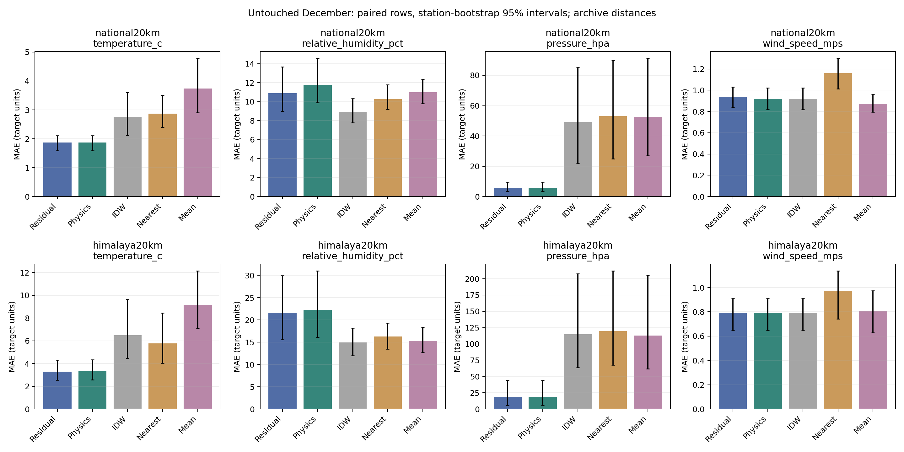

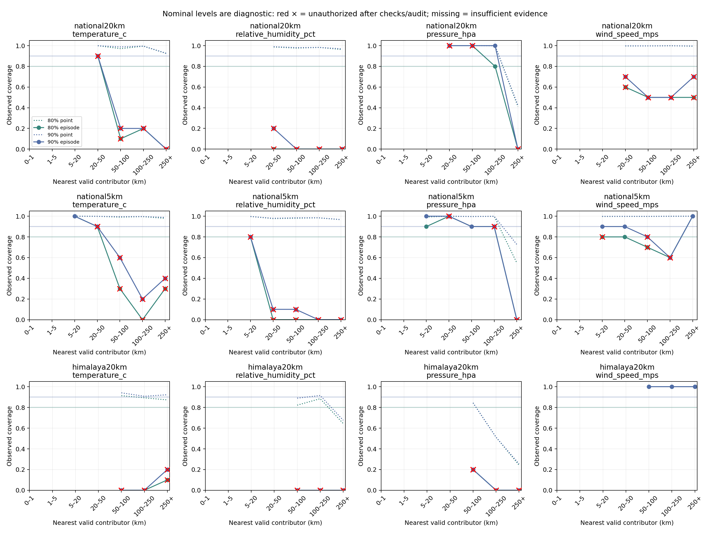


</details>


<a id="source-de1912119a00"></a>

<details>
<summary>reports/showcase_2026_10_22/prospective/REPORT.md</summary>

# Mandi prospective collection progress

Checked: 2026-10-21T20:52:41.264163+00:00

Scored forecasts: 4; pending: 6.
Issued in the input hour: 0; delayed startup inputs: 4.

The later values are API/model grids, not physical station truth. No six-hour field accuracy or model improvement is established.

## Target 2026-10-21T17:00:00+00:00

Input valid: 2026-10-21T11:00:00+00:00. Prediction actually saved: 2026-10-21T16:48:21+00:00.
Remaining lead at issuance: **11.65 minutes**. Later values first available: 2026-10-21T17:07:01+00:00.

| Channel | Input | Saved prediction | Later API value | Absolute error |
| --- | ---: | ---: | ---: | ---: |
| temperature_c | 25.000 | 13.838 | 14.500 | 0.662 |
| relative_humidity_pct | 50.000 | 83.343 | 82.000 | 1.343 |
| pressure_hpa | 931.300 | 929.949 | 930.900 | 0.951 |
| pm25_ug_m3 | 10.500 | 26.395 | 26.500 | 0.105 |
| pm10_ug_m3 | 13.000 | 30.533 | 28.800 | 1.733 |
| wind_speed_mps | 0.930 | 0.766 | 0.650 | 0.116 |

## Target 2026-10-21T18:00:00+00:00

Input valid: 2026-10-21T12:00:00+00:00. Prediction actually saved: 2026-10-21T16:48:21+00:00.
Remaining lead at issuance: **71.65 minutes**. Later values first available: 2026-10-21T18:09:39+00:00.

| Channel | Input | Saved prediction | Later API value | Absolute error |
| --- | ---: | ---: | ---: | ---: |
| temperature_c | 22.600 | 12.406 | 13.100 | 0.694 |
| relative_humidity_pct | 56.000 | 90.522 | 89.000 | 1.522 |
| pressure_hpa | 931.000 | 929.523 | 930.300 | 0.777 |
| pm25_ug_m3 | 13.200 | 27.776 | 26.600 | 1.176 |
| pm10_ug_m3 | 15.500 | 29.677 | 28.900 | 0.777 |
| wind_speed_mps | 0.290 | 0.850 | 0.760 | 0.090 |

## Target 2026-10-21T19:00:00+00:00

Input valid: 2026-10-21T13:00:00+00:00. Prediction actually saved: 2026-10-21T16:48:21+00:00.
Remaining lead at issuance: **131.65 minutes**. Later values first available: 2026-10-21T19:09:52+00:00.

| Channel | Input | Saved prediction | Later API value | Absolute error |
| --- | ---: | ---: | ---: | ---: |
| temperature_c | 20.800 | 11.602 | 12.100 | 0.498 |
| relative_humidity_pct | 61.000 | 91.961 | 93.000 | 1.039 |
| pressure_hpa | 931.000 | 929.449 | 930.100 | 0.651 |
| pm25_ug_m3 | 17.600 | 26.815 | 25.400 | 1.415 |
| pm10_ug_m3 | 19.900 | 29.553 | 27.800 | 1.753 |
| wind_speed_mps | 0.050 | 1.083 | 0.990 | 0.093 |

## Target 2026-10-21T20:00:00+00:00

Input valid: 2026-10-21T14:00:00+00:00. Prediction actually saved: 2026-10-21T16:48:21+00:00.
Remaining lead at issuance: **191.65 minutes**. Later values first available: 2026-10-21T20:48:36+00:00.

| Channel | Input | Saved prediction | Later API value | Absolute error |
| --- | ---: | ---: | ---: | ---: |
| temperature_c | 19.600 | 11.501 | 11.700 | 0.199 |
| relative_humidity_pct | 65.000 | 92.079 | 93.000 | 0.921 |
| pressure_hpa | 931.200 | 929.205 | 929.300 | 0.095 |
| pm25_ug_m3 | 20.400 | 22.560 | 24.000 | 1.440 |
| pm10_ug_m3 | 22.700 | 23.652 | 26.300 | 2.648 |
| wind_speed_mps | 0.000 | 1.285 | 1.240 | 0.045 |

Predictions were saved before updates. Published offline weights remain unchanged; corrections are learned in shadow mode. All comparisons are retained in audit.json.


</details>


<a id="source-d5b9c0dc96c6"></a>

<details>
<summary>reports/storm_risk_pipeline_v1/ACCEPTANCE.md</summary>

# Storm-risk software acceptance audit

2026-10-15, Asia/Kolkata. Scope: the supplied experimental ERA5 pipeline spec,
preserved in `docs/reference/STORM_RISK_IMPLEMENTATION_SPEC.md`.

| Requirement | Authoritative evidence | Result |
| --- | --- | --- |
| Local ERA5 ingestion, actual-name/unit checks, UTC/configured region/years | `storm_risk/data/era5_loader.py`; `test_data_evidence.py` | Implemented and tested |
| 24-hour lags, changes, trailing extrema, derived wind/dew point | `storm_risk/features/`; `test_no_future_leakage.py` | 588 ordered features; future perturbation and gap tests pass |
| Explicit confirmed labels; monitored zeros; two-source event records; exclusions | `storm_risk/data/labels.py`; `test_data_evidence.py` | Source/time/location/magnitude checks; unknown hours never become zero |
| Date splits, chronological inner validation, boundary and shared-event purging | `storm_risk/data/splits.py`; `pipeline.merge_outcomes`; isolation tests | Test data excluded from all fitted stages |
| Ridge, XGBoost and fixed-epoch MLP | `storm_risk/models/`; actual saved local bundle | Three heads fitted on the synthetic fixture only |
| Nonnegative ensemble coefficients summing to one, selected only on calib | `models/ensemble.py`; fit spies and local artifact audit | Passed |
| Optional calib-only isotonic/Platt mapping, minimum class counts | `calibration/calibrate.py`; `test_calibrator_skip.py` | Skip path writes method `none` and keeps risk columns |
| Brier, counted reliability bins and Murphy components | `validation/metrics.py`, `reliability.py`; `test_reliability_bins.py` | Includes explicit binning remainder |
| Whole-day bootstrap, at least 1,000 draws and fixed seed | `validation/bootstrap.py`; deterministic test and report | Passed; synthetic numerical diagnostics withheld |
| All configured gate criteria and failed-condition report | `validation/gate.py`; `report.json` | Gate false on synthetic evidence, as required |
| Training-only month-wise anomaly thresholds, separate flags | `anomaly/anomaly.py`; `test_anomaly_flags.py` | Passed; uncovered months marked unavailable |
| Distinct-neighbour confirmation within a trailing window, no future use | `confirmation/neighbour.py`; `test_neighbour_confirmation.py` | Passed, including missing-hour and future-perturbation checks |
| Optional SGD daily predict-before-update, frozen scaler/weights, delayed labels | `models/online.py`; `test_online_predict_before_update.py` and actual-run audit | Passed; test rows never update the learner |
| Rolling diagnostics, drift flags and dated online checkpoints | Local run `online_metrics.csv`, `online_audit.json`, `checkpoints/` | Written; synthetic Brier/AUC values withheld |
| Joblib models/scaler/weights/mapper/settings, report and scores | Local `outputs/storm_pipeline_submission_v2/`; SHA checks in receipt | Written and verified |
| Feature NPZ per sampled timestamp plus latest per-feature PNG | Local `heatmaps/`, manifest and digest audit | 1,440 timestamp arrays; 21 PNGs |
| UI anomalies, neighbour-confirmed status, maps, scores, warnings and gate | `StormRiskPanel.jsx`; three read-only backend endpoints; six browser checks | Connected and tested on desktop/mobile |
| No uncalibrated scores presented as percentages or event certainty | UI label/browser assertions; risk-column checks on actual run | Passed for this pipeline |
| Complete report even if inputs/gate fail | Missing-input CLI run and unit test | NOT_READY report/CSV written, exit 2 |
| Seven mandatory named tests | `tests/storm_risk/test_*.py` | All present and passing; extra data/API tests also pass |
| Repository regression and original artifact preservation | `verification.json` | 309 tests + 172 subtests; 129 protected files unchanged |
| End-to-end run on real ERA5 if present | Repo and Downloads scan including ignored files | Conditional check: no real ERA5 available; only synthetic NetCDF fixtures found |
| No restricted-portal downloads or model-generated event labels | Local-only loader/label path and source inspection | No new network acquisition; synthetic labels are explicitly fixture-only |

The software acceptance above does not establish a validated cloudburst model.
Confirmed real event/negative records and ERA5 inputs are still needed to fit
and evaluate an empirical run. Physical ESP/radio execution and promotion of
the six-channel numerical neural ensemble remain separate unfinished work.


</details>


<a id="source-f2a8b0276508"></a>

<details>
<summary>reports/storm_risk_pipeline_v1/REPORT.md</summary>

# Experimental storm-risk pipeline implementation report

The ERA5-context ridge/XGBoost/MLP ensemble pipeline is implemented and connected
to the existing dashboard through read-only report, score and feature-map APIs.
It is separate from the six-channel ESP numerical forecast.

Validation: **309 Python tests and 172 subtests pass**, two JavaScript contract
tests pass, and all six desktop/mobile browser checks pass. The production UI
build and lint pass. All 129 protected original artifacts remain unchanged.
See [verification.json](reports/storm_risk_pipeline_v1/verification.json) and [acceptance audit](#source-d5b9c0dc96c6).

## Engineering run

Local output: `outputs/storm_pipeline_submission_v2/`.

- Inputs: 60 days, four synthetic grid cells, 17 ERA5-shaped variables.
- Derived inputs: dewpoint depression, wind speed, direction sine and cosine.
- History: 24 causal hours, producing 588 ordered model features.
- Complete score rows: 5,664; incomplete initial history rows: 96.
- Base models: linear ridge, XGBoost and a 64-unit fixed-30-epoch MLP.
- Ensemble coefficients and all fitted weights are saved in the local joblib;
  the coefficient vector and artifact digest are in the verification receipt.
- Labels are independent random **synthetic engineering fixtures**, not observed
  Himalayan events and not thresholds generated from weather or satellite rain.

| Partition | Complete rows | Synthetic positive samples | Synthetic negative samples |
| --- | ---: | ---: | ---: |
| Train | 3,360 | 411 | 2,949 |
| Calib | 1,152 | 135 | 1,017 |
| Test | 1,152 | 135 | 1,017 |

These are partition inventory counts, not empirical performance. Unavailable
outcomes are purged before actual model/calibration fits; the fit audit records
their exact row IDs. The held-out gate remains **false**. Synthetic diagnostic
values are withheld from the exported report.

Feature maps: **1,440** hourly NPZ files and **21** latest per-feature PNGs.
The online replay writes **3,456** scores and performs **24** mature non-test
updates. Its scaler remains fixed, its test period is frozen, and its final
pending-label count is 92. Dated checkpoints are `2020-07-24.joblib` and
`2020-07-30_final.joblib`. No live learning service was started.

## Current boundaries

No real ERA5 file or independent confirmed-event dataset was available. The
real-input CLI therefore returns `NOT_READY` and writes a complete report rather
than manufacturing labels or weights. The default is a current-hour research
assessment, not demonstrated advance warning. Feature grids and neighbouring
grid agreement are modeled context, not independent physical sensor evidence.

The active six-channel node forecast still uses the compact Mandi XGBoost
student. Physical telemetry transport, neural edge promotion, live neighbour
corroboration and empirical Himalayan event validation are not completed by
this context-pipeline phase. Public notifications remain disabled.

Use the [run guide](#source-475f13cfdf66) for installation, configuration,
input schemas, reproducible commands and dashboard setup.


</details>


<a id="source-df4061ba2e16"></a>

<details>
<summary>reports/submission/2026-10-21/REPORT.md</summary>

# INDRA Mandi submission test

Executed: 2026-10-20T19:23:44.064590+00:00

**Task:** six numerical measurements at +6h. **Evidence:** retrospective Mandi
API/model grids, not physical station or hazard accuracy. No model was retrained
and no ensemble weights were selected using this test.

Source: 24,336 hourly positions, 2024-01-01T00:00:00+00:00 to 2026-10-10T23:00:00+00:00.
Split counts: {'train': 22602, 'validation': 738, 'future_test': 954}. Six-hour targets are purged at split boundaries.
The September/October test is reused research evidence, not a new untouched holdout.

## All saved Mandi forecast candidates — test MAE

Lower is better. Columns have different physical units and must not be averaged directly.

| Model | T °C | RH percentage points | P hPa | PM2.5 µg/m³ | PM10 µg/m³ | Wind m/s |
| --- | ---: | ---: | ---: | ---: | ---: | ---: |
| persistence | 4.8331 | 18.9686 | 1.6804 | 10.1762 | 12.6751 | 0.5945 |
| compact_xgboost | 3.7926 | 14.1338 | 1.4844 | 8.4077 | 10.5534 | 0.4642 |
| residual_mlp_32 | 1.4029 | 7.0272 | 0.9516 | 7.1338 | 9.1892 | 0.2979 |
| residual_mlp_64_32 | 1.3506 | 6.8190 | 0.9455 | 7.3370 | 9.8697 | 0.3158 |
| xgb_history | 1.7724 | 7.8542 | 1.0429 | 6.9577 | 9.3210 | 0.3215 |
| ridge_history | 1.2724 | 7.0027 | 0.9467 | 7.0209 | 9.2795 | 0.3415 |
| active_hybrid | 1.3063 | 6.9332 | 0.9255 | 6.8923 | 8.9972 | 0.3128 |

Full MAE/RMSE/R², persistence skill and row counts: [metrics.json](reports/submission/2026-10-21/metrics.json).
Classification accuracy/F1 do not apply to these continuous targets. The deployed
hybrid is kept fixed even where an individual component has a lower test error.

## Inputs, labels and learned weights

Inputs, in order: temperature_c, relative_humidity_pct, pressure_hpa, pm25_ug_m3,
pm10_ug_m3, wind_speed_mps. The hybrid derives 66 causal features from 25 hourly
snapshots spanning 24 hours. Labels are the same six API values exactly +6h later.
Examples with input, prediction and later API values are included in metrics.json.

Learned MLP arrays/normalization, tree files and ridge arrays remain at their
original paths. The active profile records their checksums; per-target prediction
blend coefficients are recorded below. These are not hazard probabilities.

| Target | Selected MLP | Neural | History XGBoost | Ridge |
| --- | --- | ---: | ---: | ---: |
| temperature_c | residual_mlp_64_32 | 0.40 | 0.35 | 0.25 |
| relative_humidity_pct | residual_mlp_64_32 | 0.50 | 0.50 | 0.00 |
| pressure_hpa | residual_mlp_32 | 0.35 | 0.15 | 0.50 |
| pm25_ug_m3 | residual_mlp_64_32 | 0.40 | 0.55 | 0.05 |
| pm10_ug_m3 | residual_mlp_32 | 0.40 | 0.55 | 0.05 |
| wind_speed_mps | residual_mlp_64_32 | 0.90 | 0.10 | 0.00 |

## End-to-end Mandi replay

One historical node: `mandi-api-grid`; forecast status `HYBRID_READY`.
The replay keeps actual source retrieval time, modeled source class, different
weather/PM grid identities, no claimed calibration and grid-surface pressure.
It never shifts old dates to today or invents nodes, rainfall labels or 15-minute readings.
Forecast target times remain historical. Stale readings are explicitly marked.

**Expected abstention:** current hazard rules reject modeled sources as field
evidence. Their scores remain unavailable; this is a checked safety state, not
measured hazard accuracy. The native 15-minute storm sequence cannot be evaluated
from this hourly source. One grid cannot validate neighbour consensus or a spatial map.

## What the submission can claim

- Implemented six-channel hybrid forecasting, source/weight integrity checks and retrospective numerical comparison.
- Tested local backend/frontend, explicit missing-history fallback, stale/cache handling and unavailable hazard states.
- Separate engineered tests for anomaly, neighbour/radio simulation, spatial research and ERA5 pipeline execution.
- No calibrated cloudburst/storm/snowstorm probability, flood/landslide skill, physical ESP32/RF execution or live six-sensor learning.

Attribution: Open-Meteo, ECMWF IFS and Copernicus Atmosphere Monitoring Service (CAMS).
Weather/air grids differ; underlying CAMS is coarser than its hourly API representation.
Original issue-time data availability is unverified. This is a retrospective value forecast.


</details>


<a id="source-80bc09b6549d"></a>

<details>
<summary>reports/two_node_phase/REPORT.md</summary>

# Exactly two nodes: measured archive results

**Deployment coverage remains unverified.** Each fit/prediction uses exactly K distinct QC-valid core-weather neighbors; K=2 is a separately trained model, with 3/4/5 comparisons. Complete-core contexts require T/RH/station pressure/wind, vetted height and plausible reduced pressure. This differs from the previous partial-channel 32-neighbor cohort. No row caps; all previously acquired 2023/2024 hours are considered. Exact coordinate aliases and held-out physical sites are excluded. Query labels never enter features.

## Identical test-row comparison (archive diagnostics)

| Hold-out | K | Fit rows | Common test rows | T MAE °C | RH MAE pp | P MAE hPa | Wind MAE m/s |
|---|---:|---:|---:|---:|---:|---:|---:|
| national5km | 2 | 462227 | 8391 | 1.735 | 10.871 | 4.059 | 0.908 |
| national5km | 3 | 462209 | 8391 | 1.681 | 10.682 | 4.065 | 0.894 |
| national5km | 4 | 462203 | 8391 | 1.648 | 10.690 | 3.752 | 0.874 |
| national5km | 5 | 462203 | 8391 | 1.684 | 10.508 | 3.699 | 0.866 |
| himalaya20km | 2 | 541231 | 1904 | 4.507 | 21.763 | 18.945 | 0.611 |
| himalaya20km | 3 | 541134 | 1904 | 4.734 | 21.543 | 18.795 | 0.675 |
| himalaya20km | 4 | 541116 | 1904 | 4.767 | 21.366 | 19.122 | 0.630 |
| himalaya20km | 5 | 541095 | 1904 | 4.766 | 21.350 | 19.047 | 0.612 |

MAE/RMSE, whole-station-bootstrap 95% MAE intervals, baseline losses and per-target denominators: [results.csv](reports/two_node_phase/results.csv). These are archive diagnostics, not acceptable deployment predictions. Selection gating guarantees aggregate non-inferiority only on selection labels; test losses remain.

## Two-neighbor physics versus residual

| Hold-out | Target | Rows | Residual MAE | Physics MAE | IDW MAE | Nearest MAE | Mean MAE |
|---|---|---:|---:|---:|---:|---:|---:|
| national5km | temperature_c | 8313 | 1.735 | 2.159 | 2.696 | 2.799 | 2.677 |
| national5km | relative_humidity_pct | 8305 | 10.871 | 13.797 | 10.768 | 11.692 | 10.543 |
| national5km | pressure_hpa | 2688 | 4.059 | 4.059 | 36.541 | 35.092 | 39.447 |
| national5km | wind_speed_mps | 8207 | 0.908 | 1.054 | 1.054 | 1.108 | 1.061 |
| himalaya20km | temperature_c | 1878 | 4.507 | 4.942 | 8.540 | 8.325 | 8.938 |
| himalaya20km | relative_humidity_pct | 1869 | 21.763 | 22.553 | 16.499 | 16.953 | 16.130 |
| himalaya20km | pressure_hpa | 1240 | 18.945 | 18.637 | 117.687 | 119.232 | 115.429 |
| himalaya20km | wind_speed_mps | 1904 | 0.611 | 0.632 | 0.632 | 0.789 | 0.688 |

The two-node baseline performs fixed 6.5 K/km temperature correction, dewpoint interpolation/RH restoration, common-height log-pressure reduction and query-height restoration; wind uses IDW. Missing/suspect height/pressure remains unavailable. Physics is also a residual-model feature and fallback. PM targets stay optional/untrained.

## Serving eligibility and uncertainty

| Hold-out | K | Current geometry-eligible rows | Geometry policy |
|---|---:|---:|---|
| national5km | 2 | 0 | A–B corridor |
| national5km | 3 | 226 | 20 km + hull |
| national5km | 4 | 237 | 20 km + hull |
| national5km | 5 | 280 | 20 km + hull |
| himalaya20km | 2 | 0 | A–B corridor |
| himalaya20km | 3 | 0 | 20 km + hull |
| himalaya20km | 4 | 0 | 20 km + hull |
| himalaya20km | 5 | 0 | 20 km + hull |

Default corridor: ≤1 km from the clamped A–B segment, ≤0.25 km beyond either end, pair separation ≤20 km. End and segment distances both apply; co-located/antipodal endpoints are refused. Configurable flag-only extrapolation emits a flagged prediction and no checked band. Missing contributors remain refused even in flag mode.

**Zero two-node test rows satisfy the default corridor**. NOAA complete-four-channel nearest pairs are too widely separated; actual minimum national test A–B spacing is documented below. Training counts do not prove close-range support. For 3–5 nodes the hull policy is different, so geometry-subset scores cannot rank deployment policies fairly. Common archive-row comparisons above are the controlled neighbor-count comparison.

Bands are fit with whole global 72-hour blocks Sep–Oct, independently checked Nov and revoked on December audit failures. All rows used for band calibration/check/audit must pass the corresponding serving geometry. **No two-node checked 80/90% band is available**; demo outputs null, never a 3–5-node or 32-node band. Full trial coverage/widths/counts: [coverage_by_distance.csv](reports/two_node_phase/coverage_by_distance.csv). Calendar blocks are episode proxies and future/field coverage is unverified. Hourly archive bands also require completed-hour input metadata and unchanged corridor limits.

A–B spacing national5km, min/p10/median/p90/max: 25.36, 65.53, 173.16, 545.24, 1468.08 km; pairs ≤20 km: 0.

Training national5km: 462227 pair-time rows / 787 unique A–B pairs; 2828 rows have 1–20 km A–B spacing. [Pair support](reports/two_node_phase/pair_support.json).

A–B spacing himalaya20km, min/p10/median/p90/max: 79.75, 343.35, 501.13, 796.46, 956.32 km; pairs ≤20 km: 0.

Training himalaya20km: 541231 pair-time rows / 970 unique A–B pairs; 12958 rows have 1–20 km A–B spacing. [Pair support](reports/two_node_phase/pair_support.json).

## Commands and verified behavior

- Node collection/calibration/position rotation: [NODE_COLLECTION_SPEC.md](#source-ee2e6e8a3ad3). Frozen per-instrument offsets are fit only from a previous colocated session; no deployment-label fitting.
- `python -m reports.practicum.demo --input reports/two_node_phase/examples/readings.json --model data/two_node_training/national5km/k2/model.json`. Input contains exactly A/B plus query metadata; hidden readings and third nodes are rejected. Models are bounded JSON, never pickle.
- `python -m ml.field.two_node calibrate colocated.csv --output offsets.json`; `python -m ml.field.two_node score field.csv --offsets offsets.json --output scores.csv --model data/two_node_training/national5km/k2/model.json`. Default hides A/B/C in turn; `--hide-c-only` matches deployment. All refusal/missing counts and raw/corrected truth are retained. Unguarded IDW/nearest/mean diagnostics have separate availability.
- Side-by-side offset and hidden-label-independence tests pass; the CLI calibration/scoring and physics/model demos were executed on **synthetic fixtures only**. No physical field observations supplied.
- JSON round trips checked against sklearn over every test row: maximum prediction deviation across runs 0.00006104. Missing-only HGB splits are represented explicitly, not as invalid JSON infinities. No executable deserialization.
- Use isolated `requirements-physics.txt`; `python -m ml.spatial_ensemble.evaluate_two_nodes` reproduces all eight experiments without caps. Trained JSON files/feature arrays remain local under ignored `data/two_node_training/`; source hashes and artifact hashes are in [results.json](reports/two_node_phase/results.json).

## Limits and next evidence

Archive context pairs can change with availability; the deployed A/B instruments are fixed. Whole-station/5 km national and 20 km Himalaya-proxy buffers, disjoint global time blocks, prior QC and masked heads are preserved. The Himalaya proxy is the previous lat/lon/elevation definition, not a complete ecological boundary. Core pressure availability selects a sparse cohort; nearby airport/WMO aliases beyond exact coordinates remain unresolved. More neighbors are not a uniform improvement; humidity and residual-pressure losses are explicitly preserved in CSV.

Offsets are relative to C unless a traceable instrument/reference is supplied; they cannot establish absolute accuracy, gain/linearity, high-wind behavior or drift. Fixed-position endpoint hiding is extrapolation; rotate physical instruments through the middle position in separate episodes for an interpolation comparison. Do not treat three rotations from the same episode as independent evidence.

Before a deployment claim: collect the A/B/C campaign, score untouched field episodes at real spacing/elevation/exposure, calibrate and check field-domain bands independently, and measure device memory/latency/watchdog/precision. The JSON evaluator is Python/server code; ESP32 execution remains unverified. ERA5/PM training and real authentication/transport integration are not added in this phase.

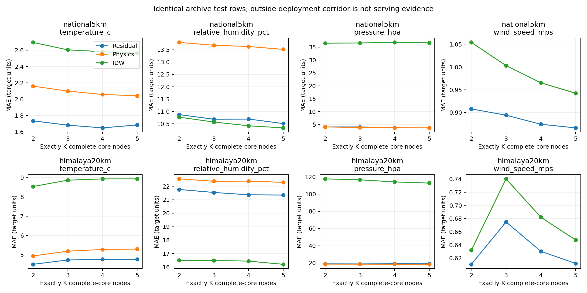


</details>


<a id="source-3cd48364cd17"></a>

<details>
<summary>reports/two_node_phase/examples/README.md</summary>

These files are **synthetic smoke tests**, not real sensor observations or measured model skill. Regenerate with `python -m reports.two_node_phase.generate_examples`, then run the calibration/scoring/demo commands in the node specification. The constructed offsets are +1 for A, −2 for B relative to C across the four native core channels; the script must reverse them. Fixed A/B endpoints and C middle demonstrate endpoint hiding refusal. No physical instrument accuracy, temporal variability or weather generalization is established.


</details>


<a id="source-ff693540f472"></a>

<details>
<summary>reports/two_node_phase/patches/README.md</summary>

# Small two-node phase patches

Already applied in the workspace; **do not apply again here**. Patches are relative to the completed physics phase, not original Git HEAD. No commits made; earlier unrelated changes preserved.

1. `01-segment-corridor.patch`: spherical segment/cross-track/endpoint distances and configurable refusal.
2. `02-exact-neighbor-training-view.patch`: exactly K complete-core contributors, query exclusion, neighbor IDs, optional query slope excluded from deployment model view.
3. `03-two-node-serving-and-refusal.patch`: automatic corridor for two inputs, strict A/B wrapper, model/interval compatibility, incomplete-channel behavior and band withholding.
4. `04-bounded-json-model.patch`: bounded numeric tree/NN export and inference without pickle, including missing-only splits.
5. `05-held-station-neighbor-evaluation.patch`: uncapped K=2/3/4/5 experiments, identical test-row comparisons, geometry-specific episode calibration and JSON parity checks.
6. `06-offsets-and-hidden-sensor-scoring.patch`: frozen relative calibration offsets and hidden A/B/C scorer with raw/corrected truth, availability and losses.
7. `07-node-calibration-rotation-spec.patch`: colocated procedure, offset limitations, physical middle-position rotation and command/schema contract.
8. `08-input-demo-and-fixtures.patch`: A/B JSON input demo and explicitly synthetic fixture generator.
9. `09-regression-tests.patch`: corridor edge cases, hidden truth isolation, calibration failures, JSON parity and interval/model compatibility.
10. `10-report-and-practicum-links.patch`: measured tables/figures generator, training-pair support and updated practicum links.

Each passed `git apply --check`, application in a temporary prior-phase tree, and byte-for-byte comparison with the workspace. [Verification](reports/two_node_phase/verification.json) records hashes, tests and unverified work.

Generated JSON models, feature arrays and predictions stay local in ignored `data/two_node_training/`. Reports/CSV/PNG/PDF, source/model hashes and synthetic CLI outputs are separate reproducible artifacts, not embedded binary patches. Run the evaluator and report generator to reproduce them. The generated model JSON is server-side; ESP32 runtime and real A/B/C field performance remain unverified.


</details>


<a id="source-4650cc3de371"></a>

<details>
<summary>reports/ui_refresh_v1/REPORT.md</summary>

# INDRA interface refresh

21 October 2026. The interface now uses a light map-first layout, three clear
views, readable location names, compact measurements and a separate forecast.
Technical model details moved into System. Simulated, archived, older and saved
readings remain identifiable. No model weights or source identities were changed
by the visual redesign.

Verified workflows: desktop/mobile observations, parameter-map selection,
geographic overlays, weather-pattern scores, saved offline readings, location
replacement, model comparisons and technical evidence. The actual local Mandi
application and separate twelve-location simulated application were both checked.
See `verification.json` and the browser receipts in this folder.

The larger software change also implements six supported IDW measurement
surfaces and a ten-category synthetic-trained LightGBM/MLP classifier. See
`reports/weather_features_v1/REPORT.md`. Synthetic category performance remains
separate from real event accuracy.

Public deployment has not occurred. Hosting, live ingestion, physical device
tests and independent local event validation remain as described in
[the handoff guide](#source-ca1e9e721220).


</details>


<a id="source-07c08e1cb257"></a>

<details>
<summary>reports/weather_features_v1/REPORT.md</summary>

# Parameter maps and weather classification — implemented prototype

21 October 2026. API/UI 0.5.0. Both requested features are implemented in the
local gateway/dashboard; real spatial/event validation remains unavailable.

## Delivered

- Six geographic parameter maps with units, source timestamps, explicit support
  and selectable map overlays. IDW estimates never extend outside supported
  geometry; two locations support only a segment.
- Ten simultaneous weather sensor-pattern categories using saved LightGBM / MLP
  models. Native-history, missing-input and training-domain checks are active.
- Twelve-location synthetic showcase, isolated from the actual downloaded Mandi
  grid. Separate source and synthetic-training notices remain visible.
- Existing v2 six-hour measurement forecasting and shadow learning stay intact.

## Actual synthetic classifier comparison

16,000 training / 4,000 validation / 4,000 test episodes. Splits are by independent
seven-snapshot episode, not by overlapping rows of the same history. A fresh test
seed 404 was reserved after initial engineering fixture checks; blend weights and
thresholds use validation only. Raw synthetic arrays stay local.

| Saved candidate | Synthetic exact match | Synthetic macro-F1 |
| --- | ---: | ---: |
| LightGBM | 0.99725 | 0.998674 |
| MLP 13→64→32→10 | 0.95925 | 0.979458 |
| Validation-selected blend | 0.99750 | 0.998743 |

These measure recovery of explicit proxy rules from generated sensor histories.
They do **not** establish 99.75% accuracy on actual weather, cloudbursts or storms.
Per-category precision/recall/F1/support and AUC are in
[classification_results.json](reports/weather_features_v1/classification_results.json). Input examples,
actual model outputs (including abstentions/misses) and map ranges/support are in
[integration_results.json](reports/weather_features_v1/integration_results.json).

## Tested boundaries

Known-point interpolation and midpoint arithmetic; geographic hull masks; line
versus area geometry; per-channel missingness; duplicate grid cells; mixed sources;
asynchronous timestamps; stale data; complete native history; domain abstention;
artifact tampering; saved-store migration; all six HTTP layers; desktop/mobile
parameter selection and overlay rendering. Software checks and original artifact
integrity are recorded in [verification.json](reports/weather_features_v1/verification.json).

The Mandi archive still has one location, so it has point data rather than an
area map. More synchronized locations with the six channels are needed for a
measured multi-node map. There is no mountain/elevation correction or independent
interpolation accuracy test. Scores remain uncalibrated; no real event labels
were added, no flood/landslide predictor is claimed, and no physical-board/RF
test or public warning service is established.

Run: `.venv/bin/python scripts/run_himachal_demo.py --offline --weather-demo --db data/himachal/weather_demo.sqlite --port 8082`.
Open http://127.0.0.1:8082. Full instructions and category definitions:
[guide](#source-4f516879b0b8).


</details>


<a id="source-25b96aa16f8b"></a>

<details>
<summary>scripts/README.md</summary>

# Evaluation entry points

| Script | Role | Data/model scope |
| --- | --- | --- |
| `test_weather_features.py` | Retest the saved category model and all six spatial HTTP layers | Synthetic proxy recovery only; does not retrain or establish event accuracy |
| `train_weather_categories.py` | Offline LightGBM/MLP synthetic-pattern fitting | Independent episode splits, validation-selected blend/thresholds; refuses overwrite |
| `train_mandi_v2.py` | Active v2 acquisition/train/frozen-evaluation entry point | Expanded LightGBM/MLP/legacy ensemble; `--prepare`, `--train`, `--evaluate` |
| `online_mandi_worker.py` | Actual hourly arrival watcher or explicit research replay | Durable exact +6h delayed-label SGD shadow state; no automatic output promotion |
| `benchmark_tabpfn_mandi.py` | Optional isolated local TabPFN v2 benchmark | 512 training-context / 96 test rows; separate runtime; no hosted inference |
| `generate_mandi_synthetic_pm.py` | Flagged older-archive PM gap filling | Simulation only; `--verify --reproduce` audits the saved version without overwriting |
| `fetch_mandi_data.py` | Download latest 30 completed UTC days separately | Six Mandi IFS/CAMS channels + rain/snow/gust context; local ignored snapshots, no retraining |
| `test_mandi_submission.py` | Retained v1 submission: seven candidates and historical dashboard replay | Six-channel frozen Mandi model-grid source; no fitting, no China models |
| `test_india_mandi.py` | Retained baseline/acquisition workflow | Six modeled Mandi channels, newly Mandi-trained weights, existing Indian research profiles; no China models |
| `test_models.py` | Historical comprehensive audit | Archived feature contracts and foreign/Indian comparisons; retained to reproduce the earlier report |
| `download_copernicus_mandi.py` | Ten-year archive acquisition | ERA5 2016–2025 monthly requests; dry run by default, no model or hazard-label changes |

Use `train_mandi_v2.py --evaluate` for current project results. The retained
`test_mandi_submission.py` reproduces v1 results; `test_india_mandi.py --prepare`
acquires the older baseline source. The historical script is not
an independent Himalayan hazard evaluator. Raw downloads, recovered Git files
and local working outputs remain ignored. Neither script invents event truth.

Copernicus account setup, portal selections and request-size batching:
[download guide](#source-6cf349104447).

The connected teammate dashboard starts with `run_himachal_demo.py --offline`. `import_dashboard_observations.py` atomically refreshes its store from reviewed native snapshots. See [integration guide](EVERYTHING.md#source-88c6383f55c9).

`compare_forecast_architectures.py` evaluates the saved Mandi history neural candidates against persistence/XGBoost/ridge. `predict_neural_forecast.py` runs an actual saved neural model on hourly six-channel histories. [Architecture and online-learning status](EVERYTHING.md#source-0e64d996660f).

`online_storm_risk.py` runs/resumes a daily ERA5-context SGD learner with delayed labels, fixed scaling and uncalibrated scores. `demo_online_storm.py` exercises it with explicitly synthetic NetCDF/labels. [Online research guide](EVERYTHING.md#source-2ecdaa4bae5d). This is separate from six-sensor live forecasting.


</details>


<a id="source-8b475407ed91"></a>

<details>
<summary>storm_risk/ARCHITECTURE.md</summary>

# ERA5 context ensemble architecture

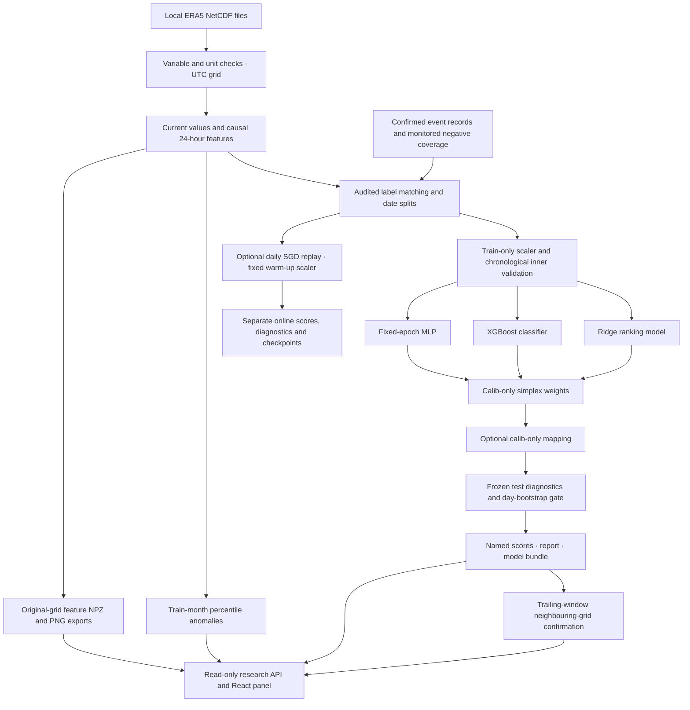

The current model input has 588 ordered features from 17 weather variables and
four derived values. The MLP defaults to 588 inputs → 64 ReLU units → one binary
ranking output. The ridge and boosted heads use the same feature order. Their
bounded outputs are combined with nonnegative coefficients summing to one;
coefficients are fitted on `calib`, never on `test`.

Anomalies and neighbouring-grid confirmation are separate outputs. Neither is
added to an event score. Grid agreement is not the physical-node authenticated
consensus implemented in the separate Himachal network phase.

The optional online learner predicts and saves each day before updating on
mature known labels. Its scaler and initial class weights are fixed; test-period
updates are disabled. It does not modify the three batch heads or their gate.

This architecture runs on the host/gateway. The six-channel ESP model, serial
transport and live sensor dashboard remain a distinct system. Real ERA5/event
data and independent held-out evidence are required before empirical promotion.


</details>


<a id="source-475f13cfdf66"></a>

<details>
<summary>storm_risk/README.md</summary>

# Experimental ERA5 storm-risk pipeline

This is the implementation of the [supplied specification](#source-7f7d28e1e42b).
It is a local-file, retrospective context experiment. It is separate from the
six physical measurement channels and the six-hour numerical forecast shown in
the node telemetry dashboard. It does not add sensors or replace edge weights.

The default target is **current-hour cloudburst risk** (`lead_hours: 0`), following
the selected current-risk submission scope. A positive lead is configurable;
target alignment and split-boundary purging change with it. ERA5 context does
not establish what an operational system actually knew at issue time. A replay
with later reanalysis is not a demonstrated live advance warning.

## Run

From the repository root, in a dedicated Python environment:

```sh
python -m pip install -r requirements-storm-risk.txt -r requirements-dashboard.txt
python -m storm_risk.cli demo --config storm_risk/config/default.yaml --fixture-dir data/hazard_context/storm_demo_inputs --run-id storm_demo --online
python -m server.dashboard --demo --ui apps/indra-himachal-ui/dist --storm-risk-run outputs/storm_demo
```

Build the frontend first with `npm ci && npm run build` inside
`apps/indra-himachal-ui`. Open `http://127.0.0.1:8080` and expand **ERA5 storm-risk
research**. The example serves a labelled synthetic sensor demo separately from
the synthetic gridded research run. No physical hardware is implied.

For real local inputs, edit `storm_risk/config/default.yaml` and its `paths`:

```sh
python -m storm_risk.cli run --config storm_risk/config/default.yaml --run-id reviewed_local_run
python -m pytest tests/storm_risk -q
```

Run IDs must be new; existing artifacts are never overwritten. Local raw files,
training labels and `outputs/` are ignored by Git. The pipeline makes no portal
requests. A missing-input run writes `report.json` and an empty `scores.csv`,
returns `NOT_READY`, and exits with status 2. It never fabricates fitted heads.

## Inputs and evidence

- Default coverage is India, 2016–2025, on a configured 0.25-degree grid. Dates,
  region, years, resource budgets and every model/gate setting are in YAML.
  Partition large exports by configured time/region before exceeding memory
  budgets; this delivery is not a nationally fitted model.
- Supply the seventeen configured ERA5 variables in hourly NetCDF files.
  Actual variable names, dimensions and units are checked on import. Temperature
  is converted from K to degrees C, pressure from Pa to hPa, and the declared
  hourly precipitation accumulations from metres to mm/h. Different accumulation
  periods require preprocessing; cumulative multi-hour fields are not supported.
- Labels require `time,lat,lon,label,split`; `available_at` is recommended.
  Time means the outcome hour, with an explicit UTC offset. Splits must match the
  predeclared dates. Coordinates map to the nearest available grid cell only
  within the configured matching radius; collisions and out-of-radius records
  are excluded for review. Unknown hours stay unknown.
- Event records require the full schema from the supplied specification. Two
  distinct declared source domains, known time/location and accepted confidence
  are required. Cloudburst positives additionally need the configured intensity
  and unit. These source declarations still require the owner's review; the
  software does not verify the content of external records.
- A zero needs a matched `monitored_non_event` coverage record with supporting
  sources. Missing incident reports do not establish zero. Unbacked, conflicting
  and incomplete records are exported in exclusion CSVs. Shared event IDs across
  splits are excluded from supervised fitting/evaluation.
- Snowstorm training requires a reviewed target definition and matching records;
  rainfall intensity is not a snowstorm label. No labels come from ERA5 or IMERG.

No real ERA5 exports or independently confirmed event files were available for
this implementation run. All demonstrated fitted artifacts are explicitly
synthetic engineering artifacts, not deployable empirical event models.

## Models and leakage controls

Each of 17 base variables plus four derived features has its current value,
lags 1–24, change over 24 hours and trailing min/max: **588 ordered features**.
Missing hours are reindexed without filling; incomplete histories are dropped
and counted. Wind direction is encoded as sine/cosine; calm wind uses a zero
vector, and missing wind remains missing.

The first 80 percent of training timestamps fit the scaler and three base
models. The last 20 percent form chronological inner validation, with unavailable
outcomes and target-boundary overlap removed from the fit. Models are:

1. Configured ridge regression, RidgeClassifier or L2 logistic alternative.
2. XGBoost with training class ratio and inner-validation early stopping.
3. A small MLP with fixed epochs, no shuffled rows and no random validation split.

The simplex weights are selected on eligible `calib` rows only, using a fixed
grid over nonnegative coefficients summing to one. The same calibration
partition fits the optional isotonic/Platt mapping; this reuse can be optimistic,
which is why it does not establish validation by itself. Class-count checks can
skip mapping. No test row is used for fitting, weight selection or thresholds.

The test report contains counted reliability bins, Brier diagnostics and whole
UTC-day bootstrap intervals with at least 1,000 resamples. Continuous scores are
binned for the Murphy components, so the report includes the binning remainder
instead of incorrectly claiming exact equality for the raw continuous scores.
The decomposition follows [Murphy (1973)](https://journals.ametsoc.org/abstract/journals/apme/12/4/1520-0450_1973_012_0595_anvpot_2_0_co_2.xml).

The gate checks Brier skill lower bound, reliability, populated-bin counts and
independent positive test-event count. Mapping must also have been fitted.
Single-class/insufficient-day diagnostics stay unavailable. A failed gate keeps
all score columns ending in `_risk_uncal`. Only a passing mapped ensemble can
be named `ensemble_cal_prob`; unmapped base heads retain their risk names.
Synthetic mode always fails the evidence gate and withholds diagnostic values
from the report rather than presenting synthetic skill.

## Separate outputs

- Monthly percentile anomalies are fitted only from training-period features.
  Missing climatology months are marked unavailable. Anomalies are neither
  sensor faults nor confirmed weather events, and never modify ensemble scores.
- Neighbour confirmation counts distinct other grid cells within the configured
  degree radius and trailing window, including no future hour. The current cell
  must also exceed the configured threshold. Grid-cell agreement is spatially
  correlated context, not independent physical-node quorum.
- Every sampled map timestamp has a compressed feature `.npz`; the default
  stride exports every hour. Latest per-feature PNGs have coordinates and units.
  Unsupported cells stay NaN; the exporter does no spatial interpolation.
- Optional online SGD is a separate daily retrospective replay. Warm-up scaling
  and class weights remain fixed. Daily scores are written before mature labels
  update the model, and all updates stop before the test period. Unknown/delayed
  labels remain pending. Rolling diagnostics, drift flags, dated checkpoints and
  an audit JSON are separate from batch-model gate results. This is not a live
  six-sensor online-learning service.

Each run saves `ensemble_<train_end_date>.joblib`, `scores.csv`, `report.json`,
exclusion CSVs, `heatmaps/`, and optional `online_scores.csv`,
`online_metrics.csv`, `online_audit.json`, and `checkpoints/`. Joblib contains
models, scaler, weights, mapper, settings and software versions. Load only
trusted owner-generated joblib files; the dashboard never loads them.

## Dashboard contract

Start the existing FastAPI backend with `--storm-risk-run <run directory>`.
Three additive read-only endpoints serve the selected local outputs:

- `GET /api/storm-risk/report`: evidence, warnings, gate state and model weights.
- `GET /api/storm-risk/scores`: up to 200 recent cells, explicitly scoped.
- `GET /api/storm-risk/heatmap?feature=t2m&time=<UTC timestamp>`: a hash-checked
  feature grid from the exported manifest; omitted time selects the latest frame.

The React panel shows uncalibrated score labels, per-cell anomaly markers,
neighbour-confirmed experimental status, feature grids and gate failures.
Unavailable runs and corrupted files produce explicit errors, without creating
browser data or simulated physical acknowledgements. The node telemetry
forecast now uses the separate six-channel Mandi neural/history-XGBoost/ridge
hybrid (`india_mandi_hybrid_6h_v1`), with a labelled persistence warm-up when
24 hours of complete hourly history are unavailable. These numerical forecasts
remain distinct from this ERA5 hazard research panel. Public notifications
remain disabled.


</details>
