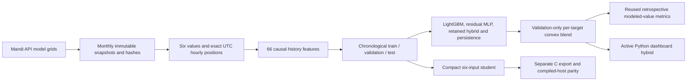
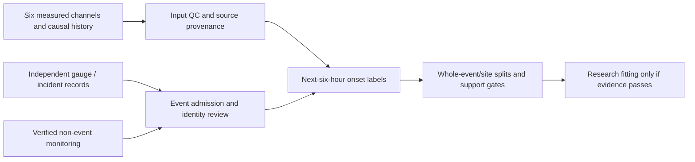
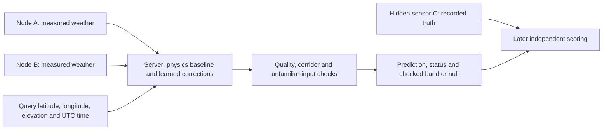
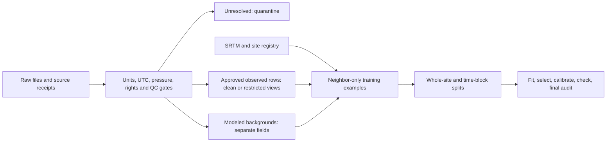

# INDRA operating handbook

This is the consolidated project documentation. Start with [README.md](README.md)
for installation and local operation. Sections retain their original dates and
status; older plans are historical and do not override the current status below.

## Current status — 23 October 2026

The active Python forecast uses the Mandi v2 ensemble. It predicts six numerical
measurements at +6 hours. Parameter maps, synthetic-trained categories and
assumption-based hazard scenarios remain distinct outputs. Physical field
accuracy and calibrated disaster probabilities have not been established.

The new provenance integration captures transaction-bound audit events, exports
Ed25519-signed batches and tests an append-only Solidity anchor on a local EVM.
The live backend reports LOCAL_ONLY until an external anchor worker, finality
verification and independent witness are configured. This is not a public chain
deployment or a claim of production security readiness.

## Provenance commands

```sh
.venv/bin/python -m pip install -r requirements-blockchain.txt
.venv/bin/python scripts/compile_anchor.py
.venv/bin/python scripts/provenance.py export --db data/himachal/mandi_dashboard.sqlite --output data/himachal/audit-proof.json --key data/himachal/audit-signing.key
# Pin the returned public key independently; never publish the signing key.
.venv/bin/python scripts/provenance.py verify --proof data/himachal/audit-proof.json --trusted-key YOUR_PINNED_PUBLIC_KEY
.venv/bin/python scripts/provenance.py evm-test --proof data/himachal/audit-proof.json --trusted-key YOUR_PINNED_PUBLIC_KEY
```

The local EVM command creates an ephemeral chain per invocation. Its transaction
reference cannot be checked later on a persistent public network. Retain exported
proofs independently. Existing rows before this integration are not retroactively
audited. Audit events become durable in the same SQLite transaction as the write.
A compromised local administrator can rewrite a whole unanchored history.

## Optional persistent local anchor worker

With an existing local EVM RPC and its unlocked development account, use
`--deploy --once` instead of `--contract CONTRACT_ADDRESS` on the first run to
deploy the contract. Keep the returned contract address for subsequent runs:

```sh
.venv/bin/python scripts/anchor_worker.py --rpc http://127.0.0.1:8545 --contract CONTRACT_ADDRESS --account LOCAL_UNLOCKED_ACCOUNT --db data/himachal/mandi_dashboard.sqlite --key data/himachal/audit-signing.key --output-dir data/himachal/anchor-receipts
```

The worker retries every 60 seconds, reuses existing commitments and retains one
signed proof per cumulative batch. `--once` performs one attempt. RPC anchoring
is deliberately restricted to loopback development networks; public deployment,
key custody, independent finality verification and key rotation are outstanding.
The dashboard does not consume worker receipts and continues to report local
status. This first version batches the complete journal; bounded incremental
batches and retention limits are required before sustained production operation.

## Verification of this integration

On 23 October 2026: the full Python suite passed 362 tests and 172 subtests;
frontend contract tests passed (2), and the production frontend build passed.
The local EVM test accepted a signed batch root and rejected duplicate and
unauthorized submissions. Evidence: [local EVM receipt](reports/provenance_v1/verification.json).
These are software checks, not field accuracy or an external-chain deployment.

## Consolidated guide index

- [docs/ARCHITECTURE.md](#source-ff21b6b9a3a3)
- [docs/CURRENT_MANDI_FEED.md](#source-6d85e1c96415)
- [docs/DATA_LICENSES.md](#source-8ef030a6160f)
- [docs/DOCUMENTATION_VERIFICATION.md](#source-bfd8778290ff)
- [docs/FEATURES.md](#source-dfea6b4a44c8)
- [docs/FORECAST_MODEL_IMPROVEMENT.md](#source-0e64d996660f)
- [docs/HIMACHAL_DASHBOARD_INTEGRATION.md](#source-88c6383f55c9)
- [docs/HIMACHAL_DATA_PIPELINE.md](#source-18f06f6ed4f8)
- [docs/HIMACHAL_EDGE_VALIDATION.md](#source-3660c603e9c8)
- [docs/HIMACHAL_FEATURE_CONTRACT.md](#source-76a7be045d86)
- [docs/HIMACHAL_NEIGHBOUR_NETWORK.md](#source-cb346bd51639)
- [docs/HIMACHAL_RULE_BASELINE.md](#source-17ef93fa72f4)
- [docs/HIMALAYAN_EVENT_PREDICTIONS.md](#source-d7ebb8545407)
- [docs/HIMALAYAN_EVENT_SCOPE.md](#source-3f8f2800b552)
- [docs/HIMALAYAN_WARNING_PROTOCOL.md](#source-5f398dd76325)
- [docs/INDIA_SENSOR_RISK_PLAN.md](#source-895004202eb0)
- [docs/MANDI_V2_PIPELINE.md](#source-699782d7781d)
- [docs/ONLINE_STORM_RESEARCH.md](#source-2ecdaa4bae5d)
- [docs/PARAMETER_MAPS_AND_WEATHER_CATEGORIES.md](#source-4f516879b0b8)
- [docs/PROJECT_OVERVIEW.md](#source-f795de9ca89c)
- [docs/README.md](#source-0b5ca119d2be)
- [docs/SHOWCASE_RUNBOOK.md](#source-f51ffcf33d24)
- [docs/SPATIAL_RESEARCH_OVERVIEW.md](#source-0b9b174d7db2)
- [docs/SUBMISSION_GUIDE.md](#source-32a01492adf5)
- [docs/SYNTHETIC_HAZARD_SCENARIOS.md](#source-76ac9fbe3adb)
- [docs/UI_AND_DEPLOYMENT_STATUS.md](#source-ca1e9e721220)
- [docs/hazard_label_audit.md](#source-233befa42eae)
- [docs/plans/BLOCKCHAIN_PROVENANCE_RESEARCH.md](#source-299ae1d7cc9f)
- [docs/plans/CURRENT_REPO_AUDIT.md](#source-904adb4881e6)
- [docs/plans/INDRA_HIMACHAL_PLAN.md](#source-70581c657aea)
- [docs/reviews/2026-10-21-submission-review.md](#source-7f4288476f37)


---

<a id="source-ff21b6b9a3a3"></a>

## Original guide: `docs/ARCHITECTURE.md`

# Implemented INDRA India/Mandi architecture

Updated 21 October 2026. The primary contract has six physical channels:
temperature, relative humidity, station pressure, PM2.5, PM10 and wind. History
and derived values come from these channels; they are not extra sensors.

## Numerical forecast: implemented, trained and retrospectively tested

Two additional implemented paths are [six geographic parameter surfaces and
ten current sensor-pattern categories](EVERYTHING.md#source-4f516879b0b8).
The spatial path uses synchronized same-source points → local metre projection →
IDW → hull/line support masks → six unit-labelled layers. The classification
path uses complete native history → 13 six-channel features → saved LightGBM/MLP
blend → ten overlapping synthetic-pattern scores with domain abstention.
They are separate from future numerical forecasting and empirical hazard training.



| Layer | Actual implementation |
| --- | --- |
| Acquisition and country/evidence controls | `ml/india_mandi/data.py` |
| Canonical feature/target construction | `ml/six_sensor_forecast/features.py` |
| Residual tree teacher/student fitting | `ml/six_sensor_forecast/train.py` |
| Linear temporal fitting and India-only evaluation | `ml/india_mandi/benchmark.py` |
| Active gateway ensemble | `ml/india_mandi/tabular_v2.py`, `ml/india_mandi/registry.py` |
| Public runnable entry point | `scripts/train_mandi_v2.py` |
| Delayed-label shadow learner | `ml/india_mandi/online.py`, `scripts/online_mandi_worker.py` |
| Six-output compact C export | `ml/six_sensor_forecast/export.py` |
| Active configuration; frozen historical export catalog | `configs/mandi_pipeline_v2.json`; `configs/model_catalog.json` |

The history teacher uses 66 features: per channel, current value, 1/3/6/12/24-hour
lags, one-hour delta, and trailing 6/24-hour mean/std. The compact student uses
only the current six values, with 16 depth-3 trees per output. The temporal
linear model uses the same 66-feature cohort, training-only standardization and
validation-selected regularization. No learned station ID, coordinates or future
reading enters these numeric models.

Tree prediction is `physical_clip(current + validation_weight * residual)`.
Linear prediction is `physical_clip(current + intercept + standardized_features
dot coefficients)`. Six separate heads preserve the output units. Each target's
best offline method is selected on validation; final errors never retune it.

This profile uses temporal-only splits with six-hour label purges, not fabricated
held-out stations. Historical teacher/linear inputs require a complete 24-hour
span. The compact student accepts one current snapshot. File hashes, feature
orders and source/config provenance are retained beside the weights.

**Active gateway:** `india_mandi_tabular_v2` combines six LightGBM residual heads,
a 66→64→32→6 residual MLP, the retained v1 hybrid and persistence. Per-target
nonnegative prediction coefficients sum to one and minimize validation MAE.
Train-only scalers and all component files are checksummed. It was fitted on
33,570 eligible rows from the expanded 35,520-position Mandi source. Its mixed
test results and optional TabPFN diagnostic are in the
[v2 report](reports/mandi_pipeline_v2/REPORT.md).

The persistent SGD residual learner saves forecasts before exact +6h truth
updates, with fixed scaling and source-isolated transactional state. It is
shadow-only; historical late inputs cannot create live learning scores. See
[operation and replay boundaries](EVERYTHING.md#source-699782d7781d).

**Retained v1 gateway component:** `india_mandi_hybrid_6h_v1` combines predictions from the saved
66→32→6 and 66→64→32→6 residual neural candidates, history XGBoost and ridge.
Validation selects a neural architecture and three convex coefficients per target.
No original model weights are rewritten. Complete history is required; otherwise
the API/UI explicitly reports persistence warm-up or unavailable current inputs.
The compact student remains the separate edge export. See
[hybrid report](reports/india_mandi_hybrid_6h_v1/REPORT.md).

The separate synthetic PM gap-fill dataset is excluded from these fits and
reported holdouts; see [its provenance](reports/mandi_synthetic_pm_v1/README.md).

**Evidence boundary:** India-only describes where INDRA's fit/evaluation records
come from and excludes Beijing records/pretrained weights. ECMWF/CAMS are global
model providers, not an IMD station archive. The Mandi profile contains modeled
weather/PM on different grids and modeled surface pressure. It does not validate
the transfer to actual sensors or historical information availability.

## Himalayan event warning: implemented labels/gates, no fitted real model



Actual modules are `ml/hazard_context/events.py`, `matching.py`, `warning.py`,
`policy.py`, `train.py`, `episodes.py` and `diagnostics.py`. The explicit protocol
is `configs/himalayan_warning_v2.json`. It supports cloudburst, storm, flash flood,
landslide and snowstorm. Rainfall/event records provide offline outcomes; they
do not silently become a seventh runtime input.

An onset and its entire timing-uncertainty interval must fall in `(issue, issue+H]`
for a positive. A negative needs complete compatible monitoring and no plausible
event/candidate overlap. Unknowns and post-onset windows remain unavailable.
Full six-channel history is mandatory. Current sources yield no admitted real
training corpus, so no hazard probabilities or field warning lead times exist.

## Embedded integration boundary

`ml/generated/india_mandi_modeled_6h_v1/` contains the new compact India/Mandi
C header and executed host-parity receipt. It is a research numeric forecast.
Physical ESP32 execution, timing, memory and sensor-distribution accuracy remain
untested. Existing firmware has not been silently switched to these weights.

`esp32/ml_integration` is the legacy serial forecast/rule integration.
`esp32/india_sensor` is the earlier India measurement-threshold smoke firmware.
`esp32/operational_node` prepares actual sensor readout with physical mode off
until wiring/calibration/UTC are supplied. These distinct applications must be
named separately in a submission. A compile or host-parity pass is not a field
test or an independent disaster-warning result.


---

<a id="source-6d85e1c96415"></a>

## Original guide: `docs/CURRENT_MANDI_FEED.md`

# Current Mandi API feed and delayed testing

Fetched 21 October 2026 for 31.71° N, 76.93° E. One query location is displayed;
it is not a physical mesh node. All six channels are present, with timestamps.

## Sources found and fetched

- Weather: Open-Meteo, explicitly pinned `models=ecmwf_ifs` — temperature,
  humidity, grid-surface pressure and wind in m/s.
- Particulates: Open-Meteo `domains=cams_global` — PM2.5 and PM10 in µg/m³.
- [ECMWF API documentation](https://open-meteo.com/en/docs/ecmwf-api) and
  [CAMS API documentation](https://open-meteo.com/en/docs/air-quality-api).

These are modeled estimates. CAMS global is approximately 45 km and three-hourly
underneath its hourly API output. The two providers return different grid cells;
their exact coordinates are saved. No six-channel co-located Mandi station stream
was verified. The reviewed [CPCB station-list snapshot](https://app.cpcbccr.com/ccr_docs/caaqms_list_All_India.pdf)
does not establish such a Mandi stream; its inventory may lag the live portal.

The initial current download has 89 past/current hourly positions through
21 October 16:00 UTC (21:30 IST), with all six channels. Seven future-valid hours
returned by the providers were excluded before inference. The latest frozen
forecast targets 22:00 UTC (03:30 IST on 22 October).

## How to run

Fetch once, update the local dashboard and record delayed shadow forecasts:

```sh
.venv/bin/python scripts/fetch_mandi_live.py --db data/himachal/mandi_dashboard.sqlite --online-state data/himachal/mandi_v2_online_live.sqlite
```

Collect every 15 minutes while the terminal/computer remains running:

```sh
.venv/bin/python scripts/fetch_mandi_live.py --db data/himachal/mandi_dashboard.sqlite --online-state data/himachal/mandi_v2_online_live.sqlite --watch-seconds 900
```

Only one collector may use the same output directory at a time. This job also
updates the shadow learner; a second online worker is not required. It is a local
process, not a hosted service or operating-system startup job. Ctrl+C stops it.
Interrupted downloads keep the previous dashboard data. Source identity changes
require a separate directory rather than silently mixing grids.

The existing backend serves http://127.0.0.1:8080. To start it after a restart:

```sh
.venv/bin/python -m server.dashboard --observations data/himachal/mandi_current_api_v1/history.json --db data/himachal/mandi_dashboard.sqlite --online-state data/himachal/mandi_v2_online_live.sqlite --ui apps/indra-himachal-ui/dist --port 8080
```

Raw receipts/history are under `data/himachal/mandi_current_api_v1/`, ignored by
Git. `history.json` preserves first-seen values and actual availability times.
Provider revisions are counted and retained in raw responses, not substituted
into existing predictions or truth. Missing values remain missing.

## What is being tested

The published numerical forecast remains the frozen v2 ensemble. The separate
shadow learner saves forecasts before any updates, waits for exact target-time
values acquired on later polls, then records errors and learns corrections.
The initial run has six pending eligible forecasts and zero updates. Earlier
historical positions initialize feature history; they cannot generate live
scores when their target time has already passed.

The nominal task is +6h from the input valid time. Actual issue/availability is
later than that valid time; report the actual remaining lead, not a full six
hours from retrieval. During bootstrap, eligible forecasts for several recent
hours may have substantially shorter remaining lead. No future API row is used
as an input or as early truth, even though provider forecasts are downloadable.

Later labels remain **model-grid values**, not measured weather. This can test
pipeline stability and adaptation to the API source; it cannot establish sensor
accuracy, improve the model by assumption, or validate cloudburst/flood/landslide
probabilities. Live-grid source state is namespaced separately from historical
replay and physical sensors. Online corrections remain in shadow mode.

## Archive test completed

The separate 30-day download covers 21 September–20 October: 720 complete hours,
690 eligible +6h pairs, including 24 target hours beyond the previous archive.
All six targets beat persistence MAE in both cohorts. The full period reuses
examined test dates, and 24 new target hours are a small sample. No weights were
retrained or selected on either cohort.

[Results and numerical errors](reports/mandi_current_api_v1/REPORT.md).

Reproduce the download and evaluation:

```sh
.venv/bin/python scripts/fetch_mandi_data.py --start 2026-09-21 --end 2026-10-20
.venv/bin/python scripts/evaluate_mandi_snapshot.py --input data/himachal/mandi_api/2026-09-21_2026-10-20 --output reports/mandi_current_api_v1
```

Attribution: Open-Meteo, ECMWF IFS, Copernicus Atmosphere Monitoring Service (CAMS).

## Prospective collection progress

The collector received the 17:00 UTC API values on 21 October and completed its
first shadow update. That first forecast was saved at 16:48 UTC using an 11:00
input: its remaining issuance lead was only **11.65 minutes**. It verifies delayed
scoring/update plumbing, not a full six-hour forecast issued at 11:00.

The System/model panel now separates scored forecasts issued within their input
hour from those issued using delayed inputs, and shows actual remaining lead.
The ordinary rolling error summary still includes both groups; its interpretation
must retain that timing distinction. Issued within the input hour means a
processing delay below 60 minutes, not exactly six hours of wall-clock lead.

Regenerate the journal audit without fitting/promoting any model:

```sh
.venv/bin/python scripts/report_mandi_live.py
```

[Audited input/prediction/later-value comparisons](reports/mandi_current_api_v1/prospective/REPORT.md)
include issue, target, retrieval and update timestamps. The report checks that
predictions precede their target and labels are available before the update.
One scored case is insufficient to assess whether online learning improves errors.


---

<a id="source-8ef030a6160f"></a>

## Original guide: `docs/DATA_LICENSES.md`

# Data licenses and training-view admission

License evidence consolidated on 3 October 2026 from [the source registry](data/registry/sources.json), [the original dataset review](docs/archive/reports/review/DATASETS_AND_PIPELINE.md) and retained source manifests. This is recorded evidence, not fresh provider confirmation or legal approval. Check and freeze the actual product/export terms before new use.

`training_open` is the clean, open-license observed-target view; `training_restricted` admits resolved restricted-license rows separately. Unresolved licenses, UTC/interval conventions, units, QC or pressure references block admission to both. Modeled products belong in separate background fields, not measured targets. Legacy CPCB research artifacts predate these gates and retain their explicitly assumed timezone.

## Every registered source

| Source ID / evidence | Recorded license | Commercial-use status | Present use / view |
|---|---|---|---|
| [uci_beijing_501](https://doi.org/10.24432/C5RK5G) | CC-BY-4.0 | Allowed under recorded terms; retain attribution/terms | Legacy forecast/event training; new view contracts incomplete |
| [india_cpcb_kaggle_v2](https://www.kaggle.com/datasets/abhisheksjha/time-series-air-quality-data-of-india-2010-2023) | CC-BY-NC-SA-4.0 | Non-commercial only; additional permission for commercial use | Legacy restricted research; new restricted admission awaits contracts |
| [delhi_opencity](https://data.opencity.in/dataset/delhi-hourly-air-quality-reports) | Other (Public Domain) | Unresolved; no commercial clearance | Quarantine; neither target view |
| [nwic_hp_temperature](https://www.nwdp.nwic.gov.in/dataset/temperature-telemetry-hourly-himachal-pradesh-water-department) | other-open | Unresolved; no commercial clearance | Quarantine; neither target view |
| [nwic_hp_humidity](https://www.nwdp.nwic.gov.in/dataset/relative-humidity-telemetry-hourly-himachal-pradesh) | other-open | Unresolved; no commercial clearance | Quarantine; neither target view |
| [nwic_hp_pressure](https://www.nwdp.nwic.gov.in/dataset/atmospheric-pressure-telemetry-hourly-himachal-pradesh) | other-open | Unresolved; no commercial clearance | Quarantine; neither target view |
| [nwic_hp_wind](https://www.nwdp.nwic.gov.in/dataset/wind-speed-telemetry-hourly-himachal-pradesh-department) | other-open | Unresolved; no commercial clearance | Quarantine; neither target view |
| [nwic_hp_rainfall](https://nwdp.nwic.gov.in/dataset/rainfall-telemetry-hourly-himachal-pradesh-department) | Other (Open) | Unresolved; no commercial clearance | Quarantine; neither target view |
| [nwic_hp_temperature_legacy](https://nwdp.nwic.gov.in/dataset/temperature-telemetry-hourly-himachal-pradesh-water-department) | UNVERIFIED | Unresolved; no commercial clearance | Quarantine; neither target view |
| [imd_station_catalogue](https://dsp.imdpune.gov.in/) | UNVERIFIED | Unresolved; no commercial clearance | No approved observation training rows |
| [srtm_gl1](https://portal.opentopography.org/raster?opentopoID=OTSRTM.082015.4326.1) | USGS public-domain product; mirror attribution | Allowed under recorded terms; retain attribution/terms | Static features/grouping; not weather targets |
| [era5_land](https://cds.climate.copernicus.eu/datasets/reanalysis-era5-land) | CC-BY | Allowed under recorded terms; retain attribution/terms | Not acquired; planned background only |
| [era5](https://cds.climate.copernicus.eu/datasets/reanalysis-era5-single-levels) | CC-BY | Allowed under recorded terms; retain attribution/terms | Not acquired; planned background only |
| [nasa_power](https://power.larc.nasa.gov/) | Free NASA data; attribution | Allowed under recorded terms; retain attribution/terms | Mandi diagnostic/background; not observed targets |
| [noaa_ghcnh](https://www.ncei.noaa.gov/products/global-historical-climatology-network-hourly) | CC0-1.0 | Allowed under recorded terms; retain attribution/terms | Clean observed targets after QC |
| [openaq](https://docs.openaq.org/resources/licenses) | Provider-specific | Unresolved; no commercial clearance | No approved observation training rows |
| [sensor_community](https://sensor.community/en/) | Database Contents License 1.0; database terms unresolved | Unresolved; no commercial clearance | No approved observation training rows |
| [cams_eac4](https://ads.atmosphere.copernicus.eu/datasets/cams-global-reanalysis-eac4) | CC-BY | Allowed under recorded terms; retain attribution/terms | Not acquired; planned background only |
| [koppen_geiger_1991_2020](https://www.gloh2o.org/koppen/) | CC-BY-4.0 | Allowed under recorded terms; retain attribution/terms | Static features/grouping; not weather targets |

## Important unresolved evidence

- NWIC: catalogue `other-open` labels do not resolve exact rights; all four-channel rows remain quarantined. Rainfall rights/clock semantics are unresolved too. The legacy temperature export contains only four rows, not the advertised long history.
- Delhi/OpenCity: catalogue says “Other (Public Domain)”, but primary-provider terms, pressure unit/reference and time convention are unresolved. Do not infer admission from that catalog label.
- NOAA: use station-level pressure only; UTC/QC contracts and CC0 evidence are recorded. Repeated/aliased sites and suspect elevations still need scientific review.
- ERA5/ERA5-Land/CAMS: recorded CC-BY class is not evidence of acquisition or acceptance of current service terms. CDS/ADS account terms must be accepted through authorized access. ERA5 pressure is grid-surface background; the registry station-reference placeholder is not a valid target mapping.
- POWER: explicit UTC is required; grid pressure is not station truth. Default local solar time must not be silently converted.
- OpenAQ: a key alone does not establish rights to each provider dataset. IMD permission/export terms and Sensor.Community content/database terms remain unresolved.
- UCI derived RH and uncertain pressure/interval contract in the new registry prevent treating the older forecast training as automatic spatial-view approval.
- Derived SRTM slope and climate classifications are inputs/group labels, not extra independently measured weather targets. Keep terrain product/datum/hash provenance.

No source terms were changed and no authenticated download was attempted in this documentation pass.


---

<a id="source-bfd8778290ff"></a>

## Original guide: `docs/DOCUMENTATION_VERIFICATION.md`

# Documentation consolidation verification — 3 October 2026

This pass changed documentation only. It did not retrain models, alter data, change firmware or run authenticated downloads.

## Executed in this pass

- Recursively inventoried all `.md`/`.mmd` files, including hidden/ignored files except Git internals: **43 original Markdown files, zero standalone Mermaid files**. Preserved all originals at their existing or recorded archive destinations. Four original inline Mermaid blocks were extracted verbatim to archive `.mmd` files.
- Rebased local Markdown links after 13 moves. Checked existence of all local link/image targets and heading anchors; external websites were not rechecked. Original names, modification times, hashes, classifications and actions are in [the manifest](docs/documentation_manifest.json).
- Checked the four core-target overview tables against the two-neighbor rows in [results.csv](reports/two_node_phase/results.csv) and the printed [report](reports/two_node_phase/REPORT.md). Core MAE values retain the report's three decimals; persistence retains CSV precision. No new performance measurements were added.
- Ran `/tmp/indra-data-venv/bin/python -m pytest -q`: **97 passed, eight subtests passed in 10.57 s**, one existing pandas `verify_integrity` deprecation warning. Temporary log: `/tmp/indra-doc-tests.log`.
- Ran the physics-only demo and the learned-model demo on `reports/two_node_phase/examples/readings.json`, using `data/two_node_training/national5km/k2/model.json` for the latter. Both completed, returned status/contributor information and withheld unchecked bands. These are **synthetic software examples**, not field observations. Temporary outputs: `/tmp/indra-doc-demo-physics.json`, `/tmp/indra-doc-demo-model.json`.

## Not executed or established

Clean-environment dependency installation, NOAA reacquisition/full retraining, ERA5/IMD/OpenAQ access, field calibration/scoring, physical ESP32 execution, a fresh firmware build, hardware soak or security clearance were not run in consolidation. Earlier compile/evaluation claims are attributed to their original reports. No new claim of model accuracy, field uncertainty coverage, commercial clearance or invention novelty was made.

The overview is Markdown, not a paginated PDF. Its short sections and compact tables target approximately 6–8 pages; exact pagination depends on rendering. The two overview diagrams received source/syntax inspection, not a Mermaid renderer run. Archive diagrams preserve originals rather than asserting all historical syntax has been rendered.


---

<a id="source-dfea6b4a44c8"></a>

## Original guide: `docs/FEATURES.md`

# INDRA features — current implementation

Status: 21 October 2026. [Current v2 pipeline and results](EVERYTHING.md#source-699782d7781d). This is the feature list for the project submission.
"Implemented" describes software; its evidence column states what has been tested.

## Product and research features

| Feature | What is provided | Evidence and limitation |
| --- | --- | --- |
| Six-channel input | Temperature, RH, pressure, PM2.5, PM10, wind, units and timestamps | Canonical range/QC checks; no seventh physical channel |
| Six-hour numerical forecast | Six endpoint values at t+6h from the active neural/tree/ridge ensemble | Current v2 tested against 1,170 later Mandi API/model values; not measured station accuracy |
| History and fallback | 66 causal features, 24h history; explicit persistence warm-up or missing-input status | Gap/missing-channel and no-future-dependence tests |
| Dashboard telemetry | Node list/map, six values/mini-histories, forecasts, model identity, coefficients, source and timestamps | Local backend/browser integration; Mandi replay is historical and stale |
| Data quality and source | Units, pressure reference, source class, calibration identities and availability | Modeled source cannot silently become physical station evidence |
| Current rain/snowstorm/cloudburst rule cards | Experimental current-condition matches and evidence/abstention | Synthetic contract tests; not calibrated probabilities or six-hour hazard predictions |
| Weather category classification | Ten overlapping categories from a saved LightGBM/MLP blend | Trained/tested on independent synthetic proxy episodes; scores are not real-event probabilities. Six complete native hours required |
| Cloudburst / flash-flood / landslide scenarios | Six-hour Monte Carlo fractions with central/drier/wetter assumption ranges | [Research-informed simulator](EVERYTHING.md#source-76ac9fbe3adb); generated 786,432 synthetic futures. Rainfall/soil/catchment priors are assumptions; no observed-event accuracy or calibrated probabilities |
| Storm sequence | Six-hour pressure fall and native 15-minute rebound/cooling/washout sequence | Requires appropriate cadence/source; hourly Mandi API cannot provide 15-minute evidence |
| Anomaly detection | Bounded six-channel engineering detector and Python/C parity | Tested separately; not wired as a validated live dashboard alarm |
| Neighbour inference | Registration, health, authenticated consensus and radio simulation modules | Engineering tests only; live radios and dashboard corroboration remain incomplete |
| Six parameter heatmaps | All six numerical surfaces, units and selectable geographic overlays using IDW | Hull masks, exact synchronization, per-channel missingness and line-only two-point support; one Mandi grid cannot support an area map. No field spatial validation |
| ERA5 risk research panel | Optional owner-generated scores, anomaly markers and feature grids | Available example is synthetic engineering data, not actual Mandi event accuracy |
| Offline/cache operation | Versioned cache, stale notices and unavailable states | Does not manufacture current readings or physical acknowledgements |
| ESP32 research | Separate compiled C exports and firmware applications | Host/build receipts exist; physical execution and hybrid edge export remain untested |
| Online learning | Durable six-channel delayed-label SGD shadow worker, plus separate ERA5 replay | Predict/save before update, exact +6h truth and fixed scaler; shadow updates do not replace offline/ESP32 outputs |
| Hardware commands/alerts | Explicitly disabled RPC and public notifications | No live sensor bridge or public warning service |

## Six input/output channels

| Order | Input name | Unit | Label/output |
| --- | --- | --- | --- |
| 1 | `temperature_c` | °C | Same measurement at exact +6h |
| 2 | `relative_humidity_pct` | % | Same measurement at exact +6h |
| 3 | `pressure_hpa` | hPa | Same measurement at exact +6h |
| 4 | `pm25_ug_m3` | µg/m³ | Same measurement at exact +6h |
| 5 | `pm10_ug_m3` | µg/m³ | Same measurement at exact +6h |
| 6 | `wind_speed_mps` | m/s | Same measurement at exact +6h |

Station inputs require station pressure; the Mandi API source explicitly retains
modeled grid-surface pressure. Coordinates identify the displayed source location;
they are not learned inputs to the active numerical model.

## Derived features

For each channel the numerical model uses: current value; 1/3/6/12/24h lags;
1h difference; trailing 6/24h means and standard deviations. That is **11 per
channel, 66 total**. No future rows or filled gaps are allowed.

The separate native feature engine implements hourly/15-minute/six-hour changes,
rates and statistics, dew point, frost point, vapour-pressure deficit, NWS heat
index, PM2.5/PM10 ratio, washout proxies, wind/RH-change flags and seasonal context.
These estimates retain missing/domain/calibration states. They do not add sensors
or turn pollutant washout into measured precipitation. Actual source availability
is respected; a retrospectively downloaded file is not treated as known earlier.

## Retained v1 Mandi submission run

Seven comparisons use the same 954 labels: persistence, compact XGBoost, history
XGBoost, ridge, MLP32, MLP64→32 and the fixed active hybrid. Report MAE/RMSE/R²
per target; do not claim a general accuracy percentage or retune on this test.
The local replay uses the last 25 actual API positions with their original dates,
source retrieval time and separate weather/PM cell IDs. Hazard rules correctly
abstain on that modeled source. Artificial multi-node fixtures cannot establish
Mandi-wide, spatial or disaster prediction skill.

See [test results](reports/submission/2026-10-21/REPORT.md) and
[submission steps](EVERYTHING.md#source-32a01492adf5).


---

<a id="source-0e64d996660f"></a>

## Original guide: `docs/FORECAST_MODEL_IMPROVEMENT.md`

# Forecast architecture and online-learning status

Status: 21 October 2026. The active pipeline is now [Mandi v2](EVERYTHING.md#source-699782d7781d), with LightGBM and a durable delayed-label shadow worker. The v1 experiment below is retained history.

Earlier status: 16 October 2026. The active dashboard now uses
`india_mandi_hybrid_6h_v1`: a validation-selected residual neural network,
history XGBoost and temporal ridge blend. Both trained neural candidates are
included in its versioned component manifest. Every target has a nonzero neural
coefficient. The compact model remains the separate existing firmware export.

The gateway integration and persistence warm-up are described in
[the dashboard guide](EVERYTHING.md#source-88c6383f55c9). Selection coefficients,
retrospective metrics and verification are in
[the hybrid report](reports/india_mandi_hybrid_6h_v1/REPORT.md).

## Architecture implemented in this experiment

The same six channels feed the existing causal feature builder. It produces
66 numerical features from current values, lags, changes and trailing means/stds.
Complete inference requires 25 consecutive hourly snapshots spanning 24 hours.
Missing hours/channels are not filled. Coordinates and additional atmospheric
variables are not introduced as learned inputs.

Two shared multi-output neural architectures were fitted:

- **66 → 32 → 6**, with 2,342 learned weights/biases.
- **66 → 64 → 32 → 6**, with 6,566 learned weights/biases.

These are feed-forward networks over causal history features, not recurrent
networks or TCNs. ReLU hidden layers feed six residual predictions. Feature and
residual means/stds fit training rows only. Each endpoint is
`physical_clip(current + validation_selected_weight * residual)`.

The optimizer is Adam. Epoch selection uses the fixed chronological validation
period, not sklearn's random early-stopping split. Per-target persistence blends
are also selected on validation. The test period does not select epochs,
architecture, targets or blend weights.

Both candidates were compared with persistence, the saved six-input XGBoost
student, the existing 66-feature XGBoost teacher and temporal ridge on identical
rows. Feature/history differences mean improvement against the snapshot student
cannot be attributed solely to changing the learning algorithm. The teacher and
ridge are the matched history comparisons.

Data: the existing 24,336 hourly Mandi-location Open-Meteo/IFS/CAMS modeled rows,
2024-01-01 through 2026-10-10. Complete training/validation/test cohorts contain
22,602 / 738 / 954 rows. The six-hour target horizon is purged at the partition
boundaries. This is one location's retrospective modeled grid, not independently
measured Indian station accuracy. Previously examined September/October dates
remain a reused benchmark, not a new untouched test.

Results, including every candidate and physical-unit MAE/RMSE/R², are saved in
[the comparison report](reports/india_mandi_neural_history_v1/REPORT.md) and
[JSON results](reports/india_mandi_neural_history_v1/results.json).

Weights and normalization are stored in bounded, checksum-verified NumPy archives
under `ml/models/india_mandi_neural_history_v1/`; no pickle/joblib loading is used.
Original trained models and exports remain byte-for-byte unchanged. The neural
candidates have no ESP32 export, quantization or on-board execution receipt.
They now contribute to the active dashboard hybrid. No firmware substitution
or neural edge export is claimed.

## Reproduce and run inference

Use the pinned `requirements-himachal.txt` environment. No new library is needed.

```sh
python scripts/compare_forecast_architectures.py
```

This evaluates the already saved neural candidates and checks the original data
manifest. The local raw observations must be present. `--train` fits a new
versioned experiment once and refuses to overwrite an existing model folder;
use a new configuration/output version for another training experiment.

Run a saved neural model on a six-channel hourly observation CSV:

```sh
python scripts/predict_neural_forecast.py \
  --input data/india_mandi_modeled/observations.csv \
  --output data/himachal/neural_prediction.csv
```

Input columns are `location_id`, timezone-aware `timestamp_utc`, and the six
canonical channel names. First-day/incomplete histories produce unavailable
predictions and an explicit status. The output has six numerical endpoints at
+6h plus a metadata receipt. It does not emit hazard classes or probabilities.

## Is online learning implemented?

**The historical v1 experiment had no live online-learning loop. Current v2 has an event-driven shadow worker; see the linked guide.** Recording, importing, plotting
and refreshing observations do not change learned weights. The new benchmark's
`partial_fit` calls implement offline training epochs over the historical
training partition; they do not wire online learning into the product.

For numerical +6h forecasts, a supervised update needs the actual six-channel
observation at exactly the forecast's target time, available no earlier than
six hours after its issue. A new input alone is not a training label, and the
model's own prediction is not ground truth.

A suitable next implementation is a gateway-side shadow learner or bounded
residual correction layer, with a frozen base model and scaler. It needs:

1. Persistent forecast records keyed by station/registration, issue/target time
   and exact model version; calibrated units, clock and source QC.
2. Exact delayed truth matching, duplicate prevention and gaps/missing-channel
   abstention. Keep modeled, synthetic and physical observations separate.
3. Training-only updates after labels mature; score each issued forecast before
   applying its update. Monitor drift and error against the frozen model and
   persistence. Preserve an independent future monitoring cohort.
4. Versioned checkpoints, shadow comparison, promotion criteria and rollback.
   Keep candidate updates off the ESP32 until size/parity/board tests pass.

Online hazard learning additionally requires independently observed event
outcomes and monitored negative periods. Threshold rules, high risk scores and
satellite candidate flags do not automatically supply verified cloudburst or
snowstorm labels.

## Work still needed for completion

- Connect the physical ESP32 telemetry bridge and verify clock, units, pressure,
  calibration and complete native histories.
- Evaluate the active gateway architecture on new measured Mandi data; build
  and verify a compact neural/hybrid edge export if that deployment is needed.
- Implement and replay-test the delayed-label shadow update service before
  enabling live adaptation.
- Obtain independent hazard labels and coverage evidence for rain, snowstorm,
  cloudburst, flash flood and landslide claims. Train/calibrate/evaluate each
  supported target separately; the current risk rules remain experimental.
- Finish the remaining network, spatial and deployment phases recorded in
  `docs/plans/INDRA_HIMACHAL_PLAN.md`; dashboard integration alone is not
  completion of the full product.

Implementation reference: sklearn supports multi-output MLP regression and
incremental fitting via `partial_fit`; using that API inside an offline training
script does not create a deployed learning service:
https://scikit-learn.org/1.7/modules/generated/sklearn.neural_network.MLPRegressor.html

A separate ERA5-context SGD online research replay has since been implemented; see [its scope and tests](EVERYTHING.md#source-2ecdaa4bae5d). It does not update the six-channel numerical forecast model or connect a live learning worker to the dashboard/ESP32.


---

<a id="source-88c6383f55c9"></a>

## Original guide: `docs/HIMACHAL_DASHBOARD_INTEGRATION.md`

# Connected INDRA dashboard

The supplied DP Mesh Dashboard is integrated in `apps/indra-himachal-ui`.
Its original source, reports and integration contract are retained unchanged in
`docs/reference/dp_mesh_dashboard_handoff/`, with SHA-256 identities in
`original_manifest.json` and `docs/plans/PROTECTED_PATHS.json`.
The original Downloads folder is unchanged.

The working application retains the teammate's React/Leaflet layout and IndexedDB
cache. Its API adapter now uses `server/dashboard.py`, independently of the
existing operational application. API version is **0.4.0**: the active six-channel
forecast is now the saved expanded Mandi LightGBM/neural/retained-hybrid ensemble, with explicit
history and fallback status. API-versioned caches discard older predictions.
This does not modify the team's firmware
contract automatically; the communications owner must adopt the versioned adapter.

See [current v2 and online-learning guide](EVERYTHING.md#source-699782d7781d) for the active model, mixed comparisons, shadow state and rollback.

## Run locally

Install once with Python 3.11–3.13 and Node 22:

```sh
python3 -m venv .venv
.venv/bin/python -m pip install -r requirements-dashboard.txt
cd apps/indra-himachal-ui
npm ci
cd ../..
```

Then start the complete local demonstration:

```sh
.venv/bin/python scripts/run_himachal_demo.py --offline
```

Open **http://127.0.0.1:8080**. The script builds and serves the PWA and API
from the same address. No weather API, NASA/CDS credentials, map downloads,
SMS/email, RF transmission or physical sensor connection is required. Dependencies
must already be installed; `--offline` does not install packages. The four demo
nodes are synthetic rain/snow/cloudburst-pattern/incomplete-history fixtures,
marked in the header and telemetry. They stop at a fixed observation time and
become stale; polling never manufactures new sensor readings.

The tested temporary environment on this computer is
`/private/tmp/indra-himachal-venv/bin/python`; its location is not a permanent
deployment dependency.

For frontend development, start `python -m server.dashboard --demo` from the
root, then `npm run dev` in the app directory. Vite proxies `/api` to port 8080.
For an independently hosted backend, set `VITE_MASTER_BASE_URL` at build time;
that deployment must configure its own authenticated gateway and CORS. No token
belongs in frontend environment variables. Optional OSM background tiles require
`VITE_OSM_TILES=true` and internet access; default node markers work offline.

## What is connected

| Dashboard content | Actual implementation/evidence |
| --- | --- |
| Six measurements with units and short histories | Native snapshots validated by `ml/himachal/contracts.py`; no seventh physical input |
| Six numerical +6h estimates | Active `india_mandi_tabular_v2`: validation-selected LightGBM + residual MLP + retained hybrid + persistence; checksum-verified components and bounds |
| Rain, snowstorm and cloudburst risk cards | Versioned `ml/himachal/features.py` and `rules.py`, including evidence and abstention |
| Storm sequence | Separate experimental six-hour pressure fall followed by native 15-minute rebound rule; not a fitted storm model |
| Node positions | Supplied WGS84 coordinates, with source class and observation age |
| Battery | Unavailable until measured; no invented voltage |
| Spatial surface | Explicitly unavailable; no invented kriging or smoothing of risk scores |
| Device commands | Disabled; HTTP 501, never a fake physical acknowledgement |

The numerical model was trained on **Mandi-location IFS/CAMS modeled grids**,
not verified six-channel Mandi station observations. This interface performs
inference, not a new accuracy evaluation. Forecasts are one endpoint at +6h,
not six hourly predictions. Risk assessments concern the input time and do not
inherit that six-hour forecast horizon.

The hybrid uses 66 causal features from **25 complete hourly snapshots spanning
24 hours**, selected at the latest observation's exact hourly phase. No missing
hour is interpolated. The UI shows the model identity, history count and each
target's three blend coefficients. Incomplete history uses explicitly named
`WARMING_UP_PERSISTENCE` (current values copied to +6h); a missing current channel
produces `MISSING_CURRENT_SENSOR` with unavailable outputs. Neither is presented
as hybrid inference. Startup recomputes legacy SQLite forecasts from retained
history; a legacy seven-hour cache warms up rather than retaining an old XGBoost
prediction under a new label.

Selection uses only the August validation partition; its report uses 954
previously examined September/October modeled rows, not a new untouched field
test. See [hybrid results](reports/india_mandi_hybrid_6h_v1/REPORT.md).
The existing compact ESP32 export is separate; this promotion runs on the
Python gateway and does not export the hybrid to firmware.

Risk scores remain **uncalibrated rule matches**, with `probability: null` and
no measured warning lead time. Missing channels/history or incompatible pressure
references cause explicit abstention. A high cloudburst score does not measure
rainfall intensity, and a high snowstorm score does not confirm snowfall.
Flood and landslide prediction remain unavailable. Public notifications are off.

## Import measured observations

The backend is a read-only local adapter, not a network telemetry collector.
An operator imports a JSON list of full native snapshot records following
`docs/HIMACHAL_FEATURE_CONTRACT.md`. Preserve actual units, station pressure,
measurement/availability times, site/registration, cadence, source class and
per-channel calibration identities. Source identity is operator-supplied and
does not establish cryptographic verification or voting privileges.

```sh
.venv/bin/python scripts/run_himachal_demo.py --offline --observations /absolute/path/snapshots.json
```

To refresh a running dashboard without restarting it:

```sh
.venv/bin/python scripts/import_dashboard_observations.py --input /absolute/path/snapshots.json
```

Validation and model inference finish before the SQLite snapshot is replaced
atomically. Polling updates the UI within eight seconds. Invalid imports preserve
the previous state. Use the same `--db` path for server and importer. Raw data
and the local SQLite store stay under ignored `data/himachal/`.
No source automatically falls back to synthetic values.

The firmware's positional serial JSON is **not** this full snapshot contract.
The remaining live bridge must add reviewed site/calibration/units metadata,
preserve serial quality flags and actual receipt times, and reject duplicates,
clock errors and invalid frames. Bench-test that bridge against the connected
ESP32 before declaring a live product. This change does not claim physical
execution, a LoRa link or a calibrated hazard probability.

## Contract and verification

Five teammate-compatible endpoint paths are implemented: `/api/nodes`,
`/api/nodes/{id}/telemetry`, `/api/status`, `/api/kriging/heatmap` and
`POST /api/rpc/{id}`. Telemetry now uses the canonical six channel names.
Additional fields identify source, history availability, forecast model,
rule evidence, stale state and unsupported capabilities. SQLite survives restart.
There is no public listening interface or write API; the server binds loopback.

Backend tests exercise the real saved model, partial-history abstention, missing
channels, invalid/future/relocated/duplicate observations, tampered model weights,
atomic import preservation, restart/staleness and original-source hashes.
Browser tests exercise desktop/mobile layouts, all three risk cards, node
selection, disabled RPC and cached/offline states. Cache keys include API version
and backend address. Cached or stale values are never shown as current warnings.

```sh
.venv/bin/python -m pytest tests/test_dashboard_integration.py -q
cd apps/indra-himachal-ui
npm test
npm run test:e2e
```

On macOS the browser tests use installed Google Chrome. CI uses Playwright
Chromium. `INDRA_PYTHON` selects the Python environment for the browser-test
backend. Local validation results and screenshots are recorded under
`reports/himachal/dashboard/`.


---

<a id="source-18f06f6ed4f8"></a>

## Original guide: `docs/HIMACHAL_DATA_PIPELINE.md`

# Himachal sources and independent label pipeline

The new source registry and adapters add to the existing `ml/hazard_context`
admission/matching engine. They do not weaken its gates or overwrite the v1/v2
warning experiments. The only shared target-set extension is independent `rain`;
the existing event schema already accepts text event types. The separate profile
is `configs/himachal_labels_v1.json`.

## Source access and immutable cache

`configs/himachal_sources_v1.json` records official provider documentation,
native cadence/resolution, source kind and unresolved reuse terms. Public JSON
adapters cover explicit ERA5 weather, global CAMS PM via Open-Meteo, and hourly
NASA POWER. They request UTC and explicit units/model selection. Context is
cached as modeled data, never an independent local gauge or six-channel station.

The [Open-Meteo historical API](https://open-meteo.com/en/docs/historical-weather-api),
[air-quality API](https://open-meteo.com/en/docs/air-quality-api) and
[NASA POWER hourly documentation](https://power.larc.nasa.gov/docs/services/api/temporal/hourly/)
are the request references. Native CAMS cadence remains three hours despite hourly
API positions. POWER must explicitly declare UTC; an LST response is rejected.

```sh
python -m ml.himachal.data.download \
  --config configs/himachal_sources_v1.json --source open_meteo_weather \
  --start 2024-01-01 --end 2024-01-31 --output data/himachal/context
# Repeat with --offline to require verified cache and prohibit network.
```

Dates split into bounded calendar-month chunks; responses have a 64 MiB cap,
three attempts, rate-limit backoff, fixed-ETag range resume, and provider-host
redirect checks. A changed/missing ETag cannot append bytes to a different file.
Raw response hashes, requests, provider role/version, units, returned coordinates,
retrieval clocks and source-resolution metadata are retained. Same requests reuse
the exact verified receipt; changed bytes fail. Station/cell IDs and original
issue-time availability remain **unverified** when the provider has not supplied
them. The adapter does not invent a grid ID from the requested coordinates.

CDS/IMERG, IMD, CPCB, OpenAQ and HPSDMA use audited manual imports in this adapter.
Existing authorized CDS download tooling remains available separately. No IMD/CPCB
bulk scraping route, private collection URL or rights grant is assumed.

```sh
python -m ml.himachal.data.download --source imerg_final_v07 \
  --start 2016-01-01 --end 2025-12-31 --output data/himachal/imerg \
  --input /path/to/legitimate-export.nc --metadata /path/to/reviewed-metadata.json
```

The metadata requires actual provider version, station/cell ID, native interval,
source units, retrieval time, rights evidence/reviewer and original request.
No metadata/export returns `NOT_READY`. Credentials and signed-token URLs are
rejected from provenance. Imports preserve immutable original bytes and filename;
they are cached, **not automatically admitted**. Source-specific terms still need
review. Raw/working data stays local under ignored `data/himachal/`.

## Normalization and virtual identity

`imerg_hourly` requires explicit half-hour start/end, mm/h rate, cell ID, quality,
random-error and fill metadata. Each rate contributes `rate × 0.5 h` accumulation;
two valid intervals are required for an hourly total. Gaps, rejected/fill values
and zero-as-fill ambiguity stay unavailable. Quality/error evidence is retained.
Satellite cell precipitation is not local gauge evidence for cloudburst admission.

`power_hourly` verifies UTC, declared units/fill values and kPa-to-hPa conversion.
Missing PM stays null. Source grid pressure remains grid-surface pressure. Neither
adapter declares original operational availability that the archive cannot prove.

`sensor_frame` accepts simultaneous six-channel snapshots through the canonical
adapter and separates physical-site/registration histories. A reviewed site table
must establish Indian/Himachal identity, coordinates, source and co-location;
country/state is never guessed from a rectangular bounding box. Grid/synthetic
records cannot become a measured six-channel Indian corpus.

Virtual-node ancestry deduplicates the true upstream station/cell and valid time,
so OpenAQ/CPCB copies and repeated model-cell queries do not manufacture stations.
Conflicting duplicates are rejected rather than silently fused. Variables/units,
elevation/datum, pressure reference, publication time, resolution, uncertainty,
ancestry, version and licence remain visible. All virtual nodes are excluded from
the minimum physical quorum, including external observed stations by default.

## Independent outcome profile

The offline JSONL envelope has `record` (existing nullable event schema),
`measurement` and `evidence_category`. Measurement intervals preserve amount,
unit, accumulation statistic, actual instrument and local-gauge review. Original
records keep time/location uncertainty, reviewed physical event groups, source
hashes, rights and reported-time text. Never create precise onset time from an
approximate incident date or hourly accumulation endpoint.

- Rain: gauge-sensitive initial research definition ≥0.2 mm liquid accumulation
  in one explicitly timed hour. It is not an official universal hazard definition.
- Snowstorm: independently confirmed occurrence under a reviewed definition;
  snowfall amount or cold/humid measurements alone are insufficient.
- Observed cloudburst: reviewed local gauge ≥100 mm over a verified hour, with
  independently reviewed event identity/onset. Public output remains
  `cloudburst_risk`; model/satellite/media candidates cannot supply this truth.

Rain/cloudburst structural intervals must agree with the legacy scalar measurement
and units. Daily totals cannot pass the hourly check. Unsupported definitions,
missing rights/identity/clocks/uncertainties and unapproved source roles remain
unadmitted. Possible cloudburst records block conflicting negative rain windows,
without creating positive rain labels. Candidates with unknown time/location stay
unknown and can conservatively exclude negatives.

```sh
python -m ml.himachal.data.labels --events /path/to/events.jsonl \
  --observations /path/to/native-snapshots.jsonl --monitoring /path/to/monitoring.json \
  --config /path/to/reviewed-himachal-label-profile.json \
  --output data/himachal/labels-v1 --offline
```

The reviewed profile adds `approved_sources` and `approved_sites` to the supplied
definitions. The existing source-admission fields remain mandatory. Monitoring
must match those sources, rights and exact outcome definition, cover the whole
six-hour future window and declared spatial radius, and have no candidate/event
overlap. Missing reports are not negatives. The adapter requires 24-hour complete
six-channel hourly history, preserves whole physical groups and never treats
ongoing/post-onset observations as new six-hour precursor positives.

Outputs are deterministic `labels.csv` plus a hash/config/input manifest, target
counts, rejected reasons, monitoring coverage and detailed `NOT_READY` branches.
Existing differing outputs refuse overwrite. Initial ≥50 groups/≥10 positive
sites are only a cohort-review screen, not final evaluation/deployment approval.
Further train/dev/calibration/test and season/valley gates remain mandatory.

The committed event/monitoring fixtures are **synthetic software contracts** and
never admit empirical training. Tests have an explicit internal contract mode to
exercise matching; it tags every row inadmissible and still returns `NOT_READY`.
The public CLI does not expose that override. Rules, simulations and satellite
rainfall cannot supply independent labels merely to make fitting succeed.


---

<a id="source-3660c603e9c8"></a>

## Original guide: `docs/HIMACHAL_EDGE_VALIDATION.md`

# Himachal local research node — Phase E

`esp32/himachal_node` is a separate application. It uses the existing operational
sensor abstractions and new generated local diagnostics/rules. It does not select
Beijing weights, invent an empirical hazard head or transmit external alerts.

## Diagnostics and generated identity

`configs/himachal_anomaly_v1.json` holds initial research settings: a fixed
16-reading ring per channel, eight valid samples of warm-up, median/MAD residuals
with explicit scale floors and an EWMA diagnostic. These settings have not been
fitted to independent local development observations. They are not sensor
accuracy or event-detection claims.

Python and generated C share configuration/hash, state meanings, float32
telemetry and double intermediate arithmetic. Range/Inf/self-test failures are
sensor faults; missing NaN is unavailable. CRC/time/clock rejection does not
advance the baseline. Long gaps rewarm the state. A valid fast weather change
is an environmental anomaly and remains valid input. Calm zero wind and a
constant reading alone are not diagnosed as failed sensors.

```sh
python -m ml.himachal.anomaly_codegen \
  --config configs/himachal_anomaly_v1.json \
  --output esp32/himachal_node/include/indra_anomaly.h --verify
python -m pytest -q tests/test_himachal_anomaly.py tests/test_himachal_anomaly_c.py
pio run -d esp32/himachal_node
```

The generator verifies the temporary header before publishing it and writes a
parity manifest. The local rule header is generated from the same feature/rule
configurations as Python. CI checks committed bytes and compiled stateful parity.
Tests include warm-up, boundary/adjacent values, gaps/replay/CRC/clock failures,
missing/range failures, reboot, slow drift, constant calm wind and abrupt weather.

## Local rule capabilities and missing states

The bounded local collector supports two explicit modes:

| Native interval | Supported local evidence | Unavailable evidence |
| --- | --- | --- |
| 60 seconds | Native 15-minute cloudburst-risk pattern after sufficient genuine history; preceding-hour PM baseline needs 75 minutes | Six-hour rain/snow pressure history: buffer intentionally spans only 75 minutes |
| 3600 seconds | Rain/snowstorm condition-risk rules after complete six-hour history and distinct hourly cloudburst companion | Native 15-minute pressure, temperature or wind changes |

The collector never expands hourly readings into minute samples. Missing
intervals restart collector history; missing channels remain null per channel.
The compact collector uses the initial PM floor/relative-decline proxy; it does
not accept independent calibrated PM noise sigmas. Use the server feature engine
when three-sigma noise adjustment or a longer native history is required.

Native mode must not be presented as a working local six-hour rain/snow detector.
The server can process longer complete native histories through the full feature
engine. Local probabilities remain null, trained-event-model mask is zero,
lead time is null and indication stays `LOCAL_ONLY` with dispatch `DISABLED`.
Local candidates are neither quorum decisions nor confirmed hazards.

## Serial synthetic demonstration

Default mode performs no physical IO. Supply one record per exact 60-second step:

```text
unix_seconds,T_C,RH_percent,station_P_hPa,PM25_ug_m3,PM10_ug_m3,wind_mps,crc_ok,clock_uncertainty_seconds
1767225600,20,60,900,25,50,0,1,2
```

`crc_ok` and clock uncertainty here are explicit test metadata supplied by the
host, not a verified physical link/clock. Serial records are always tagged
`synthetic_demo`; wind calibration in this path is a synthetic contract assumption.
They cannot become field evidence merely by passing the parser. Inputs are
bounded; malformed/extra fields refuse. `INFO` reports identities/capabilities;
`RESET` clears local state. Array order is always the six channels shown above.

JSON includes measured input array, diagnostic states/masks, rule scores/coverage,
abstention and local-candidate masks, source/profile/version, null probabilities
and disabled dispatch. `inference_latency_us` is instrumented around actual
on-board computation if the firmware is later run. No latency value has been
measured on a physical board in this phase.

## Physical enablement

Copy the example into ignored `include/device_config.h` only after the actual
board, pins, wind curve, surveyed EGM96 elevation, sensor calibration, native
cadence and clock uncertainty are known. Default pins are −1 and physical mode
is false. Enabling requires explicit cadence/calibration/site verification plus
valid clock uncertainty and wind/survey configuration. SensorHub additionally
checks pin validity/uniqueness and calibration inputs before acquiring.

The GPIO/RTC/GNSS/PMS drivers are prepared interfaces, not validated installation
claims. PMS CRC/staleness gates preserve missing PM. Physical wind averages the
actual encoder-derived readings over a complete native interval, with a small
sampling-boundary tolerance; incomplete/first intervals are unavailable. Actual
sampling/exposure/calibration must still be checked on the installed device.
No radio is enabled by this firmware. Actual peer protocol/RF readiness belongs
to later stages and cannot be inferred from successful compilation.

The configured compile target is the existing ESP32-S3 DevKitC-1 N8/no-PSRAM
profile. The actual board has not been identified or connected for this work.

## Measured software receipts and remaining hardware work

- [Generated host parity receipt](esp32/himachal_node/include/indra_anomaly.parity.json):
  220 stateful synthetic rows; 424-byte anomaly state. No heap in inference.
- [Xtensa object/static stack analysis](reports/himachal/anomaly_cross_object.json):
  5,252-byte object; 1,084-byte text, 80-byte literals, 144-byte read-only data,
  424-byte BSS. Static frames: 480-byte push, 176-byte median, 32-byte caller.
  This supports the proposed module budgets under static analysis; linked
  floating-point/libm helpers and real peak stack must not be silently omitted
  from a physical resource claim.
- [Four cross-build receipts](reports/himachal/edge_cross_builds.json):
  full firmware RAM/flash and ELF/bin identities. These include the framework
  and drivers; the 32 KiB proposal applies to the anomaly module, not the whole
  Arduino application. The history buffer is a separate bounded allocation.

All of the above are software/synthetic engineering evidence. Board execution,
installed pin/driver behavior, physical inference latency/peak stack, power,
calibration, cold/condensation performance, soak stability and radio operation
remain **NOT_TESTED**. No cloudburst accuracy follows from these receipts.


---

<a id="source-76a7be045d86"></a>

## Original guide: `docs/HIMACHAL_FEATURE_CONTRACT.md`

# Himachal native feature contract v1

`ml.himachal.features.build_packet(records, issue_time_utc)` produces deterministic
JSON input features. It does not train a model or supply independent event labels.
Definitions are frozen in `configs/himachal_features_v1.json`; the packet carries
its hash and a hash of the input snapshots actually available by issue time.

## Inputs and provenance

`ml.himachal.contracts.snapshot` accepts exactly the six named measurements and
their explicit units. It reuses the existing operational unit/range/QC adapters.
Kelvin/Celsius, Pa/hPa and km/h/m/s conversions are supported. Missing/rejected
channels remain null; original values/units are retained separately. NaN/Inf raw
values have a string representation; learned numerical inputs never contain them.

Required metadata includes node, physical-site and registration identities,
WGS84 position, elevation/datum, instrument and wind heights, native cadence,
source class/ID/cell, pressure reference, sensor model and per-channel calibration
IDs (null when unknown). Elevation/heights can explicitly be unknown. Model grids
must name the real provider cell. These fields are not extra physical sensors or
client-granted authentication privileges. They remain separate from six inputs.

Observation and valid time must agree. All timestamps require a timezone and are
converted to UTC; `available_at_utc` is mandatory and cannot precede observation.
For display use `Asia/Kolkata`, without changing calculation clocks. Native samples
must lie on their declared exact UTC grid; the cadence must divide an hour.

One feature history has one fixed site, registration, position, height, pressure
reference, source and calibration segment. Changes require a new segment rather
than mixing histories. Duplicate/reordered/off-grid input is rejected. Gaps are
not filled. A late packet can inform later issues only after its actual arrival.

Station and grid-surface pressure can produce separately tagged same-source
tendencies. Sea-level/unknown pressure stays unavailable. Grid context never
becomes a measured station pressure. Event-rule deployment separately requires
station pressure and observed/physical or explicitly synthetic-demo provenance.

## Features and units

Current values retain canonical units: degC, %, hPa, ug/m3, ug/m3, m/s. Each
channel has exact 15-minute, one-hour and six-hour changes and normalized rates
per elapsed hour, plus six-hour native-sample mean/population standard deviation.
Windows require every actual native sample from start through issue, inclusive.
RH changes use **percentage points**, with rates in percentage points/hour.
No hourly record can establish a quarter-hour change or a true instantaneous gust.
The storm-sequence pre-drop window is separately named: six hours ending at
issue−15 minutes, followed by a disjoint final 15-minute pressure-rebound window.
The feature packet does not infer a rebound from a six-hour total change.

Seven complete hourly snapshots span six hours; optional teacher history spans
24 hours. Their availability flags are distinct. At finer native cadence these
flags conservatively require complete native support throughout the window.

The PM ratio is PM2.5/PM10 and is null at zero/missing denominator. PM2.5 greater
than PM10 is flagged for review; the ratio is not silently clipped.

Hourly PM-decline baseline: median of the three preceding complete hourly values.
For finer native data, those hourly values are complete arithmetic means over
the three preceding completed hour windows. Native washout uses its separately
named preceding-hour median on `[issue−75 min, issue−15 min)` and current PM.
The baseline excludes the current decline interval. Both channels must decline:
PM2.5 by at least max(5 ug/m3, 20% baseline), PM10 by max(10 ug/m3, 20% baseline).
Baselines below 10/20 respectively make the proxy unavailable. An identified,
already available co-location noise calibration can additionally require a
three-sigma decline. Neither PM decline nor non-decline proves rainfall status.

Sharp hourly RH change starts at absolute 10 percentage points. The wind-increase
proxy starts at a genuine 15-minute increase of 3 m/s and current wind 8 m/s;
an explicit wind calibration ID is required. Calibration metadata is a source
claim until independently checked by the ingestion/registration layer. No gust
observation is inferred. June–September uses the Indian local calendar only.
The separate hourly companion applies that wind increase/current-wind setting
over a genuine full hour and retains a distinct name; it is not a 15-minute proxy.

## Meteorological estimates

The new helper uses [NPL water/ice Magnus equations](https://www.npl.co.uk/resources/q-a/dew-point-and-relative-humidity).
RH means saturation over liquid water. Water-domain computation is restricted
to −45…60 C, with result-domain checks. Zero RH has unavailable dew/frost point.
Below freezing, water dew point is explicitly labelled supercooled-water; frost
point is calculated from the same vapour pressure using ice coefficients and
returned only within −65…0 C. VPD uses liquid saturation, in kPa. No pressure
enhancement correction or instrument accuracy guarantee is claimed.

Heat index follows the [complete NWS calculation](https://www.weather.gov/tbw/heatindex):
preliminary simple index averaged with air temperature, then Rothfusz and the
low/high humidity adjustments where applicable. Fahrenheit intermediates convert
back to Celsius. A conservative implemented air-temperature screen of 40…112 F
returns null outside it; this screen is a research guard, not an NWS certification
of the entire temperature/humidity rectangle. Branch/status is always present.

## Packet and evidence

The packet has `schema_version`, issue/observation times, site/source metadata,
`features`, history flags and provenance/configuration hashes. Each feature has
a stable evidence ID, numerical/boolean value or null, unit, status and relevant
window/baseline detail. `training_label_admissible` is always false. Confidence,
rainfall measurements, event probabilities and forecast lead times are not
manufactured by the feature engine. Frozen existing model features/headers were
not changed; they require their original preprocessing.

The committed native CSV is a **synthetic software fixture**. It is not Indian
weather data and must not enter an empirical training or accuracy table.


---

<a id="source-cb346bd51639"></a>

## Original guide: `docs/HIMACHAL_NEIGHBOUR_NETWORK.md`

# Himachal neighbour and network research phase

This phase supplies tested Python registration, health, neighbour selection and
authenticated consensus components, a portable C frame codec/policy, and a
synthetic radio scheduler. It is not connected to the active dashboard or to a
physical radio. It does not change the active forecast model or event rules.

## Runtime contract

- Keep exactly six measurement channels. Three ordered event bits represent
  rain, snowstorm and cloudburst risk; these are current rule indications.
- An operator provisions reviewed registrations and distinct per-node keys.
  Provisioning files containing keys belong in ignored private storage with
  owner-only permissions, never in Git or an API response. Registration changes
  require new registration IDs and rotated keys; retired IDs remain reserved.
- Registration batch validation is atomic, including retired identity history.
- Health excludes missing/faulty channels, stale observations, uncertain clocks
  and critical batteries. Three good observations are required for recovery;
  confirmed persistent faults require a maintenance review. A regional change
  alone is not evidence of a sensor fault.
- Neighbours are selected within the configured 5 km / 750 m elevation limits,
  from at most 64 candidates, with at most six peers. A bounded scan reports
  unknown total coverage rather than claiming every eligible node was found.
- Requests and votes use an 82-byte application frame: a 64-byte body,
  16-byte truncated HMAC-SHA256 tag and 2-byte CRC. The host C codec is tested
  against Python, including tampering and quantization. The configured LoRa
  airtime is 0.472064 seconds per frame, before any additional MAC overhead.
- Queries lock the origin, observed time, registration, boot, profile and peer
  membership. Replays, changed duplicates, wrong-window and unsolicited votes
  are rejected. At least three agreeing independent physical nodes including
  the origin, two known failure domains, and two-thirds weighted agreement are
  required. Timeout means unavailable corroboration, not safe conditions.
- Outputs are risk-only, with probability unavailable and public dispatch off.

The C headers are included in the isolated ESP32 firmware build, but a live
packet receive/send loop and radio driver are not implemented. Compilation does
not establish on-board crypto execution, end-to-end mesh delivery or latency.

## Reproduce the engineering checks

Use the repository's Python dependency files and an activated environment:

```sh
python -m pytest tests/test_himachal_registration.py tests/test_himachal_health.py tests/test_himachal_consensus.py tests/test_himachal_radio.py -q
pio run -d esp32/himachal_node
python -m simulator.run_network --nodes 3 10 50 200 --scenarios nominal combined --seeds 1 --rounds 3 --output /tmp/indra_network_smoke.json
```

The retained stress receipt uses the default 30 seeds, 60 rounds, four node
counts and all six scenarios:

```sh
python -m simulator.run_network --output /tmp/indra_network_scale.json
```

This simulator calls the real registration/health/coordinator/codec/scheduler.
Local event flags and physical-role actors are explicitly synthetic fixtures.
It models a direct single-channel star, not a completed multihop mesh, terrain
propagation, measured RF losses, or trained weather inference.

## Results and remaining work

The retained scale receipt is `reports/himachal/network_scale.json`. Across
24 groups (four sizes, six scenarios), each with 30 seeds, no false
corroboration was observed. This must be read together with missed queries:
nominal missed-positive fractions are approximately 38.5% at three nodes,
89.6% at ten nodes, and 100% at 50 and 200 nodes. These fractions describe
injected protocol scenarios, not weather accuracy. The one-channel heartbeat
and query load is unsuitable at the larger scales under these assumptions.

Phase F therefore remains in progress. Remaining integration includes a real
transport/driver and verified provisioning, congestion-aware scheduling,
state recovery after gateway restart, dashboard corroboration displays, and
physical board/radio measurements. Full history-driven model/rule simulations
are a separate step; injected flags do not validate that pipeline.

The configured RF profile is disabled and conditional. Its power, equipment,
antenna and regulatory assumptions require verification for the actual setup.
No hardware configuration is inferred from this simulator.


---

<a id="source-17ef93fa72f4"></a>

## Original guide: `docs/HIMACHAL_RULE_BASELINE.md`

# Three-target current-condition rule baseline

`ml.himachal.rules.evaluate` consumes a versioned native feature packet and
returns exactly `rain`, `snowstorm` and `cloudburst_risk`. These are exploratory
sensor-pattern assessments. None confirms rainfall intensity, snowfall,
visibility, a blizzard or a cloudburst. No learned hazard head is fitted here.

All thresholds are research defaults in `configs/himachal_rules_v1.json`, derived
from the supplied review/build specification. They are not validated IMD warning
definitions. They must be evaluated/selected on independent development data
before any operational claim.

## Rain and snowstorm risk

Rain pattern is the complete conjunction of RH ≥85%, same-site six-hour pressure
fall ≤−1.5 hPa, temperature >3 C and the new hourly two-channel PM-decline proxy.
Snowstorm risk requires temperature ≤1 C, RH ≥85%, wind ≥9 m/s, six-hour pressure
fall ≤−3 hPa and the hourly PM-decline proxy. PM baselines and noise handling use
the feature contract; this is not the legacy classifier's non-increasing-PM rule.

Complete matches have rule score 1, complete non-matches score 0. The score is not
an event probability. Any unavailable required feature gives null score and
abstention. Clean-air rain can have unavailable PM evidence: the output is unknown,
not a certified absence of rain. Neither non-match nor missing evidence means safe.

An auxiliary `rainstorm_sequence` assessment explicitly separates a six-hour
pressure pre-drop ending 15 minutes ago (≤−3.5 hPa) from the following 15-minute
rebound (≥1.5 hPa). It additionally requires a 15-minute temperature fall ≤−3 C,
current temperature >3 C, wind ≥10 m/s and native PM-decline proxy. The pre-drop
duration is an explicitly chosen initial research setting; it was unspecified
in the older proposed matrix. This needs 6 h 15 min of native support and cannot
be established from a six-hour net delta alone. It is auxiliary sequence evidence,
not a fourth independent storm detector or a trained storm forecast.

## Cloudburst risk

The native profile's fixed weights are:

| Criterion | Weight |
| --- | ---: |
| RH ≥90% | .20 |
| Actual 15-minute pressure fall ≤−1 hPa | .20 |
| Actual 15-minute temperature fall ≤−2 C | .20 |
| Calibrated wind-increase proxy | .15 |
| Available native two-PM decline proxy | .15 |
| Indian local calendar June–September | .05 |
| Reviewed, already available terrain-exposure source | .05 |

Score is the sum of weights of observed matching criteria. Missing features do
not match and their weights are **not redistributed**. Availability and coverage
remain explicit even when a lower-bound observed score can be computed. No
terrain threshold is guessed from elevation. A terrain prior requires review,
source identity and an availability time no later than issue time.

The hourly companion has a different profile identity. Its experimental pressure
criterion is ≤−1.5 hPa/hour, temperature ≤−2 C/hour, and calibrated wind increase
≥3 m/s/hour with current wind ≥8 m/s. It uses hourly PM decline. These are hourly
patterns, with no implied quarter-hour precursor or actual gust. Both profiles
require the same explicit source/reference and evidence-status handling.

## Levels, missing states and next policy stages

Display defaults are watch ≥.4 and local warning-candidate ≥.7. A high local
candidate also requires ≥3 matching dynamic measurement criteria and ≥.9 available
weight. Fewer than three available dynamic criteria or insufficient coverage
abstains. Calendar/terrain alone cannot create a candidate.

This phase produces only `LOCAL_ONLY` assessments; `warning_candidate` remains
false, corroboration is `NOT_ASSESSED`, and dispatch is `DISABLED`. A complete
network/human-confirm policy must explicitly promote a candidate later. High
scores cannot bypass quorum or public-alert readiness gates. Unknown/stale states
must not be rendered as green zero risk.

Each output includes profile/version/config identity, source kind, evidence
IDs/values/units/operators/thresholds, triggered evidence, feature availability,
coverage, abstention and score interpretation. Probability and lead time remain
null; task is `current_condition_heuristic`. Cloudburst/snowstorm are always risk
only. These current-time patterns do not establish six-hour advance skill.

Grid-surface/sea-level/unknown pressure and modeled-only context cannot satisfy
the observed-station rule profile. Synthetic demo packets are visibly tagged
and must stay out of empirical model training, evaluation and field-accuracy
reports. Rule outputs are always inadmissible as independent training labels.


---

<a id="source-d7ebb8545407"></a>

## Original guide: `docs/HIMALAYAN_EVENT_PREDICTIONS.md`

# Required Himalayan event outputs — 12 October 2026

Cloudburst and storm predictions are required project outputs. The numerical
six-hour Mandi forecast is a separate task; it does not finish the event models.

The current protocol is `configs/himalayan_warning_v2.json`: **cloudburst,
storm, flash flood, landslide and snowstorm**. Version 1 remains unchanged for
prior evidence. Next-H-hour CLI defaults now use v2. No real hazard head is fitted.

## Independent target evidence

| Target | Required evidence |
| --- | --- |
| Cloudburst | Verified local one-hour gauge intensity, event identity and timing |
| Storm | Confirmed thunderstorm/squall under a reviewed definition, onset, location and identity |
| Flash flood | Confirmed rapid flood episode and catchment/location |
| Landslide | Confirmed slope-failure occurrence with reviewed onset/location |
| Snowstorm | Independently confirmed snowstorm, beyond snowfall or cold/humid readings |

The same six channels and causal history are predictors. Rain, gust and incident
records provide offline outcomes; they do not add a physical deployed channel.
An onset in the next six hours does not guarantee six hours of achieved warning.

## New observed storm evidence

Audited existing Indian NOAA GHCNh station-year files for Mandi, Sundernagar,
Bhuntar, two Shimla IDs and Kangra, 2023/2024. NOAA describes these observed
fields in its [dataset documentation](https://www.ncei.noaa.gov/products/global-historical-climatology-network-hourly).
Its [weather-code tables](https://www.ncei.noaa.gov/oa/global-historical-climatology-network/hourly/doc/ghcnh-present-weather-elements.pdf)
were downloaded, hashed and visually reviewed. Manual MW and automated AW codes
are interpreted separately; current and preceding-hour reports stay distinct.
AU combinations remain undecoded. Gust alone is not a thunderstorm label.

Found **869 distinct station/report timestamps**, including **26 at Mandi**.
These are not 869 independent storm episodes. Mandi's median report gap is
15 hours; several neighboring synoptic stations have three-hour gaps. Observed
report time is preserved separately from unknown episode onset. Unknown event
groups and timing/location uncertainty stay null. PM and verified continuous
non-event monitoring are absent.

Canonical candidates remain local/ignored in
`results/storm_evidence/ghcnh_hp_2023_24/candidates.jsonl`. Provenance/counts are
in `reports/hazard_context_phase/storm_observation_audit.json`.
**Admitted episodes: 0. Complete matched six-channel windows: 0. Models fitted: 0.**

```sh
python3 -m ml.hazard_context.storm_audit \
  --output results/storm-evidence-new-version \
  --audit-output reports/hazard_context_phase/storm-audit-new-version.json \
  --code-receipt results/storm_evidence/weather_codes.receipt.json
```

Use fresh paths; original station files are read-only and hashed.

## Fitting when evidence is admitted

Storm now requires confirmed occurrence in admission; a rain-gauge record
cannot admit it. Cloudburst retains verified local gauge evidence. Both route
into complete six-channel history, next-six-hour onset labels, whole-event/site
splits, validation alert budgets and event/lead-time evaluation.

```sh
python3 -m ml.hazard_context.cli train-hazards \
  --events data/hazard_context/reviewed_events.jsonl \
  --stations data/hazard_context/stations.csv \
  --observations data/hazard_context/six_channel_observations.csv \
  --monitoring data/hazard_context/monitoring.json \
  --config data/hazard_context/reviewed_sensor_config.json \
  --label-mode next_h_hours \
  --warning-protocol configs/himalayan_warning_v2.json \
  --targets cloudburst storm flash_flood landslide snowstorm \
  --output results/himalayan-events-v2
```

These are example paths, not acquired training data. Next, adjudicate the storm
episodes/onsets and obtain matched measured six-channel histories and monitoring.
Cloudburst still needs verified local hourly gauge evidence. The institutional
request now explicitly asks for realized thunderstorm/squall logs and gust
metadata; forecasts and nowcast warnings do not supply occurrence truth.

Until the evidence passes, event scores remain unavailable and accuracy is
undefined. The numeric Mandi API benchmark reports the same unavailable event
targets rather than learning them from modeled rain/weather proxies.


---

<a id="source-3f8f2800b552"></a>

## Original guide: `docs/HIMALAYAN_EVENT_SCOPE.md`

# Himalayan weather-event forecasting scope — 8 October 2026

Cloudburst and Himalayan weather-event forecasting remain project objectives.
The three currently fitted India measurement-threshold heads do not complete
this objective. Adding an event name or testing a rainfall proxy does not fit
an independent cloudburst detector.

The physical weather inputs remain temperature, relative humidity, station
pressure, PM2.5, PM10 and calibrated wind. Site coordinates, elevation and
timestamps describe the node. Rain/event records may provide offline targets
and validation without becoming additional deployed sensor channels.

| Requested research output | Current implementation/evidence | Next missing evidence |
| --- | --- | --- |
| Localized extreme-rainfall / cloudburst risk | Cloudburst event schema, admission, matching and training pipeline exist; no fitted head | Verified local rain-rate/event timing, locations, rainfall definition and monitored non-event periods |
| Heavy-rainfall risk | Hazard pipeline prepared; prior rain/flood scores imitate input rules | Independent rainfall targets and causal matched sensor histories |
| Storm / strong-wind risk | +6h high-wind measurement head fitted; independent storm head absent | Observed storm/gust labels; evaluate missed events and false alarms |
| Snowstorm / snowfall and freezing conditions | Legacy snowstorm head is untrained; frost/freezing rules are diagnostics | Independent snowfall/frost/freezing observations and target definitions |
| Fog, heat and cold episodes | Future near-saturation/hot measurement heads and current rule diagnostics exist | Visibility observations; local temperature normals, event duration and independent episode labels |
| Wildfire-conducive weather | Surface feature/rule diagnostics and hazard pipeline prepared | Independent fire attribution, event chronology and monitored negatives |
| Flash-flood or landslide weather contribution | Independent-event pipeline prepared; no fitted disaster head | Occurrence records and relevant rainfall/catchment/slope context; weather-only predictors do not establish total physical risk |

Future measured thresholds at exactly +6h differ from the occurrence of an
event at any time in the next six hours. The existing hazard matcher targets
exact future observed windows. A different warning window needs an explicit
target-definition change and fresh evaluation; no six-hour cloudburst lead-time
claim is currently established.

The subsequent [warning protocol v1](EVERYTHING.md#source-5f398dd76325) now implements
an explicit `next_h_hours` experiment alongside this preserved exact-window
benchmark. It still needs admitted real data and fresh model/evaluation results.

## Sources found for the cloudburst work

- [IMD Shimla July 2024 incident report](https://mausam.imd.gov.in/shimla/mcdata/disasterous_event.pdf)
  includes Padhar, Mandi in a 31 July multi-location incident entry. The
  underlying information is media-sourced, and rainfall intensity is blank.
  Preserve it as a reported incident candidate, not verified rain-rate truth.
- [HPSDMA major-event narrative](https://hpsdma.nic.in/admnis/admin/showimg.aspx?ID=3664)
  has a Rajvan/Rajban, Padhar, Mandi case in the primary site's search index.
  The direct fetch timed out. Its date/time must be reconciled against the IMD
  report before any hourly label is assigned. No UTC time or coordinates were
  guessed.
- [IMD MAUSAM 2022 Himalayan study](https://mausamjournal.imd.gov.in/index.php/MAUSAM/article/view/7150),
  published 1 October 2026, reports 66 cases. The abstract is a discovery lead,
  not 66 admitted labels; original records, rain-rate evidence and negative
  coverage remain unverified. The current archive also needs 2022 coverage for
  a matched experiment using those cases.

These sources are registered as **candidates** in
`configs/hazard_sources.json`. None was used for fitting or scored as ground
truth. Original source rights, event identity and spatial/time uncertainty still
need review. The [IMD cloudburst study](https://mausamjournal.imd.gov.in/index.php/MAUSAM/article/view/5084)
describes localized rainfall of at least 100 mm in an hour; the existing six
channels do not directly measure that quantity. They can be tested as predictors
of independently verified events, without claiming rainfall measurement.

## Work required to fit and test the event heads

1. Obtain the dated event records plus verified rain-rate evidence where the
   cloudburst definition requires it, and independently monitored negatives.
2. Match causal six-channel histories from the same area to the event windows.
   Keep unknown times, locations and outcomes unavailable.
3. Fit separate multilabel heads using the existing hazard pipeline; keep entire
   episodes and sites out of training for selection, calibration and final tests.
4. Report event recall, false alarms and measured lead time. Artificial data may
   exercise interfaces and failure cases; it cannot establish field event accuracy.

No cloudburst probability or fitted Himalayan disaster model is claimed by
this scope update. The blocking issue is missing independent target evidence,
not the absence of a named output in the software.

## Integration update — 9 October 2026

The independent-event pipeline now accepts `snowstorm`, alongside `cloudburst`,
`flash_flood` and `landslide`. Snowstorm admission requires a reviewed source
with independently confirmed occurrence, a documented event definition, time,
location and the existing provenance checks. A cold/humid reading or rain gauge
measurement alone cannot admit a snowstorm. This adds a research target; it
does not train the legacy untrained snowstorm head or enable an ESP32 warning.

Once canonical event JSONL, station metadata, synchronized observations and
verified monitoring coverage are available, select the four targets explicitly:

```sh
python3 -m ml.hazard_context.cli train-hazards \
  --events /path/to/reviewed-events.jsonl \
  --stations /path/to/stations.csv \
  --observations /path/to/observations.csv \
  --monitoring /path/to/monitoring.json \
  --targets cloudburst flash_flood landslide snowstorm \
  --output /tmp/indra-himalayan-research-v1
```

These are placeholder input paths, not an acquired dataset. Use a fresh output
directory. The command writes per-target admission/support results and fits
only targets whose evidence and independent split checks pass. The existing
research trainer uses the India feature builder and XGBoost; this update does
not introduce a neural model or certify six-complete-channel training data.

The implementation sequence is:

1. Define each outcome and its time window, then obtain matched observations
   and both confirmed events and monitored non-event intervals. Rainfall can
   supply offline cloudburst evidence without becoming a seventh runtime input.
2. Establish a baseline separately for each target. Hold out entire events and
   sites. Evaluate recall, false alarms, calibration and actual warning lead time.
3. Compare a small temporal neural model using causal histories of the same six
   channels only after there is enough independent data. Its architecture is
   an experiment, not a substitute for labels or a guaranteed improvement.
4. Export an eligible model, verify host/ESP32 prediction parity and measure
   board latency. Until then these disaster outputs remain unavailable.

The current evidence cannot establish whether six local atmospheric channels
alone provide sufficient skill for flash floods or landslides. Additional
catchment/terrain context is a separate research option that must be evaluated
explicitly, without silently changing the six-channel deployment contract.


---

<a id="source-5f398dd76325"></a>

## Original guide: `docs/HIMALAYAN_WARNING_PROTOCOL.md`

# Himalayan six-channel warning experiment — protocol v1

Historical v1 is preserved. The current CLI default is the expanded
[v2 event protocol](EVERYTHING.md#source-d7ebb8545407), adding independent storm.
Use `--warning-protocol configs/himalayan_warning_v1.json` for the exact v1
commands/manifests below. No real fitted hazard head exists in either version.

Implemented 9 October 2026. This is a tested labeling/training interface and a
research protocol. It has fitted no real hazard model and enables no deployed
warning. Institutional observations, admitted events and monitoring remain the
scientific bottleneck.

## Target and available software

`configs/himalayan_warning_v1.json` freezes the new experiment's six-hour window,
hourly cadence, 24-hour complete-input history, target definitions, spatial
association policy, metrics and validation alert budget. Its file SHA256 is
recorded in generated manifests and new model reports.

| Label | Meaning |
| --- | --- |
| 1 | Earliest independently admitted target-episode onset lies in `(issue, issue+6h]`, with its full timing-uncertainty interval inside that window |
| 0 | Compatible independently reviewed monitoring covers the whole future window, with no plausible event/candidate overlap or ongoing/post-event context |
| Unknown | Incomplete monitoring, unresolved event clock/location, ambiguous episode groups, timing at an uncertain boundary, or unavailable six-channel history |

All event sources still pass normal admission. Cloudburst requires independently
verified local one-hour gauge evidence of at least 100 mm/h; reported flood or
landslide occurrence is not automatically a cloudburst. Snowstorm requires
confirmed occurrence under a reviewed definition. Synthetic fixtures cannot
pass normal source admission or produce fitted research heads.

For an exact synthetic onset at 18:00 UTC, issue times 12:00–17:00 UTC are
positive if their histories are complete. At/after onset, they are unavailable
for early warning. A timing interval that crosses the issue time or six-hour
endpoint is also unavailable. Whole grouped episodes use the earliest target
onset so reactivation reports do not create post-onset precursor examples.

The original `exact_future_window` benchmark remains the default for backward
compatibility. Select `next_h_hours` explicitly for the new warning experiment.
Historical scores from the old mode are not scores for this new task.

## Inputs and monitoring

The predictor columns remain temperature, humidity, station pressure, PM2.5,
PM10 and wind. Coordinates/timestamps organize evidence; the new fitted
baseline excludes learned geographic features. No rainfall channel is added
to deployed inputs. Rainfall supplies cloudburst target evidence offline.

Use the canonical `ml.india_sensor.features.build` input contract. Every endpoint
from `t−24h` through `t` must contain valid measurements of all six channels at
the exact hourly cadence: **25 hourly endpoints** for a complete 24-hour span.
Missing PM, off-reference pressure, gaps and delayed observations remain
unavailable. This matches the existing baseline's 24-hour derived features;
a future raw-sequence architecture will have its own explicit window shape.

The v1 association radius is 20 km. Reviewed negative monitoring must cover
that radius; a single dry point gauge cannot establish a 20-km event-free area.
This is a conservative nearby-event experiment, not confirmation of conditions
at the sensor or a validated Mandi-wide warning. A different target location
or radius requires a separately versioned protocol and data-coverage review.

Compatible intervals from the same reviewed source/definition can join at a
shared endpoint. A one-second gap or a change in outcome definition prevents
claiming complete coverage. Unresolved nearby candidate events block negatives.

## Commands when reviewed data is available

Raw files and derived rows should live under the Git-ignored
`data/hazard_context/` directory. These are example paths, not acquired data.

```sh
python3 -m ml.hazard_context.cli warning-labels \
  --events data/hazard_context/events.jsonl \
  --stations data/hazard_context/stations.csv \
  --observations data/hazard_context/six_channel_observations.csv \
  --monitoring data/hazard_context/monitoring.json \
  --config data/hazard_context/reviewed_sensor_config.json \
  --warning-protocol configs/himalayan_warning_v1.json \
  --output data/hazard_context/warning_labels_v1.csv
```

The command writes labels plus a provenance manifest with source/config hashes,
protocol snapshot and positive/negative/unknown counts. It does not fit a model.
The sensor config must explicitly approve the acquired observation sources;
the old NOAA profile alone does not approve new institutional data.

```sh
python3 -m ml.hazard_context.cli train-hazards \
  --events data/hazard_context/events.jsonl \
  --stations data/hazard_context/stations.csv \
  --observations data/hazard_context/six_channel_observations.csv \
  --monitoring data/hazard_context/monitoring.json \
  --config data/hazard_context/reviewed_sensor_config.json \
  --label-mode next_h_hours \
  --warning-protocol configs/himalayan_warning_v1.json \
  --output results/hazards/next6h-v1
```

Use a fresh output directory. The sensor horizon/history/cadence must agree
with the protocol. Warning matching limits come from the protocol; they cannot
silently differ through `--matching-config`.

Admission/support is checked again on eligible warning labels after incomplete
histories are masked. The existing conservative event/site/year/district and
negative-day screens still apply, followed by per-role episode support and
whole-group/site/time isolation. Existing 2024 benchmark split dates are not
a suitable final split merely because they are already configured: freeze
coverage-appropriate dates in a versioned sensor config before model selection.

## Alert evaluation and model comparison

The conventional baseline reuses the small XGBoost fitter. Its model-weighting
candidates are selected by the existing validation F2/AP procedure. The new
**alert cutoff** is selected separately using validation episode recall within
the frozen budget of **one false-alert episode per 100 eligible monitored
negative site-days**, requiring at least three validation positive groups and
ten eligible negative site-days. Ties favor lower false-alert rate and a higher
cutoff. The tested candidate grid is 41 validation score quantiles plus 1.0.
If support/budget is unsatisfied, no cutoff is supplied. These are experimental
choices, not an operational safety standard.

Calibration uses its separate role; final testing never retunes the cutoff.
The original hourly threshold selection is retained in new head metadata for
traceability. New weights, if ever admitted, are named
`<target>_next_h_hours_research.ubj`, distinct from exact-window artifacts.

Episode evaluation collapses contiguous alerts, excludes unknown periods from
false-alert precision, reports achieved first-alert lead-time bounds and counts
each eligible negative issue interval once in the site-day denominator.
Overlapping six-hour target windows do not multiply monitoring days. This
denominator describes evaluated prediction opportunities, not all surveillance
time or all unevaluable/missing-sensor periods.

Once enough real evidence passes, compare no-alert/prevalence references, the
six-channel baseline, a four-weather-channel ablation on identical rows/splits,
and a small causal temporal model. No temporal model has been fitted by this
change. Choose it only if independent event/site performance improves. Model
export, board parity/latency and live sensors remain subsequent stages.

## Distinguish the two Mandi forecast tests

The older Himachal-file diagnostic has four weather channels and lacks PM.
The separate Open-Meteo test uses six API-modeled channels and 714 six-hour
forecast pairs. The compact Beijing model beat persistence MAE on two of those
six modeled targets. Its complete report is now committed in
`docs/reference/MODEL_TEST_RESULTS.md`; it is not an uncommitted result or an
observed six-channel IIT Mandi station test. Neither establishes Mandi hazard
warning skill. Keep both artifacts and their evidence descriptions separate.

## Institutional next action

The [request package](docs/reference/IMD_HIMACHAL_DATA_REQUEST_PACKAGE.md) now includes
HPSPCB Mandi for PM archive availability and more explicit HPSDMA log/coverage
questions. Fill its identity/supervisor fields and obtain the institution's
authorized signed undertaking. No emails, enrolment, signatures or orders have
been submitted by this software update.

## Executed verification

The full repository test suite passed **189 tests plus 14 subtests**, with the
optional research and operational dependencies available. Lint and diff checks
passed. The end-to-end synthetic CLI fixture is recorded in
`reports/hazard_context_phase/warning_window_contract.json`.

That fixture generates six ready pre-onset examples only through its unit-only
constructor override. Normal CLI admission produces zero positive labels and
blocks training: no model weights are created. This verifies interfaces and
evidence gates, not Himalayan event accuracy. Local fixture CSVs remain under
Git-ignored `results/`.


---

<a id="source-895004202eb0"></a>

## Original guide: `docs/INDIA_SENSOR_RISK_PLAN.md`

# India sensor models: audit and incremental plan — 5 October 2026

**Confidential: do not publish before IP review.** This is a reference supplement to [PROJECT_OVERVIEW.md](EVERYTHING.md#source-f795de9ca89c), not a replacement for measured spatial results.

## 1. Repository audit before changes

| Existing feature/model | Sensor/data source | Purpose | Implemented? | Reusable? | Required change |
|---|---|---|---|---|---|
| Six channels and bounds | BME280 T/RH/station P, PMS7003 PM2.5/10, calibrated wind | Measurement contract | Yes: `ml/six_sensor_forecast/contract.py` | Yes | PM stays optional in new India work; keep old six-input forecast intact |
| 1/3/6/12/24 h lags, 1 h changes, 6/24 h mean/std | Same six channels | Six-hour measurement forecasting, 66 teacher features | Yes: `six_sensor_forecast/features.py` | Yes | Minute tendencies need genuinely minute observations; no hourly upsampling |
| Dewpoint, VPD, heat index, PM ratio | T/RH/PM | Moisture/heat/particulate patterns | Yes: `event_classifier/features.py` | Yes | Reuse equations; distinguish sensor patterns from observed events |
| Pressure 1/6 h, T/RH/PM 1 h changes; PM monotonicity | Hourly history | Twelve generated event rules | Yes: same file | Yes | No inferred 10/30 min changes from hourly archives |
| Twelve event heads | Beijing with input-generated labels | Rule imitation | Ten trained; severe rainstorm and snowstorm skipped | Feature code yes; weights external reference only | No independent disaster validation, no India event release |
| Rain/fog/frost/heat/fire/dust/smoke/inversion/front rules | Input thresholds | Weak labels, not observed hazards | Yes: `apply_event_labels` | Benchmark only | Never reuse these as independent disaster truth |
| Node forecast teachers/students | Beijing; separate restricted CPCB Indian profiles | Six-hour numerical forecasts; compact C export | Yes | Keep legacy interface | Indian principal data must be source-isolated; no Beijing mixing |
| Elevation-aware spatial physics + boosting/NN residuals | NOAA India 2023/2024, SRTM | Current weather between nodes | Yes: `ml/spatial_ensemble/` | Yes | Do not retrain it as a disaster detector; serving skill still unverified |
| Distance, spherical lat/lon, elevation differences, time cycles, slope | GPS/site registry, terrain, clock | Interpolation features/domain guards | Yes | Yes | Latest K=2 omits query slope; GPS ellipsoid height needs datum conversion |
| ERA5 named feature slots | External modeled grid | Background only | Adapter/slots, no acquired files/join/ablation | Research only | New sensor-only models must exclude them at inference |
| Long schema/rights/source/QC views | `ml/datasets/schema.sql`, `registry.py` | Open/restricted/quarantine provenance | Yes | Yes | Add separate label evidence; keep rain/satellite labels out of sensor features |
| Physical-site/time blocks, buffers, metrics, band suppression | `episodes.py`, national/two-node evaluators | Spatial evaluation | Yes | Yes | Risk forecasts additionally purge target horizon and feature history |
| Relative offsets and hidden A/B/C scoring | `ml/field/two_node.py` | Field interpolation validation | Synthetic-tested only | Yes | Real calibrated sensor campaign still required |
| Firmware/serial history and logging | `esp32/ml_integration/` | Forecast/rule replay | Host parity/compile only | Yes | Live drivers, radio, authentication and spatial runtime remain missing |
| Cloudburst, flood and landslide trained heads | None with independent labels | Proposed new applications | No | No weights to reuse | Remain unavailable until evidence exists |

The prior principal spatial dataset already is Indian NOAA, not China. All 375 acquired 2024 station files and 360 2023 files have been processed; actual hourly core coverage differs by station. NWIC's 1,571,295 supplied weather rows remain quarantined. Delhi and restricted CPCB metadata do not establish approved new event labels. Existing rainfall has no explicit dry-hour records. No real disaster classifier can be validated from these alone. See [sources/rights](EVERYTHING.md#source-8ef030a6160f), [latest spatial results](reports/two_node_phase/REPORT.md), and [event limitations](ml/event_classifier/EVENT_RELIABILITY.md).

## 2. Hardware and capability matrix

The user now specifies BME280, PMS7003, 600 PPR encoder, Neo-M8N GPS, INA219 and DS3231. Parts are specified; installed wiring, calibration and field operation are not verified. Encoder PPR alone does not determine m/s: rotor geometry, gearing and measured transfer function are needed. Rotation direction is not wind azimuth. INA219 provides health/power diagnostics, not rainfall evidence. RTC time must be set/verified as UTC; GPS altitude and SRTM height must not be silently mixed.

Classes: **A** measured quantity; **B** plausible pattern inference requiring independent validation; **C** conditions/risk indicator only; **D** event cannot reliably be detected with these sensors. Confidence below describes measurement/physics, not a trained event probability.

| Hazard/condition | Class | Available evidence / confidence | Recommended output |
|---|---|---|---|
| Ambient temperature, RH, station pressure | A | Shielded/calibrated BME280; device accuracy not yet measured | Measurements + QC |
| Elevated optical PM | A for sensor estimate | PMS7003 optical equivalent; humidity/calibration affect interpretation | `elevated_pm_measurement`, not certified AQI |
| High wind | A after mechanical calibration | Encoder-derived m/s; hourly means cannot establish gusts | `high_wind_measurement`; future-measurement forecast |
| Rapid pressure change | A | Time-aligned pressure tendency; drift/height changes must be excluded | `pressure_fall_pattern` |
| Heavy-rain precursor | C; B only after validation | Surface moisture/pressure/wind are nonspecific | Experimental `extreme_rainfall_risk`, unavailable until validated |
| Cloudburst occurrence | D | No measured rain rate or storm spatial extent | No `cloudburst_detected` head |
| Cloudburst precursor | C, feasibility unproven | Surface proxies do not observe vertical instability | Research hypothesis; risk probability unavailable |
| Thunderstorm occurrence | D; atmospheric patterns B | No lightning, radar or verified thunder observations | `storm_weather_pattern`, not thunder detection |
| Flash flood | D occurrence; C weather contribution | No upstream rain, river level, catchment/runoff state | `flash_flood_weather_risk` requires external truth |
| Landslide | D occurrence; C weather contribution | No slope moisture/geotechnical state or movement | `landslide_weather_risk` requires external truth |
| Wildfire-conducive conditions | C | VPD/RH/heat/wind; fuel/ignition absent | Weather contribution to fire risk, not active fire |
| Smoke/fire signature | B smoke-like pattern; D fire confirmation | PM spikes/ratio are not source-specific | `smoke_like_pm_pattern` |
| Dust event | B | PM coarse fraction/wind; other aerosols can match | `dust_like_pattern`, independently validate |
| Heat/cold anomaly | A temperature; C event criteria | Needs local normals, duration and official definitions | Measured threshold/anomaly, not automatic heat/cold wave |
| Fog/high humidity | A RH; B fog | No visibility measurement | `near_saturation_conditions`, not confirmed fog |

The old fixed 35°C/heat-index rule is not an official Indian heatwave declaration. Use [IMD guidance](https://mausam.imd.gov.in/responsive/heatwave_guidance.php) for independent regional/duration labels. Surface T/RH cannot yield true CAPE or convective instability profiles; no physically unsupported `CAPE` feature is added.

## 3. Cloudburst feasibility

IMD-published research describes localized rainfall of **100 mm or more in one hour**. INDRA has no rain-rate sensor, so it cannot confirm that quantity. [IMD MAUSAM study](https://mausamjournal.imd.gov.in/index.php/MAUSAM/article/view/5084).

A calibrated tipping-bucket or weighing rain gauge with timestamped increments is the most useful single added sensor for local confirmation. One gauge still cannot establish spatial extent or an entire catchment's flood risk. A gauge network/radar and independent reports would be needed for stronger storm labels.

Proposed hierarchy is **not operational**: ordinary background → moisture/pressure-change pattern → independently validated extreme-rainfall risk → independently validated localized-extreme-rainfall risk. “Normal” must not mean proven disaster-free when labels are absent. No numeric high-cloudburst risk is emitted without local gauge/event validation. Flood/landslide weather contribution must remain distinct from total physical risk. GSI describes terrain factors and rainfall-triggered landslides, reinforcing that weather alone is insufficient. [GSI explanation](https://gsi.gov.in/landslide-hazard/).

## 4. India dataset strategy

| Dataset / provider | Geography/resolution | Variables or label purpose | Recorded rights / commercial status | New fit / access |
|---|---|---|---|---|
| [NOAA GHCNh](https://www.ncei.noaa.gov/products/global-historical-climatology-network-hourly) | Indian point stations; actual hourly/synoptic coverage | Core weather, later observed sensor thresholds | CC0; recorded open/commercial use | Yes, principal clean archive |
| NWIC HP weather/rain | Himachal points; hourly export claims | Weather/rain candidates | Exact rights unresolved; no commercial clearance | No; clocks/P/rights quarantined; wet-only rain has no negatives |
| CPCB compilation / [OpenAQ](https://docs.openaq.org/resources/licenses) | Indian PM points; provider cadence | PM labels/measurements | Compilation CC-BY-NC-SA; OpenAQ provider-specific | No; restricted data stays separate; OpenAQ key/rights needed |
| [IMD AWS/ARG/events](https://dsp.imdpune.gov.in/) | Indian stations, instrument-dependent | Rain-rate, wind, official heat/cold/storm verification | Export/product permission unresolved | No; authorized exports needed |
| [IMD gridded rain](https://imdpune.gov.in/lrfindex.php) | India daily 0.25° | Broad rain/climatology, not hourly cloudbursts | Verify actual product terms | No; candidate |
| [GPM IMERG V07](https://gpm.nasa.gov/resources/documents/imerg-v07-technical-documentation) | 0.1°, half-hourly | Modeled rain research labels with grid/time uncertainty | Product/export rights not frozen here | No; authorized NASA/PPS/Earthdata acquisition pending |
| [MOSDAC INSAT](https://www.mosdac.gov.in/faq-page) | India; product-specific grid/cadence | Cloud/rain research labels only | Verify product terms | No; registered product access needed |
| [ERA5/ERA5-Land](https://cds.climate.copernicus.eu/datasets/reanalysis-era5-land) | India hourly grids | Research context/labels, never new sensor-only inputs | Recorded CC-BY; service terms still need acceptance | No; CDS token/manual download pending |
| [NASA FIRMS](https://firms.modaps.eosdis.nasa.gov/) | India; sensor-specific pixel/revisit | Active-fire corroboration; no hotspot is not a verified negative | Product/API terms unresolved here | No; candidate authorized API/export route |
| [GSI Bhusanket/Bhukosh](https://bhusanket.gsi.gov.in/index.html) | Indian inventory/maps; event-dependent dates | Landslide occurrence/susceptibility context | Dataset rights/ascertainment unresolved | No; preserve location/time uncertainty |
| [CWC](https://cwc.gov.in/iso/home)/NDMA records | River/basin or report polygons; cadence varies | Flood occurrence/river levels; warnings ≠ observations | Historical export permissions unresolved | No; explicit monitored negatives needed |
| SRTM/Köppen | Static 30m elevation/slope; 1km climate map | Registry/QC/evaluation grouping | Recorded SRTM public domain; Köppen CC-BY-4.0 | Yes: altitude/QC; climate groups are evaluation metadata |
| [UCI Beijing](https://doi.org/10.24432/C5RK5G) | China hourly point stations | Legacy/external research only | CC-BY-4.0 | No new India training or validation |

Primary routes: [IMD rainfall archive](https://imdpune.gov.in/lrfindex.php), [NASA IMERG documentation](https://gpm.nasa.gov/resources/documents/imerg-v07-technical-documentation), [MOSDAC access FAQ](https://www.mosdac.gov.in/faq-page), [GSI inventory](https://bhusanket.gsi.gov.in/index.html), [CWC](https://cwc.gov.in/iso/home), [FIRMS](https://firms.modaps.eosdis.nasa.gov/), and existing registry/provider links. NASA documents half-hour 0.1° fields; this grid can miss localized peaks, so satellite estimates are not certified cloudburst truth. MOSDAC FAQ describes registered ordering. These are investigated candidates, not fabricated acquired datasets or approved licenses.

## 5. Himalayan/Himachal strategy

Use the existing elevation/pressure QC and distinguish surveyed sensor height from SRTM ground height. Evaluate inversions, valleys, monsoon and winter/western-disturbance periods, exposure and altitude bands. Calendar monsoon flags are seasonal proxies, not observed monsoon onset. No surface sensor feature is called true convective instability.

The current Himalayan rectangle/elevation selection is a geographic proxy, not an official belt polygon. A Himachal rectangle is also only a proxy until verified administrative boundaries are obtained. Per-state/eastern-Himalaya/coastal claims require those boundaries; missing region metadata remains unknown. Do not treat sparse proxy results as all-Himalaya validation.

## 6. Incremental implementation plan

1. Preserve old forecasting, event artifacts and two-node interpolation. Reuse meteorological equations, physical ranges, hashes and global episode IDs.
2. Add sensor-only minute/hour feature configuration, strict UTC/units/country/provenance checks and causal windows. Add 10/30/60-minute tendencies only at a supporting cadence; gusts require native gust metadata.
3. Add separate long-form label evidence: target interval, source/version/hash, observed versus modeled versus weak, verified negatives, location/time uncertainty and event grouping. Missing labels never become zero. No inference join to satellite/rain/reanalysis variables.
4. Compare A sensor-only national, B national plus GPS/height, C B plus Himalayan calibration and D GPS/height regional experts with base fallback. Start with independently observed **future sensor-threshold forecasts**, named as measurements, not disasters. Risk heads remain unavailable without independent labels.
5. Use whole physical sites with buffers, chronological selection/calibration/test and target/history purge. Publish per-region/elevation metrics and losses, calibration, false alarms and missing coverage. Real disaster, weak-label, historical, geographic/time and physical-sensor evidence remain separate categories.
6. Write versioned metadata/configuration and meaningful regression tests; run actual Indian preparation/evaluation that available data supports. No trained disaster or ESP32 claim without its required evidence.

## 7. Dataset/model contract

Reuse the existing weather long schema. New wide sensor view adds verified UTC availability/cadence, country, physical site, coordinates and height datum. Derived feature categories: raw six channels; causal tendency/mean/std/min/max; dewpoint/depression/VPD/absolute-humidity estimate; PM ratio/spikes; GPS height/time cycles; static region/climate grouping. INA219 health and measurement counts stay diagnostics until independently justified as predictors. No invented wind direction or gust channel.

Labels are a separate table keyed by physical site and issue time. Records must identify forecast horizon, target window, label source/hash/version, definition and evidence category, whether zero means a verified non-event, and group ID spanning the whole event. Labels spanning splits are purged. Same-event records cannot appear across roles. Satellite/rain/water-level columns are not permitted in deployed feature lists. China's existing paths stay intact to avoid breaking legacy tests; an explicit country/source allowlist enforces logical isolation rather than moving artifacts.

## 8. Evidence and remaining limits

Prior measured spatial scores are unchanged. The existing clean-checkout suite recorded 97 tests plus eight subtests; new checks/runs will be recorded separately. There are **no approved independent Indian disaster labels**, real-minute wind/gust streams, official region polygons, field risk calibration or a deployed hazard model. No downloaded product or benchmark win is claimed merely from this plan. Missing or uncalibrated experts fall back to the national score when trained; a model failure produces unavailable output and a corrupt artifact is rejected. A national uncalibrated score is not emitted as a probability.

Implementation and actual runs: [phase report](reports/india_sensor_phase/REPORT.md), [measured-threshold tables](reports/india_sensor_phase/RESULTS.md), and [commands/feature contract](ml/india_sensor/README.md). Independent disaster-label ingestion/training and physical sensor validation are still pending.


---

<a id="source-699782d7781d"></a>

## Original guide: `docs/MANDI_V2_PIPELINE.md`

# Mandi v2 pipeline and online learning

Current gateway: `india_mandi_tabular_v2`, API/PWA 0.5.0. The six physical channels
and +6h numerical task are unchanged. This is a local research prototype.
The current [parameter-map and weather-category integration](EVERYTHING.md#source-4f516879b0b8)
adds separate current-pattern classification without changing these forecast weights.

## What changed

- Expanded the complete source from 24,336 to **35,520 hourly modeled positions**,
  October 2022–19 October 2026. Older PM probes were empty; no PM history was invented.
- Trained six LightGBM residual heads and a shared 66→64→32→6 residual MLP on the
  expanded training partition. The retained v1 hybrid and persistence remain candidates.
- Selected nonnegative per-target prediction blends using August validation only.
  Components are bounded, checksummed and versioned; originals remain unchanged.
- Added a model workspace: data coverage, per-channel v1/v2 errors, regressions,
  cohort selection, blend details, live-shadow status and separate replay diagnostics.
- Implemented durable delayed-label SGD residual learning with a file-watching worker.

## Results and evidence

[Full report](reports/mandi_pipeline_v2/REPORT.md), [metrics](reports/mandi_pipeline_v2/results.json),
[TabPFN comparison](reports/mandi_pipeline_v2/tabpfn.json), and
[online replay](reports/mandi_pipeline_v2/online_replay.json).

Train: 33,570 eligible rows before August. Validation: 738 August rows. Test:
1,170 September–October pairs, including 210 new-date pairs on 11–19 October.
Exact +6h targets are purged at split boundaries. The older test was examined
before; its reuse is explicit. Model selection never receives these test errors.

The v2 pipeline improves humidity/wind over v1 on the full test, but regresses
on several other channels. It improves five of six channels on the new-date
extension. Do not call it universally more accurate. V1 used a shorter history,
so this comparison changes both training data and architecture. No synchronized
station, geographic holdout or independently labelled hazard skill is established.

TabPFN v2 ran locally with 512 training-context rows and 96 fixed test rows.
Other models were scored on those same 96 rows, but their training histories
are longer. This is a bounded CPU diagnostic, not production selection. Its
prior weights have separate licensing/attribution and are not redistributed.

## Install, reproduce and retest

```sh
.venv/bin/python -m pip install -r requirements-dashboard.txt
# Download/cache the configured source if missing; raw files remain ignored:
.venv/bin/python scripts/train_mandi_v2.py --prepare
# Retest the committed, frozen models; no fitting or new blend selection:
.venv/bin/python scripts/train_mandi_v2.py --evaluate
```

`--train` fits a new experiment and refuses to overwrite an existing version.
Keep original source snapshots: if upstream values change, source checks fail
instead of silently relabelling the old model evaluation. The config is
`configs/mandi_pipeline_v2.json`; weights are in `ml/models/india_mandi_tabular_v2`.
Raw source is `data/himachal/mandi_expanded_v2`. API inference needs only committed
artifacts, not raw source or TabPFN/Torch.

Optional TabPFN reproduction uses an isolated `.venv/tabpfn` environment with
`tabpfn==2.2.1`; `scripts/benchmark_tabpfn_mandi.py` reads bounded local NumPy
inputs, downloads the public checkpoint on first use, and disables telemetry.
It never calls hosted inference. The local input archive/checkpoint stays ignored.
Prepare its frozen bounded input with `scripts/train_mandi_v2.py --tabpfn-inputs`
in the main environment, then run the benchmark using the isolated environment.

Older PM gaps are handled by a [separate synthetic experiment](reports/mandi_synthetic_pm_v1/README.md).
Those flagged rows do not enter the active v2 fit, validation or reported tests.

## Online learning: what is active

The worker is **implemented in shadow mode**. It produces and persists a separate
shadow forecast and learns residual corrections; it does not overwrite the
published offline v2 forecast or promote itself after looking at test errors.

For each source/site/calibration namespace it:

1. Validates an exact hourly six-channel arrival and actual availability.
2. Saves the base/shadow forecast and the current checkpoint revision first.
3. Matches truth at exactly issue+6h, only after that observation is available.
4. Records errors from the immutable pre-update forecast, then updates six
   `SGDRegressor(loss="huber")` heads with a fixed train-only scaler.
5. Saves numerical checkpoints and update state atomically in SQLite, with no pickle.

Duplicates do not train twice; later downloads retain first recorded availability.
Conflicting revisions, backward clocks or changed scaler/model identity fail closed.
Missing truth is not zero or nearest-hour truth. Source/site/location/calibration
identities separate state. High-rate observations are explicitly skipped; a reviewed
hourly aggregation must precede this worker. Public training/write APIs are absent.

Late historical inputs are ineligible for live forecast scoring or updates. Therefore
the current archived Mandi input correctly shows zero live updates. Future hourly
arrivals and their +6h outcomes will drive the same worker without a batch retrain.

The separate replay simulated timely arrivals: **1,170 updates, 6 pending forecasts**.
Its last-720-score MAEs improved over the frozen base on all six channels, but this
is retrospective prequential evidence. Original issue-time API availability is
unverified; do not present simulated timing as live sensor performance.

## Run locally

The stable input file is `data/himachal/live_hourly.json`, initially containing
historical modeled Mandi snapshots. Replace it atomically with reviewed hourly
arrivals. Keep source metadata honest; do not turn model grids into physical nodes.

```sh
.venv/bin/python scripts/run_himachal_demo.py --offline --observations data/himachal/live_hourly.json --db data/himachal/mandi_dashboard.sqlite --online-state data/himachal/mandi_v2_online_live.sqlite
# In another terminal, if new input files will arrive:
.venv/bin/python scripts/online_mandi_worker.py --input data/himachal/live_hourly.json --state data/himachal/mandi_v2_online_live.sqlite --watch-seconds 5
# Development frontend (optional; backend also serves the built UI on :8080):
npm run dev --prefix apps/indra-himachal-ui
```

Frontend: http://127.0.0.1:5173 · Backend: http://127.0.0.1:8080.
Importing refreshed readings can update both dashboard and learner explicitly:

```sh
.venv/bin/python scripts/import_dashboard_observations.py --input data/himachal/live_hourly.json --db data/himachal/mandi_dashboard.sqlite --online-state data/himachal/mandi_v2_online_live.sqlite
```

Rollback: start the backend/demo runner with
`--forecast-model ml/models/india_mandi_hybrid_6h_v1` and omit `--online-state`.
A new model/scaler requires a separate shadow-state database. The simulated replay
state `mandi_v2_online_replay.sqlite` is never the live state.

Cloudburst/storm/flood/landslide/snowstorm probabilities, physical ESP32 execution
and RF delivery remain independently unvalidated. Do not use the model workspace’s
numerical MAE or rule scores as evidence of those outcomes. Keep deployment local.


---

<a id="source-2ecdaa4bae5d"></a>

## Original guide: `docs/ONLINE_STORM_RESEARCH.md`

# Incremental storm-risk research pipeline

Implemented 15 October 2026. This is a separate **ERA5-context research learner**;
it does not change the six-channel forecasting model, ESP32 firmware or dashboard.
The deployed six-sensor product still has no live online-learning connection.

## What runs

`scripts/online_storm_risk.py` uses `SGDClassifier(loss="log_loss")` and
`partial_fit` to update an existing binary classifier once per daily replay step.
Its first call explicitly supplies `classes=[0,1]`. `StandardScaler` is fitted
once on the initial mature training cohort and never refitted. Per-class sample
weights are `N / (2 * class_count)`, computed from that same cohort and fixed for
later batches. Cloudburst and snowstorm use separate files, model states and runs.

Every daily step follows this order:

1. Predict the day's feature rows using the previous model version. Append and
   flush those immutable scores to `predictions.csv`.
2. Reveal only labels whose `available_at` is no later than the actual replay
   issue clock. Score the original stored prediction, including delayed labels
   for earlier days.
3. Apply one `partial_fit` update to the newly revealed, previously unconsumed
   labels. Unknown labels and missing features never become negatives.
4. Record rolling diagnostic metrics and save date-named checkpoints every
   30 replay days, plus a final checkpoint.

The feature day and issue clock are recorded separately. A daily feature batch
is issued after the observation day ends and all its declared features are
available. With delayed ERA5 data, issuance can be much later than the event.
This is **retrospective contemporaneous classification**, not a cloudburst
advance-warning forecast. It establishes no warning lead time.

## Inputs

ERA5 NetCDF is read with xarray. Supported short/long variable aliases are listed
in `ml/hazard_context/online_data.py`. Required quantities are CAPE, CIN, total
column water vapour, 2 m temperature/dew point, surface pressure, 10 m u/v wind,
gust and boundary-layer height. Temperature is converted K → °C, pressure
Pa → hPa, and dewpoint depression is derived as T − Td. CIN remains in its
provider-supplied convention; no invented shear, gust or atmospheric column
variables are derived from the six surface sensors.

These are **ten context features**, not the six physical deployment channels.
All variables must have explicit compatible units. Missing variables, ambiguous
ensemble/version dimensions, overlapping exports and unsupported units are
rejected. Complete monthly exports or disjoint variable files on identical
coordinates are supported. Only requested nearest cells are loaded, with a
maximum matching distance of 25 km. Actual grid coordinates and matching
separation are retained; matching does not prove physical co-location. Rows are
bounded to 200,000 and requested sites to 200 per replay.

The label CSV requires:

```text
time,lat,lon,label,available_at
2024-07-01T00:00:00Z,31.71,76.93,1,2024-10-15T00:00:00Z
```

`time` is the **start of the outcome hour**, not a model issue time. Known labels
must be 0 or 1; blanks remain unknown. Explicit times must include a timezone.
Optional `target` must match the selected head. Duplicate identities are rejected.
If `available_at` is absent, `--label-delay-hours` is mandatory. That records an
assumption, not verified publication availability. An hourly label cannot be
available before its outcome hour ends. `--feature-delay-hours` is also mandatory;
actual as-issued ERA5 availability is not verified by this loader.

Choose `--label-role satellite_proxy` for IMERG-derived rain labels, including
those associated with reported incidents. For native half-hourly IMERG rates in
mm/hour, compute hourly accumulation as `0.5*rate_1 + 0.5*rate_2`; a single
half-hour's rate is not the observed hour's rainfall. A threshold in a 0.1°
satellite cell is not a verified local cloudburst measurement. IMERG Final
publication can be delayed by months, so do not assume next-day Final labels.

Snowstorm labels require a separate supplied occurrence definition/source;
rain-rate proxy labels are explicitly rejected for that target. The role
`observed_event_unverified` preserves an operator declaration without bypassing
the existing independent-event/monitoring admission gates. This script does not
verify incident identity, source rights, gauge evidence or complete dry-hour
coverage. `label=0` must be supplied from a justified monitoring scheme; an
absent incident record is not automatically a negative.

## Warm-up, reference and drift

Default warm-up is 30 observation days: the first 23 form the initial training
window and the last 7 form a **prequential reference tail**. Initial training
uses only rows/features/labels available by the training cutoff. At least ten
positive and ten negative mature labels are required; otherwise the run returns
`NOT_READY`. Rare events or months-delayed labels may require a much longer
warm-up. Extend the window rather than pretending labels arrived sooner.

The reference tail is predicted before each update. Its scores are not
in-sample warm-up predictions. The baseline Brier score is fixed only after all
finite reference predictions have mature labels and at least 24 are scored.
Until then, drift baseline status is explicitly waiting. Reference predictions
may inform later daily updates after their labels mature: this is prequential
assessment, not a fully frozen holdout.

`metrics.csv` records date, actual as-of clock, window endpoint, sample/positive
counts, unweighted Brier score and ROC-AUC. AUC is unavailable when both classes
are not present. The 30-day outcome window ends at the newest mature scored
outcome; it is not falsely labeled the latest live month when labels lag. A
warning is emitted when Brier exceeds the fixed reference by more than 0.05.
This warning does not automatically certify drift, calibrate probabilities or
publish an alert.

For a fully frozen later holdout, set `settings.holdout_start` in a new config
copy to a UTC midnight after warm-up. All updates stop at that observation-day
boundary, including delayed training labels. Holdout metrics contain holdout
predictions only. Event-group, geographic and season independence still require
separate cohort design; adjacent grid cells/hours do not establish independent
event samples.

All scores are named `cloudburst_risk_uncal` or `snowstorm_risk_uncal`. They are
**experimental, uncalibrated scores**, including after incremental updates.
Class balancing changes the fitted class prior; `predict_proba` does not make
these outputs calibrated real-event probabilities. No real hazard accuracy is
claimed by the pipeline's manifests or synthetic tests.

## Run and resume

Install the pinned `requirements-online-research.txt` into the project's isolated
Python environment. For files you have already obtained:

```sh
python scripts/online_storm_risk.py \
  --era5 /absolute/path/era5.nc \
  --labels /absolute/path/hourly_labels.csv \
  --target cloudburst --label-role satellite_proxy \
  --feature-delay-hours 120 \
  --output data/hazard_context/online_cloudburst_run
```

The numerical delay in that example is an explicit research assumption, not a
verified ERA5 publication schedule. Use the actual evidence for your source.
If the CSV has only the four required columns, additionally supply the justified
`--label-delay-hours`. For snowstorm, use its own labels and
`--target snowstorm --label-role observed_event_unverified`.

Configuration is `configs/online_storm_research_v1.json`. `--until` is an
exclusive timezone-aware UTC midnight; by default replay stops after the last
feature day. A later explicit cutoff can drain pending delayed labels without
inventing new observations. The final manifest reports unscored pending labels.

Checkpoint files preserve the estimator's optimizer state, fixed scaler,
weights, pending features, issued predictions, metrics, audit and model version.
Each has a SHA-256/sklearn-version manifest. Resume into a **new** output folder:

```sh
python scripts/online_storm_risk.py \
  --era5 /absolute/path/era5.nc --labels /absolute/path/updated_labels.csv \
  --target cloudburst --label-role satellite_proxy --feature-delay-hours 120 \
  --resume data/hazard_context/online_cloudburst_run/cloudburst_DATE_final.joblib \
  --until 2026-11-01T00:00:00Z \
  --output data/hazard_context/online_cloudburst_continuation
```

Resume requires the same configuration, target, evidence role and sklearn
version; completed observation days are not processed again. Load only trusted
local joblib files: this is not an endpoint for uploaded/downloaded pickle models.
Keep the original run manifest/checkpoints with the continuation's parent hash.
Private data, raw synthetic fixtures and working checkpoints stay in ignored
`data/hazard_context/`; they are not committed to GitHub.

## Engineering verification

```sh
python scripts/demo_online_storm.py --output data/hazard_context/new_online_demo
python -m pytest tests/test_online_storm.py -q
```

The demo uses ERA5-shaped synthetic fields and random synthetic labels, not actual
ERA5/IMERG or confirmed events. Each target's 100-day fixture issued 3,696 scores
and performed 78 update batches; 30-day and final checkpoints were written.
Those counts establish execution, not predictive accuracy. Tests check future
feature/label poisoning, prediction-before-update ordering, delayed-label
admission, fixed scaling, missing inputs, warm-up class gates, frozen holdout,
single-class AUC, drift threshold, NetCDF units and exact checkpoint resume.

Official API/source references:

- https://scikit-learn.org/1.7/modules/generated/sklearn.linear_model.SGDClassifier.html
- https://scikit-learn.org/1.7/modules/generated/sklearn.preprocessing.StandardScaler.html
- https://docs.xarray.dev/en/stable/generated/xarray.open_dataset.html
- https://gpm.nasa.gov/data/imerg


---

<a id="source-4f516879b0b8"></a>

## Original guide: `docs/PARAMETER_MAPS_AND_WEATHER_CATEGORIES.md`

# Six parameter maps and sensor weather categories

Implemented in dashboard/API **0.5.0**. Both features operate on the same six
channels: temperature, RH, pressure, PM2.5, PM10 and wind. The existing numerical
+6h forecast remains a separate task and retains its v2 weights.

## Run the complete demonstration

```sh
.venv/bin/python scripts/run_himachal_demo.py --offline --weather-demo --db data/himachal/weather_demo.sqlite --port 8082
```

Open **http://127.0.0.1:8082**. The banner explicitly says SYNTHETIC DEMO.
Twelve geographically distinct synthetic locations exercise maps, complete and
incomplete histories, and multiple weather patterns. They are not measurements
from twelve Mandi stations. The real downloaded Mandi grid remains on :8080.

1. View the six parameter maps together. Each shows values in its own unit.
2. Click a parameter card to select and enable its geographic map overlay.
3. Select a node. Its telemetry includes numerical forecasts and a separate
   **Sensor weather categories** panel with ten category scores.
4. Example nodes: demo-05 heat stress, demo-06 fog, demo-07 frost,
   demo-08 dust, demo-10 hot/dry/windy, demo-11 snowstorm and demo-12
   overlapping rain/rainstorm/cloudburst-like patterns. Demo-04 lacks history
   and must show an unavailable classification. Predictions, including misses,
   are recorded in the report rather than replacing model outputs with rules.

## Parameter heatmaps

`ml/himachal/parameter_maps.py` converts geographic coordinates to a common
local east/north metre projection, then interpolates each channel with
inverse-square distance weighting (IDW). The legacy route name contains
"kriging", but response metadata identifies the actual IDW method; no kriging
or uncertainty claim is made.

- One location: readings only, no area surface.
- Two locations or collinear locations: their connecting segment only.
- Three or more noncollinear locations: cells wholly inside the contributing
  locations' convex hull. Outside cells remain null; no extrapolation occurs.
- Missing values change support for that channel, not the other five channels.
- Only exact synchronized latest timestamps are combined. Other nodes and
  duplicate positions/source cells are listed as excluded. Source classes and
  pressure references cannot be mixed.
- The local approximation is limited to a 100 km extent. There is no elevation,
  mountain-barrier or wind-direction transport correction. Model grids are not
  relabelled as physical stations. Historical/stale maps retain that status.

Colors span each map's numerical range, not hazard severity. Interpolation is
an estimate between points, not an observation or a validated spatial forecast.
Only one downloaded Mandi location is currently available, so its area map
correctly remains unavailable until more synchronized locations are supplied.

APIs:

```text
GET /api/parameter-heatmaps?resolution=24
GET /api/kriging/heatmap?channel=temperature_c&resolution=24
GET /api/nodes/{id}/telemetry
```

The first returns all six layers with units, supported-cell masks, coordinates,
source/timestamp and exclusions. The second returns the selected layer as
GeoJSON polygons or a line; resolution is bounded to 8–40.

## Weather category model

Saved model: `ml/models/himachal_sensor_patterns_v1/`. It has ten LightGBM binary
heads and a shared **13→64→32→10 sigmoid MLP**. Each category's tree/neural blend
and decision threshold were chosen on validation only. Models load numerical
arrays/text with checksums, never executable pickle.

Inputs are six current values, six one-hour changes, and six-hour pressure
change: **13 features from six physical channels**. Six complete hours of native
history are required. For hourly input this is seven snapshots at t−6h through t.
Minute/quarter-hour data must be complete at its own native cadence; missing
samples are not interpolated into classification history. Missing/out-of-domain
data abstains. Archived observations are classified as historical conditions
after import, not as information known at their original observation time.

The model supports overlapping patterns:

| Category | Engineering proxy definition used for labels |
| --- | --- |
| Rain-like | RH ≥85%, pressure falls ≥1.5 hPa/6h, T >3°C, PM2.5/PM10 fall ≥5/10 µg/m³ in one hour |
| Rainstorm | RH ≥80%, pressure falls ≥3 hPa/6h, cooling ≥3°C/h, wind ≥10 m/s, T >3°C |
| Snowstorm | T ≤1°C, RH ≥85%, wind ≥9 m/s, pressure falls ≥3 hPa/6h |
| Heat stress / heatwave-like | T ≥35°C; instantaneous, not a sustained regional heatwave definition |
| Fog-like | RH ≥95%, wind <1.5 m/s, T ≤25°C |
| Frost-like | T ≤0°C, wind <2 m/s |
| Dust storm | Wind ≥8 m/s, PM10 ≥250, PM2.5/PM10 ≤0.35, RH <40% |
| Smoke / pollution | PM2.5 ≥150, PM2.5/PM10 ≥0.7, RH <60% |
| Hot/dry/windy | T ≥30°C, RH ≤25%, wind ≥5 m/s |
| Cloudburst-like | RH ≥90%, pressure falls ≥1.5 hPa/h, cooling ≥2°C/h, wind ≥10 m/s, PM washout ≥5/10 µg/m³/h |

These are explicit **research proxy definitions, not official event definitions**.
PM washout does not measure precipitation. Cloudburst-like scores cannot establish
100 mm/h rainfall. Snowstorm, fog and smoke matches do not confirm those events.
Flood and landslide outcomes are not inferred from these categories.

## Synthetic data, results and probabilities

Training/validation/test contain **16,000 / 4,000 / 4,000 independent synthetic
episodes**, generated with separate seeds. Each episode has seven six-channel
snapshots. The generator covers broad background conditions plus overlapping
weather-pattern scenarios; train-only scaling is used. Data remains ignored at
`data/himachal/weather_patterns_v1/synthetic_episodes.npz`. This is separate from
the older synthetic PM archive and from downloaded Mandi forecast training data.

Two classifiers were actually fitted and compared. The selected blend recovered
the synthetic proxy labels with **0.9975 exact match and 0.998743 macro-F1**.
These are synthetic definition-recovery metrics, not measured weather accuracy.
Independent episode splitting does not establish independent real-world events.
No real event examples or monitored non-event periods entered this model.

Scores are in [0,1], displayed as **sensor-pattern scores**. They are not calibrated
probabilities of rainstorms, cloudbursts, fires or other real events. Synthetic
oversampling changes category priors. A value of 0.8 does not establish an 80%
event chance. Multiple categories can match; no match is not a safety certificate.
`probability` remains null and public alerts remain disabled.

## Reproduce and inspect

```sh
.venv/bin/python scripts/test_weather_features.py
.venv/bin/pytest -q tests/test_weather_features.py
```

The first retests the committed model without retraining and saves compact
classification/map results. Training code is `scripts/train_weather_categories.py`;
it refuses to overwrite an existing model version. Preserve old versions when
running a new training experiment. Both v2 numerical forecasting and older event
models remain unchanged. The original three evidence-gated rule cards are shown
separately from the new synthetic-trained classification.

Results: [feature report](reports/weather_features_v1/REPORT.md),
[classifier comparison](reports/weather_features_v1/classification_results.json),
[API/scenario results](reports/weather_features_v1/integration_results.json).


---

<a id="source-f795de9ca89c"></a>

## Original guide: `docs/PROJECT_OVERVIEW.md`

# INDRA project overview

Updated 21 October 2026. See [features](EVERYTHING.md#source-dfea6b4a44c8), [current pipeline](EVERYTHING.md#source-699782d7781d), [submission steps](EVERYTHING.md#source-32a01492adf5) and [results](reports/mandi_pipeline_v2/REPORT.md).

## Active numerical model

INDRA uses temperature, RH, pressure, PM2.5, PM10 and wind. Twenty-five hourly snapshots produce 66 causal current/lag/change/statistical features. The gateway combines six LightGBM residual heads, a 66→64→32→6 residual MLP, the retained v1 hybrid and persistence. Per-target convex weights were selected using August validation only. Outputs are six bounded numerical measurements at exactly +6h, not six intermediate hourly forecasts or future disaster probabilities.

The active `india_mandi_tabular_v2` profile checksums its weights and scaler. Missing history explicitly falls back to persistence; missing current channels produce unavailable outputs. The UI displays actual model identity and blend weights. Original v1 and compact firmware models remain preserved.

## Data and results

The v2 source has **35,520 complete hourly modeled positions**, October 2022–19 October 2026, from Open-Meteo/ECMWF IFS/CAMS for Mandi. It yields 33,570 training, 738 validation and 1,170 September–October test pairs after history and exact +6h split purging. Earlier test dates were previously examined; this is explicit retrospective reuse. No Chinese rows or weights enter this fitted pipeline. TabPFN's separately pretrained prior was tested as a bounded local diagnostic and is not in the active ensemble.

Against v1, v2 improves humidity and wind on the full test and five of six channels on the 210-pair new-date extension. Other errors regress. The report shows these differences rather than claiming universal improvement. No synchronized station or geographically independent Mandi accuracy is established. Weather/air grids differ, pressure is grid-surface pressure, and original issue-time API availability is unverified.

A separate synthetic PM experiment fills older archive gaps for simulation. Its flagged rows are excluded from v2 fitting and the reported accuracy benchmark. See `reports/mandi_synthetic_pm_v1/README.md`.

## Online learning and dashboard

The local React/FastAPI/SQLite dashboard shows nodes, source timestamps, measurements/history, +6h forecasts, components, risk evidence, cache/stale state and a model comparison workspace. A durable file-watching shadow learner saves forecasts before updating six SGD residual correctors on exact +6h outcomes. It uses fixed training scalers, isolates source/site identities, handles duplicates transactionally and rejects late historical forecasts for live scoring. Shadow learning does not automatically change published outputs.

The historical input has zero eligible live updates. A separate simulated timely-arrival replay completed 1,170 updates; its timing assumptions and errors are explicitly labelled. It is not a live sensor test.

## Submission boundaries

The source, versioned models, local dashboard and retrospective numerical tests form the project prototype. Current hazard rules abstain on modeled inputs. Cloudburst, flood, landslide and snowstorm probabilities require independent event/non-event evidence; synthetic pollution cannot supply it. Synthetic storm fixtures and the ERA5 research demonstration exercise software only. One Mandi grid cannot validate neighbour consensus or a spatial weather surface.

The active ensemble runs on the Python gateway. Physical ESP32 execution, sensor calibration, RF delivery and v2 edge export remain unverified. Public alerts and hardware RPC are disabled. Keep both services local. The [repository map](README.md#repository-map) distinguishes active code from retained research without breaking immutable artifact paths.


---

<a id="source-0b5ca119d2be"></a>

## Original guide: `docs/README.md`

# INDRA documentation index

The primary scope is six channels plus features, India/Mandi forecasting, and
independently labeled Himalayan hazards. Start with the current guides:

- [Active Mandi v2 and online-learning workflow](EVERYTHING.md#source-699782d7781d), [new report](reports/mandi_pipeline_v2/REPORT.md).

- [Submission guide](EVERYTHING.md#source-32a01492adf5) and [feature/status list](EVERYTHING.md#source-dfea6b4a44c8).
- [Current seven-model Mandi test](reports/submission/2026-10-21/REPORT.md): active hybrid, complete comparison and replay evidence.
- [Dashboard setup](EVERYTHING.md#source-88c6383f55c9) and [hybrid architecture](EVERYTHING.md#source-0e64d996660f).

- [Project overview](EVERYTHING.md#source-f795de9ca89c): current scope, modeled benchmark and remaining work.
- [Implemented architecture](EVERYTHING.md#source-ff21b6b9a3a3): code/data/model flow and deployment boundary.
- [Model catalog](configs/model_catalog.json): countries, datasets, channels and target roles.
- [India/Mandi results](reports/india_mandi_phase/REPORT.md) and [commands](ml/india_mandi/README.md): retained compact/history baseline test; the current hybrid comparison is above.
- [Himalayan warning protocol](EVERYTHING.md#source-5f398dd76325): next-six-hour onset labels, evidence gates and metrics.
- [Cloudburst/storm event prediction update](EVERYTHING.md#source-d7ebb8545407): expanded v2 protocol and observed storm-report evidence.
- [Evidence acquisition review](docs/reference/HIMALAYAN_EVIDENCE_PROGRESS.md) and [institutional request package](docs/reference/IMD_HIMACHAL_DATA_REQUEST_PACKAGE.md).
- [Low-cost source check](docs/reference/FREE_DATA_SOURCE_REVIEW.md): verified access routes, Baddi PM lead and remaining Mandi coverage gap.
- [Ten-year Copernicus download](docs/reference/COPERNICUS_MANDI_DOWNLOAD.md): 2016–2025 selections, request-size batching and private API setup.
- [Data rights](EVERYTHING.md#source-8ef030a6160f): source-specific rules remain applicable.
- [ESP32 integration](esp32/ml_integration/README.md): existing legacy runtime; new Mandi model has host C parity only.

Research references retain their original evidence categories:

- [India weather-threshold pipeline](ml/india_sensor/README.md), [offline results](reports/offline_phase/RESULTS.md): NOAA weather inputs with PM inactive.
- [CPCB five-channel forecast](ml/models/india_cpcb_5sensor_6h/README.md): Indian secondary observations; pressure excluded.
- [Prior complete-model audit](docs/reference/MODEL_TEST_RESULTS.md): historical foreign/Indian and rule-proxy comparisons.
- [Spatial research overview](EVERYTHING.md#source-0b9b174d7db2), [two-node evidence](reports/two_node_phase/REPORT.md): same-time estimation, secondary scope.
- [Archive](docs/archive/README.md), [inventory](DOC_INVENTORY.md), [source documentation](data/india_mandi_modeled/README.md).

Older reports remain reproducible references. Their four-channel or foreign-model
results are not six-channel Indian hazard validation. Model/raw data paths have
not been renamed or removed where code and immutable manifests depend on them.
# Current maps and categories

[Six parameter heatmaps and ten synthetic-trained weather categories](EVERYTHING.md#source-4f516879b0b8)
documents the API/UI 0.5.0 integration and isolated 12-location demonstration.


---

<a id="source-f51ffcf33d24"></a>

## Original guide: `docs/SHOWCASE_RUNBOOK.md`

# INDRA showcase — five-minute walkthrough

Prepared 22 October 2026, IST. The software demonstration does not require waiting
for the IMD data request. Field-accuracy and hardware claims remain separate.

## Before the examiner arrives

Open these two tabs and confirm the Connected indicator:

- **http://127.0.0.1:8082** — twelve simulated locations; demonstrates area maps,
  category matching and synthetic hazard scenarios.
- **http://127.0.0.1:8080** — one Mandi model-grid location; demonstrates the
  current API feed, numerical forecast and delayed shadow learning.

Keep the computer awake and connected for new Mandi fetches. Have a charger and
the supplied screenshots/reports available if the network or local process stops.
Use the built interface served on these ports; a Vite development server is not
required. Do not install dependencies, retrain or download years of data on stage.

If the local processes have stopped, use three separate terminals:

```sh
# Terminal 1: current Mandi feed dashboard
MPLCONFIGDIR=/private/tmp/indra-v2-mpl .venv/bin/python -m server.dashboard --observations data/himachal/mandi_current_api_v1/history.json --ui apps/indra-himachal-ui/dist --db data/himachal/mandi_dashboard.sqlite --online-state data/himachal/mandi_v2_online_live.sqlite --port 8080

# Terminal 2: separate simulated network
MPLCONFIGDIR=/private/tmp/indra-v2-mpl .venv/bin/python -m server.dashboard --weather-demo --ui apps/indra-himachal-ui/dist --db data/himachal/weather_demo.sqlite --port 8082

# Terminal 3: future API collection and shadow scoring
MPLCONFIGDIR=/private/tmp/indra-v2-mpl .venv/bin/python scripts/fetch_mandi_live.py --db data/himachal/mandi_dashboard.sqlite --online-state data/himachal/mandi_v2_online_live.sqlite --watch-seconds 900
```

Start each only once. The collector lock prevents two copies using the same data.
The dashboard imports a snapshot at startup; the collector subsequently refreshes
its database. A stopped collector means old values stay visible with their times.

## Presentation order

| Time | Action | Explain |
| --- | --- | --- |
| 0:00–0:40 | Open :8082, Observations | Each location has six channels: temperature, RH, pressure, PM2.5, PM10 and wind. The twelve locations are simulated. |
| 0:40–1:40 | Open Parameters; select each of the six maps | Known points are interpolated within supported geometry. Outside coverage is masked. Two points support a line; three noncollinear points support an area. |
| 1:40–2:30 | Return to Observations; select Location 05, then 08 and 12 | Show heat stress, dust and wet/storm-like patterns. Scores are learned synthetic pattern matches. Hazard scenarios separately sample future rainfall and ground conditions. |
| 2:30–3:15 | Open :8080 | Show the Mandi source label, timestamp, six inputs and six-hour numerical outputs. This is one API/model location, not twelve real stations. |
| 3:15–4:15 | Open System and the model workspace | Show the active LightGBM/neural/hybrid blend, history and persistence fallback, frozen weights, comparison table, pending outcomes and shadow updates. Read the live count rather than memorizing it. |
| 4:15–5:00 | Open the test/progress reports | Show MAE against persistence, actual issue/target times and one saved prediction versus its later API value. State exactly what the evidence supports. |

Use the incomplete-history location if asked about failures: unavailable/warm-up
is intentional. Do not change missing inputs into zeros or hide their status.

## Explain the three different outputs

1. **Numerical forecast:** six estimated measurements at input time +6 hours.
2. **Weather patterns:** current categories from the same six channels and history.
3. **Hazard scenarios:** fractions of simulated rainfall/runoff/landslide-trigger
   outcomes under explicit assumptions. These are not calibrated event probabilities.

The online learner saves predictions, waits for later target-time values and then
updates separate residual corrections. Published offline predictions stay frozen.
Startup forecasts can have short remaining lead; show the timing breakdown before
calling any result a six-hour prospective test. A few updates do not show that
learning has improved errors.

## Evidence to keep open

- [Current API test: 720 complete hours and baseline comparisons](reports/mandi_current_api_v1/REPORT.md).
- [Latest showcase-time prospective audit](reports/showcase_2026_10_22/prospective/REPORT.md).
- [Active model architecture and results](reports/mandi_pipeline_v2/REPORT.md).
- [Synthetic hazard source/assumption specification](EVERYTHING.md#source-76ac9fbe3adb).
- [Input/output and feature inventory](EVERYTHING.md#source-dfea6b4a44c8).
- [Current-feed restart and audit instructions](EVERYTHING.md#source-6d85e1c96415).

Fresh desktop/mobile checks and fallback screenshots are saved under
`reports/showcase_2026_10_22/`.

## What remains outside this software showcase

- Actual ESP32/sensors/radio demonstration, if included in the presentation scope.
- Co-located physical Mandi outcomes and independent event/non-event records for
  real accuracy and calibrated hazard-probability claims.
- More prospective outcomes to assess shadow improvement and actual forecast lead.
- Public hosting, only if an external URL is required. Local demonstration works
  without a deployment account.

Before presenting, rehearse this sequence once on the actual display and check
text size. A short backup recording is useful but is not required by the app.


---

<a id="source-0b9b174d7db2"></a>

## Original guide: `docs/SPATIAL_RESEARCH_OVERVIEW.md`

# INDRA: project overview

**Confidential: do not publish before IP review.** This includes the separate [INVENTION_NOTES.md](INVENTION_NOTES.md). No claim of patent novelty is established.

Evidence cutoff: 3 October 2026. This is the main project guide. Original reports remain available through the source map and archive. **The software prototype works in offline tests; reliable field deployment between two ESP32 nodes has not been demonstrated.**

5 October supplement: [India sensor-risk audit](EVERYTHING.md#source-895004202eb0) and [executed sensor-only forecast phase](reports/india_sensor_phase/REPORT.md). This adds same-node future measurement thresholds, separate from interpolation; cloudburst/flood/landslide heads remain unavailable. Older spatial scores below are unchanged.

6 October software update: [offline completion report](reports/offline_phase/REPORT.md) and [A–D tables/losses](reports/offline_phase/RESULTS.md). Four protocols now include whole-site, whole-Himalaya-proxy, temporal-only and Himalayan-only tests. All 374 archive feature matrices were exactly rechecked; 61 selected fits reproduce identical model bytes. Cutoffs/weights use validation only. Wind recall remains zero; geography does not consistently help. PM/hazard truth is still insufficient. A national same-node forecast C export is host-tested and ESP32-S3 cross-compiled; **not hardware validated**. The existing spatial results below are unchanged.

Independent-label/background update: [hazard audit](EVERYTHING.md#source-233befa42eae) and [ERA5 context phase](reports/hazard_context_phase/REPORT.md) prepare event admission, monitored negatives, event-disjoint matching and a separate retrospective S/SB comparison. Real event/ERA5 data is missing; no disaster output or previous score changed. The test-only GCC repair is verified by remote CI.

## 1. What this project is

INDRA is an AI weather mesh network project for a course at IIT Mandi. A mesh is a group of communicating sensor nodes. The intended deployment has exactly two transmitting nodes, A and B. Given their readings and a query latitude, longitude and elevation, a server estimates weather between them. A third instrument, C, measures the hidden test point; its readings are withheld from prediction and used only for scoring.

This is **current-weather interpolation**, meaning estimation at an unmeasured location. The repository also contains an older six-hour forecast and an event-rule experiment. Those answer different questions and do not validate between-node weather predictions.



Arrows describe the intended system; live sensor drivers, radio transport and authenticated ingestion remain unfinished. The implemented demo reads files on a computer.

## 2. What has been built

“Done and tested” means software/archive tests, unless stated otherwise.

| Item | Status | Evidence and boundary |
|---|---|---|
| Six-channel contract | Done and tested | T °C, RH %, station pressure hPa, PM2.5/PM10 µg/m³, wind m/s, in that order; fewer than six physical devices may supply them. |
| India sensor-only threshold forecasts | Partly done | Indian NOAA A–D comparisons and causal features tested; independent field/hazard validation missing. PM optional; suspect pressure/height masked. |
| Four-channel spatial model; optional PM | Partly done | Weather works without PM. Separate target predictors (“heads”) mask missing labels; current spatial PM heads are untrained. |
| Registry and long-form store | Done and tested | One variable per row; source/site IDs, hashes, units, UTC intervals, quality/reference flags; clean/restricted separation. |
| All-source ingestion | Partly done | NOAA/NWIC/POWER have real execution evidence; other adapters limited/synthetic. Unresolved sources quarantined; ERA5 join pending. |
| Terrain | Partly done | SRTM elevation/slope and elevation differences implemented; some stations missing terrain. Latest two-node heads exclude query slope. |
| Spatial ensemble | Done and tested | Combines predictors; separately trained 2/3/4/5-neighbor models; boosting and small neural network correct physics baselines on the server. |
| Physics baselines | Done and tested | Lapse-adjusted T, dewpoint-based RH, common-height pressure; wind inverse-distance weighting (IDW). Losses reported below. |
| Geometry checks | Done and tested | Two-node corridor: ≤1 km from segment, ≤0.25 km beyond ends, A–B ≤20 km. 3–5 use a hull (enclosing polygon); refusal/flagging tested. |
| Out-of-distribution (OOD) and fallback | Done and tested | Unfamiliar inputs: selected fitted-range violations or learned failure fall back to available physics; missing contributors can refuse. |
| Sensor quality control (QC) | Partly done | Range/nonfinite/stale/coordinate/time and pressure/elevation checks; plausible wrong units, stuck sensors, drift/spoofing remain gaps. |
| Error bands | Partly done | Block calibration/check/revocation tested; no checked two-node 80/90% band. |
| A/B/C offsets and scorer | Done and tested | Frozen relative calibration and hidden-label isolation tested synthetically; no field campaign. |
| ESP32 firmware | Partly done | Serial forecast/event replay, host parity and compilation; no autonomous sensor/radio node or spatial model. |
| Field reliability/authentication | Not done | No hardware soak, authenticated mesh or field outage/accuracy proof. |

The ensemble combines a physics prediction with weighted learned **residuals**, differences from that baseline. Validation selects weights and correction strength, including zero. It protects aggregate validation error, not future/individual predictions. Bounded numeric JSON replaces executable pickle loading.

Pressure uses temperature-aware barometric reduction to 0 m EGM96, log-pressure interpolation, then query-height restoration; this is not certified sea-level pressure. Temperature uses 6.5 K/km; RH comes from interpolated dewpoint and adjusted temperature. Mountain inversions/exposure can violate these assumptions.

## 3. Requirements and running it

Validation needs three instruments: A/B transmit and C stays hidden. Existing firmware targets **ESP32-S3-DevKitC-1-N8, 8 MB flash**. User-specified parts: BME280 (T/RH/pressure), PMS7003 (PM), 600 PPR encoder (wind rotation), Neo-M8N GPS, INA219 power monitoring and DS3231 RTC. **Installed wiring, shielding, calibration and operation are unverified**; encoder PPR alone does not establish m/s or wind azimuth.

Use isolated Python 3.11.8; root dependency pins differ from the tested spatial phase. Full tests need a C/C++ compiler; firmware builds need PlatformIO.

```sh
# From the repository root; installation needs package access.
python3.11 -m venv .venv-physics
. .venv-physics/bin/activate
python -m pip install -r requirements-physics.txt xgboost==3.1.1
python -m pytest -q

# Synthetic A/B demo, with physics only; prints prediction/bands/status.
python -m reports.practicum.demo --input reports/two_node_phase/examples/readings.json

# Optional learned model, if the local trained artifact is present.
python -m reports.practicum.demo --input reports/two_node_phase/examples/readings.json --model data/two_node_training/national5km/k2/model.json

# Reproduce the eight archive experiments after acquiring the same NOAA inputs.
python -m ml.spatial_ensemble.evaluate_two_nodes
# Compile only; requires PlatformIO and its board packages.
pio run -d esp32/ml_integration -e esp32-s3-ml -e esp32-s3-ml-usb
```

Raw arrays/models may be absent in a fresh checkout. Clean installation/download commands were not replayed in consolidation. See [node collection and scoring](reports/nwic_pipeline/NODE_COLLECTION_SPEC.md) and [firmware build/replay](esp32/ml_integration/README.md) for detailed contracts. Demo A/B values must already be offset-corrected; C readings are forbidden in its input.

CDS needs accepted terms/account/token or manual download; OpenAQ needs a v3 key/provider rights; IMD needs authorized access. None was bypassed. [ERA5 download specification](reports/physics_phase/ERA5_DOWNLOAD.md) lists 24 monthly India requests for 2023–2024: all UTC hours, T2m, dewpoint, surface pressure and 10 m u/v wind, area `[38,68,6,98.5]`. Files belong in `data/backgrounds/raw/era5_land/`. Actual downloads and completed-hour joins remain pending.

## 4. Data sources and rights

“Clean” is the approved open-license target view, not certified quality. Restricted rows stay separate; unresolved rights/time/units/reference block both views. These are recorded terms, not new legal clearance. Full evidence: [DATA_LICENSES.md](EVERYTHING.md#source-8ef030a6160f).

| Source | What it gives / resolution | Recorded license; commercial use | Current view/use |
|---|---|---|---|
| NOAA GHCNh | Point hourly/synoptic T/RH/dewpoint, station pressure, wind; 2023–2024 | CC0-1.0; permitted under recorded terms | Clean observed targets; latest spatial fits |
| SRTM GL1 v3 | Static ~30 m elevation and derived slope | USGS public-domain product; mirror attribution | Terrain inputs, not weather targets |
| Köppen-Geiger | 1 km 1991–2020 climate zones | CC BY 4.0; with attribution | Registry/evaluation grouping |
| UCI Beijing 501 | 420,768 hourly rows, 12 sites, 2013–2017; six channels with RH derived | CC BY 4.0; with attribution | Older forecast/event models; not approved new spatial targets where contracts unresolved |
| CPCB/Kaggle v2 | Seven downloaded station samples, 368,462 hourly rows; weather/PM availability varies | CC BY-NC-SA 4.0; non-commercial only | Older restricted research models; new restricted-view admission still contract-gated |
| Delhi OpenCity/CPCB | Two 15-minute exports, 2024–2025; one weather+PM, one PM-only | “Other (Public Domain)”; primary rights unresolved | Quarantined audit only |
| NWIC Himachal weather | Four hourly channels, 30 identities; no PM | “other-open”; exact terms unresolved | All 1,571,295 supplied rows quarantined |
| NWIC rainfall / legacy T | 166,355 rain rows, no explicit dry hours; legacy T download only four rows | “Other (Open)” / unverified; unresolved | Audit only; neither target view |
| NASA POWER | Coarse modeled hourly weather; January Mandi diagnostic obtained | Free NASA data, attribution; recorded open class | Background/clock diagnostic, not observed truth |
| ERA5 / ERA5-Land | Hourly modeled grids: 0.25° / 0.1° (~9 km native Land) | Registry CC-BY; accept current CDS terms | Not acquired; planned `era5_*` background only |
| IMD | Station catalogs obtained; observations need authorization | Unverified export terms; commercial rights unresolved | No new observation targets |
| OpenAQ | Point PM; provider-dependent cadence and rights | Provider-specific; unresolved | Key/data not obtained; no PM training |
| Sensor.Community | Consumer PM and some weather, variable cadence | Content/database terms unresolved | Not acquired/approved |
| CAMS EAC4 | Modeled PM/background, 3-hourly 0.75° | Registry CC-BY; accept provider terms | Not acquired; never measured PM truth |



NOAA: 586 India-coded candidates; 375 acquired 2024 files, 360 also in 2023. Retained 1,516,003 hour buckets, including 775,778 calendar-2024 hour-end buckets; missing hours stay missing. Alias exclusion leaves 374 sites. Channel availability varies; hidden-site readings/aliases are excluded.

## 5. Results: wins and losses

**All numbers in the four core tables are real NOAA archive diagnostics, not synthetic or field deployment results.** These are separately fitted two-neighbor models, whole held-out stations, December audit, national 5 km buffer or Himalaya-proxy 20 km buffer. The Himalaya proxy is 28–37°N, 72–90°E, elevation ≥500 m. Models considered acquired 2023/2024 hours without row caps; national/Himalaya fits contain 462227/541231 rows. Only rows with eligible target truth enter each metric.

Mean absolute error (MAE) averages absolute prediction misses; lower is better. Core values copy the three-decimal [latest report](reports/two_node_phase/REPORT.md). Persistence copies the full-precision [results.csv](reports/two_node_phase/results.csv): it holds the previous one-hour **neighbor IDW**, never hidden query history. Pressure persistence has zero pairs. The CSV retains root mean squared error (RMSE), station-resampled 95% MAE intervals and denominators; mean-error intervals are not prediction bands.

### Temperature (°C MAE; real archive)

| Hold-out / rows | Ensemble | Physics | IDW | Nearest | Mean | Persistence |
|---|---:|---:|---:|---:|---:|---:|
| National / 8313 | 1.735 | 2.159 | 2.696 | 2.799 | 2.677 | 2.6964614391326904 |
| Himalaya / 1878 | 4.507 | 4.942 | 8.540 | 8.325 | 8.938 | 6.822472095489502 |

### Relative humidity (percentage-point MAE; real archive)

| Hold-out / rows | Ensemble | Physics | IDW | Nearest | Mean | Persistence |
|---|---:|---:|---:|---:|---:|---:|
| National / 8305 | 10.871 | 13.797 | 10.768 | 11.692 | 10.543 | 11.096077919006348 |
| Himalaya / 1869 | 21.763 | 22.553 | 16.499 | 16.953 | 16.130 | 18.22036361694336 |

**Loss:** national RH loses to IDW and mean; Himalayan RH loses to all three raw spatial baselines and persistence.

### Station pressure (hPa MAE; real archive)

| Hold-out / rows | Ensemble | Physics | IDW | Nearest | Mean | Persistence |
|---|---:|---:|---:|---:|---:|---|
| National / 2688 | 4.059 | 4.059 | 36.541 | 35.092 | 39.447 | Unavailable |
| Himalaya / 1240 | 18.945 | 18.637 | 117.687 | 119.232 | 115.429 | Unavailable |

**Loss:** Himalayan residual correction worsens the physics baseline. Elevation correction greatly improves raw interpolation here, but Himalayan absolute error is still large.

### Wind (m/s MAE; real archive)

| Hold-out / rows | Ensemble | Physics | IDW | Nearest | Mean | Persistence |
|---|---:|---:|---:|---:|---:|---:|
| National / 8207 | 0.908 | 1.054 | 1.054 | 1.108 | 1.061 | 1.453328251838684 |
| Himalaya / 1904 | 0.611 | 0.632 | 0.632 | 0.789 | 0.688 | 1.4415870904922485 |

### PM2.5 (µg/m³; current spatial task)

| Evidence | Ensemble | IDW | Nearest | Mean | Persistence |
|---|---|---|---|---|---|
| No real spatial labels in latest fits | Untrained | Not evaluated | Not evaluated | Not evaluated | Not evaluated |

### PM10 (µg/m³; current spatial task)

| Evidence | Ensemble | IDW | Nearest | Mean | Persistence |
|---|---|---|---|---|---|
| No real spatial labels in latest fits | Untrained | Not evaluated | Not evaluated | Not evaluated | Not evaluated |

Synthetic fixtures test behavior, not real PM skill. Older PM forecasts and event-rule scores are different tasks.

K=3–5 does not uniformly improve errors; matched-row scores remain in the report. An earlier specialist won on eight Mandi reports, insufficient to establish a two-node winner.

**Deployment coverage: zero two-node audit rows pass the default corridor.** Minimum national test A–B spacing is 25.36 km; Himalayan is 79.75 km. Training has only 2828 national and 12958 Himalayan pair-time rows at 1–20 km; repeated hours are not independent sites. No checked two-node band exists at either 80% or 90%; outputs correctly return null.

## 6. Limitations

- No real fixed-node 1–20 km validation or hidden C campaign. Archive context pairs change with availability; deployment A/B are fixed.
- Pressure remains inaccurate in mountains. Suspect height/pressure stations are flagged, not repaired; QC can also exclude valid terrain differences.
- PM spatial heads are untrained; independent hazard labels are absent. Event-rule imitation is not hazard detection.
- Earlier bands under-covered. In the prior 32-neighbor Himalayan pressure trial, episode coverage was 20% at 50–100 km and 0% beyond 100 km at both trial levels; bands were revoked. Those trials cannot authorize current two-node bands.
- NWIC timezone, interval convention, pressure reference and exact license remain unresolved. A POWER daily-cycle comparison supports IST but cannot confirm it. Repeated 925 hPa, Kala Amb's height/pressure conflict and 11 wind rows dated 2007 remain quarantined.
- Himalaya, cold-desert/highland sites, eastern Himalaya and independent dense city meshes are poorly represented. Region labels are proxies; the full national archive is not complete coverage of India.
- Small independent samples remain despite many repeated hours. The earlier Mandi comparison had eight reports; some climate zones have only 1–2 sites. Pressure labels are especially sparse.
- Fixed lapse rates, grid terrain versus sensor height, exposure, inversions and humidity correction can be wrong. The ensemble can lose to simple baselines.
- No hardware soak, measured spatial-model RAM/flash/latency/watchdog test, live radio outage evaluation or node authentication. Build hashes do not authenticate senders.
- Broad QC cannot prove correct units, detect every frozen sensor or reject plausible spoofed data. Dependency scanning was limited, not a full security audit.
- ERA5-Land files were absent in the measured phase; no contribution is measured. Live archive availability and independence of weather blocks remain unverified.

## 7. Verified versus unverified

**Actually run in prior phases:** full-hour NOAA ingestion; eight uncapped K=2–5 experiments with hashes, site/query exclusion and time-block assertions; synthetic physics/field/demos; JSON/sklearn parity; firmware cross-compilation and host C parity. Latest verification records **97 tests plus eight subtests passed**, with one existing pandas deprecation warning. The recorded UART integration build used **316,853 B flash / 18,848 B static RAM**; these are whole-image compile figures for the older forecast/event firmware, not spatial-model measurements.

**This documentation pass:** inventory, reference reconciliation and local-link checks; current test/demo rerun evidence is recorded in [documentation verification](EVERYTHING.md#source-bfd8778290ff). No models were retrained or firmware rebuilt for consolidation.

**Not run/proven:** real A/B/C campaign, absolute calibration/drift, field error-band coverage, autonomous sensor/mesh operation, authenticated transport, ESP32 spatial execution, nationwide dense-mesh accuracy, ERA5 ablation, new authorized IMD/OpenAQ training or a systematic patent search.

## 8. Next steps

1. Run a field test with A/B plus hidden C. First colocate and freeze offsets, then separate instruments and physically rotate each through the middle in distinct episodes. Retain raw/corrected truth, refusals and untouched final episodes.
2. Validate and improve the **already implemented** elevation-aware pressure baseline: resolve suspect coordinates/heights/reference, survey sensor elevations and compare lapse/moisture assumptions. Keep weak RH corrections optional.
3. Obtain ERA5-Land through authorized CDS/manual access; implement and test completed-hour background joins and matched-row ablation. Keep `era5_*` fields separate from station targets.
4. Resolve NWIC/Delhi clocks, pressure and rights; obtain authorized IMD/OpenAQ exports and independent close-range city/valley stations. Preserve clean/restricted separation.
5. Add authenticated messages, replay/freshness checks, key provisioning, sensor integration and hardware soak tests; retain conservative refusal and fallback.
6. Train/export a compact spatial model for ESP32, then measure precision, RAM/flash, latency, energy and outage behavior. Recalibrate/check field bands on separate episodes before reporting nominal coverage.

## 9. Glossary

| Term | Meaning |
|---|---|
| IDW | Inverse-distance weighting: nearby observations receive more weight, here inverse squared distance. |
| Kriging | A spatial estimator using a fitted correlation model. Optional in older heatmaps; not the latest ensemble's fitted spatial member. |
| Ensemble / boosting | Combining predictors; boosting builds successive small decision trees to reduce error. |
| OOD / QC | Unfamiliar inputs / quality control. Current OOD envelope is a heuristic guard, not an OOD probability. |
| MAE / RMSE | Mean absolute error / root mean squared error; RMSE penalizes large errors more. Both use the target's units. |
| Station / sea-level pressure | Pressure at the instrument's height / pressure adjusted to sea level under assumptions. They cannot be interchanged silently. |
| Residual model | Learns corrections to a baseline rather than the full target. |
| Lapse rate / dewpoint | Temperature change with height / temperature at which air reaches saturation. |
| Error band / conformal | Prediction interval / calibration using held-out error ranks. Current whole-block method needs independent checks and can withhold a band. |
| Reanalysis / SRTM | Modeled historical weather using observations and physics / satellite-derived terrain elevation. Neither is a colocated sensor observation. |
| UTC / EGM96 | Common global time standard / height reference used by SRTM; distinct from raw GNSS ellipsoidal height. |
| Persistence | Keep a previous value unchanged; in current spatial scores, previous neighbor IDW. |

## 10. Source map

Archive paths preserve the original directory hierarchy. [DOC_INVENTORY.md](DOC_INVENTORY.md) maps every original file to its destination and classification.

| Overview section | Original evidence (current location) |
|---|---|
| 1: purpose and tasks | [original architecture](docs/archive/ARCHITECTURE.md), [model contracts](docs/archive/docs/MODEL_INPUTS_AND_OUTPUTS.md), [two-node report](reports/two_node_phase/REPORT.md); IIT Mandi/course scope from project brief |
| 2: implementation | [review](docs/archive/reports/review/REVIEW.md), [India report](docs/archive/reports/nwic_pipeline/INDIA_REPORT.md), [physics report](docs/archive/reports/physics_phase/REPORT.md), latest two-node report |
| 3: requirements/commands | [node spec](reports/nwic_pipeline/NODE_COLLECTION_SPEC.md), [firmware guide](esp32/ml_integration/README.md), [ERA5 spec](reports/physics_phase/ERA5_DOWNLOAD.md), phase requirements and latest report |
| 4: data/rights | [pipeline design](docs/archive/reports/review/DATASETS_AND_PIPELINE.md), India/physics reports, [registry](data/registry/sources.json), retained `data/*` source notes; DATA_LICENSES is a consolidation of these |
| 5: current scores | [two-node REPORT](reports/two_node_phase/REPORT.md), [results.csv](reports/two_node_phase/results.csv), [results.json](reports/two_node_phase/results.json), [pair support](reports/two_node_phase/pair_support.json); earlier Mandi comparison in India report |
| 6: limitations | Review, India/physics/two-node reports; [practicum results](reports/practicum/RESULTS.md), [source verification](data/india_delhi_station_samples/SOURCE_VERIFICATION.md), [event limitations](ml/event_classifier/EVENT_RELIABILITY.md) |
| 7: verification | [latest verification receipt](reports/two_node_phase/verification.json), review build evidence, [this pass](EVERYTHING.md#source-bfd8778290ff) |
| 8: next steps | Node spec, [ERA5 spec](reports/physics_phase/ERA5_DOWNLOAD.md), [readiness history](docs/archive/docs/PROTOTYPE_READINESS.md), physics/two-node reports |
| 9: glossary | Architecture, model contracts, pipeline and physics descriptions above |
| Resolved conflicts | Original README/architecture/model guides versus later India/physics/two-node evidence; registry versus ERA5 adapter/spec; invention notes |

## Resolved conflicts

- **Inputs:** older forecast/IMD guides require six channels for that forecast. Latest spatial models use four core channels plus optional PM.
- **Evidence:** old geographic forecasts used hidden-site readings; new interpolation excludes them. Forecast/synthetic scores do not prove deployment skill.
- **Geometry:** corridor supersedes hull for two nodes; hull remains for 3–5 and older heatmaps.
- **Metrics:** sampled India, 32-neighbor and K=2 cohorts differ. Latest K=2 evidence governs; historical scores are not a comparable trend.
- **Bands:** earlier p90/synthetic/32-neighbor coverage cannot authorize two-node bands. Latest eligible count is zero; bands are null.
- **Pressure/ERA5:** elevation-aware reduction is now implemented. ERA5 registry “station” pressure is a placeholder; adapter/spec correctly use grid-surface background. No ERA5 training occurred.
- **Firmware:** spatial JSON runs on the server; old C/compile evidence is for forecast/event firmware. Stale event README “not integrated” claims were corrected to the serial integration scope, with no hazard accuracy upgrade.
- **IP:** technical distinctions are not novelty claims; confidential notes require systematic scientific/patent review.


---

<a id="source-32a01492adf5"></a>

## Original guide: `docs/SUBMISSION_GUIDE.md`

# Submission and local demonstration

INDRA is a six-channel environmental forecasting and Himalayan risk research prototype. The active gateway is `india_mandi_tabular_v2`: LightGBM, a residual MLP, retained hybrid and persistence with validation-selected prediction blends. A persistent delayed-label learner runs in shadow mode. Physical station accuracy, disaster probabilities, promotion of adaptive outputs and ESP32/RF execution remain separate empirical work.

## Files for the examiner

**Current showcase:** follow the [five-minute runbook](EVERYTHING.md#source-f51ffcf33d24).
The :8080 view now uses the current API collector, not just the original frozen
archive. Its update count is live and must not be described as permanently zero.
Current values remain model grids, not physical station measurements. The
runbook covers both :8080 and the separate twelve-location :8082 demonstration.

The two newly completed features are documented in
[parameter maps and weather categories](EVERYTHING.md#source-4f516879b0b8)
and the [feature report](reports/weather_features_v1/REPORT.md).
Use the separate 12-location synthetic demo on :8082 to show both end to end;
the downloaded Mandi archive remains a one-location view on :8080.

1. [Features](EVERYTHING.md#source-dfea6b4a44c8), [overview](EVERYTHING.md#source-f795de9ca89c) and [architecture](EVERYTHING.md#source-ff21b6b9a3a3).
2. [Current Mandi report](reports/mandi_pipeline_v2/REPORT.md), its `results.json` and `verification.json`: data provenance, inputs, exact +6h targets, comparisons, software/browser checks and limits.
3. [Active profile](ml/models/india_mandi_tabular_v2/profile.json) and [blend coefficients](ml/models/india_mandi_tabular_v2/ensemble_weights.json). These reference checksummed learned artifacts; weights are not hidden in the frontend.
4. [Pipeline and online-learning guide](EVERYTHING.md#source-699782d7781d): reproduction, durable shadow state and rollback.
5. [Synthetic PM report](reports/mandi_synthetic_pm_v1/README.md): explicitly separate simulation data, excluded from reported forecast scores.

Retained v1 results are in `reports/submission/2026-10-21/`; `scripts/test_mandi_submission.py` reproduces that version. Preserve their original model/report paths. The frozen export catalog is historical; `ml/india_mandi/registry.py` selects the active gateway.

Submit source and committed trained artifacts. Raw CSVs, virtual environments, node_modules, SQLite state, credentials and downloaded TabPFN checkpoints stay local.

## Reproduce and show the model

From the repository root with Python 3.13 and Node 22:

```sh
python3 -m venv .venv
.venv/bin/python -m pip install -r requirements-dashboard.txt
npm ci --prefix apps/indra-himachal-ui
# Download the configured source if it is absent; does not train:
.venv/bin/python scripts/train_mandi_v2.py --prepare
# Evaluate frozen committed components; does not select new weights:
.venv/bin/python scripts/train_mandi_v2.py --evaluate
# Obtain the current input file on a fresh checkout, before starting its collector:
.venv/bin/python scripts/fetch_mandi_live.py
.venv/bin/python -m server.dashboard --observations data/himachal/mandi_current_api_v1/history.json --db data/himachal/mandi_dashboard.sqlite --online-state data/himachal/mandi_v2_online_live.sqlite --ui apps/indra-himachal-ui/dist --port 8080
```

Open http://127.0.0.1:8080. For development run `npm run dev --prefix apps/indra-himachal-ui` and open http://127.0.0.1:5173. The backend also serves the built UI. The preparation step initially creates the stable input file only when absent, preserving an existing live stream. Matching frozen source/model hashes are required; changed upstream values require a new version.

Demonstrate the weather-model source label, actual input time, one grid location,
six readings, `HYBRID_READY`, 25/25 hourly history, +6h numerical forecasts, blend
details and the model workspace's mixed v1/v2 results. The initial archive-only
replay had zero eligible live updates; the current collector can now show updates.
Read its actual count and issuance timing. The separate retrospective replay count
is simulated timely-arrival research, not the current worker count. Hazard
scenarios remain synthetic conditional fractions, not calibrated probabilities.

For the current API feed, run `scripts/fetch_mandi_live.py` as shown in the
runbook. It both publishes new snapshots and drives the shadow learner; no second
worker is needed. The older `scripts/online_mandi_worker.py` remains available
for separately supplied reviewed hourly files. Published offline outputs remain
unchanged by shadow updates.

Synthetic multi-node/current-rule fixtures are a separate demonstration. Use a separate database when running the demo without `--observations`; do not present those fixtures as measured Mandi weather.

## Software verification

```sh
.venv/bin/python -m pip install -r requirements-physics.txt -r requirements-hazard-context.txt -r requirements-operational.txt -r requirements-online-research.txt -r requirements-storm-risk.txt
.venv/bin/python -m pytest -q
npm test --prefix apps/indra-himachal-ui
# Browser tests require Chrome on macOS, Chromium in CI:
INDRA_PYTHON="$PWD/.venv/bin/python" npm run test:e2e --prefix apps/indra-himachal-ui
# With the actual current Mandi application running:
cd apps/indra-himachal-ui
node tests/verify-current-mandi.mjs
```

Synthetic browser fixtures verify wiring only. The current Mandi browser check
verifies source labels, numerical forecasts and timing diagnostics. The older
`npm run test:mandi` check targets the historical archive node specifically.

## Questions to answer

- **Labels:** the six modeled values exactly six hours later. Current sensor rules are not independent hazard labels.
- **Accuracy:** report MAE/RMSE/R² in channel units, including regressions. The test is retrospective/reused, not synchronized station truth.
- **Synthetic PM:** simulated missing history can exercise the pipeline; it cannot establish historical pollution or event accuracy.
- **Remaining work:** measured six-channel Mandi evaluation, independent event/non-event records, sensor/ESP32/RF tests, validated hazard fitting/calibration and controlled shadow-model promotion. Both services stay local as requested.


---

<a id="source-76ac9fbe3adb"></a>

## Original guide: `docs/SYNTHETIC_HAZARD_SCENARIOS.md`

# Cloudburst, flash-flood and landslide scenarios

Implemented 21 October 2026. The dashboard now has **Hazard scenarios** below
Weather patterns. It takes the same six measurement channels and six hours of
complete native history. There is no seventh sensor or invented rainfall input.

The new component is a **generative Monte Carlo model**, not another classifier
fitted to its own rules. It directly samples possible six-hour futures and reports
the fraction crossing each simulated target. It has no learned weights. Existing
forecast and weather-pattern weights are retained unchanged.

## What each output means

| Dashboard output | Synthetic outcome over the next six hours |
| --- | --- |
| Cloudburst rainfall threshold | At least one simulated rolling hour contains >=100 mm of rain. This does not establish the spatial footprint required to identify a real cloudburst. |
| Flash-flood runoff scenario | Simplified peak runoff exceeds an assumed drainage capacity. This is not a routed river forecast or confirmation of inundation. |
| Landslide rainfall trigger | A transferred intensity-duration threshold is exceeded on an assumed susceptible slope. This is not a geotechnical slope-failure prediction. |

For each target the API returns a central `scenario_fraction`, three separate
family fractions, an `assumption_range`, and a target-specific `*_risk_uncal` field.
A value of 0.20 means **20% of the generated worlds under that assumed setting**,
not a measured 20% chance of an event at Mandi. The range compares different
assumptions; it is not a confidence or credible interval. No family weights or
combined posterior are invented. A zero result does not establish safe conditions.

The API keeps `probability: null`, `calibrated: false`, `field_validated: false`
and `public_alerts_enabled: false`. Independent-event admission gates remain in
place. The six-hour numerical forecast, current pattern classification and these
future scenarios are separate tasks.

## Research basis and what was assumed

The reviewed sources support mechanisms and thresholds, **not a universal
P(hazard | temperature, humidity, pressure, PM2.5, PM10, wind)**. They are a bounded
source review, not a review of all published research.

1. Singh and Thapliyal (2022), [MAUSAM](https://mausamjournal.imd.gov.in/index.php/MAUSAM/article/view/5084),
   DOI 10.54302/mausam.v73i1.5084: supplies the 100 mm/hour threshold and discusses
   upper-air conditions and radar. Those fields cannot be recovered from our six
   surface channels. The simulator uses the threshold, not purported paper-derived
   probabilities.
2. Dahal and Hasegawa (2008), [Geomorphology](https://doi.org/10.1016/j.geomorph.2008.01.014):
   supplies a Nepal lower-envelope relation `I = 73.90 D^-0.79`, intensity mm/h
   and duration hours. The paper reports its fit for 5 hours to 30 days; this
   implementation uses only 5- and 6-hour windows. The study lacks non-landslide
   rainfall records and estimates some subdaily rainfall. Its threshold is neither
   an occurrence probability nor a Mandi calibration. The wetness adjustment and
   susceptibility gate here are explicitly additional assumptions.
3. [TxDOT Hydraulic Design Manual](https://www.txdot.gov/content/txdotoms/us/en/manuals/des/hyd/chapter-4--hydrology/section-12--rational-method/procedure-for-using-the-rational-method.html):
   supplies the Rational Method relationship among rainfall, runoff coefficient,
   area and concentration time. With area in km² and rain in mm/h,
   `Q = C * I * A / 3.6` gives m³/s. Our time-varying runoff coefficient and
   capacity distributions are simplifications, not a calibrated hydrologic model.
4. [WMO Flash Flood Guidance guide](https://etrp.wmo.int/pluginfile.php/99357/mod_resource/content/1/BSMEFFG_UserGuide-opt.pdf?forcedownload=1):
   identifies catchment/drainage properties and soil water deficit as necessary
   influences. These are sampled as unobserved variables here. This implementation
   does not run WMO's FFG system.
5. [Manali Valley July 2023 study](https://mausamjournal.imd.gov.in/index.php/MAUSAM/article/view/6447),
   DOI 10.54302/mausam.v75i4.6447: provides the regional terrain and circulation
   context. It supplies no numeric priors used in this simulator.

Every numerical prior is documented in
[`configs/himalayan_synthetic_scenarios_v1.json`](configs/himalayan_synthetic_scenarios_v1.json).
Only the rainfall threshold and Nepal intensity-duration coefficients are taken
numerically from the cited studies. Rain-link coefficients, latent ranges and
family settings are **engineering assumptions**, not fitted research results.

## Pipeline

1. Validate the six channels, native cadence and complete past six-hour history.
   Bounds follow the existing synthetic pattern domain. Missing/off-grid data,
   nonfinite inputs and inconsistent particulate readings stop the estimate.
2. Derive current values, six one-hour differences and six-hour pressure change
   from seven exact hourly positions. No future observation is an input.
3. Use a documented logistic surface-weather link to sample whether a rainy
   episode exists. Its liquid-phase factor is `sigmoid((T-1)/2)`. PM channels
   are retained and validated but do not drive rain generation.
4. Sample lognormal rain intensity with temporally correlated half-hour variation:
   AR coefficient 0.75, log-variation scale 0.45, and the configured rate cap.
   Rain activity is shared within each six-hour world; these assumptions do not
   reconstruct a measured storm lifecycle. Half-hour resolution is native to the
   simulation; observed hourly rainfall is never split into fake measurements.
5. Generate paired drier/central/wetter worlds using common random numbers.
   Sample soil wetness, storage, runoff coefficient, catchment area, concentration
   time, drainage capacity and susceptibility. These are latent scenario variables,
   not measured extra channels. Soil wetness rises with simulated accumulation;
   drainage/evaporation during the short simulation are omitted.
6. Compute the three outcomes. The Nepal threshold is multiplied by the assumed
   factor `1.4 - 0.7 * wetness` and gated by assumed terrain susceptibility.
7. Count outcomes separately per family. Runtime uses 2,048 draws per family.
   Report Monte Carlo standard error, which covers sampling noise under the fixed
   assumptions only. It does not cover error in those assumptions.

Equal six-channel histories can produce very different outcomes when unmeasured
rainfall or drainage changes. The tests explicitly demonstrate this identifiability
limit. Changing a random seed does not create independent observational evidence.

## Generated dataset and verification

Run from the repository root:

```sh
.venv/bin/python scripts/generate_hazard_scenarios.py
.venv/bin/python -m pytest tests/test_hazard_scenarios.py -q
```

The default run creates **2,048 parent sensor histories × 128 latent worlds ×
3 assumption families = 786,432 synthetic six-hour futures**. Each world has three
binary synthetic outcomes. These are not 786,432 independent weather observations.
Parent histories deliberately oversample engineered weather regimes, so aggregate
synthetic outcome shares do not estimate Mandi climate frequencies.
All worlds belonging to one parent episode must stay together in any later ML
train/test split. No classifier is fitted or selected in this phase.

- Local dataset: `data/himachal/hazard_scenarios_v1/scenarios.npz` (ignored by Git).
- Results and provenance: [`reports/hazard_scenarios_v1/results.json`](reports/hazard_scenarios_v1/results.json).
- Five fully synthetic examples: [`examples.json`](reports/hazard_scenarios_v1/examples.json).
- Implementation: [`ml/himachal/hazard_scenarios.py`](ml/himachal/hazard_scenarios.py).
- UI integration: the existing `/api/nodes/{id}/telemetry` response includes
  `hazardScenarios`. Persisted nodes are reassessed after the configuration changes.

Fresh-seed checks use 64 new parent episodes and two independent sets of 4,096
worlds per family. The average absolute fraction difference was **0.002081**
(0.208 percentage points), with a maximum of **0.026855** (2.686 points).
This measures numerical consistency of the simulator, not forecasting accuracy.
No observed-event accuracy is available; the results explicitly store it as null.

To view it locally, use the existing Mandi dashboard on port 8080 or the simulated
multi-location view on port 8082. Source labels and older-reading indicators remain
visible. These are Python/backend scenarios, not a new ESP32 firmware export.


---

<a id="source-ca1e9e721220"></a>

## Original guide: `docs/UI_AND_DEPLOYMENT_STATUS.md`

# INDRA interface and deployment handoff

Updated 21 October 2026. The app is presented as **INDRA — Local weather**.
The main interface no longer uses research/prototype/phase branding. Data-source
labels still distinguish simulated readings, archived modeled weather and actual
station readings. Changing the interface does not change the provenance of data.

## Current interface

- **Observations:** locations, an offline-capable geographic coordinate grid,
  selectable parameter overlays, six current readings, a six-hour numerical
  forecast, compact weather-pattern matches and three explicitly simulated
  [hazard scenarios](EVERYTHING.md#source-76ac9fbe3adb) with assumption ranges.
- **Parameters:** six measurement maps, ranges and units. Selecting a map returns
  to the matching geographic overlay. Unsupported areas stay unavailable.
- **System:** source identities, timestamps, forecast model/components, rule
  evidence, comparison results and separate online-learning status.

Technical IDs, calibration details and engineering checks are kept out of the
main reading flow. Unsupported device commands are not offered as functioning
controls. Older readings and saved offline data remain labelled. Times use IST.

Preview with all features: http://127.0.0.1:8082.
Downloaded historical Mandi view: http://127.0.0.1:8080.

## What remains

1. **Hosting:** choose the hosting account/service and public URL, configure HTTPS
   and persistent storage, then verify the deployed frontend and API together.
   Nothing has been publicly deployed by this UI change.
2. **Live input:** connect the actual sensor/gateway importer. Existing downloaded
   Mandi data is historical and contains one location. A live area map needs
   synchronized readings from multiple distinct locations; three noncollinear
   locations support an area, two only a connecting line.
3. **Field validation:** test real sensors/ESP32/RF and the numerical forecast on
   local outcomes. The current category model was trained on simulated patterns;
   independently observed events/non-events are needed to assess real hazard
   skill and calibrate event probabilities. No UI change establishes that skill.

The maps and category software are implemented and tested. These remaining tasks
concern hosting, live data and empirical product claims rather than missing UI
screens. The existing online learner stays in shadow mode; it is not silently
promoted into published forecasts.

## Deployment entry point

The Python server can serve the built frontend and API from one origin:

```sh
python -m pip install -r requirements-dashboard.txt
npm ci --prefix apps/indra-himachal-ui
npm run build --prefix apps/indra-himachal-ui
python -m server.dashboard --host 0.0.0.0 --port 8080 --ui apps/indra-himachal-ui/dist --db /persistent/indra/dashboard.sqlite --observations /persistent/indra/reviewed_observations.json
```

Use the host's assigned port and persistent paths in place of these examples.
The default listen address remains `127.0.0.1` for local work. No synthetic
source is automatically selected when the server starts without an input flag.
The command prepares the serving process; it does not create a sensor feed.
The existing reviewed importer must update the store when new measurements arrive.

Include the committed forecast components, category model and referenced reports
in the backend deployment. Raw training CSVs, synthetic working arrays, TabPFN,
PyTorch, credentials and local SQLite snapshots are not frontend assets.
With frontend/API split across domains, configure the API origin and server
cross-origin policy explicitly; the same-origin deployment above avoids that step.

## Verification

Browser workflows cover desktop/mobile navigation, source labels, all six maps,
saved-data handling, location replacement and access to model evidence. Runtime
checks exercise both the simulated twelve-location view and the historical Mandi
view. Screenshots and receipts are in `reports/ui_refresh_v1/`.


---

<a id="source-233befa42eae"></a>

## Original guide: `docs/hazard_label_audit.md`

# Independent Indian hazard-label audit

**Confidential: do not publish before IP review.** Audited 6 October 2026 before any new fit. Original locally verified baseline: `bc1d8be`; GitHub CI exposed one GCC portability issue in a test harness, repaired separately in `1e67bd9`. Frozen scores/model/export remain unchanged; remote status is recorded in the new phase receipt.

| Target | Existing source | Label type | Independent? | Suitable for training? | Main limitation |
|---|---|---|---|---|---|
| High wind, hot T, near saturation | NOAA future exact t+6h hourly measurements, `ml/india_sensor/labels.py` | Observed future measurement thresholds | Yes relative to issue-time inputs | Existing measurement research only | Hourly mean, rare positives; not gust/storm/heatwave/fog/disaster truth |
| Thunderstorm/storm-like conditions | `ml/event_classifier/features.py` Beijing sensor rules | Weak input-generated heuristic | No | No independent India event training | Matches its own rules, not storm records; China remains separate |
| Heatwave/cold-wave/heat-index patterns | Event classifier rules and fixed hot-T threshold | Weak heuristic / measurement threshold | Not independent official declaration | No official event head | Regional/duration criteria and independent declarations absent |
| Wildfire evaporative risk, fog, smoke/dust/AQI patterns | Beijing rule labels and optional PM fields | Weak patterns / optical PM measurements | No event independence | No wildfire/smoke-source/disaster head | PM source/clock/rights unresolved; no attribution |
| Rainfall | NWIC wet-only local files, existing registry/source receipts | Reported rainfall measurements, incomplete coverage | Potentially, once interpretation verified | No current hazard fit | Wet-only records cannot supply negatives; clock/unit/rights gates |
| Heavy/extreme rain | [IMD data supply](https://dsp.imdpune.gov.in/data_request_form_dsp.php), [daily gridded archive](https://imdpune.gov.in/lrfindex.php) | Gauge vs daily gridded analysis | Gauge can be independent; gridded analysis is distinct | Candidate, requires authorized export/definitions/coverage | Daily rain cannot establish hourly localized extremes; rights/access unresolved |
| Satellite rain | [NASA IMERG documentation](https://gpm.nasa.gov/resources/documents/imerg-v07-technical-documentation) | Satellite/gauge-adjusted estimate | External, but not direct local gauge truth | Research context/qualified estimated-rain target only | Product latency, grid smoothing and gauge dependence; no independent cloudburst label |
| Cloudburst | [IMD MAUSAM 2017 case study](https://mausamjournal.imd.gov.in/index.php/MAUSAM/article/view/5084) | Five reported gauge/AWS-observed cases, outside 2023/24 | Potential observed evidence | Candidate only; training DISABLED | No complete machine-readable records/monitored negatives here; event time/location detail needs full text; article CC-BY-NC notice conflicts with generic CC-BY text |
| Flood / flash flood | [CWC observation portal](https://cwc.gov.in/hydro-meteorological-observation), authorized state disaster reports | River gauge data vs occurrence reports | Potential independent occurrence evidence | Candidate; none admitted | River levels/forecast warnings/rain are not proof of local flash flood. CWC policy PDF returned 401; no access bypass |
| Landslide occurrence | [GSI field-validated inventory](https://bhusanket.gsi.gov.in/index.html) | Mapped occurrence vs susceptibility/forecast | Inventory potentially independent | Candidate; no admitted export | Source advertises public downloads; actual dated records/rights/negative survey coverage not verified. Static susceptibility is not an event |
| Landslide weather risk | No independent current target | Proposed environmental-risk model | No labels | DISABLED | Keep separate from actual landslide occurrence |
| Wildfire / fire | [NASA FIRMS API](https://firms.modaps.eosdis.nasa.gov/api/) | Thermal anomaly / active-fire detection | Satellite observation, not necessarily confirmed vegetation wildfire | Qualified thermal-anomaly research candidate only | [API requires MAP_KEY](https://firms.modaps.eosdis.nasa.gov/api/map_key/); coverage/non-detections and attribution need validation; FAQ fetch returned 403 |
| ERA5 atmospheric background | Existing `ml/datasets/era5_land.py`, 24 frozen CDS requests | Model-based retrospective reanalysis | Not independent event truth | SB context only, never hazard proof | No files/token; indirect observation assimilation; publication semantics required |

NASA describes IMERG as combined precipitation estimates with successive product runs; gauge-adjusted estimates retain satellite/model uncertainty. [NASA product directory](https://gpm.nasa.gov/data/directory). The MAUSAM paper describes localized hourly extreme rain observed using gauges/AWS, not detection from RH/pressure alone. Its license conflict is intentionally unresolved.

## Existing infrastructure and gaps

- `ml/india_sensor/labels.py` already validates independent observed exports, monitored negatives, source hashes and disjoint event IDs; it has no provider adapters, station-event association or independent occurrence corpus. Reuse its principles without refactoring stable code.
- `ml/datasets/schema.sql`, adapters and source registry preserve observation provenance, source clock/pressure interpretation and separate open/restricted views. Those views are not automatic event admission.
- `ml/spatial_ensemble/episodes.py` supplies fixed 72h time proxies; they are not physical storm identities. New grouping must keep duplicate/nearby multi-station reports together and purge intervals across split boundaries.
- Current inference returns null for every independent disaster head. Existing China sensor-rule scores remain explicitly separate diagnostics; no new model can relabel them as observed events.
- Coordinates, UTC times, measured intensity, confidence and monitored coverage must remain null if the provider does not supply evidence. No state/district centroid or guessed midnight event is inserted.

## Admission order

Prioritize gauge heavy/extreme rainfall, specifically evidenced cloudbursts, independent flood/flash-flood records, dated landslide occurrences, then qualified fire detections. Candidate discovery is not admission. Rights, independent definitions, uncertainty, adequate distinct events/sites/years, defensible negatives and event-disjoint split support are required. Minimum research support is a screening floor, never proof of scientific sufficiency or deployment approval.

## ERA5 availability audit

No `.nc/.nc4/.grib/.grib2/.zarr` ERA5 files were found under data. Neither `.cdsapirc` nor a CDSAPI_KEY was present; only existence was checked, no secrets read. **ERA5_DOWNLOAD_STATUS = BLOCKED_BY_ACCESS.** Validate the unchanged 24 2023/2024 monthly requests; download only after personal [CDS setup and manual terms acceptance](https://cds.climate.copernicus.eu/how-to-api). ERA5 is model-based, with indirect observation influence through atmospheric forcing; retain that dependence in any station holdout. [CDS dataset description](https://cds.climate.copernicus.eu/datasets/reanalysis-era5-land?tab=overview).

## PM admission update

| Source | Clock/interval | Units and PM identity | Country/station/QC/rights | Outcome |
|---|---|---|---|---|
| Existing CPCB-derived compilation | Assumed IST; interval unverified | Legacy canonical PM2.5/PM10 fields; provider metadata still needed | Restricted NC terms; legacy assumptions retained | No new clean admission/model |
| Delhi/OpenCity samples | Unresolved source convention | Source units/QC still need verification | Identity/rights incomplete | Candidate, no new fit |
| OpenAQ | API documents time handling; AWS archive has explicit ISO-offset datetimes, averaging interval still provider-specific | Archive documents pollutant/unit/sensor IDs | Provider license, country and QC metadata still required | Candidate; no acquired/admitted PM rows |
| Sensor.Community | Provider/native cadence/clock metadata unresolved locally | Optical PM fields require verified units/channel/QC | Provider rights and identity incomplete | Candidate, no new fit |

OpenAQ API authentication is key-based, but a **documented public S3 archive** is also a legitimate route—not an authentication bypass. Its rows include timestamps/coordinates, PM parameters/units and location/sensor IDs, but the documented narrow schema does not itself establish provider rights, country or complete QC/averaging semantics. [OpenAQ archive documentation](https://docs.openaq.org/aws/about), [API key documentation](https://docs.openaq.org/using-the-api/api-key). No raw PM export was acquired/admitted in this phase.

NASA fire products distinguish fire, no-fire and no-observation states. A missing detection CSV row is therefore not automatically a monitored negative; retain quality/coverage/attribution before a qualified fire target. [NASA LAADS product description](https://ladsweb.modaps.eosdis.nasa.gov/missions-and-measurements/science-domain/thermal-anomalies-fire/).


---

<a id="source-299ae1d7cc9f"></a>

## Original guide: `docs/plans/BLOCKCHAIN_PROVENANCE_RESEARCH.md`

# INDRA blockchain provenance: integration and research plan

Date: 23 October 2026. Status: proposed design; no blockchain integration or
blockchain benchmark is implemented by this document.

## Purpose and research question

Add independently verifiable provenance to the existing six-channel forecasting
pipeline. Keep the active LightGBM/neural/hybrid ensemble and numerical outputs.
Blockchain supplies an audit trail; it does not improve forecast accuracy or
validate synthetic hazard scores.

Research question: can batched blockchain commitments make INDRA's observation,
forecast, outcome and shadow-learning history independently auditable at
acceptable gateway latency, transaction cost and recovery overhead compared
with a signed append-only log?

Working paper title: **INDRA: Verifiable Provenance for Six-Channel Weather
Forecasting and Delayed Online Learning**. Novelty remains a hypothesis pending
a systematic related-work comparison and experiments.

## Existing integration points

- `ml/india_mandi/online.py`: SQLite observations, forecasts, model/scaler identity
  and shadow checkpoint state. Forecast rows precede delayed outcome updates.
  These are application-controlled records, not externally immutable evidence.
- `server/dashboard.py`: active forecast generation, issue timestamps and model
  profile hashes. The dashboard's latest-state store is mutable.
- `ml/india_mandi/live.py`: downloaded source receipts and availability tracking.
- `ml/models/india_mandi_tabular_v2/`: deployed Python profile and component files.

The provenance layer must link actual persisted records, not synthesize a new
forecast from the dashboard when an auditor requests a proof.

## Proposed architecture

```text
Sensor or API observations -> QC/history -> existing ML -> forecast + journal
                                  |               |              |
                                  +------- durable audit outbox --+
                                                   |
                                        canonical event + signature
                                                   |
                                      batch manifest + Merkle root
                                                   |
                                  gateway blockchain anchor worker
                                                   |
                                append-only smart-contract commitments
                                                   |
                          independent proof verifier + dashboard status

Later outcome -> evaluation event -> shadow-update/checkpoint event
                         \_________ same append-only audit path ______/
```

Keep readings, coordinates, histories, model files and checkpoints off-chain in
backed-up storage. Store their cryptographic commitments on-chain. A hash does
not preserve the original file or make predictable sensitive metadata private.
Do not upload restricted source data to public storage.

Start with a local EVM development chain and a minimal Solidity anchor contract.
Use synthetic transactions or existing API replay records, explicitly identified.
This local chain is a functional test, not independent decentralization or a
production consensus benchmark. Evaluate independent operators or a public
testnet before making those claims. No token, payments, real funds or public
deployment is required for the initial integration. A Fabric consortium is an
alternative if real institutional participants require permissioned governance.

Run anchoring on the gateway, outside the forecast request path. ESP32 devices
need not execute a ledger or hold blockchain transaction keys. A future device
signature can attest a device identity; the current API/gateway signature cannot
be presented as a physical sensor signature.

## Event contract and verification

Versioned events: `OBSERVATION`, `MODEL_RELEASE`, `FORECAST_ISSUED`,
`OUTCOME_OBSERVED`, `FORECAST_EVALUATED`, `SHADOW_UPDATE`, `CORRECTION`.
Never overwrite an original event to add its later truth or correct it.

Each event binds a schema/domain identifier, event type, source/site namespace,
unique event ID, sequence number, previous-event hash, observation valid time,
first availability time, gateway issue time, optional target time, payload hash,
model-component manifest hash and relevant parent-event hashes. Preserve units,
feature schema, source kind, fallback status and synthetic/scenario indicators.
Model release manifests must cover all component bytes, normalization, blending,
feature schema and preprocessing implementation, not only a profile JSON file.

Specify and test deterministic serialization before hashing, including UTC time,
numeric representation, explicit missing values and rejection of NaN/Infinity.
Use domain-separated SHA-256 Merkle leaf/internal-node hashing with a documented
ordering and odd-leaf rule. Bind batch ID, record count, sequence boundaries,
signer and previous batch to each committed manifest/root.

The contract must authorize submitters, reject reused batch IDs and prevent
replacement of accepted roots. Version identifiers must bind network ID and
contract address to avoid cross-deployment replay. Define key rotation/revocation
without invalidating historical receipts. Keep private keys out of Git and UI.

Verify event signature, canonical hash, parent links, Merkle inclusion, signer,
contract identity, transaction receipt and configured finality. Persist proof
material and independently witnessed batch checkpoints. Inclusion alone cannot
detect every omitted event: use sequence continuity, committed counts and
witnessed manifests, and document omission before capture as outside the claim.

An issue timestamp written inside a transaction is self-reported. Evidence that
a forecast predates its target requires a sufficiently finalized commitment
before that target, under the chain's timestamp/trust assumptions. A batch
anchored after the target cannot establish a prospective six-hour forecast.
Report actual remaining lead time and anchoring delay separately.

## Reliability and user interface

Use an atomic outbox with ingestion where possible, deterministic IDs, retry,
idempotent submission and reconciliation after restart or chain interruption.
Capture outcome and update events when they occur; exporting mutable SQLite
state later cannot retroactively prove the original sequence of changes.

Show separate states: `LOCAL_ONLY`, `PENDING_ANCHOR`, `ANCHORED`, `VERIFIED`,
`MISMATCH`, `UNAVAILABLE`. Display network, transaction reference, commitment time,
source type and what the proof covers. A local hash match is not an on-chain
verification. Anchoring outages must not block numerical forecasts or turn a
failed verification into a success. Track backlog age and finalized receipts.

## Experiments required for the paper

Compare the same workload and attack cases across:

1. Existing SQLite journal.
2. Signed hash-linked append-only log with an independent checkpoint witness.
3. Signed events plus batched blockchain commitments.

Test changed readings, changed forecast values, changed model bytes, replay,
unauthorized anchoring, reordered/removed records, rewritten local histories,
false issue timestamps, key rotation and gateway/network interruption. Distinguish
detectable post-commit changes from false inputs signed before commitment.

Measure detection rate by attack type, false alarms on honest records, median
and p95 forecast overhead, anchor/finality and verification latency, throughput,
bytes per record, gas per batch/record, backlog/recovery and actual forecast lead.
Compare batch sizes 1, 24 and 100 with a maximum flush delay. Declare hardware,
software versions, chain trust model and confirmations. Do not infer production
fees, energy use or consensus resilience from a single local development node.

Verify unchanged forecasts with anchoring enabled versus disabled. Report MAE,
RMSE and persistence comparison separately from security metrics. API/model-grid
data remains API/model-grid data. Synthetic hazard outcomes remain scenarios.

## Implementation sequence and completion criteria

1. Canonical event schema, signing, model manifest and Merkle verifier; deterministic
   fixtures and mutation/replay tests.
2. Minimal anchor contract with authorization/idempotency tests on a local chain.
3. Transactional outbox and gateway worker integrated with actual forecast and
   online-update creation, plus outage/restart tests.
4. Read-only verification API and dashboard evidence status.
5. Reproducible baseline/attack/overhead benchmark with raw receipts and results.
6. Paper draft: introduction, related work, threat model, methods, experimental
   setup, measured results, limitations and reproducibility instructions.

Completion requires a runnable end-to-end verification and measured baseline
comparison, not just a contract or architecture diagram. Independently controlled
verification requires a separate operator or witness; that is an external
deployment requirement, not an achieved property of the current laptop setup.

## Related work and claim boundaries

- [Sigwart et al., IoT provenance framework](https://link.springer.com/article/10.1007/s00779-020-01417-z):
  Ethereum-based provenance implementation and throughput/latency evaluation.
- [Heston, climate verification framework (2026)](https://doi.org/10.1371/journal.pclm.0000764):
  climate-data verification with on-chain commitments and off-chain records;
  conceptual blockchain parameters must be distinguished from measured deployment.
- [NISTIR 8202](https://doi.org/10.6028/NIST.IR.8202): blockchain fundamentals and
  the oracle problem; ledger integrity cannot establish physical input truth.
- [Hyperledger Fabric private data](https://hyperledger-fabric.readthedocs.io/en/latest/private-data/private-data.html):
  an alternative consortium design with restricted data and shared hash evidence.

Blockchain plus weather monitoring alone is not a new contribution. The proposed
INDRA-specific focus is the verifiable linkage of source availability, multi-model
forecast versions, actual issue/target timing, later outcomes and shadow updates.
Evaluate that contribution and its necessity against the signed-log baseline.


---

<a id="source-904adb4881e6"></a>

## Original guide: `docs/plans/CURRENT_REPO_AUDIT.md`

# Repository audit and export verification — Phase A

Baseline: `6bcda6b689868682cabfd95808eeb611dcb4aed3`. Supplied review dated
14 October 2026. Its complete package is preserved in
[the reference directory](docs/reference/indra_review_2026_10_14/README.md).
Every supplied package file matches its manifest SHA-256 and byte length.
The supplied root prompt and package prompt are byte-identical.

## Existing scope and preserved work

The active Indian numerical experiment is `india_mandi_modeled_6h_v1`: six
numerical targets at exactly +6 hours, using retrospective IFS/CAMS grids.
Station pressure and modeled grid-surface pressure have different source roles.
This benchmark is not field weather accuracy or a trained disaster detector.
The CPCB five-channel and two-PM experiments, NOAA India measurement-threshold
heads, and historical Beijing forecasts/current-rule imitation remain separate.
All catalogued training metadata/reports, fitted artifacts and shipping C headers
were inventoried; their original bytes are protected in `PROTECTED_PATHS.json`.

Current primary README, PROJECT_OVERVIEW and ARCHITECTURE agree about these
boundaries. Older 12-sensor/five-class descriptions under `docs/archive` are
historical, not the current contract. `MODEL_INPUTS_AND_OUTPUTS.md` describes
the retained legacy wrapper and its separate source roles, not Mandi deployment.
No `master/kriging` or current frontend/package.json was found. No AGENTS.md was
found in this checkout or its ancestors. The teammate UI/backend is external
and will be supplied later; new work is isolated until its exact paths can be
inventoried and protected.

## Actual firmware selection

| Firmware environment | Included model/export |
| --- | --- |
| `model_test:esp32-s3-model-test` | Beijing six-channel numerical forecast |
| `model_test:india-five-sensor-test` | CPCB five-channel numerical forecast |
| `model_test:india-pm-test` | CPCB two-PM numerical forecast |
| `ml_integration:esp32-s3-ml` / `esp32-s3-ml-usb` | Beijing numerical forecast and current-rule classifier |
| `india_sensor:india-sensor-research` | NOAA India future measurement-threshold heads and hourly preprocessing |
| `operational_node:operational-driver-preparation` | Sensor/packet preparation; no fitted ML header, physical mode disabled |
| Mandi active export | Separate host C export; not selected by the above firmware |

This audit does not switch any firmware to a different dataset/model.

## Closing the committed-export gap

`configs/committed_exports_v1.json` freezes all existing model artifacts/reports,
export reports/headers, generator sources and one synthetic contract CSV. The
catalog points to that versioned manifest. `ml.deployment.verify_exports` checks
identities before loading models, compiles each **committed** header, compares
it with frozen UBJ weights and regenerates into temporary folders. No original
dataset, training run, network connection or board is required.

Coverage includes every tree split and adjacent float32 thresholds, reachable
leaf paths, physical bounds, channel-wise NaN/+Inf/-Inf and just-outside limits,
null pointers, missing-branch behavior, calibration/threshold/status checks for
India measurement heads, and explicit alias contracts. Forecast aliasing passes;
the legacy event function rejects same-buffer calls. India serving uses distinct
arrays. Existing raw-to-hourly C preprocessing parity and deployment-wrapper
unavailable-head tests remain in the regression suite. Test fixtures are
software contracts and are not added to empirical training/evaluation.

Two compatibility cases are explicit:

1. Three older numerical headers predate country/evidence macros. Regeneration
   omits exactly those two named metadata lines for those named profiles. Every
   other byte must match; no numerical expression is normalized or rewritten.
2. The India threshold export receipt records metadata hash `70049f74…`, while
   the bundled metadata is `a6c95777…`. The exact original receipt and bundled
   metadata remain unchanged. Both hashes and this discrepancy are frozen in
   the new profile. The original receipt's referenced metadata bytes have not
   been recovered. Fresh verification instead checks the bundled metadata,
   exact weight identities, raw/calibrated outputs, flags and statuses, and
   requires both generated headers to reproduce byte-for-byte. The UBJ models
   have positional inputs; their feature names/order come from this hash-checked
   bundled metadata, not embedded UBJ names.

This is explicit legacy compatibility, not a claim that the historical metadata
receipt was correct. Future artifact changes need a new reviewed export identity.
No trained weight, historical report or existing header was modified.

## Executed checks

An isolated Python 3.13.0 host environment uses `requirements-physics.txt`,
`requirements-hazard-context.txt`, `requirements-operational.txt`, XGBoost 3.1.1
and Ruff 0.16.10. These are CI experiment pins, separate from historical training
pins. CI also runs on Python 3.11; this local run does not establish 3.11 execution.

- Existing baseline: **206 passed, 14 subtests passed**, 70.14 seconds.
- Ruff `ml tests esp32/ml_integration/tools --select E9,F63,F7,F82`: passed.
- Offline committed-export CLI: six profiles passed. Detailed rows, threshold
  counts, error maxima and identities are in the
  [fresh verification receipt](reports/deployment/committed_export_verification.json).
- Existing pandas deprecation and NumPy/netCDF binary-size warnings persist.
  Sandboxed Arrow CPU-cache probes also print permission diagnostics; parity
  checks complete. No demonstrated prediction failure follows from these warnings.

Expanded regression suite: **209 passed, 124 subtests passed**, 25.16 seconds.
Header, weight, report and generator tamper checks passed. Protected artifact
hashes remain unchanged. Physical execution, RF operation, local independent hazard
data, empirical calibration/accuracy and field power remain NOT_TESTED/NOT_READY.


---

<a id="source-70581c657aea"></a>

## Original guide: `docs/plans/INDRA_HIMACHAL_PLAN.md`

# INDRA Himachal implementation plan

Source: [review/build pack](docs/reference/indra_review_2026_10_14/README.md), verified against its SHA-256 manifest. Baseline `6bcda6b689868682cabfd95808eeb611dcb4aed3`.

Exactly six physical channels; derived history and metadata are separate. Conventional ML and deterministic rules only. Preserve all existing artifacts and applications. The supplied teammate dashboard is preserved under `docs/reference/dp_mesh_dashboard_handoff`; its working adaptation stays in `apps/indra-himachal-ui`.

| Phase | Deliverable | Status |
| --- | --- | --- |
| A | Audit, protected paths, offline committed-export checks and CI | COMPLETE |
| B | Causal native-cadence feature contract and meteorology | COMPLETE |
| C | Versioned rain/snowstorm/cloudburst risk rules | COMPLETE |
| D | Source provenance and independent observed labels | COMPLETE |
| E | Bounded anomaly engine and Python/C parity | COMPLETE |
| F | Dynamic registration, health, authenticated consensus and radio simulation | IN_PROGRESS |
| G | Independent supervised model pipeline and registry | PARTIAL — separate ERA5 risk pipeline implemented/tested; empirical training and six-channel promotion pending |
| H | Leakage-safe evaluation and evidence receipts | PENDING |
| I | Supported elevation-aware spatial estimates and uncertainty | PENDING |
| J | Isolated persistent backend and bounded jobs/SSE | PARTIAL — read-only SQLite dashboard adapter; jobs/SSE pending |
| K | Isolated English/Hindi dashboard | PARTIAL — teammate UI connected; Hindi and full spatial/incident workflows pending |
| L | Human-confirmed pilot incident lifecycle and local fake sink | PENDING |
| M | Offline demo, Docker, CI, deployment runbooks and readiness | PENDING |
| N | Runtime-driven end-to-end simulation at 3/10/50/200 nodes | PENDING |

Each phase requires its relevant tests, existing regression suite, evidence receipt and coherent commit. Synthetic engineering results remain separate from empirical weather skill. No data download or retraining is needed for export verification.

## External evidence and field gates

- Independent synchronized Himachal six-channel histories plus observed outcomes and complete monitored negatives: NOT_READY.
- Empirical rain/snowstorm/cloudburst accuracy, calibration and pre-onset lead time: NOT_EVALUATED until the above data pass admission.
- Physical ESP32, installed sensor calibration, radio/type approval, surveyed site/elevation and winter power: NOT_TESTED.
- Public notifications: DISABLED. No configured/authorized public recipients.
- Teammate UI supplied and preserved byte-for-byte; working six-channel integration tested. Master firmware transport is not connected.

## Phase A completed

Phase A: verify the supplied package, recreate the pinned host environment, establish baseline tests, compile each committed export and test numerical parity, exact regeneration, provenance and tamper rejection. Legacy country/evidence macro differences require explicit compatibility, not numerical changes.

Validation: 209 tests and 124 subtests passed; CI-equivalent Ruff and offline six-profile committed-export verification passed. All protected artifact hashes unchanged. See `CURRENT_REPO_AUDIT.md` and `reports/deployment/phase_a_verification.json`. Next: Phase B native feature engine, then Phase C rules.

Phase B: new snapshot provenance/QC adapter, exact native features, water/ice humidity estimates and NWS branch-aware heat index; hourly/native washout and wind-calibration availability. Relevant existing/new checks and full regression suite passed. Existing models/headers unchanged. Next: versioned current-condition risk rules (Phase C).

Phase C: three risk-only current-condition rules, distinct hourly/native cloudburst profiles, explicit non-renormalized missing evidence and auxiliary disjoint storm sequence. Focused 26-test suite passed; full regression and lint passed. No independent hazard weights fitted; no probabilities, lead times or dispatch enabled. Next: source/label pipeline (Phase D).

Phase D: bounded cached context acquisition, audited manual imports, IMERG/POWER normalization, source ancestry deduplication and independent onset-label adapter reuse existing conservative gates. Full suite: 248 tests / 146 subtests passed. Offline label and manual-access CLI smoke runs returned NOT_READY as required; fixtures are never empirical training evidence. No real source download or fitted hazard head. Next: Phase E ESP32 anomaly/C contracts.

Phase E: bounded diagnostics, generated Python/C stateful parity and capability-limited local risk indicator; isolated physical-default-disabled firmware. Full suite 258 tests / 153 subtests; four firmware cross-builds pass. Anomaly state 424 bytes; Xtensa object/static stack and full firmware sizes recorded. Native minute collector spans 75 min and cannot establish local rain/snow six-hour pressure history; hourly mode and server histories are separate supported paths. Board/RF/latency/peak stack remain NOT_TESTED. Next: Phase F dynamic nodes/health/authenticated consensus and radio scheduling.

Phase F in progress: dynamic registry and bounded spatial candidate index, per-channel health/recovery, locked authenticated consensus, exact 82-byte codec and conditional Indian RF profile. Runtime and stress evidence are published separately as F1 and F2. Host C/Python codec tests and the firmware cross-build pass; 30-seed scale results expose severe missed-confirmation rates under single-channel congestion. Physical radio wiring, dashboard corroboration, restart persistence and the full history-driven simulation remain unfinished. See `docs/HIMACHAL_NEIGHBOUR_NETWORK.md` and `reports/himachal/phase_f_verification.json`. A–E remain complete; F is not promoted to complete by these commits.

## Teammate dashboard integration steering (2026-10-15)

User supplied DP Mesh Dashboard and requested connection before the remaining phases. Working UI now consumes the saved Mandi student and current experimental risk rules through a separate read-only SQLite/FastAPI adapter. Original handoff is hashed and retained unchanged. Six channels, model/source evidence, missing-history abstention, stale/cache labels and disabled hardware commands replace the old browser mocks and extra sensors. This is a focused J/K subset, not completion of the wider G–N plan. See `docs/HIMACHAL_DASHBOARD_INTEGRATION.md` and `reports/himachal/dashboard/verification.json`.

## Numerical architecture improvement (2026-10-15)

User requested an architecture beyond XGBoost. Two six-channel, 66-history-feature residual neural networks were trained and compared on the existing Mandi modeled cohort. Validation chooses neural temperature/wind, ridge pressure and XGBoost teacher humidity/PM heads. The research candidates were initially saved separately; the subsequent dashboard promotion is recorded below. Existing weights/exports are preserved. This numerical experiment does not complete the independent hazard training/evaluation phases. Online learning remains NOT_IMPLEMENTED; see `docs/FORECAST_MODEL_IMPROVEMENT.md`.

## ERA5 online research replay (2026-10-15)

User supplied a specific SGDClassifier/partial_fit research specification. Implemented a separate ERA5-context daily learner with fixed warm-up scaling/weights, delayed outcome availability, durable prediction-before-update records, prequential reference/rolling diagnostics, frozen holdout and resumable local joblib checkpoints. Synthetic engineering runs verify causality/execution only. Existing six-channel forecasting, deployed risk rules and independent-event admission remain unchanged. No live service or empirical hazard probability is enabled. See `docs/ONLINE_STORM_RESEARCH.md`.

## Config-driven ERA5 ensemble and research UI (2026-10-15)

Implemented the supplied `STORM_RISK_IMPLEMENTATION_SPEC.md` as an isolated
`storm_risk` package: 588 causal features, independently recorded labels and
monitored negatives, chronological ridge/XGBoost/MLP fits, calibration-only
ensemble/mapping, held-out day-bootstrap gate, separate anomalies and grid
confirmation, optional frozen-holdout online replay, artifact exports and a
React research panel. All demonstrated models use synthetic engineering data;
the evidence gate remains closed. No real local ERA5/event files were present.
The six-channel student and all original weights remain unchanged. See
`storm_risk/README.md` and `reports/storm_risk_pipeline_v1/ACCEPTANCE.md`.

## Active six-channel hybrid promotion — 16 October 2026

The dashboard now calls `india_mandi_hybrid_6h_v1`: validation-selected residual MLP, history XGBoost and temporal ridge predictions. All six targets use nonzero neural coefficients. Its 66 causal features require 25 complete hourly snapshots spanning 24 hours; missing history is explicit persistence warm-up, and missing current inputs produce unavailable outputs. Legacy cached forecasts are recomputed rather than relabelled. Selection uses validation only; the 954-row test is a reused Mandi modeled-grid cohort, not independent sensor validation. This is a gateway promotion; original weights and ESP32 exports remain unchanged. It does not complete hazard training, live online adaptation or physical execution. See `reports/india_mandi_hybrid_6h_v1/REPORT.md` and `docs/HIMACHAL_DASHBOARD_INTEGRATION.md`.

## Mandi v2 and six-channel online shadow worker — 21 October 2026

Expanded the complete modeled source to 35,520 hourly positions. Trained new LightGBM/MLP candidates, froze validation-only per-target blends and retained v1 rollback. Mixed test performance is explicit. A separate local TabPFN v2 bounded comparison completed. Implemented persistent exact +6h delayed-label SGD shadow updates, idempotence/checkpoints/source separation, actual hourly file watching and a separate timely-arrival research replay. Shadow updates do not silently replace offline outputs. API/PWA 0.4.0 and the model workspace show comparisons, regressions, actual learning state and separate simulation. Field/hazard/ESP/RF gates remain unchanged. See `docs/MANDI_V2_PIPELINE.md` and `reports/mandi_pipeline_v2/REPORT.md`.


---

<a id="source-7f4288476f37"></a>

## Original guide: `docs/reviews/2026-10-21-submission-review.md`

# Submission review — 21 October 2026 (Asia/Kolkata)

The active project is a six-channel numerical forecasting prototype with separate
Himalayan hazard research. The root README, feature list, model index and submission
guide now point to the active hybrid rather than older compact-only results.

## Executed checks

- Frozen Mandi source: 24,336 modeled hourly positions; 954 reused test pairs.
- Seven identical-cohort comparisons: persistence, compact/history XGBoost, ridge,
  MLP32, MLP64→32 and the fixed active hybrid. No fitting/selection on this run.
- 322 Python tests and 172 subtests passed; 8 desktop/mobile workflow tests passed.
- 2 JavaScript contract tests, production build and targeted Ruff checks passed.
- Actual historical Mandi replay checked in Chrome on desktop/mobile, through the
  development frontend and backend-served production page. Source labels, one node,
  stale status, 25/25 history, hybrid outputs and hazard abstention were checked.
- Map cleanup now cancels queued callbacks; changing imported nodes replaces an
  invalid selection. The latter has a desktop/mobile regression test.
- All 129 protected original artifact/handoff identities and 108 frozen export
  identities remain unchanged. Old reports/models/raw source were not removed.

## Deliverable and remaining work

The submission includes runnable source, saved models, a reproducible numerical
test, input/output/label examples, learned-component paths and blend coefficients,
feature/status documentation and browser evidence. Raw CSVs and local stores stay
ignored. Both services remain local; no hosting deployment was made.

This does not establish measured Mandi station accuracy, calibrated disaster
probabilities, live online learning, physical ESP32/RF operation or validated
neighbour/spatial inference. Those claims need their own independent evidence.

See [submission guide](EVERYTHING.md#source-32a01492adf5), [features](EVERYTHING.md#source-dfea6b4a44c8),
[Mandi report](reports/submission/2026-10-21/REPORT.md) and
[verification receipt](reports/submission/2026-10-21/verification.json).
