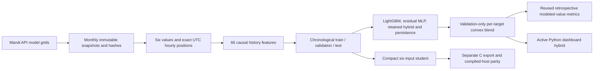
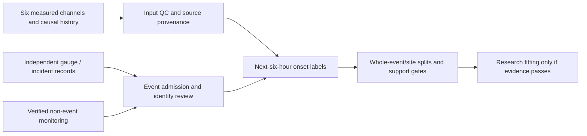

# Implemented INDRA India/Mandi architecture

Updated 21 October 2026. The primary contract has six physical channels:
temperature, relative humidity, station pressure, PM2.5, PM10 and wind. History
and derived values come from these channels; they are not extra sensors.

## Numerical forecast: implemented, trained and retrospectively tested

Two additional implemented paths are [six geographic parameter surfaces and
ten current sensor-pattern categories](PARAMETER_MAPS_AND_WEATHER_CATEGORIES.md).
The spatial path uses synchronized same-source points → local metre projection →
IDW → hull/line support masks → six unit-labelled layers. The classification
path uses complete native history → 13 six-channel features → saved LightGBM/MLP
blend → ten overlapping synthetic-pattern scores with domain abstention.
They are separate from future numerical forecasting and empirical hazard training.

| Layer | Actual implementation |
| --- | --- |
| Acquisition and country/evidence controls | `ml/india_mandi/data.py` |
| Canonical feature/target construction | `ml/six_sensor_forecast/features.py` |
| Residual tree teacher/student fitting | `ml/six_sensor_forecast/train.py` |
| Linear temporal fitting and India-only evaluation | `ml/india_mandi/benchmark.py` |
| Active gateway ensemble | `ml/india_mandi/tabular_v2.py`, `ml/india_mandi/registry.py` |
| Public runnable entry point | `scripts/train_mandi_v2.py` |
| Delayed-label shadow learner | `ml/india_mandi/online.py`, `scripts/online_mandi_worker.py` |
| Six-output compact C export | `ml/six_sensor_forecast/export.py` |
| Active configuration; frozen historical export catalog | `configs/mandi_pipeline_v2.json`; `configs/model_catalog.json` |

The history teacher uses 66 features: per channel, current value, 1/3/6/12/24-hour
lags, one-hour delta, and trailing 6/24-hour mean/std. The compact student uses
only the current six values, with 16 depth-3 trees per output. The temporal
linear model uses the same 66-feature cohort, training-only standardization and
validation-selected regularization. No learned station ID, coordinates or future
reading enters these numeric models.

Tree prediction is `physical_clip(current + validation_weight * residual)`.
Linear prediction is `physical_clip(current + intercept + standardized_features
dot coefficients)`. Six separate heads preserve the output units. Each target's
best offline method is selected on validation; final errors never retune it.

This profile uses temporal-only splits with six-hour label purges, not fabricated
held-out stations. Historical teacher/linear inputs require a complete 24-hour
span. The compact student accepts one current snapshot. File hashes, feature
orders and source/config provenance are retained beside the weights.

**Active gateway:** `india_mandi_tabular_v2` combines six LightGBM residual heads,
a 66→64→32→6 residual MLP, the retained v1 hybrid and persistence. Per-target
nonnegative prediction coefficients sum to one and minimize validation MAE.
Train-only scalers and all component files are checksummed. It was fitted on
33,570 eligible rows from the expanded 35,520-position Mandi source. Its mixed
test results and optional TabPFN diagnostic are in the
[v2 report](../reports/mandi_pipeline_v2/REPORT.md).

The persistent SGD residual learner saves forecasts before exact +6h truth
updates, with fixed scaling and source-isolated transactional state. It is
shadow-only; historical late inputs cannot create live learning scores. See
[operation and replay boundaries](MANDI_V2_PIPELINE.md).

**Retained v1 gateway component:** `india_mandi_hybrid_6h_v1` combines predictions from the saved
66→32→6 and 66→64→32→6 residual neural candidates, history XGBoost and ridge.
Validation selects a neural architecture and three convex coefficients per target.
No original model weights are rewritten. Complete history is required; otherwise
the API/UI explicitly reports persistence warm-up or unavailable current inputs.
The compact student remains the separate edge export. See
[hybrid report](../reports/india_mandi_hybrid_6h_v1/REPORT.md).

The separate synthetic PM gap-fill dataset is excluded from these fits and
reported holdouts; see [its provenance](../reports/mandi_synthetic_pm_v1/README.md).

**Evidence boundary:** India-only describes where INDRA's fit/evaluation records
come from and excludes Beijing records/pretrained weights. ECMWF/CAMS are global
model providers, not an IMD station archive. The Mandi profile contains modeled
weather/PM on different grids and modeled surface pressure. It does not validate
the transfer to actual sensors or historical information availability.

## Himalayan event warning: implemented labels/gates, no fitted real model

Actual modules are `ml/hazard_context/events.py`, `matching.py`, `warning.py`,
`policy.py`, `train.py`, `episodes.py` and `diagnostics.py`. The explicit protocol
is `configs/himalayan_warning_v2.json`. It supports cloudburst, storm, flash flood,
landslide and snowstorm. Rainfall/event records provide offline outcomes; they
do not silently become a seventh runtime input.

An onset and its entire timing-uncertainty interval must fall in `(issue, issue+H]`
for a positive. A negative needs complete compatible monitoring and no plausible
event/candidate overlap. Unknowns and post-onset windows remain unavailable.
Full six-channel history is mandatory. Current sources yield no admitted real
training corpus, so no hazard probabilities or field warning lead times exist.

## Embedded integration boundary

`ml/generated/india_mandi_modeled_6h_v1/` contains the new compact India/Mandi
C header and executed host-parity receipt. It is a research numeric forecast.
Physical ESP32 execution, timing, memory and sensor-distribution accuracy remain
untested. Existing firmware has not been silently switched to these weights.

`esp32/ml_integration` is the legacy serial forecast/rule integration.
`esp32/india_sensor` is the earlier India measurement-threshold smoke firmware.
`esp32/operational_node` prepares actual sensor readout with physical mode off
until wiring/calibration/UTC are supplied. These distinct applications must be
named separately in a submission. A compile or host-parity pass is not a field
test or an independent disaster-warning result.
