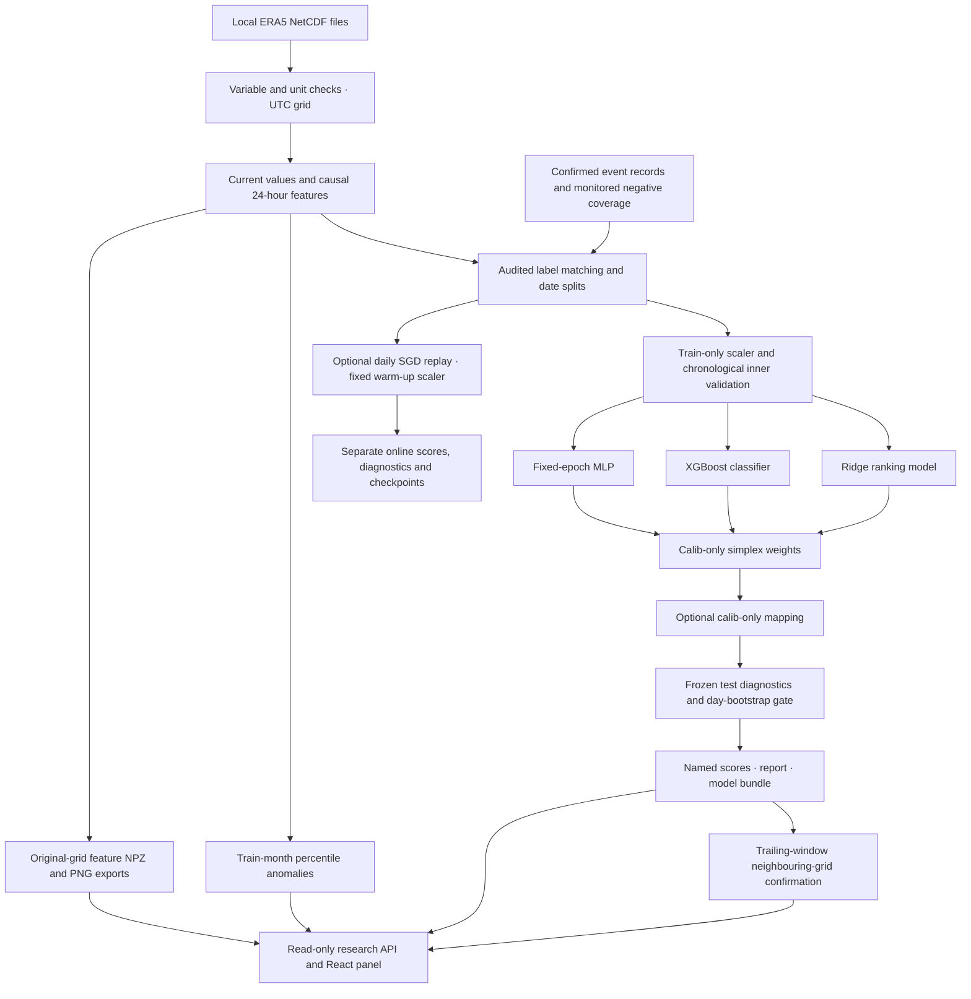

# ERA5 context ensemble architecture

The current model input has 588 ordered features from 17 weather variables and
four derived values. The MLP defaults to 588 inputs → 64 ReLU units → one binary
ranking output. The ridge and boosted heads use the same feature order. Their
bounded outputs are combined with nonnegative coefficients summing to one;
coefficients are fitted on `calib`, never on `test`.

Anomalies and neighbouring-grid confirmation are separate outputs. Neither is
added to an event score. Grid agreement is not the physical-node authenticated
consensus implemented in the separate Himachal network phase.

The optional online learner predicts and saves each day before updating on
mature known labels. Its scaler and initial class weights are fixed; test-period
updates are disabled. It does not modify the three batch heads or their gate.

This architecture runs on the host/gateway. The six-channel ESP model, serial
transport and live sensor dashboard remain a distinct system. Real ERA5/event
data and independent held-out evidence are required before empirical promotion.
